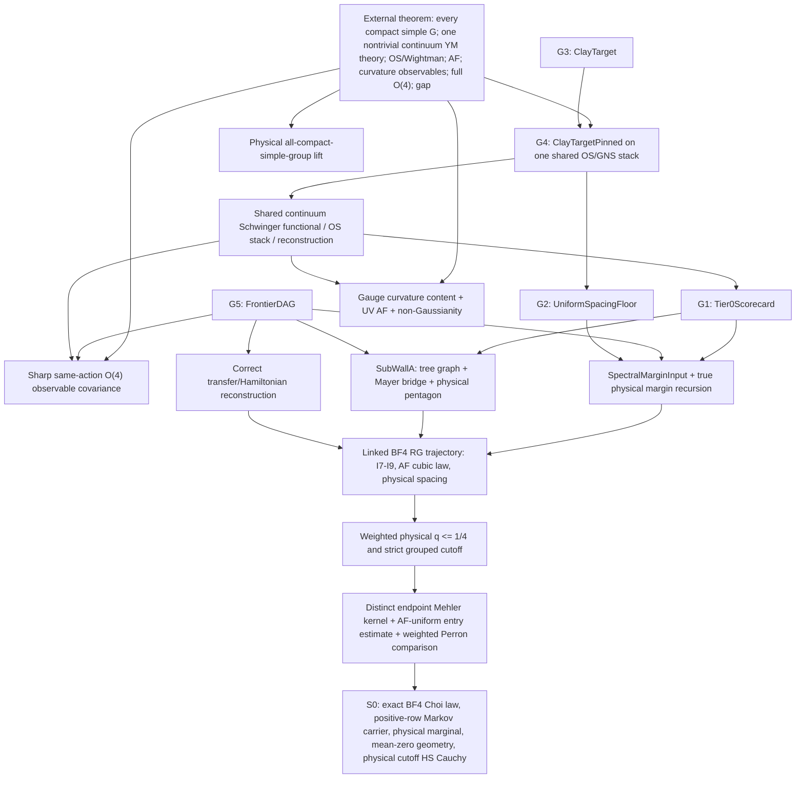

# Five-gate backward roadmap from the physical BF4 carrier

Date: 2026-07-28

## 1. Completion state

The program is complete only after the same nonperturbative Yang--Mills
trajectory supplies all five guarded Lean gates

1. `YMGap.Continuum.Tier0Scorecard.Tier0Scorecard`;
2. `YMGap.Continuum.UnifiedContinuumFloor.UniformSpacingFloor`;
3. `YMGap.Rubric.ClayScorecard.ClayTarget`;
4. `YMGap.Rubric.ClayTargetPinned.ClayTargetPinned`;
5. `YMGap.Rubric.FrontierDAG.FrontierDAG`;

and the resulting shared continuum object is upgraded to the actual external
target: for every compact simple gauge group, a nontrivial four-dimensional
continuum Yang--Mills theory with gauge-invariant curvature observables, full
same-action Euclidean covariance, ultraviolet asymptotic freedom, OS/Wightman
reconstruction, and a positive Hamiltonian spectral gap.

The five guarded types are indispensable internal accounting gates, but they
are not by themselves a sufficient external theorem:

- `ClayTarget.o4Restoration` and the corresponding field of
  `ClayTargetPinned.limitData` are legacy scalar anisotropy slots, weaker than
  observable-level same-action \(O(4)\) covariance.
- `FunctionalContinuumTarget` is likewise a useful measure-free legacy
  package whose Euclidean slot is too weak.
- `ContinuumYMWithGap` states the sharp shared-object existence-and-gap
  package, but is presently only consumed as a hypothesis.

Thus the terminal state is

\[
  \text{five guarded gates}
  \;+\;\text{sharp same-action }O(4)
  \;+\;\text{gauge/AF/nontriviality pins}
  \;+\;\text{all compact simple groups}.
\]

This roadmap works backward from that state.

## 2. Current state \(S_0\)

The current physical BF4 milestone is the fixed-plane, all-label, central
\(\mathrm{SU}(2)\) carrier in:

- `BF4SU2FixedIntertwinerPhysicalChoi.lean`;
- `BF4SU2FixedMagneticMehlerCarrier.lean`;
- `BF4SU2FixedMagneticPositiveKernelConvergence.lean`;
- `BF4SU2FixedMagneticPhysicalHSCauchy.lean`;
- `BF4SU2FixedMagneticPhysicalMarkov.lean`.

It constructs and proves:

1. the exact grouped physical source/target half-amplitudes and their Choi
   contraction;
2. the enlarged magnetic retained carrier and the exact spatial insertion
   window;
3. an executable all-label cutoff modulus;
4. cutoff Cauchy convergence of the normalized physical joint kernels on an
   old square carrier, with the entry tolerance \(\varepsilon/N\) paying all
   \(N^2\) entries;
5. the exact positive-row conditional Markov kernel;
6. its stationary physical Choi marginal \(\pi\), preservation of constants,
   the physical \(\pi\)-mean-zero subspace, detailed balance, and weighted
   self-adjointness.

The milestone does **not** yet construct:

- a distinct Gaussian endpoint/Mehler kernel on this carrier;
- an AF-uniform physical-minus-Mehler estimate;
- the physical non-vacuum Perron bound \(q\leq 1/4\);
- the resulting strict grouped cutoff inequality
  \[
    C_{s(a)}^2 q_{s(a)}^{m(a,L)-2}<1;
  \]
- a linked physical BF4 block trajectory;
- a spacing-uniform continuum theory.

That is the exact starting node \(S_0\).

The first interface edge out of \(S_0\) is now complete.
`BF4WeightedJointPerronPerturbation` proves, constructively and on the exact
positive-row carrier, that symmetric joint laws satisfying
\[
  \sum_y|J(x,y)-M(x,y)|\leq\varepsilon\pi(x)
\]
obey
\[
  |\mathcal Q_J(f)-\mathcal Q_M(f)|
  \leq\varepsilon\sum_x\pi(x)f(x)^2.
\]
It also identifies the physical Markov quadratic exactly with the normalized
physical Choi joint quadratic.

The Peter--Weyl/AF interface has since been sharpened in three modules:

- `BF4CentralPositivePeterWeylEndpoint` constructs the exact rational-complex
  fundamental \(\mathrm{SU}(2)\) matrix coefficients, proves their Haar Schur
  table, and proves an explicit coefficient is negative.  It then states
  nonvacuous all-spin boundary-transform and double-Haar endpoint-projection
  targets on `centralPositiveHalfStates`.
- `BF4SymmetricReferenceOperatorComparison` records the mathematically
  natural output of that projection: a signed symmetric positive-semidefinite
  matrix with a physical-mean-zero Rayleigh bound.  Its direct weighted
  consumer needs neither entrywise positivity nor an endpoint marginal.
- `BF4AFUniformRowRelativeBudget` proves the complete division-free
  cross-numerator, numerator/partition, carrier-growth, marginal-floor, and
  AF-family bookkeeping needed to construct the row-relative comparison.

Thus M3 is complete in the stronger signed-operator form, and the finite
normalization part of M2 is complete.  M1 and the genuinely
Yang--Mills-specific estimates required to inhabit M2 remain open.

## 3. Dijkstra convention

The mathematical search graph is directed. A node is a package of named
certificates on one pinned physical object. An edge is either an already-proved
Lean map or a new theorem which constructs the target package.

The edge labels below are not time estimates. They order work by mathematical
novelty:

- **0 — transport:** an existing total Lean constructor, projection, or
  coarsening;
- **1 — interface:** new Lean wiring or a finite-dimensional lemma, with no new
  Yang--Mills estimate;
- **2 — local analysis:** a new finite-carrier or one-block estimate;
- **3 — uniform RG:** a spacing-, cutoff-, and volume-uniform theorem on the
  genuine Yang--Mills trajectory;
- **4 — continuum:** compactness/scaling, OS reconstruction, or full
  observable covariance.

The shortest path is lexicographic: first avoid unpinned or surrogate objects,
then minimize new continuum input, then new uniform RG input, then local
analysis and interface work. A formally shorter path through an abstract
matrix, Padé envelope, free field, or unrelated measure has infinite cost
because it cannot inhabit the shared physical gates.

### Formal occupancy versus physical occupancy

Several component types now have unconditional or reconstructed inhabitants,
even though older comments still call them open. This reduces formal assembly
cost, but not the same-object physical cost:

| Component | Existing Lean status | Remaining physical pin |
|---|---|---|
| `TreeGraphBound` | `UrsellPinComplete.treeGraphBoundHardCore` constructs the abstract hard-core bound | Identify the Ursell activity with the exact grouped BF4 Gibbs activity used by the RG trajectory |
| `BridgeDecomposition` | `MayerUrsellZ4PhysicalClose.bridgeDecomposition_z4_recon` and `LoopyPinnedPenroseUrsell.loopyBridgeDecomposition` construct stated-type witnesses | Show that the off-diagonal correlator is the same BF4 continuum precursor, not a separately reconstructed spectral model |
| `PentagonNumericCore` | `PentagonRelation.numericShapeWitness` and `SixJKernel.racahKernelCore` inhabit the minimal numeric specification | Construct the full signed/fractional physical associator and its nonlinear pentagon on the retained intertwiner spaces |
| `FiniteSMargin w` | `FusionUTuranFiniteS.finiteSMargin_of_trunc` works for \(0<w\leq1/2\) | Prove that the physical RG trajectory lands in this window and that this is its Core-B weight |
| `CouplingRunning` | Model flows such as `O4BetaSign.tauModelRunning` exist | Identify the running with the interacting BF4 coupling and derive the observable response |
| legacy O4 and continuum slots | Weak/model witnesses exist | Supply full same-action observable covariance and one shared continuum object |

Accordingly, “inhabit all five gates” in this roadmap means inhabit them from
the pinned BF4 trajectory. Merely assembling the weakest stated fields from
unrelated existing inhabitants is not a solution.

## 4. The backward graph



The arrows are read backward: to reach a node at the top, construct the nodes
below it. The diagram deliberately shows that the BF4 Mehler obstruction is a
high-leverage shared trunk, but not the whole Clay program.

## 5. Backward relaxation of the five gates

### Gate 4: `ClayTargetPinned`

The pinned target requires one shared object carrying:

- `OSAxiomBundle μ_inf`;
- `OSReconstruction μ_inf`;
- the Wilson/GNS data and the identity pins between them;
- one positive mass equal to the reconstruction gap;
- `ClayContinuumExistence`;
- continuum limit data, including reflection positivity;
- the coupling-uniform gap.

Its immediate predecessors are therefore:

| Predecessor | Required output | Cost |
|---|---|---:|
| R1 | A located scaling limit of the exact BF4 Schwinger functionals on a gauge-invariant local observable algebra | 4 |
| R2 | OS0--OS4 for that same limit, with full OS0 supplied separately rather than hidden in the weak legacy slot | 4 |
| R3 | GNS/OS reconstruction with the transfer semigroup and positive mass pinned to the same limit | 4 |
| R4 | A physical uniform floor/clustering theorem from the BF4 trajectory | 3 |
| R5 | Nontriviality and AF normalization on the same limit | 3--4 |

Once those objects exist, assembling the identity fields of
`ClayTargetPinned` is an interface edge of cost 1.

### Gate 3: `ClayTarget`

`ClayTargetPinned.toClayTarget` is already proved. Hence

\[
  \texttt{ClayTargetPinned}\longrightarrow\texttt{ClayTarget}
\]

has cost 0. No independent attack on the coarse target is useful. The coarse
target forgets the very shared-object pins needed for the external theorem.

### Gate 2: `UniformSpacingFloor`

The honest shortest predecessor is a `TrueMarginRecursionPhysical` whose
`margin k` is definitionally
\[
  m_{\mathrm{lat}}(a_k)/a_k
\]
and whose positive lower witness bounds every scale. The map
`uniformSpacingFloor_of_trueMarginPhysical` is already proved.

The older multiplicative `TrueMarginRecursion` also maps to a `QFloor`, and
`frontierTrueMargin_qFloor` is proved, but the physical path must additionally
identify its `physGap` with the actual BF4 gap. The shortest physical route is:

\[
\begin{aligned}
&\text{weighted BF4 contraction}\\
&\Rightarrow\text{one-step physical gap erosion}\\
&\Rightarrow\text{summable AF defect and additive erosion}\\
&\Rightarrow\texttt{TrueMarginRecursionPhysical}\\
&\Rightarrow\texttt{UniformSpacingFloor}.
\end{aligned}
\]

The last edge has cost 0; the one-step and summability theorem is cost 3.

### Gate 1: `Tier0Scorecard`

Its fixed-spacing field is already proved. The remaining predecessors are:

1. `SubWallA p w`:
   - the existing \(D2\) lattice separation data;
   - identification of the existing hard-core `TreeGraphBound` with the
     physical BF4 activities, or a direct physical construction;
   - identification of the existing reconstructed `BridgeDecomposition` with
     the BF4 correlator, or a direct physical construction;
   - the existing coarse Racah carrier;
   - a strengthening of the existing minimal numeric core to the genuine
     fractional-\(6j\) physical pentagon/associator;
2. `SpectralMarginInput b afr N₀`:
   - graded per-scale localization;
   - the tail identification;
   - the physical spacing and fixed-spacing family;
   - ceiling and anchor bounds;
   - the located-eigenvalue additive step `hadd`;
   - the shift-to-defect bridge `hbridge`.

The constructor edge from these two packages is cost 1. The analytic
predecessors are cost 2--3.

### Gate 5: `FrontierDAG`

`FrontierDAG` is a product ledger, not a magic route to the other gates. It
requires the following physical fields:

- per-mode `SpectralLocalizationCrux.SpectralLocalization`;
- \(D2\), tree-graph, Mayer, coarse Racah, and physical pentagon data;
- the finite-\(s\) Core-B margin;
- `PinnedBridgeProgress.EdgeShiftResidual`;
- the true-margin recursion;
- the transfer/Hamiltonian reconstruction field;
- the physical anisotropy running.

Two cautions are part of the plan:

1. `BulkCtrlToHlocalizeBridge` is genuinely open: the per-mode `bulkCtrl`
   certificate does not definitionally equal the per-scale `hlocalize`
   certificate.
2. Core B itself has the proved constructor
   `FusionUTuranFiniteS.finiteSMargin_of_trunc` on \(0<w\leq1/2\). The
   remaining physical edge is strong-coupling landing and identification of
   this \(w\) with the BF4 trajectory.
3. The historical `BoundedFunctionalCalculusResidual` must be supplied only
   in a mathematically valid finite/located setting. The mass-gap critical
   path itself should use the corrected bounded-transfer/form-gap results,
   not assert that the continuum unbounded Hamiltonian is a bounded
   \(-\log T\).

After all fields are produced on the same trajectory, assembly is cost 1.

## 6. The immediate shortest path: \(S_0\) to the BF4 quarter theorem

This is the current priority queue head because it feeds the spectral,
cluster, true-margin, and physical-RG branches.

### M1. Define the distinct weighted endpoint Mehler object — INTERFACE COMPLETE

Construct a cutoff-indexed Gaussian endpoint kernel by taking the quadratic
BF4 action on the **same retained boundary coordinates** as
`centralPositiveHalfStates`.

There is a real carrier mismatch to resolve before this definition is
available.  `centralPositiveHalfStates` consists of finite Peter--Weyl
`EdgeLabelling`s, whereas `BF4FiveHolonomyGaussian` and
`BF4CanonicalClassCoordinateCarrier` currently expose continuous/rational
five-holonomy coordinates without a source/target transform from those
labellings.  Therefore the next construction must do one of the following:

1. define the five-holonomy Gaussian endpoint semigroup and calculate its
   Peter--Weyl matrix coefficients on every retained `EdgeLabelling`; or
2. construct a finite cylinder transform from the retained labellings to the
   five class coordinates and prove that pulling the Gaussian joint law back
   through this transform preserves all retained observables.

The first route is implemented as a nonvacuous witness-bearing target in
`BF4CentralPositivePeterWeylEndpoint`.  The exact fundamental
matrix-coefficient calculation also proves that a Peter--Weyl coefficient
can be negative.  Consequently the projection naturally produces a signed
symmetric positive-semidefinite operator, not automatically an
entrywise-positive Markov joint law.  An arbitrary refresh matrix, identity
kernel, or renamed physical joint law does not resolve the mismatch.

Required data:

- an actual normalized five-holonomy Gaussian/Mehler kernel;
- the all-spin BF4 boundary spin-network wavefunctions and their exact
  fivefold Haar pairing;
- the genuine double-Haar projected matrix
  \(M_{K,a}(x,y)\) on the retained labels;
- symmetry, quadratic-form positivity, and a located Rayleigh bound on the
  physical marginal-mean-zero carrier.

The endpoint object must be distinct from the nonlinear physical matrix. A
renaming of the physical kernel, the identity matrix, or an arbitrary
normalized Gaussian matrix is not an endpoint construction.

Entrywise positivity, an endpoint marginal, and positive refined-channel
lumping are optional stronger data.  If they are available, they recover the
older Markov-joint interface.  They are not needed by the direct symmetric
operator comparison.

#### 2026-07-29 compact-Haar action-order milestone

The nonlinear finite-order analytic layer underneath this transform is now
proved constructively for the genuine physical \((K,S)\) action polynomial
\(A\), rather than for a surrogate Gaussian matrix:

- `BF4CompactActionSphereShift` proves the exact arbitrary-insertion identity
  \[
    H(PD)+H(PA)=\frac{133}{4}H(P),
    \qquad D=\frac{133}{4}-A,
  \]
  and identifies the denominator-cleared compiler coefficientwise with the
  original physical \((1/96,1/8)\) compiler used by the geometric Mehler
  series.
- `BF4CompactActionPhysicalCPOrder` gives an explicit 45-square LDL/SOS
  certificate for \(A\) and proves the two-sided polynomial-square Haar order
  \[
    0\leq H(P^2A),\qquad
    0\leq H(P^2D)
  \]
  for every supported rational polynomial \(P\).
- `BF4CompactActionMomentPositivity` and
  `BF4CompactActionShiftedExponential` extend this to every degree:
  \[
    0\leq H(P^2D^n),
  \]
  so all finite shifted-exponential quadratic partial sums are nonnegative
  and monotone.
- `BF4CompactActionShiftedLimit` proves the quantitative all-degree majorant
  \[
    \frac1{n!}H(P^2D^n)
      \leq \|P\|_1^2\frac{\|D\|_1^n}{n!},
  \]
  supplies an explicit factorial-tail modulus, and packages the monotone
  partials as a located, nonnegative `CReal`.
- `BF4CompactActionExponentialShift` proves an arbitrary-suffix Haar
  reassociation theorem, uses it to identify the parity-arranged positive
  carrier with the canonical \(P^2D^n\) carrier in both even and odd degree,
  and establishes coefficientwise
  \[
    [e^{-133/4}H(P^2e^D)]_n=[H(P^2e^{-A})]_n.
  \]
- `BF4CompactActionPhysicalLimit` proves the required constructive Mertens
  theorem.  It splits the same-cutoff product rectangle into the genuine
  negative-action Cauchy triangle and a corner, bounds that corner by
  \[
    \|P\|_1^2\,
    \operatorname{cornerAbsAdd}
      (133/4,\|D\|_1,n),
  \]
    and proves that the lifted Taylor partials \(H(P^2e^{-A})\) converge to the
    located product
    \[
      e^{-133/4}H(P^2e^D).
    \]

#### 2026-07-29 reflected all-spin Peter--Weyl bridge milestone

`BF4ReflectedAllSpinPeterWeylBridge` now closes the source/target
polarization obstruction without identifying the two boundary halves:

- the source and reflected target are the geometric BF4 spin-network
  wavefunctions obtained from the 24 plaquette characters after exact
  integration of the 18 non-transmitted chords;
- both wavefunctions, their sum, and their difference are proved to be
  supported on the ten quaternion blocks required by the compact Haar layer;
- the exact rational polarization identity
  \[
    H(PQK)=\frac14\bigl(H((P+Q)^2K)-H((P-Q)^2K)\bigr)
  \]
  converts every finite negative-action Taylor coefficient into the genuine
  reflected geometric double-Haar coefficient;
- polarization of the two located diagonal limits gives a constructive
  `CReal` source/target coefficient, and
  `reflectedPhysicalCoefficient_equiv_geometric` identifies it with the
  all-spin geometric Mehler Haar coefficient.

`BF4ReflectedAllSpinAFRowRelative` then pins the M2 normalization theorem to
this numerator and to the exact matched BF4 trajectory:
`blockedWeight family (coupling scale)`,
`matchedPhysicalSpacingBits`, and the same `CubicMarginLaw` /
`PhysicalSpacingEnvelope` used by `physicalAFEnvelope`.
`MatchedReflectedAllSpinAFRowCertificate.row_relative_estimate` proves the
AF-uniform row-relative conclusion from one common rational tolerance.
Unlike the earlier generic interface, its endpoint numerator is
definitionally `geometricMehlerTaylorPartial` and its partition is
definitionally the corresponding vacuum--vacuum coefficient; an unrelated
matrix or normalizer cannot inhabit it.

This closes the finite polynomial CP-order, factorial-tail, carrier
identification, limit-level scalar shift, and reflected source/target
Peter--Weyl identification.

There is now also a nontrivial positive finite endpoint.
`BF4ReflectedAllSpinMehlerGramEndpoint` proves that the genuine reflected BF4
action has the exact one-sided Feynman--Kac plus cross-Mehler factorization
under every ten-Haar insertion.  The one-sided shifted complement is an
explicit five-Haar SOS with nonnegative moments; the cross exponential has
fifteen nonnegative three-colour LDL features.  Finite ordered feature words
therefore give a literal all-spin Gram matrix with strict vacuum partition,
symmetry, and normalized PSD.  `BF4ReflectedAllSpinMehlerGramAFRow` connects
this endpoint to the matched AF budget.  Its physical-mean-zero Rayleigh rate
and AF-uniform physical comparison remain open.

`BF4ReflectedAllSpinTaylorRankOneEndpoint` now also closes the finite spectral
part of M2 at Taylor order one.  It proves exact product-Haar factorization
\[
  M_1(\lambda,\mu)=A_0(\lambda)A_0(\mu)
\]
and the exact vacuum partition \(Z_1=1\), hence symmetry and PSD.  Because
`centralPositiveHalfStates` is a constructively nonempty finite list whose
members have strictly positive physical row marginal, the module takes its
located rational minimum \(\pi_{\min}>0\).  Finite Cauchy--Schwarz then gives
the explicit physical Rayleigh rate
\[
  r_1=\frac{\sum_\lambda |A_0(\lambda)|^2}{\pi_{\min}}.
\]
The direct constructor
`matchedReflectedAllSpinAFRowCertificateOfCanonicalRankOne` fills the
original, unchanged certificate with these objects.

M2 is nevertheless not closed.  The remaining analytic input is the common
spacing-uniform `CentralPhysicalNumeratorPartitionBudget`: numerator and
partition errors, endpoint ceiling, carrier payment, and physical marginal
payment on the exact matched trajectory.  Moreover \(r_1\) is only a coarse
finite bound; the separate quarter condition \(r_1+\varepsilon\le1/4\) has
not been proved.  The finite positive endpoint part of M1 is constructed,
but its convergent physical identification and AF-uniform comparison, along
with the concrete `CubicMarginLaw` / `PhysicalSpacingEnvelope` trajectory,
remain open.

### M2. Prove the AF-uniform row-relative estimate

For every physical tolerance \(\varepsilon>0\), retained base cutoff \(K_0\),
and AF-window spacing \(a\), construct a cutoff \(K\geq K_0\) such that every
retained source row satisfies
\[
  \sum_y
  \left|J^{\mathrm{phys}}_{K,a}(x,y)-M_{K,a}(x,y)\right|
  \leq\varepsilon\,\pi^{\mathrm{phys}}_{K,a}(x).
\]

Here \(M\) may be signed.  `BF4AFUniformRowRelativeBudget` proves that it is
enough to bound the division-free cross numerator
\[
 N_{\mathrm{phys}}(x,y)Z_M-N_M(x,y)Z_{\mathrm{phys}}
\]
and pay the resulting source-dependent entry budget against
\(\varepsilon\pi^{\mathrm{phys}}(x)\) after multiplying by the full retained
carrier size.  It also derives this cross estimate from separate numerator
and partition errors plus an absolute endpoint-numerator ceiling.

This is strictly stronger in the relevant direction than an unweighted
`\(\varepsilon/N\)` matrix estimate.  A plain bound
\[
  |J^{\mathrm{phys}}(x,y)-J^M(x,y)|\leq\varepsilon/N
\]
controls ordinary Hilbert--Schmidt norm but gives no spacing-uniform
\(\ell^2(\pi)\) estimate when small physical marginals are allowed.
An entrywise proof may still feed the row-relative theorem, but it must have
one of the weighted forms
\[
 |J^{\mathrm{phys}}(x,y)-J^M(x,y)|
   \leq \frac{\varepsilon\,\pi^{\mathrm{phys}}(x)}{N}
\]
or combine an absolute entry estimate with an explicit AF-uniform positive
lower bound for every retained marginal.

If the optional Markov-joint interpretation is needed independently, prove
\[
  \left|P^{\mathrm{phys}}_{K,a}(x,y)-M_{K,a}(x,y)\right|
  \leq \frac{\varepsilon}{N_{K_0}}
\]
or derive it from the joint-law estimate plus quantitative positive lower
bounds on the retained row marginals. The latter bounds must be uniform on
the AF window used by the RG step.

The proof must expose:

- a numerator tail;
- a partition-function tail;
- a retained-row marginal lower bound;
- a carrier-growth bound;
- the AF spacing/coupling window on which all four estimates are uniform.

The existing degree-thirteen all-label cutoff modulus and physical cutoff
Cauchy theorem supply the nonlinear-tail half. The new analytic content is
to inhabit the displayed budgets uniformly along the genuine AF trajectory.

### M3. Prove the correct weighted perturbation lemma — COMPLETE

The existing \(\varepsilon/N\) compensation proves an unweighted matrix HS
bound:
\[
 N^2(\varepsilon/N)^2\leq\varepsilon^2.
\]

The physical Perron geometry, however, is the rational weighted space
\(\ell^2(\pi)\), not the uniformly mean-zero space used by the older
`NormalizedSameCarrierMehlerHSConvergence`. Therefore one of the following
must be constructed:

1. **weighted HS route:** a finite rational theorem bounding the operator
   perturbation in the physical weighted inner product, with every inverse
   marginal factor controlled; or
2. **joint-law route:** a generalized Rayleigh theorem for the symmetric pair
   \((J,\operatorname{diag}\pi)\), so the comparison stays on joint kernels
   and never introduces rational square roots; or
3. **constructive conjugation route:** a `CReal` square-root conjugation to a
   symmetric matrix, together with a located finite spectral theorem and
   transport back to the rational physical carrier.

Route 2 is implemented in
`lean/YMGap/Continuum/BF4WeightedJointPerronPerturbation.lean` and extended
to signed Peter--Weyl reference operators in
`lean/YMGap/Continuum/BF4SymmetricReferenceOperatorComparison.lean`.
The theorem
`finiteJointQuadratic_abs_sub_le_weightedSquare` proves the sharp
row-relative estimate using finite `Q'` sums and
\(2|f(x)f(y)|\leq f(x)^2+f(y)^2\).
`centralPhysicalWeightedMarkovQuadratic_eq_joint` identifies the exact
physical Markov quadratic with the normalized Choi joint law.
The `physical_markov_quadratic_abs_le_quarter` theorem in
`CentralPhysicalSymmetricReferenceComparison` is the primary completed consumer:
an endpoint rate plus row-relative error at most \(1/4\) yields the physical
quarter bound.  The older `CentralPhysicalMehlerComparison` is recovered
only when a separate entrywise-positive joint-law certificate exists.  The
axiom audit contains only `propext` and `Quot.sound`.

### M4. Identify the physical non-vacuum Perron quantity

Define \(q_{K,a}^{\mathrm{phys}}\) as the least located Rayleigh bound of the
physical Markov operator on the \(\pi\)-mean-zero carrier. Prove:

- nonnegativity;
- control by every absolute weighted Rayleigh bound;
- equality with the largest non-vacuum eigenvalue/modulus in the finite
  located spectrum;
- compatibility under the old-carrier cutoff embeddings.

This discharges the role of
`MatchedPhysicalPerronIdentification` for the genuine weighted carrier rather
than the older rectangular or uniform-vacuum carrier.

### M5. Derive \(q\leq1/4\)

Prove the Gaussian endpoint quadratic estimate with enough buffer, then combine
it with M2--M4. The target theorem has the shape

```lean
theorem centralPhysical_perronRatio_le_quarter
    (a : AFSpacing) (K : Nat) (hK : cutoffSchedule a ≤ K) :
    centralPhysicalPerronRatio a K ≤ oneQuarter
```

with every matrix and marginal definitionally tied to the physical BF4 Choi
law.

### M6. Discharge the quoted cutoff inequality

Feed the physical quarter theorem into the existing all-label cutoff geometry.
Choose the grouped physical depth \(m(a,L)\) so that
\[
  192\,\mathrm{bits}(a)+1\leq m(a,L)-2.
\]
Then the already-proved cutoff arithmetic yields
\[
  C_{s(a)}^2q_{s(a)}^{m(a,L)-2}<1.
\]

This is the first major milestone in the forward execution order.

## 7. From the quarter theorem to the spectral and true-margin gates

The quarter theorem is useful only after it is transported through the exact
block map.

### M7. Construct the linked physical BF4 trajectory

Build an inhabitant of `LinkedBondMovingTrajectory` for the grouped BF4
operator, with:

- exact fine-to-coarse pushforward;
- next-step identification;
- carrier landing/reproduction;
- the physical heat coordinate;
- the physical spacing coordinate;
- volume and cutoff moduli.

On this same trajectory prove the physical `CubicMarginLaw` and
`PhysicalSpacingEnvelope`, and instantiate `physicalAFEnvelope`. Only at this
point does `BareAFImpliesLinearFloor` become a theorem about the physical BF4
trajectory rather than the already-identified Padé scalar diagnostic.

### M8. Convert projective contraction to an eigenvalue-shift bound

For each scale prove:

- the physical located first-excited eigenvalue;
- a perturbation/shift budget produced by the grouped block step;
- `bulk_shift ≤ 1/12` for the per-mode
  `SpectralLocalizationCrux.SpectralLocalization`;
- the edge identity and linear control needed by
  `PinnedBridgeProgress.EdgeShiftResidual`.

Then construct the named per-mode-to-per-scale bridge
`BulkCtrlToHlocalizeBridge` on this trajectory. This is the exact point at
which the BF4 contraction enters `SpectralMarginInput.sl.hlocalize`.

### M9. Prove the additive physical margin recursion

Identify
\[
  g_k=\frac{m_{\mathrm{lat}}(a_k)}{a_k}
\]
with the located physical transfer gap and prove:

- `hadd`: the next gap is no smaller than the current gap minus the located
  shift;
- `hbridge`: the shift is bounded by the summable AF defect times the current
  gap;
- the additive erosion term \(\varepsilon_k\);
- a tail modulus for \(\delta_k+\varepsilon_k\);
- anchor dominance and a strictly positive common lower witness.

Outputs:

- `AsymptoticSpectralLoc.SpectralMarginInput`;
- `UniformCouplingFromAF.TrueMarginRecursion`;
- the sharper `TrueMarginRecursionPhysical`;
- `UniformSpacingFloor` by an existing cost-0 map;
- the Sub-wall-B input of `Tier0Scorecard`;
- the `bulkCtrl`, `edgeShift`, and `trueMargin` fields of `FrontierDAG`.

## 8. Parallel branches that the Mehler theorem does not close

### Track A: loopy geometry and the physical associator

1. Construct the signed/fractional physical \(6j\) associator on the retained
   intertwiner carrier and prove the Biedenharn--Elliott pentagon, strengthening
   the already-inhabited minimal `PentagonNumericCore`.
2. Pin `treeGraphBoundHardCore` to the exact grouped BF4 Gibbs activities, or
   prove the corresponding direct all-positive-row tree-graph theorem if that
   identification fails.
3. Pin the existing reconstructed/loopy `BridgeDecomposition` to the exact BF4
   connected correlator, or prove the direct absolute Mayer--Ursell bridge
   theorem with the existing \(4D\) cluster count.
4. Package a physically pinned `SubWallA`, then forget the pins only at the
   guarded constructor boundary.

The existing \(D2\) separation, abstract hard-core tree bound, reconstructed
Mayer bridge, minimal numeric core, and coarse Racah data are inputs. The
remaining work is the exact physical identification and the full associator,
not re-proving their weaker statement shapes.

### Track B: graded stability and polymer control

Extend the unbranched BF4 contraction to branched/intersection sectors:

- an explicit graded remainder;
- a summable projective distortion;
- RG-I7 contraction;
- RG-I8 landing;
- RG-I9 reproduction.

This branch supplies the uniform cluster estimates needed by Track A and the
scaling modulus needed by the continuum branch.

### Track C: continuum functional and shared reconstruction

From the exact RG trajectory construct:

1. fixed-spacing infinite-volume functionals;
2. a spacing-uniform `ScalingLimitModulus`;
3. the continuum positive functional on gauge-invariant local curvature
   observables;
4. OS regularity, reflection positivity, symmetry, clustering, and locality;
5. the GNS/OS reconstruction and transfer semigroup;
6. the spectral exclusion supplied by the same physical uniform floor;
7. non-Gaussianity and the AF short-distance normalization.

This must produce both a functional target and, if desired, the optional
sigma-additive measure realization. The functional route does not remove the
need for full same-action Euclidean covariance.

### Track D: sharp same-action \(O(4)\)

Construct the physical \(O(4)\) action on the same observable algebra and prove
a `DecayControlledSymmetryResponse` uniformly along the BF4 trajectory. Combine
it with the vanishing anisotropy coefficient to obtain exact continuum
observable invariance. Quantification over the full group action, compatibility
with products/localization, and identity with the action used in OS
reconstruction must be explicit.

The existing scalar `CouplingRunning` and selected-map response theorems are
precursors, not the finished OS0 theorem.

### Track E: all compact simple groups

Generalize the BF4 carrier, heat kernel, intertwiners, endpoint Gaussian, and
tail estimates to a compact-simple-group interface. Then prove on the physical
kernel that the relevant constants are bounded by the \(\mathrm{SU}(2)\)
worst case, or supply a separate per-group construction.

A scalar Casimir comparison without a map between the actual retained
carriers is insufficient.

## 9. Gate assembly table

| Gate | Final missing inputs | Existing final edge |
|---|---|---|
| `UniformSpacingFloor` | Physical additive true-margin recursion and lower witness | `uniformSpacingFloor_of_trueMarginPhysical` |
| `Tier0Scorecard` | `SubWallA` + `SpectralMarginInput` | Structure assembly; fixed spacing already proved |
| `FrontierDAG` | Spectral fields, SubWallA fields, Core B, edge shift, true margin, valid transfer reconstruction, physical O4 running | Structure assembly |
| `ClayTargetPinned` | One shared continuum OS/GNS stack, pins, positive gap, continuum limit, uniform coupling | Structure assembly |
| `ClayTarget` | `ClayTargetPinned` | `ClayTargetPinned.toClayTarget` |

The efficient order is not the numeric gate order. It is:

1. close the weighted BF4 Mehler/Perron milestone;
2. construct the linked physical RG trajectory;
3. derive the spectral/true-margin packages;
4. close loopy geometry and graded stability;
5. construct the continuum shared stack and sharp \(O(4)\);
6. assemble `UniformSpacingFloor`, `Tier0Scorecard`, `FrontierDAG`, and
   `ClayTargetPinned`;
7. obtain `ClayTarget` by the proved coarsening;
8. apply the all-groups lift and state the sharp external theorem.

## 10. Priority queue

The next executable theorem queue is:

| Priority | Theorem-sized deliverable | Why it is next |
|---:|---|---|
| 0 | Actual normalized five-holonomy Mehler kernel plus all-spin BF4 boundary wavefunctions inhabiting `CentralPositiveBoundaryPeterWeylTransform` and `CentralPositiveGaussianEndpointProjection` | The exact transform target and fundamental Schur calculation now exist; these are its missing analytic witnesses |
| 1 | Endpoint quadratic-form positivity and physical-mean-zero spectral certificate | This turns the genuine projected matrix into `CentralSymmetricReferenceOperator` without a false entrywise-positivity assumption |
| 2 | AF-uniform cross-numerator or numerator/partition/marginal-floor budget | The finite normalization theorem is proved; the remaining work is the Yang--Mills estimate inhabiting it |
| 3 | Endpoint mean-zero rate plus physical `q ≤ 1/4` and `C_s² q^(m-2) < 1` | Closes the present BF4 obstruction |
| 4 | Linked BF4 trajectory + physical cubic AF law + spacing envelope | Makes the already-proved AF floor theorem genuinely physical |
| 5 | Per-mode shift, per-scale bridge, `SpectralMarginInput`, and physical true-margin recursion | Opens the direct paths to the floor, Tier-0 Sub-wall B, and FrontierDAG |
| 6 | Physical pentagon, tree graph, Mayer bridge, graded RG stability | Closes Tier-0 Sub-wall A and the cluster half of the continuum limit |
| 7 | Scaling functional, sharp O4, OS/GNS reconstruction, and pins | Produces the shared continuum object |
| 8 | Compact-simple-group physical lift | Converts the SU(2) pilot into the Jaffe--Witten quantifier |
| 9 | Five-gate and sharp-capstone assembly | Final zero/one-cost constructor phase |

## 11. Definition of the next major milestone

The next major milestone is reached when Lean contains, with no new axiom,
`sorry`, classical choice shortcut, or surrogate matrix:

1. a distinct endpoint Mehler kernel and its genuine double-Haar
   Peter--Weyl projection on the exact fixed magnetic BF4 carrier;
2. the AF-window row-relative estimate with explicit cutoff, carrier, and
   marginal compensation;
3. an inhabitant of the signed symmetric weighted physical comparison
   interface;
4. `centralPhysical_perronRatio_le_quarter`;
5. the physical specialization of
   \(C_{s(a)}^2q_{s(a)}^{m(a,L)-2}<1\).

At that point the queue advances to the linked physical trajectory and
spacing-uniform gap recursion. The five guarded gates will still not yet be
inhabited, but the present local analytic obstruction will have been removed
on the correct carrier, and every downstream use will have an explicit pinned
edge.

## 12. Failure conditions

The route must be revised, not cosmetically patched, if any of the following is
proved:

- the projected endpoint fails quadratic-form positivity on the enlarged
  carrier;
- the signed endpoint matrix cannot be compared row-relatively to the
  physical matrix against the physical marginal;
- the required entry error cannot dominate carrier growth on the AF window;
- the weighted non-vacuum Rayleigh quotient is not controlled by the proposed
  HS metric;
- the grouped exponent gives only a fixed-cutoff contraction, not a
  fixed-physical-distance rate;
- the physical block output does not land back in the retained carrier;
- the SU(2) constants are not worst-case for the physical all-group kernels;
- the continuum limit loses nontriviality, reflection positivity, locality,
  or the shared-object pins.

These are mathematical forks in the Dijkstra graph. They are not reasons to
replace the physical object by a formally convenient surrogate.
