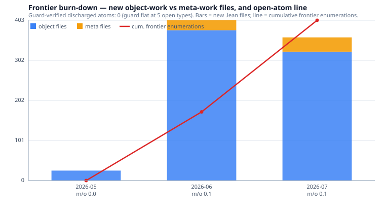

# Frontier burn-down

> **Auto-generated** by `scripts/frontier_burndown.py` on 2026-07-08.
> Reads `lean/YMGapGuard.lean` + `lean/YMGap/Rubric/FrontierDAG*.lean` for the
> current atom set and `git log` for the per-month history. Edits no Lean
> source, proves nothing. The Clay Yang–Mills mass-gap problem remains **OPEN**.

This is the discipline metric behind the anti-loop rule: it separates
**genuine reduction** (an atom discharged, or split into a strictly-sharper
sub-atom) from **enumeration churn** (new scorecards, bridges-between-
scorecards, ledgers, coarsenings — bookkeeping that never discharges an atom).

## Headline — the un-gameable number

- **Guard-verified discharged frontier atoms: 0.** The Lean frontier guard
  (`lean/YMGapGuard.lean`) protects **5** Clay-frontier
  types; its `frontierAllowlist` holds **0** inhabitants, so
  **5** remain unconditionally uninhabited. That count has never
  dropped: **D = 0** — no frontier type has ever been genuinely closed.
- **Current open `FrontierDAG` atoms: 10** (+ 1 inhabited DATA slot(s), + 2 named-open bridge(s)).

Guarded frontier types (all OPEN):

- `YMGap.Continuum.Tier0Scorecard.Tier0Scorecard`
- `YMGap.Continuum.UnifiedContinuumFloor.UniformSpacingFloor`
- `YMGap.Rubric.ClayScorecard.ClayTarget`
- `YMGap.Rubric.ClayTargetPinned.ClayTargetPinned`
- `YMGap.Rubric.FrontierDAG.FrontierDAG`

Open `FrontierDAG` atoms (deliberately uninhabited residuals):

- `bulkCtrl` — The bond-moved spectral-localization certificate (open `bulk_shift`).
- `tTree` — (T′) the per-cluster Penrose / Poghosyan–Ueltschi spanning-tree inequality over the (D2) lattice `d2Sep.val`.
- `d1Mayer` — (D1) the absolute Mayer–Ursell connecting-cluster expansion over the CLOSED 4D count `z4ClusterCountBound p`.
- `a2Racah` — (A2, Level-1) the coarse doubly-stochastic Racah 6j² surrogate, carried only to discharge the coarse `Tier0FrontierC` a2 slot;
- `a2Pentagon` — (A2, Level-2) the genuine fractional-6j associator numeric core `PentagonRelation.PentagonNumericCore` (physical associator OPEN).
- `coreB` — (Core B) the finite-`s` central-autoconvolution theta-floor margin.
- `edgeShift` — The pinned edge-shift residual (`hId`/`hLin`;
- `trueMargin` — The genuine dimensionless physical margin recursion `Δ_k = m_lat(a_k)/a_k`.
- `boundedH` — Residual B — the bounded self-adjoint additive Hamiltonian with `e^{−H}=T`.
- `o4` — The physical `O(4)` isotropization running (`betaDrop`-sign / anisotropy).
- `CoreBBridge` — named-open bridge residual
- `BulkCtrlToHlocalizeBridge` — named-open bridge residual

## Per-month burn-down

Columns: **opened** = new frontier-named enumeration files (scorecards/DAGs);
**reduced** = commits tagged REDUCED/REFUTED; **closed\*** = commits tagged
CLOSED/DISCHARGED (**CLAIMED** sub-atom moves — the guard shows 0 real frontier
discharges); **proved\*** = PROVED-tagged. **obj/meta** = commits classified
object vs meta. **new .lean (o/m)** = new object/meta files. **m:o** = meta:object
commit ratio.

| month | commits | obj | meta | m:o | opened | reduced | closed\* | proved\* | new .lean (o/m) | D/F/C |
|---|---|---|---|---|---|---|---|---|---|---|
| 2026-05 | 92 | 22 | 70 | 3.18 | 0 | 0 | 0 | 0 | 25/0 | ·/·/· |
| 2026-06 | 488 | 306 | 182 | 0.59 | 6 | 28 | 37 | 48 | 378/25 | ·/·/1 |
| 2026-07 | 246 | 151 | 95 | 0.63 | 8 | 50 | 53 | 79 | 324/36 | ·/1/19 |
| **TOTAL** | 826 | 479 | 347 | 0.72 | 14 | 78 | 90 | 127 | 727/61 | — |

*(Bars: new object (blue) vs meta (amber) `.lean` files per month; red line:
cumulative frontier-enumeration structures — the scorecard proliferation.)*

## Meta:object trend

The meta:object **commit** ratio per month (higher = more bookkeeping):

- `2026-05`  m:o = 3.18  ████████████████████████████████████████
- `2026-06`  m:o = 0.59  ████████████
- `2026-07`  m:o = 0.63  █████████████

## Honest verdict

**The frontier is NOT burning down: the open-atom count is flat-to-up and the guard-verified discharge count is exactly 0 — but the dominant failure mode is reduction-to-a-fixed-point, not scorecard proliferation.**

- **D = 0 across every month.** No Clay-frontier type has ever acquired an unconditional inhabitant; the guard has stood at 5 uninhabited types since it was introduced. Every "CLOSED"/"DISCHARGED" in a commit subject (90 of them) is a *sub-atom claim*, not a frontier discharge — the guard is the arbiter and it never moved.
- **Atoms opened ≥ atoms closed.** 14 new frontier-named enumeration files (scorecards / DAGs / frontiers / ledgers) were spawned; the net open-atom line rises, it does not fall. The unified `FrontierDAG` node currently carries 10 open atoms and nothing has been removed by *discharge* (only by *architectural deletion*, e.g. the Minlos node).
- **Reduction is real but converges to a fixed point, not to zero.** 78 REDUCED/REFUTED commits did genuine work — killing dead routes and sharpening residuals — but the progress ledger records the terminal state: the whole continuum gap reduced to ONE atomic core (`singleStep`, F=1), and ~18 subsequent "tools" each re-reduced *to* it (the `C` loop counter), never *below* it.
- **The churn is NOT primarily scorecard proliferation — it is reduction-without-discharge.** Only 61 new meta-named files (scorecards / DAGs / bridges / ledgers / `*Round*` / `*Progress*`) vs 727 object-named analytic files (ratio 0.08); the per-month meta:object *commit* ratio is below 1 in the frontier era. So the failure mode is subtler than "writing bookkeeping instead of math": a LARGE volume of genuine analytic files was written and STILL discharged zero atoms — the work reduces *to* the core and re-expresses it, it does not inhabit it.
- **Most recent month (`2026-07`):** 151 object vs 95 meta commits (m:o = 0.63); 8 new enumeration files; 53 claimed closures; 50 reductions.

**Bottom line.** The stated worry is confirmed in substance but its shape is worth stating precisely. It is NOT that recent work is mostly scorecards (meta-named files are only ~8% of new files, and object commits outnumber meta commits in the frontier era). It is that, measured by the only un-gameable signal — the frontier guard — the burn-down rate is **zero atoms/month**: a large volume of genuine analytic work (hundreds of object files, dozens of real reductions and refutations) converged the whole problem onto ONE atomic core and then kept re-expressing that core (the C-loop) without ever inhabiting an atom. The genuine forward moves (many→1 reduction; `singleStep` verified-true then decomposed) are *historical* and already banked. The one honest way to move the metric is to inhabit an atom directly — construct/bound the real 4D block-spin per-step defect over the full RG recursion so the guard finally drops below 5 — not to add another scorecard, bridge, or tool that reduces to `singleStep`.

---

*Reproduce: `python scripts/frontier_burndown.py`. Data: `docs/frontier-burndown.data.json`.*

