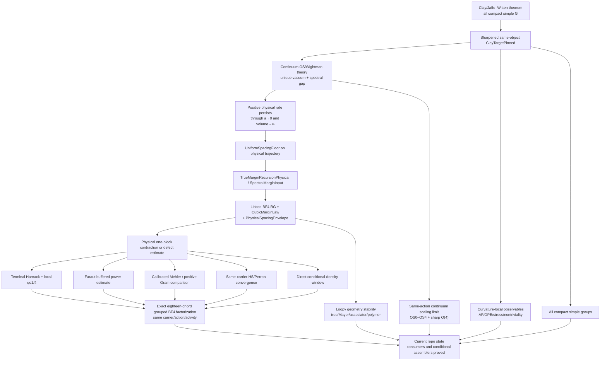

# Work Plan

This is the execution plan for the constructive Yang–Mills mass gap
program. It is organized around milestones with concrete deliverables.
The authoritative specification is `docs/outline.md`; the motivation
is `docs/context.md`; this file is the *schedule*.

## Whole-project goal and live completion map (updated 2026-09-11)

The north-star deliverable is a constructive, same-object four-dimensional
Yang--Mills construction whose continuum measure, observable algebra,
OS/GNS reconstruction, time-translation operator, and strictly positive
physical mass gap are all pinned to the same theory.  At the Clay-facing
boundary this means legitimately inhabiting the canonical pinned frontier
bundles without `sorry`, a new axiom, classical witness erasure, a surrogate
model, or a weakened field.  Fixed-spacing or finite-cutoff decay is evidence
and infrastructure for this goal, not the goal itself.

### Current physical BF4 gap frontier (2026-09-11)

The actual finite SU(2) vacuum-sector boundary Gram has a verified head--tail
contraction theorem, and its new-tail trace has been reduced exactly to
`sum_new K_raw(x,x) / row_raw(x)`.  That reduction remains correct, but the
proposed uniform small-trace producer is no longer the active route.  Exact
untrusted exploration at `w = 1/2`, cutoff four, finds a single new state
with self-return about `0.71428` and six symmetric copies, already forcing
the positive new-state trace above four.  No floating or externally computed
value is used in a theorem, so this is a decisive route-selection diagnostic,
not a kernel-checked obstruction theorem.

The active replacement is a non-abelian inward-mate/conditional-variance
route.  For a parity-uniform six-face cube, the inward mate changes each even
zero to one, lowers every positive even label by one, and lowers every odd
label by one.  Lean now proves the complete Casimir payment at the physical
nome: every non-vacuum even six-face heat product is at most `64` times its
mate heat product, while every odd product is at most `1/4096` times its mate.
The exact cutoff-two diagnostic ratio `48` is therefore explained by the
one-positive-spin-two bottleneck, with `64` as the first uniform analytic
envelope.

Lean also proves the exact local fusion debt: simultaneous predecessor
lowering preserves every SU(2) Clebsch--Gordan channel except the stretched
channel, while the even zero-to-one compensation preserves the old channel.
At a production valence-at-most-six link this contracts to

```text
source multiplicity <= mate multiplicity + stretched-continuation multiplicity.
```

That local inequality now transports across arbitrary physical incident-spin
orderings.  Given two distinct incident plaquette IDs, Lean constructively
produces a common residual word and both source/mate `List.Perm` witnesses,
then feeds them through the production multiplicity compiler.  The
cube-specific instantiation is also proved: on each of the twelve recorded
boundary links, the two named face IDs occur and exhaust the selected
six-face support, so the global mate gives the corrected-slab multiplicity
bound with exactly one explicit stretched continuation.  These twelve
certificates are now assembled into an observable attached-list debt profile:
the global mate is unchanged off the cube boundary, and the full boundary
source product is bounded by the product of the twelve explicit
`mate + stretchedDebt` factors.  Exact finite distributivity now enumerates
that product by Boolean words on the attached link list, separates the
all-target word, and names the sum of every nonempty stretched word as
`cubeInwardMateNonemptyStretchedRemainder`.  Every such word now also carries
a canonical computed root: its first stretched bit gives a bounded index into
the attached twelve-link production-incidence list, and the selected bit is
proved `true`.  This is Type-level input for the strand tracer, not an
existential choice.
The exact natural-number remainder is now also realized as one literal finite
carrier.  At each link the Boolean word chooses either the ordinary mate
auxiliary fiber or a newly exposed stretched-spin auxiliary fiber; a Cartesian
compiler assembles these choices, and Lean proves that the flattened carrier's
length is exactly `cubeInwardMateNonemptyStretchedRemainder`.
The raw debt has also been sharpened before rerouting: when either incident
cube-face label is zero, every source fusion path survives the mate, so the
local additive term is definitionally zero.  The active twelve-link product,
nonempty remainder, and finite witness carrier retain only positive-positive
stretched fibers.  This removes spurious zero-face summands and guarantees
that every genuine root can supply physical strand copies on both incident
faces.  Every active carrier member now additionally stores its complete
assignment-membership proof, the first active assignment position, the actual
auxiliary labelling read there, and kernel-checked positivity of both root
faces.  No existential proposition is eliminated to manufacture this data.
Those two positive faces now produce distinct literal slot-zero
`SlabFaceStrandCopy` values, both proved incident on the recorded root link.
At the SU(2) stretched trivalent vertex, the canonical port mate is also
explicit: right input slots map to the initial summed-leg segment and left
input slots to the disjoint shifted segment, with no input-to-input strands.
The active cube specialization now joins these facts: both geometric root
copies enter those input ports, their mates are distinct summed-channel ports,
and the stored root auxiliary is accepted on the exact collapsed word headed
by their spin sum.  A new finite-valence coordinate compiler now lifts any
such collapsed accepted auxiliary back across the stretched vertex: it inserts
the forced spin-sum channel, shifts every surviving internal coordinate, and
proves acceptance on the ordered source word through valence six.  The
specialization to every active cube-root carrier is also closed: the lifted
auxiliary is accepted on its literal ordered source word, that word has length
at most six and bounded spins, and the physical production incident-spin word
is retained with an exact permutation to it.  The matching root-first order of
literal plaquette IDs is now also Type-level data: it is duplicate-free,
permutes the production incidence list, and maps exactly to that ordered source
spin word.  A small upstream refactor makes the residual ID and spin words
compute transparently rather than through proof recursors.  The local strand
machinery is now generalized to any such certified face order: the unchanged
canonical SU(2) partner terminates on literal incident faces, remains an
involution, and crosses to a distinct plaquette by duplicate-freeness.  Its
one-element physical half-edge fiber also constructs the terminal at any
specified position and slot.  Specializing this selector at the active root
turns both positive slot-zero face copies into literal terminals of the same
accepted resolved source network; each full-chain partner reaches a different
plaquette.  The first-vertex bridge is now exact as well.  A generic canonical
link compiler identifies physical positions zero and one with the `a` and `b`
half-edges of vertex zero.  At the active root, positivity rules out the
degenerate two-valent case, the lifted source auxiliary labels the third leg
by the precise stretched sum, and the three SU(2) strand counts reduce to
`ab = 0`, `bc = right`, and `ca = left`.  The two actual selected terminals
therefore enter the common third leg in the disjoint slots `right` and `0`.
That common outgoing edge is now constructively classified: it is physical
edge two at valence three and the first genuine internal fusion edge at
valence four through six.  Both alternatives feed the existing exact
stop-or-same-slot-advance compiler.  Complete paths from the two local mates
to physical terminals are retained as Type-level data, and involutivity proves
that their endpoint terminals are distinct.  The ordered terminal-to-face
reindexing now lands in the same presentation-independent
`SlabFaceStrandCopy` carrier used by the global component graph.  It is proved
injective; the two retained path endpoints remain distinct global copies; and
the original left and right root copies are the exact sources of two global
strand edges on the recorded root link.  A heterogeneous global compiler now
retains an independently certified face order and accepted auxiliary witness
at each link, enumerates all local terminal-pair edges, and concatenates them
on that common carrier.  Given any complete presented background, replacing
its root entry by the actual root-first witness is constructive and puts both
root edges literally in the resulting global list.  Ordinary accepted source
assignments now embed in the presented interface through their production
orders.  The generic rooted-component engine pulls back to partner closure at
every independently ordered link.  At the active root, the Boolean union of
the left- and right-rooted components contains both required face copies and
is closed across every global edge; no equality or disjointness of those two
components is assumed.
The ordered pullback now compiles further to a coherent trivalent-network
removal.  Its canonical external-edge count is proved equal to the global
selected-copy count on the literal ordered face.  Thus every link sees one
common lowered physical field, every lowered auxiliary remains accepted in
its retained order, the complete lowered presented assignment is Type-level
data, and both distinct root-face labels decrease strictly.
The missing source-side local partition is now constructive as well.  On a
root-first word through valence six, the actual first SU(2) channel of every
accepted source witness either survives the even inward mate or is the unique
stretched channel.  In the second branch an explicit coordinate drop produces
an accepted collapsed witness, retains positivity of both changed labels, and
is exactly inverted by the existing stretched-witness lift.  Hence the local
`mate + stretched` classifier is injective and loses no source multiplicity.
That classifier is now connected to the literal corrected-slab geometry at
every recorded cube link.  A certified root-first face order maps the physical
source to the exact source word and the global six-face mate to the exact mated
word with a common residual list.  The specialized classifier is injective,
its decoder recovers the source auxiliary exactly, and its surviving branch is
an accepted presented witness on the actual mated link.
The dependent product over all twelve incidences is now explicit.  It applies
the local classifier coordinatewise, is injective by the twelve exact local
decoders, and packages every original source tuple as a common accepted
presented cube family.  This closes the anonymous-product-to-dependent-witness
step, but does not yet supply off-cube entries of a complete slab assignment.
The classified product is now split constructively as well.  A left-to-right
scan either projects all twelve coordinates to accepted mated witnesses or
returns the first stretched incidence with its actual collapsed witness and
both positive-face certificates.  An explicit unsplit map recovers the whole
classified family, so composing the split with the twelve-link classifier is
still injective on complete source assignments.
The exact source-image invariant is now retained at every classified
coordinate: decoding either branch is certified to return an auxiliary
accepted in that coordinate's literal source order.  Its dependent product
therefore reconstructs a common presented cube source after classification.
The strengthened first-stretched output retains this certified family and
identifies its returned root with the actual stored debt constructor.
Given an explicit accepted complete-slab background for the same source
physical field, the certified cube family now extends to a complete presented
assignment.  A computable lookup in the duplicate-free twelve-incidence table
overwrites exactly the cube links and retains the background everywhere else;
each cube lookup is proved to return its intended dependent incidence.
At the first certified stretched incidence, its positive left and right labels
now construct the two literal slot-zero terminals in the retained root-first
witness.  The corresponding terminal-pair edges have the intended cube-face
copies as sources and both occur in the one completed presented global graph.
Their two constructive rooted components are now unioned without assuming
either equality or disjointness.  A reusable global partner-closed-selection
compiler pulls this union back to every independently presented link and
produces one common lowered physical field with a complete accepted presented
assignment.  Slot-zero membership proves strict descent at both root faces.
Every endpoint in that heterogeneous graph is now proved physically supported.
The union's exact selected-copy multiplicities serialize as a legal repeated
face peel whose finite word reconstructs the physical source from the lowered
target.  The two certified root faces are numerically distinct, so the word has
length at least two.  Applying the exact anchor peel theorem bounds the actual
completed source entry by one `anchorFaceCoefficient` per removed copy.
The inverse side is now finite and exact too.  Because the lowered presented
target preserves every certified face order, reconstruction needs only the
physical peel word and one internal-drop word per link.  Every such word has
width at most three, and the target plus this code reconstructs the complete
source `(physical, raw auxiliary)` payload exactly.
Zero internal-drop rows are now erased by an exact sparse decoder.  Every
retained row is charged injectively to a selected physical copy and one of its
four incident boundary links, giving at most `4 * peelSize` nonzero rows.
The sharper volume-indexed adaptive encoding bounds each row entry by its
link's selected physical mass, proves the total link mass exactly
`4 * peelSize`, and places the full row table in a carrier of size at most
`4096^peelSize`.  These bounds are independent of slab volume and spin cutoff;
they cover the certified two-root union without assuming its two rooted
components are equal or disjoint.
The remaining structural factors are now closed as well.  The deduplicated
two-root support is one connected rooted `Z^4` animal, encoded by a padded
tour in a carrier of size exactly `625^peelSize`; its support-ordered physical
multiplicities are encoded in a carrier of size exactly `4^peelSize` and
decode the selected-copy count at every ambient face.  Together with the
adaptive auxiliary rows, the actual certified source inhabits one common
carrier bounded by `10240000^peelSize`.  A flat inverse certificate now avoids
normalizing the full dependent strand graph: at fixed root and lowered
presented target, equal three-word codes reconstruct equal source physical
fields and equal raw auxiliary assignments.  Consequently every explicit
duplicate-free fixed-target source family has at most
`10240000^peelSize` members.  Combining that cardinality with an explicit
per-source anchor-payment witness gives the checked fixed-target sum

```text
source fiber weight <= (8/25)^peelSize * target weight.
```

The complete root-first classifier domain over the twelve cube incidences is
now an explicit duplicate-free heterogeneous product.  The constructive SU(2)
fusion-path permutation theorem proves equality of every root-first local
fiber length with its production multiplicity.  Structural dependent lookup
then injects the tuple carrier into the function-valued source type, and the
certified target-or-first-stretched classifier preserves its exact cardinality
`cubeInwardMateSourceBoundaryProduct K physical` and duplicate-freeness.

The two outcome branches are now extracted constructively into separate
duplicate-free target and first-stretched lists.  Their lengths add exactly
to the production cube-boundary source multiplicity.  This is still a
cube-boundary enumeration plus a fixed-fiber theorem.

The no-overcount off-cube completion is now explicit as well.  The complete
extent-one slab-link list is filtered to the literal complement of the twelve
cube links, and only those production fusion fibers are enumerated.  A
piecewise compiler uses certified root-first data at every cube link and the
complement assignment everywhere else.  Exact lookup laws prove both sides,
so the construction contains no cube-background coordinate that is later
discarded.

The first-stretched/off-cube Cartesian product is now packaged as one
duplicate-free finite family.  Its length is exactly the first-stretched cube
count times the off-cube production multiplicity, and every member compiles
to both the complete presented source and the raw auxiliary payload consumed
downstream.  Injectivity of that presented/raw compiler, partitioning by
common lowered target/root/peel size, and summation over roots and sizes remain
open.

The full source compiler is now injective on that enumerated family.  Equality
of raw complete assignments gives coordinatewise presented-auxiliary equality;
the twelve cube coordinates recover the original certified classifier input,
and the off-cube coordinates reconstruct the complete complement assignment.
Consequently the physical/raw image has the same length and remains
duplicate-free.  The next step is to attach deterministic peel data to every
member and partition the resulting list by its common lowered presented target,
root, and peel size.

Every complete source is now attached to that deterministic peel data in a
duplicate-free list of the same cardinality.  The attachment retains the
upstream source itself as its injective key and exposes the existing flat
adaptive inverse record as a projection; both distinct certified root faces
prove every attached peel size is at least two.  The older defensive cube
override is raw-idempotent on these already-complete sources.  Constructing
the dependent fixed-target/root/size subfamilies and their removal witnesses
is the next open edge.  Their exact decidable key is now available: equal
root/size/physical/order/auxiliary words reconstruct the complete lowered
physical function and the dependent presented target.  The next compiler can
therefore select actual realized-key representatives and filter their exact
fixed fibers without deciding equality of function-valued data.  This
realized-fiber compiler is now complete: it retains a shallow explicit raw
field, constructs the fixed-target removal witnesses, proves the exact
adaptive-code cardinality ceiling, and applies the checked `(8/25)^n`
contraction to every representative fiber.  Exact Fubini across the
representatives and contraction of their distinct lowered-target sum against
the pure mate product are next.  Exact representative Fubini and termwise
summation are now proved, so the entire enumerated first-stretched weight is
bounded by the strict-rate-weighted realized-target sum.  Only the target-side
congestion/injection into the pure mate carrier remains on this edge.

The all-target route has now crossed the literal production-carrier boundary
without thinning away its probability mass.  Every successful source is
compiled injectively to a production expanded atom; its all-target mate is
compiled to another accepted atom of the same carrier; every pair is off
diagonal; and the duplicate-free source marginal preserves the full theorem

```text
(41/425) * Z_K <= sum productionSourceWeight.
```

This is the correct many-to-one geometry: target collisions remain present
instead of being hidden by representative selection.  They can therefore be
charged to the already proved exact-key capacity `<= 64` and weighted target
congestion.

The next load-bearing producers are, in causal order:

1. disintegrate or splice the full-slab source--mate transport into supported
   paths of the actual lower/boundary-indexed OS kernel, with the edge loads
   explicit rather than treating the constructed pair relation as a joint
   probability law.  The geometric half of this splice is now proved: source
   and mate assemble from distinct lower states against one common boundary
   and one common reflected-upper state.  Both displayed boundary summands
   are now strictly positive, and hence give a genuine two-edge path in the
   retained row-conditional physical kernel.  Each production witness weight
   is now proved bounded by its exact physical term, then by the displayed raw
   OS-kernel entry.  Dividing by the common physical partition gives literal
   quantitative lower bounds on both normalized symmetric-joint edge
   capacities.  The normalized source demands now sum to at least `41/425`,
   and every compiled-target fiber has total incoming demand at most
   `globalInwardMateTransportCost` times its actual second OS edge capacity.
   The normalization introduces no hidden cutoff factor.  Source collisions
   created by forgetting a complete slab to its first OS edge are now summed
   exactly: each source injects into its literal boundary--fine-intertwiner
   summand of that edge, so the aggregate first-edge traffic is at most the
   actual normalized OS joint capacity with no cardinality loss.  The second
   edge is now aggregated exactly as well: production-target classes partition
   all selected traffic, those classes are repartitioned by their literal
   second OS edge, and distinct target atoms inject into distinct boundary--
   fine-intertwiner summands.  Every second-edge load is therefore at most
   `globalInwardMateTransportCost` times its actual normalized OS joint
   capacity, while the edge loads sum exactly to the selected traffic.  The
   selected transport now has a concrete observable demand as well.  The
   parity of central lower face zero is reversed at every source--target pair;
   since the middle parity is also Boolean, exactly one path edge flips it.
   Lean therefore proves the lossless identity that the total selected traffic
   equals its two parity-gradient edge energies and in particular that their
   sum is at least `41/425`.  The first collision-grouped energy is now
   embedded in the complete physical OS Dirichlet form: each exact first-edge
   fiber has one constant parity gradient, its aggregate traffic is bounded
   by that edge's capacity, and the distinct realized edge representatives
   inject into the full Cartesian half-state square.  The second grouped
   energy is now embedded too: production-target equality preserves the
   physical target endpoint, both target-class and edge-class partitions are
   exact, and the only loss is the already proved
   `globalInwardMateTransportCost` congestion factor.  Combining both sides
   with the `41/425` demand floor now proves that the full physical OS
   Dirichlet energy of central-face parity is at least the explicit positive
   cutoff-independent rational
   `(41/425) / (1 + globalInwardMateTransportCost)`.  That observable is now
   centered by its exact stationary mean.  Constant-shift invariance, exact
   deletion of zero-marginal rows and columns, and the physical
   Dirichlet/transfer identity yield the strict rate
   `q = 1 - (1/2) * (41/425) /
   (1 + globalInwardMateTransportCost)`, with `0 <= q < 1`.  The same proof
   gives a cutoff-independent positive lower bound on the centered physical
   norm, so the channel is non-vacuous.  The edge side is no longer specific
   to parity: for every rational observable, the selected
   endpoint oscillation is bounded by
   `2 * (1 + globalInwardMateTransportCost)` times its actual OS Dirichlet
   energy.  The proposed full-positive-carrier coverage field is now proved
   uninhabited: XOR parity on central faces `0` and `39` is invariant under
   every simultaneous six-face mate, while its stationary-centered version
   has strictly positive norm already at cutoff one.  Thus its selected
   endpoint energy is zero and no positive coverage floor can exist.  This
   agrees with the independently proved reducibility of the full positive-row
   kernel at cutoff two.  Positive raw OS edges are now proved unable to leave
   `centralPhysicalFiniteVacuumSectorIndices`; in particular, if a certified
   inward-mate source endpoint is in the exact vacuum component, its common
   state and mate endpoint remain there.  A finite-support Boolean classifier
   now constructs a duplicate-free Type-level source list with the exact iff
   membership condition `global source + source endpoint in the vacuum
   component`; all three path vertices are proved internal.  Restricting the
   partition-normalized traffic and production-target fibers to that list
   preserves both actual OS edge-capacity estimates.  The physical-field event
   is now restricted separately, and over it the all-target plus
   first-stretched branch masses exactly reconstruct the genuine BF4 physical
   mass.  The support argument now allows arbitrary boundary changes: since
   the OS kernel sums over boundary labels, preserving the reflected upper
   state gives the required two-edge path.  Preserving the lower state also
   suffices directly.  The first-stretched mass is therefore split exactly
   into one-sided targets proved to stay in the sector and a two-sided
   remainder changing both half-states.  That remainder is contained in the
   older boundary-or-upper crossing list; no strict positive mass saving is
   asserted.  The weighted target-fiber localization is now proved:
   `targetWeightedFirstStretchedMass_le_physicalMass` retains the factor
   `384/425` against any nonnegative function of the actual lowered physical
   target.  Its exact sector-indicator specialization bounds internal bad
   mass by `384/425` of sector physical mass.  The actual source/target event
   split then gives `sectorSuccessfulMass_add_escape_ge`:
   `(41/425) * sectorMass <= successfulMass + escapingBadMass`.
   Every escaping source is two-sided, but two-sided targets that stay in the
   sector are already paid by the internal contraction.  The remaining demand
   input is a strict sector-relative estimate on this exact escaping mass.
   Positive filtered demand alone is not an all-vector coverage theorem.
   After embedding the
   restricted edge energies in the existing sector Dirichlet form, build a
   translated or component-adapted family that
   separates that exact connected sector with cutoff-uniform weighted
   congestion.  Everything
   after a correctly sector-local coverage input is compiled: a floor
   `kappa > 0` yields the cutoff-independent strict rate
   `4(1 + globalInwardMateTransportCost) /
   (4(1 + globalInwardMateTransportCost) + kappa) < 1` for every centered
   physical coefficient;
2. feed those supported paths into the existing mass-normalized
   canonical-flow or posterior conditional-variance compiler and prove one
   cutoff/volume-uniform strict finite vacuum-complement rate;
3. contract that rate through the already proved same-object
   dense/completed-gap machinery, then construct the thermodynamic and
   continuum limit maps.

Rust may generate exact orbit, contraction, or rerouting certificates for
these producers, but Lean must parse and kernel-check every certificate and
all inequalities it supports.

Thermodynamic and continuum control, continuum QFT construction, isolated
vacuum, and the Clay theorem remain open.

Status symbols used in this live map are:

```text
[PROVED]  kernel-checked constructive theorem(s) at the stated scope
[ACTIVE]  current causal proof edge
[PARTIAL] useful reductions exist, but a named physical input remains
[OBSTRUCTED] a stronger route has a proved structural cost or no-go
[OPEN]    no legitimate inhabitant/proof at the required scope
```

```text
Constructive 4D Yang--Mills existence + positive physical mass gap
|
+-- A. Finite lattice and fixed spacing
|   |
|   +-- A1. Exact SU(2) representation, heat, and recoupling data
|   |       [PROVED at the finite scopes recorded below]
|   |
|   +-- A2. Two-replica geometry, accepted carriers, and peeling
|   |       [PROVED through a cutoff-uniform guard-fiber payment]
|   |
|   +-- A3. Explicit separated observable transition
|   |   +-- cutoff-uniform insertion + inverse-fiber rates .... [PROVED]
|   |   +-- quarter-mass pivot-cylinder disconnection ......... [PROVED]
|   |   +-- literal observable-row membership + exact weights . [PROVED]
|   |   `-- every literal cylinder member is successful ....... [PROVED]
|   |
|   +-- A4. Global contraction
|   |   +-- generic complete-cell posterior interface ......... [OPEN / superseded]
|   |   |       concrete guarded aggregate route below is stronger at this face
|   |   +-- literal successful-event mass >= 1/4 .............. [PROVED]
|   |   +-- unthinned connected-row residue <= 3/4 ............ [PROVED]
|   |   +-- receiver-collision bridge ......................... [PROVED]
|   |   |   `-- datum-wise positive aggregate retained fraction [PROVED]
|   |   +-- marked face covariance / same-object moment < 1 ... [PROVED]
|   |   |       at each finite positive-coupling datum only
|   |   +-- SU(2) inward-mate posterior/path route ............. [ACTIVE preferred]
|   |   |   +-- full successful source mass >= `(41/425) Z_K` .. [PROVED]
|   |   |   +-- source/target endpoints in production carrier .. [PROVED]
|   |   |   +-- full source compiler and pair list injective .... [PROVED]
|   |   |   +-- source marginal preserves full successful mass .. [PROVED]
|   |   |   +-- compiled target fibers have capacity <= 64 ...... [PROVED]
|   |   |   +-- weighted production target congestion ........... [PROVED]
|   |   |   +-- common-channel two-edge OS path geometry ......... [PROVED]
|   |   |   +-- raw, normalized, conditional OS path support ...... [PROVED]
|   |   |   +-- production weights -> normalized OS edge capacity . [PROVED]
|   |   |   +-- normalized source mass + target-fiber edge load ... [PROVED]
|   |   |   +-- aggregate first OS-edge traffic without collisions . [PROVED]
|   |   |   +-- aggregate second OS-edge traffic + exact partition . [PROVED]
|   |   |   +-- selected central-face parity demand >= `41/425` ..... [PROVED]
|   |   |   +-- selected first parity energy -> full OS Dirichlet ... [PROVED]
|   |   |   +-- selected second parity energy -> cost * Dirichlet ... [PROVED]
|   |   |   +-- combine demand + both energies -> coercivity ......... [PROVED]
|   |   |   +-- center parity + strict one-observable form bound ..... [PROVED]
|   |   |   +-- arbitrary-observable endpoint -> OS energy bound ..... [PROVED]
|   |   |   +-- fixed-root full-carrier all-vector coverage .......... [OBSTRUCTED exact]
|   |   |   +-- positive OS paths stay in exact vacuum component ..... [PROVED]
|   |   |   +-- exact finite sector-local source carrier .............. [PROVED]
|   |   |   +-- restricted flow retains OS edge capacities ............ [PROVED]
|   |   |   +-- sector-event good+bad branch conservation ............. [PROVED]
|   |   |   +-- one-sided bad targets preserve vacuum component ....... [PROVED]
|   |   |   +-- exact successful + one-sided + two-sided mass split ... [PROVED]
|   |   |   +-- nonnegative target-weighted 384/425 contraction ....... [PROVED]
|   |   |   +-- exact sector demand bound with escaping-mass error .... [PROVED]
|   |   |   +-- strict sector-relative escaping-mass estimate ........ [ACTIVE]
|   |   |   +-- sector demand + sector Dirichlet embedding ............ [OPEN]
|   |   |   +-- translated/component move separation + congestion .... [OPEN]
|   |   |   `-- sector coverage -> uniform all-vector strict rate .... [PROVED algebraically]
|   |   +-- support-aligned paired recoupling/activity route
|   |   |   +-- literal right-tree realization + column capacity [PROVED]
|   |   |   +-- paired-union component geometry/mass floor ..... [PROVED]
|   |   |   +-- canonical paired-peel inverse-fiber payment ..... [PROVED at w=1/400]
|   |   |   +-- normalized residue <= (25/9)(16/25)^(d+1) ...... [PROVED at w=1/400]
|   |   |   +-- same-object reflected face OS identification .... [PROVED at w=1/400]
|   |   |   `-- cutoff-removed receding-volume face clustering .. [PROVED at w=1/400]
|   |   +-- arbitrary-coupling continuation .................... [ACTIVE]
|   |   |   +-- threshold-paid high-spin exterior path .......... [PROVED for 0<w<1]
|   |   |   +-- common truncated core target + exact excess mass  [PROVED]
|   |   |   +-- accepted canonical completion to vacuum .......... [PROVED]
|   |   |   +-- telescope accepted-path weights .................. [PROVED for 0<w<1]
|   |   |   +-- total core exponent <= 2*faces*threshold .......... [PROVED]
|   |   |   +-- terminal/trace/exterior/core proof profile ........ [PROVED]
|   |   |   +-- fixed terminal/exterior/core global source fiber .. [PROVED]
|   |   |   +-- sum bounded core counters and total mass .......... [PROVED]
|   |   |   +-- complete accepted-terminal inverse fiber .......... [PROVED]
|   |   |   +-- exact core = target-component truncated mass ...... [PROVED]
|   |   |   +-- exact residual coefficient `2*w^3` ................ [PROVED]
|   |   |   +-- full covariance decay for `0<w<=1/400` ............ [PROVED]
|   |   |   +-- same-object OS / cutoff removal on that corridor .. [PROVED]
|   |   |   +-- receding-volume face clustering on that corridor .. [PROVED]
|   |   |   +-- core-coefficient bound => full covariance decay .... [PROVED interface]
|   |   |   +-- exact decimation reaches coefficient corridor ...... [PROVED]
|   |   |   +-- physical observable transport through blocking ..... [ACTIVE producer]
|   |   |   |   +-- exact fine/coarse face covariance defect split . [PROVED]
|   |   |   |   +-- actual Markov pullback defects ................. [EXPOSED]
|   |   |   |   +-- actual pushed-law remainder L1 ................. [EXPOSED]
|   |   |   |   +-- finite-corridor argmin of total exact budget .... [PROVED]
|   |   |   |   +-- exact-decimation singleton + actual kernel join . [PROVED]
|   |   |   |   +-- centered covariance-to-covariance defect split .. [PROVED]
|   |   |   |   +-- centered exact-decimation physical join ......... [PROVED]
|   |   |   |   +-- centered pushed-law defect = exact connected
|   |   |   |   |       signed root/target/joint remainder ........... [PROVED]
|   |   |   |   +-- exact-decimation bound with connected remainder .. [PROVED]
|   |   |   |   +-- centered pullback defect = exact connected
|   |   |   |   |       signed root/target/joint remainder ........... [PROVED]
|   |   |   |   +-- fully connected exact-decimation bound ........... [PROVED]
|   |   |   |   +-- pullback moments = fine-law averages of literal
|   |   |   |   |       source-row kernel discrepancies ............... [PROVED]
|   |   |   |   +-- source-resolved exact-decimation bound ............ [PROVED]
|   |   |   |   +-- absolute row discrepancy = literal mismatch mass .. [PROVED]
|   |   |   |   +-- connected pullback <= averaged mismatch cost ...... [PROVED]
|   |   |   |   +-- mismatch-resolved exact-decimation bound .......... [PROVED]
|   |   |   |   +-- positive-row mismatch = selected globally glued
|   |   |   |   |       raw weight / complete row partition ............ [PROVED]
|   |   |   |   +-- Gibbs-null rows removed from mismatch average ...... [PROVED]
|   |   |   |   +-- raw-mismatch exact-decimation bound ................ [PROVED]
|   |   |   |   +-- each raw average <= 1; three-event cost <= 3 ........ [PROVED]
|   |   |   |   +-- nested physical schedule + O(a) tail compiler ....... [PROVED interface]
|   |   |   |   +-- connected remainder as one unit-bounded observable ... [PROVED]
|   |   |   |   +-- connected remainder = fine Gibbs average of one
|   |   |   |   |       production-minus-refresh observable row action .... [PROVED exact]
|   |   |   |   +-- selected row-action signed/source-L1/pointwise
|   |   |   |   |       quadratic calibration hierarchy ................... [PROVED interface]
|   |   |   |   +-- connected positive row = literal raw observable
|   |   |   |   |       numerator / complete row partition - Gibbs mean .... [PROVED exact]
|   |   |   |   +-- Gibbs-null rows deleted from signed/source-L1 averages .. [PROVED exact]
|   |   |   |   +-- positive-raw signed/source-L1/pointwise quadratic
|   |   |   |   |       calibration hierarchy ............................... [PROVED interface]
|   |   |   |   +-- positive row-versus-Gibbs signed raw cross
|   |   |   |   |       / (row partition * coarse partition) ................ [PROVED exact]
|   |   |   |   +-- relative row raw-cross bound => centered calibration ..... [PROVED interface]
|   |   |   |   +-- connected row raw cross = signed joint/root/target
|   |   |   |   |       literal-cylinder crosses .............................. [PROVED exact]
|   |   |   |   +-- relative three-event cross bound => centered calibration . [PROVED interface]
|   |   |   |   +-- clear embedded moment denominators into one fully raw
|   |   |   |   |       joint/root/target polynomial .......................... [PROVED exact]
|   |   |   |   +-- relative fully raw row polynomial => pointwise calibration  [PROVED stronger interface]
|   |   |   |   +-- signed fine-law average of fully raw row ratios = centered
|   |   |   |   |       pushed-law remainder ................................... [PROVED exact]
|   |   |   |   +-- fully raw aggregate calibration <=> receiver-column cross .. [PROVED exact]
|   |   |   |   +-- matched-AF raw-column control supplies fully raw aggregate .. [PROVED exact]
|   |   |   |   +-- posterior three-budget control => raw-column/full-raw
|   |   |   |   |       aggregate control ........................................ [PROVED exact compiler]
|   |   |   |   +-- signed row + connected-posterior + disconnected-posterior
|   |   |   |   |       debt sum = raw column ..................................... [PROVED exact]
|   |   |   |   +-- signed posterior calibration <=> fully raw aggregate .......... [PROVED exact]
|   |   |   |   +-- separate posterior l1 estimates ............................... [PROVED stronger fallback]
|   |   |   |   +-- signed posterior debt = signed density debt * Z_coarse^2 ....... [PROVED exact]
|   |   |   |   +-- density-debt calibration <=> fully raw aggregate ............... [PROVED exact]
|   |   |   |   +-- signed density debt = refresh-production cross
|   |   |   |   |       = Z_fine^2 * centered remainder ............................. [PROVED exact]
|   |   |   |   +-- density-debt calibration <=> centered-remainder calibration ..... [PROVED exact]
|   |   |   |   +-- normalized centered-change numerator = (1-w) * signed
|   |   |   |   |       geometric-quotient numerator ................................. [PROVED exact]
|   |   |   |   +-- matched-AF margin compiler: quotient ceiling => O(g^2) change .... [PROVED interface]
|   |   |   |   +-- balanced raw defect / unit-normalized residual quotient .......... [PROVED exact]
|   |   |   |   +-- balanced calibration => normalized residual, no constant loss .... [PROVED interface]
|   |   |   |   +-- balanced + margin compiler => centered O(g^2) remainder ........... [PROVED interface]
|   |   |   |   +-- margin quotient = selected centered receiver-pair debt cross ....... [PROVED exact]
|   |   |   |   +-- complete receiver-pair centered debt has total mass zero ........... [PROVED exact]
|   |   |   |   +-- selected debt = centered fine-source-pair signed average ........... [PROVED exact]
|   |   |   |   +-- product-kernel output contrast has pointwise abs <= 1 .............. [PROVED]
|   |   |   |   +-- source-pair debt factors through zero-mass one-source score ......... [PROVED exact]
|   |   |   |   +-- product-kernel four-cell contrast = one-row 2x2 determinant ......... [PROVED exact]
|   |   |   |   +-- source-pair average = four products of one-source moments ........... [PROVED exact]
|   |   |   |   +-- four centered one-source cell moments sum to zero ................... [PROVED exact]
|   |   |   |   +-- global geometric quotient telescopes over literal slab faces ......... [PROVED exact]
|   |   |   |   +-- centered score moments = source-face hybrid insertions ................ [PROVED exact]
|   |   |   |   +-- cutoff-one insertion symmetrized over occupied faces ................... [PROVED exact]
|   |   |   |   +-- centered score antisymmetrized into occupation skew .................... [PROVED exact]
|   |   |   |   +-- support swap preserves total occupation and has a scalar cocycle ....... [PROVED exact]
|   |   |   |   +-- coupling-one multiplicities expanded into assignment pairs ............. [PROVED exact]
|   |   |   |   +-- support-swap term = switched + component + response defect ............. [PROVED exact]
|   |   |   |   +-- generic support swap placed on accepted source/target carrier ........... [PROVED exact]
|   |   |   |   +-- accepted rows positive from literal intertwiner witnesses ............... [PROVED]
|   |   |   |   +-- actual response defect = four whole-row raw-event ratios ................ [PROVED exact]
|   |   |   |   +-- clear four positive row partitions to one division-free raw cross ....... [PROVED exact]
|   |   |   |   +-- raw-cross zero => defect-free accepted contraction ....................... [PROVED exact compiler]
|   |   |   |   +-- switched root/target occupancy => exact cubic response factor ............. [PROVED exact]
|   |   |   |   +-- response defect <= 2; complete response term
|   |   |   |   |       <= 2*w^3/(1-w) times unit-coupling target weight ....................... [PROVED pointwise]
|   |   |   |   +-- exact w^(3*min switched occupations) response factor ....................... [PROVED exact]
|   |   |   |   +-- min-heat residual <= 1/(1-w); full accepted cocycle recompiled ............. [PROVED pointwise]
|   |   |   |   +-- component -> finite touched coarse-face carrier ............................. [PROVED exact]
|   |   |   |   +-- untouched whole-slab raw face product is invariant .......................... [PROVED exact]
|   |   |   |   +-- target-independent touched scalar => normalized response cancellation ....... [PROVED exact compiler]
|   |   |   |   +-- facewise target-independent bubble scalar .............................. [OBSTRUCTED exact no-go]
|   |   |   |   +-- free retained-face target sum = `1 + coeffW w 2` ...................... [PROVED exact]
|   |   |   |   +-- pair-bubble/vacuum shared-link tensor = vacuum tensor ................. [PROVED local]
|   |   |   |   +-- isolated nonzero face kills valence-<=6 slab link product .............. [PROVED exact]
|   |   |   |   +-- literal isolated pair-bubble whole raw row = vacuum row ................ [PROVED exact]
|   |   |   |   +-- canonical spin-0..4 maximal-final face weight = coarse heat coefficient . [PROVED exact]
|   |   |   |   +-- simultaneous spin-four endpoint raw target = coarse physical term ....... [PROVED exact]
|   |   |   |   +-- complete local off-target kernel = parity-preserving lowering matrix ..... [PROVED exact]
|   |   |   |   +-- complete raw row = explicit lower-triangular coarse spin-foam weight ..... [PROVED exact]
|   |   |   |   +-- restrict and sum the row over the global lowering downset ................ [PROVED exact]
|   |   |   |   +-- factor each surviving row entry as integer tilt * coarse Gibbs weight .... [PROVED exact]
|   |   |   |   +-- canonical physicalKernel row = normalized tilted Gibbs downset ........... [PROVED exact]
|   |   |   |   +-- arbitrary binary packet kernel depends only on total source spin .......... [PROVED exact]
|   |   |   |   +-- every positive fine-source row = its normalized tilted Gibbs downset ...... [PROVED exact]
|   |   |   |   +-- compile all-source row laws into the signed source average ................. [PROVED exact]
|   |   |   |   +-- expose the tilt's local reward/count structure for centered cancellation . [PROVED local]
|   |   |   |   +-- parity pushforward = minimal lowering target with positive ground mass ..... [PROVED exact]
|   |   |   |   +-- split every tilted row into ground plus relative excitations ............... [PROVED exact]
|   |   |   |   +-- every excitation has a facewise positive two-spin level .................... [PROVED exact]
|   |   |   |   +-- compare excitation activities with the certified ground term ............... [PROVED pointwise at fine cutoff 1]
|   |   |   |   |   +-- exact fusion tilt <= 2^K times parity ground ............................. [PROVED at fine cutoff 1]
|   |   |   |   |   +-- fusion tilt * SU(2) dimension <= 5^K times parity ground ................ [PROVED at fine cutoff 1]
|   |   |   |   |   +-- Casimir excess >= 8K contracts the full face factor to `(5*w^8)^K` ...... [PROVED]
|   |   |   |   |   +-- at most four changed links per excited face .............................. [PROVED exact]
|   |   |   |   |   +-- target link product <= `15625^(4K)` times parity ground .................. [PROVED at fine cutoff 1]
|   |   |   |   |   +-- full rate `q(w)=15625^4*(5*w^8)`; `q(1/400)=5^9/2^32<1` ............... [PROVED]
|   |   |   |   |   `-- actual tilted summand <= literal ground summand * `q(w)^K` .............. [PROVED exact bridge]
|   |   |   |   +-- actual production kernel <= `q(w)^K` after row normalization ............... [PROVED]
|   |   |   |   `-- oriented two-row kernel product <= `q(w)^(K1+K2)` ........................... [PROVED]
|   |   |   |   +-- normalized joint entry = fine-source weight * actual row-pair kernel ........ [PROVED exact]
|   |   |   |   `-- global connected fraction <= source-weighted excitation entropy fraction ... [PROVED]
|   |   |   |   +-- complete target rate `q(w)` <= common anchor `1/400` on corridor ............. [PROVED]
|   |   |   |   `-- source heat + target excitation -> one connected joint-activity power ........ [PROVED]
|   |   |   |   +-- joint-activity entropy sum .................................... [PARTIAL; valid but too coarse]
|   |   |   |   +-- normalize complete target rows before exterior summation ................ [PROVED]
|   |   |   |   +-- both-empty fine packets force connected target-row mass = 0 ............. [PROVED]
|   |   |   |   +-- SU(2) anchor packet occupation `p <= 256/425` ............................ [PROVED]
|   |   |   |   +-- global connected production fraction `<= 1449/1700 < 1` .... [PROVED finite volume]
|   |   |   |   +-- connected observable = two exact symmetric face gradients ............... [PROVED exact]
|   |   |   |   +-- disconnected gradient carriers cancel by finite involutions ............. [PROVED exact]
|   |   |   |   +-- rational-observable two-row cross <= root + target envelopes ............ [PROVED raw]
|   |   |   |   +-- normalize and prove connected-response unit oscillation ............ [PROVED sharp]
|   |   |   |   +-- average root + target envelopes over the fine-source law ........... [PROVED exact]
|   |   |   |   +-- full connected posterior variance <= `1449/1700 < 1` ........ [PROVED finite volume]
|   |   |   |   +-- identify posterior with centered production/refresh form ............ [PROVED exact]
|   |   |   |   +-- uncentered RG-row form = centered form + exact bias square .... [PROVED exact]
|   |   |   |   +-- normalized RG-row bias = centered cylinder remainder .......... [PROVED exact]
|   |   |   |   +-- matched-AF `O(g^2)` control of that literal bias ............... [OPEN named producer]
|   |   |   |   +-- relative all-observable RG contraction ........................ [OPEN; not implied by spanning]
|   |   |   |   +-- symmetric SU(2) reference + physical row-relative error ........ [OPEN analytic producer]
|   |   |   |   +-- arbitrary-rate finite form gap -> completed physical gap ....... [PROVED exact compiler]
|   |   |   |   +-- each fixed dense sector cylinder -> actual strict completed form [PROVED; base-indexed rate]
|   |   |   |   +-- one common rate on the dense sector closure .................... [OPEN; path-ceiling rate has proved no-go]
|   |   |   |   +-- exact RG endpoint intertwiner ........................ [BYPASSED on symmetric-reference route]
|   |   |   |   +-- componentwise telescope retaining heat payment on target-reaching pieces .... [OPEN consumer]
|   |   |   |   +-- signed/background residual aggregation or raw-cross component bound ....... [OPEN consumer]
|   |   |   |   +-- volume-uniform balanced-blocking bound ............................... [ACTIVE analytic producer]
|   |   |   |   +-- uniform hybrid-measure local-insertion covariance bound ............... [ACTIVE analytic producer]
|   |   |   |   `-- cutoff/volume-uniform O(g^2) centered-remainder estimate .......... [OPEN consumer]
|   |   |   |   +-- connected pushed-law remainder <= remainderL1 ....... [PROVED sharp]
|   |   |   |   +-- normalized connected defect = raw cross / (Z_f*Z_c) .. [PROVED]
|   |   |   |   +-- relative raw-cross O(a) => sharp connected tail ....... [PROVED interface]
|   |   |   |   +-- face-event moments = raw numerators / partition ....... [PROVED]
|   |   |   |   +-- connected covariance = fully raw cubic determinant
|   |   |   |   |       / partition^3 ...................................... [PROVED]
|   |   |   |   +-- fully raw covariance cross / (Z_c^3*Z_f^3) ............ [PROVED]
|   |   |   |   +-- relative fully raw cross => sharp connected tail ....... [PROVED interface]
|   |   |   |   +-- actual pushed event numerator = positive-row sum of
|   |   |   |   |       physical terms times recoupling raw-event ratios .... [PROVED]
|   |   |   |   +-- generic covariance cross = actual-kernel raw-ratio cross [PROVED]
|   |   |   |   +-- actual cubic numerator = raw-ratio four-cell determinant
|   |   |   |   |       times the fine physical partition .................... [PROVED]
|   |   |   |   +-- full connected defect = coarse-versus-pushed four-cell
|   |   |   |   |       raw cross ............................................ [PROVED]
|   |   |   |   +-- pushed determinant = literal coarse-output pair-mass
|   |   |   |   |       difference ........................................... [PROVED]
|   |   |   |   +-- each output-pair mass = literal paired source-to-target
|   |   |   |   |       kernel-path sum ....................................... [PROVED]
|   |   |   |   +-- Gibbs-null paths deleted; surviving paths carry positive
|   |   |   |   |       sources and literal conditional raw rows ............... [PROVED]
|   |   |   |   +-- positive paths disintegrated over proof-carrying accepted
|   |   |   |   |       fine-intertwiner fibers without changing mass ........... [PROVED]
|   |   |   |   +-- accepted fine endpoints project into the established
|   |   |   |   |       same-datum receiver source universe with equal weight ... [PROVED]
|   |   |   |   +-- separate mismatch/L1 tails => sharp C_m + C_r tail ... [PROVED interface]
|   |   |   |   +-- remainderL1 = selected candidate's sign-observable
|   |   |   |   |       matching defect .................................. [PROVED]
|   |   |   |   +-- mismatch/sign-match tails => sharp C_m + C_s tail .... [PROVED interface]
|   |   |   |   +-- finite-atlas sharp raw/connected argmin + transfer ... [PROVED reduction]
|   |   |   |   |   `-- corridor atlas with O(a) reference candidate ..... [OPEN alternative]
|   |   |   |   +-- exact connected split => sharp C_m + C_c tail ........ [PROVED interface]
|   |   |   |   +-- matched-BF4 nome + physical spacing on one AF chart .. [PROVED bridge]
|   |   |   |   |   +-- shifted-AF identification => spacing to zero ..... [PROVED]
|   |   |   |   |   +-- fully raw covariance-cross tail => matched-chart
|   |   |   |   |   |       anchor + epsilon ............................... [PROVED interface]
|   |   |   |   |   +-- actual-kernel raw-ratio tail => matched-chart
|   |   |   |   |   |       anchor + epsilon ............................... [PROVED interface]
|   |   |   |   |   +-- accepted-fiber path tail => matched-chart
|   |   |   |   |   |       anchor + epsilon ............................... [PROVED interface]
|   |   |   |   |   +-- strict-support receiver path tail => matched-chart
|   |   |   |   |   |       anchor + epsilon ............................... [PROVED interface]
|   |   |   |   |   +-- receiver-density path tail => matched-chart
|   |   |   |   |   |       anchor + epsilon ............................... [PROVED interface]
|   |   |   |   |   +-- receiver-fiber-density tail => matched-chart
|   |   |   |   |   |       anchor + epsilon ............................... [PROVED interface]
|   |   |   |   |   +-- partition-scaled receiver-fiber tail => matched-chart
|   |   |   |   |   |       anchor + epsilon ............................... [PROVED interface]
|   |   |   |   |   +-- raw-cross tail => matched-chart anchor + epsilon .. [PROVED interface]
|   |   |   |   |   +-- connected tail => matched-chart anchor + epsilon . [PROVED interface]
|   |   |   |   |   `-- raw/sign tail => matched-chart anchor + epsilon ... [PROVED interface]
|   |   |   |   `-- canonical-decimation schedule producers ............. [ACTIVE]
|   |   |   |       +-- shared raw event-mismatch <= C_m * a ............. [OPEN]
|   |   |   |       +-- actual positive accepted-fiber paired path raw cross
|   |   |   |       |       <= C_c*a*(Z_c^3*Z_f^3) ....................... [OPEN broader route]
|   |   |   |       |   +-- coarse-output pairs expanded over fine sources [PROVED]
|   |   |   |       |   +-- null paths deleted and positive conditional
|   |   |   |       |   |       raw rows exposed .......................... [PROVED]
|   |   |   |       |   +-- accepted assignment fibers inserted exactly .. [PROVED]
|   |   |   |       |   +-- fine endpoints embedded in receiver sources ... [PROVED]
|   |   |   |       |   +-- positive-raw coarse endpoints assigned accepted
|   |   |   |       |   |       witnesses and oriented as receiver cells ... [PROVED]
|   |   |   |       |   +-- raw-supported coarse endpoints saturated over
|   |   |   |       |   |       every accepted receiver assignment .......... [PROVED]
|   |   |   |       |   +-- saturated image membership iff physical endpoint
|   |   |   |       |   |       reachability ................................. [PROVED]
|   |   |   |       |   +-- full receiver cell = saturated covered mass plus
|   |   |   |       |   |       physically unreachable endpoint mass ......... [PROVED exact]
|   |   |   |       |   +-- saturated scale-defect cross = physical raw-cross
|   |   |   |       |   |       defect up to the exact partition factor ......... [PROVED exact]
|   |   |   |       |   +-- saturated normalized variation = covered endpoint
|   |   |   |       |   |       calibration + unreachable endpoint mass ......... [PROVED exact]
|   |   |   |       |   +-- saturated variation bound => physical raw-cross bound
|   |   |   |       |   |       with exact cubic partition denominator ............ [PROVED]
|   |   |   |       |   +-- matched-AF saturated coverage/calibration compiler
|   |   |   |       |   |       => `fineCovariance <= anchorRate + epsilon` ........ [PROVED interface]
|   |   |   |       |   +-- delete zero-raw paths from complete path cells .. [PROVED]
|   |   |   |       |   +-- factor each supported path exactly as receiver
|   |   |   |       |   |       density times receiver-pair weight ........ [PROVED]
|   |   |   |       |   +-- aggregate all path densities on each full-cell
|   |   |   |       |   |       receiver fiber without losing multiplicity  [PROVED]
|   |   |   |       |   +-- coarse physical cross = source-minus-target mass
|   |   |   |       |   |       on those same receiver carriers ............. [PROVED]
|   |   |   |       |   +-- partition-scaled coefficient
|   |   |   |       |   |       `Z_f^2 - fiberDensity * Z_c^2` .............. [PROVED]
|   |   |   |       |   +-- full raw defect = `Z_c*Z_f` times the weighted
|   |   |   |       |   |       scaled receiver-fiber coefficient cross ..... [PROVED]
|   |   |   |       |   +-- generic dependent-kernel coefficient cross splits
|   |   |   |       |   |       exactly into row/edge/column debts ........... [PROVED]
|   |   |   |       |   +-- conditional receiver-transport route
|   |   |   |       |   |   +-- complete-cell posterior specialization ......... [PROVED reduction]
|   |   |   |       |   |   +-- row debt = connected unretained coefficient mass [PROVED]
|   |   |   |       |   |   |   `-- partition-density calibration `l1` majorant  [PROVED]
|   |   |   |       |   |   +-- edge debt = successful-edge variation .......... [PROVED]
|   |   |   |       |   |   |   +-- common `Z_f^2` cancels exactly .............. [PROVED]
|   |   |   |       |   |   |   `-- density-variation double-sum `l1` majorant .. [PROVED]
|   |   |   |       |   |   +-- column debt = coefficient times capacity slack . [PROVED]
|   |   |   |       |   |   |   `-- partition-density calibration `l1` majorant  [PROVED]
|   |   |   |       |   |   +-- three `l1` budgets => covariance consumer ....... [PROVED interface]
|   |   |   |       |   |   +-- schedule-level complete posterior producer ..... [OPEN alternative]
|   |   |   |       |   |   |       fixed-anchor theorem does not inhabit it
|   |   |   |       |   |   `-- uniform row/edge/column budgets sum to `O(a)` ... [OPEN alternative]
|   |   |   |       |   +-- explicit split-sector transport route
|   |   |   |       |   |   +-- normalized disconnected recoupling kernel ....... [PROVED]
|   |   |   |       |   |   +-- first-source-thinned connected kernel ........... [PROVED]
|   |   |   |       |   |   +-- exact source/target Boolean sector partitions ... [PROVED]
|   |   |   |       |   |   +-- disconnected row debt = 0 ....................... [PROVED]
|   |   |   |       |   |   +-- full cross = five explicit surviving debts ...... [PROVED]
|   |   |   |       |   |   +-- coefficient-weighted finite Fubini regroups each
|   |   |   |       |   |   |       edge/column pair as one posterior column ..... [PROVED]
|   |   |   |       |   |   +-- five debts = connected row + two posterior columns [PROVED]
|   |   |   |       |   |   +-- three-term posterior-column `l1` majorant and
|   |   |   |       |   |   |       physical partition scaling ................... [PROVED]
|   |   |   |       |   |   +-- common coefficient rescaling through row/column
|   |   |   |       |   |   |       posterior debts ................................ [PROVED]
|   |   |   |       |   |   +-- normalize/cancel all common partition factors ..... [PROVED]
|   |   |   |       |   |   +-- posterior normalized cost = three-budget /
|   |   |   |       |   |   |       `(a*Z_f^2)` .................................... [PROVED]
|   |   |   |       |   |   +-- posterior normalized-cost bound => covariance ..... [PROVED interface]
|   |   |   |       |   |   +-- matched-AF posterior coupling-square route
|   |   |   |       |   |   |   +-- three analytic inputs => normalized bounds ..... [PROVED bridge]
|   |   |   |       |   |   |   +-- inhabit lower `c*g^2 <= a(g)` .................. [OPEN]
|   |   |   |       |   |   |   +-- raw mismatch <= `M*g^2` ........................ [OPEN]
|   |   |   |       |   |   |   +-- posterior three-budget <=
|   |   |   |       |   |   |   |       `(K*g^2)*Z_f^2` ............................ [PARTIAL]
|   |   |   |       |   |   |   |   +-- aggregate coefficient-`l1` route, no column
|   |   |   |       |   |   |   |   |       count or pointwise coverage premise ........... [ACTIVE preferred]
|   |   |   |       |   |   |   |   |   +-- retained/unretained source reassembly ......... [PROVED exact]
|   |   |   |       |   |   |   |   |   +-- connected/disconnected carrier reassembly ...... [PROVED exact]
|   |   |   |       |   |   |   |   |   +-- row + both posteriors <= full source + target
|   |   |   |       |   |   |   |   |   |       coefficient `l1` ........................... [PROVED]
|   |   |   |       |   |   |   |   |   +-- matched-AF covariance consumer ................. [PROVED]
|   |   |   |       |   |   |   |   |   +-- exact coarse-law normalization ................. [PROVED]
|   |   |   |       |   |   |   |   |   +-- normalized variation = covered calibration
|   |   |   |       |   |   |   |   |   |       + uncovered physical mass ................... [PROVED exact]
|   |   |   |       |   |   |   |   |   +-- covered/uncovered matched-AF compiler ........... [PROVED]
|   |   |   |       |   |   |   |   |   +-- assignment-saturated raw cross and physical
|   |   |   |       |   |   |   |   |   |       endpoint coverage decomposition .............. [PROVED exact]
|   |   |   |       |   |   |   |   |   +-- rebuild normalized aggregate variation with the
|   |   |   |       |   |   |   |   |   |       saturated density .............................. [PROVED exact]
|   |   |   |       |   |   |   |   |   +-- every attached spin-0-through-4 endpoint has a
|   |   |   |       |   |   |   |   |   |       closed fine cutoff-one binary lift ............ [PROVED]
|   |   |   |       |   |   |   |   |   +-- both assignment-saturated receiver columns covered [PROVED]
|   |   |   |       |   |   |   |   |   +-- unreachable receiver mass = 0 .................... [PROVED exact]
|   |   |   |       |   |   |   |   |   +-- matched-AF endpoint-coverage field automatic ...... [PROVED]
|   |   |   |       |   |   |   |   |   +-- full normalized receiver-variation route
|   |   |   |       |   |   |   |   |   |   +-- covered variation = full-carrier variation ...... [PROVED exact]
|   |   |   |       |   |   |   |   |   |   +-- relative pointwise defects sum without a
|   |   |   |       |   |   |   |   |   |   |       receiver-cardinality loss ................... [PROVED reduction]
|   |   |   |       |   |   |   |   |   |   +-- relative-density field => finite covariance ..... [PROVED]
|   |   |   |       |   |   |   |   |   |   +-- density * receiver weight = pushed raw mass ..... [PROVED exact]
|   |   |   |       |   |   |   |   |   |   +-- raw-mass bound iff relative-density bound ........ [PROVED exact]
|   |   |   |       |   |   |   |   |   |   `-- uniform pointwise `K*g^2` raw error .............. [OPEN stronger route]
|   |   |   |       |   |   |   |   |   `-- cancellation-preserving raw-column-cross route
|   |   |   |       |   |   |   |   |       +-- raw cell totals = products of literal
|   |   |   |       |   |   |   |   |       |       one-replica pushed column masses ............. [PROVED exact]
|   |   |   |       |   |   |   |   |       +-- signed receiver cross = actual pushed cross ..... [PROVED exact]
|   |   |   |       |   |   |   |   |       +-- signed scale-defect cross = physical raw defect
|   |   |   |       |   |   |   |   |       |       up to the exact partition factor ............. [PROVED exact]
|   |   |   |       |   |   |   |   |       +-- aggregate `K*g^2` field => finite covariance .... [PROVED interface]
|   |   |   |       |   |   |   |   |       `-- prove aggregate `K*g^2` raw-column cross ........ [ACTIVE analytic producer]
|   |   |   |       |   |   |   |   |           +-- exact term at `w` = `w^Casimir` times term
|   |   |   |       |   |   |   |   |           |       at coupling one ............................ [PROVED]
|   |   |   |       |   |   |   |   |           +-- pushed-column and partition losses bounded by
|   |   |   |       |   |   |   |   |           |       `(1-w)` times explicit Casimir moments ..... [PROVED]
|   |   |   |       |   |   |   |   |           +-- blocked-margin upper comparison to `2*g^2` ... [PROVED]
|   |   |   |       |   |   |   |   |           +-- matched-AF pushed-column/partition loss
|   |   |   |       |   |   |   |   |           |       <= `2*g^2` times Casimir moment ........... [PROVED]
|   |   |   |       |   |   |   |   |           +-- actual signed cross differs from coupling-one
|   |   |   |       |   |   |   |   |           |       cross by `2*g^2` times exactly the two selected
|   |   |   |       |   |   |   |   |           |       pair-cell Casimir moments .................... [PROVED]
|   |   |   |       |   |   |   |   |           +-- raw scale defect regrouped into coarse and
|   |   |   |       |   |   |   |   |           |       receiver signed crosses .................... [PROVED exact]
|   |   |   |       |   |   |   |   |           +-- exact reference-scale-defect plus localized
|   |   |   |       |   |   |   |   |           |       coupling-one perturbation split ............. [PROVED]
|   |   |   |       |   |   |   |   |           +-- reference residual + normalized moment compiler
|   |   |   |       |   |   |   |   |           |       => aggregate raw-column calibration ......... [PROVED]
|   |   |   |       |   |   |   |   |           +-- reference defect = balanced coupling-one blocking
|   |   |   |       |   |   |   |   |           |       defect - global fine-partition drift ........ [PROVED exact]
|   |   |   |       |   |   |   |   |           +-- global partition-square drift <= `2*g^2` times
|   |   |   |       |   |   |   |   |           |       whole-slab Casimir normalization term ....... [PROVED]
|   |   |   |       |   |   |   |   |           +-- global coupling-one continuation
|   |   |   |       |   |   |   |   |           |   +-- balanced blocking-law calibration ........... [PARTIAL]
|   |   |   |       |   |   |   |   |           |   `-- volume-uniform whole-slab moment ............ [OPEN / extensive risk]
|   |   |   |       |   |   |   |   |           +-- normalization-preserving reference-kernel route
|   |   |   |       |   |   |   |   |           |   +-- every finite kernel pushes the same actual `Z_f` [PROVED]
|   |   |   |       |   |   |   |   |           |   +-- exact reference + signed kernel-cross split .. [PROVED]
|   |   |   |       |   |   |   |   |           |   +-- two calibrated inputs => aggregate calibration [PROVED]
|   |   |   |       |   |   |   |   |           |   +-- concrete coarse Gibbs refresh row .............. [PROVED]
|   |   |   |       |   |   |   |   |           |   +-- ratio-scaled pushed law and actual `Z_f` total . [PROVED]
|   |   |   |       |   |   |   |   |           |   +-- refresh reference scale defect = zero .......... [PROVED]
|   |   |   |       |   |   |   |   |           |   +-- one signed-cross input => aggregate calibration  [PROVED]
|   |   |   |       |   |   |   |   |           |   `-- refresh-versus-production signed cross
|   |   |   |       |   |   |   |   |           |       +-- equals `Z_f^2` times centered remainder ..... [PROVED exact]
|   |   |   |       |   |   |   |   |           |       +-- equals `Z_f^2` times one unit-bounded
|   |   |   |       |   |   |   |   |           |       |       connected-observable defect ................. [PROVED exact]
|   |   |   |       |   |   |   |   |           |       +-- direct matched-AF three-input compiler ........ [PROVED interface]
|   |   |   |       |   |   |   |   |           |       +-- aggregate raw-column calibration iff centered
|   |   |   |       |   |   |   |   |           |       |       remainder calibration ........................ [PROVED exact]
|   |   |   |       |   |   |   |   |           |       +-- coupling-one reference + localized moment
|   |   |   |       |   |   |   |   |           |       |       => centered remainder calibration ............ [PROVED interface]
|   |   |   |       |   |   |   |   |           |       +-- unit-normalized cancellation recentering
|   |   |   |       |   |   |   |   |           |       |   +-- unit partition positive; actual blocked covariance
|   |   |   |       |   |   |   |   |           |       |   |       = actual four-cell cross / actual `Z_f^2` ... [PROVED]
|   |   |   |       |   |   |   |   |           |       |   +-- normalized unit/actual change = one signed
|   |   |   |       |   |   |   |   |           |       |   |       cross determinant / positive denominator .... [PROVED exact]
|   |   |   |       |   |   |   |   |           |       |   +-- centered remainder = unit-normalized blocking
|   |   |   |       |   |   |   |   |           |       |   |       residual + centered normalized change ....... [PROVED exact]
|   |   |   |       |   |   |   |   |           |       |   +-- two raw quadratic premises => centered bound .. [PROVED interface]
|   |   |   |       |   |   |   |   |           |       |   `-- prove both premises cutoff-uniformly .......... [ACTIVE co-producers]
|   |   |   |       |   |   |   |   |           |       +-- centered remainder <= `K*g^2` .............. [ACTIVE preferred]
|   |   |   |       |   |   |   |   |           |       `-- full physical remainder `l1` <= `K*g^2` ... [OPEN stronger fallback]
|   |   |   |       |   |   |   |   |           `-- localized pair-cell moment route ................. [PARTIAL / extensive-risk fallback]
|   |   |   |       |   |   |   |   `-- two-scalar/full-carrier route ................... [OPEN adapter]
|   |   |   |       |   |   |   |       +-- split posterior `l1` and masses reassemble on
|   |   |   |       |   |   |   |       |       the original full target carrier ........... [PROVED exact]
|   |   |   |       |   |   |   |       +-- full-carrier posterior compiler, no column count [PROVED]
|   |   |   |       |   |   |   |       +-- connected source mass <= `Z_c^2` ............. [PROVED]
|   |   |   |       |   |   |   |       +-- full target-carrier mass <= `Z_c^2` .......... [PROVED]
|   |   |   |       |   |   |   |       +-- total posterior relative cost ................. [PROVED exact]
|   |   |   |       |   |   |   |       +-- row + full-carrier posterior => global budget . [PROVED bridge]
|   |   |   |       |   |   |   |       +-- connected row relative estimate ............... [OPEN]
|   |   |   |       |   |   |   |       `-- posterior relative cost ........................ [OPEN]
|   |   |   |       |   |   |   |           `-- uniform density calibration ............... [OBSTRUCTED alternative]
|   |   |   |       |   |   |   |               +-- off-image coefficient = full density ... [PROVED obstruction]
|   |   |   |       |   |   |   |               +-- full supported-image coverage .......... [OPEN prerequisite]
|   |   |   |       |   |   |   |               +-- source calibration on covered image .... [OPEN]
|   |   |   |       |   |   |   |               `-- target calibration on covered image .... [OPEN]
|   |   |   |       |   |   +-- five debts => literal calibration/variation `l1` . [PROVED]
|   |   |   |       |   |   +-- five `l1` budgets => covariance consumer .......... [PROVED interface]
|   |   |   |       |   |   +-- one literal sum majorizes the five scaled debts ... [PROVED]
|   |   |   |       |   |   +-- exact positive normalization by `a*(Z_c^3*Z_f^3)` [PROVED]
|   |   |   |       |   |   +-- cancel common `Z_c*Z_f`; denominator becomes
|   |   |   |       |   |   |       `a*(Z_c^2*Z_f^2)` .............................. [PROVED]
|   |   |   |       |   |   +-- pull common `Z_c^2` through five absolute sums;
|   |   |   |       |   |   |       denominator becomes `a*Z_f^2` .................. [PROVED]
|   |   |   |       |   |   +-- normalized mismatch/five-budget bounds => consumer [PROVED interface]
|   |   |   |       |   |   +-- uniformly bound the two five-budget normalized
|   |   |   |       |   |   |       sequences ...................................... [OPEN equivalent]
|   |   |   |       |   |   `-- matched-AF five-budget coupling-square route
|   |   |   |       |   |       +-- lower `c*g^2 <= a(g)` plus quadratic budgets
|   |   |   |       |   |       |       => normalized bounds ...................... [PROVED bridge alternative]
|   |   |   |       |   |       +-- inhabit lower quadratic spacing comparison .... [OPEN]
|   |   |   |       |   |       +-- raw mismatch <= `M*g^2` ....................... [OPEN]
|   |   |   |       |   |       `-- dimensionless five-defect sum <=
|   |   |   |       |   |               `(K*g^2)*Z_f^2` ........................... [OPEN]
|   |   |   |       |   `-- posterior-free direct calibration route
|   |   |   |       |       +-- source/target fields vs common `Z_f^2/Z_c^2`
|   |   |   |       |       |       weighted `l1` budgets ....................... [PROVED]
|   |   |   |       |       +-- two budgets => same covariance consumer ......... [PROVED interface]
|   |   |   |       |       `-- uniform source/target calibration `O(a)` ......... [OPEN alternative]
|   |   |   |       +-- actual all-source paired path raw cross
|   |   |   |       |       <= C_c*a*(Z_c^3*Z_f^3) ....................... [OPEN equivalent]
|   |   |   |       +-- actual two-replica four-cell raw cross
|   |   |   |       |       <= C_c*a*(Z_c^3*Z_f^3) ....................... [OPEN equivalent]
|   |   |   |       +-- actual positive-row raw-ratio covariance cross
|   |   |   |       |       <= C_c*a*(Z_c^3*Z_f^3) ....................... [OPEN equivalent]
|   |   |   |       +-- generic fully raw covariance cross
|   |   |   |       |       <= C_c*a*(Z_c^3*Z_f^3) ....................... [OPEN equivalent]
|   |   |   |       +-- structured-observable cross
|   |   |   |       |       <= C_c*a*(Z_f*Z_c) ........................... [OPEN equivalent]
|   |   |   |       +-- normalized connected remainder <= C_c * a ........ [OPEN equivalent]
|   |   |   |       `-- stronger input: sign/TV defect <= C_s * a ........ [OPEN alternative]
|   |   |   `-- beta and lattice-spacing trajectory transport .... [OPEN]
|   |   +-- cutoff-uniform aggregate retained-fraction floor .. [PROVED]
|   |   |   +-- common guarded-receiver fiber payment ......... [PROVED]
|   |   |   +-- successful receiver-row mass >= 1/4 ........... [PROVED]
|   |   |   +-- decoder => unthinned shared-column capacity .... [PROVED]
|   |   |   +-- local additive-output decoder obstruction ...... [PROVED]
|   |   |   +-- support-mask / strand-mask mismatch ............ [PROVED]
|   |   |   +-- fixed-mask source physical recovery ............ [PROVED]
|   |   |   +-- strand mask confined to fixed pattern code ..... [PROVED]
|   |   |   +-- exhaustive mask-code count = 2^|pattern| ....... [PROVED]
|   |   |   +-- fixed physical-component mass cap .............. [PROVED]
|   |   |   +-- active auxiliary code <= 4096^patternMass ...... [PROVED]
|   |   |   +-- joint mask/active-row provenance capacity ...... [PROVED]
|   |   |   +-- full assignment recovery in one code fiber ..... [PROVED]
|   |   |   +-- fixed guarded receiver-fiber cardinality ....... [PROVED]
|   |   |   +-- scaled weighted column allocation .............. [PROVED]
|   |   |   |   +-- common SU(2) column per code fiber ......... [PROVED]
|   |   |   |   +-- unscaled guarded preimage capacity <= C .... [PROVED]
|   |   |   |   +-- `1/(C+1)` scaled receiver capacity <= 1 .... [PROVED]
|   |   |   |   +-- actual guarded row carrier + no duplicates . [PROVED]
|   |   |   |   +-- literal choices retained in actual carrier . [PROVED]
|   |   |   |   +-- actual target compiler complete + no dupes . [PROVED]
|   |   |   |   +-- actual scaled receiver capacity <= 1 ....... [PROVED]
|   |   |   |   +-- actual Gibbs-weighted receiver capacity ..... [PROVED]
|   |   |   |   `-- actual scaled row mass >= scale * 1/4 ...... [PROVED]
|   |   |   `-- Gibbs-weighted uniform aggregate fraction ...... [PROVED]
|   |   |       +-- accepted-state guarded-row partition ....... [PROVED]
|   |   |       +-- representative rows partition by target .... [PROVED]
|   |   |       `-- global retained floor from partition ....... [PROVED]
|   |   +-- literal centered face, relative form contraction ... [PROVED]
|   |   |   +-- one-replica off-diagonal transition floor ...... [PROVED]
|   |   |   +-- common factor `1-rate` is in `[0,1)` ........... [PROVED]
|   |   |   +-- same physical face/vector on both form sides ... [PROVED]
|   |   |   +-- cutoff-uniform positive face-variance floor .... [PROVED]
|   |   |   `-- cutoff-removed face RC form gap ................ [PROVED]
|   |   +-- fixed-cutoff all-vector Poincare gap ............... [PROVED]
|   |   +-- cutoff-removed fixed-base all-vector form gap ...... [PROVED]
|   |   +-- common all-vector rate on each finite base prefix .. [PROVED]
|   |   +-- common face/all-vector finite-prefix envelope ...... [PROVED]
|   |   +-- cofinal strict rate independent of prefix bound .... [ACTIVE]
|   |   |   +-- arbitrary-spin explicit vacuum ray ............ [PROVED]
|   |   |   +-- local congestion <= first resistance moment ... [PROVED reduction]
|   |   |   +-- moment >= nonzero off-ray cardinality .......... [PROVED obstruction]
|   |   |   +-- global uniform resistance moment ............... [OBSTRUCTED]
|   |   |   +-- exact edge-user stationary-resistance tail ..... [PROVED]
|   |   |   +-- nonzero edge-user count <= local congestion .... [PROVED diagnostic]
|   |   |   +-- full-sector adaptive routing compiler .......... [PROVED reduction]
|   |   |   +-- adaptive multiplicity-aware edge tail .......... [PROVED]
|   |   |   +-- adaptive edge-user count <= local congestion ... [PROVED diagnostic]
|   |   |   +-- adaptive loop erasure preserves edge sublists .. [PROVED]
|   |   |   +-- vertex-simple normalization, same flow bound .... [PROVED reduction]
|   |   |   +-- named simple cofinal certificate + translations  [PROVED interface]
|   |   |   +-- literal positive terminal root spoke per state .. [PROVED]
|   |   |   +-- terminal-spoke fiber <= local congestion ........ [PROVED diagnostic]
|   |   |   +-- terminal fibers exactly partition nonvacuum ..... [PROVED]
|   |   |   +-- sector <= positive spokes * common bound ........ [PROVED diagnostic]
|   |   |   +-- K explicit spin-cube positive root spokes ....... [PROVED]
|   |   |   +-- inverse-kernel terminal-fiber demand <= load .... [PROVED diagnostic]
|   |   |   +-- spin-ray direct demand uniformly bounded ........ [PROVED at anchor]
|   |   |   +-- full routing fixes ray states to own spokes ..... [PROVED]
|   |   |   +-- each ray-spoke fiber has one ray occupant ........ [PROVED]
|   |   |   +-- terminal demand = direct + off-ray demand ........ [PROVED exact]
|   |   |   +-- all direct-ray edge load uniformly bounded ...... [PROVED at anchor]
|   |   |   +-- full flow = direct-ray + off-ray flow ............ [PROVED exact]
|   |   |   +-- off-ray flow = twice canonical off-ray flow ...... [PROVED exact]
|   |   |   +-- canonical off-ray localized edge-load bound ...... [ACTIVE]
|   |   |   |   +-- exact twice-spin physical-mass shells ......... [PROVED]
|   |   |   |   +-- mass entropy x state-load factorization ....... [PROVED reduction]
|   |   |   |   |   +-- shell cardinality <= 2^24 * 2^mass ......... [PROVED]
|   |   |   |   |   +-- state load = weight x path resistance ...... [PROVED exact]
|   |   |   |   |   |   +-- stationary-weight decay ................. [OPEN]
|   |   |   |   |   |   +-- canonical resistance growth ............. [OPEN]
|   |   |   |   |   |   `-- every occupied-shell user load >= 1 ...... [PROVED obstruction]
|   |   |   |   |   `-- geometric pointwise decay ................... [OBSTRUCTED]
|   |   |   |   |       unless edge-user masses truncate uniformly
|   |   |   |   +-- mass-shell sum => full simple certificate ..... [PROVED reduction]
|   |   |   |   +-- literal edge-user count <= congestion ......... [PROVED necessary]
|   |   |   |   +-- sharing x uniform user load => congestion ...... [PROVED reduction]
|   |   |   |   |   +-- cutoff-uniform literal edge sharing ........ [OPEN producer]
|   |   |   |   |   `-- cutoff-uniform per-user route load ......... [OPEN producer]
|   |   |   |   +-- adaptive sharing x edge-load compiler .......... [PROVED reduction]
|   |   |   |   +-- strict-mass adaptive reroute ................... [OBSTRUCTED at K=2]
|   |   |   |   |   +-- edgewise mass drop => simple, length <= mass [PROVED]
|   |   |   |   |   +-- local descending step => full root route .... [PROVED reduction]
|   |   |   |   |   +-- literal-state step => indexed BF4 step ....... [PROVED reduction]
|   |   |   |   |   +-- K=2 mass-two state has no lower positive edge  [PROVED no-go]
|   |   |   |   |   `-- literal/indexed local producer at K=2 empty ... [PROVED no-go]
|   |   |   |   +-- graph-aware rank or positive macro-step reroute .. [ACTIVE design]
|   |   |   |   |   +-- mass-amortized macro-step compiler ............ [PROVED reduction]
|   |   |   |   |   +-- K=2 state -> hub -> vacuum inhabitant .......... [PROVED finite]
|   |   |   |   |   +-- one common terminal spoke cofinally ............ [PROVED no-go]
|   |   |   |   |   +-- distributed terminal-spoke producer ............ [ACTIVE design]
|   |   |   |   |   |   +-- arbitrary-cutoff vacuum boundary delta ..... [PROVED]
|   |   |   |   |   |   +-- raw root spoke <-> vacuum amplitude ........ [PROVED reduction]
|   |   |   |   |   |   +-- finite-sector amplitude filter/count ....... [PROVED exact]
|   |   |   |   |   |   +-- positive-coupling lower-link filter/count .. [PROVED exact]
|   |   |   |   |   |   +-- all-link local CSP filter/count ............ [PROVED exact]
|   |   |   |   |   |   +-- 24-var/48-link arity<=4 active scopes ...... [PROVED]
|   |   |   |   |   |   +-- active CSP iff uniform six-face spin cube .. [PROVED exact]
|   |   |   |   |   |   +-- root-spoke carrier = K+1 spin-cube indices . [PROVED exact]
|   |   |   |   |   |   +-- terminal source -> admitted spin label ..... [PROVED exact]
|   |   |   |   |   |   +-- used bins <= K+1; sector <= (K+1)*load .... [PROVED necessary]
|   |   |   |   |   |   +-- spin-labelled prefix -> exact root route .... [PROVED compiler]
|   |   |   |   |   |   +-- central-face distributed assignment ......... [PROVED finite]
|   |   |   |   |   |   +-- loop-erased prefix length <= sector size ..... [PROVED finite]
|   |   |   |   |   |   +-- zero-face repair => nonvacuum final spoke ..... [PROVED finite]
|   |   |   |   |   |   +-- loop erasure => simple, nonvacuum predecessor . [PROVED finite]
|   |   |   |   |   |   +-- normalized used bins <= K excited cubes ....... [PROVED exact]
|   |   |   |   |   |   +-- exact-routing cofinal load interface ........... [PROVED reduction]
|   |   |   |   |   |   +-- simplicity removes edge multiplicity ........... [PROVED exact]
|   |   |   |   |   |   +-- normalized state load <= raw prefix route ....... [PROVED]
|   |   |   |   |   |   +-- raw resistance = prefix + terminal reciprocal ... [PROVED exact]
|   |   |   |   |   |   +-- normalized edge users subset raw edge users ...... [PROVED]
|   |   |   |   |   |   +-- raw terminal fibers = repaired face-zero fibers ... [PROVED exact]
|   |   |   |   |   |   +-- terminal demand = 2 * actual fiber mass / kernel ... [PROVED exact]
|   |   |   |   |   |   +-- actual normalized fiber ratio <= congestion ........ [PROVED necessary]
|   |   |   |   |   |   `-- assignment sharing/resistance load .......... [ACTIVE producer]
|   |   |   |   |   |       +-- normalized terminal-mass decomposition ...... [PROVED reduction]
|   |   |   |   |   |       |   +-- prefix-to-vacuum weighted demand ........ [OPEN]
|   |   |   |   |   |       |   `-- assigned face-label mass -> observable .. [PROVED reduction]
|   |   |   |   |   |       |       +-- ray return floor at anchor ........... [PROVED]
|   |   |   |   |   |       |       +-- exact finite expectation/weight ratio  [PROVED]
|   |   |   |   |   |       |       +-- sharp finite-cutoff ratio maximum .... [PROVED]
|   |   |   |   |   |       |       +-- assigned masses partition 1-vacuum ... [PROVED exact]
|   |   |   |   |   |       |       +-- ratio => (1-vacuum) <= C*ray mass .... [PROVED necessary]
|   |   |   |   |   |       |       +-- matched tail: 1/6 <= C_K*ray mass ..... [PROVED necessary]
|   |   |   |   |   |       |       +-- matched varying-weight cofinal interface [PROVED reduction]
|   |   |   |   |   |       |       +-- uniform C => ray mass >= (1/6)/C ...... [PROVED necessary]
|   |   |   |   |   |       |       +-- ray-mass asymptotic fork .............. [ACTIVE diagnostic]
|   |   |   |   |   |       |       |   +-- positive tail floor ............... [OPEN / route survives]
|   |   |   |   |   |       |       |   `-- tail-zero branch ................... [ACTIVE diagnostic]
|   |   |   |   |   |       |       |       +-- ray mass = exact raw numerator / Z [PROVED exact]
|   |   |   |   |   |       |       |       +-- exact numerator <= eps*Z ......... [OPEN equivalent]
|   |   |   |   |   |       |       |       +-- explicit raw-envelope route ....... [PROVED sufficient / coarse]
|   |   |   |   |   |       |       |       +-- R raw-row replicas => ray <= 1/R .. [PROVED compiler]
|   |   |   |   |   |       |       |       +-- R replicas at floor lambda => ray <= 1/(R*lambda)
|   |   |   |   |   |       |       |       |                                      [PROVED compiler]
|   |   |   |   |   |       |       |       +-- finite ratio ceiling >= (R*lambda)/6 [PROVED]
|   |   |   |   |   |       |       |       +-- positive injection => computed lambda [PROVED compiler]
|   |   |   |   |   |       |       |       +-- identity positive injection (R=1) ... [PROVED finite]
|   |   |   |   |   |       |       |       +-- cutoff-two positive injection (R=2) . [PROVED finite]
|   |   |   |   |   |       |       |       +-- closed-spin-surface positivity compiler [PROVED]
|   |   |   |   |   |       |       |       +-- arbitrary-spin transverse positive ray [PROVED]
|   |   |   |   |   |       |       |       +-- all-cutoff two-ray injection (R=2) ... [PROVED finite family]
|   |   |   |   |   |       |       |       +-- two disjoint closed-surface spin grid [PROVED]
|   |   |   |   |   |       |       |       +-- growing injection R(K)=K+1 .......... [PROVED finite family]
|   |   |   |   |   |       |       |       +-- computed lambda is capped row minimum [PROVED compiler]
|   |   |   |   |   |       |       |       +-- pointwise row floor => lambda floor .. [PROVED reduction]
|   |   |   |   |   |       |       |       +-- reflected grid target retained ....... [PROVED]
|   |   |   |   |   |       |       |       +-- selected floor coeff(K)^6/C <= lambda  [PROVED anchor]
|   |   |   |   |   |       |       |       +-- selected-term witness -> 0 ............ [PROVED diagnostic]
|   |   |   |   |   |       |       |       |   so it cannot itself force divergence
|   |   |   |   |   |       |       |       +-- sharper full-row comparison .......... [PROVED reduction]
|   |   |   |   |   |       |       |       |   +-- raw row / selected activity enhancement [PROVED exact]
|   |   |   |   |   |       |       |       |   +-- enhancement >= 1 and exact cancellation [PROVED]
|   |   |   |   |   |       |       |       |   +-- full-row common floor >= selected floor . [PROVED]
|   |   |   |   |   |       |       |       |   +-- one decorated activity per grid coordinate [PROVED]
|   |   |   |   |   |       |       |       |   +-- extreme-pair computed-floor ceiling ...... [PROVED]
|   |   |   |   |   |       |       |       |   `-- high-spin grid effective multiplicity bounded [OBSTRUCTED]
|   |   |   |   |   |       |       |       +-- low-spin growing-volume replicas ..... [PROVED all finite K, positive w; growing half]
|   |   |   |   |   |       |       |       |   +-- volume+1 common-box placements ...... [PROVED]
|   |   |   |   |   |       |       |       |   +-- injective duplicate-free cutoff-one list [PROVED]
|   |   |   |   |   |       |       |       |   +-- identical positive one-cube production [PROVED]
|   |   |   |   |   |       |       |       |   +-- exact ambient/slab reflected adapter . [PROVED]
|   |   |   |   |   |       |       |       |   +-- volume+1 distinct reflected lower states [PROVED]
|   |   |   |   |   |       |       |       |   +-- common positive raw-row floor ......... [PROVED]
|   |   |   |   |   |       |       |       |   +-- aggregate raw mass grows linearly ..... [PROVED]
|   |   |   |   |   |       |       |       |   +-- partition pays the same linear floor .. [PROVED]
|   |   |   |   |   |       |       |       |   +-- absolute-floor fraction <= 1 .......... [PROVED obstruction]
|   |   |   |   |   |       |       |       |   +-- arbitrary-volume ratio compiler ....... [PROVED]
|   |   |   |   |   |       |       |       |   +-- pointwise floor => computed minimum ..... [PROVED]
|   |   |   |   |   |       |       |       |   +-- fixed slice-zero reference branch
|   |   |   |   |   |       |       |       |   |   +-- literal compiler instance ........... [PROVED]
|   |   |   |   |   |       |       |       |   |   +-- marginal <= 1/effective ............. [PROVED]
|   |   |   |   |   |       |       |       |   |   +-- one-ceiling fixed/adaptive Harnack gate [PROVED reduction]
|   |   |   |   |   |       |       |       |   |   +-- exact raw-row ratio floor = 1 .......... [PROVED]
|   |   |   |   |   |       |       |       |   |   +-- effective multiplicity = volume+1 ...... [PROVED]
|   |   |   |   |   |       |       |       |   |   +-- explicit fixed marginal tail zero ..... [PROVED]
|   |   |   |   |   |       |       |       |   |   `-- volume-uniform raw-row Harnack ........ [PROVED, ceiling 1]
|   |   |   |   |   |       |       |       |   |       +-- raw row = target/boundary completion sum [PROVED exact]
|   |   |   |   |   |       |       |       |   |       +-- weighted completion injection => Harnack [PROVED reduction]
|   |   |   |   |   |       |       |       |   |       +-- unchanged-completion identity injection [PROVED reduction]
|   |   |   |   |   |       |       |       |   |       +-- lower completion remainder is zero .... [PROVED geometry]
|   |   |   |   |   |       |       |       |   |       +-- source/remainder face separation ...... [PROVED geometry]
|   |   |   |   |   |       |       |       |   |       +-- source/remainder link separation ...... [PROVED geometry]
|   |   |   |   |   |       |       |       |   |       +-- exact physical-term factorization ..... [PROVED]
|   |   |   |   |   |       |       |       |   |       +-- every selected complete raw row equal . [PROVED]
|   |   |   |   |   |       |       |       |   |       +-- arbitrary-K source/remainder boundedness [PROVED]
|   |   |   |   |   |       |       |       |   |       +-- arbitrary-K time-shift source equality  [PROVED]
|   |   |   |   |   |       |       |       |   |       +-- all-K complete raw rows equal .......... [PROVED]
|   |   |   |   |   |       |       |       |   |       +-- all-K ratio floor = 1 ................. [PROVED]
|   |   |   |   |   |       |       |       |   |       +-- all-K effective multiplicity = volume+1 [PROVED]
|   |   |   |   |   |       |       |       |   |       +-- all-K fixed-source marginal tail zero .. [PROVED]
|   |   |   |   |   |       |       |       |   |       `-- growing-half -> fixed-half matched ray . [ACTIVE boundary]
|   |   |   |   |   |       |       |       |   |           +-- constant-ceiling diagonal gate ... [PROVED reduction]
|   |   |   |   |   |       |       |       |   |           +-- matched ray contains spin-one atom  [PROVED]
|   |   |   |   |   |       |       |       |   |           +-- gate forces fixed/growing atom bound [PROVED necessary]
|   |   |   |   |   |       |       |       |   |           +-- normalized comparison <-> raw cross [PROVED exact]
|   |   |   |   |   |       |       |       |   |           +-- raw-row/partition growth balance ... [ACTIVE producer]
|   |   |   |   |   |       |       |       |   |           |   +-- crossed finite product carriers .... [PROVED exact]
|   |   |   |   |   |       |       |       |   |           |   +-- product sums = raw row x opposite Z . [PROVED exact]
|   |   |   |   |   |       |       |       |   |           |   +-- diagonal weighted injection => cross  [PROVED reduction]
|   |   |   |   |   |       |       |       |   |           |   +-- occurrence-index recoding preserves sums [PROVED exact]
|   |   |   |   |   |       |       |       |   |           |   +-- weighted inverse fibers => raw cross . [PROVED reduction]
|   |   |   |   |   |       |       |       |   |           |   +-- one matched ceiling => atom bound .... [PROVED reduction]
|   |   |   |   |   |       |       |       |   |           |   +-- faithful three-code target keys ...... [PROVED exact]
|   |   |   |   |   |       |       |       |   |           |   +-- canonical restriction/assembly repair  [PROVED carrier]
|   |   |   |   |   |       |       |       |   |           |   +-- faithful canonical fiber capacity ..... [OBSTRUCTED]
|   |   |   |   |   |       |       |       |   |           |   |   +-- fixed-vacuum source/key slices exact ... [PROVED]
|   |   |   |   |   |       |       |       |   |           |   |   +-- slice capacity => Z_V <= C * raw_V .... [PROVED necessary]
|   |   |   |   |   |       |       |       |   |           |   |   +-- capacity => 1 <= C * growingMarginal .. [PROVED necessary]
|   |   |   |   |   |       |       |       |   |           |   |   `-- all-K tail contradicts one matched C .. [PROVED no-go]
|   |   |   |   |   |       |       |       |   |           |   +-- mixed fixed-completion repair .......... [OBSTRUCTED at w=1/2,K=2,V=0]
|   |   |   |   |   |       |       |       |   |           |   |   +-- growing-completion-only keys ........... [PROVED carrier]
|   |   |   |   |   |       |       |       |   |           |   |   +-- key weight = growing completion * Z_0 .. [PROVED exact]
|   |   |   |   |   |       |       |       |   |           |   |   +-- source fiber = raw_0 * physical fiber .. [PROVED exact]
|   |   |   |   |   |       |       |       |   |           |   |   +-- fallback mass outside positive support .. [PROVED zero]
|   |   |   |   |   |       |       |       |   |           |   |   +-- physical fiber = completion column ...... [PROVED exact]
|   |   |   |   |   |       |       |       |   |           |   |   +-- fiber bound iff column Harnack ........... [PROVED exact]
|   |   |   |   |   |       |       |       |   |           |   |   +-- completion-column Harnack ............... [REFUTED at w=1/2,K=2,V=0]
|   |   |   |   |   |       |       |       |   |           |   |   |   +-- boundary sum = target raw row ......... [PROVED exact]
|   |   |   |   |   |       |       |       |   |           |   |   |   +-- column bound => target-row bound ...... [PROVED necessary]
|   |   |   |   |   |       |       |       |   |           |   |   |   +-- column Gram factorization ............. [PROVED exact]
|   |   |   |   |   |       |       |       |   |           |   |   |   +-- boundary-amplitude bound => column .... [PROVED sufficient]
|   |   |   |   |   |       |       |       |   |           |   |   |   +-- zero lower rows vanish termwise ....... [PROVED exact]
|   |   |   |   |   |       |       |       |   |           |   |   |   +-- positive-carrier amplitude factor ..... [PROVED exact]
|   |   |   |   |   |       |       |       |   |           |   |   |   +-- positive-boundary bound <-> posterior floor [PROVED exact]
|   |   |   |   |   |       |       |       |   |           |   |   |   +-- uniform reference posterior floor .... [OBSTRUCTED at w=1/2,K=2,V=0]
|   |   |   |   |   |       |       |       |   |           |   |   |   |   +-- same-volume projective posterior window [PROVED]
|   |   |   |   |   |       |       |       |   |           |   |   |   |   +-- projective x volume-comparison compiler [PROVED reduction]
|   |   |   |   |   |       |       |       |   |           |   |   |   |   +-- fixed-to-growing marginal factor ...... [OPEN / tail-sensitive; insufficient for support]
|   |   |   |   |   |       |       |       |   |           |   |   |   |   +-- one zero-support boundary => no floor .. [PROVED reduction]
|   |   |   |   |   |       |       |       |   |           |   |   |   |   +-- isolated reference = source x vacuum ... [PROVED exact]
|   |   |   |   |   |       |       |       |   |           |   |   |   |   +-- reference support subset vacuum support . [PROVED exact]
|   |   |   |   |   |       |       |       |   |           |   |   |   |   `-- positive retained boundary outside vacuum [PROVED at w=1/2,K=2,V=0]
|   |   |   |   |   |       |       |       |   |           |   |   |   |       +-- half-zero leakage translated to half one [PROVED exact]
|   |   |   |   |   |       |       |       |   |           |   |   |   |       +-- lower row and half-amplitude positive [PROVED]
|   |   |   |   |   |       |       |       |   |           |   |   |   |       +-- retained boundary total positive ..... [PROVED]
|   |   |   |   |   |       |       |       |   |           |   |   |   |       +-- vacuum/reference amplitude zero ....... [PROVED]
|   |   |   |   |   |       |       |       |   |           |   |   |   |       `-- every finite posterior ceiling refuted [PROVED]
|   |   |   |   |   |       |       |       |   |           |   |   |   +-- fiber contains volume+1 equal terms .. [PROVED necessary]
|   |   |   |   |   |       |       |       |   |           |   |   |   +-- capacity => (V+1)*fixedMarginal <= C [PROVED necessary]
|   |   |   |   |   |       |       |       |   |           |   |   |   `-- matched fixed marginal = O(1/(s+1)) . [OPEN necessary test]
|   |   |   |   |   |       |       |       |   |           |   |   `-- inhabit or refute uniform column bound . [REFUTED at finite datum]
|   |   |   |   |   |       |       |       |   |           |   `-- source-dependent cross-boundary redesign . [ACTIVE analytic route]
|   |   |   |   |   |       |       |       |   |           |       +-- occurrence recoding preserves both sums [PROVED exact]
|   |   |   |   |   |       |       |       |   |           |       +-- weighted inverse fibers => raw cross ... [PROVED reduction]
|   |   |   |   |   |       |       |       |   |           |       +-- zero target weight => zero source fiber . [PROVED necessary]
|   |   |   |   |   |       |       |       |   |           |       +-- positive source maps to nonzero target .. [PROVED necessary]
|   |   |   |   |   |       |       |       |   |           |       +-- finite support-aware constant repair .... [PROVED each positive datum]
|   |   |   |   |   |       |       |       |   |           |       |   +-- crossed source/target totals positive ... [PROVED]
|   |   |   |   |   |       |       |       |   |           |       |   +-- constructive positive target selector ... [PROVED]
|   |   |   |   |   |       |       |       |   |           |       |   +-- constructive maximum target selector .... [PROVED]
|   |   |   |   |   |       |       |       |   |           |       |   +-- constant inverse fibers exact ........... [PROVED]
|   |   |   |   |   |       |       |       |   |           |       |   +-- exact datum-dependent ratio ceiling ..... [PROVED]
|   |   |   |   |   |       |       |       |   |           |       |   +-- maximum ceiling <= arbitrary ceiling .... [PROVED]
|   |   |   |   |   |       |       |       |   |           |       |   +-- maximum target weight <= target total ... [PROVED]
|   |   |   |   |   |       |       |       |   |           |       |   +-- target total <= carrier length * maximum  [PROVED]
|   |   |   |   |   |       |       |       |   |           |       |   `-- total ratio <= maximum ceiling
|   |   |   |   |   |       |       |       |   |           |       |       <= carrier length * total ratio ....... [PROVED finite]
|   |   |   |   |   |       |       |       |   |           |       `-- cutoff/volume-uniform matched ceiling .. [ACTIVE analytic producer]
|   |   |   |   |   |       |       |       |   |           |           +-- exact matched maximum-ceiling sequence [PROVED]
|   |   |   |   |   |       |       |       |   |           |           +-- ceiling weakening monotonicity ...... [PROVED]
|   |   |   |   |   |       |       |       |   |           |           +-- one uniform bound => matched switch . [PROVED reduction]
|   |   |   |   |   |       |       |       |   |           |           +-- inhabit uniform maximum bound ....... [OPEN producer]
|   |   |   |   |   |       |       |       |   |           |           `-- distributed multi-target improvement [PROVED algebraically]
|   |   |   |   |   |       |       |       |   |           |               +-- normalized fractional kernel .... [PROVED finite]
|   |   |   |   |   |       |       |       |   |           |               +-- exact columns = (S/T)*target .... [PROVED]
|   |   |   |   |   |       |       |       |   |           |               +-- S/T is optimal fractional ceiling  [PROVED]
|   |   |   |   |   |       |       |       |   |           |               +-- matched S/T uniform-bound gate .... [PROVED reduction]
|   |   |   |   |   |       |       |       |   |           |               +-- S/T <= C iff normalized atom bound . [PROVED exact]
|   |   |   |   |   |       |       |       |   |           |               +-- inhabit uniform matched S/T bound . [ACTIVE analytic producer]
|   |   |   |   |   |       |       |       |   |           |               +-- bound => normalized fixed atom .... [PROVED reduction]
|   |   |   |   |   |       |       |       |   |           |               +-- bound => fixed-atom located tail zero [PROVED reduction]
|   |   |   |   |   |       |       |       |   |           |               `-- local geometric realization ...... [OPEN if required]
|   |   |   |   |   |       |       |       |   |           +-- complete ray <= C * fixed spin-one atom [OPEN producer]
|   |   |   |   |   |       |       |       |   |           +-- S/T bound + atom compression => ray gate [PROVED reduction]
|   |   |   |   |   |       |       |       |   |           +-- gate => matched ray tail zero ...... [PROVED reduction]
|   |   |   |   |   |       |       |       |   |           `-- tail zero excludes ratio route .... [PROVED no-go]
|   |   |   |   |   |       |       |       |   `-- adaptive minimum-row branch
|   |   |   |   |   |       |       |       |       +-- constructive finite arg-min ......... [PROVED]
|   |   |   |   |   |       |       |       |       +-- exact ratio floor = 1 ............... [PROVED]
|   |   |   |   |   |       |       |       |       +-- effective multiplicity = volume+1 ... [PROVED]
|   |   |   |   |   |       |       |       |       +-- adaptive marginal <= 1/(volume+1) ... [PROVED]
|   |   |   |   |   |       |       |       |       +-- explicit epsilon/denominator modulus  [PROVED]
|   |   |   |   |   |       |       |       |       `-- fixed slice-zero row identity ....... [PROVED]
|   |   |   |   |   |       |       |       +-- volume-parametric multiplicity diverges ... [PROVED for growing-half scalar atom]
|   |   |   |   |   |       |       |       `-- tail zero => no uniform ratio .... [PROVED reduction]
|   |   |   |   |   |       |       +-- inhabit cofinal uniform ratio ceiling  [OPEN / route risk]
|   |   |   |   |   |       |       `-- ratio + return => conductance bound ... [PROVED reduction]
|   |   |   |   |   |       +-- avoidance => exact source/fiber identity .... [PROVED optional]
|   |   |   |   |   |       |   `-- construct prefix vacuum avoidance ....... [OPEN shortcut]
|   |   |   |   |   |       +-- repaired face-zero fiber cardinality ....... [OPEN sufficient]
|   |   |   |   |   |       |       necessary only for the raw-sharing adapter
|   |   |   |   |   |       +-- raw preceding-edge sharing ................ [OPEN]
|   |   |   |   |   |       `-- prefix-terminal state-load bound ......... [OPEN]
|   |   |   |   |   +-- cofinal positive macro-step producer ........... [OPEN]
|   |   |   |   |   +-- uniform adaptive edge sharing ................. [OPEN producer]
|   |   |   |   |   `-- uniform adaptive per-user edge load ........... [OPEN producer]
|   |   |   |   +-- path-length-shell alternative ................. [PARTIAL / route risk]
|   |   |   |   +-- off-ray terminal demand ...................... [OPEN consequence]
|   |   |   |   `-- off-ray preceding-edge resistance tail ....... [OPEN consequence]
|   |   |   +-- separating guarded-event family alternative ... [PARTIAL]
|   |   |   +-- fixed-nome cofinal ceiling interfaces ......... [PROVED reductions]
|   |   |   |   `-- global path-ceiling / edge-floor instance .. [OBSTRUCTED exact no-go]
|   |   |   +-- matched constructed-Poincare rate path ......... [OBSTRUCTED exact no-go]
|   |   |   +-- localized posterior Dirichlet/capacity path .... [ACTIVE]
|   |   |   `-- ceiling also synchronizes guarded face ......... [PROVED reduction]
|   |   `-- completed all-vector form / operator gap ........... [OPEN]
|   |
|   `-- A5. Parallel verified finite route
|       `-- BF4 finite-cutoff covariance clustering ............ [PROVED]
|           quotient/norm-relative operator interpretation ..... [OPEN]
|
|   `-- A6. Carrier-reproducing physical block-flow route
|       +-- arbitrary-cutoff raw whole-slab recoupling ......... [PROVED]
|       +-- total reflected stochastic kernel `K -> 4K` ........ [PROVED]
|       +-- exact agreement with physical cutoff-one kernel ..... [PROVED]
|       +-- pushforward = coherent law + weighted fallback ...... [PROVED exact]
|       +-- fallback `L1` = incoherent source probability ....... [PROVED exact]
|       +-- cutoff-two collar Gibbs mass positive ............... [PROVED]
|       +-- its four-preimage raw row partition not positive .... [PROVED]
|       +-- total incoherent probability and fallback `L1` > 0 .. [PROVED]
|       +-- four-preimage carrier as exact all-cutoff flow ....... [REFUTED at K=2]
|       +-- retained fine-intertwiner/collar carrier ............. [PROVED inhabited]
|       +-- disjoint coarse-or-retained finite target ............ [PROVED nodup]
|       +-- exact enriched stochastic kernel ..................... [PROVED]
|       +-- exact normalized enriched pushforward law ............ [PROVED]
|       +-- lossy projection recovers old fallback kernel ........ [PROVED exact]
|       +-- blocked-law projection recovers old pushforward ...... [PROVED exact]
|       +-- retained component/dynamics carrier bridge ........... [PROVED exact]
|       +-- retained blocked-law point density ................... [PROVED exact]
|       +-- retained two-replica point law ....................... [PROVED exact]
|       +-- connected retained-pair component estimate ........... [PROVED on 0<w<=1/400]
|       +-- all-branch source-labelled connected joint flow ....... [PROVED exact]
|       +-- full expanded target marginal = enriched blocked pair . [PROVED exact]
|       +-- connected target contribution is a product submeasure . [PROVED exact]
|       +-- total target contribution inherits corridor rate ...... [PROVED on 0<w<=1/400]
|       +-- enriched target observable ........................... [PROVED]
|       +-- retained intertwiner equal-rank reflection ........... [PROVED exact]
|       +-- enriched kernel reflection identity ................. [PROVED exact]
|       +-- enriched pushed-law reflection identity .............. [PROVED exact]
|       +-- enriched observable pullback / expectation compiler .. [PROVED exact]
|       +-- cross-carrier block `L2` contraction ................. [PROVED exact]
|       +-- retained-row positive-time face identification ....... [PROVED exact]
|       +-- coherent root/reflected/joint recoupling compiler ..... [PROVED exact]
|       +-- weighted defect localization to coherent rows ......... [PROVED exact]
|       +-- coherent defect as selected raw-weight ratio .......... [PROVED exact]
|       +-- mismatch <= fine-source + coarse-output occupation ..... [PROVED exact]
|       +-- coherent output marginal / pushed-law bridge ........... [PROVED exact]
|       +-- positive/complement mismatch recoding .................. [PROVED exact]
|       +-- normalized/expanded positive-face mass identity ........ [PROVED exact]
|       +-- fine occupation <= 8/17 at named SU(2) anchor .......... [PROVED]
|       +-- physical strand component peel size >= 2 ................ [PROVED exact]
|       +-- fine occupation <= 64/425 from the size-two tail ......... [PROVED anchor]
|       +-- exact four-face dyadic same-object event ................ [PROVED exact]
|       +-- coarse positivity => dyadic fine-packet support ......... [PROVED at K=1]
|       +-- one-sided coherent packet mismatch bound ................ [PROVED exact at K=1]
|       +-- anchor packet occupation <= 256/425 < 1 ................. [PROVED]
|       +-- coherent packet/coarse mismatch <= 256/425 .............. [PROVED at anchor, K=1]
|       +-- selected-face dyadic-incidence witness interface ........ [PROVED exact]
|       +-- actual root/reflected/joint mismatch <= 256/425 ......... [PROVED given incidence bundle]
|       +-- canonical reflected dyadic-incidence bundle producer .... [PROVED exact]
|       +-- canonical actual three defects <= 256/425 ............... [PROVED at anchor, K=1]
|       +-- enriched centered reflected-form compiler ................ [PROVED exact]
|       +-- canonical centered reflected form <= 256/425 < 1 ......... [PROVED anchor, K=1]
|       +-- exact total-reflection-covariance decomposition ........... [PROVED]
|       +-- retained/null row covariance contribution vanishes ....... [PROVED exact]
|       +-- pulled term = source same-object reflected form ........... [PROVED exact]
|       +-- scaling-corridor packet-occupation modulus .............. [OPEN]
|       +-- parameter-correct SU(2) rare-event branch ............... [PROVED at anchor, K=1]
|       +-- beta/cutoff/volume-explicit rare-event bound ........... [OPEN]
|       +-- positive-time locality of the enriched pullback .......... [OPEN]
|       +-- coherent recoupling-row reflection positivity ............ [OPEN]
|       +-- reflection positivity of the enriched pushed law ........ [OPEN follows]
|       +-- norm-relative same-object form contraction .............. [OPEN]
|       `-- linked same-object enriched cutoff tower ............. [OPEN]
|
+-- B. Uniform physical scaling
|   +-- mass-normalized persistence algebra .................... [PROVED]
|   +-- same-object physical separator producer ................ [PARTIAL]
|   +-- upper quadratic physical spacing envelope .............. [PROVED interface]
|   +-- matching lower quadratic spacing comparison ............ [OPEN]
|   +-- beta/lattice-spacing/volume-uniform gap floor .......... [OPEN]
|   `-- genuine `UniformSpacingFloor` inhabitant ............... [OPEN]
|
+-- C. Continuum construction and reconstruction
|   +-- thermodynamic and `a -> 0` continuum measure ........... [OPEN]
|   +-- same-measure OS axioms and GNS time translation ........ [OPEN]
|   +-- reconstructed generator/operator with positive gap ..... [OPEN]
|   `-- exact finite-to-continuum mass identification .......... [OPEN]
|
`-- D. Clay-facing completion
    +-- pinned shared-object SU(2) target ....................... [OPEN]
    +-- remaining local-field/regularity clauses ............... [OPEN]
    +-- compact-simple-group extension ......................... [OPEN]
    `-- guarded frontier/Clay target inhabitant ................ [OPEN]
```

#### Contract cutoff-four SU(2) face excitations to one explicit activity (2026-09-10)

`Z4DyadicBinarySourceParityExcitationTiltBound` replaces the opaque
target-excitation estimate by a direct five-by-five SU(2) calculation.  For a
cutoff-one fine packet, every supported coarse target spin is in `0..4` and is
its source-parity ground plus `K` two-spin raises.  The exact lowering table
gives two separate bounds:

```text
lowering multiplicity <= 2^K * parity-ground multiplicity,

lowering multiplicity * (target spin + 1)
  <= 5^K * (parity-ground multiplicity * parity-ground dimension).
```

The second line includes the physical SU(2) representation dimension; its
largest local rational ratio is `9/2`, so the integral base `5` is sufficient.
The already-proved SU(2) Casimir excess pays at least `8K`.  For every
explicit heat parameter `0 <= w <= 1`, finite-product multiplication and
power antitonicity therefore contract the complete face carrier to

```text
full lowering face coefficient * w^(total Casimir excess)
  <= parity-ground face coefficient * (5*w^8)^K.
```

This theorem is source-relative and volume-free, and it applies directly to
every target in the actual positive physical source's lowering row.  It does
not itself compare the target and ground shared-link multiplicity products;
that comparison is supplied by the immediately following milestone before
the two estimates are contracted into a complete physical Gibbs summand.

Monitored verification:

```text
parity-excitation face-activity focused source check    PASS
aggregate YMGap target                                  SAFE-STOPPED at 3249/7984
                                                        (12 GiB memory reserve)
```

Every printed load-bearing
declaration uses only `[propext, Quot.sound]` (or `[propext]`/no axioms where
stronger).  No `sorry`, `admit`, `Classical`, `native_decide`, custom axiom,
noncomputable declaration, enlarged heartbeat budget, Rust computation, or
other trusted external computation is introduced.  The interrupted aggregate
run is not claimed as a pass or full-root audit.

Still open at the current frontier: the complete ground-relative summand
activity and its target sum, a conditional/posterior contraction, dense and
completed OS gap, beta/cutoff/volume/spacing-uniform control, the linked
same-object tower, thermodynamic and continuum construction, and the
Clay-facing theorem.

#### Localize cutoff-four link multiplicities to excited faces (2026-09-10)

`Z4DyadicBinarySourceParityExcitationLinkBound` closes the shared-link half
of the positive-row comparison.  Given a target and the geometric parity
ground, it filters the actual corrected-slab link list by the exact Boolean
condition that an incident physical face differs from ground.  The resulting
touched-link list is duplicate-free and injects into the flattened four-edge
boundaries of the excited faces, proving

```text
changed links <= 4 * excited faces <= 4 * parity-excitation mass K.
```

At cutoff four, the exact production multiplicity at one link is bounded by
the six-valent auxiliary-window envelope
`(6*4 + 1)^3 = 15625`.  Positivity of the already-constructed parity-ground
link product supplies a factor of at least one at every ground link.  Finite
product comparison therefore gives the volume-independent statement

```text
target shared-link product
  <= 15625^(4*K) * parity-ground shared-link product.
```

The current contraction frontier is now algebraic but still substantive:
combine this natural-valued link estimate with the proved complete face
activity `(5*w^8)^K` to obtain a bound on the full ground-relative Gibbs
summand, and then sum the lowering targets without reintroducing a
volume-dependent prefactor.

Monitored verification:

```text
parity-excitation link-localization focused source check    PASS
```

Every printed declaration uses only `[propext, Quot.sound]` (or fewer
axioms).  No `sorry`, `admit`, `Classical`, `native_decide`, custom axiom,
noncomputable declaration, enlarged heartbeat budget, Rust computation, or
other trusted external computation is introduced.  No aggregate or full-root
audit is claimed by this focused check.

Still open: the complete ground-relative summand activity, its target sum,
the posterior fraction and centered production/refresh contraction, the
dense and completed OS gap, beta/cutoff/volume/spacing-uniform control, the
linked same-object tower, thermodynamic and continuum construction, and the
Clay-facing theorem.

#### Contract face and link losses into the actual tilted Gibbs summand (2026-09-10)

`Z4DyadicBinarySourceParityExcitationFullActivityBound` combines the two
independent pointwise branches without changing the object being estimated.
For excitation mass `K`, the face branch contributes `(5*w^8)^K` and the
shared-link branch contributes `15625^(4*K)`.  Their exact common base is

```text
q(w) = 15625^4 * (5*w^8),
q(1/400) = 1953125 / 4294967296 = 5^9 / 2^32 < 1.
```

The module then proves the missing exact factorization of the complete
lower-triangular row weight.  Every supported target's actual integer-tilted
coarse Gibbs summand is its source-row parity-ground heat factor times a
relative excitation weight containing the full face coefficient and the
complete shared-link multiplicity.  Specializing the same equality to the
geometric parity ground identifies the common heat factor times the ground
relative coefficient with the already-certified literal positive ground
summand.  Monotonic multiplication therefore yields

```text
ofNat(lowering multiplicity product) * coarse physicalTerm(target)
  <= positivePhysicalSourceParityGroundMass * q(w)^K.
```

This closes the complete pointwise summand comparison.  It does not imply a
volume-independent posterior probability for the single global ground state:
there are extensively many spatially translated small excitations.  The next
causal frontier is an observable-anchored connected target sum, so only
components capable of contributing to the centered production/refresh cross
pay entropy.

Monitored verification:

```text
complete parity-excitation activity focused source check    PASS
complete parity-excitation dependency target                PASS (5,567 jobs)
aggregate YMGap target                                      SAFE-STOPPED at 3,249/7,986
                                                            (12 GiB memory reserve)
```

All printed declarations use only `[propext, Quot.sound]` (or fewer axioms).
No `sorry`, `admit`, `Classical`, `native_decide`, custom axiom,
noncomputable declaration, enlarged heartbeat budget, Rust computation, or
other trusted external computation is introduced.  The interrupted aggregate
run is not claimed as a pass or full-root audit.

Still open: the observable-anchored connected entropy sum, a local
conditional/posterior fraction usable by the centered cross, the dense and
completed OS gap, beta/cutoff/volume/spacing-uniform control, the linked
same-object tower, thermodynamic and continuum construction, and the
Clay-facing theorem.

#### Normalize the excitation estimate into the actual production kernel (2026-09-10)

`Z4DyadicBinarySourceParityExcitationKernelBound` divides the complete
ground-relative summand estimate by the positive tilted row mass.  The
literal parity-ground summand is itself bounded by that same row mass, so a
supported production transition satisfies

```text
physicalKernel(source,target) <= q(w)^K.
```

The module also packages the product of two actual production rows with the
forward/reverse orientation used by the connected carrier and proves

```text
orientedKernelPairWeight <= q(w)^(total oriented target excitation activity).
```

The equality between the exponent on the two normalized rows and the
carrier's pointwise-summed excitation coordinate is proved by a finite-list
identity; it is not a change of activity.  This removes the source-dependent
ground prefactor at the exact probabilistic interface needed by the contour
sum.  It remains pointwise and makes no global posterior-ground or connected
entropy claim.

Monitored verification:

```text
production-kernel excitation focused source check          PASS
production-kernel excitation dependency target             PASS (5,568 jobs)
```

All printed declarations use only `[propext, Quot.sound]`.  No `sorry`,
`admit`, `Classical`, `native_decide`, custom axiom, noncomputable
declaration, enlarged heartbeat budget, Rust computation, or trusted
external computation is introduced.  The root aggregator imports the
module.  No aggregate or full-root audit is claimed by these checks.

Still open: inject this normalized row-pair bound into the
observable-anchored connected target carrier, sum its entropy uniformly in
volume, and use that local contraction in the centered production/refresh
cross; thereafter the dense/completed OS gap and controlled limits remain.

#### Put normalized excitation activity on the global connected carrier (2026-09-10)

`Z4DyadicBinaryGlobalConnectedKernelExcitationBound` proves the exact
probabilistic identification hidden by the earlier raw-row presentation:

```text
normalizedJointPairWeight
  = fineSourceRawPairWeight * orientedPhysicalKernelPairWeight.
```

Consequently every supported entry is at most its literal fine-source Gibbs
pair weight times `q(w)^K`.  Entries whose chosen orientation has zero raw
weight are discharged as zero before a lowering witness is extracted.  This
gives a pointwise bound on every entry of the literal dependent connected
carrier and, by finite-list monotonicity, the global normalized connected
mass and fraction bounds

```text
global connected fraction
  <= [sum_connected sourceWeight * q(w)^targetExcitation] / finePartition^2.
```

This is the first direct injection of the new complete SU(2) excitation rate
into the observable-connected global carrier.  The right-hand side is now
the explicitly named entropy target; no volume-independent estimate of it is
claimed yet.

Monitored verification:

```text
global connected kernel-excitation focused source check    PASS
global connected kernel-excitation dependency target       PASS (5,580 jobs)
```

All printed declarations use only `[propext, Quot.sound]`.  No `sorry`,
`admit`, `Classical`, `native_decide`, custom axiom, noncomputable
declaration, enlarged heartbeat budget, Rust computation, or trusted
external computation is introduced.  The root aggregator imports the
module.  No aggregate or full-root audit is claimed by these checks.

Still open: factor the retained fine-source weight into source activity and
unit-coupling residue, combine source and target powers into the connected
joint activity, and sum the observable-anchored entropy uniformly in volume.
The centered production/refresh contraction, dense/completed OS gap, and
controlled limits remain downstream.

#### Contract source heat and target excitation to one joint activity (2026-09-10)

`Z4DyadicBinaryGlobalConnectedJointActivityBound` proves that the complete
cutoff-four target rate remains below the same `1/400` anchor used for the
fine cutoff-one source law throughout the named coupling corridor:

```text
q(coarse coupling) <= 1/400.
```

The fine-source pair weight factors exactly into
`fineCoupling^(3*occupiedFaces)` times its unit-coupling source weight.  Since
the oriented packet source activity is at most the occupied-face count, that
source heat and `q^targetExcitation` are both bounded by one common rate.  The
two exponents then combine using the already-proved exact identity

```text
jointActivity = sourceActivity + targetExcitationActivity.
```

Summing on the literal connected carrier and normalizing by the fine
partition square yields the anchor-corridor bound

```text
actual global connected fraction
  <= [sum_connected (1/400)^jointActivity * unitSourceWeight]
       / finePartition^2.
```

All target-row fusion, dimension, heat, and shared-link costs have therefore
been contracted into the common activity power.  Only the cutoff-one
unit-coupling source weight and the connected-carrier entropy remain.

Monitored verification:

```text
global connected joint-activity focused source check       PASS
global connected joint-activity dependency target          PASS (5,581 jobs)
```

All printed declarations use only `[propext, Quot.sound]` (or fewer axioms).
No `sorry`, `admit`, `Classical`, `native_decide`, custom axiom,
noncomputable declaration, enlarged heartbeat budget, Rust computation, or
trusted external computation is introduced.  The root aggregator imports
the module.  No aggregate or full-root audit is claimed by these checks.

Still open: the volume-independent observable-anchored entropy bound for the
last joint-activity/unit-source sum and its use in the centered
production/refresh contraction.  The dense/completed OS gap and controlled
thermodynamic/continuum limits remain downstream.

#### Contract the connected production rows through the vacuum packet (2026-09-10)

`Z4DyadicBinaryGlobalConnectedVacuumPacketStrictness` takes the sharper
normalized-row route.  It first sums the complete target exterior through
the exact production-row normalization.  If both fine source packets above
the observable face are empty, every nonzero lowering row forces both
observable target spins to zero, contradicting membership in the connected
target carrier.  Hence that entire conditional connected row is exactly
zero.

Writing `p` for the normalized probability that one fine packet is nonempty,
the only contributing independent source pairs have mass

```text
p + (1-p)*p.
```

At the named SU(2) anchor the already-constructed packet estimate gives
`p <= 256/425`.  Rational square nonnegativity gives
`p(1-p) <= 1/4`, and therefore

```text
actual global connected production fraction
  <= 256/425 + 1/4
   = 1449/1700
   < 1.
```

The rate is independent of the finite slab volume at this exact anchor.  The
input is SU(2)-specific: it uses the constructed dyadic packet occupation
estimate, so this is not a group-agnostic or U(1) contraction claim.  The
previous joint-activity theorem remains valid, but its single common rate
discards source heat powers and is not the selected entropy closure.

Monitored verification:

```text
vacuum-packet strictness focused source check              PASS
vacuum-packet strictness dependency target                 PASS (5,612 jobs)
```

All printed declarations use only `[propext, Quot.sound]` (or fewer axioms).
No `sorry`, `admit`, `Classical`, `native_decide`, custom axiom,
noncomputable declaration, enlarged heartbeat budget, Rust computation, or
trusted external computation is introduced.  The root aggregator imports
the module.  No aggregate or full-root audit is claimed by these checks.

Still open: identify this literal connected production fraction with the
precise positive term in the centered production/refresh cross, retain the
vacuum cancellation there, and obtain the uniform strict dense form bound.
The completed OS gap and controlled thermodynamic/continuum limits remain
downstream.

#### Contract the strict carrier into an observable response (2026-09-10)

`Z4DyadicBinaryGlobalConnectedResponseOscillation` defines the actual
fine-source-law average of the absolute difference between two normalized
tilted Gibbs one-face responses.  The already-proved pointwise response
domination bounds it by the symmetrized connected envelope.  Exact rational
normalization then proves the load-bearing identity

```text
global connected response envelope
  = (1/2) * (forward global connected production fraction
           + reverse global connected production fraction).
```

The factor `1/2` prevents any loss when the two orientations are combined.
Applying the SU(2)-specific vacuum-packet estimate to both orientations gives

```text
normalized global face-response oscillation
  <= 1449/1700
   < 1.
```

This is a finite-volume posterior-response estimate at the named anchor, with
no dependence on the finite slab extent in the displayed rate.  It is not yet
a posterior variance identity or a strict centered refresh form bound.

Monitored verification:

```text
global response-oscillation focused source check           PASS
global response-oscillation dependency target              PASS (5,613 jobs)
```

All printed declarations use only `[propext, Quot.sound]` (or fewer axioms).
No `sorry`, `admit`, `Classical`, `native_decide`, custom axiom,
noncomputable declaration, enlarged heartbeat budget, Rust computation, or
trusted external computation is introduced.  The root aggregator imports the
module.  No aggregate or full-root audit is claimed by these checks.

Still open: identify this one-face source-pair oscillation with the positive
contribution in the centered production/refresh form (or prove the requisite
posterior-variance inequality), retain vacuum cancellation, and obtain the
strict dense two-step form bound.  Completed OS extension and controlled
thermodynamic/continuum passage remain downstream.

#### Convert response oscillation into posterior variance (2026-09-10)

`Z4DyadicBinaryGlobalPosteriorVarianceFraction` puts the selected normalized
one-face tilted-Gibbs response into the exact finite weighted pairwise-
variance identity.  Every response is proved to lie in `[0,1]`, so for two
independent fine sources its response difference obeys

```text
(r(first) - r(second))^2 <= |r(first) - r(second)|.
```

The conventional posterior variance is defined as one half of the normalized
pairwise square and is proved exactly equal to

```text
(finePartition * weightedSecondMoment - weightedMean^2)
  / finePartition^2.
```

Consequently the strict response-oscillation estimate contracts to

```text
one-face posterior variance
  <= (1/2) * response oscillation
  <= 1449/3400
   < 1.
```

This rate is independent of the finite slab extent at the named SU(2) anchor.
It is not a variance bound for an arbitrary observable and is not yet the full
connected refresh form: that observable also includes a joint two-face event
and signed moment coefficients.

Monitored verification:

```text
global posterior-variance focused source check             PASS
global posterior-variance dependency target                PASS (5,614 jobs)
```

All printed declarations use only `[propext, Quot.sound]` (or fewer axioms).
No `sorry`, `admit`, `Classical`, `native_decide`, custom axiom,
noncomputable declaration, enlarged heartbeat budget, Rust computation, or
trusted external computation is introduced.  The root aggregator imports the
module.  No aggregate or full-root audit is claimed here.

Still open: extend the connected response analysis to the joint two-face
cylinder while preserving the three-term vacuum cancellation, identify the
result with the centered production/refresh form, and prove the strict dense
two-step form bound.  Completed OS extension and controlled thermodynamic/
continuum passage remain downstream.

#### Localize the rational connected-observable two-row determinant (2026-09-10)

`Z4DyadicBinaryConnectedObservableTwoRowDeterminant` extends the finite
two-row determinant identity from Boolean events to an arbitrary
rational-valued observable.  It localizes both positive tilted-Gibbs rows,
factors their common exterior weights, and applies the exact symmetric-face
gradient identity without expanding the connected observable into three
separately estimated cylinder events.

The full root and target gradient sums are pruned to their active carriers.
After the already-proved disconnected involution cancellations and gradient
envelopes, the module proves the exact-and-sharp chain

```text
4 * connectedRawCross
  = rootGradientActiveSum + targetGradientActiveSum

abs(2 * connectedRawCross)
  <= rootConnectedEnvelopeSum + targetConnectedEnvelopeSum.
```

Thus the common factor two from antisymmetrization is cancelled without loss.
This is a division-free two-row statement.  It is not yet the normalized
connected-response oscillation or posterior variance.

Monitored verification:

```text
connected-observable two-row determinant focused check    PASS
connected-observable two-row determinant dependency       PASS (5,619 jobs)
```

All printed declarations use only `[propext, Quot.sound]` (or no axioms).
No `sorry`, `admit`, `Classical`, `native_decide`, custom axiom,
noncomputable declaration, enlarged heartbeat budget, Rust computation, or
trusted external computation is introduced.  The root aggregator imports the
module.  No aggregate or full-root audit is claimed here.

Still open: divide by the two positive row masses and average over the fine
source-pair law; prove the actual connected response has pairwise range at
most one so squaring costs no constant; then derive its strict posterior
variance and identify that variance with the centered production/refresh
form.  The dense/completed gap and controlled thermodynamic/continuum passage
remain downstream.

#### Normalize the actual connected-observable response (2026-09-11)

`Z4DyadicBinaryConnectedObservableResponseOscillation` divides the exact
two-row cross by the two proved-positive tilted-Gibbs row masses.  The
connected remainder is first reduced to the four values

```text
0, beta, gamma, beta + gamma - 1,
```

where `beta` and `gamma` lie in `[0,1]`; every pairwise difference therefore
has absolute value at most one.  A generic finite weighted-diameter lemma then
proves the sharp normalized estimate

```text
abs(connectedResponse(first) - connectedResponse(second)) <= 1.
```

The lossless two-row envelope also gives the more structural bound

```text
abs(connectedResponse(first) - connectedResponse(second))
  <= rootConnectedEnvelopeFraction + targetConnectedEnvelopeFraction.
```

All finite slab, cutoff-one, coarse-coupling, source, kernel, and observable
arguments remain explicit; no opaque uniform constant is introduced.

Monitored verification:

```text
connected-response oscillation focused source check       PASS
connected-response oscillation dependency target          PASS (5,620 jobs)
```

All printed declarations use only `[propext, Quot.sound]` (or no axioms).
No `sorry`, `admit`, `Classical`, `native_decide`, custom axiom,
noncomputable declaration, enlarged heartbeat budget, Rust computation, or
trusted external computation is introduced.  The root aggregator imports the
module.  No aggregate or full-root audit is claimed here.

Still open: average this actual connected-response bound over the fine
source-pair law, identify the exact half-pairwise square with its centered
posterior variance, and combine the two face-envelope fractions with the
strict SU(2)-specific anchor input.  Then identify that variance with the
centered production/refresh form.  The dense/completed gap and controlled
thermodynamic/continuum passage remain downstream.

#### Average the actual connected-response oscillation globally (2026-09-11)

`Z4DyadicBinaryGlobalConnectedObservableResponseOscillation` averages the
pointwise actual connected-response estimate over the physical fine-source
pair law.  It proves the causal two-face decomposition

```text
global abs connected-response oscillation
  <= global root connected-envelope fraction
     + global target connected-envelope fraction.
```

Each face envelope is separately bounded at the named SU(2) anchor by
`q = 1449/1700`.  The module deliberately records only the honest unhalved
bound `oscillation <= q + q`; this intermediate sum is not below one.  The
next posterior-variance step has an exact factor `1/2`, so its expected bound
is `q < 1`.

Monitored verification:

```text
global connected-observable oscillation focused check     PASS
global connected-observable oscillation dependency        PASS (5,621 jobs)
```

All printed declarations use only `[propext, Quot.sound]`.  No `sorry`,
`admit`, `Classical`, `native_decide`, custom axiom, noncomputable
declaration, enlarged heartbeat budget, Rust computation, or trusted
external computation is introduced.  The root aggregator imports the module.
No aggregate or full-root audit is claimed here.

Still open: construct the exact half-pairwise connected-response variance,
identify it with the centered second moment, cancel its factor two against
the two face contributions, and then identify the resulting strict quantity
with the centered production/refresh form.  The dense/completed gap and
controlled thermodynamic/continuum passage remain downstream.

#### Prove strict posterior variance for the full connected response (2026-09-11)

`Z4DyadicBinaryConnectedObservablePosteriorVarianceFraction` forms the
fine-source weighted pairwise square of the same normalized connected
response and proves the exact identity

```text
posteriorVariance(connectedResponse)
  = centeredSecondMoment(connectedResponse)
  = (1/2) * E[(R(first) - R(second))^2].
```

The sharp pairwise diameter bound gives `(R(first)-R(second))^2 <=
abs(R(first)-R(second))`.  Combining this with the two causal face envelopes
and their SU(2)-specific anchor bounds contracts exactly as

```text
posterior variance
  <= (1/2) * (root envelope + target envelope)
  <= (1/2) * (1449/1700 + 1449/1700)
   = 1449/1700
   < 1.
```

This is a strict, finite-volume, volume-independent posterior-variance bound
for the full connected remainder observable.  It is not yet the physical
centered production/refresh form or an operator spectral gap.

Monitored verification:

```text
connected posterior-variance focused check                PASS
connected posterior-variance dependency                   PASS (5,622 jobs)
```

All printed declarations use only `[propext, Quot.sound]`.  No `sorry`,
`admit`, `Classical`, `native_decide`, custom axiom, noncomputable
declaration, enlarged heartbeat budget, Rust computation, or trusted
external computation is introduced.  The root aggregator imports the module.
No aggregate or full-root audit is claimed here.

Still open: prove the exact bridge from this centered posterior variance to
the centered physical production/refresh form for the same connected
observable, then lift the one-observable strictness to the required dense
vacuum-complement form bound.  Completed extension and controlled
thermodynamic/continuum passage remain downstream.

#### Identify posterior variance with the physical centered row form (2026-09-11)

`Z4DyadicBinaryConnectedObservableCenteredProductionRefreshForm` specializes
the connected response to the actual cutoff-one `physicalKernel` and proves
that it is exactly that kernel's connected-observable expectation.  On every
positive source, the existing Gibbs-refresh row action is therefore

```text
production connected response - coarse Gibbs connected expectation.
```

Subtracting its fine-source mean cancels the source-independent coarse term
exactly.  The resulting vacuum-centered row is pointwise equal to the
centered connected response.  Finite weighted variance algebra then proves
the same-object identity

```text
connected posterior variance
  = normalized square of the vacuum-centered
      physical production-minus-refresh row action.
```

Consequently the concrete physical centered form satisfies
`<= 1449/1700 < 1` at the named SU(2) anchor.  The uncentered row action is
not identified with variance: it also contains the squared global bias.

Monitored verification:

```text
centered production-refresh form focused check             PASS
centered production-refresh form dependency                PASS (5,623 jobs)
```

All printed declarations use only `[propext, Quot.sound]`.  No `sorry`,
`admit`, `Classical`, `native_decide`, custom axiom, noncomputable
declaration, enlarged heartbeat budget, Rust computation, or trusted
external computation is introduced.  The root aggregator imports the module.
No aggregate or full-root audit is claimed here.

The bound here is absolute and applies to one selected RG blocking-row
observable.  Linear or basis spanning alone cannot turn it into a relative
all-vector inequality, and this `physicalKernel` is not the OS time-transfer
operator.  The completed strong-coupling OS gap at rate `1/16` is already
proved on its separate branch.  Still open here: identify the exact
uncentered-row bias, control it on the matched AF trajectory, construct a
relative all-observable RG contraction, and inhabit the completed
weak-to-strong OS transfer intertwiner.  Uniform thermodynamic and controlled
continuum passage remain downstream.

#### Split the selected RG row into fluctuation and exact bias (2026-09-11)

`Z4DyadicBinaryConnectedObservableProductionRefreshBiasVariance` proves the
finite weighted Pythagorean identity for the actual production-minus-refresh
row `A`:

```text
normalized E[A^2]
  = normalized E[(A - E[A])^2] + E[A]^2.
```

Zero physical source weights are constructively deleted, and the normalized
positive-source mean is identified with the existing full signed Gibbs
average.  The earlier row-action theorem then gives the exact same-object
identity

```text
E[A] = centeredCylinderRemainder.
```

Consequently the uncentered selected-row form at the named SU(2) anchor obeys

```text
uncentered production/refresh form
  <= 1449/1700 + centeredCylinderRemainder^2.
```

This closes the normalization audit without inventing a spectral theorem:
the strict `1449/1700` term is the fluctuation, while the literal squared
observable-matching remainder is the only missing term for this selected
uncentered row.  It is still an absolute one-observable RG blocking-row
statement, not a relative vacuum-complement inequality and not an OS
time-transfer estimate.

Monitored verification:

```text
production/refresh bias-variance focused check            PASS
production/refresh bias-variance dependency               PASS (5,624 jobs)
```

All printed declarations use only `[propext, Quot.sound]`.  No `sorry`,
`admit`, `Classical`, `native_decide`, custom axiom, noncomputable
declaration, enlarged heartbeat budget, Rust computation, or trusted
external computation is introduced.  The root aggregator imports the module.
No full-root audit is claimed in this entry.

The coupling audit also separates the two parameter regimes.  In
`CubicMarginLaw`, the matched-AF coordinate is `g` and the fine heat nome
satisfies `1-w = g^2`, so `w -> 1` as `g -> 0`.  The new strict posterior
bound instead assumes the fine slab itself is the strong anchor
`w = 1/400`.  Therefore it cannot directly inhabit the matched-AF bias
producer.  The next causal analytic target is `O(g^2)` control of the exact
`centeredCylinderRemainder` on the weak matched-AF schedule, followed by the
completed weak-to-strong OS operator realization.

#### Repoint the finite completed gap through symmetric-reference perturbation (2026-09-11)

`BF4PhysicalSymmetricReferenceCompletedGap` removes the hard-coded `1/16`
from the direct finite-to-completed theorem.  For any named rational `q`, an
all-observable finite physical mean-zero estimate at `q` now passes through
exact stationary centering and constructive GNS completion at the identical
rate.  If `0 <= q < 1`, the existing division-free consumer gives

```text
<T v,v> <= q <v,v>,
||T v||^2 <= q^2 ||v||^2,
|<T^n v,test>|^2 <= q^(2n) ||v||^2 ||test||^2
```

for the concrete completed physical transfer on its vacuum complement.

The existing symmetric-reference comparison supplies the finite input with
`q = reference.rate + epsilon`.  Thus no exact return of the blocked law to a
one-parameter heat family, exact RG endpoint intertwiner, entrywise-positive
reference matrix, or reference probability marginal is needed on this proof
path.  The missing load-bearing mathematical input is now precisely a
physical SU(2) symmetric reference together with an all-row relative error
and a proof `reference.rate + epsilon < 1` along the required scaling family.
This theorem is finite-cutoff; cutoff, volume, lattice-spacing, and continuum
persistence remain open.

Monitored verification:

```text
symmetric-reference completed-gap focused check           PASS
symmetric-reference completed-gap dependency              PASS (1,232 jobs)
```

All printed declarations use only `[propext, Quot.sound]`.  No `sorry`,
`admit`, `Classical`, `native_decide`, custom axiom, noncomputable
declaration, enlarged heartbeat budget, Rust computation, or trusted
external computation is introduced.  The root aggregator imports the module.
No full-root audit is claimed in this entry.

#### Put the inhabited fixed-base Poincare rate on the actual dense sector (2026-09-11)

`BF4PhysicalCutoffVacuumSectorCylinderDensePointwisePoincareGap` composes the
constructed persistent positive-edge Poincare estimate with the exact dense
form identifications on the canonical vacuum-sector cylinder completion.  For
every finite presentation orthogonal to the global vacuum it now proves, on
the actual completed carrier,

```text
0 <= <T v,v> <= q_base <v,v>,       q_base < 1.
```

The rate is the explicit constructed Poincare rate belonging to
`presentation.base`; it is uniform over all later representation cutoffs for
that base.  This is the correct contraction of the finite theorem.  It does
not apply the selected-component estimate to the reducible global positive-
row carrier, and it does not hide the already-proved failure of the crude
path-ceiling rates to admit one common `q < 1` as the base grows.

The new theorem is therefore a genuine dense-domain strictness result but not
a spectral gap on the completed closure.  The next mathematical frontier is
a new SU(2)-specific common-rate mechanism (localized posterior/tensorization,
multiscale flow, or a symmetric-reference comparison), not further transport
of the known global-path bound.

Monitored verification:

```text
dense pointwise Poincare focused check                    PASS
dense pointwise Poincare dependency                       PASS (4,873 jobs)
```

All printed declarations use only `[propext, Quot.sound]`.  No `sorry`,
`admit`, `Classical`, `native_decide`, custom axiom, noncomputable
declaration, enlarged heartbeat budget, Rust computation, or trusted
external computation is introduced.  The root aggregator imports the module.
No full-root audit is claimed in this entry.

#### Bound both surviving gradients without losing their common factor two (2026-09-10)

`Z4DyadicBinaryConnectedObservableGradientEnvelope` proves that a localized
root or target gradient term has absolute value at most twice the existing
positive one-face determinant envelope.  Finite triangle inequalities then
give the same bound on each connected-carrier sum.  Combining the two sums
retains the exact form

```text
abs(rootGradientSum + targetGradientSum)
  <= 2 * (rootEnvelopeSum + targetEnvelopeSum).
```

The complete active-sum version follows through the exact disconnected
cancellations, so no absolute value is applied to a disconnected branch.
The factor `2` is intentional and sharp for this route: it matches the factor
`2` in the symmetric-gradient identity and can therefore be cancelled after
the rational-observable two-row determinant is identified.

Monitored verification:

```text
connected-observable gradient-envelope focused check      PASS
connected-observable gradient-envelope dependency         PASS (5,618 jobs)
```

All printed declarations use only `[propext, Quot.sound]`.  No `sorry`,
`admit`, `Classical`, `native_decide`, custom axiom, noncomputable declaration,
enlarged heartbeat budget, Rust computation, or trusted external computation
is introduced.  The root aggregator imports the module.  No aggregate or
full-root audit is claimed here.

Still open: prove the generic rational-observable two-row determinant and
localized factorization, identify four times the actual connected raw cross
with the two active gradient sums, cancel the common factor two, and derive a
strict posterior variance for the actual connected response.  Centered
production/refresh identification, the dense/completed spectral gap, and
controlled thermodynamic/continuum passage remain downstream.

#### Cancel both disconnected connected-gradient carriers exactly (2026-09-10)

`Z4DyadicBinaryConnectedObservableGradientDisconnectedCancellation` turns the
pointwise component-swap sign laws into finite exact cancellations.  A reusable
constructive lemma proves that a finite `Q'` sum is zero whenever a
self-permutation sends each summand to its exact negative.  Applying it to the
root- and target-face disconnected active carriers proves both gradient sums
zero.

The exact Boolean filter partition then contracts each complete active
gradient sum to the corresponding connected carrier.  There is no orbit
quotient, fixed-point assumption, excluded middle, or estimate in this step;
the disconnected branch is removed by a literal finite reindexing.

Monitored verification:

```text
connected-gradient disconnected-cancellation focused check PASS
connected-gradient disconnected-cancellation dependency    PASS (5,617 jobs)
```

All printed declarations use only `[propext, Quot.sound]`.  No `sorry`,
`admit`, `Classical`, `native_decide`, custom axiom, noncomputable declaration,
enlarged heartbeat budget, Rust computation, or trusted external computation
is introduced.  The root aggregator imports the module.  No aggregate or
full-root audit is claimed here.

Still open: bound the two surviving connected gradient sums by their one-face
connected envelopes, identify the full connected-observable two-row cross
with these active sums, and derive a strict posterior variance for the actual
connected response.  Centered production/refresh identification, the
dense/completed spectral gap, and controlled thermodynamic/continuum passage
remain downstream.

#### Make both connected gradients antisymmetric under component swap (2026-09-10)

`Z4DyadicBinaryConnectedObservableSymmetricGradientSwap` proves that the
exact symmetric-gradient factorization respects the existing
observable-rooted component involution.  At every face, the swap either fixes
the two replica bits or exchanges them, so their indicator sum is invariant.
Hence the root-gradient coefficient is invariant under the root swap and the
target-gradient coefficient is invariant under the target swap.

On the disconnected active carrier, the corresponding one-face localized
determinant changes sign while its symmetric gradient is fixed.  Each complete
gradient-weighted term therefore maps pointwise to its exact negative.  The
module also packages the denominator-cleared identity from the actual
connected-observable determinant to the sum of these two terms.  This is an
exact cancellation statement before absolute values; it spends no factor on
the three-cylinder presentation.

Monitored verification:

```text
connected symmetric-gradient swap focused source check    PASS
connected symmetric-gradient swap dependency target       PASS (5,616 jobs)
```

All printed declarations use only `[propext, Quot.sound]`.  No `sorry`,
`admit`, `Classical`, `native_decide`, custom axiom, noncomputable declaration,
enlarged heartbeat budget, Rust computation, or trusted external computation
is introduced.  The root aggregator imports the module.  No aggregate or
full-root audit is claimed here.

Still open: reindex each finite disconnected carrier by this involution and
cancel it exactly, bound the surviving connected root and target carriers by
their already strict one-face envelopes, and contract the result to a strict
posterior variance for the actual connected response.  Centered
production/refresh identification, the dense/completed spectral gap, and
controlled thermodynamic/continuum passage remain downstream.

#### Factor the connected cylinder through two symmetric face gradients (2026-09-10)

`Z4DyadicBinaryConnectedObservableSymmetricGradient` removes the apparent
three-observable loss at the exact pointwise level.  Writing the connected
observable as

```text
F(a,b) = -a*b + beta*a + gamma*b,
```

the module proves the denominator-cleared identity

```text
2 * (F(a,b) - F(a',b'))
  = (a-a') * (2*beta - b-b')
  + (b-b') * (2*gamma - a-a').
```

The two symmetric gradient coefficients are each proved to have absolute
value at most `2`, since the relevant physical moments and Boolean sums lie
in `[0,2]`.  It also proves that the connected-observable difference is
exactly zero whenever both selected face bits agree.  Thus the joint and
marginal cylinder terms retain their vacuum cancellation and expose only two
one-face response directions.  The polynomial identity is checked by the
existing sound reflective `Q'` normalizer; no external computation is trusted.

Monitored verification:

```text
connected symmetric-gradient focused source check         PASS
connected symmetric-gradient dependency target            PASS (5,615 jobs)
```

All printed declarations use only `[propext, Quot.sound]` (or fewer axioms).
No `sorry`, `admit`, `Classical`, `native_decide`, custom axiom,
noncomputable declaration, enlarged heartbeat budget, Rust computation, or
trusted external computation is introduced.  The root aggregator imports the
module.  No aggregate or full-root audit is claimed here.

Still open: lift the two symmetric gradient terms through the existing
root- and target-face component-swap cancellations, dominate the surviving
connected carriers by their one-face envelopes, and obtain a strict posterior
variance for the actual connected response.  Identification with the centered
production/refresh form, the dense/completed spectral gap, and controlled
thermodynamic/continuum passage remain downstream.

#### Rule out the global constructed-Poincare rate and repoint locally (2026-09-10)

`BF4PhysicalCutoffVacuumSectorConstructedRateNoGo` proves that the specific
cross-carrier premise used by the matched constructed-rate path is
uninhabited at half-extent zero.  At cutoff `K`, the canonical vacuum sector
contains `K` distinct excited SU(2) spin-cube states.  The all-pairs path
ceiling contains one nontrivial vacuum-to-excited path term for each of them,
so

```text
K <= pathCeiling_K.
```

The pulled positive-edge floor is at most one: it lies below a positive
pulled kernel entry, the entry lies below its exact row sum, and that row sum
is a physical stationary weight bounded by one.  If a strict common rate
`q < 1` bounded every constructed rate, denominator clearing would give

```text
(1-q) * K <= (1-q) * pathCeiling_K
            <= q * floor_K <= 1
```

for every positive `K`.  Taking the explicit constructive witness
`K = (den(1-q)+1)^2` contradicts the established rational denominator bound.
The module proves both that
`FixedNomeUniformConstructedVacuumSectorRateBound ... half=0` is empty and
that `MatchedPhysicalConstructedRateGapProducer` is empty already at physical
scale zero.

This is a no-go for the compiler, not for the physical signed-form gap.  The
failure comes from replacing local probability-weighted geometry by one
global all-pairs sum and one global minimum.  The active replacement frontier
is therefore the localized posterior Dirichlet/capacity route: retain the
stationary weights inside edge loads or conditional variances so that the
growing spin-ray count is paid by its total probability mass rather than by a
global cardinality factor.

The monitored focused source check and dependency-complete 5,087-job target
build pass.  All nine printed load-bearing
declarations use only `[propext, Quot.sound]`; no `sorry`, `admit`,
`Classical`, `native_decide`, custom axiom, noncomputable declaration, or
enlarged heartbeat budget is introduced.  No full-root audit is claimed.

#### Construct the all-cutoff total block kernel and expose its coherence mass (2026-09-10)

`CompactDualAllCutoffTotalKernel` removes the artificial cutoff-one carrier
restart without assuming a false general coherence theorem.  The existing raw
whole-slab recoupling row already maps cutoff `K` into the lossless cutoff
`4*K`.  For every positive `K`, the new total row uses the exact normalized
recoupling law when both the source Gibbs term and raw row partition are
positive, and otherwise uses the already-audited reflection-fixed stochastic
completion.  Finite positive-entry search supplies the conditional-kernel
witness constructively.

The resulting `allCutoffWholeSlabFiniteKernel` is nonnegative, row-normalized,
reflection-intertwining, and source-dependent.  At cutoff one it agrees
pointwise (up to `Q'.eqv`) with the established physical cutoff-one kernel.
The only new higher-cutoff fallback sector is measured explicitly by
`positiveIncoherentRecouplingMass`; it is nonnegative and is exactly zero at
cutoff one.

This repairs the *type-level carrier flow* `K -> 4*K`, not the physical RG
flow.  The next causal theorem must decompose the pushed normalized law into
the coherent recoupling contribution plus a remainder bounded by the named
incoherent mass.  A higher-cutoff estimate on that mass is then required before
assembling a linked full finite-law cutoff tower.  No posterior variance,
uniform physical form bound, completed gap, continuum construction, or Clay
theorem is claimed.

The focused monitored source check and dependency-complete 702-job target
build pass.  The eight printed load-bearing declarations use only
`[propext, Quot.sound]`; no `sorry`, `admit`, `Classical`, `native_decide`,
custom axiom, noncomputable declaration, or enlarged heartbeat budget is
introduced.  No full-root audit is claimed.

#### Split the all-cutoff physical pushforward by coherent probability mass (2026-09-10)

`CompactDualAllCutoffPhysicalPushforward` pushes the normalized fine Gibbs
law through the all-cutoff total kernel and separates the result into two
literal nonnegative columns:

```text
full blocked mass
  = coherent positive-row recoupling mass
    + positive-incoherent fallback mass.
```

Finite Fubini and exact row normalization then prove the stronger identity

```text
sum_target |full blocked mass - coherent recoupling mass|
  = positiveIncoherentRecouplingMass.
```

Thus the coherence loss is paid by its exact normalized source probability,
not by a carrier size, a worst-row floor, or an opaque constant.  This is the
first probability-weighted replacement for the globally obstructed
path-ceiling/minimum-edge compiler.  It does not make the old four-preimage
raw row positive: the existing collar counterexample remains decisive, so
the next physical construction must either control this explicit probability
or enlarge the retained coarse carrier to preserve the missing fine
intertwiner information.

The focused monitored source check and dependency-complete 704-job target
build pass.  All seven printed load-bearing declarations use only
`[propext, Quot.sound]`; no `sorry`, `admit`, `Classical`, `native_decide`,
custom axiom, noncomputable declaration, or enlarged heartbeat budget is
introduced.  No full-root audit is claimed.

#### Prove the four-preimage all-cutoff flow has positive fallback mass (2026-09-10)

`CompactDualAllCutoffPhysicalPushforwardCounterexample` connects the explicit
cutoff-two SU(2) collar certificate to the exact all-cutoff pushforward split.
The collar row has strictly positive normalized fine Gibbs mass but a
nonpositive complete four-preimage raw recoupling partition.  Therefore its
incoherent-row weight is strictly positive, the total incoherent source
probability is strictly positive, and

```text
0 < coherenceFallbackL1 counterScalePair.
```

The total kernel is also proved to use its null-completion row on this exact
positive source.  Hence the fallback is not a conservative branch awaiting a
better tail estimate: it occurs on a concrete physical SU(2) row already at
cutoff two.  The information-losing four-preimage carrier is therefore
refuted as an exact all-cutoff physical RG flow.  The causal replacement is
the existing retained fine-intertwiner/collar carrier, followed by an exact
enriched coarse pushforward that keeps the missing channel data.

This is a carrier no-go and route correction, not a spectral-gap theorem.  It
does not supply the enriched pushforward, localized posterior form bound,
completed gap, thermodynamic/continuum construction, or Clay target.

The focused monitored source check and dependency-complete 877-job target
build pass.  All six printed load-bearing declarations use only
`[propext, Quot.sound]`; no `sorry`, `admit`, `Classical`, `native_decide`,
custom axiom, noncomputable declaration, or enlarged heartbeat budget is
introduced.  No full-root audit is claimed.

#### Construct the lossless retained-intertwiner all-cutoff kernel (2026-09-10)

`CompactDualAllCutoffRetainedFineIntertwinerKernel` replaces the refuted
four-preimage target by the disjoint finite carrier

```text
coarse physical states
  + (fine physical state, accepted global fine-intertwiner assignment).
```

The carrier is duplicate-free.  A faithful mixed-radix code identifies the
physical block of each expanded source without assuming decidable equality
of function-valued labellings.  The total row has three exact branches:

```text
positive fine term + positive raw partition
  -> normalized whole-slab recoupling on the coarse sector;
positive fine term + nonpositive raw partition
  -> exact normalized Haar-fiber law on that row's retained sector;
nonpositive fine term
  -> existing coarse null completion.
```

Each branch is nonnegative and has exact row mass one.  Pushing the normalized
fine Gibbs law through this kernel therefore constructs a nonnegative enriched
law of exact total mass one at every positive fine cutoff.  In particular, the
cutoff-two collar obstruction is retained as physical fiber data rather than
discarded into an arbitrary coarse state.

This is the corrected finite carrier and probability-flow node.  Reflection
on the retained sector, the theorem that forgetting retained data reproduces
the old null-fallback kernel, a repeated same-object enriched cutoff tower,
localized posterior contraction, completed gap, continuum construction, and
Clay closure remain open.

The focused monitored source check and dependency-complete 1,080-job target
build pass.  All ten printed load-bearing declarations use only
`[propext, Quot.sound]`; no `sorry`, `admit`, `Classical`, `native_decide`,
custom axiom, noncomputable declaration, or enlarged heartbeat budget is
introduced.  No full-root audit is claimed.

#### Identify the old fallback as the exact lossy retained projection (2026-09-10)

`CompactDualAllCutoffRetainedFineIntertwinerProjection` defines a stochastic
forgetting kernel from the corrected coarse-or-retained carrier back to the
old coarse physical carrier.  It fixes a coarse state by a supported Dirac
row and sends a retained fine-intertwiner state through exactly the former
source-dependent null-completion row.

The row-level commuting square is now kernel checked:

```text
fine physical source
  -> lossless coarse-or-retained kernel
  -> forgetting kernel
  = old total four-preimage kernel.
```

Thus the old fallback is no longer merely compared qualitatively with the
retained construction: it is exactly its information-losing quotient.  The
cutoff-two positive fallback theorem shows separately that the erased sector
has positive Gibbs mass, so this identity does not assert that forgetting is
physically harmless.  No beta-uniform estimate or group-agnostic gap claim is
introduced.

The focused monitored source check and dependency-complete 1,081-job target
build pass.  All five printed load-bearing declarations use only
`[propext, Quot.sound]`; no `sorry`, `admit`, `Classical`, `native_decide`,
custom axiom, noncomputable declaration, or enlarged heartbeat budget is
introduced.  No full-root audit is claimed.

The next causal edge is to lift this row square through the normalized fine
Gibbs law, proving that forgetting the enriched blocked law exactly recovers
the old blocked pushforward.  Reflection on the retained sector, the linked
same-object tower, localized posterior contraction, completed gap, continuum
construction, and Clay closure remain open.

#### Lift the retained projection square through the blocked Gibbs law (2026-09-10)

`CompactDualAllCutoffRetainedFineIntertwinerBlockedProjection` pushes the
normalized enriched law through the forgetting kernel and proves, target by
target,

```text
normalized fine Gibbs law
  -> lossless coarse-or-retained kernel
  -> forgetting kernel
  = blocked law of the old total four-preimage kernel.
```

The proof is exact finite Fubini: source and enriched-target sums are swapped,
the row composition is exposed by rational associativity, and the row-level
commuting theorem contracts every source contribution to the former kernel.
The enriched probability flow is therefore connected exactly to the existing
coarse blocked-law API.  The equality deliberately preserves the audit
warning: the old observable is a lossy projection, and the cutoff-two theorem
proves that the forgotten sector has positive Gibbs mass.

The focused monitored source check and dependency-complete 1,083-job target
build pass.  Both printed load-bearing declarations use only
`[propext, Quot.sound]`; no `sorry`, `admit`, `Classical`, `native_decide`,
custom axiom, noncomputable declaration, or enlarged heartbeat budget is
introduced.  No full-root audit is claimed.

The next causal edge is to connect every retained target to the already
constructed expanded-source/component-peeling carrier, without forgetting its
fine-intertwiner assignment.  Reflection on that retained sector, a linked
same-object tower, localized posterior contraction, completed gap, continuum
construction, and Clay closure remain open.

#### Join retained probability flow to canonical component dynamics (2026-09-10)

`CompactDualAllCutoffRetainedFineIntertwinerPeelingBridge` proves that the
retained sector and the previously constructed expanded-source carrier are
literally the same fine physical labelling plus accepted global intertwiner
assignment.  On that common object it proves the exact density identity

```text
normalized physical source mass * retained conditional row
  = normalized expanded-source weight used by component estimates.
```

Any pair of retained targets is then embedded in the duplicate-free accepted
two-replica carrier.  The existing deterministic component compiler peels the
pair to zero on every physical slab face, emits only valid adaptive component
codes, and its trace pays exactly the sum of the two initial physical masses.
This supplies a genuinely connected path from the new probability-flow node
into the strand/component/peeling mathematics; no forgetting kernel occurs at
this seam.

The focused monitored source check and dependency-complete 1,290-job target
build pass.  All six printed load-bearing declarations use only
`[propext, Quot.sound]`; no `sorry`, `admit`, `Classical`, `native_decide`,
custom axiom, noncomputable declaration, or enlarged heartbeat budget is
introduced.  No full-root audit is claimed.

The next causal edge is targetwise: prove that the complete enriched blocked
mass of a positive incoherent retained target equals this normalized expanded
point mass, using uniqueness of the attached physical source.  Reflection,
the linked same-object cutoff tower, a beta- and spacing-aware localized
posterior contraction, completed gap, continuum construction, and Clay closure
remain open.

#### Identify each incoherent retained blocked-law point exactly (2026-09-10)

`CompactDualAllCutoffRetainedFineIntertwinerBlockedDensity` closes the final
measure-level seam into component dynamics.  For every retained target whose
physical row is positive and has nonpositive four-preimage raw partition, it
proves

```text
complete enriched blocked mass of that retained target
  = its normalized literal expanded-source weight.
```

A constructive unique-code summation theorem collapses the complete source
sum: every source with a different mixed-radix physical code contributes zero,
and code injectivity on the attached bounded carrier identifies the sole
remaining source.  The previous normalized row-density theorem evaluates that
term.  Therefore neither an unspecified multiplicity nor a hidden comparison
constant lies between the retained probability law and the component-peeling
weight.

The focused monitored source check and dependency-complete 1,291-job target
build pass.  Both printed load-bearing declarations use only
`[propext, Quot.sound]`; no `sorry`, `admit`, `Classical`, `native_decide`,
custom axiom, noncomputable declaration, or enlarged heartbeat budget is
introduced.  No full-root audit is claimed.

The next causal edge is the two-replica law: restrict to observable-relevant
positive incoherent retained pairs, identify their product probability with
the normalized accepted-pair weight, and transport the existing connected
component/peeling estimates to that literal law.  Reflection, the linked
same-object cutoff tower, a beta- and spacing-aware strict contraction,
completed gap, continuum construction, and Clay closure remain open.

#### Identify the retained two-replica point law (2026-09-10)

`CompactDualAllCutoffRetainedFineIntertwinerTwoReplicaLaw` proves first that
positive coupling alone forces positivity of every retained target's physical
row.  The selected expanded-source weight is strictly positive, occurs in the
exact nonnegative fine-intertwiner fiber sum, and that sum reconstructs the
genuine physical row.  Thus the earlier point-density theorem no longer needs
row positivity supplied as an external hypothesis.

For two retained targets with nonpositive four-preimage raw partitions, the
module then proves the exact product identity

```text
product of the two enriched blocked-law point masses
  = accepted two-replica Gibbs weight / physicalPartition^2.
```

The right-hand side is precisely the accepted paired weight already consumed
by canonical component peeling.  Quotient cancellation is proved directly in
`Q'`; no carrier-size factor, multiplicity, opaque constant, or forgetting
projection occurs.

The focused monitored source check and dependency-complete 1,538-job target
build pass.  All three printed load-bearing
declarations use only `[propext, Quot.sound]`; no `sorry`, `admit`,
`Classical`, `native_decide`, custom axiom, noncomputable declaration, or
enlarged heartbeat budget is introduced.  No full-root audit is claimed.

The next causal edge is to filter the existing observable support-connected
pair carrier by the two explicit incoherence tests, sum this point identity,
and inherit the existing SU(2), `0 < w <= 1/400` component-decay bound on the
resulting literal retained probability event.  Reflection, the linked
same-object cutoff tower, beta/lattice-spacing scaling, completed gap,
continuum construction, and Clay closure remain open.

#### Bound the retained connected event by the SU(2) corridor rate (2026-09-10)

`CompactDualAllCutoffRetainedFineIntertwinerConnectedCorridor` filters the
literal observable support-connected source-pair carrier by the two exact
tests that select nonpositive four-preimage raw partitions.  It evaluates
each pair with the product of the two actual enriched blocked-law retained
point masses, not with a proxy measure.

Summing the preceding point identity gives

```text
retained positive-incoherent connected probability
  = filtered accepted-pair Gibbs weight / physicalPartition^2.
```

All accepted-pair weights are positive at positive coupling.  The filtered
numerator is therefore no larger than the complete connected numerator, so
the existing non-abelian SU(2) component/peeling estimate proves the explicit
cutoff- and finite-volume-independent corridor bound

```text
retained connected probability
  <= (25/9) * (16/25)^(linfDistance + 1)
```

for the fully named range `0 < S.fine.coupling < 1` and
`S.fine.coupling <= 1/400`.  This is not a group-agnostic or beta-uniform
claim; the coupling range and concrete SU(2) component compiler are
load-bearing.

The focused monitored source check and dependency-complete 1,552-job target
build pass.  All three printed load-bearing
declarations use only `[propext, Quot.sound]`; no `sorry`, `admit`,
`Classical`, `native_decide`, custom axiom, noncomputable declaration, or
enlarged heartbeat budget is introduced.  No full-root audit is claimed.

The next causal edge is to cover the coherent/coarse and mixed output sectors
without losing the source-connected component witness.  The natural exact
object is a source-labelled two-replica joint law whose target marginal is the
enriched blocked pair law and whose source projection retains the component
geometry.  Reflection on the enriched target, the linked same-object cutoff
tower, beta/lattice-spacing scaling, completed gap, continuum construction,
and Clay closure remain open.

#### Carry the connected witness through every enriched output branch (2026-09-10)

`CompactDualAllCutoffRetainedFineIntertwinerConnectedJointFlow` constructs the
source-labelled two-replica joint law suggested by the preceding frontier.
For each expanded observable source pair, its output fiber is the complete
Cartesian square of the corrected coarse-or-retained target.  It therefore
contains coarse/coarse, coarse/retained, retained/coarse, and
retained/retained outputs in one finite object.

The two-replica output kernel is the product of the two genuine enriched
kernel rows.  Exact row normalization proves that summing the complete output
fiber gives one.  Consequently

```text
normalized mass of source-connected pairs with every enriched output
  = normalized source-connected expanded-pair Gibbs mass
  <= (25/9) * (16/25)^(linfDistance + 1)
```

throughout the explicit SU(2) corridor `0 < w < 1`, `w <= 1/400`, with
fine cutoff positivity named explicitly.  This removes the branch-coverage
gap without erasing the component witness.

The focused monitored source check and dependency-complete 1,553-job target
build pass.  All four printed load-bearing
declarations use only `[propext, Quot.sound]`; no `sorry`, `admit`,
`Classical`, `native_decide`, custom axiom, noncomputable declaration, or
enlarged heartbeat budget is introduced.  No full-root audit is claimed.

The next exact seam is marginalization: forget the expanded source labels and
prove that the resulting target-pair law is the product of the two enriched
blocked masses.  Only after that equality can a target observable or
reflection statement inherit the source-connected estimate.  The linked
same-object cutoff tower, beta/lattice-spacing scaling, completed gap,
continuum construction, and Clay closure remain open.

#### Identify the expanded joint law's enriched target marginal (2026-09-10)

`CompactDualAllCutoffRetainedFineIntertwinerExpandedMarginal` groups the
proof-relevant expanded source carrier by physical labelling and enumerates
the complete accepted fine-intertwiner fiber above each physical source.  A
named one-source block theorem uses the exact SU(2) fiber identity to prove

```text
sum_witness (expanded normalized weight * enriched kernel row)
  = physical normalized mass * enriched kernel row.
```

Summing the physical blocks therefore identifies the one-copy target marginal
with `allCutoffRetainedFineIntertwinerBlockedMass` exactly.  Cartesian
factorization then gives, at every pair of enriched targets,

```text
full expanded two-copy target marginal
  = blockedMass(targetLeft) * blockedMass(targetRight).
```

Thus the expanded source labels used by the component compiler form a genuine
disintegration of the actual enriched pair law rather than a comparison
measure.

The focused monitored source check and dependency-complete 1,554-job target
build pass.  All three printed load-bearing
declarations use only `[propext, Quot.sound]`; no `sorry`, `admit`,
`Classical`, `native_decide`, custom axiom, noncomputable declaration, or
enlarged heartbeat budget is introduced.  No full-root audit is claimed.

The next causal edge is to define the targetwise contribution of the
support-connected source subcarrier, prove it is a nonnegative submeasure of
this product blocked law, and show its total target mass inherits the SU(2)
corridor rate.  A reflected target event still requires a theorem relating
target observables to this connected contribution.  The linked tower,
physical scaling, completed gap, continuum construction, and Clay closure
remain open.

#### Embed the connected carrier as an enriched target submeasure (2026-09-10)

`CompactDualAllCutoffRetainedFineIntertwinerConnectedTargetSubmeasure`
attaches carrier membership to the grouped expanded sources and equips those
function-valued records with constructive decidable equality through the
existing finite-support SU(2) key.  It then embeds every literal
support-connected observable source pair injectively into the complete
attached expanded-source square.

For each enriched target pair, the connected contribution is the sum of the
two-copy normalized source/kernel density over that embedded list.  A generic
duplicate-free finite subset theorem and nonnegativity prove the targetwise
interval

```text
0 <= connectedTargetContribution(targetLeft,targetRight)
  <= enrichedBlockedMass(targetLeft) * enrichedBlockedMass(targetRight).
```

The upper endpoint is identified by the preceding exact expanded marginal,
so this is a genuine submeasure of the actual product blocked law rather than
an external comparison.

The focused monitored source check and dependency-complete 1,555-job target
build pass.  All four printed load-bearing
declarations use only `[propext, Quot.sound]`; no `sorry`, `admit`,
`Classical`, `native_decide`, custom axiom, noncomputable declaration, or
enlarged heartbeat budget is introduced.  No full-root audit is claimed.

The next theorem sums this submeasure over the complete enriched target
square, uses Fubini and product-row normalization to recover the normalized
source-connected mass, and hence transports the explicit SU(2) corridor
rate.  A target observable/reflection identity, linked cutoff tower, physical
scaling, completed gap, continuum construction, and Clay closure remain open.

#### Sum the enriched connected submeasure and inherit corridor decay (2026-09-10)

`CompactDualAllCutoffRetainedFineIntertwinerConnectedTargetMass` proves first
that one normalized expanded-source joint row sums over the complete enriched
target to its normalized source mass.  Cartesian factorization gives the
corresponding two-copy identity.

The product of the two normalized grouped source weights is then identified
exactly with the accepted observable-pair weight divided by the physical
partition square.  Finite Fubini and the injective connected-source embedding
therefore prove

```text
sum over all enriched target pairs of connectedTargetContribution
  = normalized paired-support connected source mass
  <= (25/9) * (16/25)^(linfDistance + 1).
```

The final inequality holds under the explicit SU(2) corridor hypotheses
`1 <= fine.cutoff`, `0 < w < 1`, and `w <= 1/400`.  Together with the
targetwise interval from the preceding milestone, this is a nonnegative
decaying submeasure of the actual product enriched blocked law.

The focused monitored source check and dependency-complete 1,556-job target
build pass.  All four printed load-bearing
declarations use only `[propext, Quot.sound]`; no `sorry`, `admit`,
`Classical`, `native_decide`, custom axiom, noncomputable declaration, or
enlarged heartbeat budget is introduced.  No full-root audit is claimed.

The next causal edge is semantic but finite: define observables on the
coarse-or-retained target that preserve the physical face event in both
branches, then prove whether their two-copy connected contribution is exactly
this submeasure or only bounded by it.  Reflection on that enriched target,
the linked cutoff tower, physical scaling, completed gap, continuum
construction, and Clay closure remain open.

#### Restrict the connected target submeasure by observable events (2026-09-10)

`CompactDualAllCutoffRetainedFineIntertwinerConnectedTargetEvent` defines the
mass of an arbitrary Boolean event under the enriched connected target
submeasure.  Positivity and finite filtering prove the exact interval

```text
0 <= connectedTargetEventMass(event)
  <= connectedTargetTotalMass
  <= (25/9) * (16/25)^(linfDistance + 1).
```

The module also defines a literal target `11 x 00` four-cell observable.
Because the enriched target is a disjoint sum of a coarse physical state and
a retained fine physical state, its face predicate takes separate fine and
coarse indices from `SlabFaceBlockMap`; it does not silently identify the two
lattices.  The resulting four-cell restriction inherits the same explicit
SU(2) corridor rate.

The focused monitored source check passes.  All four printed declarations
use only `[propext, Quot.sound]`; no `sorry`, `admit`, `Classical`,
`native_decide`, custom axiom, noncomputable declaration, enlarged heartbeat
budget, or trusted external computation is introduced.

The next causal edge is to quantify event transport across the enriched
kernel: either prove a branchwise physical pullback identity or retain its
literal mismatch as a named defect.  Only that theorem can identify this
positive event restriction with a target covariance/reflection expression.
The linked cutoff tower, physical scaling, completed gap, continuum
construction, and Clay closure remain open.

#### Separate exact retained transport from coherent recoupling (2026-09-10)

`CompactDualAllCutoffRetainedFineIntertwinerTargetEventTransport` defines the
conditional moment of arbitrary fine/coarse Boolean physical predicates in
one enriched kernel row.  The faithful physical-state code proves that the
retained Haar row preserves every fine physical event exactly:

```text
E_retained[1_event] = 1_event(source physical state).
```

The full positive-source row then has an exact dichotomy.  If the raw
recoupling partition is nonpositive, its enriched moment is the fine source
indicator.  If the partition is positive, its enriched moment is exactly the
coarse event expectation under the genuine whole-slab recoupling row.  Thus
the observable mismatch is absent on the retained branch and localized to
the coherent coarse branch.

The focused monitored source check passes.  All three printed declarations
use only `[propext, Quot.sound]`; no `sorry`, `admit`, `Classical`,
`native_decide`, custom axiom, noncomputable declaration, enlarged heartbeat
budget, or trusted external computation is introduced.

The next causal edge is the two-replica contraction: prove that a connected
source pair whose two positive rows are both retained lands in the literal
target `11 x 00` four-cell with row mass one.  The coherent branch must remain
as a named observable mismatch until an actual pullback estimate is proved.
Reflection, the linked cutoff tower, physical scaling, completed gap,
continuum construction, and Clay closure remain open.

#### Force the target four-cell on retained connected rows (2026-09-10)

`CompactDualAllCutoffRetainedFineIntertwinerConnectedTargetFourCellTransport`
factors the conditional mass of the literal enriched target `11 x 00` event
into two one-copy event moments.  Exact product-row Fubini and the retained
one-copy identity then prove, for every source pair in the positive-
incoherent support-connected carrier,

```text
P_enriched-row(target lies in branch-explicit 11 x 00) = 1.
```

The proof uses the actual source determinant-cell membership: the first
replica is positive at both fine faces and the second is zero at both.  It
also derives positivity of both physical rows from the retained
fine-intertwiner witnesses at explicitly positive coupling.  No statement is
made about coherent coarse rows.

The focused monitored source check passes.  Both printed declarations use
only `[propext, Quot.sound]`; no `sorry`, `admit`, `Classical`,
`native_decide`, custom axiom, noncomputable declaration, enlarged heartbeat
budget, or trusted external computation is introduced.

The next contraction is measure-level: sum this rowwise probability-one
identity over the retained connected source carrier and identify the result
as an exact submass of the branch-explicit connected target event.  The
coherent observable defect, reflection, linked cutoff tower, physical
scaling, completed gap, continuum construction, and Clay closure remain
open.

#### Integrate the retained target four-cell landing mass (2026-09-10)

`CompactDualAllCutoffRetainedFineIntertwinerConnectedTargetFourCellLandingMass`
weights each retained connected source row by its normalized accepted
two-replica Gibbs mass and sums its literal enriched target `11 x 00` event
moment.  The probability-one row theorem contracts the joint source-target
sum exactly:

```text
retainedConnectedFourCellLandingMass
  = retainedIncoherentConnectedMass
  <= (25/9) * (16/25)^(linfDistance + 1).
```

Thus the previously bounded retained scalar is now the mass of a concrete
observable landing event in the genuine enriched kernel joint law.  The
coupling corridor remains explicit and SU(2)-specific.

The focused monitored source check passes.  All three printed declarations
use only `[propext, Quot.sound]`; no `sorry`, `admit`, `Classical`,
`native_decide`, custom axiom, noncomputable declaration, enlarged heartbeat
budget, or trusted external computation is introduced.

The next exact bridge is to express this source-major landing mass inside the
target-major connected submeasure and prove the corresponding submass
inequality.  The coherent observable defect, reflection, linked cutoff
tower, physical scaling, completed gap, continuum construction, and Clay
closure remain open.

#### Embed the retained landing in the target connected submeasure (2026-09-10)

`CompactDualAllCutoffRetainedFineIntertwinerConnectedTargetFourCellSubmass`
identifies the grouped expanded-source target density with normalized
accepted-pair mass times the genuine two-replica enriched kernel.  A finite
indicator/filter identity and Fubini then prove that the source-major landing
mass equals the target-major joint restriction in which both the source is
retained-incoherent and the target lies in the branch-explicit four-cell.

Constructive subset summation gives the literal inclusion

```text
retainedConnectedFourCellLandingMass
  = retained-source / target-four-cell joint submass
  <= full connected target four-cell event mass.
```

This closes the observable path through the existing compilers without
changing measures.  The difference between the upper event mass and the
retained submass consists of connected sources with at least one coherent
coarse branch; it remains nonnegative but analytically uncontrolled.

The focused monitored source check passes.  All three printed declarations
use only `[propext, Quot.sound]`; no `sorry`, `admit`, `Classical`,
`native_decide`, custom axiom, noncomputable declaration, enlarged heartbeat
budget, or trusted external computation is introduced.

The next frontier is to name that coherent excess exactly and reduce it to
one-copy coarse event-moment defects.  A quantitative estimate for those
defects is required before reflection/covariance contraction, the linked
cutoff tower, physical scaling, completed gap, continuum construction, and
Clay closure.

#### Isolate the coherent-or-mixed observable excess exactly (2026-09-10)

`CompactDualAllCutoffRetainedFineIntertwinerConnectedTargetFourCellCoherentExcess`
partitions the original connected source carrier by the decidable retained-
incoherent test.  It names the complementary target-event mass and proves

```text
full connected target four-cell mass
  = retained connected four-cell landing mass
  + coherent-or-mixed target four-cell excess,

0 <= coherent-or-mixed target four-cell excess.
```

The complement consists exactly of connected source pairs for which at least
one raw recoupling partition is positive.  Finite Fubini also rewrites the
excess source-first as the sum of literal normalized target-event landing
masses over that complementary carrier.

The focused monitored source check passes.  All four printed declarations
use only `[propext, Quot.sound]`; no `sorry`, `admit`, `Classical`,
`native_decide`, custom axiom, noncomputable declaration, enlarged heartbeat
budget, or trusted external computation is introduced.

The next causal contraction is a three-case identity: left coherent/right
retained, left retained/right coherent, and both coherent.  Each case should
reduce the two-copy event moment to one or two explicit coarse recoupling
event moments.  Quantitative smallness of those moments remains a separate
analytic obligation before reflection/covariance contraction, the linked
cutoff tower, physical scaling, completed gap, continuum construction, and
Clay closure.

#### Classify every coherent-excess row by exact one-copy moments (2026-09-10)

`CompactDualAllCutoffRetainedFineIntertwinerConnectedTargetFourCellCoherentCases`
constructively classifies each source pair in the coherent-or-mixed excess as
left coherent/right retained, left retained/right coherent, or both coherent.
In those three cases the literal two-copy target four-cell moment is exactly,
respectively,

```text
left coarse positive-pair moment,
right coarse zero-pair moment,
left coarse positive-pair moment * right coarse zero-pair moment.
```

The retained factors contract to one by the source determinant-cell facts.
Thus every remaining target-observable contribution has been reduced to an
event moment of a genuine one-copy whole-slab coarse recoupling row.  The
classification returns explicit branch witnesses and exact moment identities;
it is not merely a disjunction.

The focused monitored source check passes.  All five printed proposition-
valued declarations use only `[propext, Quot.sound]`; no `sorry`, `admit`,
`Classical`, `native_decide`, custom axiom, noncomputable declaration,
enlarged heartbeat budget, or trusted external computation is introduced.

The next causal edge is quantitative and analytic: package the excess sum by
these three cases and prove explicit ceilings for the two one-copy coarse
recoupling event moments on a named SU(2), beta, cutoff, and lattice-spacing
trajectory.  No such smallness estimate is claimed here.  Reflection/
covariance contraction, the linked cutoff tower, physical scaling, completed
gap, continuum construction, and Clay closure remain open.

#### Reflect the retained fine-intertwiner fibre by exact rank (2026-09-10)

`CompactDualRetainedFineIntertwinerReflection` equips every literal retained
SU(2) intertwiner fibre with a canonical constructive reflection.  Each
assignment is encoded by its exact finite auxiliary word and transported to
the equal written rank over the reflected physical state.  The key list is
duplicate-free, while equality of the two fibre cardinalities follows from
the proved reflection invariance of the complete SU(2) link multiplicity.

The resulting map lands in the reflected production fibre, preserves the
written rank, and is involutive on that fibre.  This avoids choosing an
unverified local reversal convention for trivalent auxiliary coordinates.

The focused monitored source check passes.  All five printed declarations
use only `[propext, Quot.sound]`; no `sorry`, `admit`, `Classical`,
`native_decide`, custom axiom, noncomputable declaration, enlarged heartbeat
budget, or trusted external computation is introduced.

The next causal edge is to combine geometric reflection on the coarse branch
with this equal-rank map on the retained branch, then prove exact reflection
covariance of the enriched stochastic kernel and its pushed probability law.
Reflection positivity is a later, strictly stronger obligation.  The linked
cutoff tower, physical scaling, completed gap, continuum construction, and
Clay closure remain open.

#### Prove reflection covariance of the lossless enriched kernel (2026-09-10)

`CompactDualAllCutoffRetainedFineIntertwinerReflection` combines geometric
reflection on the coarse summand with equal-rank assignment reflection on the
retained fine summand.  The resulting target map preserves the literal finite
carrier and is involutive there.

The complete stochastic row is then proved reflection covariant by an
explicit exhaustive branch proof.  Positive coherent rows use whole-slab
recoupling reflection; positive incoherent rows use the reflected unit-
counting Haar fibre; Gibbs-null rows use the reflected null completion.  The
proof also establishes reflection invariance of the exact retained partition
and its zero-extended physical-state row.

The focused monitored source check passes.  All six printed load-bearing
declarations use only `[propext, Quot.sound]`; no `sorry`, `admit`,
`Classical`, `native_decide`, custom axiom, noncomputable declaration,
enlarged heartbeat budget, or trusted external computation is introduced.

The next contraction is finite reindexing of the source sum to prove that the
normalized enriched pushed law itself is reflection invariant.  This remains
weaker than reflection positivity; an OS quadratic on the retained sector and
its same-object interpretation are still open, followed by the linked cutoff
tower, physical scaling, completed gap, continuum construction, and Clay
closure.

#### Repoint the matched completed gap to cancellation-preserving rates (2026-09-10; subsequently obstructed)

`BF4PhysicalMatchedAFConstructedRateGapPath` exposed a cancellation-preserving
compiler boundary beyond the obstructed row-total-variation route.  At each
exact matched nome it takes one strict rational
ceiling on the Poincare rates already constructed for every finite base
carrier.  The existing cofinal bridge then produces the actual completed
canonical vacuum-sector transfer with definitionally that same rate.

The observable-connected contraction is now the causal chain

```text
constructed finite-base Poincare rates
  -> one common cutoff-uniform signed-form rate q_j < 1
  -> completed canonical vacuum-sector transfer at q_j
  -> same-object connected correlator bounded by q_j^n
  -> physical gap floor from c*a_j <= 1-q_j <= C*a_j.
```

The subsequent constructed-rate no-go proves that the per-scale uniform
ceiling in this *global path-ceiling/global-floor form* has no inhabitant at
half-extent zero, so this path is now closed as an obstruction rather than an
open producer.  Unlike the exact
mass-normalized row coefficient, this route retains signed-form cancellation
and is therefore compatible with the verified cutoff-two `49/50` gap even
though the cutoff-two row-total-variation coefficient exceeds one.  The
thermodynamic/continuum construction, same-measure OS/GNS identification,
Hamiltonian, isolated vacuum, and Clay theorem remain open.

The live receiver-transport frontier is no longer the monolithic complete-cell
posterior.  The explicit split-sector route instantiates both existing finite
kernels at every schedule scale and leaves five named analytic debts; exact
normalization deletes the disconnected row debt.  Each surviving row, edge,
and column term is now bounded by a literal receiver-density calibration or
variation sum.  Their partition-scaled sum is now one explicit budget, and
positive division proves exact per-scale identities for that budget divided
by `a*(Z_c^3*Z_f^3)` and for the raw mismatch divided by `a`.  The common
positive `Z_c*Z_f` factor in the five-budget numerator and cubic covariance
denominator is now cancelled exactly.  Each of the five remaining budgets has
also been factored constructively as `Z_c^2` times a dimensionless receiver-
density defect sum; positivity moves the common square through every absolute
value and finite sum, and a second exact cancellation removes it.  The same
connected normalized cost is therefore the dimensionless five-defect sum
divided by `a*Z_f^2`, with no coarse-partition factor left.  The preferred next
work is the honest cutoff-independent boundedness problem for this cost and
the raw-mismatch cost.  On the exact matched AF chart, the proved bridge
reduces that task to three named inputs: a lower quadratic comparison
`c*g^2 <= a(g)`, a quadratic raw-mismatch estimate, and a quadratic estimate
on the dimensionless five-defect sum relative only to `Z_f^2`.  The present
spacing envelope has only the opposite upper comparison, so it cannot inhabit
the first input.  Direct full-cell calibration remains a shorter but stronger
alternative because it discards transport cancellation.
None of these finite identities or schedule interfaces supplies the still-open
physical spacing floor, continuum measure, OS/GNS reconstruction, Hamiltonian
gap, or Clay-facing theorem.

The cutoff-uniform aggregate retained fraction and its first same-object form
consequence on branch A4 are now proved at the stated finite fixed-geometry
scope.  For every positive representation
cutoff, the fixed positive coefficient
`reflectedBentGuardConnectedRowScale *
reflectedBentGuardSeparatedTransitionRate ...`, which does not depend on that
cutoff, times the square of the corrected-slab physical partition is bounded
by the complete opposite observable determinant cell.  The proof partitions
all accepted backgrounds by their guarded row, pays every complete row fiber
with peeling and insertion, flattens one representative per realized row,
partitions those choices by actual final target, and injects each target fiber
into the already verified Gibbs-capacity column.  The opposite-cell floor now
cancels one partition factor to give a one-replica off-diagonal transition
floor.  Exact four-cell/variance algebra then proves, for the literal centered
root-face indicator and every positive cutoff, a genuine physical same-object
Markov form bound by the common factor
`reflectedBentGuardAggregateSameObjectContractionFactor = 1 - rate`, with
`0 <= factor < 1`.  The opposite observable cell also lies inside the two
root-event factors, so the same rate is a cutoff-uniform positive lower bound
for the literal face variance.  Both statements now survive constructive
representation-cutoff removal: the connected norm is eventually at least the
fixed positive rate, while the connected autocorrelation is eventually at
most `(1-rate)` times that norm, with quotient-real `RCle` packaging.  This is
still one explicit nonzero vector, not an all-vector gap.  A single face
indicator cannot span the full finite configuration-function space.  The
existing fixed-base all-vector Poincare construction independently gives
a strict rate at each fixed carrier and a common rate on every chosen finite
prefix of base carriers.  Taking the located rational maximum of that prefix
rate and the literal guarded-face factor now gives one strict rate controlling
both the face and every centered coefficient vector with base at most the
chosen bound, after representation-cutoff removal.  This is a synchronization
of two proved finite branches, not an all-carrier theorem: its rate may tend to
one as the prefix bound grows.  The active causal edge is therefore a single
strict ceiling independent of every bound in a constructive cofinal family.
The sharpest current producer route uses the already proved arbitrary-spin
vacuum ray and reduces the remaining off-ray path congestion to one scalar
first stationary resistance moment.  Simplicity of every selected path means
that a fixed directed edge receives each state's
`stationaryWeight * pathResistance` load at most once, removing the extra
path-length multiplier present in the total-occurrence traffic bound.  A
uniform bound on this scalar moment beyond one cutoff now compiles to the
existing fixed-nome off-ray resistance-congestion certificate and hence to
the full cofinal posterior conditional-variance fraction.  However, the
finite-sector row identity also proves that every non-vacuum off-ray state
contributes at least one unit to that global moment: its first joint-kernel
edge is at most its stationary row weight.  Thus a uniform global moment
would force a uniform bound on the number of nonzero off-ray states.  No
unbounded residual-cardinality theorem is claimed yet, so this is a proved
structural obstruction rather than a no-go theorem, but it makes the global
sum an inappropriately strong default target.  The active causal edge is now
a genuinely localized edge/shell congestion estimate which retains
stationary tail decay instead of summing one unavoidable unit over every
starting state.  That localization is now exact: the directed-edge flow load
is equal to the sum of `stationaryWeight * selectedPathResistance` over the
literal filtered subcarrier of off-ray source states whose selected simple
root path traverses that edge.  Moreover, the number of nonzero sources in
this edge-user subcarrier is bounded by the same flow load.  Thus a uniform
congestion theorem for the current routing must simultaneously prove a
uniform nonzero edge-use multiplicity bound and a uniform weighted tail bound;
neither condition may be hidden by the global moment.  The existing
full-sector exact-mass compiler also permits the root paths to be chosen
adaptively at every cutoff.  The multiplicity-aware audit retains the
rational occurrence multiplicity of each directed edge exactly: before
normalization, a state's edge load is its doubled
`stationaryWeight * pathResistance` load times that multiplicity, and the
total adaptive flow load is exactly the literal tail over route users.
Constructive loop erasure now proves that repeated-edge multiplicity is not
an intrinsic analytic obligation.  Every supplied positive BF4 route is
converted to a support-aware walk, loop-erased, and converted back; the new
vertex list is duplicate-free, its directed-edge list is an order-preserving
sublist of the old list, and its resistance is no larger.  Hence every
state-edge load and the total flow load weakly decrease.  In particular, any
cofinal adaptive congestion certificate normalizes to vertex-simple routes
with the same bound.
The reduced producer is now a named Lean structure, not merely prose:
`FixedNomeCofinalVacuumSectorMassExactSimpleRootResistanceCongestionBound`
requires one start cutoff, one nonnegative cutoff-independent rational bound,
vertex-simple positive routes at every later cutoff, and the exact uniform
flow-load inequality.  Forgetting simplicity sends it to the existing
adaptive all-vector-gap interface, while constructive loop erasure sends any
adaptive certificate back to this simple certificate without changing the
start or bound.  Thus this simple-routing contract has exactly the producer
strength already consumed downstream; it introduces no stronger hidden
obligation.

The terminal-root audit now makes one further necessary condition literal.
Every non-vacuum selected route has a constructively extracted final source
`u`, the edge `(u, 0)` occurs in the route, `u` lies in the physical vacuum
sector, and the BF4 kernel on that root spoke is strictly positive.  Filtering
states by this terminal source gives a duplicate-free fiber contained in the
nonzero users of `(u, 0)`.  Its rational cardinality is therefore bounded by
the exact routed resistance flow load on that edge, and by the common family
bound whenever the named simple cofinal certificate is supplied.  Thus a
uniform route family must expose enough positive root spokes to absorb the
growing non-vacuum sector with uniformly bounded terminal fibers, in addition
to controlling the weighted resistance tail along earlier edges.  Selecting
one actual representative for each realized terminal source makes those
fibers an exact constructive partition of the full non-vacuum sector.  Their
cardinality sum is exactly the non-vacuum cardinality, the realized terminal
sources are duplicate-free positive root predecessors, and any named simple
cofinal certificate therefore satisfies the necessary inequality

```text
nonvacuum sector cardinality
  <= positive root-predecessor cardinality * common congestion bound.
```

The next finite analytic question is consequently the cutoff growth and
kernel/resistance quality of the literal positive-root predecessor carrier,
not merely the existence of one terminal edge per path.

The arbitrary-spin explicit vacuum ray now answers the first, weakest growth
question constructively.  At representation cutoff `K`, its `K` distinct
excited spin-cube vertices all belong both to the non-vacuum sector and to the
literal positive-root-predecessor carrier.  Hence each carrier has rational
cardinality at least `K`.  This proves unbounded positive-root fanout along an
explicit physical family, but it does not compare the size of the full
non-vacuum sector with the positive-spoke carrier: simultaneous linear lower
bounds on both sides give no upper bound on their ratio.  Nor does it assign
the remaining states to those spokes or control the resistance-weighted load
on the earlier route edges.  The active target is therefore a quantitative
positive-spoke density or bounded-fiber assignment together with the localized
weighted tail estimate.

The terminal-edge part of that weighted estimate is now exact.  If a simple
route assigns a state `x` to the final spoke `(u, 0)`, the reciprocal
`1 / kernel(u, 0)` is one summand of the complete path resistance.  Summing
over the literal terminal fiber proves the necessary inequality

```text
sum_{x in terminalFiber(u)}
  2 * stationaryWeight(x) / kernel(u, 0)
    <= routedFlowLoad(u, 0).
```

Accordingly, a supplied cofinal simple-routing certificate bounds this exact
inverse-kernel demand on every positive terminal spoke by its common scalar.
This strictly sharpens the cardinality audit: even a bounded-size fiber can
fail if its stationary mass is too large relative to its terminal root
kernel.  The remaining physical producer must now give an actual assignment
of all non-vacuum states to sufficiently many positive spokes and prove both
this terminal demand and the localized resistance contributions from all
preceding route edges are uniformly bounded.

For the explicit spin-cube ray, the terminal part is already controlled by a
previously constructed physical input rather than a new hypothesis.  At the
strong-coupling anchor, the literal selected-term/raw-row comparison supplies
one positive cutoff-uniform spin-cube vacuum-return floor and hence one
cofinal ray capacity `delta`.  The direct one-edge root path now satisfies,
for every admitted excited spin cube at every cutoff,

```text
delta * (2 * stationaryWeight(spinCube) /
  kernel(spinCube, vacuum)) <= 1.
```

Thus each of the `K` explicit positive spokes has direct-root resistance
demand bounded by the same `1 / delta`, independently of cutoff and spin.
The full finite-sector routing now sends every explicit ray state down that
literal spoke and retains the canonical vertex-simple root path on every
off-ray state.  Because the directed ray-spoke keys are duplicate-free, the
sum of all `K` ray-state loads at any fixed edge is still bounded by the same
`1 / delta`; no cutoff factor appears.  The complete routed flow splits
exactly into this ray load plus the off-ray load.  On an off-ray state the
new doubled resistance occurrence list is exactly two copies of the old
canonical occurrence list, so the residual aggregate is exactly twice the
existing canonical off-ray root-resistance flow.  Consequently, at every
directed edge and every cutoff,

```text
full direct-ray routing load
  <= 1 / delta + 2 * canonical off-ray local edge load.
```

This resolves the positive-spoke count, direct-ray terminal quality, and the
entire ray contribution to edge congestion.  It also removes routing design
from the immediate off-ray seam: the single active finite producer is now a
cutoff-uniform localized bound for the existing canonical off-ray edge load.
Such a bound controls both extra demand on terminal spokes and traffic on all
preceding edges.  The already-proved global resistance-moment route cannot
supply it because that moment grows with the nonempty off-ray carrier; the
needed estimate must retain edge locality.

That local load has two exact shell presentations.  The first partitions by
the edge length of the genuine canonical simple path from each edge-using
off-ray source to the vacuum.  Its shell carrier is a literal filter of the
actual off-ray edge-user list, and its finite range is bounded by the actual
vacuum-sector carrier length plus one.  If constants `A`, `r`, and `H`,
independent of the cutoff and directed edge, satisfy

```text
physicalShellLoad(n) <= A * r^n
A + r * H <= H,
```

then exact shell partition followed by constructive finite geometric
summation bounds every canonical off-ray local load by `H`.  Together with
any cofinal ray-return capacity, this constructs the full vertex-simple
cofinal routing certificate with bound `1 / delta + 2 * H`.  The remaining
analytic theorem is therefore the displayed geometric estimate for the
literal BF4 stationary-resistance shell loads.  Neither the exact partition
nor the summation compiler proves that physical estimate.

That estimate is factored without loss into a shell-cardinality obligation
and a pointwise-load obligation.  More importantly, the preferred second
presentation now partitions the same literal edge users by the total
twice-spin mass of their actual corrected-slab source configuration, rather
than by an arbitrary graph-search path statistic.  Its finite shell range is
one plus the computed maximum physical mass on the actual off-ray carrier.
If the number of states in a physical-mass shell is at most `E * b^n`, and
each such state's actual stationary-weight times path-resistance load is at
most `L * q^n`, then the shell load is at most

```text
(E * L) * (b * q)^n.
```

The checked mass-shell compiler requires nonnegative factors, `b*q < 1`, and
the same finite geometric budget recurrence, and then feeds the resulting
bound through the already proved full-routing compiler.  The entropy field is
now inhabited unconditionally: the lower half has exactly 24 physical face
coordinates, their label word has l1 sum equal to the literal twice-spin
mass, and unary separation injects every mass-`n` shell into binary words of
length `n + 24`.  Therefore

```text
mass-shell cardinality <= 2^(n + 24) = 2^24 * 2^n,
```

uniformly in cutoff and directed edge.  Thus `E = 2^24` and `b = 2` are
proved.  The mass-shell compiler would close from a pointwise bound

```text
stationaryWeight(state) * canonicalPathResistance(state, vacuum)
  <= L * q^physicalMass(state),       with 2*q < 1.
```

The remaining load factors exactly into stationary weight and the resistance
of the selected canonical path.  Separate estimates `W*s^mass` and
`R*t^mass` compile to state-load ratio `s*t`, so the entropy-adjusted condition
is `2*s*t < 1`.  But the already proved finite row identity supplies the
opposite diagnostic: every nonzero off-ray state has
`stationaryWeight * canonicalPathResistance >= 1`.  A vertex-simple path from
the vacuum to itself has no directed edges, so every literal mass-shell edge
user is automatically nonzero.  The lower bound therefore holds on every
shell member, and any proposed decay envelope must itself remain at least one
on every occupied shell.  Geometric
pointwise decay is therefore not a viable generic mechanism on arbitrarily
high occupied edge-user shells.  This does not yet prove that such shells are
occupied at unbounded mass for one fixed edge, so it is an obstruction rather
than a complete no-go theorem.  The active route must prove cutoff-uniform
edge-user mass truncation/bounded sharing, or replace the canonical paths by
a deliberately mass-amortized macro-routing whose local congestion is
controlled by a different argument.  Shell cardinality is itself bounded below by shell
load, and the complete literal edge-user count is bounded below by total
edge-flow load.  Thus any successful uniform congestion certificate for the
current canonical routing necessarily supplies a uniform literal edge-sharing
bound; the earlier nonzero filter is now eliminated.

Conversely, a cutoff-uniform literal edge-sharing bound `S` and a compatible
constant per-user resistance-load ceiling `L` suffice:

```text
offRayFlowLoad(edge)
  = sum_{state using edge} stateLoad(state)
  <= S * L.
```

This constant ceiling does not conflict with `stateLoad >= 1`.  The remaining
route-design task is therefore to construct both `S` and `L`, plausibly by an
adaptive positive macro-peel whose total path length is paid by endpoint mass
drop and whose transition ratios and shared fibers can be controlled.  The
opaque component-merger route supplies neither property merely from
connectivity.

The same product reduction is now route-parametric.  For an arbitrary
adaptive positive routing it retains repeated-edge multiplicity inside each
user's exact edge load; uniform adaptive user count times uniform exact
per-user edge load produces the full adaptive resistance certificate, and
existing no-loss loop erasure supplies the simple-routing consumer.  Thus a
replacement route need not be forced back through the canonical off-ray
definitions.

Strict physical-mass descent on every displayed edge would have implied the
sharp source-mass length bound, but the exact cutoff-two table now proves that
this local rule is impossible: a mass-two state has no positive lower-mass
neighbor.  The replacement target allows a positive macro-path to rise in
mass internally while requiring its total edge length to be at most the mass
drop between its endpoints.  Recursive concatenation telescopes those local
budgets and recovers the same complete root-path length bound.  At cutoff two,
every non-root state has mass at least two and the certified cube hub gives a
two-edge state-to-hub-to-vacuum path, so the replacement interface is already
inhabited at the first nontrivial cutoff.  The open constructive bridge is now
cofinal: build analogous mass-paid positive macro-steps at arbitrary cutoff,
then control their fibers and transition-weighted edge loads uniformly.

Every non-vacuum simple-route edge user still contributes at least one unit,
so a successful family must bound the number of users per edge together with
their weighted resistance tail.  The compiler and normalization make
lossless route choice available, but do not supply the missing BF4-local
positive-spoke fanout or bounded-sharing route.  Constructing such a routing
with uniform sharing and resistance control, or proving the corresponding
weighted tail directly for the canonical simple route, is the active causal
edge.  A
translated/separating family of guarded events with
quantitative conductance, path-Poincare, or tensorization remains an
alternative producer route.  The already formalized fixed-nome
cofinal-ceiling structures state the exact target contract.
Conditional on such a ceiling, taking its located rational maximum with the
guarded-face factor is proved to preserve strictness below one and to control
both every finite-base centered vector and the literal guarded face after
representation-cutoff removal.  Thus the face creates no second cofinal rate
obligation, but neither conditional reduction constructs the required
ceiling.  The original direct additive
decoder remains uninhabited.
`SU2TwoVertexFusionSumRewiring.twoVertexAdditiveOutput_not_injective` proves
that the two local summed resolutions alone cannot decode their colored
source decomposition.  The guarded mask obstruction is also now exact: a
successful recoupled column remains connected for the physical union-support
mask because recoupling fixes both spin fields, while success makes the
assignment-dependent strand mask disconnected.  Those masks disagree at the
root, so the support-level whole-link involution cannot replace the production
face switch.  At the finer mask, equality of final target pairs plus equality
of their source strand masks now recovers both original physical labellings
by applying the Boolean face swap twice.  The cleared guard now also confines
the complete target-rooted physical-support component to the fixed reflected
pattern, and graph refinement confines every assignment-dependent strand
mask to the same list.  Restricting a mask to that cutoff-independent list
therefore gives a finite Boolean code which determines the complete mask:
equal codes imply equal `Nat -> Bool` masks because all exterior bits are
proved false.  An explicit exhaustive Boolean-word carrier contains every
such code and has length `2 ^ reflectedBentPatternFaceIds.length`.  Thus mask
multiplicity is no longer allowed to grow with the representation cutoff.
The fixed support also bounds the paired component mass by the literal
reflected-pattern mass.  The existing adaptive active-row compiler therefore
places both source auxiliary tables in a fixed rank interval of size
`4096 ^ reflectedBentGuardPatternPhysicalMass`.  Equal source physical fields
identify the adaptive carriers, so equal ranks recover both active-row
tables.  Combining the mask word and auxiliary rank gives one explicit
source-independent provenance carrier of exact length
`2 ^ reflectedBentPatternFaceIds.length *
4096 ^ reflectedBentGuardPatternPhysicalMass`.  On a common switched receiver,
equal provenance codes now recover both source physical fields, the complete
strand mask, and both stored active auxiliary-row tables, even when the two
sources arise from different guarded background states.  The inactive-link
theorem proves that the crossed local switch returns the original source
auxiliary row whenever the complete physical link is outside the active
component.  Together with active-row recovery, this reconstructs both entire
source assignments.  The guarded receiver plus provenance code therefore
determines the complete switchable source.  On every duplicate-free finite
guarded source family, the code is injective in each fixed receiver fiber, so
that fiber has length at most the exact cutoff-independent carrier size
`2 ^ reflectedBentPatternFaceIds.length *
4096 ^ reflectedBentGuardPatternPhysicalMass`.

The weighted data-theoretic seam is now also closed at one fixed final
receiver.  A generic coherent-subfamily theorem shows that any duplicate-free
preimage family sharing one intermediate recoupled pair occupies a single
bistochastic SU(2) column and has total local weight at most one.  The guarded
decoder supplies exactly that coherence separately in each provenance-code
fiber.  Exact finite representative partition then bounds the whole guarded
preimage family by the fixed carrier length `C`, and multiplying every entry
by the strictly positive rational `1/(C+1)` gives unit receiver capacity.  The
use of `C+1` avoids a constructive nonempty-carrier predecessor branch and is
still cutoff-independent.

The actual row compiler is now constructive and complete.  It filters the
duplicate-free flattened connected source-choice carrier by a finite Boolean
scan of the complete accepted-state carrier.  Every positive successful
choice of every literal guarded graft survives this filter.  For each final
receiver, a structural first-matching-background search emits one
proof-carrying guarded preimage per underlying edge; the emitted list is
duplicate-free, every guarded row edge realizing that receiver is emitted,
and the proved provenance theorem gives its scaled column sum at most one.
The same fixed scale preserves at least `scale * 1/4` of every literal guarded
row.  Exact physical-weight preservation across the successful face switch
now upgrades each of those concrete scaled columns to a Gibbs-weighted bound:
the incoming source Gibbs weights times the scaled local edge weights sum to
at most the Gibbs weight available at that final receiver.

The finite accepted-background summation and its literal same-object
consequence are now closed.  Structural key
representatives partition the complete accepted-state mass exactly; their
connected choices form a duplicate-free carrier; deterministic target fibers
recover its total weight; and completeness places each representative target
fiber inside the actual proof-carrying guarded receiver column.  The resulting
aggregate theorem is a positive cutoff-independent *finite event* floor.  Its
new corollary is a strict, cutoff-uniform, norm-relative quadratic-form
contraction for one explicit centered face vector on the genuine physical
Markov object.  It is not by itself an all-vector form bound, a physical mass
scale, or a continuum statement.  The independent finite-state Poincare route
now supplies fixed-cutoff all-vector control and reduces its cofinal uniform
rate to a resistance-congestion problem.  On that route, the full finite
sector has a constructive vertex-simple routing that sends every explicit
excited spin-cube ray state down its own literal vacuum spoke; those ray
terminal assignments are injective and their direct demands share the proved
anchor bound.  Each such spoke's terminal fiber has exactly one ray occupant,
and its inverse-kernel demand splits exactly into the uniformly controlled
direct term plus a literal off-ray-fiber term.  More strongly, the total ray
edge load has the same cutoff-independent anchor bound, the full routed flow
splits into ray and off-ray pieces, and the off-ray piece is exactly twice the
pre-existing canonical off-ray flow.  The current A4 edge is therefore one
localized canonical off-ray edge-load estimate.  The exact canonical
physical-mass shell partition reduces it to a mass-shell cardinality estimate
times a literal per-state stationary-resistance decay estimate, with product
ratio below one; the proved finite geometric compiler then pays both the extra
terminal demand and the preceding-edge tail and produces the full simple
cofinal routing certificate.  The cardinality estimate is now proved with
amplitude `2^24` and base `2`.  The state load factors exactly into stationary
weight and canonical-path resistance, but every shell edge user has load at
least one.  Thus the former pointwise `q < 1/2` target is now marked
obstructed unless occupied edge-user masses truncate uniformly.  The active
finite branch is bounded edge sharing / shell truncation or a replacement
route.  B, C, and D remain unchanged until explicit
physical scaling, continuum, and OS/GNS bridges are inhabited.
This map should be refreshed whenever an `[ACTIVE]` edge closes or the
critical path branches.

### Live posterior-column frontier (2026-09-08)

The preferred split-sector route performs coefficient-weighted finite Fubini
before estimating magnitudes.  For each explicit connected or disconnected
transport, the former edge and ordinary target-column debts are regrouped
exactly as one posterior-column mismatch between transported source
coefficient mass and literal target coefficient mass.  Since the disconnected
row is exactly zero, the full receiver scale-defect cross is exactly

```text
five split debts
  = connected row debt
      + connected posterior-column debt
      + disconnected posterior-column debt.
```

A three-term `l1` majorant and its physical coarse--fine partition scaling are
proved.  The new coefficient-rescaling theorem transports the common coarse
partition square through both the row and posterior-column defects.
Constructive positive-factor cancellation then proves the exact normalized
cost identity

```text
physical scaled posterior budget
--------------------------------
       a * Z_coarse^3 * Z_fine^3

                 ~=

dimensionless three-term posterior budget
----------------------------------------- .
                a * Z_fine^2
```

The matched shifted-AF bridge is also proved.  It packages three named eventual
inputs at the same coupling coordinate `g`:

```text
spacingFloor * g^2 <= a(g),
rawMismatchBudget <= mismatchQuadraticCeiling * g^2,
posteriorThreeBudget <=
  (connectedQuadraticCeiling * g^2) * Z_fine^2.
```

The two posterior sectors have now been normalized on their reassembled
literal carrier as one total scalar.  With `M_target` the physical mass of the
full opposite four-cell carrier and `L1_post` its combined posterior mismatch,
the constructive definition uses positive-denominator division when
`0 < M_target` and zero otherwise.  Strict positivity of every physical pair
weight proves that the second branch has an empty carrier, so in all cases

```text
posteriorRelativeCost * M_target ~= L1_post.
```

Consequently the preferred Type-valued matched-AF witness asks only for

```text
posteriorRelativeCost <=
  posteriorQuadraticCeiling * g^2 * partitionDensity,
```

while literal aggregate, combined-sector, separate-sector, and pointwise
forms remain checked sufficient adapters.

If those inputs are inhabited, constructive positive division supplies the
two uniform normalized-cost ceilings and reaches the existing covariance
consumer `fineCovariance <= anchorRate + epsilon`.  None of the three analytic
inputs is inhabited here.  In particular, the exact cancellation is a finite
algebraic reduction, not a posterior smallness estimate, dimensional
transmutation theorem, physical mass gap, or continuum result.

The whole-project dependency remains explicit:

```text
constructive 4D Yang--Mills existence + positive physical mass gap [GOAL]
|
+-- finite literal recoupling event and receiver contraction .... [PROVED]
+-- exact posterior-column algebra and normalization ............. [PROVED]
+-- matched-AF posterior estimate-to-covariance bridge ........... [PROVED]
|   |
|   +-- lower quadratic physical spacing comparison .............. [OPEN]
|   +-- raw mismatch quadratic estimate .......................... [OPEN]
|   `-- three-budget posterior quadratic estimate ................ [ACTIVE preferred]
|       +-- row + two posteriors <= full source + target
|       |       coefficient `l1` .................................. [PROVED]
|       +-- aggregate coefficient-`l1` matched-AF compiler ........ [PROVED]
|       +-- exact conversion to coarse-normalized variation ....... [PROVED]
|       +-- normalized variation = covered calibration
|       |       + uncovered physical mass ......................... [PROVED exact]
|       +-- covered/uncovered matched-AF compiler ................. [PROVED]
|       +-- saturate every accepted assignment over reachable
|       |       physical endpoints ................................ [PROVED exact]
|       +-- saturated image iff physical endpoint reachability .... [PROVED]
|       +-- full cell = saturated coverage + unreachable endpoint
|       |       mass ............................................... [PROVED exact]
|       +-- saturated scale-defect/raw-cross bridge ................ [PROVED exact]
|       +-- saturated normalized variation = covered calibration
|       |       + physically unreachable endpoint mass ............ [PROVED exact]
|       +-- saturated physical estimates + spacing/mismatch
|       |       => matched-AF covariance consumer .................. [PROVED interface]
|       `-- normalized receiver variation <= `(K*g^2)*Z_c^2` ...... [ACTIVE sole input]
|           +-- covered-image calibration <= `(K_cov*g^2)*Z_c^2` .. [OPEN]
|           +-- unreachable endpoint mass
|           |   +-- <= full source-plus-target receiver mass ....... [PROVED exact]
|           |   +-- <= `2 * rootPositiveMass * Z_c` ................ [PROVED]
|           |   +-- one-face quadratic occupation compiler ......... [PROVED interface]
|           |   +-- rootPositiveMass <= `(K_pos*g^2)*Z_c` .......... [OPEN alternative]
|           |   |   `-- matched coarse coupling has no such law yet  [OPEN analytic]
|           |   `-- exact raw-support endpoint coverage ............. [PROVED exact]
|           |       +-- bounded link-inadmissible endpoints excluded  [PROVED correction]
|           |       +-- attached endpoint => coarse link factor > 0 .. [PROVED exact]
|           |       +-- explicit supported face channels imply
|           |       |       positive fixed-final face sums ........... [PROVED reduction]
|           |       +-- stretched channel guards and bounds from exact
|           |       |       four-fine-face block counts ............... [PROVED exact]
|           |       +-- closed binary support => positive Gibbs source
|           |       |       + accepted fine intertwiner ............... [PROVED constructive]
|           |       +-- literal subdivision preserves closure, nodup,
|           |       |       slab membership, and exact `{0,1}` packets . [PROVED]
|           |       +-- every closed binary coarse endpoint has an exact
|           |       |       literal fine-support endpoint lift .......... [PROVED subclass]
|           |       +-- closed all-plane pair bubbles contribute exact
|           |       |       packets `[1,1,0,0]` or `[0,0,1,1]` ........... [PROVED]
|           |       +-- pair bubbles vanish on every other coarse fibre .. [PROVED]
|           |       +-- target-independent pointwise bubble scalar ....... [OBSTRUCTED exact]
|           |       +-- free retained-target sum gives exact scalar
|           |       |       `1 + coeffW w 2` .............................. [PROVED]
|           |       +-- bubble/vacuum shared-link tensor contracts exactly [PROVED local]
|           |       +-- isolated spin kills actual whole-slab link product  [PROVED exact]
|           |       +-- literal isolated bubble whole raw row = vacuum row . [PROVED exact]
|           |       +-- interacting multi-face bubble-network transport .... [ACTIVE]
|           |       +-- arbitrary attached spins `0..4`: coefficient-level
|           |       |       XOR assembly and exact packets ................ [PROVED]
|           |       +-- canonical finite duplicate-free XOR support and
|           |       |       exact support coefficient ..................... [PROVED]
|           |       +-- odd-spin parity from accepted link multiplicity ... [PROVED exact]
|           |       +-- one-valent boundary links force vacuum spins ...... [PROVED exact]
|           |       +-- selected-spin spatial margin and bubble containment [PROVED exact]
|           |       +-- every attached endpoint has exact fine lift ....... [PROVED exact]
|           |       +-- two lifts => saturated receiver coverage .... [PROVED reduction]
|           |       +-- saturated coverage => unreachable mass = 0 .. [PROVED exact]
|           |       `-- exact-coverage matched-AF compiler ........... [PROVED interface]
|           +-- full cell mass <= covered image mass
|           |       + `(K_miss*g^2)*Z_c^2` ......................... [OPEN alternative]
|           |   `-- equivalent to uncovered-mass bound ............ [PROVED exact]
|           +-- full-carrier pointwise relative calibration
|           |   +-- pointwise `K*g^2*Z_f^2` bounds imply full
|           |   |       normalized variation <= `(2*K*g^2)*Z_c^2` . [PROVED reduction]
|           |   +-- saturated defect = `(partitionDensity-rho)*Z_c^2`
|           |   |       and relative density error gives those
|           |   |       pointwise bounds ........................... [PROVED exact]
|           |   +-- schedule-level relative-density control yields
|           |   |       `fineCovariance <= anchorRate + epsilon` ... [PROVED compiler]
|           |   `-- prove `|partitionDensity-rho| <=
|           |           K*g^2*partitionDensity` .................... [ACTIVE preferred]
|           `-- unsaturated off-image pointwise route ............. [OBSTRUCTED alternative]
|               `-- off-image density floor ....................... [PROVED obstruction]
+-- positive physical gap on a common trajectory ................. [OPEN]
+-- same-measure continuum construction .......................... [OPEN]
+-- OS/GNS Hamiltonian with a positive gap ........................ [OPEN]
`-- Clay-facing same-object assembly .............................. [OPEN]
```

The aggregate coefficient-`l1` generic module passes both a monitored focused
check and its dependency-complete target (220 jobs), and the first concrete
physical compiler passes its monitored focused check and dependency-complete
target (5,448 jobs).  The normalized-variation and quantitative-coverage
module also passes its monitored focused check and dependency-complete target
(5,450 jobs).  The assignment-saturated scale-defect and normalized-variation
modules pass monitored focused checks, and the latter's dependency-complete
target builds successfully (5,455 jobs).  The new generic declarations use
only `[propext]`; the physical declarations use only
`[propext, Quot.sound]`.  The direct assignment-saturated matched-AF compiler
also passes its focused check and dependency-complete target (5,456 jobs),
again with only `[propext, Quot.sound]`.  The one-face occupation reduction
and matched-AF adapter pass their focused check and dependency-complete target
(5,457 jobs), also with only `[propext, Quot.sound]`.  No full-root audit is
claimed.  The endpoint-lift factorization likewise passes its focused check
and dependency-complete target (5,458 jobs), with only
`[propext, Quot.sound]`: it proves that one positive raw fine lift for every
attached coarse endpoint gives full saturated receiver coverage, zero
unreachable mass, and the existing covariance consumer.  The attachment's
accepted coarse intertwiner assignment already forces its global link factor
to be positive.  Explicit pair channels with the required final spin and
three Boolean fusion guards are proved sufficient for every fixed-final face
sum to be positive.  The canonical stretched channel then removes those
channel inputs whenever the attached coarse spin is the sum of the four fine
binary spins.  Finally, a duplicate-free even-incidence fine support is proved
to supply its positive Gibbs term, an accepted fine intertwiner, and literal
positive-source enumeration membership.  Literal cellular subdivision now
constructs that support whenever the attached coarse endpoint is itself the
zero-one indicator of a duplicate-free closed coarse surface.  It preserves
closure, duplicate freedom, corrected-slab membership, and contributes
exactly one occupied nondegenerate fine preimage to each selected coarse
face.  The spin-zero-through-four XOR support now completes the remaining
finite geometric witness: accepted local multiplicity gives odd-spin parity,
and each nonzero positive-boundary face is ruled out by a literal one-valent
outer link and the SU(2) vacuum rule.  The resulting spatial margin keeps all
selected pair bubbles inside the corrected fine slab.  At fine cutoff one,
every attached endpoint therefore has an exact positive raw preimage, both
assignment-saturated receiver columns are covered, and unreachable receiver
mass is exactly zero.  No lift is required for link-inadmissible zero-mass
members of the broader bounded Cartesian list.  The active quantitative
frontier is now the covered-image calibration bound, together with the
already-open physical spacing and raw-mismatch estimates.

## Milestone 241: close literal dyadic subdivision for binary endpoints (2026-09-08)

**Status. LITERAL FOUR-CELL SUBDIVISION NOW GIVES AN EXACT CONSTRUCTIVE
ENDPOINT LIFT FOR EVERY CLOSED BINARY COARSE ENDPOINT; GENERAL ATTACHED
SPINS `2`, `3`, AND `4` REMAIN OPEN.**

`Z4DyadicSubdivisionClosure.lean` defines coefficient-level dyadic face and
link subdivision and proves their cellular boundaries commute over `F2`.
Consequently, subdividing a duplicate-free even-incidence coarse support
produces a duplicate-free even-incidence fine support.  The construction also
stays inside the corrected affine fine slab.

The endpoint module computes the literal nondegenerate four-face packet of
that support exactly:

```text
closed binary coarse surface
  -> four coplanar children per selected coarse plaquette
  -> closed, duplicate-free fine support in the corrected slab
  -> nondegenerate endpoint packet `[1, 0, 0, 0]` on a selected face
  -> exact coarse endpoint spin `1` (and `0` off the surface)
  -> existing stretched-channel positive endpoint-lift chain.
```

This corrects a tempting but false interpretation: the four coplanar
subdivision cells do not occupy all four nondegenerate dyadic face preimages
used by `wholeSlabFinePacket`; exactly one does.  Thus literal subdivision
solves the closed `{0,1}` endpoint subclass, not a `{0,4}` subclass.

The next active branch must use the accepted coarse intertwiner to route
multiple fine strands consistently across links and thereby realize general
attached endpoint spins `2`, `3`, and `4`.  Covered calibration, quadratic
spacing and mismatch, cutoff-uniform physical contraction, same-measure
continuum construction, OS/GNS reconstruction, Hamiltonian gap, and Clay
closure remain open.

## Milestone 242: closed dyadic pair bubbles in every face orientation (2026-09-08)

**Status. THE LOCAL CLOSED GENERATOR FOR COARSE SPIN TWO IS NOW PROVED IN
ALL SIX PLAQUETTE ORIENTATIONS; GLOBAL XOR ASSEMBLY AND CORRECTED-SLAB
CONTAINMENT REMAIN OPEN.**

`Z4DyadicClosedPairBubble.lean` constructs a translated six-face fine unit-
cube boundary over any coarse plaquette.  The cube orientation is chosen so
that exactly two opposite faces lie in the target plane.  Those faces are
the lower or upper adjacent pair in the explicit four-element nondegenerate
dyadic fibre; the other four cube faces are dyadically degenerate.

```text
chosen coarse face q
  +-- lower pair bubble  -> packet(q) = [1,1,0,0]
  +-- upper pair bubble  -> packet(q) = [0,0,1,1]
  `-- every r != q       -> packet(r) = [0,0,0,0]

each bubble
  -> six distinct fine plaquettes
  -> even incidence at every fine link
  -> one exact nondegenerate coarse image
```

The construction works uniformly for planes `01`, `02`, `03`, `12`, `13`,
and `23`.  The monitored dependency-complete target passes 822 jobs.  Every
printed load-bearing declaration depends on at most
`[propext, Quot.sound]`; the initial symbolic proof was explicitly repaired
to remove a `Classical.choice` dependency before this milestone was accepted.
No full-root audit is claimed.

Together with literal parity subdivision, the packet arithmetic now has the
required local generators:

```text
spin 0 : nothing
spin 1 : literal parity child                     [1,0,0,0]
spin 2 : lower pair bubble                        [1,1,0,0]
spin 3 : literal parity child + upper pair bubble [1,0,1,1]
spin 4 : lower pair + upper pair bubbles          [1,1,1,1]
```

The `+` in the last two lines must be implemented as coefficient-level XOR,
not list append: side faces of different cube bubbles can overlap and must
cancel mod two.  The next theorem must construct the canonical finite XOR
support, preserve cellular closure, prove its exact packet at every coarse
face, and show it stays in the corrected fine slab.  Boundary containment is
a genuine remaining condition, not silently inferred from the local cube.

This is exact finite lattice geometry.  It does not prove full attached-
endpoint coverage, receiver calibration, spacing or mismatch estimates,
cutoff-uniform contraction, a continuum measure, OS/GNS reconstruction, a
Hamiltonian gap, or the Clay theorem.

## Milestone 243: global coefficient-level XOR routing for spins zero through four (2026-09-08)

**Status. EXACT ORDERED FOUR-CHILD PACKETS ARE NOW CONSTRUCTED FOR EVERY
DUPLICATE-FREE FINITE CARRIER WITH SPINS `0..4`; MILESTONE 244 REALIZES THE
FINITE SUPPORT AND ISOLATES THE REMAINING ENDPOINT BOUNDARY INPUT.**

`Z4DyadicSpinFourXorAssembly.lean` combines the literal odd-spin subdivision
with the lower and upper pair bubbles by pointwise Boolean XOR.  This is the
correct global operation: coincident bubble side faces cancel mod two instead
of surviving as duplicate list entries.  A recursive finite assembly proves
that bubbles attached to every other coarse face vanish on the queried fibre,
so each query sees precisely its own local generator.

```text
finite duplicate-free coarse carrier with spin : face -> Nat
|
+-- odd spin support -> literal dyadic child `[1,0,0,0]`
|
+-- spin 2 -> lower closed pair bubble `[1,1,0,0]`
+-- spin 3 -> upper closed pair bubble `[0,0,1,1]`
+-- spin 4 -> lower XOR upper       `[1,1,1,1]`
|
`-- global pointwise XOR
    +-- exact packet for spin 0  `[0,0,0,0]`
    +-- exact packet for spin 1  `[1,0,0,0]`
    +-- exact packet for spin 2  `[1,1,0,0]`
    +-- exact packet for spin 3  `[1,0,1,1]`
    `-- exact packet for spin 4  `[1,1,1,1]`
```

The assembly is mod-two closed whenever the odd-spin coarse support has even
face incidence.  That hypothesis is stated honestly.  Milestone 244 now
enumerates the finite true support of the Boolean coefficient without choice,
proves duplicate freedom and coefficient equality, and reduces corrected-slab
containment to a selected-bubble boundary condition.  A local cube bubble can
extend transversely beyond a boundary face, so that final input is not
silently inferred.

The monitored dependency-complete target passes 823 jobs.  Every printed
load-bearing declaration depends on at most `[propext, Quot.sound]`; no
`Classical.choice`, `sorry`, new axiom, or noncomputable witness is present.
No full-root audit is claimed.  This remains exact finite lattice geometry;
receiver calibration, uniform physical estimates, continuum construction,
OS/GNS reconstruction, the Hamiltonian gap, and Clay closure remain open.

## Milestone 244: canonical finite XOR support and boundary interface (2026-09-08)

**Status. THE GLOBAL BOOLEAN ASSEMBLY NOW HAS A CANONICAL FINITE,
DUPLICATE-FREE SUPPORT WITH EXACT COEFFICIENT AND SPIN PACKETS; ENDPOINT
PARITY AND THE SELECTED-BUBBLE BOUNDARY CONDITION ARE THE ACTIVE EDGE.**

`Z4DyadicSpinFourXorAssembly.lean` now constructs an explicit finite ambient
list from the literal odd subdivision and every selected lower or upper pair
bubble.  Filtering this list by the assembled Boolean coefficient and then
erasing duplicates gives `dyadicSpinFourSupport`.  Constructive membership
lemmas prove the exact equivalence
`p \in dyadicSpinFourSupport ... <-> dyadicSpinFourCoefficient ... p = true`,
so its support coefficient is definitionally the global XOR coefficient.

```text
arbitrary attached endpoint spins `0..4`
|
+-- global closed Boolean XOR coefficient .............. [PROVED]
|   `-- closure needs odd-spin even incidence .......... [PROVED interface]
+-- explicit finite ambient enumeration ................ [PROVED]
+-- filter + eraseDups ................................. [PROVED]
|   +-- duplicate freedom .............................. [PROVED]
|   +-- exact coefficient equality ..................... [PROVED]
|   `-- exact ordered packets / spin totals ............ [PROVED]
`-- corrected-slab membership
    +-- literal odd-subdivision carrier containment .... [INPUT]
    `-- every actually selected bubble stays in slab ... [ACTIVE endpoint input]
```

The theorem `dyadicSpinFourSupport_subset_boundaryCompleteFineSlab` proves
corrected-slab containment from exactly those two geometric inputs.  The
second is packaged as `PairBubbleSlabAdmissible` and applies only to bubbles
whose local coefficient is actually selected; it does not impose an
unnecessary global cube condition.  The endpoint adapter must now derive
odd-spin even incidence from the accepted coarse intertwiner/link assignment
and establish this boundary condition for the attached carrier, or refine the
local generator at the spatial boundary if the condition is false.

The monitored dependency-complete target passes 823 jobs.  Every newly
printed load-bearing declaration depends on at most `[propext, Quot.sound]`;
no `Classical.choice`, `sorry`, new axiom, or noncomputable witness is present.
No full-root audit is claimed.  Finite support realization is not receiver
coverage, cutoff-uniform contraction, a continuum measure, OS/GNS
reconstruction, a Hamiltonian gap, or the Clay theorem.

## Milestone 245: accepted-endpoint spin-four lift and exact receiver coverage (2026-09-08)

**Status. EVERY ATTACHED ACCEPTED COARSE ENDPOINT NOW HAS A CONSTRUCTIVE
FINE-CUTOFF-ONE SPIN-ZERO-THROUGH-FOUR LIFT; BOTH ASSIGNMENT-SATURATED
RECEIVER COLUMNS ARE COVERED AND UNREACHABLE MASS IS EXACTLY ZERO.**

`Z4DyadicSpinFourEndpointLift.lean` derives the parity and boundary facts
that milestone 244 left as honest interfaces.  The accepted global coarse
intertwiner assignment makes every local link multiplicity positive, so the
odd-spin support has even incidence.  On a positive spatial boundary, the
far link of a face is incident to that face alone.  Rewriting the exact
incident-ID list as a singleton and applying the one-valent SU(2) rule forces
the boundary face spin to zero.  Consequently every selected spin `2`, `3`,
or `4` has precisely the spatial margin required by its pair bubble.

```text
attached accepted endpoint
|
+-- positive local multiplicities
|   +-- odd-spin support has even incidence
|   `-- one-valent outer link => boundary spin = 0
+-- selected spins 2/3/4 have spatial margin
+-- every selected pair bubble stays in the affine fine slab
+-- canonical finite XOR support
|   +-- duplicate-free and even-incidence
|   `-- exact four-child packet total = every coarse spin 0..4
+-- positive fine Gibbs source + accepted fine intertwiner
`-- exact positive raw endpoint coverage
    +-- source receiver column covered
    +-- target receiver column covered
    `-- assignment-saturated unreachable mass = 0
```

The dependency-complete monitored target passes 5,489 jobs.  Every printed
load-bearing declaration depends on at most `[propext, Quot.sound]`.  Two
initial proof drafts exposed `Classical.choice` through broad arithmetic and
list-membership simplification; both were replaced by explicit constructive
order lemmas and literal list-membership witnesses before accepting this
milestone.  No full-root audit is claimed.

This closes the preferred finite endpoint-coverage branch, not the full
Yang--Mills goal.  The active contraction input is now the covered-image
calibration estimate; the lower physical-spacing and raw-mismatch quadratic
estimates also remain open.  A cutoff-uniform contraction theorem, the same
interacting continuum measure, OS/GNS reconstruction, a positive Hamiltonian
gap, and the Clay-facing same-object assembly remain open.

## Milestone 246: automatic matched-AF spin-four coverage compiler (2026-09-08)

**Status. ENDPOINT COVERAGE IS NOW A THEOREM OF EVERY MATCHED-AF SCHEDULE
SCALE, NOT A FIELD THAT THE QUANTITATIVE PRODUCER MUST SUPPLY.**

`Z4DyadicSpinFourMatchedAFCoverage.lean` observes that every scale pair built
by `matchedShiftedAFPhysicalObservableRefinementSchedule` has fine cutoff one
definitionally.  It therefore specializes milestone 245's concrete endpoint
lift at every scale and constructs
`matchedShiftedAFSpinFourEndpointCoverage` without an eventual-start or
coverage premise.

The new producer record
`MatchedShiftedAFSpinFourCoveredVariationQuadraticCostControl` deletes the
old `endpointCoverage` field.  Its adapter inserts the theorematic spin-four
coverage into the existing assignment-saturated compiler, obtains exact zero
unreachable mass, and reaches the unchanged final consumer

```text
three genuine analytic bounds
|
+-- c * g(scale)^2 <= physical spacing               [OPEN]
+-- raw mismatch <= M * g(scale)^2                   [OPEN]
`-- covered normalized variation <= K * g(scale)^2   [ACTIVE]
    |
    `-- automatic spin-four endpoint coverage        [PROVED]
        `-- fine covariance <= anchor rate + epsilon [PROVED consumer]
```

The dependency-complete monitored target passes 5,490 jobs.  Every printed
load-bearing declaration depends exactly on `[propext, Quot.sound]`; no
`Classical`, choice, `sorry`, new axiom, or noncomputable witness is present.
No full-root audit is claimed.

This milestone minimizes the quantitative interface but does not inhabit its
three analytic fields.  In particular it does not establish cutoff-uniform
contraction, construct the interacting continuum measure, perform same-object
OS/GNS reconstruction, prove a positive Hamiltonian gap, or close the Clay
problem.

## Milestone 247: filter-free full receiver-variation reduction (2026-09-08)

**Status. THE REMAINING RECEIVER ESTIMATE CAN BE STATED ON THE FULL CANONICAL
SOURCE AND TARGET CARRIERS; SUPPORTED-IMAGE FILTERS ARE NO LONGER PART OF THE
ANALYTIC OBLIGATION.**

The automatic positive raw coverage in
`Z4DyadicSpinFourMatchedAFCoverage.lean` is now combined with the exact
covered-plus-unreachable decomposition.  Since the unreachable mass is zero,
Lean proves

```text
covered normalized variation ~= full normalized variation.
```

The companion order theorem transfers any bound on the full variation to the
covered variation with the identical right-hand side.  Thus the remaining
quadratic producer may work directly with the unfiltered source-plus-target
scale-defect `l1` sums on the canonical receiver carriers; it need not reason
about membership in a constructed path image.

The dependency-complete monitored target still passes 5,490 jobs.  The two
new equivalence/order declarations depend exactly on
`[propext, Quot.sound]`.  No full-root audit is claimed.

This removes a finite bookkeeping layer, not the analytic estimate itself.
The full normalized variation `O(g^2)` bound, lower physical-spacing bound,
and raw-mismatch bound remain open, followed by all-cutoff contraction,
continuum construction, same-object OS/GNS reconstruction, the Hamiltonian
gap, and Clay closure.

## Milestone 248: pointwise relative calibration compiler (2026-09-08)

**Status. THE FULL RECEIVER-VARIATION SUM NOW REDUCES TO TWO POINTWISE
RELATIVE DENSITY ESTIMATES WITHOUT A RECEIVER-CARDINALITY FACTOR.**

`Z4DyadicSpinFourReceiverPointwiseCalibration.lean` proves the exact finite
summation chain

```text
source and target pointwise defects <= relative * Z_f^2
|
+-- weighted source-plus-target defect l1
|       <= pointwise budget * full receiver-cell mass
+-- full receiver-cell mass <= 2 * Z_c^2
+-- full normalized variation <= 2 * relative * Z_c^2
`-- exact endpoint coverage transfers the same bound to the covered field.
```

With `relative = K * g^2`, the final theorem has the required quadratic
shape `full normalized variation <= (2*K*g^2)*Z_c^2`.  The proof uses the exact
physical receiver weights, the existing positive-source carrier bound, and
strict positivity of the fine physical partition square; `Z_f^2` cancels
constructively and the single prescribed `Z_c^2` scale remains.  It does not
count receivers.

The dependency-complete monitored target passes 5,491 jobs.  All seven printed
load-bearing declarations depend exactly on `[propext, Quot.sound]`; no
`Classical`, choice, `sorry`, new axiom, `native_decide`, or noncomputable
witness is introduced.  No full-root audit is claimed.

This is a sufficient-condition compiler, not the analytic estimate itself.
The active receiver edge is now to prove the displayed source and target
pointwise defects on every matched scale.  Lower physical spacing and raw
mismatch remain independent open quadratic inputs; all-cutoff contraction,
the same interacting continuum measure, OS/GNS reconstruction, the positive
Hamiltonian gap, and Clay closure remain open downstream.

## Milestone 249: assignment-saturated relative-density seam (2026-09-08)

**Status. THE REMAINING RECEIVER ESTIMATE IS NOW A NAMED DIMENSIONLESS
RELATIVE-DENSITY CALIBRATION, WITH A VERIFIED HANDOFF TO THE COVERED
MATCHED-AF VARIATION FIELD.**

`Z4DyadicSpinFourReceiverRelativeDensityCalibration.lean` proves, for both
source and target canonical receivers, the exact factorization

```text
Z_f^2 - saturatedDensity * Z_c^2
  = (Z_f^2 / Z_c^2 - saturatedDensity) * Z_c^2.
```

It names the still-open analytic input
`PositiveExpandedAssignmentSaturatedRelativeDensityCalibration`: every
source and target saturated density must differ from the exact partition
density `Z_f^2/Z_c^2` by at most a prescribed relative factor.  A factor
`K*g^2` implies the required pointwise `K*g^2*Z_f^2` scale-defect bounds and,
through exact endpoint coverage, the covered normalized-variation estimate
`(2*K*g^2)*Z_c^2`.  No receiver-cardinality term enters.

The dependency-complete monitored target passes 5,492 jobs.  All ten
printed declarations depend exactly on `[propext, Quot.sound]`; no
`Classical`, choice, `sorry`, new axiom, `native_decide`, or noncomputable
witness is introduced.  No full-root audit is claimed.

The named relative-density proposition is deliberately not inhabited here.
Its proof must now come from the actual assignment-saturated raw path masses
and positive receiver weights.  Lower physical spacing and raw mismatch stay
independent open quadratic inputs, followed by all-cutoff contraction,
continuum construction, same-object OS/GNS reconstruction, the Hamiltonian
gap, and Clay closure.

## Milestone 250: schedule-level relative-density covariance compiler (2026-09-08)

**Status. THE SATURATED RELATIVE-DENSITY INPUT NOW REACHES THE EXISTING
MATCHED-AF FINITE COVARIANCE CONCLUSION AT EVERY EVENTUAL SCALE.**

The same relative-density module now defines
`MatchedShiftedAFSpinFourRelativeDensityQuadraticCostControl`.  Its three
genuine analytic fields are kept visible:

```text
spacingFloor * g^2 <= physical spacing,
rawMismatch <= K_mismatch * g^2,
|partitionDensity - saturatedDensity|
  <= K_density * g^2 * partitionDensity.
```

The last field is required for every canonical source and target receiver.
The compiler doubles only `K_density` for the source-plus-target variation,
inserts the already-proved spin-four endpoint coverage, constructs
`MatchedShiftedAFSpinFourCoveredVariationQuadraticCostControl`, and reaches
the existing eventual theorem
`fineCovariance <= anchorRate + epsilon`.

The dependency-complete monitored target still passes 5,492 jobs.  All ten
printed declarations in the module depend exactly on
`[propext, Quot.sound]`.  This closes the formal handoff, not any of the three
displayed analytic premises.  Uniform all-cutoff contraction, the same
interacting continuum measure, OS/GNS reconstruction, a positive Hamiltonian
gap, and Clay closure remain open after those premises.

## Milestone 251: division-free receiver raw-pushforward seam (2026-09-08)

**Status. THE RECEIVER CALIBRATION IS NOW EXACTLY RESTATED AS A FINITE RAW
PUSHFORWARD-MASS ESTIMATE, AND THAT PRODUCER INTERFACE REACHES THE MATCHED-AF
FINITE COVARIANCE CONCLUSION.**

`Z4DyadicSpinFourReceiverRawPushforwardCalibration.lean` defines, separately
on the source and replica-oriented target cells, the literal raw mass pushed
to one canonical receiver.  It is a multiplicity-faithful zero extension of
the saturated-lift contributions, before division by the receiver Gibbs
weight.  The new exact pointwise identities are

```text
saturatedReceiverDensity(receiver) * receiverWeight(receiver)
  = saturatedRawPushforwardMass(receiver).
```

Every canonical receiver weight is strictly positive at positive coarse
coupling.  Positive-factor cancellation therefore proves that the previous
relative-density estimate is equivalent, receiver by receiver, to

```text
|partitionDensity * receiverWeight - saturatedRawPushforwardMass|
  <= relative * partitionDensity * receiverWeight.
```

`MatchedShiftedAFSpinFourRawPushforwardQuadraticCostControl` carries this
division-free estimate at relative scale `K*g^2`, preserves the independent
spacing and raw-event-mismatch inputs, and compiles through the existing
relative-density control to `fineCovariance <= anchorRate + epsilon`.

The dependency-complete monitored target passes 5,493 jobs.  All nine
printed load-bearing declarations depend exactly on `[propext, Quot.sound]`;
no `Classical`, choice, `sorry`, new axiom, `native_decide`, or noncomputable
witness is introduced.  No full-root audit is claimed.

The audit found no stationarity identity or `O(g^2)` perturbation theorem for
the literal whole-slab recoupling kernel.  The all-cutoff physical frontier
also still names positive-row closure as an open input.  Consequently the
next analytic milestone must prove the displayed raw pushforward estimate
from the actual heat/intertwiner weights, with constants uniform in the
required finite volume, or weaken/localize the pointwise premise if such
uniformity is false.  Lower physical spacing and raw event mismatch remain
independent open inputs.  All-cutoff persistence, continuum construction,
same-object OS/GNS reconstruction, the Hamiltonian gap, and Clay closure
remain downstream.

## Milestone 252: cancellation-preserving receiver raw-column cross (2026-09-08)

**Status. THE SELECTED CONNECTED FOUR-CELL COVARIANCE NOW REDUCES TO ONE
SIGNED AGGREGATE OF LITERAL PUSHED COLUMNS; POINTWISE RECEIVER CONTROL AND
TOTAL-VARIATION CONTRACTION ARE NO LONGER REQUIRED ON THIS BRANCH.**

`Z4DyadicSpinFourReceiverRawColumnCrossCalibration.lean` sums the
assignment-saturated raw receiver masses over each complete source and
replica-oriented target cell.  Exact finite disintegration, deletion of
zero-raw paths, and path-to-column Fubini prove

```text
source or target saturated receiver raw-cell total
  = sum over the corresponding coarse target-pair cell
      pushedColumnMass(left) * pushedColumnMass(right).
```

Subtracting the target cell from the source cell identifies the signed
receiver raw-column cross exactly with the actual pushed four-cell cross.
After inserting the coarse and fine partition squares, the earlier saturated
scale-defect cross is exactly the new division-free raw-column scale-defect
cross.  Thus a single bound

```text
|signed raw-column scale-defect cross|
  <= relative * (Z_c^2 * Z_f^2)
```

has precisely the normalization needed by the physical connected covariance
raw-cross denominator.  The matched-AF schedule compiler takes this aggregate
input at `relative = K*g^2`, together with the independent spacing and raw
event-mismatch fields, to the existing eventual finite conclusion
`fineCovariance <= anchorRate + epsilon`.

The dependency-complete monitored target passes 5,494 jobs.  All twelve
printed load-bearing declarations depend exactly on `[propext, Quot.sound]`;
no `Classical`, choice, `sorry`, new axiom, `native_decide`, or noncomputable
witness is introduced.  No full-root audit is claimed.

This is a strictly weaker analytic producer tailored to the selected
connected four-cell observable: it preserves the cancellation the consumer
actually uses, but it proves neither pointwise receiver calibration nor
total-variation contraction.  The aggregate `K*g^2` raw-column bound is not
inhabited here and is now the active analytic edge.  Lower physical spacing
and raw event mismatch remain separate open inputs, followed by all-cutoff
persistence, construction of the same interacting continuum measure,
same-object OS/GNS reconstruction, the Hamiltonian spectral gap, and Clay
closure.

## Milestone 253: exact fine-coupling reference perturbation (2026-09-08)

**Status. THE ACTUAL FINE HEAT-NOME DEPENDENCE OF EVERY CORRECTED-SLAB
PRODUCTION TERM AND PUSHED RECEIVER COLUMN IS NOW FACTORED EXACTLY, WITH A
CONSTRUCTIVE FIRST-ORDER CASIMIR-MOMENT LOSS BOUND.**

`Z4DyadicSpinFourFineCouplingReferencePerturbation.lean` defines the total
face Casimir exponent of a bounded corrected-slab physical labelling and
proves the exact identity

```text
physicalTerm(w, source)
  = w^(total face Casimir(source)) * physicalTerm(1, source).
```

For `0 <= w <= 1`, constructive Bernoulli control then gives the termwise
loss estimate

```text
physicalTerm(1, source) - physicalTerm(w, source)
  <= (1-w) * totalCasimir(source) * physicalTerm(1, source).
```

Positivity of the literal finite recoupling kernel transports this inequality
to every pushed receiver column.  The same summation proves the corresponding
fine-partition loss, while row normalization shows that total unit-coupling
pushed mass is exactly the unit-coupling partition.  These results expose the
actual perturbative quantity without replacing the physical kernel or erasing
receiver multiplicity.

The dependency-complete monitored target passes 5,495 jobs.  All six printed
load-bearing declarations use at most `[propext, Quot.sound]`; no
`Classical`, choice, `sorry`, new axiom, `native_decide`, or noncomputable
witness is introduced.  No full-root audit is claimed.

This milestone does **not** yet inhabit the aggregate signed raw-column
`K*g^2` estimate.  The matched schedule uses the physically blocked nome, so
its margin is not definitionally `g^2`; an upper comparison must be derived
from the named cubic remainder law.  More importantly, the exposed total
Casimir moment can grow with slab volume, and no coupling-one reference-law
stationarity or signed-cross cancellation theorem has been established.  The
active producer is therefore a localized or cancellation-preserving moment
estimate uniform in the required finite volume, together with the reference
cross identity it needs.  Physical spacing and raw event mismatch remain
independent open inputs; all-cutoff persistence, the same interacting
continuum measure, OS/GNS reconstruction, the Hamiltonian gap, and Clay
closure remain downstream.

## Milestone 254: matched-AF quadratic reference loss (2026-09-09)

**Status. THE CUBIC MATCHED-AF LAW NOW CONTROLS THE PHYSICAL BLOCKED-NOME
MARGIN FROM BOTH SIDES, AND THE LITERAL PUSHED-COLUMN AND PARTITION LOSSES
HAVE AN EXPLICIT `2*G^2` PREFACTOR.**

`BF4MatchedPhysicalAFBridge.lean` proves the missing constructive upper
comparison

```text
1 - blockedWeight(family,g) <= 2*g^2
```

from the same `CubicMarginLaw` remainder and window that already supply the
lower half-square comparison.  No stronger AF hypothesis is added.

`Z4DyadicSpinFourFineCouplingReferencePerturbation.lean` proves
nonnegativity of the receiver-local and total coupling-one Casimir moments,
then transports the new scalar comparison through the milestone-253 loss
bounds.  For a matched fine coupling, the literal conclusions are

```text
unit pushed column - actual pushed column
  <= 2*g^2 * receiver-local unit-coupling Casimir moment,

unit fine partition - actual fine partition
  <= 2*g^2 * total unit-coupling Casimir moment.
```

The dependency-complete monitored target passes all 5,495 jobs.  The four
new perturbation declarations and `blockedMargin_le_two_square` depend only
on `[propext, Quot.sound]`; no `Classical`, choice, `sorry`, new axiom,
`native_decide`, or noncomputable witness is introduced.  No full-root audit
is claimed.

This closes the previously open blocked-margin comparison, but not the
aggregate raw-column `K*g^2` producer.  The displayed moments still sum the
whole fine slab and can grow with volume.  The active analytic edge is
therefore unchanged in substance: establish the needed coupling-one
reference-cross identity and a localized or cancellation-preserving moment
estimate uniform in the required finite volume.  Physical spacing and raw
event mismatch remain independent inputs; all-cutoff persistence, continuum
construction, same-object OS/GNS reconstruction, the Hamiltonian gap, and
Clay closure remain downstream.

## Milestone 255: localized coupling-one raw-column cross perturbation (2026-09-09)

**Status. THE LITERAL COUPLING-ONE PUSHED COLUMNS NOW DEFINE A SIGNED
REFERENCE CROSS ON EXACTLY THE TWO FOUR-CELL PAIR CARRIERS CONSUMED BY THE
OBSERVABLE, AND THE ACTUAL ASSIGNMENT-SATURATED RECEIVER CROSS DIFFERS FROM
IT BY AT MOST `2*G^2` TIMES AN EXPLICIT LOCALIZED PAIR-CELL CASIMIR MOMENT.**

`Z4DyadicSpinFourFineCouplingReferenceCross.lean` first proves monotonicity
of every corrected-slab physical term and pushed receiver column below
coupling one.  For a coarse target pair, it defines the coupling-one product
mass and the product-rule Casimir moment

```text
reference(left) * moment(right)
  + reference(right) * moment(left).
```

The exact product-difference identity and positivity then give a pairwise
loss bound with scalar factor `1 - fineCoupling`.  Summing only over the
`TT x FF` source pair cell and the opposite `FT x TF` target pair cell, while
retaining their signed cancellation until the final absolute value, proves

```text
|couplingOneRawColumnCross - actualPushedFourCellCross|
  <= (1 - fineCoupling)
       * (sourcePairCellCasimirMoment + targetPairCellCasimirMoment).
```

The matched-AF margin theorem specializes this to the prefactor `2*g^2`.
The final theorem replaces the actual pushed cross by the already established
assignment-saturated receiver raw-column cross, so the result lands directly
at the current finite covariance seam.  No sum over unrelated receivers and
no receiver-cardinality factor is introduced.

The dependency-complete monitored target passes all 5,496 jobs.  All eleven
printed load-bearing declarations depend only on `[propext, Quot.sound]`; no
`Classical`, choice, `sorry`, new axiom, `native_decide`, or noncomputable
witness is introduced.  No full-root audit is claimed.

This milestone does **not** prove that the coupling-one reference cross is
zero, nor that the displayed two-cell Casimir moment is bounded uniformly in
the growing slab.  Those are now the two exact active analytic co-producers.
They must then be combined with the independent physical-spacing and raw
event-mismatch estimates.  All-cutoff persistence, construction of the same
interacting continuum measure, same-object OS/GNS reconstruction, the
Hamiltonian gap, and Clay closure remain downstream.

## Milestone 256: reference scale-defect decomposition and calibration compiler (2026-09-09)

**Status. THE AGGREGATE RAW-COLUMN SCALE DEFECT NOW SPLITS EXACTLY INTO AN
HONEST COARSE-LAW REFERENCE SCALE DEFECT PLUS THE ALREADY CONTROLLED
COUPLING-ONE/ACTUAL RECEIVER PERTURBATION.  QUADRATIC REFERENCE CALIBRATION
AND A NORMALIZED LOCALIZED-MOMENT BOUND NOW COMPILE DIRECTLY TO THE FINITE
COVARIANCE CONSUMER.**

`Z4DyadicSpinFourFineCouplingReferenceScaleDefect.lean` defines the signed
coarse Gibbs four-cell cross on the same `TT x FF` and `FT x TF` carriers as
the observable.  It first proves the exact regrouping

```text
rawScaleDefect
  = Z_f^2 * coarseCross - Z_c^2 * actualReceiverCross.
```

Replacing only the receiver cross by its fine coupling-one pushed reference
gives an explicit residual against the *actual decimated coarse law*.  The
full defect then decomposes as

```text
referenceScaleDefect
  + Z_c^2 * (couplingOnePushedCross - actualReceiverCross).
```

The milestone-255 perturbation theorem therefore yields the matched bound

```text
|rawScaleDefect|
  <= |referenceScaleDefect|
       + Z_c^2 * (2*g^2) * localizedPairCellCasimirMoment.
```

Finally, a reference bound normalized by `Z_c^2*Z_f^2` and a local-moment
bound normalized by `Z_f^2` compile to the existing aggregate calibration
with coefficient `(referenceCeiling + 2*momentCeiling)*g^2`.  This removes
the earlier misleading suggestion that the reference cross itself should
vanish: the schedule's coarse coupling is the strong-coupling nome produced
by exact decimation, not coupling one.

The dependency-complete monitored target passes all 5,497 jobs.  All nine
printed load-bearing declarations depend only on `[propext, Quot.sound]`; no
`Classical`, choice, `sorry`, new axiom, `native_decide`, or noncomputable
witness is introduced.  No full-root audit is claimed.

The two genuine analytic co-producers are now (i) quadratic calibration of
the displayed reference scale defect against the literal decimated coarse
law and (ii) a volume-uniform normalized bound on the localized two-cell
Casimir moment.  Physical spacing and raw-event mismatch remain independent
inputs.  All-cutoff persistence, the same interacting continuum measure,
same-object OS/GNS reconstruction, the Hamiltonian gap, and Clay closure
remain downstream.

## Milestone 257: coupling-one partition-drift audit (2026-09-09)

**Status. THE REFERENCE SCALE DEFECT NOW SPLITS A SECOND TIME INTO A
BALANCED COUPLING-ONE BLOCKING-LAW DEFECT AND AN EXPLICIT GLOBAL
FINE-PARTITION DRIFT.  THE LATTER IS PROVED TO CARRY THE TOTAL WHOLE-SLAB
CASIMIR MOMENT, SO THE GLOBAL COUPLING-ONE ROUTE NO LONGER HIDES ITS
POTENTIAL VOLUME COST.**

`Z4DyadicSpinFourFineCouplingPartitionDrift.lean` proves termwise and then
partition monotonicity below coupling one,

```text
Z_f(actual) <= Z_f(unit),
```

defines the nonnegative square loss

```text
partitionSquareLoss = Z_f(unit)^2 - Z_f(actual)^2,
```

and factors it exactly as

```text
(Z_f(unit) - Z_f(actual)) * (Z_f(unit) + Z_f(actual)).
```

The matched-AF perturbation theorem therefore gives

```text
partitionSquareLoss
  <= 2*g^2 * totalUnitCasimirMoment
       * (Z_f(unit) + Z_f(actual)).
```

The reference scale defect from milestone 256 is then recentered exactly:

```text
referenceScaleDefect
  = balancedUnitBlockingDefect
      - partitionSquareLoss * coarseCross.
```

Consequently its absolute value is bounded by the balanced blocking-law
residual plus the displayed whole-slab normalization payment.  The module
names separate calibration interfaces for those two obligations.  This is
not a proof that a volume-uniform global-moment bound is impossible, but it
does show that the coupling-one interpolation changes every fine face and
therefore requires control of the total slab Casimir exponent; the earlier
"localized moment only" reading was incomplete.

The dependency-complete monitored target passes all 5,498 jobs.  All twelve
printed declarations depend only on `[propext, Quot.sound]`; no `Classical`,
choice, `sorry`, new axiom, `native_decide`, or noncomputable witness is
introduced.  No full-root audit is claimed.

The preferred active branch is now to construct a genuinely local or
normalization-preserving reference that keeps the already proved two-cell
perturbation without changing the entire fine partition.  The balanced
blocking-law calibration and the localized pair-cell moment remain honest
co-producers.  Physical spacing, raw-event mismatch, all-cutoff persistence,
the same interacting continuum measure, same-object OS/GNS reconstruction,
the Hamiltonian gap, and Clay closure remain downstream.

## Milestone 258: normalization-preserving reference-kernel compiler (2026-09-09)

**Status. THE RAW-COLUMN SCALE DEFECT NOW HAS AN EXACT REFERENCE-KERNEL
DECOMPOSITION IN WHICH BOTH PUSHED CROSSES USE THE SAME ACTUAL FINE GIBBS
LAW.  THE GLOBAL FINE-PARTITION DRIFT FROM THE COUPLING-ONE ROUTE IS ABSENT,
AND TWO EXPLICIT QUADRATIC CALIBRATIONS COMPILE TO THE EXISTING FINITE
COVARIANCE CONSUMER.**

`Z4DyadicSpinFourNormalizationPreservingReferenceKernel.lean` first records
that every `FiniteSlabKernel` has pushed raw target mass exactly
`Z_f(actual)`, by its constructive row-normalization field.  In particular,
an arbitrary reference kernel and the production physical kernel share the
same source Gibbs mass and the same pushed normalization.

For any such reference kernel the aggregate signed scale defect is recentered
exactly as

```text
rawScaleDefect
  = referenceKernelScaleDefect
      + Z_c^2 * (referenceKernelCross - physicalKernelCross).
```

Taking absolute values introduces no partition correction.  The module
therefore exposes exactly two honest inputs:

```text
|referenceKernelScaleDefect|
  <= referenceCeiling*g^2*(Z_c^2*Z_f^2),

|referenceKernelCross - physicalKernelCross|
  <= kernelCeiling*g^2*Z_f^2.
```

They compile constructively to the existing raw-column calibration with
coefficient `(referenceCeiling + kernelCeiling)*g^2`.  This milestone does
not manufacture a reference kernel satisfying those estimates; its next
producer is a concrete local or ideal transport kernel whose blocking-law
and signed-cross errors can be bounded without a volume factor.

The dependency-complete monitored target passes all 5,499 jobs.  All nine
printed declarations depend only on `[propext, Quot.sound]`; no `Classical`,
choice, `sorry`, new axiom, `native_decide`, or noncomputable witness is
introduced.  No full-root audit is claimed.

The global coupling-one branch remains an informative comparison with an
explicit whole-slab normalization risk.  The preferred branch is now the
normalization-preserving kernel producer.  Physical spacing, raw-event
mismatch, all-cutoff persistence, the same interacting continuum measure,
same-object OS/GNS reconstruction, the Hamiltonian gap, and Clay closure
remain downstream.

## Milestone 259: concrete Gibbs-refresh reference cross (2026-09-09)

**Status. THE NORMALIZATION-PRESERVING REFERENCE IS NOW A CONCRETE
CONSTRUCTIVE KERNEL ON THE LITERAL PHYSICAL EDGE-LABELLING CARRIERS.  ITS
REFERENCE BLOCKING DEFECT VANISHES EXACTLY, SO THE AGGREGATE RAW-COLUMN
CALIBRATION HAS ONE REMAINING ANALYTIC INPUT: THE SIGNED FOUR-CELL CROSS OF
THE GIBBS REFRESH VERSUS THE PRODUCTION PHYSICAL KERNEL.**

`Z4DyadicSpinFourGibbsRefreshReferenceCross.lean` defines a rank-one reference
row from the normalized coarse physical Gibbs weight.  The generic finite
proportional-kernel calculation proves constructively that this row is
nonnegative and normalized.  The module also proves reflection intertwining
on the physical coarse carrier.  It deliberately does not package the row as
a `FiniteSlabKernel`, whose `source_dependent` field excludes a rank-one
refresh; no source-dependence claim is hidden.

Writing `Z_f` and `Z_c` for the actual fine and coarse physical partitions,
the pushed raw column is proved exactly

```text
refreshRawMass(y) = (Z_f / Z_c) * coarsePhysicalTerm(y).
```

Consequently its total mass is the actual `Z_f`, and its signed four-cell
cross is `(Z_f/Z_c)^2` times the literal coarse physical cross.  Restoring
the coarse partition square gives

```text
Z_c^2 * refreshCross = Z_f^2 * coarseCross,
```

so the refresh reference scale defect is exactly zero.  The full production
scale defect therefore has the exact one-term form

```text
rawScaleDefect
  = Z_c^2 * (refreshCross - physicalKernelCross).
```

A quadratic bound on that signed discrepancy immediately inhabits the
existing aggregate raw-column calibration.  The active producer is now to
derive this bound from local physical-kernel remainder information without
losing the determinant cancellation or introducing a receiver-cardinality
or volume factor.

The dependency-complete monitored target passes all 5,502 jobs.  All sixteen
printed declarations depend only on `[propext, Quot.sound]`; no `Classical`,
choice, `sorry`, new axiom, `native_decide`, or noncomputable witness is
introduced.  No full-root audit is claimed.

This remains a finite, cutoff-one scale-transport theorem.  Physical spacing,
raw-event mismatch, all-cutoff and volume-uniform persistence, construction
of the same interacting continuum measure and observable algebra, same-object
OS/GNS reconstruction, a positive Hamiltonian gap, and Clay closure remain
open downstream obligations.

## Milestone 260: Gibbs-refresh cross equals the connected remainder (2026-09-09)

**Status. THE SOLE GIBBS-REFRESH SIGNED-CROSS INPUT IS NOW IDENTIFIED EXACTLY
WITH THE PRE-EXISTING CANCELLATION-AWARE CENTERED PHYSICAL REMAINDER.  IT IS
NOT A SECOND ANALYTIC OBLIGATION.  THE PREFERRED PRODUCER IS A QUADRATIC
BOUND FOR ONE EXPLICIT UNIT-BOUNDED CONNECTED OBSERVABLE; A FULL PHYSICAL
REMAINDER-`L1` BOUND IS A STRONGER FALLBACK.**

`Z4DyadicSpinFourGibbsRefreshConnectedRemainder.lean` first cancels the raw
covariance normalization constructively.  For every witness-bearing physical
face block map `M`, it proves

```text
rawColumnScaleDefect
  = (Z_c^2 * Z_f^2) * centeredCylinderRemainder,
```

and combines this with the zero-defect Gibbs-refresh factorization from
milestone 259 to cancel the positive coarse partition square:

```text
refreshCross - physicalKernelCross
  = Z_f^2 * centeredCylinderRemainder.
```

The existing connected-remainder observable theorem then gives the exact
second presentation

```text
refreshCross - physicalKernelCross
  = Z_f^2 * remainderExpectation(connectedRemainderObservable).
```

The observable is the established three-cylinder combination and is already
pointwise bounded in absolute value by one.  A calibration

```text
|centeredCylinderRemainder| <= kernelCeiling * g^2
```

therefore compiles directly to the aggregate raw-column consumer.  The module
also records the conservative implication from
`physicalKernel.remainderL1 <= kernelCeiling*g^2`, while preserving in the
preferred interface the joint/root/target signs that the full `L1` norm
would discard.

The dependency-complete monitored target passes all 5,503 jobs.  All nine
printed declarations depend only on `[propext, Quot.sound]`; no `Classical`,
choice, `sorry`, new axiom, `native_decide`, or noncomputable witness is
introduced.  No full-root audit is claimed.

This closes an interface identification, not its quadratic analytic input.
The direct connected remainder bound remains active.  Physical spacing,
raw-event mismatch, all-cutoff and volume-uniform persistence, the same
interacting continuum measure, OS/GNS reconstruction, the Hamiltonian gap,
and Clay closure remain downstream.

## Milestone 261: direct connected producer reaches the matched-AF consumer (2026-09-09)

**Status. THE GIBBS-REFRESH CENTERED-REMAINDER PREMISE NOW SITS DIRECTLY ON
THE EXACT SHIFTED MATCHED-AF SCHEDULE AND COMPILES TO THE FINAL FINITE
`ANCHOR + EPSILON` COVARIANCE THEOREM.  THE PRODUCER-FACING INTERFACE HAS
EXACTLY THREE INDEPENDENT QUANTITATIVE FIELDS.**

`Z4DyadicSpinFourGibbsRefreshConnectedRemainderMatchedAF.lean` defines the
schedule-level Type witness
`MatchedShiftedAFSpinFourGibbsRefreshConnectedRemainderQuadraticCostControl`.
After a common tail start it asks for precisely

```text
spacingFloor * g(scale)^2 <= physicalSpacing(scale),
rawMismatch(scale) <= mismatchCeiling * g(scale)^2,
|centeredCylinderRemainder(scale)|
  <= connectedCeiling * g(scale)^2.
```

The last field uses the actual production physical kernel, the literal face
map, and the exact effective coarse coupling at that same schedule index.
The milestone-260 Gibbs-refresh theorem converts it to the aggregate signed
raw-column cross with no coefficient loss.  The existing matched-AF compiler
then divides both quadratic budgets by the positive spacing floor and reaches
the exact actual-covariance raw-cross tail and the finite
`fineCovariance <= anchorRate + epsilon` consumer.

Thus no receiver-column determinant, partition normalization, full-carrier
variation, or total-variation norm remains in the preferred schedule-facing
premise.  No one of the three quantitative estimates is inhabited here: the
direct centered-remainder bound is still the active cancellation-aware
producer, while raw mismatch and lower physical spacing remain independent
co-producers.

The dependency-complete monitored target passes all 5,504 jobs.  All four
printed declarations depend only on `[propext, Quot.sound]`; no `Classical`,
choice, `sorry`, new axiom, `native_decide`, or noncomputable witness is
introduced.  No full-root audit is claimed.

This remains a finite cutoff-one/matched-chart compiler.  Uniform cutoff and
volume persistence, construction of the same interacting continuum measure
and observable algebra, same-object OS/GNS reconstruction, a positive
Hamiltonian gap, and Clay closure remain open.

## Milestone 262: raw-column and centered calibrations are equivalent (2026-09-09)

**Status. THE AGGREGATE RAW-COLUMN CALIBRATION IS NOW PROVED EQUIVALENT TO
THE PREFERRED NORMALIZED CENTERED-REMAINDER CALIBRATION.  POSITIVE PHYSICAL
PARTITIONS CANCEL IN BOTH DIRECTIONS, SO THE RECEIVER-COLUMN FORMULATION
CARRIES NO ADDITIONAL ANALYTIC CONTENT.**

`Z4DyadicSpinFourGibbsRefreshConnectedRemainder.lean` now proves the reverse
of the milestone-260 compiler.  From

```text
|rawColumnScaleDefect|
  <= (K*g^2) * (Z_c^2 * Z_f^2)
```

and the exact identity

```text
rawColumnScaleDefect
  = (Z_c^2 * Z_f^2) * centeredCylinderRemainder,
```

strict positivity of both physical partitions cancels the common factor and
gives `|centeredCylinderRemainder| <= K*g^2`.  Together with the already
proved forward implication, this yields a constructive `iff` with no change
of coefficient.

The module also composes that reverse cancellation with the earlier
fine-coupling theorem.  A quadratic calibration of the coupling-one
reference scale defect plus a volume-uniform bound on the two selected
pair-cell Casimir moments now supplies the preferred connected calibration
with coefficient

```text
referenceCeiling + 2 * momentCeiling.
```

This unifies rather than duplicates the two analytic routes.  It does not
inhabit either premise: the coupling-one reference residual and localized
moment remain a sufficient producer pair, while a direct cancellation-aware
proof of the centered bound remains the weakest named target.

The dependency-complete monitored target passes all 5,504 jobs.  The twelve
printed declarations in the updated connected-remainder module and the four
downstream matched-AF declarations depend only on `[propext, Quot.sound]`.
No `Classical`, choice, `sorry`, new axiom, `native_decide`, or noncomputable
witness is introduced.  No full-root audit is claimed.

This is still a finite cutoff-one identity and compiler.  Raw-event mismatch,
lower physical spacing, cutoff/volume-uniform persistence, continuum measure
construction, same-object OS/GNS reconstruction, the Hamiltonian gap, and
Clay closure remain open.

## Milestone 263: cancellation-preserving normalized coupling-one recentering (2026-09-09)

**Status. THE COUPLING-ONE/ACTUAL COMPARISON NOW HAS AN EXACT NORMALIZED
FORM THAT KEEPS CROSS CHANGE AND PARTITION CHANGE INSIDE ONE SIGNED
DETERMINANT.  THE EARLIER WHOLE-SLAB PARTITION-DRIFT PAYMENT IS NO LONGER A
REQUIRED PREMISE OF THIS BRANCH.**

`Z4DyadicSpinFourFineCouplingNormalizedRecentering.lean` proves strict
positivity of the literal coupling-one fine partition and defines the
coupling-one pushed four-cell cross normalized by its own partition square.
It also proves directly that the actual blocked covariance is the actual
pushed four-cell cross divided by the actual fine partition square.

For unit cross `U`, actual cross `A`, unit partition square `Z_u^2`, and
actual partition square `Z_a^2`, the exact normalized change is

```text
U / Z_u^2 - A / Z_a^2
  = (U*Z_a^2 - A*Z_u^2) / (Z_u^2*Z_a^2).
```

The numerator is retained as one signed cross determinant.  In particular,
the proof does not take separate absolute values of cross loss and global
partition drift.  Inserting the unit-normalized cross between the coarse and
actual blocked covariances gives the exact decomposition

```text
centeredCylinderRemainder
  = unitNormalizedBlockingResidual + centeredNormalizedChange.
```

Two explicit quadratic premises now compile to the preferred centered
remainder calibration: a bound on the unit-normalized blocking residual and
a raw bound on the signed centered-change numerator against its positive
common denominator.  The compiler is connected to the concrete physical
kernel in `Z4DyadicSpinFourGibbsRefreshConnectedRemainder.lean`.

Neither quadratic premise is inhabited here.  This is a sharper analytic
interface, not an estimate: the active work is to expand the signed
determinant before absolute values and prove cutoff/volume-uniform control.
The selected pair-cell Casimir route remains sufficient, but its inserted
Casimir exponent is the total fine-slab exponent and therefore is not yet a
volume-safe producer.

The monitored leaf target passes all 5,497 jobs, and the downstream Gibbs
target passes all 5,504 jobs.  All ten printed declarations in the new module
and all thirteen printed declarations in the updated Gibbs module depend
only on `[propext, Quot.sound]`.  No `Classical`, choice, `sorry`, new axiom,
`native_decide`, or noncomputable witness is introduced.  No full-root audit
is claimed.

This remains finite cutoff-one algebra.  Raw-event mismatch, lower physical
spacing, cutoff/volume-uniform persistence, construction of the same
interacting continuum measure, same-object OS/GNS reconstruction, the
Hamiltonian gap, and Clay closure remain open.

## Milestone 264: selected connected observable at the Gibbs row-action seam (2026-09-09)

**Status. THE NORMALIZED CENTERED REMAINDER IS NOW EXACTLY THE FINE
GIBBS-WEIGHTED AVERAGE OF A PER-SOURCE PRODUCTION-MINUS-REFRESH ACTION ON THE
ONE POINTWISE-UNIT-BOUNDED CONNECTED OBSERVABLE.  THE ACTIVE QUADRATIC INPUT
CAN THEREFORE BE PROVED DIRECTLY AS A SIGNED AVERAGE, A SOURCE-WEIGHTED
SELECTED-ROW `L1` BOUND, OR A POINTWISE SELECTED-ROW BOUND.**

`Z4DyadicSpinFourGibbsRefreshConnectedRowAction.lean` first proves that the
proportional coarse Gibbs refresh row is exactly the existing normalized
coarse physical mass.  A carrier-generic finite Fubini theorem then rewrites
the fine-law average of a candidate-minus-reference observable row action as
the blocked-minus-reference observable expectation.  Specializing to the
production physical kernel and the established connected observable gives

```text
sum_source fineMass(source) *
  sum_target (physicalKernel(source,target) - refresh(target)) *
    connectedObservable(target)
  = centeredCylinderRemainder.
```

The module exposes three quantitative premises with exact compilers:

```text
|signed source average| <= K*g^2
    [exactly equivalent to the centered calibration]

sum_source fineMass(source) * |selected row action(source)| <= K*g^2
    [sufficient, retaining cancellation across coarse targets]

forall source, |selected row action(source)| <= K*g^2
    [sufficient local recoupling/posterior target]
```

A pointwise full kernel-row `L1` bound also compiles through the observable's
unit bound, but is recorded only as a conservative fallback.  The preferred
next analytic proof should act on the selected row action itself, where the
existing literal recoupling and receiver-column data can retain target
cancellation before any absolute value is taken.

The monitored leaf target passes all 5,505 jobs.  All fourteen printed
declarations depend exactly on `[propext, Quot.sound]`; no `Classical`,
choice, `sorry`, new axiom, `native_decide`, noncomputable witness, or enlarged
heartbeat budget is introduced.  A subsequent monitored `YMGap` aggregate
check was safely stopped when available memory reached 11.6 GiB, below the
12 GiB reserve; it is not reported as passed and was not immediately rerun.

This remains a finite cutoff-one identity and calibration hierarchy.  No
quadratic premise is inhabited here.  Raw-event mismatch, lower physical
spacing, cutoff/volume-uniform persistence, construction of the same
interacting continuum measure, same-object OS/GNS reconstruction, the
Hamiltonian gap, and Clay closure remain open.

## Milestone 265: positive raw-row expansion of the connected Gibbs action (2026-09-09)

**Status. ON EVERY STRICTLY POSITIVE FINE GIBBS SOURCE, THE SELECTED
PRODUCTION-MINUS-REFRESH ACTION IS NOW AN EXACT DIFFERENCE BETWEEN A
GLOBALLY LINK-GLUED RAW OBSERVABLE NUMERATOR DIVIDED BY THE COMPLETE ROW
PARTITION AND THE NORMALIZED COARSE GIBBS EXPECTATION.  GIBBS-NULL SOURCES
ARE DELETED EXACTLY FROM BOTH THE SIGNED AVERAGE AND THE SOURCE-WEIGHTED
SELECTED-ROW `L1`.**

`Z4DyadicSpinFourGibbsRefreshConnectedRawRow.lean` first proves the generic
positive-row identity

```text
conditional row expectation of observable
  = sum_target rawWeight(source,target) * observable(target)
      / completeRowPartition(source).
```

It specializes this to the one connected observable from milestone 264 and
defines the literal positive-source target

```text
positiveRawRowAction(source)
  = rawConnectedObservableNumerator(source) / rowPartition(source)
      - coarseGibbsConnectedObservableMean.
```

The selected Gibbs-refresh row action is exactly this raw-ratio difference
on every strictly positive source.  Dependent recursions then split positive
from non-positive physical terms.  In the non-positive branch the fine
normalized Gibbs mass is proved exactly zero, so deleting that row changes
neither the signed source average nor the weighted selected-row `L1`.
Consequently the positive-raw signed average remains exactly the existing
centered-cylinder remainder, while positive-raw source-`L1` and pointwise
quadratic hypotheses compile with no coefficient loss to the existing
centered-remainder calibration.

The monitored leaf target passes all 5,506 jobs.  All nineteen printed
declarations depend exactly on `[propext, Quot.sound]`; no `Classical`,
choice, `sorry`, new axiom, `native_decide`, noncomputable witness, or
enlarged heartbeat budget is introduced.  The previously stopped aggregate
root audit was not rerun because it crossed the configured 12 GiB memory
reserve; no aggregate pass is claimed.

No quadratic estimate is inhabited.  This milestone exposes the genuine
raw positive-row recoupling surface; the next algebraic seam is to retain
the production-versus-Gibbs cancellation in one common-denominator signed
numerator before any absolute value.  Raw-event mismatch, lower physical
spacing, cutoff/volume-uniform persistence, construction of the same
interacting continuum measure, same-object OS/GNS reconstruction, the
Hamiltonian gap, and Clay closure remain open.

## Milestone 266: common-denominator signed cross for each positive connected row (2026-09-09)

**Status. THE POSITIVE-SOURCE PRODUCTION-MINUS-GIBBS ACTION IS NOW EXACTLY
ONE SIGNED RAW CROSS NUMERATOR DIVIDED BY THE PRODUCT OF THE COMPLETE ROW
PARTITION AND THE COARSE PHYSICAL PARTITION.  A RELATIVE POINTWISE BOUND ON
THAT NUMERATOR COMPILES WITHOUT COEFFICIENT LOSS TO THE EXISTING NORMALIZED
CENTERED-REMAINDER CALIBRATION.**

`Z4DyadicSpinFourGibbsRefreshConnectedRawCross.lean` proves the generic
cancellation-preserving identity

```text
rowRawObservableNumerator / rowPartition
  - coarseRawObservableNumerator / coarsePartition
= (rowRawObservableNumerator * coarsePartition
     - coarseRawObservableNumerator * rowPartition)
    / (rowPartition * coarsePartition).
```

Both denominator factors are proved strictly positive from the existing
proof-carrying coherent source and coarse physical partition.  Specializing
the identity to the connected observable gives a source-resolved signed raw
cross.  The module defines the division-free pointwise premise

```text
|rowConnectedRawCross|
  <= K*g^2 * (rowPartition * coarsePartition)
```

and compiles it first to the positive-raw pointwise row calibration and then
to the normalized centered-cylinder remainder.  No separate numerator and
partition errors are introduced.

The monitored leaf target passes all 5,507 jobs.  All eleven printed
declarations depend exactly on `[propext, Quot.sound]`; no `Classical`,
choice, `sorry`, new axiom, `native_decide`, noncomputable witness, or
enlarged heartbeat budget is introduced.  No aggregate root pass is claimed.

No relative raw-cross bound is inhabited.  The connected observable still
contains one blocked fine-law moment and one coarse-law moment.  The next
algebraic seam is to clear those embedded partition factors into one fully
raw joint/root/target polynomial while retaining all signs and cancellations.
Raw-event mismatch, lower physical spacing, cutoff/volume-uniform
persistence, construction of the same interacting continuum measure,
same-object OS/GNS reconstruction, the Hamiltonian gap, and Clay closure
remain open.

## Milestone 267: literal three-event expansion of the connected row cross (2026-09-09)

**Status. THE SOURCE-RESOLVED CONNECTED RAW CROSS IS NOW EXACTLY ONE SIGNED
COMBINATION OF THE JOINT, ROOT, AND TARGET LITERAL-CYLINDER CROSSES.  A
RELATIVE BOUND ON THIS COMBINED THREE-EVENT NUMERATOR COMPILES WITHOUT
COEFFICIENT LOSS TO THE EXISTING NORMALIZED CENTERED-REMAINDER CALIBRATION.**

`Z4DyadicSpinFourGibbsRefreshConnectedRawEventCross.lean` proves finite-sum
linearity and the exact raw numerator of a weighted Boolean cylinder.  It
then expands both the conditional recoupling row and the coarse physical
numerator of the connected observable into the same three event masses:

```text
- jointCylinderCross
  + blockedTargetMoment * rootCylinderCross
  + coarseRootMoment    * targetCylinderCross.
```

Each cylinder cross retains the cancellation

```text
rowEventRaw * Zc - coarseEventRaw * rowZ
```

before any absolute value.  The positive physical specialization is proved
equal to the preceding arbitrary-observable raw cross, so its relative
`K*g^2` premise feeds the already established pointwise-row and centered
consumers directly.

The monitored leaf target passes all 5,508 jobs.  All thirteen printed
declarations depend exactly on `[propext, Quot.sound]`; no `Classical`,
choice, `sorry`, new axiom, `native_decide`, noncomputable witness, or
enlarged heartbeat budget is introduced.  No aggregate root pass is claimed.

No relative event-cross estimate is inhabited.  The blocked target and
coarse root coefficients still contain their fine and coarse partition
denominators.  The next algebraic seam is to clear those two factors into a
single fully raw joint/root/target polynomial with one positive denominator,
still without splitting its signed cancellations.  Raw-event mismatch,
lower physical spacing, cutoff/volume-uniform persistence, construction of
the same interacting continuum measure, same-object OS/GNS reconstruction,
the Hamiltonian gap, and Clay closure remain open.

## Milestone 268: fully raw connected row polynomial (2026-09-09)

**Status. THE TWO NORMALIZED MOMENT COEFFICIENTS HAVE BEEN CLEARED FROM THE
THREE-EVENT ROW CROSS.  EACH POSITIVE CONNECTED ROW IS NOW EXACTLY ONE
DIVISION-FREE JOINT/ROOT/TARGET POLYNOMIAL OVER ONE STRICTLY POSITIVE RAW
DENOMINATOR, AND A RELATIVE BOUND ON THAT POLYNOMIAL COMPILES DIRECTLY TO
THE EXISTING CENTERED-REMAINDER CALIBRATION.**

`Z4DyadicSpinFourGibbsRefreshConnectedFullyRawEventCross.lean` multiplies
the three-event cross by the hidden moment scale `Zf*Zc` and proves the
exact numerator

```text
-(jointCross * (Zf*Zc))
  + (pushedTargetRaw * rootCross) * Zc
  + (coarseRootRaw  * targetCross) * Zf.
```

Here every `eventCross` is still the signed production-versus-Gibbs
difference `rowEventRaw*Zc - coarseEventRaw*rowZ`.  No absolute value is
taken during denominator clearing.  The positive row action is this fully
raw numerator divided by

```text
(rowZ*Zc)*(Zf*Zc) = rowZ*Zf*Zc^2
```

up to constructive rational association and commutation, and that denominator
is proved strictly positive.  The division-free premise

```text
|fullyRawEventCross| <= K*g^2 * ((rowZ*Zc)*(Zf*Zc))
```

therefore compiles without coefficient loss to the positive-row pointwise
bound and then the normalized centered-cylinder remainder.

The monitored leaf target passes all 5,509 jobs.  All eleven printed
declarations depend exactly on `[propext, Quot.sound]`; no `Classical`,
choice, `sorry`, new axiom, `native_decide`, noncomputable witness, or
enlarged heartbeat budget is introduced.  No aggregate root pass is claimed.

No relative fully raw estimate is inhabited.  This pointwise route is a
sufficient but potentially stronger producer than the signed fine-law
average required by the centered remainder.  The next exact seam is therefore
to expose the fully raw ratios under that aggregate before selecting the
analytic hypothesis.  Raw-event mismatch, lower physical spacing,
cutoff/volume-uniform persistence, construction of the same interacting
continuum measure, same-object OS/GNS reconstruction, the Hamiltonian gap,
and Clay closure remain open.

## Milestone 269: cancellation-preserving fully raw source aggregate (2026-09-09)

**Status. THE FULLY RAW CONNECTED ROW RATIOS ARE NOW AGGREGATED WITH THEIR
ACTUAL FINE GIBBS WEIGHTS BEFORE TAKING AN ABSOLUTE VALUE.  THIS SIGNED
AGGREGATE IS EXACTLY THE NORMALIZED CENTERED-CYLINDER REMAINDER, SO ITS
`K*G^2` CALIBRATION IS EQUIVALENT TO THE PHYSICAL PRODUCER WITH NO CONSTANT
LOSS.  THE PER-ROW FULLY RAW BOUND IS RETAINED ONLY AS A STRONGER FALLBACK.**

`Z4DyadicSpinFourGibbsRefreshConnectedFullyRawEventCrossAverage.lean`
recurses over the literal fine physical carrier.  Gibbs-null sources are
omitted, while every positive source contributes

```text
fineNormalizedMass(source)
  * fullyRawEventCross(source)
      / ((rowZ(source)*Zc)*(Zf*Zc)).
```

The source sum is proved exactly equal first to the earlier signed positive
raw-row average and then to `centeredCylinderRemainder`.  Consequently

```text
|signed fully raw source aggregate| <= K*g^2
```

is logically equivalent to the existing centered-remainder calibration and,
through exact cancellation of the positive coarse/fine partition squares,
to the established aggregate receiver-column raw-cross calibration.  This
is the weakest exact producer exposed by the row expansion: it retains the
joint/root/target signs inside every row and cancellation between different
fine Gibbs sources.  The former pointwise fully raw calibration still
compiles to it, but is no longer identified as the preferred target.
Moreover, the existing matched-AF receiver-column control now has a direct
accessor furnishing this fully raw aggregate calibration at every controlled
scale; this introduces no new field or hypothesis.

The monitored leaf target passes all 5,510 jobs.  All ten printed
declarations depend exactly on `[propext, Quot.sound]`; no `Classical`,
choice, `sorry`, new axiom, `native_decide`, noncomputable witness, or
enlarged heartbeat budget is introduced.  No aggregate root pass is claimed.

No quadratic aggregate estimate is inhabited.  The active analytic producer
is a cutoff- and volume-uniform `O(g^2)` bound on this signed fully raw source
aggregate, preferably by a receiver-column or posterior-contraction estimate
that keeps the source cancellation.  Raw-event mismatch, lower physical
spacing, cutoff/volume persistence, construction of the same interacting
continuum measure, same-object OS/GNS reconstruction, the Hamiltonian gap,
and Clay closure remain open.

## Milestone 270: posterior-column producer for the fully raw aggregate (2026-09-09)

**Status. THE EXISTING MATCHED-AF THREE-TERM POSTERIOR CONTROL NOW COMPILES
DIRECTLY TO THE ASSIGNMENT-SATURATED RAW-COLUMN CONTROL AND THEREFORE TO THE
SIGNED FULLY RAW SOURCE-AGGREGATE CALIBRATION.  THIS USES THE SAME ANALYTIC
FIELD AND THE SAME QUADRATIC CONSTANT; NO NEW HYPOTHESIS OR CARDINALITY LOSS
IS INTRODUCED.**

`Z4DyadicSpinFourGibbsRefreshConnectedFullyRawPosteriorColumn.lean` first
proves that the assignment-saturated raw-column scale-defect cross and the
accepted receiver-fiber scale-defect cross are exactly equal.  Each already
factors the same physical raw covariance defect through the strictly positive
factor `Z_coarse*Z_fine`, so constructive positive-factor cancellation gives
the identification without inspecting dependent receiver extents.

The established posterior triangle bound and exact coarse-square rescaling
then give the constant-preserving compiler

```text
posteriorThreeBudget <= relative * Z_fine^2
  => |rawColumnCross| <= relative * (Z_coarse^2 * Z_fine^2).
```

At the matched-AF schedule, this turns
`MatchedShiftedAFSplitPosteriorColumnQuadraticCostControl` into
`MatchedShiftedAFSpinFourRawColumnCrossQuadraticCostControl`.  Composing with
Milestone 269 supplies

```text
|signed fully raw source aggregate| <= connectedCeiling * g^2
```

at every controlled scale.  Thus the abstract aggregate estimate is no
longer the narrowest named frontier: the remaining analytic work is to
inhabit cutoff- and volume-uniform `O(g^2)` bounds for the three displayed
posterior components (connected row loss, connected posterior-column
mismatch, and disconnected posterior-column mismatch).

The monitored leaf target passes all 5,511 jobs.  All four printed
declarations depend exactly on `[propext, Quot.sound]`; no `Classical`,
choice, `sorry`, new axiom, `native_decide`, noncomputable witness, or
enlarged heartbeat budget is introduced.  No aggregate root pass is claimed.

Raw-event mismatch, lower physical spacing, cutoff/volume persistence,
construction of the same interacting continuum measure, same-object OS/GNS
reconstruction, the Hamiltonian gap, and Clay closure remain open.

## Milestone 271: cancellation-preserving signed posterior frontier (2026-09-09)

**Status. THE ASSIGNMENT-SATURATED RAW COLUMN IS NOW IDENTIFIED EXACTLY WITH
THE SIGNED SUM OF THE CONNECTED ROW LOSS, CONNECTED POSTERIOR-COLUMN
MISMATCH, AND DISCONNECTED POSTERIOR-COLUMN MISMATCH.  A QUADRATIC BOUND ON
THIS SIGNED SUM IS EQUIVALENT, IN BOTH DIRECTIONS AND WITH NO CONSTANT LOSS,
TO THE SIGNED FULLY RAW SOURCE-AGGREGATE CALIBRATION.**

Milestone 270 used the established posterior `l1` majorant to feed the raw
column.  The same module now exposes the strictly weaker exact object before
that triangle inequality:

```text
rawColumnCross
  = connectedRowDebt
      + connectedPosteriorColumnDebt
      + disconnectedPosteriorColumnDebt.
```

The corresponding named calibration takes one absolute value only after the
three debts have been added.  Composing the exact raw-column equality with
Milestone 269 proves

```text
|signed posterior debt sum|
    <= K*g^2*(Z_coarse^2*Z_fine^2)
  <=>
|signed fully raw source aggregate| <= K*g^2.
```

Thus individual `l1` bounds on the row and the two columns remain a useful
volume-safe sufficient route, but they are no longer stated as the weakest
analytic frontier.  The preferred open producer is a cutoff- and
volume-uniform `O(g^2)` estimate on the signed posterior sum itself, retaining
all cancellation selected by the physical connected observable.

The monitored leaf target again passes all 5,511 jobs.  All nine printed
declarations depend exactly on `[propext, Quot.sound]`; no `Classical`,
choice, `sorry`, new axiom, `native_decide`, noncomputable witness, or
enlarged heartbeat budget is introduced.  No aggregate root pass is claimed.

Raw-event mismatch, lower physical spacing, cutoff/volume persistence,
construction of the same interacting continuum measure, same-object OS/GNS
reconstruction, the Hamiltonian gap, and Clay closure remain open.

## Milestone 272: cancel the coarse partition square before analysis (2026-09-09)

**Status. THE COMMON COARSE PHYSICAL PARTITION SQUARE HAS BEEN REMOVED
EXACTLY FROM THE COMPLETE SIGNED POSTERIOR DEBT BEFORE TAKING AN ABSOLUTE
VALUE.  THE REMAINING ANALYTIC PREMISE IS THE SMALLER DIMENSIONLESS SIGNED
DENSITY SUM, WITH ALL ROW/COLUMN CANCELLATION PRESERVED.**

`FiniteDependentKernelCoefficientPosteriorRescaling.lean` now proves that a
common coefficient rescaling passes exactly through both the total target
coefficient mass and the signed posterior-column coefficient defect.  The
signed theorem has no factor-sign premise because it performs algebra before
any absolute value or triangle inequality.

Using those generic identities for both connected and disconnected
transports, the literal posterior module proves

```text
signedPosteriorDebt
  = signedPosteriorDensityDebt * Z_coarse^2.
```

Strict positivity of `Z_coarse^2` then gives the exact equivalence

```text
|signedPosteriorDensityDebt| <= K*g^2*Z_fine^2
  <=>
|signedPosteriorDebt| <= K*g^2*(Z_coarse^2*Z_fine^2)
  <=>
|signed fully raw source aggregate| <= K*g^2.
```

No estimate is inhabited.  The preferred active producer is now a cutoff-
and volume-uniform `O(g^2)*Z_fine^2` bound on this one signed density sum;
separate row/column `l1` estimates remain a stronger fallback which discards
cancellation.

The monitored leaf target passes all 5,511 jobs.  The two new generic
rescaling theorems depend only on `[propext]`, while all five new literal
posterior declarations depend exactly on `[propext, Quot.sound]`.  No
aggregate root pass is claimed, and no `Classical`, choice, `sorry`, new
axiom, `native_decide`, noncomputable witness, or enlarged heartbeat budget
is introduced.

Raw-event mismatch, lower physical spacing, cutoff/volume persistence,
construction of the same interacting continuum measure, same-object OS/GNS
reconstruction, the Hamiltonian gap, and Clay closure remain open.

## Milestone 273: identify the signed posterior density with the connected remainder (2026-09-09)

**Status. THE COMPLETE SIGNED POSTERIOR-DENSITY SUM IS NOW IDENTIFIED
EXACTLY WITH THE CONCRETE GIBBS-REFRESH-VERSUS-PRODUCTION CROSS AND WITH
`Z_FINE^2` TIMES THE ALREADY ISOLATED CENTERED CYLINDER REMAINDER.  THE
POSTERIOR AND CONNECTED-OBSERVABLE ANALYTIC FRONTIERS ARE THE SAME PREMISE.**

The positive coarse partition square appears in two previously separate
exact presentations of the assignment-saturated raw-column defect:

```text
rawColumnDefect = signedPosteriorDensityDebt * Z_coarse^2
rawColumnDefect = Z_coarse^2 * (refreshCross - productionCross).
```

Its strict positivity permits cancellation before any absolute value, giving

```text
signedPosteriorDensityDebt
  = refreshCross - productionCross
  = Z_fine^2 * centeredCylinderRemainder.
```

Consequently, with the same quadratic constant in both directions,

```text
|signedPosteriorDensityDebt| <= K*g^2*Z_fine^2
  <=>
|centeredCylinderRemainder| <= K*g^2.
```

This closes an interface-identification seam; it does not prove the bound.
The preferred analytic producer is again the cutoff- and volume-uniform
quadratic estimate on the single centered connected remainder (equivalently,
the signed fine-Gibbs average of the established unit-bounded connected
observable).  Separate posterior row/column `l1` estimates remain a stronger
fallback and the unit-normalized two-premise recentering remains the active
cancellation-aware decomposition of that producer.

The monitored leaf target passes all 5,511 jobs.  All four new exact bridge
theorems depend exactly on `[propext, Quot.sound]`; no aggregate root pass is
claimed, and no `Classical`, choice, `sorry`, new axiom, `native_decide`,
noncomputable witness, or enlarged heartbeat budget is introduced.

Raw-event mismatch, lower physical spacing, cutoff/volume persistence,
construction of the same interacting continuum measure, same-object OS/GNS
reconstruction, the Hamiltonian gap, and Clay closure remain open.

## Milestone 274: factor the normalized centered change by the exact coupling margin (2026-09-09)

**Status. THE COMPLETE CANCELLATION-PRESERVING NORMALIZED CHANGE NUMERATOR
NOW FACTORS EXACTLY AS `(1 - W)` TIMES ONE SIGNED GEOMETRIC-QUOTIENT
NUMERATOR.  ON A MATCHED-AF CHART, A NONNEGATIVE UNIFORM QUOTIENT CEILING
COMPILES TO THE EXISTING RAW `O(G^2)` CALIBRATION WITH CONSTANT `2C`.**

`Z4DyadicSpinFourFineCouplingNormalizedMarginFactorization.lean` propagates
the finite geometric identity

```text
1 - w^n = (1 - w) * geomSum(w,n)
```

through one corrected-slab term, the fine partition, one pushed receiver
column, a target-pair product, both selected four-cell pair carriers, their
signed cross, and the fine partition square.  Before any absolute value is
taken, this proves

```text
centeredNormalizedChangeNumerator
  = (1 - fineCoupling) * centeredNormalizedMarginNumerator.
```

The residual numerator retains cancellation between the four-cell cross
loss and partition normalization drift.  Its dimensionless calibration is
now explicit:

```text
|centeredNormalizedMarginNumerator| <= C * commonDenominator.
```

If the actual fine coupling is the exact blocked weight of a `CubicMarginLaw`,
then `0 <= 1-w <= 2*g^2`; the new compiler turns the displayed premise into
the pre-existing centered-change raw calibration with ceiling `2*C`.

No such volume-independent `C` is inhabited, and the separate
unit-normalized coupling-one blocking residual still needs its own uniform
quadratic bound.  Those two signed estimates, rather than the earlier
separate whole-partition Casimir bounds, are the active analytic producers.
Cutoff/volume persistence, construction of the same interacting continuum
measure, same-object OS/GNS reconstruction, the Hamiltonian gap, and Clay
closure remain open.

The monitored leaf target passes all 5,498 jobs.  All eleven printed
load-bearing declarations depend exactly on `[propext, Quot.sound]`; no
aggregate root pass is claimed, and no `Classical`, choice, `sorry`, new
axiom, `native_decide`, noncomputable witness, or enlarged heartbeat budget
is introduced.

## Milestone 275: identify the unit-normalized residual with the balanced raw defect (2026-09-09)

**Status. THE UNIT-NORMALIZED BLOCKING RESIDUAL IS NOW EXACTLY THE EXISTING
BALANCED COUPLING-ONE RAW SCALE DEFECT DIVIDED BY THE POSITIVE COARSE/UNIT
PARTITION-SQUARE PRODUCT.  BELOW COUPLING ONE, THE EXISTING BALANCED RAW
CALIBRATION IMPLIES THE NORMALIZED RESIDUAL CALIBRATION WITH NO CONSTANT
LOSS.**

`Z4DyadicSpinFourFineCouplingNormalizedBalancedBridge.lean` first proves the
missing normalized four-cell identity for the literal coarse Gibbs law and
then obtains

```text
coarseCovariance - unitNormalizedPushedCross
  = balancedRawScaleDefect / (Z_coarse^2 * Z_unit^2).
```

The denominator is strictly positive.  If the fine coupling is at most one,
then `Z_actual <= Z_unit`, so a balanced calibration at the stronger raw
scale

```text
|balancedRawScaleDefect| <= C_balanced * g^2 * Z_coarse^2 * Z_actual^2
```

implies the unit-normalized residual bound with the same `C_balanced`.
Combining that bridge with milestone 274's matched-AF margin compiler now
gives the single end-to-end interface

```text
balanced raw calibration C_balanced
+ signed margin-quotient calibration C_margin
------------------------------------------------
|centeredCylinderRemainder|
  <= (C_balanced + 2*C_margin) * g^2.
```

This removes a duplicated normalized residual premise; it does not inhabit
either analytic calibration.  The active producers are the cutoff- and
volume-uniform balanced blocking estimate and the signed geometric-quotient
estimate.  Cutoff/volume persistence, construction of the same interacting
continuum measure, same-object OS/GNS reconstruction, the Hamiltonian gap,
and Clay closure remain open.

The monitored leaf target passes all 5,501 jobs.  All six printed
load-bearing declarations depend exactly on `[propext, Quot.sound]`; no
aggregate root pass is claimed, and no `Classical`, choice, `sorry`, new
axiom, `native_decide`, noncomputable witness, or enlarged heartbeat budget
is introduced.

## Milestone 276: center the signed coupling margin on receiver pairs (2026-09-09)

**Status. THE REMAINING SIGNED GEOMETRIC-QUOTIENT NUMERATOR IS NOW EXACTLY
THE SOURCE-CELL MINUS TARGET-CELL CROSS OF ONE CENTERED RECEIVER-PAIR DEBT.
THAT DEBT HAS EXACTLY ZERO TOTAL MASS ON THE COMPLETE COARSE PAIR CARRIER.**

`Z4DyadicSpinFourFineCouplingCenteredMarginDebt.lean` defines the debt at a
coarse receiver pair by

```text
pairMarginMass * Z_actual^2
  - actualPairMass * partitionSquareMargin.
```

The pushed one-column margin totals to the fine partition margin, the pushed
pair margin totals to the fine partition-square margin, and the actual pair
law totals to `Z_actual^2`.  Consequently the displayed centered debt sums
to zero over every coarse receiver pair.  On the two literal four-cell event
carriers, the source debt minus the opposite target debt is exactly the
existing cancellation-preserving normalized margin numerator.

Thus the two equivalent analytic premises are

```text
|centeredNormalizedMarginNumerator| <= C_margin * commonDenominator

|selectedCenteredReceiverPairDebtCross| <= C_margin * commonDenominator.
```

The equivalence changes no constant.  It shows that global partition drift
is the centering term of a signed mass-zero receiver-pair measure, rather
than a separate positive cost.  It does not prove the required uniform
bound.  The active producers remain a cutoff- and volume-uniform balanced
blocking estimate and a cutoff- and volume-uniform estimate of this selected
debt cross.  All-cutoff persistence, the interacting continuum measure,
same-object OS/GNS reconstruction, the Hamiltonian gap, and Clay closure
remain open.

The monitored leaf target passes all 5,502 jobs.  Nine printed load-bearing
declarations depend exactly on `[propext, Quot.sound]`, while the complete
pair-carrier definition depends on no axioms.  No aggregate root pass is
claimed, and no `Classical`, choice, `sorry`, new axiom, `native_decide`,
noncomputable witness, or enlarged heartbeat budget is introduced.

## Milestone 277: pull centered margin debt back to fine source pairs (2026-09-09)

**Status. THE SELECTED CENTERED RECEIVER-PAIR DEBT CROSS IS NOW PULLED BACK
EXACTLY THROUGH THE LITERAL INDEPENDENT TWO-REPLICA PRODUCT KERNEL.  IT IS A
SIGNED FINE-SOURCE-PAIR AVERAGE WHOSE SOURCE DEBT HAS TOTAL MASS ZERO AND
WHOSE OUTPUT-EVENT CONTRAST HAS POINTWISE ABSOLUTE VALUE AT MOST ONE.**

`Z4DyadicSpinFourFineCouplingCenteredMarginDebtPullback.lean` defines the
fine physical source-pair margin and actual masses, their centered debt, the
two-replica product-kernel weight, and its literal four-cell output contrast.
Exact finite-sum identities prove that the source-pair centered debt totals
to zero and that the coarse target-pair margin, actual mass, and centered
debt are the corresponding product-kernel pushforwards.  Therefore

```text
centeredNormalizedMarginNumerator
  = sum_finePair centeredSourcePairDebt(finePair)
      * (P_K^2(source cell | finePair) - P_K^2(target cell | finePair)).
```

Each selected output-cell probability lies in `[0,1]`, so the displayed
product-kernel output contrast has absolute value at most one for every fine
source pair.  The prior normalized margin calibration is exactly equivalent
to bounding this signed fine-source average, with no change of constant.

This identity does not prove the required uniform estimate.  The active
analytic producers are a cutoff- and volume-uniform balanced blocking
calibration and a cutoff- and volume-uniform estimate of the signed
fine-source average that retains both source-debt centering and output-event
cancellation before taking an absolute value.  Bounding the full source-debt
`L1` mass is a stronger fallback and may be volume-extensive.  All-cutoff
persistence, the interacting continuum measure, same-object OS/GNS
reconstruction, the Hamiltonian gap, and Clay closure remain open.

The monitored leaf target passes all 5,503 jobs.  All 17 printed
load-bearing declarations depend exactly on `[propext, Quot.sound]`.  No
aggregate root pass is claimed, and no `Classical`, choice, `sorry`, new
axiom, `native_decide`, noncomputable witness, or enlarged heartbeat budget
is introduced.

## Milestone 278: contract the centered pair debt to one-replica score moments (2026-09-09)

**Status. THE OPEN SIGNED FINE-SOURCE-PAIR AVERAGE IS NOW CONTRACTED
EXACTLY TO FOUR PRODUCTS OF ONE-REPLICA EVENT MOMENTS.  THE ONLY SIGNED
WEIGHT IN THOSE MOMENTS IS A ONE-SOURCE CENTERED COUPLING SCORE WHOSE TOTAL
MASS IS ZERO; ITS FOUR BOOLEAN OUTPUT-CELL MOMENTS ALSO SUM EXACTLY TO
ZERO.**

`Z4DyadicSpinFourFineCouplingCenteredMarginOneReplica.lean` defines the
one-source centered score

```text
d(x) = marginMass(x) * Z_actual - actualMass(x) * marginPartition.
```

It proves `sum_x d(x) = 0` and factors the prior two-source centered debt
through `d`.  Independently, the product-kernel four-cell output contrast
is proved to be the `TT*FF - FT*TF` determinant of four one-row event
masses.  Finite Cartesian Fubini then proves that the complete signed pair
average is

```text
Z_actual * (U_TT*D_FF - U_FT*D_TF)
  + Z_unit * (D_TT*A_FF - D_FT*A_TF),
```

where `U`, `A`, and `D` are one-replica moments with unit, actual, and
centered-score source weights.  The four `D` cell moments obey
`D_TT + D_TF + D_FT + D_FF = 0`.  No absolute value or triangle inequality
is used.

This strictly narrows the active margin producer: instead of estimating a
two-replica source-debt `L1` mass, it may estimate the covariance-like
response of one centered global coupling score against the four local
coarse-output cells, retaining complement cancellation.  No such
cutoff/volume-uniform analytic estimate is inhabited here.  The balanced
blocking producer remains independently open, as do the centered
`O(g^2)` consumer, all-cutoff persistence, the interacting continuum
measure, same-object OS/GNS reconstruction, the Hamiltonian gap, and Clay
closure.

The monitored leaf target passes all 5,504 jobs.  All 12 printed
load-bearing declarations depend exactly on `[propext, Quot.sound]`.  No
aggregate root pass is claimed, and no `Classical`, choice, `sorry`, new
axiom, `native_decide`, noncomputable witness, or enlarged heartbeat budget
is introduced.

## Milestone 279: localize the centered coupling score by physical face (2026-09-09)

**Status. THE GLOBAL GEOMETRIC COUPLING QUOTIENT IS NOW TELESCOPED EXACTLY
OVER THE LITERAL ORDERED SLAB-FACE LIST.  EACH ONE-REPLICA CENTERED SCORE
MOMENT IS EXACTLY A SUM OF FACE-LABELLED HYBRID INSERTIONS.**

`Z4DyadicSpinFourFineCouplingCenteredMarginLocalInsertion.lean` proves the
finite geometric identity

```text
geomSum(w, left + right)
  = geomSum(w, left) + w^left * geomSum(w, right)
```

and uses it to construct, for every fine physical source, an ordered list of
face-labelled coefficients whose sum is the source's complete coupling
margin.  Flattening over fine sources gives a source-face carrier whose raw
mass is exactly the global coupling-margin partition.  The centered event
moment from milestone 278 is then proved equal to

```text
sum_(source,face) localFaceMarginMass(source,face)
  * (Z_actual * rowEventMass(source) - actualEventRawMass).
```

No absolute value or estimate enters this identity.  It exposes the face at
which the finite coupling change is inserted while retaining exact
normalization cancellation.

The coefficient is a prefix-weighted hybrid contribution, not yet an
observable depending only on that face.  Therefore the active analytic
producer is specifically a cutoff- and volume-uniform covariance estimate
for the induced one-face hybrid measures, or an exact symmetric recoding
that removes the ordered-prefix dependence.  Merely grouping the present
carrier by face distance would not establish locality.  The balanced
blocking producer remains independently open, as do the centered `O(g^2)`
consumer, all-cutoff persistence, the interacting continuum measure,
same-object OS/GNS reconstruction, the Hamiltonian gap, and Clay closure.

The monitored leaf target passes all 5,505 jobs.  The 11 printed
load-bearing declarations use only `[propext, Quot.sound]` (some require only
`[propext]` or no axioms).  No aggregate root pass is claimed, and no
`Classical`, choice, `sorry`, new axiom, `native_decide`, noncomputable
witness, or enlarged heartbeat budget is introduced.

## Milestone 280: symmetrize the cutoff-one centered face insertion (2026-09-09)

**Status. THE ACTUAL FINE CUTOFF MAKES EVERY PHYSICAL FACE BINARY.  THE
ORDERED HYBRID INSERTION IS NOW RECODED EXACTLY ON AN ORDER-FREE CARRIER
CONTAINING ONLY OCCUPIED FACES.**

`Z4DyadicSpinFourFineCouplingCenteredMarginBinaryHybrid.lean` first extracts
from the literal bounded-labelling carrier that every physical face spin is
zero or one when `S.fine.cutoff = 1`.  Hence an empty face has Casimir
exponent zero, while an occupied face has exact SU(2) exponent
`C4(1) = 3`.  The ordered local response therefore obeys the binary
recurrence

```text
empty face    -> tail
occupied face -> geomSum(w,3) * localResponse + w^3 * tail.
```

The centered response is constant in the inserted face at fixed fine
source.  The module uses this fact to remove the arbitrary prefix ordering
entirely.  If `n` faces of a source are occupied, each occupied face receives
the exact common share

```text
geomSum(w, 3*n) / n,
```

and empty faces are absent.  Finite positive-denominator cancellation proves
that these shares sum to the source's global geometric quotient.  Flattening
over sources yields a symmetric source-face carrier, and membership in that
carrier constructively implies both membership of the source in the physical
state list and `source(insertedFace) = 1`.  The complete one-replica centered
score-event moment is exactly the corresponding symmetric insertion sum.

This closes the exact symmetric-recoding alternative left open by milestone
279.  It does not yet prove a local covariance estimate: the common share
still depends on the source's global occupied-face count, and the centered
coarse-output response still depends on the full kernel row.  The next causal
edge is to exploit the now-genuine occupied insertion anchor in the existing
two-replica support-switch/path decomposition, separating source components
that do not connect the inserted face to the coarse event from the connected
residue, before estimating the latter.  The balanced-blocking producer,
centered `O(g^2)` consumer, all-cutoff persistence, interacting continuum
measure, same-object OS/GNS reconstruction, Hamiltonian gap, and Clay closure
remain open.

The focused monitored source check and dependency-complete target both pass;
the latter builds all 5,506 jobs.  All 32 printed declarations use only
`[propext, Quot.sound]` (many use only `[propext]` or no axioms).  No aggregate
root pass is claimed, and no `Classical`, choice, `sorry`, new axiom,
`native_decide`, noncomputable witness, or enlarged heartbeat budget is
introduced.

## Milestone 281: expose the centered response as a marked source-pair difference (2026-09-09)

**Status. THE GLOBAL CENTERING TERM IS NOW ELIMINATED EXACTLY.  THE CUTOFF-ONE
SCORE MOMENT IS A FINITE SUM OVER AN OCCUPIED SOURCE-FACE AND A SECOND ACTUAL
SOURCE, WEIGHTED BY THE DIFFERENCE OF THEIR KERNEL-ROW EVENT MASSES.**

`Z4DyadicSpinFourFineCouplingCenteredMarginMarkedPairDifference.lean` proves
the exact finite identity

```text
Z_actual * F(x) - sum_y a(y) * F(y)
  = sum_y a(y) * (F(x) - F(y)).
```

Substitution into the symmetric occupied-face carrier from milestone 280
gives the complete centered score-event moment as

```text
sum_((x,p),y)
  markedMarginMass(x,p) * actualMass(y) * (F(x) - F(y)),
```

with association made explicit in the Lean definition.  Carrier membership
constructively certifies that both sources are physical and that the marked
face `p` has spin one.  In addition, the common occupied-face share satisfies
the genuinely volume-independent pointwise estimate
`0 <= share(x,p) <= 3` for every `0 <= w <= 1`.

This is the first exact object on this branch to retain a local occupied-face
anchor while presenting the observable response as a two-source difference.
It also reveals why the existing same-coupling paired-support switch cannot
yet simply be invoked: the marked factor uses a coupling-one source mass,
whereas the unmarked second factor uses the actual-coupling mass.  No switch
invariance for this mixed product is claimed.  The next causal edge is to
factor that mixed weight into its common pair product and its explicit
occupation-exponent imbalance, then determine the exact marked switch or
antisymmetric cancellation law before taking absolute values.  The
balanced-blocking producer, centered `O(g^2)` consumer, all-cutoff
persistence, interacting continuum measure, same-object OS/GNS
reconstruction, Hamiltonian gap, and Clay closure remain open.

The focused monitored source check and dependency-complete target both pass;
the latter builds all 5,507 jobs.  All 12 printed declarations use only
`[propext, Quot.sound]` (one uses no axioms).  No aggregate root pass is
claimed, and no `Classical`, choice, `sorry`, new axiom, `native_decide`,
noncomputable witness, or enlarged heartbeat budget is introduced.

## Milestone 282: antisymmetrize the centered source pair and isolate occupation imbalance (2026-09-09)

**Status. THE MIXED COUPLING WEIGHT IS NOW AN EXACT ANTISYMMETRIC
DETERMINANT.  AT CUTOFF ONE ITS ENTIRE HEAT DEPENDENCE IS A SIGNED
OCCUPATION-IMBALANCE COFACTOR MULTIPLYING A COMMON COUPLING-ONE PAIR
PRODUCT.**

`Z4DyadicSpinFourFineCouplingCenteredMarginAntisymmetricPair.lean` proves the
generic finite identity

```text
sum_(x,y) (m(x)a(y) - a(x)m(y)) * (F(x) - F(y))
  = 2 * sum_(x,y) m(x)a(y) * (F(x) - F(y)).
```

Finite Fubini identifies the oriented sum on the right with the genuine
centered one-replica score-event moment.  At cutoff one it is also the marked
occupied-face sum from milestone 281, so the antisymmetric determinant gives
twice that exact marked observable.

For a physical source `x`, let `n(x)` be its number of occupied fine faces.
The module proves

```text
actualMass(x) = w^(3*n(x)) * unitMass(x),
marginMass(x) = geomSum(w,3*n(x)) * unitMass(x).
```

The determinant therefore factors through `unitMass(x)*unitMass(y)`.  Its
remaining scalar is reduced without division:

```text
n(y) <= n(x):  + w^(3*n(y)) * geomSum(w,3*(n(x)-n(y)))
n(x) <= n(y):  - w^(3*n(x)) * geomSum(w,3*(n(y)-n(x))).
```

This replaces the opaque mixed-coupling obstruction by one explicit signed
occupation-difference factor.  It does not yet show that a paired-support
component switch preserves or cancels that factor.  The next causal edge is
to track how the two occupation counts change under the literal physical
component swap and either construct a cofactor-preserving marked involution
or telescope the imbalance into single occupied-face transfers.  Only after
that exact step is it honest to bound the connected residue.  The
balanced-blocking producer, centered `O(g^2)` consumer, all-cutoff
persistence, interacting continuum measure, same-object OS/GNS
reconstruction, Hamiltonian gap, and Clay closure remain open.

The focused monitored source check and dependency-complete target both pass;
the latter builds all 5,508 jobs.  All 22 printed declarations use only
`[propext, Quot.sound]` (several use only `[propext]` or no axioms).  No
aggregate root pass is claimed, and no `Classical`, choice, `sorry`, new
axiom, `native_decide`, noncomputable witness, or enlarged heartbeat budget
is introduced.

## Milestone 283: compute occupation transport under the paired-support swap (2026-09-09)

**Status. THE TARGET-ROOTED COMPONENT SWAP NOW HAS EXACT INDIVIDUAL COUNT,
TOTAL HEAT-EXPONENT, AND SIGNED IMBALANCE TRANSPORT LAWS.**

`Z4DyadicSpinFourFineCouplingCenteredMarginOccupationSwapTransport.lean`
defines the occupation count restricted to an arbitrary Boolean face mask.
Selected and complementary counts partition the complete cutoff-one
occupation count.  Under the literal two-replica face swap it proves

```text
n(left')  = n_mask(right) + n_complement(left),
n(right') = n_mask(left)  + n_complement(right).
```

Consequently `n(left') + n(right') = n(left) + n(right)`.  Specializing the
mask to the target-rooted union-support component proves that the common pair
heat exponent `3*(n(left)+n(right))` is exactly preserved.

The stronger signed law identifies the remaining obstruction.  If
`M = n_mask(left)-n_mask(right)` and `I = n(left)-n(right)`, both interpreted
in `Int`, then

```text
I_after + 2*M = I_before.
```

Thus the support switch preserves the common heat factor but does not, in
general, preserve the antisymmetric occupation cofactor: it reverses exactly
the selected component's contribution to the global imbalance.  The next
causal edge is to substitute this transport law into the geometric-sum skew
coefficient and either obtain a component-telescoping identity or isolate a
single-component remainder that the existing connected mass floor can pay.
No cancellation or connected estimate is claimed yet.  The balanced-blocking
producer, centered `O(g^2)` consumer, all-cutoff persistence, interacting
continuum measure, same-object OS/GNS reconstruction, Hamiltonian gap, and
Clay closure remain open.

The focused monitored source check and dependency-complete target both pass;
the latter builds all 5,509 jobs.  All 14 printed declarations use only
`[propext, Quot.sound]` (the masked-count definition uses no axioms).  No
aggregate root pass is claimed, and no `Classical`, choice, `sorry`, new
axiom, `native_decide`, noncomputable witness, or enlarged heartbeat budget
is introduced.

## Milestone 284: prove the occupation-skew component cocycle (2026-09-09)

**Status. THE MIXED-COUPLING SKEW HAS A UNIVERSAL DIFFERENCE NORMAL FORM,
AND ITS CHANGE UNDER COMPONENT EXCHANGE IS ONE EXACT TELESCOPING TERM.**

`Z4DyadicSpinFourFineCouplingCenteredMarginOccupationSwapCocycle.lean`
first proves the division-free identity

```text
geomSum(w,a)*w^b - w^a*geomSum(w,b)
  = geomSum(w,a) - geomSum(w,b).
```

It follows by comparing the two additive expansions of
`geomSum(w,a+b)`; no division by `1-w` and no ordering case split is needed.
The previous ordered normal forms are therefore contractions of one simpler
universal antisymmetric potential difference.

Writing `u,v` for outside exponents and `p,q` for the exponents inside one
support component, the module proves the exact cocycle

```text
K_w(u+p,v+q)
  = K_w(u+q,v+p) + (w^u+w^v)*K_w(p,q).
```

After substituting the canonical target-rooted component counts from
milestone 283, this gives an exact theorem for the actual cutoff-one
occupation skew: its value before the support swap is its value after the
swap plus an outside heat multiplier times the component skew.  Thus the
failure of invariance is now itself a component-local telescoping term.

The next causal edge is to lift this scalar cocycle through the common
coupling-one pair product and kernel-row response difference, using the
existing accepted support-switch involution.  That will decide which
disconnected terms cancel and leave only a target-reaching component
remainder for the existing geometric mass floor.  No such summed
cancellation or bound is claimed here.  The balanced-blocking producer,
centered `O(g^2)` consumer, all-cutoff persistence, interacting continuum
measure, same-object OS/GNS reconstruction, Hamiltonian gap, and Clay closure
remain open.

The focused monitored source check and dependency-complete target both pass;
the latter builds all 5,510 jobs.  All eight printed declarations use only
`[propext, Quot.sound]` (the generic cocycle uses only `[propext]`, and its
underlying definition uses no axioms).  No aggregate root pass is claimed,
and no `Classical`, choice, `sorry`, new axiom, `native_decide`, noncomputable
witness, or enlarged heartbeat budget is introduced.

## Milestone 285: lift the occupation cocycle through the exact SU(2) fiber (2026-09-09)

**Status. THE COMMON COUPLING-ONE PHYSICAL MULTIPLICITY IS NOW EXPANDED INTO
LITERAL INTERTWINER-ASSIGNMENT PAIRS, AND THE FULL SOURCE TERM SPLITS EXACTLY
INTO SWITCHED, COMPONENT-SKEW, AND BLOCK-ROW-RESPONSE-DEFECT TERMS.**

`Z4DyadicSpinFourFineCouplingCenteredMarginOccupationSwapResponseDefect.lean`
introduces the coupling-one fine slab with the same cutoff and geometry as
the actual fine datum.  For every physical source pair, the Cartesian pair of
its two global SU(2) intertwiner fibers has total weight exactly

```text
fineUnitPhysicalTerm(left) * fineUnitPhysicalTerm(right).
```

This is the needed multiplicity-faithful expansion: each assignment pair
carries only the two face factors, so the existing facewise transposition
theorem proves exact pointwise weight preservation for arbitrary source and
target assignments.  Summing the new expanded occupation-response term over
the complete assignment-pair carrier reconstructs the original physical
antisymmetric source-pair term exactly.  No link multiplicity is dropped or
treated as if it were pointwise invariant.

Combining that weight preservation with milestone 284 gives the exact
three-term identity

```text
source term
  = switched term
    + outsideHeat * componentOccupationSkew * sourceWeight * sourceResponse
    + switchedOccupationSkew * switchedWeight * responseDefect.
```

The response defect is the original pair's block-kernel event-response
difference minus the switched pair's response difference.  Hence the next
causal edge is sharply exposed: prove this defect vanishes for components
outside the selected coarse event's fine interaction cone, and bound it on
the component that reaches that cone.  The accepted whole-link switch and
its recoupling rows can now be applied without reopening the physical
multiplicity seam.

No response-locality theorem or summed connected estimate is claimed.  The
volume-uniform balanced-blocking producer, centered `O(g^2)` consumer,
all-cutoff persistence, interacting continuum measure, same-object OS/GNS
reconstruction, Hamiltonian gap, and Clay closure remain open.  The focused
monitored source check passes, and all twelve printed declarations remain
within `[propext, Quot.sound]` (three definitions use no axioms).  A
dependency-complete monitored target also passes all 5,511 jobs.  No
aggregate root pass is claimed.

## Milestone 286: place the response defect on accepted rows and expose its raw denominators (2026-09-09)

**Status. THE GENERIC SUPPORT-SWAP COCYCLE NOW ACTS ON THE LITERAL
SUPPORT-DISCONNECTED OBSERVABLE CARRIER, AND ITS PRODUCTION-KERNEL RESPONSE
DEFECT IS EXACTLY FOUR WHOLE-SLAB RAW-EVENT RATIOS.**

`Z4DyadicSpinFourFineCouplingCenteredMarginAcceptedSupportSwapResponse.lean`
projects every accepted support-disconnected two-replica source to its two
physical rows and two literal intertwiner assignments.  For every target
recoupling choice, the generic canonical support swap is proved equal to the
physical projection of the realized target pair, which is already an actual
member of the opposite observable four-cell.  The milestone-285
three-summand cocycle therefore specializes without a surrogate carrier.

The module isolates the minimal two-row event-invariance proposition and
proves that it removes exactly the response-defect summand, leaving the
switched term plus the explicit component occupation correction.  This is a
lossless equality, not an assumed estimate.

For the concrete cutoff-one globally link-glued physical kernel, each of the
four source/switched physical rows is proved strictly positive at positive
fine coupling.  Positivity is constructed from the bounded face labels and
one literal accepted global intertwiner assignment.  Hence every event
response can be rewritten through the existing positive-row theorem, and the
remaining defect has the exact normal form

```text
(rawEvent(sourceLeft) / rowPartition(sourceLeft)
 - rawEvent(sourceRight) / rowPartition(sourceRight))
-
(rawEvent(switchedLeft) / rowPartition(switchedLeft)
 - rawEvent(switchedRight) / rowPartition(switchedRight)).
```

This changes the next causal edge.  Support disconnection alone does not make
the response invariant by definition, because the production kernel has a
source-dependent complete whole-slab denominator.  The active theorem must
cross-multiply these four ratios and prove cancellation for components away
from the selected output event, or bound the remaining target-reaching
component.  No such cross-partition cancellation or bound is claimed.  The
volume-uniform balanced-blocking producer, centered `O(g^2)` consumer,
all-cutoff persistence, interacting continuum measure, same-object OS/GNS
reconstruction, Hamiltonian gap, and Clay closure remain open.

The focused monitored source check passes and all twenty printed
declarations remain within `[propext, Quot.sound]`.  A dependency-complete
monitored target also passes all 5,512 jobs.  No aggregate root pass is
claimed.

## Milestone 287: clear the four accepted row partitions to one raw cross (2026-09-09)

**Status. THE NORMALIZED SUPPORT-SWAP RESPONSE DEFECT NOW HAS ONE EXPLICIT
POSITIVE COMMON DENOMINATOR AND ONE DIVISION-FREE RAW CROSS; VANISHING OF THAT
CROSS COMPILES DIRECTLY TO THE DEFECT-FREE ACCEPTED OCCUPATION IDENTITY.**

`Z4DyadicSpinFourFineCouplingCenteredMarginAcceptedSupportSwapRawCross.lean`
packages the four accepted positive coherent rows and their raw event masses.
For arbitrary positive rational denominators it proves the exact identity

```text
four-ratio response defect * (Z_SL * Z_SR * Z_TL * Z_TR)
  = rawEvent_SL * Z_SR * Z_TL * Z_TR
  - rawEvent_SR * Z_SL * Z_TL * Z_TR
  - rawEvent_TL * Z_SL * Z_SR * Z_TR
  + rawEvent_TR * Z_SL * Z_SR * Z_TL.
```

The common denominator is proved strictly positive.  Therefore a proof that
the single division-free raw cross vanishes implies that the production-kernel
response defect vanishes.  The accepted response module now also exposes the
minimal compiler whose sole premise is this vanishing defect; the earlier
two-row event-invariance structure remains available as a stronger wrapper.
Consequently raw-cross cancellation feeds the literal accepted occupation
decomposition without separately proving equality of either normalized row.

This removes normalization from the algebraic obstruction but does not prove
locality: each raw event mass and row partition still sums the globally glued
whole-slab face product times coarse-link multiplicity.  The next causal edge
is a componentwise factorization, involution, or quantitative bound for this
one raw cross, isolating the component that can reach the selected output
event.  No such cancellation or estimate, volume-uniform balanced-blocking
bound, continuum construction, OS/GNS reconstruction, Hamiltonian gap, or
Clay result is claimed.

The focused monitored checks pass.  The 21 declarations printed by the
accepted-response module and the 17 declarations printed by the raw-cross
module remain within `[propext, Quot.sound]`.  A dependency-complete monitored
target passes all 5,513 jobs.  No aggregate root pass is claimed.

## Milestone 288: extract the cubic response suppression (2026-09-09)

**Status. THE ACCEPTED SUPPORT-SWAP RESPONSE DEFECT NEED NOT VANISH: ITS
COMPLETE OCCUPATION-RESPONSE SUMMAND INSTEAD HAS AN EXACT COMMON `w^3`
FACTOR AND A VOLUME-INDEPENDENT POINTWISE CEILING.**

`Z4DyadicSpinFourFineCouplingCenteredMarginAcceptedSupportSwapResponseCubic.lean`
proves the general common-prefix identity

```text
geomSumQpowSkew w (base + left) (base + right)
  = w^base * geomSumQpowSkew w left right.
```

On an accepted support-disconnected source, the switch fixes the positive
root face in the left row and moves the positive target face into the right
row.  At cutoff one both switched occupation counts are therefore positive,
so their complete antisymmetric occupation cofactor is exactly `w^3` times
an explicit reduced skew.  The accepted cocycle is recompiled with that
cubic factor visible in the full response-defect summand.

Independently, every normalized kernel-row event response is proved to lie in
`[0,1]`; hence each two-row response difference lies in `[-1,1]`, and its
support-swap change has absolute value at most `2`.  Geometric summability
then gives the pointwise bound

```text
|complete response-defect summand|
  <= (2*w^3/(1-w)) * coupling-one target assignment weight.
```

This bound is uniform in occupation count and slab volume.  It does not by
itself sum the coupling-one target weights uniformly in volume: disconnected
background components still require signed cancellation, iterative peeling,
or a raw-cross/posterior component estimate that retains their heat payment.
That aggregate theorem is the next analytic producer.  The centered
`O(g^2)` remainder, all-cutoff persistence, interacting continuum measure,
same-object OS/GNS reconstruction, Hamiltonian gap, and Clay closure remain
open.

The focused monitored check passes, and all printed load-bearing declarations
remain within `[propext, Quot.sound]`.  A dependency-complete monitored target
passes all 5,515 jobs.  No aggregate root pass is claimed here.

## Milestone 289: retain the complete minimum-row heat payment (2026-09-09)

**Status. THE ACCEPTED RESPONSE RESIDUE NOW RETAINS THE HEAT POWER OF EVERY
OCCUPIED FACE IN THE SMALLER SWITCHED ROW, NOT ONLY THE FORCED CUBIC PREFIX.**

`Z4DyadicSpinFourFineCouplingCenteredMarginAcceptedSupportSwapResponseMinHeat.lean`
packages the two exact orientations of the occupation skew into a decidable
signed residual and proves

```text
occupation skew
  = w^(3 * min(left occupation, right occupation)) * signed residual,
|signed residual| <= 1/(1-w).
```

The exact factorization and its pointwise bound are lifted to the complete
accepted response-defect summand.  The literal support-swap cocycle is then
recompiled with this minimum-row heat power visible in the response term.
Unlike the cubic ceiling, this form preserves the heat payment of background
occupation shared by the two switched rows.

This still is not an aggregate contraction.  Occupation present only in the
larger row is not paid by the minimum factor, and no theorem yet telescopes
the unmatched components or sums the accepted source carrier.  The active
producer is therefore a componentwise support-swap telescope retaining heat
payment at each peeled component; the existing inverse-fiber and
dependent-kernel capacity theorems can become consumers only after that
signed component statement exists.  No volume-uniform centered remainder,
continuum measure, OS/GNS reconstruction, Hamiltonian gap, or Clay closure is
claimed.

The focused monitored check passes, and all six printed load-bearing
declarations remain within `[propext, Quot.sound]`.  A dependency-complete
monitored target passes all 5,516 jobs.  No aggregate root pass is claimed
here.

## Milestone 290: localize the raw response to a finite touched-face bubble (2026-09-09)

**Status. A ROOTED STRAND-COMPONENT PEEL NOW CHANGES ONLY AN EXPLICIT FINITE
LIST OF COARSE-FACE PACKETS, AND ONE TARGET-INDEPENDENT SCALAR EVALUATION OF
THAT TOUCHED PRODUCT CANCELS FROM EVERY NORMALIZED RAW EVENT RESPONSE.**

`Z4DyadicWholeSlabComponentRawFaceLocality.lean` first proves literal packet
locality: agreement on the four `dyadicFacePreimages` of a coarse face gives
the same `FaceSpinPacket`, hence the same actual SU(2) recoupling face factor
for every coarse target label.  A decidable touch test then filters the finite
coarse-face list into touched and untouched carriers.  The complete raw face
product factors exactly across this partition, and the entire untouched
product is identical before and after lowering the strand component.

The module then proves the normalization compiler needed by the response
route.  If a single rational `bubble` satisfies

```text
touchedProduct(lowerPhysical, coarseTarget)
  = bubble * touchedProduct(sourcePhysical, coarseTarget)
```

for every coarse target, the same scalar factors the complete globally glued
raw kernel, every raw event mass, and the complete row mass.  Exact cross
multiplication therefore cancels it from the normalized event response.  The
compiler does not assume or manufacture the bubble identity.

The remaining analytic theorem is now sharply local: evaluate the finite
touched closed-component recoupling network as a target-independent scalar,
or classify the target-reaching exception and bound only that local residue.
No component bubble evaluation, aggregate contraction, uniform centered
remainder, continuum measure, OS generator, Hamiltonian gap, or Clay closure
is claimed.

The focused monitored source check passes.  All eleven printed load-bearing
declarations remain within `[propext, Quot.sound]`; a dependency-complete
monitored target passes all 942 jobs.  No aggregate root pass is claimed.

## Milestone 291: rule out a pointwise pair-bubble scalar (2026-09-09)

**Status. THE FIRST CLOSED PAIR BUBBLE IS PROVED NOT TO CONTRACT TO ONE
TARGET-INDEPENDENT SCALAR, EVEN AFTER BOTH INTERNAL PAIR CHANNELS ARE SUMMED.
THE ACTIVE CONTRACTION EDGE IS THEREFORE A FINITE REINDEXING OR SUM IDENTITY
ON THE RETAINED COARSE-TARGET NETWORK.**

`Z4DyadicPairBubbleRawScalarNoGo.lean` compares the lower pair-bubble packet
`[1,1,0,0]` with the vacuum packet `[0,0,0,0]`.  At the individual-channel
level both packets have unit raw weight in the vacuum channel, while only the
pair bubble has a positive raw weight in the explicit channel `((2,0),2)`.
Thus no single rational scalar can relate every channel weight.

The obstruction survives the internal pair-channel marginal.  Structural
finite-sum proofs show that the vacuum packet has positive retained-spin-zero
weight and exactly zero retained-spin-two weight, whereas the pair-bubble
packet has positive retained-spin-two weight.  Hence no scalar can relate the
two `fixedFinalFaceRawWeight` rows for every retained coarse spin.  This is an
exact support obstruction, not a failed numerical search and not an artifact
of unfolding the finite Cartesian state space.

Accordingly, the conditional scalar compiler from milestone 290 remains a
valid theorem but its premise is false for the first local bubble.  The next
honest producer must compare an aggregate over retained coarse-target labels
or provide a weight-preserving finite target reindexing compatible with the
rest of the touched network.  No such aggregate recoupling identity, uniform
centered remainder, completed gap, continuum construction, or Clay theorem is
claimed.

The focused monitored source check passes.  All nine printed load-bearing
declarations remain within `[propext, Quot.sound]`; a dependency-complete
monitored target passes all 824 jobs.  No aggregate root pass is claimed.

## Milestone 292: contract one pair bubble after the complete retained-target sum (2026-09-09)

**Status. THE FIRST CLOSED PAIR BUBBLE HAS AN EXACT LOCAL SCALAR ONLY AFTER
THE RETAINED COARSE-FACE LABEL IS FREELY SUMMED: VACUUM MASS IS `1`, WHILE
EITHER LOWER OR UPPER PAIR-BUBBLE MASS IS `1 + coeffW w 2`.  THE REMAINING
OBSTRUCTION IS THEREFORE THE SHARED-LINK BOUNDARY TENSOR THAT PREVENTS THOSE
FACE LABELS FROM BEING SUMMED INDEPENDENTLY.**

`Z4DyadicPairBubbleRetainedTargetSum.lean` first proves a reusable finite
Fubini lemma: whenever a duplicate-free target list contains the target of
every source, summing target-pinned source weights over the complete target
list recovers the unpinned source sum.  Applied to the cutoff-one pair-channel
carrier and retained spins `0,...,4`, this identifies the complete retained-
target sum of `fixedFinalFaceRawWeight` with `packetPairChannelPartition`.

The proof then classifies the exact SU(2) support of all three relevant
packets.  The vacuum has only `((0,0),0)`.  The lower pair bubble adds
`((2,0),2)`, and the upper pair bubble adds `((0,2),2)`.  The two channel
weights are exactly `1` and `coeffW w 2`, giving the claimed free-face
contraction without a positivity assumption on `w`.

This theorem does not cancel a bubble inside the physical slab.  Production
coarse-link multiplicities glue retained labels from incident faces, so the
physical sum is not a product of independent free-face sums.  The next exact
producer is a finite shared-link boundary-tensor carrier and its joint
contraction/reindexing law.  A uniform centered remainder, completed gap,
continuum construction, and Clay theorem remain open.

The focused monitored target passes all 825 jobs.  All fourteen printed
load-bearing declarations remain within `[propext, Quot.sound]`; no
`Classical`, choice, `sorry`, `admit`, `native_decide`, custom axiom,
noncomputable declaration, or enlarged heartbeat budget is introduced.  A
subsequent umbrella `YMGap` replay was safely interrupted when the monitored
launcher reached its 12 GiB memory reserve; it is not reported as passed.

## Milestone 293: contract a pair bubble through the literal shared-link projector (2026-09-09)

**Status. A CUTOFF-ONE PAIR BUBBLE GLUED TO A VACUUM NEIGHBOUR HAS EXACTLY
THE SAME TWO-FACE RAW BOUNDARY TENSOR AS TWO VACUUM FACES, POINTWISE IN BOTH
RETAINED FINAL SPINS AND AFTER THEIR COMPLETE FINITE SUM.**

`Z4DyadicPairBubbleSharedLinkContraction.lean` supplies the smallest physical
gluing missing from milestone 292.  It marginalizes the internal pair
channels on each face while retaining both final spins, then multiplies by
the literal production degree-two link factor.  The existing link theorem
identifies that factor with `fusionInd leftFinal rightFinal 0`.

The proof has two exhaustive causal branches.  A nonzero retained spin on the
vacuum face has zero raw weight.  If the vacuum retained spin is zero, any
nonzero retained spin on the bubble face is killed by the vacuum fusion
projector.  Only `(leftFinal,rightFinal) = (0,0)` remains, where the vacuum
and either orientation of the pair bubble both have exact raw mass one.
Consequently the full two-face tensor agrees pointwise and its sum over
`List.range 5` in both coordinates agrees exactly.

This is a local two-face contraction, not yet a whole-slab bubble identity.
The active exact producer is geometric: expose a production link adjacent to
a vacuum face for the relevant closed bubble inside the actual touched
carrier, then lift the local equality through the remaining face and link
products.  Arbitrary background faces can carry retained spin two, so no
background-independent cancellation is claimed.  The centered blocking
estimate, completed gap, continuum construction, and Clay theorem remain
open.

The focused monitored source check passes.  All four printed load-bearing
declarations remain within `[propext, Quot.sound]`; no `Classical`, choice,
`sorry`, `admit`, `native_decide`, custom axiom, noncomputable declaration,
or enlarged heartbeat budget is introduced.

## Milestone 294: annihilate one isolated nonzero face in the actual multivalent slab link product (2026-09-09)

**Status. AT ANY PRODUCTION LINK OF THE CORRECTED SLAB, ONE NONZERO INCIDENT
COARSE-FACE SPIN WITH EVERY OTHER INCIDENT SPIN ZERO HAS EXACTLY ZERO SU(2)
INVARIANT MULTIPLICITY; THAT SINGLE ZERO FACTOR KILLS THE COMPLETE WHOLE-SLAB
LINK PRODUCT.**

`Z4WholeSlabIsolatedFaceLinkAnnihilation.lean` replaces the temporary
two-valent picture by the actual production valence-zero-through-six
resolver.  From membership of a selected face identifier in the literal
duplicate-free incident list, it constructs a singleton sublist.  The full
incident spin word is then a `ZeroExtension` of the selected singleton when
all other incident labels vanish.

The existing zero-insertion theorem reduces the full explicit multiplicity
to the one-valent multiplicity.  A nonzero selected spin cannot fuse to the
vacuum terminator, so that factor is zero.  Membership of the selected link
in `boundaryCompleteSlabLinks` propagates the zero through
`slabExplicitLinkMultiplicityProduct`; a final theorem provides the exact
`Q'.ofNat ... ≈ 0` form consumed by the whole-slab raw kernel.

This closes the local link algebra for an isolated coarse excitation, but it
does not yet prove the necessary case split for the whole pair-bubble row.
The active producer must show that every off-target coarse face with nonzero
label already has zero vacuum face weight; in the remaining case it must
select one literal link incident on the target coarse face and apply this
annihilator.  Arbitrary background components remain outside this isolated-
bubble theorem.  The centered blocking estimate, completed gap, continuum
construction, and Clay theorem remain open.

The focused monitored source check passes.  All three printed load-bearing
declarations remain within `[propext, Quot.sound]`; no `Classical`, choice,
`sorry`, `admit`, `native_decide`, custom axiom, noncomputable declaration,
or enlarged heartbeat budget is introduced.

## Milestone 295: cancel a literal isolated pair bubble in the complete globally link-glued raw row (2026-09-09)

**Status. SUBJECT ONLY TO THE ALREADY EXPLICIT FINE-SLAB SPATIAL MARGIN, A
LITERAL LOWER OR UPPER DYADIC PAIR-BUBBLE FINE SOURCE HAS EXACTLY THE SAME
COMPLETE WHOLE-SLAB RAW RECOUPLING ROW AS THE VACUUM FINE SOURCE, POINTWISE
ON EVERY BOUNDED COARSE TARGET AND AFTER THE FULL TARGET SUM.**

Three modules close the causal chain.  `Z4WholeSlabFaceFirstLinkIsolation.lean`
chooses the first genuine boundary link of every physical coarse plaquette
and proves both its whole-slab link membership and the selected face's
membership in its incident list.  Together with milestone 294, a globally
isolated nonzero coarse label therefore kills the actual complete production
link product without existential choice.

`Z4DyadicPairBubbleWholeSlabRawContraction.lean` performs the exhaustive
coarse-target case split from an explicit packet profile.  If the selected
target label is zero, the bubble and vacuum face factors both equal one.  If
it is nonzero, either another physical face is nonzero, in which case its
vacuum packet has zero face weight, or every other label is zero, in which
case the selected canonical link is the one-nonzero-spin annihilator.  The
vacuum row vanishes in either nonzero-target branch as well.

`Z4DyadicLiteralPairBubbleWholeSlabRawContraction.lean` constructs the actual
binary slab labelling of `dyadicPairBubble`, proves that `slabSpinAtPlaquette`
recovers its support coefficient, and derives the exact packet profile:
`pairBubblePacket upper` on the selected fibre and vacuum on every other
physical coarse face.  The existing spatial-margin theorem supplies fine-
slab containment.  This yields both pointwise whole-raw-row equality and
equality of the complete unnormalized row masses.

This does not permit pair bubbles to be deleted independently inside an
arbitrary non-vacuum coarse background.  In the spin-four endpoint lift,
several bubbles and subdivided odd faces jointly realize a closed coarse
configuration, and their shared-link labels interact.  The active exact
producer is therefore a simultaneous multi-face bubble-network transport,
not another facewise scalar.  The centered blocking estimate, completed gap,
continuum construction, and Clay theorem remain open.

The dependency-complete monitored target passes all 5,496 jobs.  The four
canonical-link declarations, three packet-profile compiler declarations,
and six literal-bubble declarations printed in the new modules all remain
within `[propext, Quot.sound]`; no `Classical`, choice, `sorry`, `admit`,
`native_decide`, custom axiom, noncomputable declaration, or enlarged
heartbeat budget is introduced.

## Milestone 296: preserve the complete coarse physical summand at the simultaneous spin-four endpoint (2026-09-09)

**Status. EVERY ACCEPTED COARSE ENDPOINT NOW HAS AN EXPLICIT CUTOFF-ONE FINE
SUPPORT WHOSE COMPLETE GLOBALLY LINK-GLUED RAW WEIGHT AT THAT SAME ENDPOINT
IS EXACTLY THE COARSE PHYSICAL SPIN-FOAM SUMMAND.  INTERACTING PAIR BUBBLES
ARE HANDLED SIMULTANEOUSLY, NOT DELETED ONE AT A TIME.**

`Z4DyadicSpinFourFixedFinalExact.lean` proves the structural local theorem.
If a supported pair channel reaches the total of all four packet spins, the
upper fusion bounds force both internal channels to be their maximal sums.
Thus the stretched state is the unique surviving maximal-final channel.  For
the canonical packets representing spins zero through four, the complete
fixed-final channel sum is therefore exactly `coeffW w spin`.

`Z4DyadicSpinFourWholeSlabTargetExact.lean` multiplies that identity over
every physical coarse face.  The canonical XOR support of an accepted coarse
endpoint is read literally as its ordered spin-four packets and is proved to
be an actual fine cutoff-one physical labelling.  The face product becomes
the exact coarse heat-kernel face factor, while the globally shared coarse
link-multiplicity product is already identical on both sides.  Consequently
`wholeSlabRecouplingRawWeight` of the constructed fine source at its intended
endpoint is exactly `S.coarse.physicalTerm endpoint`.

This closes the simultaneous distinguished-target numerator, not the row
normalization.  Other coarse targets can still receive positive raw mass.
The active producer is now a cancellation-aware control of the complete
off-target row mass relative to the exact diagonal target, strong enough for
the centered production-versus-refresh comparison.  A volume-uniform
centered remainder, completed gap, continuum construction, and Clay theorem
remain open.

Focused monitored checks pass for both new modules.  All sixteen printed
load-bearing declarations remain within `[propext, Quot.sound]`; no
`Classical`, choice, `sorry`, `admit`, `native_decide`, custom axiom,
noncomputable declaration, or enlarged heartbeat budget is introduced.

## Milestone 297: expose the exact lower-triangular off-target kernel (2026-09-09)

**Status. THE COMPLETE RAW ROW OF THE CANONICAL SPIN-FOUR FINE SOURCE IS NOW
AN EXPLICIT COARSE SPIN-FOAM KERNEL: EACH FACE CAN ONLY LOWER ITS SOURCE SPIN
BY AN EVEN AMOUNT, WITH EXACT PATH MULTIPLICITIES, WHILE ALL COARSE LINKS
REMAIN GLOBALLY GLUED.**

`Z4DyadicSpinFourLoweringKernel.lean` defines the internal-channel path count
and proves its complete cutoff-one matrix:

```text
source \ target   0  1  2  3  4
0                  1  0  0  0  0
1                  0  1  0  0  0
2                  1  0  1  0  0
3                  0  2  0  1  0
4                  2  0  3  0  1
```

The support is characterized exactly as `target <= source` with equal
parity.  Every fixed-final face sum is the displayed integer multiplicity
times `coeffW w target`; no inequality or positivity hypothesis is used.
Finite product congruence then identifies every entry of the globally glued
whole-slab raw row with the product of these local lowering weights times the
literal target link-multiplicity product.

The remaining row normalization is no longer an unspecified recoupling sum.
The next exact producer is to filter the physical coarse carrier to the
finite global parity-preserving lowering downset and prove all excluded terms
zero.  The analytic consumer must then control that downset mass in the
signed centered production-versus-refresh comparison.  A volume-uniform
centered remainder, completed gap, continuum construction, and Clay theorem
remain open.

The focused monitored check passes.  All five printed load-bearing
declarations remain within `[propext, Quot.sound]`; no `Classical`, choice,
`sorry`, `admit`, `native_decide`, custom axiom, noncomputable declaration,
or enlarged heartbeat budget is introduced.

## Milestone 298: restrict the complete row to its exact global lowering downset (2026-09-09)

**Status. EVERY PHYSICAL COARSE TARGET OUTSIDE THE POINTWISE PARITY-PRESERVING
LOWERING ORDER HAS EXACTLY ZERO RAW WEIGHT, SO THE COMPLETE CANONICAL
SPIN-FOUR ROW PARTITION IS NOW A FINITE SUM OVER ITS EXPLICIT LOWERING
DOWNSET.**

`Z4DyadicSpinFourLoweringDownset.lean` defines a decidable facewise lowering
test and filters the literal physical coarse carrier with it.  Failure of the
global test constructively exposes a bad face; the local multiplicity there
is zero, which annihilates the complete globally linked raw weight.  A finite
sum-filter theorem then removes every excluded target without changing the
row mass.

For every accepted coarse endpoint, its canonical spin-four fine lift now
has an exact row-normalization formula over this downset, and the intended
endpoint is proved to belong to it.  No link constraint or link multiplicity
has been relaxed: each retained summand remains the complete coarse
spin-foam weight from milestone 297.

The next exact producer is to factor every surviving summand as an integer
fusion-path multiplicity product times the ordinary coarse Gibbs physical
weight.  The subsequent analytic consumer must control that explicitly
tilted downset in the centered production-versus-refresh cross.  A
volume-uniform centered remainder, completed gap, continuum construction,
and Clay theorem remain open.

The focused monitored check passes.  All eight printed load-bearing
declarations remain within `[propext, Quot.sound]`; no `Classical`, choice,
`sorry`, `admit`, `native_decide`, custom axiom, noncomputable declaration,
or enlarged heartbeat budget is introduced.

## Milestone 299: identify the complete spin-four row as an integer-tilted Gibbs downset (2026-09-09)

**Status. EVERY SURVIVING ENTRY OF THE CANONICAL SPIN-FOUR ROW IS NOW
FACTORED EXACTLY AS A SOURCE-DEPENDENT INTEGER FUSION-PATH PRODUCT TIMES THE
ORDINARY COMPLETE COARSE GIBBS PHYSICAL SUMMAND.**

`Z4DyadicSpinFourLoweringGibbsTilt.lean` defines the product of local
spin-four lowering multiplicities over all physical coarse faces.  Structural
finite-product lemmas separate those integers from the retained heat
coefficients.  Physical target membership identifies the coefficient product
with the actual coarse heat-kernel face factor; the target's globally shared
link-multiplicity product is unchanged and therefore lies entirely in the
coarse Gibbs summand.

Combining this pointwise factorization with milestone 298 gives the complete
row-normalization identity

```text
rowMass(source)
  = sum[target in loweringDownset(source)]
      pathMultiplicityProduct(source,target) * coarsePhysicalTerm(target).
```

This is the precise measure that must be compared with coarse Gibbs refresh.
It also records why a naive rowwise near-identity estimate is not available:
the tilt rewards some strict lowerings by local factors two or three, and the
lower target heat weight can be larger than the source weight.  The next
mathematical producer is therefore the exact local reward/count structure
needed for cancellation after centering, rather than an unproved pointwise
smallness claim.  A volume-uniform centered remainder, completed gap,
continuum construction, and Clay theorem remain open.

The focused monitored check passes.  All four printed load-bearing
declarations remain within `[propext, Quot.sound]`; no `Classical`, choice,
`sorry`, `admit`, `native_decide`, custom axiom, noncomputable declaration,
trusted external computation, or enlarged heartbeat budget is introduced.

## Milestone 300: identify the actual canonical production row with the normalized Gibbs tilt (2026-09-09)

**Status. THE EXPLICIT SPIN-FOUR PREIMAGE OF EVERY ACCEPTED COARSE ENDPOINT
IS NOW A STRICTLY POSITIVE FINE GIBBS SOURCE, AND ITS ROW IN THE LITERAL
`physicalKernel` IS EXACTLY THE NORMALIZED INTEGER-TILTED GIBBS LAW.**

`Z4DyadicSpinFourLoweringConditionalLaw.lean` reuses the closed binary-support
positivity adapter to prove that the exact fine labelling computed in
milestones 296--299 lies on the positive branch of the production kernel.
It constructs the corresponding coherent recoupling source and transports
the exact raw-row partition to a strictly positive tilted Gibbs denominator.

Positive rational division then proves, target by target, that both the
coherent conditional kernel and the actual `physicalKernel` row equal

```text
pathMultiplicityProduct(source,target) * coarsePhysicalTerm(target)
------------------------------------------------------------------
sum[lowering targets y]
  pathMultiplicityProduct(source,y) * coarsePhysicalTerm(y).
```

This closes the normalization-sensitive path from the spin-four recoupling
calculation to the kernel consumed by the observable and covariance chain.
It is still a theorem about the explicit canonical preimage selected for
each accepted endpoint.  The next producer must embed or pair those
canonical rows inside the complete fine-Gibbs signed source average; endpoint
coverage alone is not such an averaging theorem.  The volume-uniform
centered remainder, completed gap, continuum construction, and Clay theorem
remain open.

The focused monitored check passes.  All six printed load-bearing
declarations remain within `[propext, Quot.sound]`; no `Classical`, choice,
`sorry`, `admit`, `native_decide`, custom axiom, noncomputable declaration,
trusted external computation, or enlarged heartbeat budget is introduced.

## Milestone 301: remove binary strand-placement dependence from the local lowering kernel (2026-09-09)

**Status. FOR EVERY CUTOFF-ONE FOUR-STRAND PACKET, THE COMPLETE RETAINED-SPIN
MULTIPLICITY DEPENDS ONLY ON THE TOTAL NUMBER OF FUNDAMENTAL STRANDS, NOT ON
THEIR PLACEMENT IN THE BALANCED FUSION TREE.**

`Z4DyadicBinaryPacketLoweringKernel.lean` defines the supported-path count for
an arbitrary face packet and factors its exact fixed-final raw face weight as
that integer count times the retained heat coefficient.  A kernel-checked
census of all sixteen binary packets and five possible retained spins proves
that the count equals `spinFourLoweringMultiplicity` indexed by
`faceSpinPacketTotal`.  Thus every binary packet has the same lower-triangular
matrix as the canonical packet with the same total spin.

This is the missing local symmetry needed to pass from milestone 300's
selected canonical sources to arbitrary positive cutoff-one fine sources.
The next exact producer is global: assign each fine source its facewise packet
totals, lift this local identity through the complete shared-link product, and
identify every row of the actual `physicalKernel` with its corresponding
normalized tilted Gibbs downset.  Only then can the full signed fine-source
average be rewritten without a coverage gap.  A volume-uniform centered
remainder, completed gap, continuum construction, and Clay theorem remain
open.

The focused monitored check passes.  All six printed load-bearing declarations
remain within `[propext, Quot.sound]`; no `Classical`, choice, `sorry`, `admit`,
`native_decide`, custom axiom, noncomputable declaration, trusted external
computation, or enlarged heartbeat budget is introduced.

## Milestone 302: identify every positive fine-source production row with its tilted Gibbs law (2026-09-09)

**Status. EVERY PROOF-CARRYING POSITIVE CUTOFF-ONE FINE SOURCE USED BY THE
OBSERVABLE PATH EXPANSION NOW HAS AN EXACT `physicalKernel` ROW FORMULA AS A
SOURCE-DEPENDENT NORMALIZED INTEGER-TILTED COARSE GIBBS DOWNSET.**

`Z4DyadicBinarySourceLoweringConditionalLaw.lean` assigns a coarse source
label by taking the total of the four binary fine spins above each coarse
face.  Milestone 301 identifies every local face weight with the canonical
lowering weight at that total.  Finite-product congruence lifts the identity
through all faces while retaining the exact globally shared target-link
multiplicity.

Every target outside the resulting pointwise parity-preserving lowering
downset is then deleted by an exact zero theorem.  Each surviving entry is
factored as the product of its local fusion-path multiplicities and the full
coarse Gibbs physical summand.  Transport through the positive coherent
partition and positive rational division proves the formula both for the
coherent conditional row and for the literal `physicalKernel` used downstream.

The endpoint-coverage caveat of milestone 300 is therefore gone: the theorem
quantifies over every `PositivePhysicalSource S`.  The next exact producer is
to rewrite the existing signed fine-Gibbs source average of the connected
production-minus-refresh observable using these row laws.  The analytic
frontier will then be cancellation-aware control of that explicit mixture of
source-dependent tilts.  A volume-uniform centered remainder, completed gap,
continuum construction, and Clay theorem remain open.

The focused monitored check passes.  All nine printed load-bearing
declarations remain within `[propext, Quot.sound]`; no `Classical`, choice,
`sorry`, `admit`, `native_decide`, custom axiom, noncomputable declaration,
trusted external computation, or enlarged heartbeat budget is introduced.

## Milestone 310: prune the response to its doubly active pair carrier (2026-09-09)

**Status. THE LOCALIZED SQUARE-CARRIER RESPONSE SUM NOW RETAINS EXACTLY THE
PAIRS WITH BOTH A NONZERO PACKET-TILT DETERMINANT AND A CHANGED OBSERVABLE,
AND EVERY SURVIVING PAIR RETURNS A CONCRETE CHANGED COARSE FACE INSIDE THE
SOURCE PACKET-DISAGREEMENT CARRIER.**

`Z4DyadicBinarySourceTiltedGibbsResponseActiveCarrier.lean` introduces two
decidable cancellation tests on each coarse target-state pair.  If either
the forward and reverse local multiplicity products agree or the Boolean
event values agree, the fully factored term is exactly zero.  Finite
zero-extension therefore replaces the complete square carrier by its active
filter without an inequality.

Agreement of the two target states on every source-disagreement face is
proved to force equality of both local multiplicity products and hence a
zero determinant.  A constructive recursive search turns the contrapositive
for every active pair into a subtype carrying a specific coarse face, its
membership proof in the source-disagreement list, and the proof that the two
target states differ there.  Together with the explicit event inequality,
the response term now has two witnessed endpoints.

The next producer lifts the changed carrier face through milestone 307 to a
concrete fine face in the accepted target-rooted source component and
specializes the event endpoint to the root/joint/target cylinders used by
the connected remainder.  The connecting polymer/path and its explicit
activity/entropy bound remain open, as do the uniform remainder, completed
gap, thermodynamic/continuum passage, and Clay theorem.

The focused monitored check passes.  All ten printed load-bearing
declarations remain within `[propext, Quot.sound]`; no `Classical`, choice,
`sorry`, `admit`, `native_decide`, custom axiom, noncomputable declaration,
trusted external computation, or enlarged heartbeat budget is introduced.

## Milestone 311: give every accepted active pair explicit component endpoints (2026-09-09)

**Status. EVERY ACTIVE LEFT OR RIGHT ACCEPTED RESPONSE PAIR NOW RETURNS A
CHANGED COARSE TARGET FACE AND A CONCRETE FINE DYADIC PREIMAGE IN THE
TARGET-ROOTED SOURCE COMPONENT; ROOT, TARGET, AND JOINT OBSERVABLE EVENTS
ALSO RETURN THEIR CHANGED COARSE ENDPOINTS.**

`Z4DyadicBinarySourceTiltedGibbsActiveComponentEndpoints.lean` specializes
the active-pair witness of milestone 310 to both accepted support-swap row
comparisons.  The source-disagreement face is transported to the generic
support-swap carrier, whose true finite `any` search is evaluated
constructively to select an actual fine face.  The resulting structure
carries the coarse membership, target-state inequality, fine dyadic-fibre
membership, and target-component membership as data.

For the other endpoint, an active one-face event is proved to change the
underlying spin coordinate at that face.  An active root-target joint event
constructively selects either the root or target coordinate and returns its
inequality proof.  Thus the exact response integrand no longer refers merely
to unspecified nonempty support: it has explicit endpoints on both the
source-component side and the observable side.

The next analytic producer must factor or expand the common physical
background into connected objects joining those endpoints and prove that
their activity beats their four-dimensional entropy uniformly in volume,
with coupling dependence explicit.  That path estimate, the uniform
centered remainder, completed gap, thermodynamic/continuum passage, and Clay
theorem remain open.

The focused monitored check passes.  All six printed load-bearing
declarations remain within `[propext, Quot.sound]`; no `Classical`, choice,
`sorry`, `admit`, `native_decide`, custom axiom, noncomputable declaration,
trusted external computation, or enlarged heartbeat budget is introduced.

## Milestone 312: construct the connected active response path (2026-09-09)

**Status. THE CONNECTED BRANCH OF EVERY ACTIVE ACCEPTED ONE-FACE RESPONSE
NOW RETURNS AN ACTUAL COARSE UNION-SUPPORT CHAIN FROM THE OBSERVABLE FACE TO
THE CHANGED SOURCE-DISAGREEMENT FACE, WHOSE FINE PREIMAGE REMAINS IN THE
PHYSICAL SOURCE COMPONENT.**

`Z4DyadicBinarySourceTiltedGibbsActiveConnectedPath.lean` introduces the
decidable branch test asking whether milestone 311's selected changed coarse
face lies in the observable-rooted union-support component of the two coarse
target states.  An active one-face event proves that the observable root is
itself in that support, while a true branch test places the changed source
face in the same component.

The constructive finite-component compiler then returns a Type-level
`ChainIn` between the two faces.  The resulting bridge structure also retains
the complete milestone-311 endpoint, including its fine dyadic preimage and
membership in the target-rooted physical source component.  Thus the
connected response branch is now one explicit cross-scale geometric object,
not two unrelated nonemptiness statements.

The selected endpoint alone does not classify the complementary branch:
another changed disagreement face may still connect.  The next producer is
therefore the complete finite `any` classifier over every changed source-
disagreement coordinate.  Only its false branch is strong enough for the
coarse component-swap involution.  The activity/entropy estimate, uniform
centered remainder, completed gap, thermodynamic/continuum passage, and Clay
theorem remain open.

The focused monitored check passes.  All five printed load-bearing
declarations remain within `[propext, Quot.sound]`; no `Classical`, choice,
`sorry`, `admit`, `native_decide`, custom axiom, noncomputable declaration,
trusted external computation, or enlarged heartbeat budget is introduced.

## Milestone 313: partition active response pairs by complete connectivity (2026-09-09)

**Status. THE ACTIVE ONE-FACE RESPONSE CARRIER NOW SPLITS EXACTLY ACCORDING
TO WHETHER ANY CHANGED SOURCE-DISAGREEMENT COORDINATE LIES IN THE
OBSERVABLE-ROOTED COARSE TARGET COMPONENT.**

`Z4DyadicBinarySourceTiltedGibbsActiveConnectivityPartition.lean` replaces
the insufficient selected-endpoint complement by a complete finite `any`
test over the entire source packet-disagreement carrier.  A true result
constructively returns a changed disagreement face in the observable
component and a Type-level `ChainIn` from the observable face to it.

The false result proves the exact complementary statement needed downstream:
the two coarse target states agree at every source-disagreement coordinate
inside the observable component.  Exact finite filtering partitions the
full active response sum into connected and disconnected pieces, and every
member of the connected carrier computes its explicit path certificate.

The next producer is now the valid disconnected-branch involution.  It must
swap the two coarse target states on their observable-rooted component, use
the false-branch agreement theorem to preserve both local disagreement tilts,
prove preservation of the remaining common physical background and carrier,
reverse the one-face event difference, and cancel the disconnected sum
exactly.  The connected branch activity-versus-entropy estimate, uniform
centered remainder, completed gap, thermodynamic/continuum passage, and Clay
theorem remain open.

The focused monitored check passes.  All ten printed load-bearing
declarations remain within `[propext, Quot.sound]`; no `Classical`, choice,
`sorry`, `admit`, `native_decide`, custom axiom, noncomputable declaration,
trusted external computation, or enlarged heartbeat budget is introduced.

## Milestone 314: construct the disconnected component-swap involution (2026-09-10)

**Status. THE COMPLETE DISCONNECTED ACTIVE RESPONSE CARRIER IS NOW CLOSED
UNDER A CANONICAL OBSERVABLE-COMPONENT TRANSPOSITION THAT PRESERVES EVERY
SOURCE-LOCAL DISAGREEMENT TILT AND REVERSES THE ONE-FACE OBSERVABLE SIGN.**

`Z4DyadicBinarySourceTiltedGibbsDisconnectedComponentSwap.lean` transposes
the two coarse target states on their observable-rooted union-support
component.  The component and complete connectivity classifier are invariant,
the operation is pointwise involutive, and bounded support proves that both
outputs remain in the enumerated coarse physical carrier.

On milestone 313's false branch, the two targets agree at every source-
disagreement coordinate inside the component; outside the component the swap
mask is false.  Therefore each swapped target agrees with its original target
throughout the entire local tilt carrier.  All four natural multiplicities in
the response determinant are exactly preserved, the active Boolean is
unchanged, and a witnessing subtype returns the swapped member of the same
disconnected active list.  At the observable root the mask is true for every
active pair, so the two Boolean event values exchange and their rational
indicator difference changes sign.

The next producer must prove that the remaining common exterior Gibbs
background is pairwise invariant.  Its agreement-face multiplicity is a
facewise commutative product; its SU(2) physical term additionally requires
the already constructed whole-link switch to preserve the product of the two
explicit link multiplicities.  Only after that seam is closed can the full
disconnected pair term and its finite sum cancel.  The connected activity-
versus-entropy estimate, uniform centered remainder, completed gap,
thermodynamic/continuum passage, and Clay theorem remain open.

The focused monitored check passes.  Every printed load-bearing declaration
remains within `[propext, Quot.sound]`; no `Classical`, choice, `sorry`,
`admit`, `native_decide`, custom axiom, noncomputable declaration, trusted
external computation, or enlarged heartbeat budget is introduced.  The
pointwise involution and witnessing-subtype carrier closure deliberately avoid
forcing Lean to normalize enormous public equalities of dependent functions.

## Milestone 315: preserve the complete paired Gibbs background (2026-09-10)

**Status. THE CANONICAL DISCONNECTED COMPONENT SWAP NOW PRESERVES THE PRODUCT
OF THE TWO COMPLETE COMMON EXTERIOR GIBBS BACKGROUNDS, INCLUDING THE FULL
NON-ABELIAN SU(2) LINK-MULTIPLICITY CONTRIBUTION.**

`Z4DyadicBinarySourceTiltedGibbsComponentSwapBackground.lean` first proves a
generic commutative finite-product identity and applies it to the
agreement-face lowering multiplicities.  It then uses the canonical support
component's one-bit-per-link theorem: on every actual boundary-complete slab
link, all incident spins of each swapped target come from one entire original
replica.  The two explicit SU(2) link multiplicities are therefore merely
transposed, and their product is unchanged.

The local link equality folds over every slab link.  Combined with the
existing arbitrary facewise heat-factor product identity, it proves exact
invariance of the paired full physical summands.  Combining that result with
the agreement-face multiplier identity proves invariance of the complete
paired `finePacketCommonExteriorGibbsWeight` for every active one-face target
pair.  This closes the last weight-preservation seam identified at milestone
314 without an inequality, asymptotic argument, or opaque uniform constant.

The next producer can now combine background invariance, local-tilt
invariance, and observable sign reversal to prove that the complete localized
antisymmetric response term changes sign.  It must then reindex the finite
disconnected carrier by the pointwise involution and cancel its sum exactly.
The connected activity-versus-entropy estimate, uniform centered response,
completed gap, thermodynamic/continuum passage, and Clay theorem remain open.

The focused monitored check passes.  All eight printed load-bearing
declarations remain within `[propext, Quot.sound]`; no `Classical`, choice,
`sorry`, `admit`, `native_decide`, custom axiom, noncomputable declaration,
trusted external computation, or enlarged heartbeat budget is introduced.

## Milestone 316: cancel the disconnected response exactly (2026-09-10)

**Status. THE COMPLETE DISCONNECTED ACTIVE TARGET-PAIR CONTRIBUTION NOW
CANCELS EXACTLY, AND TWICE THE ACTUAL DENOMINATOR-CLEARED TWO-ROW RESPONSE IS
IDENTIFIED WITH THE CONNECTED-PATH PAIR SUM.**

`Z4DyadicBinarySourceTiltedGibbsDisconnectedCancellation.lean` combines the
three exact component-swap identities: preservation of the paired common
Gibbs background, preservation of all four source-local tilts, and reversal
of the one-face indicator difference.  Hence every complete localized
antisymmetric pair term is sent to its exact negative.

The module packages the pointwise component identities carefully to prove a
genuine involution and injection on pairs of function-valued labellings.  The
physical Cartesian carrier is duplicate-free, its two Boolean filters remain
duplicate-free, and the swap maps the disconnected carrier into itself.
A constructive no-`DecidableEq` list theorem then proves that the mapped
carrier is a literal permutation.  Reindexing its finite rational sum makes
the sum equal to its own negative; cancellation by the positive rational two
proves that it is zero.

Combining this zero theorem with the exact connected/disconnected partition
and the active-carrier reduction yields the observable-path contraction:
twice the actual denominator-cleared response cross is exactly the sum over
active target pairs carrying a source-disagreement-to-observable component
path.  Thus no estimate is spent on disconnected configurations.  The next
frontier is the load-bearing connected activity-versus-entropy estimate with
all coupling, cutoff, and volume dependence explicit; only after that can a
genuinely non-abelian uniform response and completed gap be claimed.

The focused monitored check passes.  All five printed load-bearing
declarations remain within `[propext, Quot.sound]`; no `Classical`, choice,
`sorry`, `admit`, `native_decide`, custom axiom, noncomputable declaration,
trusted external computation, or enlarged heartbeat budget is introduced.

## Milestone 317: compile surviving response paths to genuine Z4 geometry (2026-09-10)

**Status. EVERY TARGET PAIR LEFT BY EXACT DISCONNECTED CANCELLATION NOW
CARRIES AN ACTUAL Z4 PLAQUETTE PATH AND A FINITE LATTICE ANIMAL WHOSE SIZE IS
AT LEAST ITS OBSERVABLE-TO-DISAGREEMENT SEPARATION PLUS ONE.**

`Z4DyadicBinarySourceTiltedGibbsConnectedGeometry.lean` maps each Boolean
adjacency in the numerical slab-face component to a genuine adjacency of Z4
plaquettes, witnessed by the same actual boundary-complete slab link.  It
therefore compiles the Type-level path retained by milestone 316 into a
literal plaquette-lattice path from the observable face to the selected
source-disagreement face.

The module also deduplicates the plaquette image of the whole observable-
rooted target-pair support component.  Constructive finite preimage search
proves internal connectivity without eliminating a propositional existence
into data.  The image is consequently a genuine finite Z4 lattice animal
containing both endpoints.  The unconditional animal enumeration contracts
this structure to the exact geometric floor

`linfDist(observablePlaquette, disagreementPlaquette) + 1 <= support.length`.

This closes the representation seam between the connected-response carrier
and the existing four-dimensional lattice-animal entropy machinery.  It does
not yet convert support size to an explicit heat/intertwiner activity cost.
The next causal theorem must bound the absolute connected response weight by
a paid-mass sum with the coupling, cutoff, and volume arguments visible; its
strict rate must contain a load-bearing SU(2)-specific input rather than a
group-agnostic all-beta assertion.  Uniform response, completed gap,
thermodynamic/continuum passage, and the Clay theorem remain open.

The focused monitored check passes.  All seven printed load-bearing
declarations remain within `[propext, Quot.sound]`; no `Classical`, choice,
`sorry`, `admit`, `native_decide`, custom axiom, noncomputable declaration,
trusted external computation, or enlarged heartbeat budget is introduced.

## Milestone 318: convert connected response geometry to physical activity (2026-09-10)

**Status. EVERY TARGET PAIR IN THE EXACT CONNECTED RESPONSE CARRIER NOW PAYS
ITS OBSERVABLE-TO-SOURCE-DISAGREEMENT SEPARATION IN ACTUAL TWO-REPLICA
TWICE-SPIN MASS.**

`Z4DyadicBinarySourceTiltedGibbsConnectedMassFloor.lean` defines both the
twice-spin mass on the observable-rooted target support component and the
complete physical mass of the two coarse target replicas.  Root-component
containment proves that every component face is a physical slab face and is
positive in at least one replica.  Hence component cardinality is at most
component mass, and duplicate-free containment bounds component mass by the
complete target-pair mass.

Combining these inequalities with milestone 317 yields

`linfDist(observablePlaquette, disagreementPlaquette) + 1`
`  <= targetPairTotalPhysicalMass`

for the computational source endpoint attached to every member of the exact
connected active-pair carrier.  This is the activity half of the required
activity-versus-entropy argument, expressed in the exponent variable of the
coarse heat weights.

No summation bound has yet been proved.  The next causal theorem must compare
the absolute antisymmetric response term with an explicit nonnegative
two-replica weight organized by this paid mass, then sum fixed-mass fibers
against the Z4 animal count.  Coupling, cutoff, and volume must stay visible,
and strictness must use load-bearing SU(2) data.  Uniform response, completed
gap, thermodynamic/continuum passage, and the Clay theorem remain open.

The focused monitored check passes.  All eight printed declarations remain
within `[propext, Quot.sound]`; no `Classical`, choice, `sorry`, `admit`,
`native_decide`, custom axiom, noncomputable declaration, trusted external
computation, or enlarged heartbeat budget is introduced.

## Milestone 319: dominate the signed connected response by an explicit positive envelope (2026-09-10)

**Status. THE ABSOLUTE DENOMINATOR-CLEARED TWO-ROW RESPONSE IS NOW BOUNDED
BY ONE EXPLICIT NONNEGATIVE WEIGHT SUM OVER ONLY THE CONNECTED ACTIVE
TARGET-PAIR CARRIER.**

`Z4DyadicBinarySourceTiltedGibbsConnectedEnvelope.lean` defines the positive
pair envelope as the paired common exterior Gibbs background multiplied by
the sum of the forward and reverse source-local tilt monomials.  Every factor
is proved nonnegative from the literal natural multiplicities and the coarse
SU(2) physical-term positivity theorem.

The Boolean event-indicator difference has absolute value at most one.  The
absolute local tilt determinant is bounded by the sum of its two nonnegative
oriented products.  Constructive rational multiplication and the triangle
inequality therefore give the pointwise bound

`abs(signedResponseTerm pair) <= positiveEnvelope pair`.

A finite-list triangle induction sums this inequality on exactly the
connected active carrier.  Combining it with milestone 316's exact
disconnected cancellation gives an absolute bound for twice the actual
denominator-cleared two-row response.  Coupling, cutoff, extent, sources, and
target states all remain visible through the displayed envelope; no opaque
uniform constant is introduced.

The next causal theorem is the fixed-paid-mass comparison: recode or dominate
the envelope by positive target-pair weights grouped by the M318 mass, prove
the inverse-fiber entropy bound, and identify the coupling corridor in which
activity beats the genuine 4D animal count.  Strictness must retain a
load-bearing SU(2) input.  Uniform normalized response, completed gap,
thermodynamic/continuum passage, and the Clay theorem remain open.

The focused monitored check passes.  All seven printed declarations remain
within `[propext, Quot.sound]`; no `Classical`, choice, `sorry`, `admit`,
`native_decide`, custom axiom, noncomputable declaration, trusted external
computation, or enlarged heartbeat budget is introduced.

## Milestone 320: identify the connected envelope as an exact event probability (2026-09-10)

**Status. THE M319 ENVELOPE IS NOW EXACTLY NORMALIZED: ON THE COMPLETE
TWO-REPLICA CARRIER ITS MASS IS `2 * ROWMASS(first) * ROWMASS(second)`, AND
ITS CONNECTED RESTRICTION DEFINES AN EXPLICIT RATIONAL FRACTION IN `[0,1]`.**

`Z4DyadicBinarySourceTiltedGibbsConnectedEnvelopeNormalization.lean` proves
pointwise that the positive determinant envelope is the sum of the two
oriented products of the localized raw tilted rows.  Finite Cartesian Fubini
then sums those products exactly, while the full-carrier localization
identities recover the two original source-dependent row masses.

The connected active carrier is a duplicate-free subcarrier of the complete
physical square.  A constructive weighted injection therefore proves its
envelope mass is at most the exact normalization.  At positive coarse
coupling the denominator is positive, so the file defines
`finePacketConnectedEnvelopeFraction` and proves both `0 <= fraction` and
`fraction <= 1`.  Thus no partition function or source-dependent
normalization remains hidden in the next strictness estimate: the remaining
analytic target is literally to bound this named connected-event fraction by
an explicit rate below one.

The M318 absolute target-mass floor alone is not yet such a strict estimate,
because a source-dependent parity ground state can contribute extensive
common target mass that cancels under row normalization.  The next causal
geometry must therefore expose a connected carrier paid by excitation
relative to the two source parity grounds (or an equivalent component-swap
boundary cost) before applying fixed-mass entropy.  Its eventual strict rate
must keep coupling, cutoff, and volume ranges explicit and use load-bearing
SU(2) data.  Completed gap, thermodynamic/continuum passage, and the Clay
theorem remain open.

The focused monitored check passes.  All twelve printed declarations remain
within `[propext, Quot.sound]`; no `Classical`, choice, `sorry`, `admit`,
`native_decide`, custom axiom, noncomputable declaration, trusted external
computation, or enlarged heartbeat budget is introduced.

## Milestone 321: dominate the actual normalized response by the connected-event fraction (2026-09-10)

**Status. THE ABSOLUTE DIFFERENCE OF THE TWO NORMALIZED TILTED-ROW FACE
RESPONSES IS NOW BOUNDED DIRECTLY BY THE M320 CONNECTED-EVENT FRACTION.**

`Z4DyadicBinarySourceTiltedGibbsConnectedResponseFraction.lean` combines the
exact denominator-clearing identity with M319's connected-envelope bound and
M320's exact normalization.  Constructive absolute-value algebra shows that
multiplying the normalized response difference by

`2 * tiltedRowMass(first) * tiltedRowMass(second)`

produces the absolute twice-raw-cross quantity already controlled by the
connected envelope.  Positive-division order transport then proves

`abs(response(first) - response(second))`
`  <= finePacketConnectedEnvelopeFraction(...)`.

This removes the final normalization bookkeeping between the analytic event
estimate and the physical one-face observable.  The next load-bearing theorem
is exactly a strict subunit bound for the connected fraction.  Its geometry
must be paid relative to the source parity grounds, or by an equivalent
component-swap boundary, because absolute target mass includes common
source-forced background.  Coupling, cutoff, volume, and SU(2)-specific
strictness must remain explicit.  Completed gap, thermodynamic/continuum
passage, and the Clay theorem remain open.

The focused monitored check passes.  The printed theorem remains within
`[propext, Quot.sound]`; no `Classical`, choice, `sorry`, `admit`,
`native_decide`, custom axiom, noncomputable declaration, trusted external
computation, or enlarged heartbeat budget is introduced.

## Milestone 322: replace absolute target mass by source-relative excitation marks (2026-09-10)

**Status. EVERY NONZERO ORIENTED CONTRIBUTION TO THE CONNECTED ENVELOPE HAS
AN OBSERVABLE ENDPOINT MARKED EITHER BY SOURCE PACKET DISAGREEMENT OR BY A
POSITIVE TWO-SPIN EXCITATION ABOVE THE ASSIGNED SOURCE PARITY GROUND.**

`Z4DyadicBinarySourceTiltedGibbsRelativeExcitationEndpoints.lean` defines the
forward and reverse relative-excitation predicates matching the two oriented
products in the M320 symmetrized envelope.  A five-case-free local argument
uses the exact lowering support theorem: if the source packet totals agree,
two unequal supported targets cannot both equal their common parity ground.
Thus at least one assigned target has positive excitation level.

For an arbitrary physical face with unequal target labels, each orientation
therefore yields the exact dichotomy

`source packet totals differ at the face`
`  OR one assigned target has positive relative excitation`.

The file also closes the support seam.  A nonzero forward or reverse raw pair
weight forces both targets into precisely the lowering rows assigned by that
orientation; otherwise the complete raw row is zero and so is the oriented
product.  Applying the dichotomy to the target inequality at the observable
endpoint of every connected active pair gives the stated marked endpoint
without an extra support hypothesis.

This corrects the activity coordinate but does not yet propagate payment
through the entire connecting component.  The next causal theorem must turn
the endpoint mark and the component-swap obstruction into a connected marked
carrier or a boundary-energy lower bound.  Only after that can fixed-mass
fibers be summed.  Any strict rate must keep coupling, cutoff, volume, and
load-bearing SU(2) dependence explicit.  Completed gap,
thermodynamic/continuum passage, and the Clay theorem remain open.

The focused monitored check passes.  All thirteen printed declarations
remain within `[propext, Quot.sound]`; no `Classical`, choice, `sorry`,
`admit`, `native_decide`, custom axiom, noncomputable declaration, trusted
external computation, or enlarged heartbeat budget is introduced.

## Milestone 323: split the connected fraction into two oriented product measures (2026-09-10)

**Status. THE SYMMETRIZED CONNECTED EVENT IS NOW EXACTLY THE SUM OF FORWARD
AND REVERSE SOURCE-ASSIGNED PRODUCT MEASURES, EACH NORMALIZED BY ONE PRODUCT
OF THE TWO TILTED ROW MASSES.**

`Z4DyadicBinarySourceTiltedGibbsConnectedOrientationDecomposition.lean`
defines the forward and reverse connected masses using the oriented raw pair
weights from milestone 322.  Their sum is exactly the M319 connected envelope
sum.  On the complete physical square, finite Cartesian Fubini and the two
localized row identities prove that each orientation has total mass

`tiltedRowMass(first) * tiltedRowMass(second)`.

Both oriented weights are nonnegative and the connected carrier is a
duplicate-free subcarrier, so each connected mass is at most its exact
oriented normalization.  The resulting forward and reverse connected
fractions are each at most one.

Most importantly, the gluing theorem
`finePacketConnectedEnvelopeFraction_le_of_oriented_mass_bounds` proves that
if both oriented connected masses are at most `rate` times their common row
product, then the original symmetrized connected fraction is at most the same
`rate`, with no factor-of-two loss.  The strictness problem may therefore be
solved one unambiguous source assignment at a time, exactly where M322's
relative-excitation marks apply.

The next causal frontier is the oriented component-boundary theorem: encode
where an observable-rooted target-component swap ceases to preserve that
orientation's two lowering rows, and lower-bound the resulting boundary by
relative excitation/source-disagreement activity.  Any summed strict rate
must keep coupling, cutoff, volume, and load-bearing SU(2) dependence
explicit.  Completed gap, thermodynamic/continuum passage, and the Clay
theorem remain open.

The focused monitored check passes.  All eighteen printed declarations
remain within `[propext, Quot.sound]`; no `Classical`, choice, `sorry`,
`admit`, `native_decide`, custom axiom, noncomputable declaration, trusted
external computation, or enlarged heartbeat budget is introduced.

## Milestone 324: locate the oriented component-swap obstruction (2026-09-10)

**Status. EVERY NONZERO CONNECTED ORIENTED CONTRIBUTION NOW COMPUTES AN
ACTUAL SOURCE-DISAGREEMENT PATH ENDPOINT WHERE EITHER COMPONENT-SWAP
CANCELLATION EXITS THE ASSIGNED LOWERING ROWS OR POSITIVE RELATIVE EXCITATION
IS PRESENT.**

`Z4DyadicBinarySourceTiltedGibbsConnectedSwapObstruction.lean` proves the
complete cutoff-four local dichotomy.  If two unequal target spins are
supported by their orientation-assigned source spins, then either the two
cross-assigned lowering relations fail after transposition, or at least one
original target lies strictly above its assigned parity ground.  The proof
checks the complete five-spin table in Lean; no external computation is
trusted.

The local obstruction is then connected to the canonical observable-rooted
component swap.  At any face in that component, cross-support failure implies
that the swapped pair cannot simultaneously belong to the original two
global lowering rows.  Finally, the existing computed connected path selects
a source packet-disagreement endpoint with unequal targets, and the nonzero
oriented weight supplies the original two lowering memberships.  The forward
and reverse constructors therefore return path-carrying boundary
certificates with the exact disjunction

`component swap exits the oriented carrier OR source endpoint is excited`.

This is a location theorem, not an activity estimate.  One marked endpoint
does not yield distance decay, and the probability of the carrier-exit branch
is not yet controlled.  The next causal frontier is to expose a sequence of
swap-preserving and swap-obstructed transitions along the computed path and
extract enough distinct paid defects, with explicit SU(2), coupling, cutoff,
and volume dependence, to support a fixed-mass entropy sum.  Completed gap,
thermodynamic/continuum passage, and the Clay theorem remain open.

The focused monitored check passes.  All twelve printed declarations remain
within `[propext, Quot.sound]`; no `Classical`, choice, `sorry`, `admit`,
`native_decide`, custom axiom, noncomputable declaration, trusted external
computation, or enlarged heartbeat budget is introduced.

## Milestone 325: replace target-only mass by joint source-target activity (2026-09-10)

**Status. EVERY NONZERO CONNECTED ORIENTED CONTRIBUTION NOW PAYS ITS ACTUAL
OBSERVABLE-TO-SOURCE-DISAGREEMENT SEPARATION IN A NORMALIZATION-AWARE JOINT
ACTIVITY: SOURCE PACKET OCCUPATION PLUS TARGET EXCITATION ABOVE THE ASSIGNED
PARITY GROUND.**

`Z4DyadicBinarySourceTiltedGibbsJointActivityFloor.lean` corrects the failed
target-only contour heuristic.  A positive coarse target can be free relative
to its source-dependent row when it is the forced parity ground.  But such a
positive parity ground forces the assigned source packet total to be odd and
therefore positive.  Conversely, any target above that ground contributes a
positive relative-excitation level.

The file packages the forward and reverse source assignments in one finite
orientation type and defines the corresponding pointwise, component, and
total joint activities.  The local lowering identity proves that every face
of the observable-rooted target support component contributes at least one
unit.  Duplicate-free component inclusion and the genuine Z4 animal floor
then give, for either orientation,

`linf distance(observable, selected source-disagreement face) + 1`
`  <= total(source packet totals + assigned target excitation levels)`.

The nonzero oriented raw weights supply exactly the global lowering-row
memberships required by this theorem.  This is the first distance-
proportional activity floor on the current branch that survives exact row
normalization.  It also repoints the estimate from an unrealistically uniform
conditional-row bound to the joint fine-source/coarse-target measure where
parity-ground highways are paid by the fine source Gibbs weight.

No weighted comparison or strict rate is asserted yet.  The next causal
frontier is to identify the source-packet part with the actual cutoff-one fine
heat exponent and the excitation part with an explicit excess coarse heat
exponent, then dominate the joint connected weight by a geometric activity
factor before the animal entropy sum.  All coupling, cutoff, volume, and
SU(2)-specific multiplicity data must remain explicit.  Completed gap,
thermodynamic/continuum passage, and the Clay theorem remain open.

The focused monitored check passes.  All fourteen printed declarations
remain within `[propext, Quot.sound]`; no `Classical`, choice, `sorry`,
`admit`, `native_decide`, custom axiom, noncomputable declaration, trusted
external computation, or enlarged heartbeat budget is introduced.

## Milestone 326: inject source-packet activity into the fine heat exponent (2026-09-10)

**Status. THE COMPLETE COARSE PACKET-TOTAL SOURCE ACTIVITY IS NOW BOUNDED BY
THE ACTUAL CUTOFF-ONE FINE OCCUPIED-FACE COUNT, WITHOUT CLAIMING THAT PACKET
FIBRES COVER THE FINE SLAB.**

`Z4DyadicBinarySourcePacketOccupiedFaceBound.lean` proves that every fine
face in a nondegenerate dyadic packet fibre remembers its unique coarse
plaquette under dyadic projection.  The four-face fibres over distinct
physical coarse face identifiers are therefore disjoint.  After constructive
inverse indexing into the corrected fine slab, their flattened fine
face-identifier carrier is duplicate-free and contained in the complete fine
physical face list.

The sum of all coarse packet totals for one source is exactly the sum of its
fine spins on this injected carrier.  At cutoff one those spins are binary,
so duplicate-free inclusion gives

`sum(coarse packet totals of source) <= fine occupied-face count(source)`.

For either connected-envelope orientation, the two assigned packet-source
activities are consequently bounded by the two actual fine occupied-face
counts.  Those counts enter the exact fine source Casimir exponents as
`3 * count`, so the source half of milestone 325's joint contour is now paid
by the genuine fine Gibbs weight.

No target-excitation comparison or strict rate is asserted yet.  The next
causal frontier is to rewrite target excitation as excess coarse Casimir
exponent above the source-determined parity ground, then combine the source
and target factors before the animal-entropy sum.  Coupling, volume, cutoff,
and load-bearing SU(2) data must remain explicit.  Completed gap,
thermodynamic/continuum passage, and the Clay theorem remain open.

The focused monitored check passes.  All thirteen printed declarations
remain within `[propext, Quot.sound]`; no `Classical`, choice, `sorry`,
`admit`, `native_decide`, custom axiom, noncomputable declaration, trusted
external computation, enlarged heartbeat budget, or Rust certificate is
introduced.

## Milestone 327: identify target excitation with SU(2) Casimir excess (2026-09-10)

**Status. EVERY NONZERO CONNECTED ORIENTED CONTRIBUTION NOW PAYS THREE TIMES
ITS GEOMETRIC SEPARATION IN THE ACTUAL FINE SOURCE CASIMIR EXPONENT PLUS THE
EXACT COARSE TARGET CASIMIR EXCESS ABOVE ITS SOURCE-DETERMINED PARITY GROUND.**

`Z4DyadicBinaryTargetExcitationCasimirExcess.lean` defines the local excess

`c4(target) - c4(source mod 2)`

on the exact spin-four lowering carrier.  The supported target reconstruction
proves that this is a genuine nonnegative decomposition of the target
Casimir.  The load-bearing SU(2) formula `c4(t) = t * (t + 2)` then proves
that every two-spin excitation step above parity ground costs at least eight
Casimir units.  The corresponding target heat power factors exactly into a
ground power and an excitation power.

Summing over both replicas gives an exact decomposition of their complete
coarse physical Casimir exponents into parity-ground and excitation parts.
Combining the eight-unit target bound with milestone 326's exact
three-units-per-occupied-fundamental-face identity uses the smaller common
scale and yields

`3 * (distance + 1)`
`  <= 3 * (fine occupied counts of both sources)`
`     + coarse target Casimir excitation excess`.

This theorem is attached directly to every nonzero forward and reverse
connected raw pair.  It is the first current-branch distance floor expressed
entirely in exponents that occur in the actual fine and coarse Gibbs factors,
and its target payment uses the non-linear SU(2) Casimir.

No rational weight domination, multiplicity/link entropy estimate, normalized
strict rate, completed gap, thermodynamic/continuum passage, or Clay theorem
is asserted.  The next causal frontier is to factor these exponents out of
the exact oriented raw weights, preserve the source-parity ground factors
through row normalization, and isolate an explicit subunit activity fugacity
before summing animals.

The focused monitored check passes.  All twenty printed declarations remain
within `[propext, Quot.sound]`; no `Classical`, choice, `sorry`, `admit`,
`native_decide`, custom axiom, noncomputable declaration, trusted external
computation, enlarged heartbeat budget, or external certificate is
introduced.

## Milestone 328: factor the actual joint summand into heat suppression and reference (2026-09-10)

**Status. EVERY ORIENTED JOINT FINE-SOURCE/COARSE-TARGET RAW SUMMAND NOW
FACTORS EXACTLY INTO THE TWO HEAT POWERS THAT PAY CONTOUR ACTIVITY AND AN
EXPLICIT PARITY-GROUND REFERENCE WEIGHT.**

`Z4DyadicBinaryJointGibbsHeatExponentFactorization.lean` first replaces only
the coarse heat coupling in one localized target row by one, retaining the
complete common-exterior multiplicity, disagreement-carrier multiplicity,
and corrected-slab link factor.  The actual row is exactly its coupling-one
version times the heat power of its complete target Casimir exponent.

For both forward and reverse lowering orientations, the two target powers
combine and milestone 327's exact SU(2) decomposition separates them into
source-parity-ground and excitation-excess powers.  Independently, the two
actual cutoff-one fine source masses combine into the heat power

`fineCoupling ^ (3 * (occupied(first) + occupied(second)))`

times their exact coupling-one masses.  The complete joint summand therefore
has the constructive rational identity

`joint weight =`
`  (fine source heat power * coarse excitation heat power)`
`  * (coarse parity-ground heat power * coupling-one finite reference)`.

Both fine and coarse couplings are named and may differ.  In particular, the
parity-ground factor has not been discarded or called uniform.  No heat-power
inequality, multiplicity/link entropy estimate, normalized strict response,
completed gap, thermodynamic/continuum passage, or Clay theorem is asserted.
The next causal frontier is an explicit suppression inequality under a named
common coupling ceiling `rate < 1`, followed by a separate bound on the
parity-ground reference entropy before any contour sum.

The focused monitored check passes.  All thirteen printed declarations remain
within `[propext, Quot.sound]`; no `Classical`, choice, `sorry`, `admit`,
`native_decide`, custom axiom, noncomputable declaration, trusted external
computation, enlarged heartbeat budget, or external certificate is
introduced.

## Milestone 329: turn the mixed heat exponent into an explicit subunit distance fugacity (2026-09-10)

**Status. UNDER AN EXPLICIT COMMON RATIONAL CEILING ON THE FINE AND COARSE
HEAT COUPLINGS, EVERY NONZERO CONNECTED ORIENTED SUPPRESSION FACTOR IS BOUNDED
BY ONE STRICTLY SUBUNIT `RATE^3` FACTOR PER UNIT OF DISTANCE PLUS ONE.**

`Z4DyadicBinaryJointGibbsSubunitSuppression.lean` assumes the named window

`fine.coupling <= rate`, `coarse.coupling <= rate`, and `rate < 1`.

The nonnegativity of both physical couplings is already carried by the two
`SlabPhysicalData` objects.  Base monotonicity bounds the two powers exposed
in milestone 328 by powers of the same `rate`; exact exponent additivity
combines them.  Milestone 327's SU(2)-specific physical activity floor and
power antitonicity then prove

`joint suppression <= (rate^3)^(distance + 1)`.

The file defines `finePacketJointDistanceFugacity rate = rate^3` and proves
it is strictly below one from the stated window.  Forward and reverse wrapper
theorems attach the bound directly to every nonzero connected active pair.
Thus neither beta nor lattice-spacing uniformity is hidden: the result is
only as uniform as the two displayed coupling ceilings supplied to it.

This is not yet a bound on the complete joint summand.  The exact
parity-ground/coupling-one reference factor still contains finite fusion and
link multiplicities and must be controlled relative to row normalization
before lattice-animal entropy can be summed.  A normalized strict response,
completed gap, thermodynamic/continuum passage, and Clay theorem remain open.

The focused monitored check passes.  All six printed declarations remain
within `[propext, Quot.sound]`; no `Classical`, choice, `sorry`, `admit`,
`native_decide`, custom axiom, noncomputable declaration, trusted external
computation, enlarged heartbeat budget, or external certificate is
introduced.

## Milestone 330: cancel the parity-ground heat factor against literal row normalization (2026-09-10)

**Status. THE PARITY-GROUND BACKGROUND IS NOW NORMALIZED BY AN ACTUAL
POSITIVE SUMMAND IN EACH TILTED ROW, LEAVING ONE EXPLICIT FINITE REFERENCE-
CONGESTION RATIO AS THE ENTIRE POINTWISE ENTROPY OBLIGATION.**

`Z4DyadicBinaryJointParityGroundNormalization.lean` constructs, for both
envelope orientations, the pair of geometric parity-ground coarse targets
assigned to the two fine sources.  This pair lies in the exact lowering
carrier and has zero SU(2) target-excitation Casimir excess.

The product of the two literal parity-ground row masses is proved exactly
equal to the coarse parity-ground heat power times the oriented coupling-one
ground target weight.  Because each ground mass is already a literal positive
summand of its full tilted row, this reference normalizer is bounded by the
exact product of the two row masses without a volume-dependent constant.

The file then defines the remaining congestion ratio as

`joint parity-ground reference / literal ground reference normalizer`.

Positivity-guarded rational cancellation proves that one actual joint
source-target summand is bounded by

`suppression * congestion ratio * exact row normalization`.

Together with milestone 329, the normalized pointwise problem has therefore
contracted to bounding this explicit finite congestion ratio while summing
the connected carrier.  No bound on that ratio, lattice-animal entropy sum,
normalized strict response, completed gap, thermodynamic/continuum passage,
or Clay theorem is asserted.

The focused monitored check passes.  All twelve printed declarations remain
within `[propext, Quot.sound]`; no `Classical`, choice, `sorry`, `admit`,
`native_decide`, custom axiom, noncomputable declaration, trusted external
computation, enlarged heartbeat budget, or external certificate is
introduced.

## Milestone 331: cancel all heat coupling from the remaining reference congestion (2026-09-10)

**Status. THE REFERENCE-CONGESTION RATIO IS NOW EXACTLY A COUPLING-ONE FINE
SOURCE WEIGHT TIMES A COUPLING-ONE TARGET-TO-GROUND RATIO; NO HEAT POWER OR
OPAQUE COUPLING CONSTANT REMAINS INSIDE IT.**

`Z4DyadicBinaryJointUnitReferenceCongestion.lean` proves that the oriented
coupling-one ground target weight is strictly positive.  It then cancels the
common positive coarse parity-ground heat power from the numerator and
denominator of milestone 330's congestion ratio.

The result factors exactly as

`fine source unit-coupling pair weight`
`  * (oriented target unit weight / oriented ground target unit weight)`.

All source, target, fusion, and corrected-slab link data remain literal.  The
coarse coupling is used only to provide the positivity witness for the
already-defined ground denominator; the resulting rational expression uses
neither fine nor coarse heat coupling.

This identifies the correct next proof path.  A pointwise volume-independent
ceiling is not asserted and would ignore arbitrary exterior backgrounds.
Instead, the coupling-one ratio must be summed on the existing positive
two-replica source-target path carrier so disconnected exterior factors are
absorbed by normalization and only the observable-connected component incurs
animal entropy.  That summed congestion estimate, normalized strict response,
completed gap, thermodynamic/continuum passage, and Clay theorem remain open.

The focused monitored check passes.  All five printed declarations remain
within `[propext, Quot.sound]`; no `Classical`, choice, `sorry`, `admit`,
`native_decide`, custom axiom, noncomputable declaration, trusted external
computation, enlarged heartbeat budget, or external certificate is
introduced.

## Milestone 332: sum normalized connected response against heat-free unit congestion (2026-09-10)

**Status. FOR EACH POSITIVE FINE-SOURCE PAIR, THE ENTIRE NORMALIZED CONNECTED
TARGET CARRIER IS NOW BOUNDED BY ONE EXPLICIT DISTANCE-WEIGHTED SUM OF
COUPLING-ONE CONGESTION WEIGHTS.**

`Z4DyadicBinaryNormalizedConnectedUnitCongestionSum.lean` divides every
oriented joint source-target raw weight by the exact product of its two
positive tilted-row normalization masses.  Milestones 330 and 331 then give
the pointwise bound

`normalized joint weight <= heat suppression * unit congestion`.

On the proof-carrying attached connected carrier, a zero localized raw
orientation contributes exactly zero.  Every nonzero forward or reverse
orientation supplies the already-checked lowering pair and observable-rooted
disagreement path, so milestone 329 replaces its heat suppression by

`(rate^3)^(distance + 1)`

under the explicit hypotheses `fine coupling <= rate`,
`coarse coupling <= rate`, and `rate < 1`.  Monotonicity of the finite sum
therefore proves

`normalized connected joint mass`
`  <= sum_connected (rate^3)^(distance + 1) * unit congestion`.

No pointwise volume-independent ceiling is introduced.  The remaining
mathematical frontier is to regroup this summed coupling-one carrier so
disconnected exterior factors cancel against source normalization and only
the observable-connected component pays finite SU(2) animal entropy.  A
uniform bound for that sum, normalized strict response, completed gap,
thermodynamic/continuum passage, and the Clay theorem remain open.

The focused monitored check passes.  All ten printed declarations remain
within `[propext, Quot.sound]`; no `Classical`, choice, `sorry`, `admit`,
`native_decide`, custom axiom, noncomputable declaration, trusted external
computation, enlarged heartbeat budget, or external certificate is
introduced.

## Milestone 333: preserve residual heat after extracting distance (2026-09-10)

**Status. THE DISTANCE FUGACITY IS NOW EXTRACTED WITHOUT DISCARDING THE
REMAINING PHYSICAL HEAT ACTIVITY; THE ARTIFICIALLY EXTENSIVE COUPLING-ONE
FRONTIER OF MILESTONE 332 HAS BEEN REPLACED BY A RESIDUAL-HEAT CARRIER.**

`Z4DyadicBinaryJointResidualHeatSuppression.lean` names the complete
common-rate exponent, the three-times-distance exponent, and their guarded
natural-number difference.  The SU(2) connected activity floor proves the
exact reconstruction

`common-rate exponent = 3 * (distance + 1) + residual exponent`.

The common rate power consequently factors exactly as

`(rate^3)^(distance + 1) * rate^residual`.

Combining this identity with the explicit assumptions
`fine coupling <= rate` and `coarse coupling <= rate` yields the stronger
pointwise suppression bound with the residual heat factor retained.  The
previous distance-only inequality remains true, but is no longer the right
summation interface because erasing the residual heat exposes arbitrary
exterior coupling-one multiplicities.

The next causal step is to replace milestone 332's heat-free weighted sum by
the residual-heat-weighted connected sum, then regroup that carrier by its
observable component and exterior boundary data.  No entropy ceiling,
normalized strict response, completed gap, thermodynamic/continuum passage,
or Clay theorem is asserted.

The focused monitored check passes.  All six printed declarations remain
within `[propext, Quot.sound]`; no `Classical`, choice, `sorry`, `admit`,
`native_decide`, custom axiom, noncomputable declaration, trusted external
computation, enlarged heartbeat budget, or external certificate is
introduced.

## Milestone 334: sum the normalized connected carrier with residual heat retained (2026-09-10)

**Status. THE COMPLETE NORMALIZED CONNECTED TARGET-PAIR MASS IS NOW BOUNDED
BY A DISTANCE-WEIGHTED RESIDUAL-HEAT SUM; THE NEXT ENTROPY ARGUMENT CAN USE
THE PHYSICAL HEAT PAYMENT INSTEAD OF FACING AN EXTENSIVE COUPLING-ONE SUM.**

`Z4DyadicBinaryNormalizedConnectedResidualHeatSum.lean` combines the exact
tilted-row normalization of milestone 332 with the residual suppression of
milestone 333.  For either orientation and every positive fine-source pair,
it proves

`normalized connected joint mass`
`  <= sum_connected`
`       (rate^3)^(distance + 1) * rate^residual * unit congestion`.

The proof treats zero raw orientations exactly as zero.  A nonzero
orientation supplies its checked lowering pair and observable-rooted path;
the refined suppression inequality is then multiplied only by the proved
nonnegative unit congestion.  Finite-sum monotonicity completes the carrier
bound.

The fine- and coarse-coupling ceilings remain explicit in the theorem.  No
beta-uniform or volume-uniform constant is asserted.  The next mathematical
frontier is to peel/regroup the residual-heat source-target carrier by its
connected component, terminal exterior state, and boundary data, so the
residual power absorbs component code multiplicity and terminal weights sum
into a partition.  Normalized strict response, completed gap,
thermodynamic/continuum passage, and the Clay theorem remain open.

The focused monitored check passes.  All five printed declarations remain
within `[propext, Quot.sound]`; no `Classical`, choice, `sorry`, `admit`,
`native_decide`, custom axiom, noncomputable declaration, trusted external
computation, enlarged heartbeat budget, or external certificate is
introduced.

## Milestone 335: restore the exact parity-ground row probability fraction (2026-09-10)

**Status. NORMALIZATION IS NO LONGER DISCARDED AFTER THE PARITY-GROUND
ANCHOR: EVERY NORMALIZED JOINT SUMMAND FACTORS EXACTLY THROUGH AN EXPLICIT
GROUND-ROW FRACTION BETWEEN ZERO AND ONE.**

`Z4DyadicBinaryNormalizedConnectedGroundFractionSum.lean` defines the
literal parity-ground pair mass divided by the complete positive product of
the two tilted-row masses.  It proves constructively that this fraction is
nonnegative and at most one.

A generic positive-intermediate quotient identity then proves

`reference / full row normalization`
`  = unit congestion * ground-row fraction`.

Consequently every lowering contribution satisfies the exact identity

`normalized joint weight`
`  = suppression * unit congestion * ground-row fraction`.

Combining this identity with milestone 333 and summing the attached
connected carrier yields

`normalized connected mass`
`  <= sum_connected distancePower * residualHeat`
`       * unitCongestion * groundRowFraction`.

This corrects a second artificial source of volume congestion: both unused
heat activity and the literal full-row normalization now remain present for
the component/exterior regrouping.  The next frontier is an exact fiber map
from this cross-scale source-target carrier to component code, boundary
trace, and terminal exterior data.  No entropy ceiling, normalized strict
response, completed gap, thermodynamic/continuum passage, or Clay theorem is
asserted.

The focused monitored check passes.  All twelve printed declarations remain
within `[propext, Quot.sound]`; no `Classical`, choice, `sorry`, `admit`,
`native_decide`, custom axiom, noncomputable declaration, trusted external
computation, enlarged heartbeat budget, or external certificate is
introduced.

## Milestone 336: normalize the complete cross-scale source-target carrier globally (2026-09-10)

**Status. THE FULL POSITIVE SOURCE-TARGET CARRIER NOW HAS EXACT TOTAL MASS
ONE AFTER DIVISION BY THE FINE PARTITION SQUARE; THE CONNECTED FRONTIER IS A
GENUINE GLOBAL SUBPROBABILITY WITH ONE PRECISE REFINED-CARRIER QUOTIENT.**

`Z4DyadicBinaryGlobalNormalizedConnectedCarrier.lean` first proves that the
complete forward or reverse target-pair row, divided by its exact positive
row-product normalization, sums to the actual weight of the fixed fine
source pair.  The connected active target carrier is a duplicate-free
subcarrier, so its normalized mass is bounded by that source-pair weight.

A constructive deletion of zero fine sources proves that all positive fine
sources still sum to the genuine fine physical partition.  Finite Cartesian
Fubini therefore gives the exact global identity

`sum_positive_source_pairs sourcePairWeight = finePartition^2`.

The module defines the global connected mass and its partition-square
fraction, proves that fraction is at most one, and sums milestone 335 over all
positive source pairs to obtain

`global normalized connected mass <= global refined carrier mass`.

Thus the remaining analytic target is exactly the refined carrier divided by
`finePartition^2`.  The next frontier is to construct its component/terminal
fiber decomposition and prove a strict bound using the retained residual heat
and ground-row fraction.  No such strict bound, completed gap,
thermodynamic/continuum passage, or Clay theorem is asserted.

The focused monitored check passes.  All twelve printed declarations remain
within `[propext, Quot.sound]`; no `Classical`, choice, `sorry`, `admit`,
`native_decide`, custom axiom, noncomputable declaration, trusted external
computation, enlarged heartbeat budget, or external certificate is
introduced.

## Milestone 337: flatten the connected cross-scale sum onto one typed carrier (2026-09-10)

**Status. THE NESTED POSITIVE-SOURCE/CONNECTED-TARGET SUM IS NOW ONE
PROOF-CARRYING GLOBAL CARRIER, AND BOTH SIDES OF THE REFINED BOUND ARE
WEIGHTS ON THE SAME LITERAL ENTRIES.**

`Z4DyadicBinaryGlobalConnectedDependentCarrier.lean` defines one dependent
entry containing a positive fine-source pair, a coarse target pair, and the
proof that this target pair belongs to the connected active fiber indexed by
those sources.  Each entry computes its canonical observable-to-source path
and its literal target support component.

Finite `flatMap` and `map` Fubini identities prove exact recodings

`global normalized connected mass`
`  = sum_global_entries normalizedEntryWeight`

and

`global refined carrier mass`
`  = sum_global_entries refinedEntryWeight`.

The milestone-336 inequality is then transported to these two weights on
the identical entry list.  No source, target, membership witness, path, heat
factor, ground-row fraction, or normalization denominator is erased.

The next frontier is a fiber map from each entry to its connected-component
code, boundary trace, and terminal exterior data, with an exact fixed-fiber
weight identity.  Only after that recoding can residual heat pay component
code multiplicity while terminal exterior weights contract into the fine
partition square.  No entropy ceiling, normalized strict response,
completed gap, thermodynamic/continuum passage, or Clay theorem is asserted.

The focused monitored check passes.  All thirteen printed declarations
remain within `[propext, Quot.sound]`; no `Classical`, choice, `sorry`,
`admit`, `native_decide`, custom axiom, noncomputable declaration, trusted
external computation, enlarged heartbeat budget, or external certificate
is introduced.

## Milestone 338: delete orientation-zero entries before component coding (2026-09-10)

**Status. THE GLOBAL REFINED CARRIER NOW CONTAINS ONLY TARGET PAIRS WITH
NONZERO RAW WEIGHT IN THE CHOSEN ORIENTATION, AND EVERY SURVIVOR CARRIES ITS
CONSTRUCTIVE LOWERING-PAIR WITNESS.**

`Z4DyadicBinaryGlobalOrientedNonzeroConnectedCarrier.lean` observes that the
connected target list is shared by the forward and reverse envelopes, so a
member can have zero raw weight in one chosen orientation.  It defines a
zero-aware refined weight that is exactly zero there, and proves the
normalized entry weight is bounded pointwise by this strengthened weight.

Structural recursion deletes precisely the zero orientations and attaches a
proof of nonzero raw weight to every survivor.  The active refined sum is
proved exactly equal to the refined sum on this smaller subtype carrier.  On
each survivor, existing nonzero-row theorems construct the two literal
SU(2) parity-preserving lowering rows required by the component heat proof.

Thus the next component compiler will never be asked to explain a spurious
orientation-incompatible upper summand.  It must split each surviving
entry's actual common heat exponent into distance payment, component slack,
and off-component reserve before terminal/exterior regrouping.  No entropy
ceiling, strict global fraction, completed gap, thermodynamic/continuum
passage, or Clay theorem is asserted.

The focused monitored check passes.  All ten printed declarations remain
within `[propext, Quot.sound]`; no `Classical`, choice, `sorry`, `admit`,
`native_decide`, custom axiom, noncomputable declaration, trusted external
computation, enlarged heartbeat budget, or external certificate is
introduced.

## Milestone 339: split the physical heat exponent into distance, component slack, and reserve (2026-09-10)

**Status. EVERY NONZERO ORIENTED CONNECTED ENTRY NOW HAS AN EXACT THREE-PART
HEAT BUDGET: DISTANCE PAYMENT, OBSERVABLE-COMPONENT SLACK, AND THE COMPLETE
REMAINING PHYSICAL HEAT RESERVE.**

`Z4DyadicBinaryConnectedComponentHeatBudget.lean` first proves that the
literal observable-rooted target-support component already carries joint
source-packet/target-excitation activity at least the geometric separation.
This uses the actual component path, its duplicate-free plaquette image, and
the SU(2) lowering witness retained by milestone 338.

It then proves that three times this component activity is bounded by the
actual common heat exponent: the complete cutoff-one fine occupied-face
count plus coarse SU(2) Casimir excess.  Guarded natural subtraction gives
the exact identity

`common heat exponent`
`  = distance heat + component heat slack + complementary heat reserve`.

Consequently the residual power factors exactly into component-slack and
reserve powers.  The complete strengthened global carrier is rewritten with
this factorization while retaining its distance fugacity, unit-coupling
congestion, and ground-row probability fraction.

The reserve is deliberately not identified with an exterior partition: it
also contains unused Casimir strength and fine faces outside the dyadic
packet image.  The next frontier is to recode each component at fixed trace
and isolate the part of this reserve that contracts with terminal source-row
normalization.  No component entropy ceiling, strict global fraction,
completed gap, thermodynamic/continuum passage, or Clay theorem is asserted.

The focused monitored check passes.  All eighteen printed declarations
remain within `[propext, Quot.sound]`; no `Classical`, choice, `sorry`,
`admit`, `native_decide`, custom axiom, noncomputable declaration, trusted
external computation, enlarged heartbeat budget, or external certificate
is introduced.

## Milestone 340: separate geometric-detour entropy from local SU(2) activity entropy (2026-09-10)

**Status. THE COMPONENT HEAT SLACK NOW SPLITS EXACTLY INTO TWO INDEPENDENT
FUNDS: EXTRA COMPONENT GEOMETRY AND EXTRA LOCAL SOURCE/TARGET ACTIVITY.**

`Z4DyadicBinaryConnectedComponentSlackDecomposition.lean` places the
literal target-support component size between observable separation and
component joint activity.  The first inequality is the connected Z4
plaquette geometry; the second is the one-unit SU(2) joint-activity payment
at every supported component face.

Guarded natural arithmetic then proves

`component heat slack`
`  = 3 * (component size - distance)`
`  + 3 * (component activity - component size)`.

The two terms are named geometric-detour heat and local-activity-excess heat.
Their rational powers factor exactly, and the complete global carrier is
rewritten with separate factors for distance, detour, local excess,
complementary reserve, and ground-normalized unit congestion.

This determines the next two compilers.  Connected-animal shape codes must
be charged only to geometric detour; finite local lowering-state codes must
be charged only to activity excess.  Their fixed-code fibers must then be
contracted against the complementary reserve and row normalization.  No
weighted entropy ceiling, strict global fraction, completed gap,
thermodynamic/continuum passage, or Clay theorem is asserted.

The focused monitored check passes.  All twelve printed declarations remain
within `[propext, Quot.sound]`; no `Classical`, choice, `sorry`, `admit`,
`native_decide`, custom axiom, noncomputable declaration, trusted external
computation, enlarged heartbeat budget, or external certificate is
introduced.

## Milestone 341: compile every component face into the exact finite SU(2) lowering catalogue (2026-09-10)

**Status. EVERY FACE OF EVERY NONZERO ORIENTED CONNECTED COMPONENT NOW MAPS
TO ONE OF EXACTLY 72 KERNEL-CERTIFIED LOCAL LOWERING STATES, AND THE WORD'S
EXCESS STATISTIC IS EXACTLY THE LOCAL-ACTIVITY HEAT FUND.**

`Z4DyadicBinaryConnectedComponentLocalCode.lean` defines the four-spin local
code consisting of the two oriented fine packet totals and two coarse target
spins.  Admissibility requires all four spins to lie in `0,...,4`, both
targets to belong to their SU(2) parity-preserving lowering rows, and at
least one target to be positive.

Lean reduction proves the complete admissible catalogue has 72 states.  It
also certifies the activity histogram for activities `0,...,12` as

`[0, 2, 1, 6, 6, 10, 10, 12, 9, 8, 5, 2, 1]`.

Thus only two local states have the minimum activity one; every other local
state carries positive local-excess heat.  Each literal target-component
face compiles into the catalogue using its physical face membership,
cutoff-four bounds, nonzero-orientation lowering witness, and target-support
positivity.

Mapping the complete component produces a local-code word whose activity
sum is exactly the component activity.  Its sum of `(activity - 1)` is
exactly `component activity - component size`, so three times that word
statistic is the milestone-340 local-excess heat.

The next frontier is the weighted word theorem using the certified histogram,
followed by the connected-animal detour code.  Those estimates must still be
combined with terminal/reserve normalization; no strict global fraction,
completed gap, thermodynamic/continuum passage, or Clay theorem is asserted.

The focused monitored check passes.  All sixteen printed declarations
remain within `[propext, Quot.sound]`; no `Classical`, choice, `sorry`,
`admit`, `native_decide`, custom axiom, noncomputable declaration, trusted
external computation, enlarged heartbeat budget, or external certificate
is introduced.

## Milestone 309: expose the antisymmetric local response determinant (2026-09-09)

**Status. THE DIFFERENCE OF TWO NORMALIZED TILTED-ROW EVENT RESPONSES NOW
CLEARS TO AN EXACT RAW CROSS, AND TWICE THAT CROSS IS A SQUARE-CARRIER SUM
WHOSE ONLY SOURCE-DEPENDENT SIGNED FACTOR IS THE DETERMINANT OF THE TWO LOCAL
PACKET-DISAGREEMENT TILTS.**

`Z4DyadicBinarySourceTiltedGibbsResponseDeterminant.lean` represents each
normalized event mass as its full-carrier raw numerator divided by its
positive tilted-row mass, and clears the two denominators without an
inequality.  A generic finite Fubini identity then rewrites the raw cross as
an oriented square-carrier sum; antisymmetrization makes it twice the cross.

Specializing the identity to milestone 308 factors every pair term as

`commonBackground(x) * commonBackground(y)`

times the antisymmetric determinant of the two disagreement-carrier tilts,
times the difference of the two Boolean event indicators.  Hence an
unchanged event or a common source tilt cancels before any absolute value is
taken.  This is the exact connected integrand to which a root-to-component
polymer/path estimate must be applied.

The next producer restricts the square carrier to pairs on which both the
local tilt determinant and observable difference survive, then attaches
those pairs to a root-to-target connected support with explicit activity and
entropy data.  No volume-uniform response estimate, completed gap,
thermodynamic/continuum passage, or Clay theorem is claimed.

The focused monitored check passes.  All nine printed load-bearing
declarations remain within `[propext, Quot.sound]`; no `Classical`, choice,
`sorry`, `admit`, `native_decide`, custom axiom, noncomputable declaration,
trusted external computation, or enlarged heartbeat budget is introduced.

## Milestone 303: rewrite the centered remainder as a signed mixture of explicit tilted Gibbs rows (2026-09-09)

**Status. THE SELECTED CENTERED PHYSICAL BLOCKING REMAINDER IS NOW EXACTLY A
FINE-GIBBS-WEIGHTED SIGNED MIXTURE OF SOURCE-DEPENDENT INTEGER-TILTED COARSE
GIBBS EXPECTATIONS MINUS THE COMMON COARSE GIBBS REFRESH EXPECTATION.**

`Z4DyadicBinarySourceTiltedGibbsSignedAverage.lean` defines the normalized
tilted kernel supplied by milestone 302 and its action on the already selected
connected observable.  For each proof-carrying positive source, the previous
raw recoupling-ratio action equals this explicit tilted action.  A dependent
finite recursion substitutes the equality through every positive branch of
the complete fine-source average and skips exactly the same Gibbs-null rows as
the established raw-row expansion.

The resulting signed average is proved equal to the existing
`centeredCylinderRemainder`.  No triangle inequality is used: cancellation
inside each target row and across fine sources is preserved.  This is the
observable-connected form needed for the analytic frontier.  The next task is
to reorganize the exact mixture by local packet-total changes and exploit the
lowering matrix's parity triangularity, rather than bound individual row
variation.  The required volume-uniform `O(g^2)` estimate, completed gap,
continuum construction, and Clay theorem remain open.

The focused monitored check passes.  All seven printed load-bearing
declarations remain within `[propext, Quot.sound]`; no `Classical`, choice,
`sorry`, `admit`, `native_decide`, custom axiom, noncomputable declaration,
trusted external computation, or enlarged heartbeat budget is introduced.

## Milestone 304: identify the physical parity ground term in every tilted row (2026-09-09)

**Status. THE GEOMETRIC MOD-TWO PUSHFORWARD OF EVERY CUTOFF-ONE POSITIVE
SOURCE IS THE POINTWISE MINIMAL MEMBER OF ITS EXACT LOWERING DOWNSET, AND ITS
LITERAL TILTED-GIBBS MASS IS A STRICTLY POSITIVE LOWER BOUND ON THE COMPLETE
ROW DENOMINATOR.**

`Z4DyadicBinarySourceParityGroundState.lean` contracts two previously
separate constructions.  The cellular parity target already equals the
final parity channel on each coarse face, while that channel is definitionally
the four-strand packet total modulo two.  Hence the geometric target is the
minimal parity-compatible label below every packet total and belongs to the
exact source-dependent lowering carrier.

The local SU(2) table gives ground multiplicities `1, 1, 1, 2, 2` for source
totals zero through four.  Their all-face product is proved positive and is
identified with the exact global lowering multiplier at the parity target.
The corresponding complete coarse physical summand is exactly the original
globally glued raw row entry, is strictly positive for every positive source,
and is bounded above by the full tilted row partition because it is a literal
member of that nonnegative finite sum.  The actual production kernel
therefore gives its parity ground target strictly positive mass.

The next exact producer is to remove this certified ground member from the
lowering list and expose the remaining targets as even-spin excitations above
the parity background.  A relative excitation-mass estimate, the required
volume-uniform `O(g^2)` centered remainder, completed gap, continuum
construction, and Clay theorem remain open.

The focused monitored check passes.  All nine printed load-bearing
declarations remain within `[propext, Quot.sound]`; no `Classical`, choice,
`sorry`, `admit`, `native_decide`, custom axiom, noncomputable declaration,
trusted external computation, or enlarged heartbeat budget is introduced.

## Milestone 305: split every tilted row into its ground state and parity excitations (2026-09-09)

**Status. EVERY POSITIVE SOURCE'S EXACT TILTED-GIBBS DENOMINATOR IS NOW
DECOMPOSED AS ITS UNIQUE PARITY-GROUND SUMMAND PLUS THE COMPLETE NON-GROUND
EXCITATION MASS, AND EVERY EXCITATION CARRIES A WITNESSED POSITIVE TWO-SPIN
LEVEL ON A PHYSICAL COARSE FACE.**

`Z4DyadicBinarySourceParityExcitationSplit.lean` defines the local coordinate

`targetSpin = sourceSpin % 2 + 2 * excitationLevel`

on the complete cutoff-one lowering matrix and proves it exactly for every
supported source/target pair.  Positive level is equivalent to differing
from the parity ground spin.  A Boolean all-face discriminator then isolates
the geometric parity state on the function-valued coarse carrier without
assuming decidable equality for arbitrary labelling functions.

Duplicate freedom of the exact lowering list and uniqueness of the physical
ground state reduce its true-filtered sublist to a singleton.  Boolean finite
sum partitioning therefore proves the exact denominator identity

`tiltedRowMass ≈ parityGroundMass + parityExcitationMass`.

The excitation mass is nonnegative at nonnegative coupling.  Membership in
its filtered carrier constructively supplies a coarse face whose excitation
level is positive, so every non-ground term now has an explicit local charge
to which a heat/activity estimate can attach.  The complete excitation mass
is volume-extensive and is therefore not itself the next uniform object; the
next producer must retain the signed source average and reorganize only the
root-to-target connected excitation support.  The required volume-uniform
`O(g^2)` centered remainder, completed gap, continuum construction, and Clay
theorem remain open.

The focused monitored check passes.  All eight printed load-bearing
declarations remain within `[propext, Quot.sound]`; no `Classical`, choice,
`sorry`, `admit`, `native_decide`, custom axiom, noncomputable declaration,
trusted external computation, or enlarged heartbeat budget is introduced.

## Milestone 306: expose the connected support of the tilted-row response defect (2026-09-09)

**Status. THE TARGET-ROOTED SUPPORT-SWAP RESPONSE DEFECT IS NOW EXACTLY A
SIGNED CONTRAST OF FOUR SOURCE-DEPENDENT INTEGER-TILTED COARSE GIBBS EVENT
MASSES, AND IT VANISHES WHEN ITS TWO FINITE PACKET-TOTAL DISAGREEMENT
CARRIERS ARE EMPTY.**

`Z4DyadicBinarySourceTiltedGibbsSupportSwapResponse.lean` joins the
all-positive-source row classification of milestone 302 to the existing
accepted component-swap cocycle.  Each of the four production rows before
and after the support swap is packaged with its already proved physical
membership and strict positivity witness, and its event response is replaced
exactly by the corresponding normalized tilted-Gibbs event mass.

The row law is then proved to depend only on the four-bit packet totals on
the finite physical coarse-face carrier.  The module defines the literal
list of coarse faces where a swap changes those totals, proves that this list
is empty exactly when the profiles agree on the carrier, and compiles two
empty disagreement lists to exact vanishing of the actual response defect.
Thus the global row-normalization seam has been contracted to a finite
connected-support problem; no total excitation mass or rowwise total
variation is taken.

The next analytic producer is to map each disagreement face into the
target-rooted fine strand component and bound the surviving event-response
contrast by a connected, root-to-component estimate.  A volume-uniform
`O(g^2)` centered remainder, completed gap, continuum construction, and Clay
theorem remain open.

The focused monitored check passes.  All printed load-bearing declarations
remain within `[propext, Quot.sound]`; no `Classical`, choice, `sorry`,
`admit`, `native_decide`, custom axiom, noncomputable declaration, trusted
external computation, or enlarged heartbeat budget is introduced.

## Milestone 307: carry every tilted response disagreement into the target component (2026-09-09)

**Status. EVERY COARSE PACKET-TOTAL DISAGREEMENT IN THE EXACT FOUR-ROW
RESPONSE HAS A CONCRETE FINE DYADIC PREIMAGE IN THE TARGET-ROOTED
TWO-REPLICA PHYSICAL-SUPPORT COMPONENT, WHILE THE OBSERVABLE ROOT IS PROVED
TO LIE OUTSIDE THAT COMPONENT.**

`Z4DyadicBinarySourceSupportSwapPacketComponent.lean` defines Boolean touch
and propositional avoidance for the four fine faces read by one coarse
packet.  If the support-swap mask avoids that fibre, both swapped fine
packets, and hence both packet-total coordinates, are literally unchanged.
Contraposition on the finite disagreement filter therefore produces an
explicit fine preimage whose support-swap bit is true, equivalently a member
of the target-rooted union-support component.

The generic carrier is then identified definitionally with each accepted
left/right disagreement carrier from milestone 306.  Thus the exact
tilted-Gibbs response identity and the component geometry now refer to the
same source pair and the same finite carrier.  Finally, accepted source
membership proves the target is in that component, while the source's
ledgered separation proof puts the observable root outside it.

This closes the finite geometric localization edge but supplies no decay
estimate by itself.  The next analytic producer is a root-to-component
activity bound for the signed four-row event response, with constants that
remain uniform in volume and explicit in coupling.  The volume-uniform
`O(g^2)` centered remainder, completed gap, thermodynamic/continuum passage,
and Clay theorem remain open.

The focused monitored check passes.  All fifteen printed load-bearing
declarations remain within `[propext, Quot.sound]`; no `Classical`, choice,
`sorry`, `admit`, `native_decide`, custom axiom, noncomputable declaration,
trusted external computation, or enlarged heartbeat budget is introduced.

## Milestone 308: factor every tilted row through one common exterior (2026-09-09)

**Status. EVERY SOURCE-DEPENDENT LOWERING ROW IS NOW SUMMED ON ONE FIXED
PHYSICAL CARRIER, AND THE TWO SUPPORT-SWAP ROW WEIGHTS FACTOR EXACTLY AS A
COMMON EXTERIOR GIBBS BACKGROUND TIMES A SOURCE-SPECIFIC MULTIPLIER ON THE
FINITE PACKET-DISAGREEMENT CARRIER.**

`Z4DyadicBinarySourceTiltedGibbsLocalFactorization.lean` first extends the
integer-tilted Gibbs numerator by zero from its source-dependent lowering
downset to the complete coarse physical carrier.  The resulting finite sum
is exactly the original tilted-row mass, so two rows can henceforth be
compared term by term without changing carriers.

The all-face fusion-path product is then partitioned into agreement and
disagreement faces.  On the agreement list the two fine packet profiles are
literally equal, which proves that both rows have the same exterior
multiplicity factor.  Their remaining dependence is confined to the
disagreement list localized by milestone 307 inside the target-rooted
component.  This is an exact change-of-measure identity; it does not yet
bound the normalized event-response contrast.

The next analytic producer is the denominator-cleared two-row response
determinant on this common carrier, followed by a connected root-to-component
expansion with an explicit volume-uniform rate.  The centered `O(g^2)`
remainder, completed gap, thermodynamic/continuum passage, and Clay theorem
remain open.

The focused monitored check passes.  All nine printed load-bearing
declarations remain within `[propext, Quot.sound]`; no `Classical`, choice,
`sorry`, `admit`, `native_decide`, custom axiom, noncomputable declaration,
trusted external computation, or enlarged heartbeat budget is introduced.

## Current goal-mode checkpoint (2026-09-09)

**Status. THE FINITE RECEIVER/CONTRACTION GOAL AND THE COMPLETE FIXED-SPACING
CORRIDOR `0 < w <= 1/400` ARE CLOSED FOR THE LITERAL FACE OBSERVABLE.  THE
CORRIDOR THEOREM INCLUDES UNIFORM PAIRED CONNECTED-RESIDUE DECAY, SAME-OBJECT
OS IDENTIFICATION, REPRESENTATION-CUTOFF REMOVAL, AND RECEDING-VOLUME
CLUSTERING.  EXACT HEAT-SEMIGROUP DECIMATION NOW REACHES THAT COEFFICIENT
CORRIDOR FROM EVERY RATIONAL `0 < w < 1`.  THE ACTIVE PHYSICAL EDGE IS THE
GENUINE INTERACTING 4D BLOCK-SPIN TRANSPORT OF THE ORIGINAL OBSERVABLE AND
ITS COVARIANCE.  ITS CURRENT NARROW PRODUCER IS THE CUTOFF- AND VOLUME-
UNIFORM CENTERED-REMAINDER `K*G^2` ESTIMATE.  THE MATCHED-AF BLOCKED MARGIN AND RESULTING
`2*G^2` CASIMIR-MOMENT PREFACTOR ARE CLOSED, INCLUDING THE SIGNED CROSS
PERTURBATION LOCALIZED TO THE TWO SELECTED PAIR CELLS.  THE FULL SCALE DEFECT
IS NOW EXACTLY RECENTERED AT A REFERENCE DEFECT AGAINST THE ACTUAL DECIMATED
COARSE LAW, AND THE TWO REMAINING NORMALIZED INPUTS COMPILE TO THE EXISTING
COVARIANCE CONSUMER.  A SECOND EXACT RECENTERING SEPARATES THAT REFERENCE
INTO A BALANCED COUPLING-ONE BLOCKING DEFECT AND A GLOBAL FINE-PARTITION
DRIFT; THE LATTER IS PROVED TO PAY A WHOLE-SLAB CASIMIR MOMENT.  THE
NORMALIZATION-PRESERVING ALTERNATIVE IS NOW PROVED AS AN ABSTRACT
REFERENCE-KERNEL COMPILER: BOTH PUSHED CROSSES RETAIN THE ACTUAL FINE LAW,
THE EXACT SPLIT HAS NO PARTITION DRIFT, AND TWO EXPLICIT QUADRATIC INPUTS
COMPILE TO THE RAW-COLUMN CONSUMER.  THAT ABSTRACT ROUTE NOW HAS A CONCRETE
RANK-ONE COARSE GIBBS-REFRESH REFERENCE ON THE LITERAL PHYSICAL CARRIERS:
ITS PUSHED LAW HAS TOTAL MASS `Z_F`, ITS REFERENCE SCALE DEFECT IS EXACTLY
ZERO, AND THE FULL DEFECT IS `Z_C^2` TIMES ONE REFRESH-VERSUS-PRODUCTION
SIGNED CROSS.  THAT SIGNED CROSS IS NOW PROVED EXACTLY `Z_F^2` TIMES THE
EXISTING CENTERED CYLINDER REMAINDER, EQUIVALENTLY `Z_F^2` TIMES THE SIGNED
REMAINDER EXPECTATION OF ONE EXPLICIT POINTWISE-UNIT-BOUNDED CONNECTED
OBSERVABLE.  THE PREFERRED ACTIVE PRODUCER IS A QUADRATIC BOUND FOR THAT
CANCELLATION-AWARE CENTERED REMAINDER; A FULL PHYSICAL REMAINDER-`L1` BOUND
IS RECORDED ONLY AS A STRONGER FALLBACK.  A NEW UNIT-NORMALIZED RECENTERING
SPLITS THE CENTERED REMAINDER INTO A UNIT-NORMALIZED BLOCKING RESIDUAL AND
ONE SIGNED CROSS DETERMINANT THAT RETAINS PARTITION-DRIFT CANCELLATION.  THESE
ARE NOW REFINED BY AN EXACT SOURCE-ROW FORMULA: THE CENTERED REMAINDER IS THE
FINE GIBBS-WEIGHTED AVERAGE OF THE PRODUCTION-MINUS-COARSE-REFRESH ACTION ON
THE ONE CONNECTED OBSERVABLE.  THE ACTIVE LOCAL PRODUCER IS A POINTWISE OR
FINE-WEIGHTED SELECTED-ROW `O(G^2)` ESTIMATE, WHICH RETAINS TARGET
CANCELLATION; FULL KERNEL-ROW `L1` IS ONLY A STRONGER FALLBACK.  ON EVERY
POSITIVE FINE GIBBS SOURCE THIS SELECTED ACTION IS NOW THE LITERAL GLOBALLY
GLUED RAW CONNECTED-OBSERVABLE NUMERATOR DIVIDED BY THE COMPLETE ROW
PARTITION, MINUS THE COARSE GIBBS MEAN.  ZERO-MASS ROWS ARE DELETED EXACTLY
FROM THE SIGNED AND SOURCE-`L1` AVERAGES.  THE ACTIVE PRODUCER CAN THEREFORE
TARGET ONE COMMON-DENOMINATOR SIGNED RAW NUMERATOR AND RETAIN BOTH TARGET
AND NORMALIZATION CANCELLATION BEFORE TAKING ABSOLUTE VALUES.  THAT
ROW-VERSUS-GIBBS CROSS-MULTIPLICATION IS NOW PROVED EXACTLY, WITH POSITIVE
DENOMINATOR `ROWZ*ZC`, AND ITS RELATIVE `K*G^2` PREMISE COMPILES DIRECTLY TO
THE CENTERED CONSUMER.  THAT CROSS IS NOW EXPANDED EXACTLY AS THE SIGNED SUM
OF THE LITERAL JOINT, ROOT, AND TARGET CYLINDER CROSSES, AND A RELATIVE BOUND
ON THIS COMBINED EVENT NUMERATOR HAS THE SAME CONSUMER.  THE TWO REMAINING
FINE/COARSE MOMENT DENOMINATORS ARE NOW CLEARED EXACTLY INTO ONE FULLY RAW
JOINT/ROOT/TARGET POLYNOMIAL OVER THE POSITIVE DENOMINATOR
`(ROWZ*ZC)*(ZF*ZC)`, WITHOUT SPLITTING ITS SIGNS.  THOSE FULLY RAW ROW
RATIOS ARE NOW SUMMED WITH THEIR ACTUAL FINE GIBBS WEIGHTS BEFORE THE
ABSOLUTE VALUE, AND THE RESULT IS EXACTLY THE CENTERED REMAINDER.  THE
FULLY RAW AGGREGATE CALIBRATION IS ALSO EXACTLY EQUIVALENT TO THE ESTABLISHED
AGGREGATE RECEIVER-COLUMN RAW-CROSS CALIBRATION, WITH NO CONSTANT LOSS.  THE
EXISTING MATCHED-AF RAW-COLUMN CONTROL NOW SUPPLIES THE FULLY RAW AGGREGATE
AT EACH CONTROLLED SCALE WITHOUT AN ADDITIONAL ANALYTIC FIELD.  THE
POINTWISE FULLY RAW PREMISE IS THEREFORE RECORDED ONLY AS A STRONGER
FALLBACK.  THE EXISTING MATCHED-AF THREE-TERM POSTERIOR-COLUMN CONTROL NOW
COMPILES TO THAT RAW-COLUMN CONTROL AND HENCE TO THE FULLY RAW AGGREGATE WITH
THE SAME QUADRATIC CONSTANT.  BEFORE THE POSTERIOR TRIANGLE INEQUALITY, THE
RAW COLUMN IS NOW EXACTLY THE SIGNED SUM OF THE CONNECTED ROW LOSS,
CONNECTED POSTERIOR-COLUMN MISMATCH, AND DISCONNECTED POSTERIOR-COLUMN
MISMATCH.  ITS QUADRATIC CALIBRATION IS EXACTLY EQUIVALENT TO THE FULLY RAW
AGGREGATE CALIBRATION.  AFTER EXACT CANCELLATION OF THE COMMON COARSE
PARTITION SQUARE, THE NORMALIZED SIGNED POSTERIOR SUM IS THE CONCRETE
GIBBS-REFRESH-VERSUS-PRODUCTION CROSS AND `Z_F^2` TIMES THE SAME CENTERED
CYLINDER REMAINDER ALREADY ISOLATED ON THE CONNECTED-OBSERVABLE BRANCH.  THE
ACTIVE ANALYTIC PRODUCER IS THEREFORE THE CUTOFF- AND VOLUME-UNIFORM
`K*G^2` CENTERED-REMAINDER BOUND; SEPARATE `L1` BOUNDS FOR THE THREE
POSTERIOR TERMS REMAIN A STRONGER FALLBACK.  THE UNIT-NORMALIZED CENTERED
CHANGE NUMERATOR IS NOW EXACTLY `(1-W)` TIMES ONE SIGNED GEOMETRIC-QUOTIENT
NUMERATOR, AND THE MATCHED-AF `1-W <= 2*G^2` BOUND COMPILES ANY NONNEGATIVE
UNIFORM QUOTIENT CEILING `C` INTO THE REQUIRED RAW QUADRATIC CALIBRATION
WITH CEILING `2*C`.  THE UNIT-REFERENCE RESIDUAL IS NOW EXACTLY THE BALANCED
RAW SCALE DEFECT DIVIDED BY `Z_COARSE^2*Z_UNIT^2`; BELOW `W<=1`, THE PRIOR
BALANCED RAW CALIBRATION IMPLIES THE NORMALIZED RESIDUAL BOUND WITH NO
CONSTANT LOSS.  THE COMBINED COMPILER LEAVES EXACTLY TWO LOCAL PRODUCERS:
THE VOLUME-UNIFORM BALANCED BLOCKING CALIBRATION AND THE SIGNED
GEOMETRIC-QUOTIENT CEILING.  THE LATTER NUMERATOR IS NOW EXACTLY THE
SOURCE-CELL MINUS TARGET-CELL CROSS OF A CENTERED RECEIVER-PAIR DEBT WHOSE
TOTAL OVER THE COMPLETE COARSE PAIR CARRIER IS ZERO.  THAT SELECTED DEBT
CROSS IS NOW PULLED BACK EXACTLY THROUGH THE INDEPENDENT TWO-REPLICA PRODUCT
KERNEL TO A SIGNED FINE-SOURCE-PAIR AVERAGE.  THE FINE SOURCE DEBT ALSO HAS
TOTAL MASS ZERO, AND ITS PRODUCT-KERNEL SOURCE-CELL MINUS TARGET-CELL OUTPUT
CONTRAST HAS POINTWISE ABSOLUTE VALUE AT MOST ONE.  THE ACTIVE MARGIN
PRODUCER CAN THEREFORE TARGET THIS CANCELLATION-PRESERVING SIGNED AVERAGE
WITHOUT SEPARATING A GLOBAL PARTITION-DRIFT COST.  A FULL SOURCE-DEBT `L1`
BOUND AND THE LOCALIZED PAIR-CELL MOMENT ROUTE REMAIN SUFFICIENT BUT MAY
STILL BE EXTENSIVE.  THE
INDEPENDENT SPACING AND
RAW-EVENT MISMATCH INPUTS, ALL-CUTOFF PERSISTENCE, AND THE CONTINUUM/OS/GNS/
GAP CHAIN REMAIN DOWNSTREAM.**

The receiver/posterior chronology has been re-audited.  The generic
`SlabObservablePairedPosteriorTransport` remains deliberately uninhabited:
its one common column budget over every disconnected and connected four-cell
row is not supplied.  Later modules do not inhabit or weaken that interface.
Instead, they construct the actual guarded connected row carrier, its
proof-carrying receiver fibers, fixed provenance scaling, Gibbs-weighted
column capacity, accepted-background partition, aggregate retained floor,
and strict same-object face contraction.  Thus the finite literal
receiver/contraction objective is genuinely proved by a concrete specialized
route, while the old generic interface is honestly marked open and
superseded at this face.

The subsequent paired-support audit closes a stronger fixed-anchor branch.
The accepted whole-slab recoupling has literal right-tree realization and
global dependent column capacity; the exact residue carries a genuine
connected plaquette support and physical mass floor; and complete canonical
paired peeling sums every fixed terminal/mass fiber at rate `16/25`.  Exact
terminal/mass Fubini and geometric summation prove

```text
normalized paired connected residue
  <= (25/9) * (16/25)^(linfDistance + 1)
```

uniformly in finite cutoff and slab volume at the production coupling
`w = 1/400`.  The same covariance is proved equal to the connected
same-object form of the literal face-positivity observable under the genuine
BF4 conditional operator.  Its representation-cutoff `CReal` limit obeys the
same envelope, and the selected boundary-to-reflected-boundary moment
constructively converges to zero as the slab half-width grows.  These are
fixed-anchor face-observable theorems, not an all-observable completed gap and
not a continuum Yang--Mills construction.

For every rational `0 < w < 1`, high-spin Casimir suppression already pays an
arbitrary-coupling exterior path down to a moving finite-spin threshold.  The
complete-component reduction now proves the exact identities

```text
corePhysical(face) = min (physical(face)) threshold
paidLength = sum_face (physical(face) - threshold),
```

with the expected unchanged values off the displayed physical carrier.  Both
the physical target and exponent are independent of the accepted fusion
assignment.  The next concrete producer is therefore sharply localized:
every accepted expanded source now has a deterministic canonical peeling to
an actual accepted vacuum source, and the terminal physical field is proved
extensionally equal to `zeroEdgeLabelling`; the retained terminal assignment
is a literal member of the vacuum fusion-witness fiber.  This closes target
existence.  The quantitative comparison is now also proved pointwise: at
every rational `0 < w < 1`, the paired product weight telescopes through the
same deterministic accepted recursion with one exact
`anchor^exterior * 2^core` multiplier per selected component, and the weighted
terminal is proved to be the literal vacuum in both replicas.  The active
producer is therefore the inverse-fiber summation of these complete accepted
paths, followed by decay/coercivity for the explicitly exposed finite-core
cost along a named beta/lattice-spacing trajectory.  The simultaneous
truncated-core theorem still does not itself manufacture an accepted witness
at the truncated field; it supplies the assignment-independent physical
target/excess accounting that the summed accepted-path theorem must recover.
The accumulated noncontractive exponent is no longer a cutoff risk: an exact
threshold-potential telescope proves that the full accepted paired path has

```text
totalCoreResidual
  = sum over both initial replicas and all physical faces of min(spin, threshold)
  <= 2 * faceCount * threshold.
```

Thus representation-cutoff growth lives entirely in the paid exterior; the
remaining core price is an explicit finite-volume prefactor.  A single
proof-carrying recursive profile now retains the accepted terminal, complete
adaptive trace, total exterior exponent, and total core exponent.  It proves
`traceMass = exteriorMass + coreMass`, the displayed core ceiling, and the
exact `anchor^exterior * 2^core` pointwise telescope.  Forgetting only the two
counters is proved to recover the pre-existing canonical terminal/trace
output literally, so its complete-output injection and dependent trace
carrier remain available without a second decoder.  The active inverse-fiber
theorem now exploits this split rather than charging the adaptive entropy
base uniformly to every peeled copy.

For a fixed accepted terminal and fixed exterior/core counters, the global
observable entropy carrier sums shapes, spins, auxiliary rows, adaptive
words, ordered signatures, and positive size compositions while the
pointwise accepted-path telescope supplies the weight.  The resulting
profile bound is

```text
fixed-profile observable source weight
  <= (16/25)^exteriorMass * 40960000^coreMass * terminalWeight.
```

The exterior rate is strictly below one and the core exponent remains bounded
by `2 * faceCount * threshold`, independently of representation cutoff.  The
finite Fubini step over both counters is now complete.  It keys each source by
`(totalMass = exteriorMass + coreMass, coreMass)`, proves that total mass is
literally the old complete trace mass, and uses the exact normalization

```text
(16/25)^exteriorMass * 40960000^coreMass
  = (16/25)^totalMass * 64000000^coreMass.
```

Writing `K = 2 * faceCount * threshold`, the complete connected source fiber
of every fixed accepted terminal therefore obeys

```text
terminal inverse-fiber weight
  <= ((25/9) * (16/25)^(linfDistance + 1))
       * ((K + 1) * 64000000^K)
       * terminalWeight.
```

There is no representation-cutoff or terminal-count factor.  This closes the
complete arbitrary-coupling observable inverse fiber at fixed finite slab
data, but the displayed core prefactor grows with the slab face count and with
the coupling-dependent threshold.  The residual counter itself is now proved
to be exactly local.  If `component` is the initial target-rooted support
component, then the accepted high-spin profile satisfies

```text
coreMass
  = sum (face in component)
      (min(leftSpin(face), threshold) + min(rightSpin(face), threshold))
  <= 2 * component.length * threshold.
```

Thus faces outside the observable component contribute no residual core
charge; the earlier whole-slab ceiling was a proof-level overestimate rather
than a physical nonlocality.  This identity does not by itself replace `K` in
the common terminal-fiber bound, because `component` varies with the source
inside that fiber.

The deliberately coarse residual price `2` has now been replaced throughout
the actual accepted paired recursion by its exact threshold-zero SU(2)
successor coefficient

```text
residualCoreCoefficient(w) = 2 * w^3.
```

This gives a sharp branch boundary.  For every rational
`0 < w <= 1/400`, monotonicity makes the residual coefficient no larger than
the production-anchor payment `1/32000000`.  Exterior and core copies can
therefore be recombined before summation.  The complete global entropy code
then proves, with no core-coordinate or terminal-count prefactor,

```text
fixed terminal + fixed total mass M
  <= (16/25)^M * terminalWeight,

normalized connected mass and same-object Boolean face covariance
  <= (25/9) * (16/25)^(linfDistance + 1).
```

These estimates are uniform in representation cutoff and finite slab volume
throughout that explicit strong-coupling corridor.  Their same-object receiver
is now complete: the literal reflected face moment has the OS-positive
interval at every fixed corridor coupling, its representation-cutoff `CReal`
limit obeys the same envelope, and the selected boundary-to-reflected-boundary
moment constructively converges to zero with the existing explicit modulus as
the slab half-width grows.  This is a family of fixed-coupling finite-slab
conditional operators; it does not yet identify powers of one common
time-translation operator.  The complete inverse-fiber/Fubini/covariance chain
has also been refactored to expose its exact low-level RG input:

```text
exteriorFaceCoefficient(w_eff, 0) <= anchorFaceCoefficient
  ==> covariance <= (25/9) * (16/25)^(linfDistance + 1).
```

Thus the above-corridor problem is no longer phrased as a vague finite-core
prefactor improvement.  It has two separately checkable producers: prove that
a genuine block step reaches an effective coefficient satisfying the displayed
inequality, and transport the original literal observable/covariance to that
blocked datum with controlled geometry.  The exact heat-semigroup half now
supplies the first producer.  For every rational `0 < w < 1`, the constructive
depth

```text
depth(w) = 400 * ((1 - w).den + 1)
```

proves

```text
mkDecimate depth(w) w <= 1/400,
exteriorFaceCoefficient (mkDecimate depth(w) w) 0
  <= anchorFaceCoefficient,
```

and hence gives the complete `16/25` covariance decay for the decimated slab
datum itself.  The interacting observable comparison has now been reduced to
two concrete, computed errors for the actual globally link-glued cutoff-one
physical Markov kernel.  For witness-bearing fine/coarse root and target face
maps, the exact one-step theorem is

```text
fine literal face covariance
  <= coarse global-anchor rate
     + observablePullbackDefect(actual physical kernel)
     + threePhysicalRemainderCost(actual physical kernel).
```

Here `observablePullbackDefect` is the sum of the root, target, and joint
moment defects between the fine Boolean cylinders and their `[0,1]`-valued
Markov pullbacks.  `threePhysicalRemainderCost` is the corresponding threefold
L1 pushed-law/coarse-Gibbs remainder payment.  Strict Boolean cylinder
preservation would be too strong for a stochastic recoupling kernel; this
decomposition records the correct physical interface without assuming an
abstract transport certificate.

The active producer is now quantitative rather than structural: prove
separation- or block-depth-absorbable bounds for both displayed errors and
then bind the iterated block depth to a named beta/lattice-spacing trajectory.
The first trajectory-selection layer is now constructive.  On any finite
positive coupling atlas whose entries all lie in the coefficient corridor,
the actual globally link-glued physical kernels are scored by the complete
displayed transport budget.  A finite rational argmin selects a candidate,
proves that its budget is no larger than every listed candidate's, inherits
the atlas-wide strict/corridor bounds, and instantiates the fine-covariance
estimate at that selected physical step.  Thus the coarse coupling on this
branch is derived from the physical transport error rather than supplied as a
free flow field.

This minimization does not prove that the selected budget is small.  The
active theorem must construct a refining corridor atlas with an absorbable
candidate bound, or prove such a bound directly for the exact face-fusion
kernel and pushed-law remainder.  Same-object all-observable OS/GNS gap,
continuum construction, and mass identification remain subsequent open edges.

The explicit decimation coupling is now also joined to this physical
interface.  For every rational `0 < w < 1`, the singleton atlas containing

```text
w_eff = mkDecimate (decimationCorridorDepth w) w
```

is positive, lies in the coefficient corridor, and is definitionally selected
by the transport argmin.  Instantiating the actual globally link-glued
cutoff-one kernel at `w_eff` gives one theorem containing the original fine
literal covariance, the decimated coarse global-anchor rate, and the exact
physical transport budget.  No equality between the interacting block step
and scalar heat decimation is asserted: that identification is exactly what a
small bound on the retained budget would provide.

The active interface has now been sharpened to preserve centering throughout
the physical comparison.  The pushed fine law defines an actual blocked
covariance of the two coarse Boolean face events.  Two computed rational
defects then give the exact causal chain

```text
fine literal covariance
  <= blocked covariance + centeredObservablePullbackDefect
  <= coarse Gibbs covariance
       + centeredObservablePullbackDefect
       + centeredPhysicalRemainderDefect.
```

Coefficient capture replaces the last coarse covariance by the global-anchor
rate, and the canonical exact-decimation theorem is now available in this
centered form.  This avoids demanding that the root and target one-point
moments decay separately with their separation.  The pushed-law half has now
also been expanded exactly.  If `r_root`, `r_target`, and `r_joint` are the
signed physical remainder selected by the corresponding coarse cylinders,
then

```text
coarse Gibbs covariance - blocked covariance
  = -r_joint
      + r_root * blockedTargetMoment
      + coarseRootMoment * r_target.
```

Consequently `centeredPhysicalRemainderDefect` is exactly the absolute value
of this one connected signed combination.  The canonical exact-decimation
bound has been rewritten to expose that quantity directly.  The Markov side
now has the parallel exact expansion.  If the signed pullback remainders are
the blocked moments minus the selected fine moments, then

```text
fine covariance - blocked covariance
  = -jointPullbackRemainder
      + rootPullbackRemainder * blockedTargetMoment
      + fineRootMoment * targetPullbackRemainder.
```

Thus `centeredObservablePullbackDefect` is also exactly the absolute value of
one connected signed combination.  The canonical exact-decimation theorem
now exposes the sum of the absolute values of these two connected quantities.
The stochastic half is now source-resolved as well.  For a fine Boolean event
`A`, coarse Boolean event `B`, and source state `x`, define the literal row
discrepancy

```text
d_K(A,B;x) = K(x,B) - 1_A(x),
K(x,B)     = sum_y 1_B(y) K(x,y).
```

Exact finite Fubini proves

```text
blockedMass(B) - fineMass(A)
  = sum_x fineNormalizedMass(x) * d_K(A,B;x).
```

This identity is specialized to the root, target, and joint face events, and
their three fine-law averages are substituted into the connected pullback
remainder.  The canonical exact-decimation theorem consequently exposes the
literal source-averaged kernel discrepancy and the connected pushed-law
remainder in one bound.

Row normalization now turns the absolute discrepancy into a nonnegative
event-mismatch mass exactly.  For each source `x`, mismatch means leaving `B`
when `A(x)` is true and entering `B` when `A(x)` is false:

```text
|d_K(A,B;x)| = K(x, mismatch(A,B;x)).
```

Finite triangle and probability-factor bounds show that the absolute
connected pullback remainder is at most the sum of the fine-law averaged
joint, root, and target mismatch masses.  A canonical exact-decimation theorem
now ends at this mismatch cost plus the absolute connected pushed-law
remainder.  The conservative three-moment/L1 theorem remains valid, but the
active quantitative producer is an actual-kernel bound for this literal
mismatch mass together with decay of the pushed-law connected combination.
No smallness or refining-scale decay estimate for either term has yet been
proved.

The literal mismatch cost has now also been unfolded through the actual
cutoff-one whole-slab kernel.  On a strictly positive fine Gibbs row, its
event-mismatch mass is exactly

```text
selected globally-glued recoupling raw mismatch weight
-------------------------------------------------------.
          complete recoupling row partition
```

Here the raw weight is the product of all coarse-face fusion sums times the
complete coarse link-multiplicity product.  A dependent finite recursion
proves that every nonpositive fine row has zero normalized fine mass and
removes it from the average.  The production exact-decimation theorem now
ends at the sum of these positive-row raw mismatch ratios plus the connected
pushed-law remainder.  The active edge is a uniform inequality for these
explicit ratios.  The ratio identity itself is not a smallness or decay
estimate.

`CompactDualSlabObservablePhysicalRawTransportTail.lean` now records the
normalization ceiling and the precise scale-dependent consumer.  Every
literal row mismatch has probability at most one, hence every positive-row
raw mismatch average is at most one and the joint/root/target cost is at most
three.  This is a universal probability bound, not a contraction estimate.
The same module defines a nested dyadic face schedule carrying a positive
subunit fine nome and a positive lattice spacing with an explicit to-zero
modulus.  Its Type-valued `LinearRawTransportTail` asks for the exact remaining
physical statement

```text
actual raw mismatch cost + |connected pushed-law remainder|
  <= C * lattice spacing
```

after a supplied tail start.  An inhabitant constructively computes, for every
positive rational `epsilon`, a scale beyond which the literal fine covariance
is at most the proved coarse anchor rate plus `epsilon`.  No inhabitant is
constructed: proving this `O(a)` inequality for the globally glued raw ratios
and connected remainder is the active analytic edge.  The schedule also does
not by itself supply measure consistency, a continuum observable algebra, or
OS/GNS reconstruction.

The first connected pushed-law reduction bounded the three signed cylinder
terms separately.  Since the blocked target and coarse root face moments lie
in `[0,1]`, that argument gave the sufficient but non-sharp estimate

```text
|connected pushed-law remainder| <= 3 * physical remainderL1.
```

`CompactDualSlabObservablePhysicalSeparatedRawTransportTail.lean` therefore
splits the single combined `O(a)` hypothesis into two independently testable
literal estimates: the raw root/target/joint mismatch cost is at most
`C_m * a`, and the physical pushforward `remainderL1` is at most `C_r * a`.
Its original compiler pays coefficient `C_m + 3*C_r`; the sharper connected
compiler described below now reuses the identical hypotheses with coefficient
`C_m + C_r`.  Neither input estimate is inhabited; they remain explicit
active analytic producers.

`CompactDualPhysicalRemainderL1DualObservable.lean` now removes any ambiguity
about what the second producer measures.  For each actual physical kernel it
constructs the pointwise sign of the pushed-law remainder and proves that the
existing observable-matching defect on this sign observable is exactly
`remainderL1`.  The blocked-minus-coarse signed expectation equals the signed
remainder expectation, whose value is the full absolute remainder sum.  This
is finite constructive total-variation duality for the actual kernel, not an
asymptotic estimate.

`CompactDualSlabObservablePhysicalSignMatchedTransportTail.lean` specializes
that identity at every index of the nested physical schedule.  Its
`SignMatchedSeparatedLinearRawTransportTail` asks for the raw event-mismatch
bound `C_m * a` and the actual selected candidate's sign-observable matching
bound `C_s * a`.  Via the unit-bounded connected observable below, the same
hypotheses now compile with sharp coefficient `C_m + C_s`, then to the
eventual `anchor + epsilon` covariance theorem.  Neither producer is
inhabited.  Crucially, the sign observable
depends on the candidate kernel, so the already-proved argmin for one fixed
observable does not by itself minimize this total-variation defect.  A
uniform candidate-dependent sign-matching estimate, together with the raw
mismatch estimate, is the active analytic frontier.

`CompactDualSlabObservablePhysicalConnectedRawTransportTail.lean` records the
sharper cancellation-preserving branch.  It defines the second budget to be
the absolute value of the exact centered pushed-law remainder and proves the
identity

```text
raw transport budget = raw mismatch budget + connected remainder budget.
```

Its `ConnectedSeparatedLinearRawTransportTail` therefore asks directly for
the two estimates `raw mismatch <= C_m * a` and
`|connected remainder| <= C_c * a`.  These compile to a transport tail with
coefficient exactly `C_m + C_c`, and then to the same eventual
`anchor + epsilon` covariance theorem.  This is now the preferred analytic
branch because it retains cancellations that the sufficient
`3 * remainderL1` bound discards.  Neither estimate is inhabited.

`CompactDualSlabObservablePhysicalConnectedRemainderObservable.lean` makes
that cancellation completely explicit.  The connected remainder is the
blocked-minus-coarse matching defect of the candidate-dependent observable

```text
-1_(root and target)
  + blockedMoment(target) * 1_root
  + coarseMoment(root) * 1_target.
```

The observable is constructively proved pointwise bounded in absolute value
by one.  Finite triangle inequality then sharpens the universal comparison to

```text
|connected pushed-law remainder| <= remainderL1.
```

Consequently the old raw/L1 and raw/sign hypotheses compile through the exact
connected tail with coefficients `C_m + C_r` and `C_m + C_s`, respectively;
the previous factor-three consumers remain only as compatibility paths.  This
is a genuine unconditional strengthening, but boundedness still supplies no
refining-scale `O(a)` estimate by itself.

`CompactDualPhysicalConnectedObservableRawCross.lean` now clears both Gibbs
normalizations for that structured observable.  It defines the literal
unnormalized coarse numerator and the raw pushed numerator obtained by applying
the actual finite physical kernel before dividing by the fine partition.  The
normalized connected defect is exactly

```text
| pushedNumerator * Z_coarse - coarseNumerator * Z_fine |
----------------------------------------------------------------.
                         Z_fine * Z_coarse
```

The division-free compiler proves that a bound of the form

```text
|raw cross determinant| <= C_c * a * (Z_fine * Z_coarse)
```

implies the required normalized connected estimate `<= C_c * a`.
`RawCrossSeparatedLinearRawTransportTail` installs precisely this hypothesis
along the physical refinement schedule and compiles it, together with the raw
event-mismatch estimate, to the same sharp `C_m + C_c` covariance tail.  This
does not prove the cross inequality; it locates the active analytic burden in
explicit unnormalized BF4 sums with no hidden quotient cancellation.

`CompactDualPhysicalConnectedCovarianceRawCross.lean` clears the remaining
normalized face-moment coefficients inside that structured observable.  Each
joint, root, and target Boolean moment is proved equal to its literal raw event
numerator divided by the positive physical partition.  To keep the derivation
cancellation-free, a covariance with raw data `(J,R,T,Z)` is represented as

```text
J*Z^2 - (R*T)*Z
----------------.
       Z^3
```

Cross-multiplying the blocked and coarse covariances therefore identifies the
exact connected remainder with a fully raw determinant divided by
`Z_coarse^3 * Z_fine^3`.  The numerator contains only pushed or coarse raw
joint/root/target event sums and the two partitions.  The corresponding
`CovarianceRawCrossSeparatedLinearRawTransportTail` and matched shifted-AF
alias compile a relative bound

```text
|fully raw covariance cross|
  <= C_c * a * (Z_coarse^3 * Z_fine^3)
```

to the existing sharp `C_m + C_c` covariance consumer.  The redundant
partition factor is deliberate proof bookkeeping, not an asymptotic gain, and
this milestone does not prove the displayed `O(a)` estimate.  It makes that
estimate the preferred producer because no normalized observable coefficient
remains hidden in its statement.

`CompactDualPhysicalConnectedCovarianceActualRawKernel.lean` specializes that
determinant to the actual cutoff-one globally link-glued physical kernel.  For
an arbitrary Boolean event, dependent recursion removes every Gibbs-null fine
row and proves that the pushed raw numerator is exactly

```text
sum over positive fine rows of
  fine physical term
    * (selected recoupling raw event weight / complete row partition).
```

This specializes the joint, root, and target pushed numerators simultaneously,
identifies the generic covariance cross with one production-kernel raw-ratio
cross, and supplies a no-loss compiler from its relative bound to the
connected remainder.  The schedule and matched shifted-AF aliases now state
the preferred connected producer in precisely this actual-kernel form.

`CompactDualPhysicalConnectedCovarianceActualFourCell.lean` exposes the exact
two-replica determinant inside that production-kernel expression.  It defines
the unnormalized pushed mass on each coarse target, proves its total mass is
exactly `Z_fine`, and identifies every pushed event numerator with the
corresponding filtered target mass.  Consequently

```text
actual pushed cubic covariance numerator
  = (TT * FF - FT * TF from positive-row raw ratios) * Z_fine.
```

The coarse cubic numerator has the identical four-cell factorization, so the
complete connected defect is now exactly a coarse-versus-pushed four-cell raw
cross.  Moreover, the pushed determinant is proved equal to the raw mass of
the literal Cartesian `TT x FF` coarse-output pairs minus the raw mass of the
opposite `FT x TF` pairs.  A relative estimate on this object compiles without
loss through a new physical refinement-tail interface and its matched
shifted-AF alias to the existing `anchor + epsilon` covariance conclusion.

`CompactDualPhysicalConnectedCovarianceActualFourCellPaths.lean` performs the
next exact carrier step.  It expands each pushed coarse-output pair mass over
the Cartesian pair of fine physical sources and equips every resulting item
with the product of its two literal source-to-target kernel-path weights.
Finite Fubini proves that the two path cells sum back to the `TT x FF` and
`FT x TF` output-pair masses.  Hence the actual positive-row four-cell
determinant, the cubic pushed numerator, and the complete connected raw cross
all have exact paired-path forms.  A carrier-respecting relative `O(a)` path
cross tail now compiles without loss through the matched AF schedule to the
existing `anchor + epsilon` covariance conclusion.

`CompactDualPhysicalConnectedCovarianceActualFourCellPositivePaths.lean`
constructively deletes the Gibbs-null paths.  Its dependent finite recursion
retains precisely the fine physical sources carrying strict positivity proofs,
then rewrites each surviving kernel factor as the corresponding whole-slab
recoupling raw weight divided by its positive complete row partition.  The
one-replica source sums, both paired four-cell path cells, the pushed path
determinant, and the complete connected raw cross are all proved unchanged.
The positive-path relative tail is now the preferred matched-AF producer.

`CompactDualPhysicalConnectedCovarianceActualFourCellPositiveExpandedPaths.lean`
closes the auxiliary-coordinate part of that mismatch.  Above each retained
positive physical source it attaches every accepted fine-intertwiner
assignment as proof-carrying data and weights it by the literal retained
physical fiber factor before the unchanged conditional kernel row.  Exact
finite attachment and Fubini prove that summing these assignments recovers the
one-replica positive path mass, both paired four-cell cells, their determinant,
and the complete connected raw-cross defect without loss.  Each expanded
fine endpoint also projects constructively to `SlabExpandedFineSourceEntry`,
the attached same-datum source universe used by the receiver-column theory,
and its fine-source weight is definitionally unchanged.  The accepted-fiber
relative tail is now the strongest preferred matched-AF producer.

`CompactDualPhysicalConnectedCovarianceActualFourCellPositiveExpandedReceiverOrientation.lean`
closes the event-orientation step on the strict raw support of those path
cells.  A positive whole-slab raw source-to-target entry constructively
selects a joint channel and its first accepted coarse fusion witness, so every
supported coarse endpoint becomes an actual `SlabExpandedFineSourceEntry`.
The source path cell is embedded in the established same-datum receiver
source carrier in its existing `11 x 00` order.  The opposite path cell is
stored as `01 x 10`; swapping its two replicas gives the receiver target
convention `10 x 01`, and exact rational commutativity preserves the paired
coarse endpoint weight.  Both receiver-carrier memberships and both weight
identities are kernel checked using only `[propext, Quot.sound]`.

`CompactDualPhysicalConnectedCovarianceActualFourCellPositiveExpandedSupportedPaths.lean`
then deletes every remaining zero-raw transition path from both complete
accepted-fiber four-cell sums.  Whole-slab raw weights are nonnegative, so a
nonpositive entry is exactly zero; division by the positive row partition
keeps its conditional-kernel factor zero, and either zero replica kills the
paired contribution.  Filtering and dependent attachment therefore preserve
both cell masses, their determinant, and the complete connected raw-cross
defect while making both positivity witnesses explicit on every survivor.
The resulting strict-support raw-cross tail compiles without loss through the
general physical schedule and the matched shifted-AF chart.

`CompactDualPhysicalConnectedCovarianceActualFourCellPositiveExpandedReceiverDensity.lean`
now resolves that mismatch algebraically.  Positive coarse coupling makes
every oriented receiver-pair weight strictly positive, so each supported path
has a constructive exact density obtained by positive rational division.
Both complete path-cell masses, their determinant, and the connected
raw-cross defect are rewritten exactly as sums of
`receiver density * receiver-pair weight`.  A new receiver-density transport
tail compiles this form without coefficient loss through the general physical
schedule and the exact matched shifted-AF chart to the existing
`anchor + epsilon` covariance conclusion.

`CompactDualPhysicalConnectedCovarianceActualFourCellPositiveExpandedReceiverFiberDensity.lean`
then performs the congestion-aware regrouping.  It uses exact finite
coefficient zero extension to sum all supported-path densities having the
same receiver endpoint onto the complete duplicate-free source and target
four-cell carriers.  Repeated paths retain their multiplicity, coefficients
vanish away from the receiver image, and both cell masses, their cross, and
the connected raw-cross defect remain exactly unchanged.  The corresponding
physical and matched-AF tail interfaces are kernel checked.

This is a factorization, fiber aggregation, and final-consumer interface, not
yet a receiver-column estimate.  The active analytic seam is now stated on
the correct carrier: transport or control the fiber-summed coefficient field
through the successful guarded receiver columns.  The previously proved
quarter success floor cannot be applied without that coefficient-transport
theorem.

`CompactDualPhysicalConnectedCovarianceActualFourCellPositiveExpandedReceiverFiberScaleDefect.lean`
now identifies the precise coefficient that theorem must transport.  First,
the coarse physical four-cell determinant is rewritten as source receiver
mass minus target receiver mass on the same complete carriers.  Then every
receiver coefficient is put in the common partition units

```text
Z_fine^2 - receiverFiberDensity * Z_coarse^2.
```

Summing this field against the receiver-pair weights gives a signed source-
minus-target cross, and the complete connected raw covariance defect is
proved exactly equal to `Z_coarse * Z_fine` times that cross.  The general
physical tail and exact matched shifted-AF chart now expose this factorized
quantity as their strongest current producer interface.

`FiniteDependentKernelCoefficientTransport.lean` now proves the reusable
constructive transport identity for any finite source-dependent kernel.  The
signed source-to-target coefficient cross is exactly the sum of three terms:

```text
source coefficient cross
|
+-- row debt ....... coefficient mass omitted when retained row mass is < 1
+-- edge debt ...... coefficient variation along each successful choice
`-- column debt .... realized incoming coefficient mass - target mass
```

The same module reindexes the edge debt onto the literal dependent choices and
the transported target term onto common target columns.  Its triangle theorem
therefore exposes three separate quantities that later analytic estimates can
address without confusing row retention with receiver congestion.

`CompactDualPhysicalConnectedCovarianceActualFourCellPositiveExpandedReceiverFiberScaleDefectTransport.lean`
specializes that generic identity to the complete receiver source and target
carriers and the actual partition-scaled fiber coefficients, conditional on a
`SlabObservablePairedAggregatePosteriorTransport`.  It proves that the exact
receiver-fiber scale-defect cross is the sum of the specialized row, successful
edge, and realized-column debts, with the corresponding absolute-value bound.
The edge term is explicitly the local source-to-realized-target coefficient
variation, and the transported target term is explicitly grouped by common
receiver columns.

Repository-wide constructor search confirms that this complete-cell aggregate
posterior interface has no inhabitant.  The concrete guarded aggregate route is
genuine and stronger for its fixed extent-five anchor face at coupling `2`, but
it neither constructs a kernel on every complete source-cell row nor matches the
arbitrary effective couplings of `PhysicalObservableRefinementSchedule`.
Accordingly this specialization is a proved conditional reduction, not an
actual schedule-level posterior construction and not a consequence of the
fixed-anchor guarded theorem.

The row branch is also reduced exactly to coefficient times unretained row
mass.  Since the aggregate posterior has row mass one on the disconnected
sector, every such term vanishes without a coefficient-sign hypothesis; the
entire row debt is supported on the connected source list.  The column branch
is reduced exactly to the target scaled coefficient times
`incomingWeight - targetWeight`.  Existing column capacity makes this slack
nonpositive, but because the coefficient itself is signed, capacity alone is
not yet a magnitude bound.

These are exact finite identities, not smallness theorems.  The active branch
now has two prerequisites: construct the missing schedule-level posterior (or a
direct coefficient-aware guarded aggregate replacement), and prove
cutoff-uniform bounds for the three conditional debts with their sum `O(a)`.
The fixed-anchor quarter-mass row floor and column-capacity certificate explain
what such a producer should preserve, but they cannot be applied directly to
the arbitrary schedule.  Neither controls the signed coefficient field, and
the edge variation remains an independent regularity obligation.  No such
producer or `O(a)` bound, continuum measure, OS/GNS reconstruction, Hamiltonian
gap, or Clay conclusion is asserted here.

`CompactDualPhysicalConnectedCovarianceActualFourCellPositiveExpandedReceiverFiberScaleDefectThreeDebtTail.lean`
now packages the conditional analytic frontier without recombining it into one
opaque estimate.  A Type-level tail supplies a complete-cell posterior on the
eventual scale range and independent positive ceilings for the scaled row,
edge, and column debts.  Exact rational distributivity and the triangle
inequality compile those three estimates with connected coefficient
`C_row + C_edge + C_column`, then reuse the existing receiver-scale-defect and
matched-covariance consumers.  The module constructs neither the posterior nor
the three estimates; those four inputs remain the active producer obligations.

`CompactDualPhysicalConnectedCovarianceActualFourCellPositiveExpandedReceiverFiberScaleDefectEdgeVariation.lean`
sharpens the edge input algebraically.  The fine-partition square is identical
in the source and target scale-defect coefficients and cancels exactly on every
transport choice:

```text
sourceScaleDefect - targetScaleDefect
  = (targetFiberDensity - sourceFiberDensity) * coarsePartition^2.
```

The complete edge debt is therefore rewritten as a literal dependent
double-list sum of coarse-partition-scaled receiver-density variations.  Two
finite triangle steps bound it by the corresponding exact `l1` budget.  A
refined tail interface accepts an `O(a)` estimate on that explicit budget and
compiles it to the same three-debt and matched-covariance consumers.  This is a
strict localization of the edge regularity obligation, not a proof that the
density variation is small and not a posterior producer.

`CompactDualPhysicalConnectedCovarianceActualFourCellPositiveExpandedReceiverFiberScaleDefectCalibration.lean`
performs the corresponding exact localization for the row and column inputs.
The coarse physical partition square is strictly positive, so the exact
partition density

```text
partitionDensity = Z_fine^2 / Z_coarse^2
```

is constructive.  Each source or target scale-defect coefficient is exactly
`(partitionDensity - receiverFiberDensity) * Z_coarse^2`.  Substitution into
the connected-row and realized-column formulas gives literal finite `l1`
majorants for the row and column debts, together with their arbitrary outer-
normalization bounds.  The calibrated tail interface in the three-debt module
now accepts exactly these row and column budgets plus the edge density-
variation budget and compiles them to the matched covariance consumer.

This reduces all three coefficient-transport estimates to named receiver-
density regularity/calibration hypotheses.  It does not prove any budget is
`O(a)`, and treating three separate absolute budgets is a sufficient route
that can be stronger than exploiting cancellations in their signed sum.  The
schedule-level complete posterior producer is still absent.  Those producer
and estimate obligations remain the active finite-to-scaling seam; the
continuum measure, OS/GNS reconstruction, Hamiltonian gap, and Clay target
remain open.

`CompactDualPhysicalConnectedCovarianceActualFourCellPositiveExpandedReceiverFiberScaleDefectDirectCalibration.lean`
now records the posterior-free alternative.  It defines the complete source-
and target-cell weighted `l1` calibration budgets against the same exact
partition density.  The absolute source-minus-target scale-defect cross is
bounded by their sum.  A schedule tail with separate positive source and
target ceilings therefore compiles, with connected coefficient
`C_source + C_target`, directly to the existing matched covariance
`anchor + epsilon` conclusion and requires no complete-cell posterior.

This removes the posterior-construction obligation only on this direct branch;
it replaces it with the potentially stronger requirement that both full
coefficient fields are individually close to `Z_fine^2 / Z_coarse^2` in the
displayed weighted `l1` norms.  No such uniform `O(a)` bounds are proved.  The
transport branch remains available because edgewise regularity plus capacity
may exploit cancellations that direct absolute calibration discards.

The phrase "fully raw covariance cross" above refers to clearing the two
global Gibbs normalizations and all normalized face-moment coefficients.  The
actual-kernel specialization still contains the source-dependent conditional
row ratios, whose denominators are the positive whole-slab recoupling row
partitions.  The receiver-density factorization isolates those ratios and the
accepted-fiber weights into explicit per-path densities, and the receiver-
fiber module sums them without losing path multiplicity.  The new exact
dependent-kernel split shows that the remaining uniform comparison consists of
row-retention, successful-edge variation, and realized-column obligations; an
alternative remains to clear the nonuniform finite row denominators with a
controlled common product.  No `O(a)` estimate is obtained merely from these
exact specializations, factorizations, and transport identities.

`CompactDualSlabObservablePhysicalRawTransportMatchedStep.lean` adds a
constructive alternative selection branch.  On any nonempty finite positive
coupling atlas it scores each candidate by its literal raw mismatch cost plus
the absolute exact connected remainder, equivalently its own structured
unit-bounded connected-observable matching defect.  A finite exact-rational
argmin chooses the least sharp score.  If every listed candidate lies below
one and inside the proved coefficient corridor, the fine covariance is
bounded by the selected coarse anchor plus this least score.  A second theorem
transfers the score of any listed reference candidate directly to that
selected covariance bound.  The candidate-dependent sign/TV defect remains a
stronger sufficient majorant but is no longer built into this selector.

This closes finite selection, not analysis: no corridor atlas carrying an
`O(a)` reference candidate is constructed, and no compatibility between such
selected candidates and a single beta/lattice-spacing trajectory is inferred.
The canonical exact-decimation singleton route still requires its direct raw
mismatch and structured connected-observable estimates (or the stronger sign
estimate).  The atlas route is a genuine alternative only if a uniformly
controlled reference family and the required trajectory coherence can be
built.

`CompactDualSlabObservablePhysicalMatchedAFTrajectory.lean` now closes the
scalar trajectory adapter for the canonical raw/sign route.  It separates
the nested dyadic face geometry from the scalar inputs, then constructs a
`PhysicalObservableRefinementSchedule` whose fine nome is definitionally

```text
blockedWeight family (coupling scale)
```

and whose physical spacing is definitionally

```text
spacing.a (coupling scale).
```

Thus both quantities are evaluated on the same rational AF coordinate.  The
matched cubic-margin law proves the exact block nome positive and below one;
the quadratic physical spacing envelope plus a coupling-to-zero modulus
constructs the schedule's spacing-to-zero modulus.  When the coupling is
identified with the repository's shifted AF schedule, its existing explicit
modulus supplies that input automatically.  Finally, an inhabitant of the
actual positive paired source-to-target path raw-cross `O(a)` tail on this
exact schedule yields the literal fine covariance bound `anchor + epsilon` at
the computed cutoff.  The equivalent all-source paired path cross, actual
four-cell cross, actual raw-ratio covariance cross, generic fully raw cross,
structured-observable raw cross, normalized connected, and stronger raw/sign
inputs remain exposed on the same schedule as alternatives, with no
factor-three coefficient loss.

This is a proved same-chart bridge, not a physical AF construction.  The
four-dimensional `CubicMarginLaw`, the dimensional-transmutation
`PhysicalSpacingEnvelope`, nested physical face data, and either pair of
transport-tail producers remain supplied objects, and no same-measure
continuum or OS/GNS conclusion is inferred.  The separate cutoff-two
total-variation row-rate obstruction concerns another kernel and criterion;
it motivates preserving this connected branch but is not a no-go theorem for
the present pushed-law remainder.

The older matched `S/T` atom route below remains a useful diagnosed side
branch, but its conditional tail-zero compiler rules it out as the default
cofinal-congestion route once the required atom compression is imposed.

`BF4GrowingGridSelectedTermWitnessBound.lean` now closes the first analytic
fork after the growing-grid construction.  The all-spin coefficient reserve
proves

```text
coeffW(anchor, K) <= (1/4)^K,
(K+1) * selectedCommonFloor(K) <= (1/4)^K,
```

and therefore, for every positive rational `epsilon`, the displayed selected
witness is at most `epsilon` once `K >= epsilon.den`.  This is a constructive
located zero-tail theorem.  It does not upper-bound the computed effective
multiplicity, because the complete raw row can contain additional positive
mass.  It proves that the single selected grid summand cannot establish the
required divergence.

`BF4GrowingGridFullRowEnhancement.lean` now completes the sharper comparison.
For every admitted source spin and replica it defines the literal quotient

```text
enhancement(K,s,r) = gridRawRow(K,s,r)
                       / (coeff(anchor,s)^6 * coeff(anchor,r)^6),
```

proves `enhancement >= 1`, and proves that multiplying it back by the exact
two-surface activity recovers the complete raw row.  After cancellation with
the existing spin-cube residual ceiling `C`, the compensated pointwise floor
is

```text
fullRowFloor(K,s,r) = coeff(anchor,r)^6 * enhancement(K,s,r) / C.
```

Its explicit finite minimum over every admitted `(s,r)` is positive, lies
above the old selected common floor, lies below the actual computed raw-row
ratio floor, and therefore supplies the stronger effective-multiplicity
lower bound

```text
(K+1) * fullRowCommonFloor(K) <= effectiveMultiplicity(K).
```

No raw grid-row mass is discarded in the named enhancement.  However,
`BF4ExtentOneSlabDecoratedFaceBound.lean` and
`BF4GrowingGridRawRowCeiling.lean` now prove that each surface meets the
lower row in only one coordinate and that the complete target row pays one
degree-thirteen decorated activity for each grid spin.  Testing the actual
finite row minimum at `(firstSpin, replica) = (1, K)` therefore gives a fixed
constant times `anchorDecoratedFaceActivity K` as an upper bound.  Finally,
`BF4GrowingGridFullRowObstruction.lean` uses the exact decorated recurrence to
prove

```text
effectiveMultiplicity_highSpinGrid(K) <= fixedCeiling    (K > 0).
```

This is an upper bound on the computed effective multiplicity itself, not on
one selected lower witness.  It formally closes the high-spin grid as a route
to the required divergence.  The active alternate is now a spatial-volume
family whose replica labels stay in a fixed low-spin set while the number of
geometrically separated placements grows.

`BF4LowSpinGrowingVolumeReplicaGeometry.lean` supplies the first concrete
deliverable on that branch.  In the common box of size `4 + horizon`, the
existing translated-cube carrier contains exactly `horizon + 1` time-slice
placements.  The new wrapper proves their support is inhabited, their
cutoff-one physical labellings are injective, the complete placement list is
duplicate-free with the exact growing length, and every individual production
summand is the same positive number

```text
productionWeight(w, horizon, slice) = coeffW(w,1)^6.
```

Thus replica cardinality and local low-spin weight no longer form the open
geometric question.  The active deliverable is the honest adapter from these
common-box physical configurations to the central reflected lower-state
carrier at growing half-volume.

`BF4LowSpinGrowingVolumeReflectedCarrier.lean` now supplies that adapter at
horizon `2 * volume` and reflection half `volume + 1`.  The exact identity

```text
4 + 2 * volume = centralAmbient(volume + 1)
```

identifies the common-box carrier with the ambient reflected slab.  The
adapter proves the slab-to-ambient round trip, injectivity, support below the
reflection cut, equality with the central lower restriction, membership in
the cutoff-one lower-state carrier, and exact duplicate-free length
`volume + 1` for the selected indices `0, ..., volume`.

`BF4LowSpinGrowingVolumeRawRowFloor.lean` transports the same local
cutoff-one production calculation through that adapter.  For positive
coupling `w`, every selected reflected lower state belongs to the complete
positive carrier and its unnormalised positive raw row obeys the common
volume-independent bound

```text
coeffW(w,1)^6 <= centralPhysicalPositiveRawRowMass(w, volume + 1, state).
```

This is a complete-row lower bound, not merely a selected local summand.
It still does not by itself prove divergent effective multiplicity: the
reference raw numerator or normalising partition can also grow with volume.
The active deliverable is therefore a volume-parametric comparison between
the `volume + 1` distinct replica rows and one common reference contribution,
or an equivalent aggregate raw-mass theorem that feeds an honest replication
gate.  The fixed-volume positive-replication compiler remains hard-coded to
half-volume zero and cannot be reused silently.

`BF4LowSpinGrowingVolumeAggregateRawMass.lean` now sums the pointwise floor
over the duplicate-free selected family and injects that selected sum into
the complete positive raw source budget.  It proves

```text
(coeffW(w,1)^6) * (volume + 1)
  <= selected positive raw source mass
  <= full positive raw source mass
   = corrected-slab physical partition.
```

The corresponding aggregate absolute-floor fraction, obtained by dividing
the first term by the physical partition, is therefore at most one.  This is
a useful obstruction, not a loss: it proves that raw counting plus an
absolute production floor cannot itself yield divergent normalized effective
multiplicity, because the same selected rows force denominator growth.  The
remaining low-spin analytic route must establish a target/source row ratio,
an exact row symmetry, or another comparison that does not replace the
reference row by the whole partition.

`BF4VolumeParametricPositiveRawReplicationGate.lean` supplies the missing
generic finite compiler at arbitrary cutoff and reflection half-volume.  Its
input is one positive reference state and a nonempty duplicate-free list of
positive replicas.  It constructively computes the minimum of the clipped
exact replica/reference raw-row ratios, defines

```text
effectiveMultiplicity = replicaCount * computedRatioFloor,
```

and proves both

```text
referenceRawRow * effectiveMultiplicity <= physicalPartition
referenceStationaryMarginal <= 1 / effectiveMultiplicity.
```

`BF4LowSpinGrowingVolumePositiveRawReplication.lean` instantiates that
compiler with the literal slice-zero reference state and all `volume + 1`
low-spin reflected replicas.  Therefore its computed finite effective
multiplicity is exactly

```text
(volume + 1) * lowSpinCentralComputedRawRowRatioFloor(w, volume),
```

and is strictly positive at every finite volume.  The compiler/interface
work is closed on the fixed-reference branch.  Its active analytic obligation
is sharply isolated: prove that this computed ratio floor decays slowly enough
for the displayed product to diverge, most plausibly through exact
time-translation symmetry, a boundary-uniform row Harnack comparison, or an
equivalent complete-row transport theorem.

`BF4LowSpinGrowingVolumeAdaptiveMinimumReplication.lean` proves a distinct
finite-volume entropy branch.  A constructive rational finite arg-min chooses
an actual member of the same low-spin replica list whose complete positive raw
row is no larger than every replica row.  The generic compiler's clipped
replica/reference ratio floor is then exactly one, so

```text
adaptiveEffectiveMultiplicity(w, volume) = volume + 1
adaptiveReferenceMarginal(w, volume) <= 1 / (volume + 1).
```

This first closed multiplicity divergence for the adaptively selected
reference.  The exact factorization below now also closes it for the literal
slice-zero source at cutoff one and fixed positive coupling.  It does not
close the cofinal gap route: the matched route varies representation cutoff
and coupling and still needs a theorem relating this growing-volume atom to
the prescribed matched spin-cube ray, a conductance bottleneck, or an
all-vector form bound.

`BF4LowSpinGrowingVolumeAdaptiveMarginalTailZero.lean` turns the reciprocal
bound into a located constructive limit statement.  For every fixed positive
coupling `w` and positive rational `epsilon`, it proves

```text
epsilon.den <= volume
---------------------------------------------
adaptiveReferenceMarginal(w, volume) <= epsilon.
```

Thus the denominator of `epsilon` is an explicit modulus and the varying
minimum-row atom tends to zero at cutoff one.  The completion factorization
below upgrades the same modulus to the literal slice-zero atom without
assuming a time-translation symmetry.

`BF4LowSpinGrowingVolumeFixedReferenceHarnackGate.lean` now compiles the
remaining fixed-source comparison into the desired asymptotic consequence.
Its sole analytic input is one positive rational `ceiling`, independent of
`volume`, satisfying

```text
sliceZeroRawRow(w, volume)
  <= ceiling * adaptiveMinimumRawRow(w, volume).
```

The reciprocal ceiling is proved to be a common lower bound for every
computed replica/reference ratio.  Hence the literal fixed-reference
effective multiplicity is at least

```text
(volume + 1) / ceiling,
```

and the fixed slice-zero stationary marginal has the explicit modulus
`(epsilon * reciprocalFloor).den`.  The gate itself remains a generic proved
reduction; the exact factorization below now inhabits it with ceiling `1`.
No time-translation symmetry or fixed-ray/cofinal-gap/continuum content is
assumed by that construction.

`BF4LowSpinGrowingVolumeFixedReferenceCompletionInjectionGate.lean` exposes
the Harnack producer at the level of literal physical configurations.  It
flattens the fixed raw row exactly into its finite carrier of
`(positive target, boundary channel)` completion pairs.  A
volume-independent `ceiling`, together with an injective recoding of every
fixed-source completion into an adaptive-source completion whose physical
weight pays the original up to that ceiling, constructively sums to the
raw-row Harnack input above.  It also proves that a pointwise comparison on
the identical completion pair is enough, so no nontrivial recoding is needed
if the selected source factors as an isolated component.

`BF4LowSpinGrowingVolumeSourceInterfaceSeparation.lean` supplies the geometric
half of exactly that identity-completion route.  Every selected
cube lies on a spatial slice `0, ..., volume`, strictly below reflection half
`volume + 1`.  The source-free assembly retaining the same boundary and
positive target is therefore zero on every lower ambient face.  The selected
source and this unchanged completion remainder are proved both face-disjoint
and link-separated in the common ambient box.

`BF4LowSpinGrowingVolumeCompletionFactorization.lean` completes the algebraic
half.  It identifies each full assembly with the binary union of the selected
cube and unchanged remainder, applies exact cutoff-one component
factorization, and proves that every admissible complete summand is

```text
(coeffW w 1)^6 * completionRemainderWeight.
```

The expression is independent of the selected slice, so all selected
positive raw rows are exactly equal.  The literal fixed/adaptive Harnack has
ceiling `1`, the computed fixed-reference ratio floor is exactly `1`, and the
effective multiplicity is semantically `volume + 1`.  For positive rational
`epsilon`, the fixed slice-zero stationary marginal consequently satisfies

```text
epsilon.den <= volume
------------------------------------------
sliceZeroMarginal(w, volume) <= epsilon.
```

This first theorem is a fixed-positive-coupling, cutoff-one, growing-volume
result.  The all-cutoff theorem below removes the representation-cutoff
restriction, but it does not remove the growing-half mismatch with the
matched ray or supply all-vector, continuum, or Clay content.

`BF4LowSpinAllCutoffGrowingVolumeCompletionFactorization.lean` lifts the
complete-row identity to every finite representation cutoff `K >= 1` and
every positive rational coupling `w`.  The selected source, its slab and
ambient transports, and the unchanged completion remainder all remain
`K`-bounded.  Exact time-shift and cross-volume transport identify the source
factor for any two selected slices, while the already proved binary-union
factorization keeps the same completion factor.  Consequently all selected
complete positive raw rows are exactly equal at cutoff `K`.  Cutoff-one
positivity persists monotonically to `K`, so the literal replication object
again has

```text
computedRawRowRatioFloor = 1,
effectiveMultiplicity = volume + 1,
sliceZeroMarginal(w, K, volume + 1) <= 1 / (volume + 1).
```

In located form, for all positive `w`, all `K >= 1`, and all positive
rational `epsilon`, it proves

```text
epsilon.den <= volume
------------------------------------------------
sliceZeroMarginal(w, K, volume + 1) <= epsilon.
```

This is uniform over finite representation cutoff and positive coupling in
the theorem's explicit modulus.  Its reflection half is `volume + 1`, whereas
the existing matched cofinal ray mass is defined at fixed half `0` while
cutoff and coupling vary.  Therefore it does not definitionally instantiate
the matched-ray tail-zero interface.  The next named producer must be an
honest growing-half-to-fixed-half comparison/transport theorem (or a revised
joint cutoff/volume cofinal interface); without that bridge, no cofinal
all-vector/operator gap is claimed.

`BF4LowSpinGrowingVolumeMatchedRayComparisonGate.lean` now types that boundary
without hiding either normalization mismatch.  Its deliberately uninhabited
structure asks for one strictly positive rational ceiling, independent of
scale, such that the complete matched spin-cube ray mass at reflection half
zero is bounded by that ceiling times the slice-zero spin-one marginal at
reflection half `scale + 1`, using the same matched coupling and cutoff.  The
proved compiler combines this single comparison with the all-cutoff theorem
above and produces located matched-ray tail-zero data with explicit rate

```text
rate(epsilon) = den(epsilon / ceiling).
```

It then invokes the existing theorem showing that matched ray tail zero
excludes any common cofinal assigned stationary-ratio ceiling.  This closes
the reduction, not the producer.  The missing comparison itself contains two
genuine analytic obligations: compress the full `1,...,K` spin-ray sum into a
uniform multiple of the low-spin atom, and compare the normalized fixed-half
law with its growing-half counterpart.  The repository's present
cross-volume theorems control fixed finite support-cylinder events; they do
not supply either exact-state inequality.

The same comparison module also proves a necessary-condition diagnostic.
At every positive coupling and cutoff `K >= 1`, the fixed-half spin-one
marginal is literally the first nonnegative summand of the matched ray, hence

```text
fixedHalfSpinOneMarginal <= matchedRayMass.
```

Any inhabitant of the diagonal gate therefore forces

```text
fixedHalfSpinOneMarginal(scale)
  <= ceiling * growingHalfSpinOneMarginal(scale).
```

Thus the normalized half-volume comparison cannot be bypassed by a sharper
estimate on the remaining spin-ray sum.  The repository's explicit raw ray
envelope may address that remaining sum, but the first-summand theorem makes
the fixed-to-growing thermodynamic comparison an independently necessary
producer.  No such uniform comparison is currently proved.

The normalized fixed/growing atom obligation is now reduced exactly to its
division-free form.  Writing `raw_0`, `Z_0` for the fixed-half spin-one raw row
and partition and `raw_V`, `Z_V` for their growing-half analogues, the new
equivalence is

```text
fixedMarginal <= ceiling * growingMarginal
  <->
raw_0 * Z_V <= (ceiling * raw_V) * Z_0.
```

Both denominators are the literal constructively positive corrected-slab
partitions.  This is the active producer level: a cross-volume configuration
injection that only proves `raw_0 <= raw_V` is insufficient unless it also
pays the relative partition growth `Z_V / Z_0`.  Conversely, any honest
raw-row/partition balance of the displayed form compiles back to the exact
normalized comparison without analytic division or hidden positivity.

`BF4LowSpinGrowingVolumeRawPartitionSwitchingGate.lean` realizes both sides
of this cross inequality as exact finite weighted products.  The source
carrier is the fixed-half spin-one row completion crossed with a full
growing-half slab; the target carrier is the growing-half reference-row
completion crossed with a full fixed-half slab.  Their sums are exactly
`raw_0 * Z_V` and `raw_V * Z_0`.  At one displayed volume, a weighted
injection from source to target therefore compiles to the normalized atom
comparison.  The matched wrapper asks only for the diagonal volume equal to
scale, avoiding the false stronger quantifier of one fixed parameter pair
over all volumes.

`BF4LowSpinGrowingVolumeRawPartitionFiberSwitchingGate.lean` weakens that
producer from an injection to a deterministic many-to-one repair.  It uses
occurrence indices to give both finite carriers decidable equality without
assuming equality of function-valued edge labellings.  Exact indexed sums
still recover the same crossed products, and a target-by-target weighted
inverse-fiber capacity bound compiles to the raw cross inequality.  Thus
several sufficiently light sources may share one target; literal injectivity
is only a stronger alternative.

`BF4LowSpinGrowingVolumeRawPartitionCanonicalRepair.lean` now constructs the
specific value-level repair.  It reads the reflected-upper target and fixed
boundary from the growing slab, retaining that completion when its exact row
marginal is positive and otherwise using the proved low-spin/zero-boundary
fallback.  It builds the fixed target slab by assembling the original
fixed-half completion over the spin-one source.  All resulting target
membership obligations are proved.  Three mixed-radix edge-labelling codes
form a decidable target key that is faithful on the bounded target carrier;
the induced key weights have exact total `raw_V * Z_0`.

`BF4LowSpinGrowingVolumeRawPartitionCanonicalRepairNecessary.lean` now closes
the audit of that explicit capacity field with a no-go.  The target key is so
faithful that one may restrict to the source slice carrying the single
positive fixed spin-one/vacuum completion and to exactly the corresponding
target keys.  Fiber preservation and capacity then give

```text
fixedWeight * Z_V <= ceiling * (fixedWeight * raw_V),
```

so positivity cancels `fixedWeight` and forces

```text
Z_V <= ceiling * raw_V
1 <= ceiling * growingReferenceMarginal.
```

For a purported matched common ceiling, choose
`epsilon = (1/2) / ceiling` and `scale = epsilon.den`.  The all-cutoff
replication theorem gives `growingReferenceMarginal <= epsilon` at that
literal scale, while the slice inequality gives the opposite scaled lower
bound, constructively implying `1 <= 1/2`.  Therefore the matched-uniform
canonical fiber-bound structure is uninhabited.

This refutes the faithful canonical repair, not the exact crossed-product
compiler or every possible repair.  The active producer must now mix or
coarsen the fixed-completion coordinate so that a selected fixed slice cannot
be forced to pay the whole growing partition by one growing raw row.  Such a
repair must still preserve the complete crossed sums and prove a uniform
weighted inverse-fiber capacity.  Spin-ray compression, the cofinal
all-vector gap, physical scaling, continuum construction, OS/GNS
reconstruction, and the Clay theorem remain open.

`BF4LowSpinGrowingVolumeRawPartitionCoarseRepair.lean` now implements that
coarsening.  Its duplicate-free decidable key retains only the growing target
and boundary codes and deliberately forgets the fixed physical coordinate.
The exact key weight is therefore

```text
growingCompletionWeight(key) * Z_0,
```

and the sum over all coarse keys is still exactly `raw_V * Z_0`.  The
canonical growing-completion extraction maps every full growing slab into
this carrier.  Because that repair is independent of the fixed completion,
each crossed source inverse fiber factors exactly as

```text
raw_0 * growingPhysicalRepairFiber(key).
```

The coarse crossed-fiber capacity is proved equivalent to the reduced
growing-physical condition

```text
raw_0 * growingPhysicalRepairFiber(key)
  <= ceiling * (growingCompletionWeight(key) * Z_0).
```

Either form compiles to the exact raw cross and then to the normalized
fixed/growing spin-one comparison.  Unlike the refuted faithful repair, this
producer retains the fixed normalization factor `raw_0 / Z_0` and cannot be
collapsed by selecting one fixed completion.  The displayed uniform
growing-physical fiber estimate is the active analytic producer; it is not
inhabited here.

`BF4LowSpinGrowingVolumeRawPartitionCoarseRepairNecessary.lean` exposes the
first sharp route test for that remaining producer.  For every positive
growing completion, its physical inverse fiber contains the `volume + 1`
distinct literal low-spin lower states, and the all-cutoff factorization makes
all of their complete terms equal to the reference completion term.  Hence
any reduced coarse capacity bound necessarily implies

```text
(volume + 1) * fixedHalfSpinOneRawRow
  <= ceiling * fixedHalfPhysicalPartition,

(volume + 1) * fixedHalfSpinOneMarginal <= ceiling.
```

On the matched diagonal this becomes the same statement with
`volume = scale`.  This is not yet a no-go: the fixed-half marginal varies
with the matched weight and cutoff.  The coarse route now survives exactly
through the still-open possibility that this marginal decays at least at the
required reciprocal-linear rate.  This is only a necessary route test, not a
sufficient construction of the coarse producer.

`BF4LowSpinGrowingVolumeRawPartitionCoarseRepairColumn.lean` identifies the
producer itself without the opaque repair-fiber wrapper.  Normalized joint
reflection symmetry and nonnegativity show that every complete physical slab
whose reflected upper row is not positive has exactly zero physical weight;
thus the canonical fallback used by the coarse repair is weight-invisible.
For every positive target/boundary completion, the retained physical inverse
fiber is then exactly the literal completion column

```text
sum over all lower states of
  centralPhysicalPartitionTerm(lower, target, boundary).
```

Consequently, both at one finite cutoff and along the matched dyadic
trajectory, the reduced coarse fiber bound is constructively equivalent to
the explicit completion-column Harnack inequality

```text
fixedRaw * completionColumn(completion)
  <= ceiling * (referenceCompletionWeight(completion) * fixedZ).
```

This column Harnack estimate is now the actual active analytic producer.  The
`volume + 1` multiplicity theorem above is its necessary diagnostic; proving
reciprocal-linear decay of the fixed marginal alone would not inhabit the
column estimate.  The next structural audit is to sum the literal columns
over the boundary coordinate and compare that sum exactly with the target raw
row.  That identity will separate an averaged row statement from the still
required pointwise boundary Harnack control.

`BF4LowSpinGrowingVolumeRawPartitionCoarseRepairColumnSum.lean` completes
that structural audit.  Finite Fubini first turns the sum over boundary
channels and lower states into the raw kernel column at the selected target.
Exact reflected-kernel symmetry turns this into its full raw row, and the
zero-support theorem removes precisely the nonpositive states.  Therefore,
for every positive target,

```text
sum_boundary completionColumn(target, boundary)
  = positiveRawRow(target).
```

Summing any pointwise completion-column Harnack certificate over the boundary
coordinate now yields the necessary averaged target-row inequality

```text
fixedRaw * positiveRawRow(target)
  <= ceiling * (rawKernel(reference, target) * fixedZ).
```

The compiler is proved both at a single finite cutoff and along the matched
dyadic trajectory.  Its converse is intentionally absent: this row statement
does not recover pointwise boundary control.  The active question is now
whether explicit boundary-factor structure proves the stronger pointwise
column inequality, or instead supplies a boundary channel whose column-to-
reference-entry ratio is unbounded.

`BF4LowSpinGrowingVolumeRawPartitionCoarseRepairBoundaryAmplitude.lean`
exposes the pointwise column through its literal Gram integrand.  Writing
`A(lower,boundary)` for the physical half-amplitude, every positive target
and retained boundary channel satisfy

```text
completionColumn(target, boundary)
  = boundaryWeight(boundary)
      * (sum_lower A(lower, boundary))
      * A(target, boundary).
```

The reference completion has the same boundary and target factors, with the
lower-state sum replaced by `A(reference,boundary)`.  Nonnegativity therefore
compiles the target-independent sufficient condition

```text
fixedRaw * sum_lower A(lower, boundary)
  <= ceiling * (A(reference,boundary) * fixedZ)
```

into the full pointwise completion-column Harnack bound, both at one cutoff
and along the matched trajectory.  This sharper boundary-amplitude producer
is not yet inhabited and is not claimed equivalent to the column bound when
the common Gram factor vanishes.  The next route test is support-theoretic:
find whether a retained boundary can have positive total amplitude and
positive Gram weight while the literal reference amplitude vanishes.  Such a
channel would refute the coarse column route; otherwise a uniform projective
amplitude estimate remains possible.

`BF4LowSpinGrowingVolumeRawPartitionCoarseRepairPositiveBoundaryAmplitude.lean`
removes a false obstruction from that route test.  It proves the lower-row
counterpart of the earlier upper-row zero theorem: if a full physical slab's
lower restriction has zero normalized marginal, that individual physical
term is exactly zero.  The column can therefore be filtered term-by-term from
all bounded lower states to the actual positive lower carrier.  Its exact
factorization sharpens to

```text
completionColumn(target, boundary)
  = boundaryWeight(boundary)
      * positiveBoundaryTotal(boundary)
      * A(target, boundary).
```

Accordingly, the true sufficient producer uses the already-developed
`centralPositiveBoundaryTotalHalfAmplitude`, not the larger unfiltered sum:

```text
fixedRaw * positiveBoundaryTotal(boundary)
  <= ceiling * (A(reference,boundary) * fixedZ).
```

This positive-carrier producer compiles to the finite and matched column
Harnack bounds.  Existing cutoff-two support-mismatch results concern a
different half extent and reference pair, so they do not by themselves
refute this growing-half producer.  The next audit must either transport an
explicit retained support mismatch to the low-spin growing reference, or
derive the displayed inequality from the retained projective-amplitude
machinery with a cutoff/volume-uniform payment.

`BF4LowSpinGrowingVolumeRawPartitionCoarseRepairBoundaryPosterior.lean`
puts that remaining producer into exact conditional-probability form.  For
every retained boundary channel with positive total half-amplitude, define
the genuine lower-state posterior by normalizing the positive half-amplitude
column.  Under the natural normalization `1 <= ceiling`, the positive-
boundary cross-bound above is equivalent to

```text
fixed slice-zero spin-one marginal
  <= ceiling * P(growing low-spin reference state | boundary).
```

Both finite and matched translations are proved.  The posterior-to-cross
direction also treats zero-total boundary channels: their left cross-product
vanishes, and the right side is nonnegative.  Consequently the active
analytic question is now precise.  One must prove a cutoff/volume-uniform
posterior floor for this exact growing reference on every positive boundary,
or exhibit a positive retained boundary on which its posterior vanishes (or
decays too quickly), thereby refuting the coarse repair route.  No posterior
floor is inhabited by the translation theorem itself.

`BF4LowSpinGrowingVolumeRawPartitionCoarseRepairBoundaryPosteriorProjective.lean`
audits whether the existing projective-amplitude machinery supplies that
floor.  The normalized-projective theorem does give the sharp same-volume
window

```text
growing reference marginal
  <= (65/64) * P(growing reference | boundary).
```

It does **not** replace the fixed slice-zero marginal on the left.  The new
two-factor compiler therefore keeps the missing comparison explicit:

```text
fixed spin-one marginal
  <= D * growing reference marginal
  <= D * (65/64) * P(growing reference | boundary).
```

At the matched level, the repository's full half-amplitude cross-ratio field
supplies the projective factor, but only after it is paired with the earlier
`MatchedDyadicLowSpinGrowingVolumeRayDomination`.  That comparison already
implies the located matched ray-mass tail-zero consequence, so projective
mixing does not evade the existing tail-sensitive bottleneck.  The useful
remaining fork is therefore honest: either prove the fixed-to-growing factor
by a route compatible with the desired cofinal conclusion, or directly test
the reference posterior support and refute this coarse repair producer.

`BF4LowSpinGrowingVolumeRawPartitionCoarseRepairBoundarySupportObstruction.lean`
makes the direct support test exact.  Its finite witness consists of one
retained boundary channel with strictly positive total retained amplitude but
zero amplitude for the selected growing low-spin reference.  Such a witness
forces the reference posterior to be exactly zero while the fixed slice-zero
spin-one marginal is strictly positive.  It therefore refutes every finite
posterior-floor ceiling at that scale and, through the proved equivalence,
the normalized positive-boundary cross-bound.  A single witness at one
matched scale likewise refutes the all-scale matched packages.  This is a
proved no-go compiler only: constructing the geometric boundary witness (or
instead proving it cannot exist with a quantitative uniform support floor)
is the active test.

`BF4LowSpinGrowingVolumeHalfAmplitudeFactorization.lean` now sharpens that
test at every cutoff `K >= 1`, volume, coupling, selected low-spin source, and
boundary.  The selected growing source cube is strictly below the reflection
interface and is link-separated from the boundary completion, so its physical
half amplitude factors exactly as

```text
A(selected low-spin source, boundary)
  = lowerFactor(selected source) * A(vacuum, boundary).
```

Hence the growing reference boundary support is contained in the vacuum-row
support: every boundary on which the vacuum half amplitude vanishes also
kills the growing reference half amplitude.  The remaining geometric test is
therefore precise: transport or construct a retained boundary whose total
amplitude is positive while its vacuum-row amplitude is zero.  This support
inclusion alone neither constructs that boundary nor proves a posterior floor.

`BF4LowSpinGrowingVolumeCutoffTwoTranslatedLeakage.lean` now completes that
test at one exact finite datum.  Starting from the earlier positive cutoff-two
single-face cell at half zero, the certificate translates the cell by one
Euclidean-time unit, zero-extends it into the ambient box, and restricts it to
the half-one slab.  Restriction and assembly recover the transported lower,
boundary, and reflected-upper labellings, and the physical term is exactly
transported, so it remains strictly positive.  If the transported lower row
were excluded from the positive carrier, the already-proved zero-row theorem
would force that positive physical term to vanish; hence the lower row and,
by the exact Gram factorization, its half amplitude are strictly positive.
A generic finite-channel lemma then promotes this one positive retained member
to a strictly positive retained boundary total without unfolding the enormous
concrete carrier.

On the same boundary, concrete lower forcing-link index `8` has zero vacuum
link multiplicity.  The vacuum half amplitude is therefore zero, and the
arbitrary-volume source factorization makes the selected growing-reference
amplitude zero as well.  The resulting
`cutoffTwoHalfOneGrowingReferenceBoundarySupportMismatch` inhabits the exact
obstruction structure at

```text
coupling w = 1/2, cutoff K = 2, volume V = 0, growing half = 1.
```

Consequently no finite ceiling can inhabit the growing-reference posterior
floor at this datum, and no ceiling at least one can inhabit the corresponding
division-free positive-boundary half-amplitude cross-bound.  This refutes the
current *universal selected-reference floor producer*.  It does not by itself
refute every matched trajectory unless that trajectory contains this exact
datum, and it proves no cofinal contraction, completed operator gap, physical
spacing-uniform mass, continuum measure, OS/GNS reconstruction, or Clay-facing
claim.  The active route must therefore pivot to a genuinely mixed/injective
repair or a redesigned reference family whose support contains every retained
positive boundary; the fixed-to-growing/projective posterior route cannot be
the universal producer as presently stated.

`BF4LowSpinGrowingVolumeCutoffTwoCompletionColumnObstruction.lean` strengthens
that conclusion from the posterior adapter to the full coarse repair.  The
positive transported physical term forces the concrete boundary weight to be
strictly positive.  Combining that fact with the positive retained boundary
total and positive target half amplitude makes the literal completion column
at `(translated lower, translated boundary)` strictly positive.  At the same
completion, the selected-reference physical summand factors through the zero
reference half amplitude and is exactly zero.  Since the fixed slice-zero
spin-one raw row is strictly positive, every proposed completion-column
ceiling would bound a positive left side by zero.  The module therefore proves
no-go theorems not only for `CoarseGrowingCompletionColumnCrossBound`, but also
for its equivalent `CoarseGrowingPhysicalFiberCrossBound` and the upstream
`CoarseCanonicalRawPartitionFiberBound`.  The present coarse completion-only
repair is thus closed at this datum; a viable next producer must change the
source-dependent allocation or the reference support, not merely sharpen its
ceiling estimate.

The occurrence-indexed
`LowSpinFixedGrowingRawPartitionFiberSwitching` remains a logically distinct
route: unlike the completion-only repair, it may send a source occurrence
across boundary channels and pair it with a different fixed-slab occurrence.
The translated zero channel therefore does not refute this broader switch by
itself.  `BF4LowSpinGrowingVolumeRawPartitionFiberSwitchingSupport.lean` now
states its unavoidable support law constructively.  The source index weights
are pointwise nonnegative; hence a target of zero weight has exactly zero
inverse-fiber mass under every valid switching.  Any strictly positive source
occurrence must consequently be repaired to a target occurrence of nonzero
weight.  This identifies the next geometric deliverable without smuggling in
a ceiling: construct a cross-boundary repair whose image covers the positive
source support inside the nonzero reference-target support, then prove a
cutoff/volume-uniform weighted-fiber capacity.  The existing fixed-to-growing
marginal comparison is left open and tail-sensitive; it is not itself refuted
at one finite datum, but it cannot repair the pointwise support failure of the
completion-only posterior route.

`BF4LowSpinGrowingVolumeRawPartitionConstantFiberSourceTotal.lean` through
`BF4LowSpinGrowingVolumeRawPartitionConstantFiberSwitching.lean` now inhabit
that broader support-aware switch at every finite positive-coupling datum.
The crossed source and target occurrence totals are strictly positive, so a
constructive finite search selects one target occurrence of positive weight.
The repair sends every source occurrence to this selected target.  Its inverse
fiber is the full source sum at the selected target and exactly zero at every
other target, while the explicit ceiling

```text
source occurrence total / selected positive target weight
```

makes the selected capacity identity exact.  This proves the corresponding
finite raw cross inequality and closes finite existence of a support-aware
repair.  The ceiling depends on coupling, cutoff, and volume; no bound on its
growth has been proved.  The active analytic producer is therefore precisely
a cutoff/volume-uniform upper bound on a suitable matched switching ceiling,
not another finite support inhabitance theorem.  The five focused monitored
builds complete through the final 5,216-job switching target.  All printed
load-bearing declarations use only `[propext, Quot.sound]`; the two generic
constant-fiber identities use no axioms.  No cofinal contraction, completed
operator gap, physical spacing-uniform mass, continuum OS/GNS theorem, or
Clay-facing conclusion is inferred.

`BF4LowSpinGrowingVolumeRawPartitionConstantFiberMatchedCeilingGate.lean`
now evaluates the explicit finite ceiling on the exact matched coupling,
cutoff, and growing volume.  It proves that increasing a finite ceiling
preserves weighted-fiber capacity and packages the remaining analytic input
as one rational bound dominating this displayed ceiling sequence.  Such a
bound constructively promotes the finite witnesses to
`MatchedDyadicLowSpinRawPartitionFiberSwitching` and hence gives the uniform
normalized spin-one fixed/growing comparison.  The bound is not inhabited,
and the constant-to-one-target switch may be stronger than an optimized
distributed repair.  Thus this is an exact sufficient gate, not evidence that
the ceiling is actually uniform.  The direct monitored check and focused
5,217-job build pass; all four printed declarations use only
`[propext, Quot.sound]`.  Compressing the complete excited spin ray remains a
separate open producer before this diagnostic branch could prove ray-mass
tail zero and close the assigned-ratio route.

`FinitePositiveMaximumEntry.lean` adds a constructive finite rational arg-max:
nonnegative entries with positive total yield a positive listed maximum.
`BF4LowSpinGrowingVolumeRawPartitionMaximumFiberSwitching.lean` applies it to
the crossed target occurrences, sends the full source fiber to that maximum,
and proves its exact ceiling is no larger than the earlier arbitrary-selector
ceiling.  The optimized finite raw cross remains exact.
`BF4LowSpinGrowingVolumeRawPartitionMaximumFiberMatchedCeilingGate.lean` then
evaluates this sharper ceiling on the matched trajectory and proves that one
uniform bound still compiles to the normalized spin-one comparison.  A bound
on the earlier sequence automatically bounds this sharper sequence, but
neither bound is inhabited.  This is the optimal *one-target constant repair*;
it does not rule out a better distributed multi-target repair.  The generic
maximum target completes in a focused 211-job build, the finite BF4 maximum
switch in 5,218 jobs, and the matched maximum gate in 5,220 jobs.  Every
printed declaration uses only `[propext, Quot.sound]` (the recursive maximum
itself uses only `[propext]`).

`BF4LowSpinGrowingVolumeRawPartitionMaximumFiberRatioBracket.lean` now makes
the remaining one-target cost quantitative.  If `S` and `T` are the crossed
source and target occurrence totals, `M` is the constructively selected
maximum target occurrence weight, and `N` is the target occurrence-list
length, then the optimized ceiling satisfies the exact finite sandwich

```text
S / T  <=  S / M  <=  N * (S / T).
```

The lower bound follows because `M` is one nonnegative summand of `T`; the
upper bound follows from `T <= N*M`.  Thus `S/T` is the unavoidable aggregate
mass ratio, while `N` is an explicitly isolated concentration overhead of the
one-target repair.  This does not prove that either endpoint grows or remains
uniform.  It does show why control of the total ratio alone cannot certify the
present repair when the target carrier grows, and it promotes a genuinely
distributed multi-target allocation to the active alternative.  The generic
summand-to-sum lemma completes in the focused 211-job utility build; the BF4
maximum dependency completes in 5,218 jobs; the new ratio bracket passes its
direct monitored check and focused 5,219-job build.  All printed declarations
use only `[propext, Quot.sound]` (the generic summand-to-sum lemma itself uses
only `[propext]`).  No uniform matched ceiling, cofinal contraction, operator
gap, physical mass, continuum reconstruction, or Clay-facing theorem follows
from this finite sandwich.

`FiniteWeightedFractionalKernelCapacity.lean` and
`FiniteWeightedProportionalKernel.lean` isolate the exact finite Fubini
algebra for a normalized rational kernel.  The BF4 specialization in
`BF4LowSpinGrowingVolumeRawPartitionProportionalFractionalSwitching.lean`
uses the normalized target occurrence weights at every source.  With the same
notation as above, every target column then receives exactly

```text
(S / T) * targetWeight,
```

so the fractional switch attains ceiling `S/T` with no factor `N`.
Conversely, summing the columns of any normalized fractional switch proves
`S/T <= ceiling`, making this proportional allocation optimal for the stated
finite interface.  It yields the exact finite raw cross; the existing proved
raw-cross equivalence remains the route to the normalized spin-one statement.
This kernel is a global mass allocation independent of the source occurrence.
It is not yet a local geometric recoupling law, so locality or physical
realizability remains a separate obligation if the downstream construction
requires it.

`BF4LowSpinGrowingVolumeRawPartitionProportionalFractionalMatchedCeilingGate.lean`
evaluates the exact ratio on the matched dyadic trajectory.  One common bound
on this matched `S/T` sequence weakens the proportional finite kernels to one
common ceiling and proves the matched raw cross at every scale.  Any uniform
maximum-target bound supplies such a ratio bound, but no ratio bound is
inhabited here.  The active analytic producer is therefore now the uniform
matched aggregate-ratio bound itself, free of the one-target carrier-length
artifact; local geometric realization is the parallel structural question.
The generic capacity and proportional targets complete in focused 210- and
211-job builds, the finite BF4 fractional target in 5,222 jobs, and the
matched gate in 5,225 jobs.  All printed load-bearing declarations use only
`[propext, Quot.sound]` (the generic finite Fubini theorem uses only
`[propext]`).  No complete-ray compression, cofinal contraction, operator gap,
physical mass, continuum reconstruction, or Clay-facing theorem is inferred.

`BF4LowSpinGrowingVolumeRawPartitionProportionalFractionalMatchedMarginalTail.lean`
now compiles that matched raw cross through the positive-partition
cross-multiplication theorem, so a uniform `S/T` bound constructively implies
the normalized fixed-half/growing-half spin-one comparison.  Combining it
with the all-cutoff growing-reference estimate gives located tail zero for
the fixed-half spin-one marginal with explicit rate

```text
rate(epsilon) = den(epsilon / ceiling).
```

This is a scalar-atom tail, not tail zero of the complete excited spin ray.
The module therefore names the exact remaining producer as one common bound

```text
matchedRayMass(scale)
  <= rayAtomCeiling * fixedHalfSpinOneMarginal(scale).
```

Given that producer and the uniform `S/T` bound, a proved compiler inhabits
the existing complete-ray growing-volume domination gate with combined
ceiling `rayAtomCeiling * ratioCeiling`.  The already verified downstream
compiler would then give ray-mass tail zero and exclude the cofinal assigned
stationary-ratio branch; the module now exposes both of those final
conditional consequences directly.  They close that route as a no-go and do
not prove contraction or a gap.  The
new source passes its direct monitored check and focused 5,226-job build, and
all eight printed declarations use only `[propext, Quot.sound]`.  In particular,
the same module proves the finite and matched pointwise biconditional

```text
S/T <= ceiling
  <-> fixedHalfSpinOneMarginal
        <= ceiling * growingHalfSpinOneMarginal.
```

Thus proportional fractional switching has removed every combinatorial and
carrier-cardinality overhead at this interface: the uniform matched `S/T`
problem is exactly the normalized thermodynamic atom comparison, not an
additional congestion estimate.  The uniform matched `S/T` bound and
complete-ray atom compression both remain uninhabited.

The new decorated-face, raw-row-ceiling, full-row-obstruction, low-spin
volume-geometry, reflected-carrier, and raw-row-floor modules pass direct
monitored source checks.  Focused one-worker builds complete successfully for
the obstruction target (5,196 jobs), the low-spin geometry target (720 jobs),
the reflected-carrier target (736 jobs), and the raw-row-floor target (5,033
jobs).  The aggregate raw-mass target also completes successfully (5,190
jobs), as do the arbitrary-volume replication compiler (5,184 jobs) and its
literal low-spin instance (5,192 jobs).  The adaptive minimum-row target
completes successfully (5,193 jobs), and its explicit marginal-tail target
completes successfully (5,194 jobs).  The generic pointwise-floor compiler was
rechecked in a focused 5,184-job build, and the fixed-reference Harnack gate
completes successfully in a focused 5,195-job build.  Its completion-injection
producer compiler completes successfully in a focused 5,196-job build.
The unchanged-completion source-interface separation target completes
successfully in a focused 5,197-job build.  The exact completion-factorization
and fixed-reference tail target completes successfully in a focused
5,198-job build.  The all-cutoff completion-factorization and fixed-source
tail target completes successfully in a focused 5,199-job build.  The matched
ray comparison compiler first completed successfully in a focused 5,200-job
build; after the necessary first-summand diagnostic and raw/partition
cross-multiplication were added, the expanded target completes successfully
in a focused 5,204-job build.  The exact raw-partition switching compiler,
occurrence-index weighted-fiber compiler, and canonical-repair compiler
complete successfully in focused 5,205-, 5,206-, and 5,207-job builds,
respectively.  The faithful-slice necessary-condition and matched-uniform
canonical-repair no-go complete successfully in a focused 5,208-job build.
The growing-completion coarse repair, exact target/source fiber
factorizations, equivalent reduced producer, and normalized compiler complete
successfully in a focused 5,209-job build.  The literal low-spin multiplicity,
necessary raw capacity, normalized fixed-marginal condition, and matched
diagonal consequence complete successfully in a focused 5,210-job build.
The zero-support fallback theorem, exact physical-fiber/completion-column
identity, and the finite and matched column-Harnack equivalences complete
successfully in a focused 5,211-job build.
The exact boundary-sum/raw-row identity and the finite and matched necessary
target-row compilers complete successfully in a focused 5,212-job build.
The exact completion-column Gram factorization and the finite and matched
boundary-amplitude sufficient compilers complete successfully in a focused
5,213-job build.
The lower zero-support theorem, exact positive-carrier column factorization,
and finite and matched positive-boundary sufficient compilers complete
successfully in a focused 5,214-job build.
The exact finite and matched translations between the positive-boundary
cross-bound and the growing-reference posterior floor complete successfully
in a focused 5,215-job build.
The normalized-projective same-volume window, its honest two-factor coarse
repair compiler, and the adapter from the existing matched half-amplitude
projective package complete successfully in a focused 5,216-job build.  This
compiler retains, rather than hides, the fixed-to-growing comparison and its
known tail-zero cost.
The exact finite and matched support-mismatch no-go compilers also complete
successfully in a focused 5,216-job build.
The arbitrary-cutoff isolated-source half-amplitude factorization and vacuum-
support inclusion complete successfully in a focused 5,217-job build.
The translated geometry, restriction/assembly, transported positive term, and
vacuum-forcing-link certificate complete successfully in a focused 5,218-job
build.  The opaque lower-row and positive-half-amplitude certificates complete
successfully in focused 5,219- and 5,220-job builds.  The reusable generic
finite-channel and BF4 retained-total positivity interfaces pass direct checks
and focused builds; with those interfaces, the concrete retained-total
certificate completes successfully in a focused 5,226-job build.  The final
finite support mismatch and its explicit posterior-floor and positive-boundary
cross-bound no-go corollaries complete successfully in a focused 5,227-job
build.
The positive completion-column/zero reference-completion certificate and the
resulting no-go theorems for the column, physical-fiber, and canonical coarse
repair packages complete successfully in a focused 5,228-job build.
The generic zero-target-fiber and positive-source/nonzero-target support laws
for the surviving occurrence-indexed weighted switch pass a direct check and
complete successfully in a focused 5,210-job build.
Printed load-bearing declarations use only `[propext, Quot.sound]`.  No
full-root audit is claimed.

### Prior cofinal-routing checkpoint

Physical-mass entropy is proved, and pointwise load decay has a shell-local
unit lower-bound obstruction.  Routing locality remains active in parallel
with the sharper full-row comparison.

`BF4PhysicalSpinCubeOffRayRootResistanceLengthShellFactorization.lean`
introduces a named cofinal input pinned to the actual BF4 edge-user shell
carrier.  It separately records a bound on that carrier's cardinality and a
pointwise bound on every member's stationary weight times selected-path
resistance.  Constructive finite-sum monotonicity and an exact rational power
factorization prove

```text
shell cardinality <= E * b^n
each state load   <= L * q^n
--------------------------------
physical shell load <= (E*L) * (b*q)^n.
```

The module compiles this product bound to the earlier geometric shell
certificate, then to the canonical off-ray congestion certificate, and—given
the already isolated cofinal ray capacity—to the full vertex-simple cofinal
routing certificate.  Its four printed declarations use only
`[propext, Quot.sound]`, and its focused monitored source check passes.

The path-length entropy and decay fields remain conditional.  In particular,
the canonical loop-erased path length is not yet proved comparable to the
physical twice-spin mass paid by the established peeling constructions.  The
preferred causal task is stated directly on physical-mass shells; if the
remaining pointwise resistance factor cannot be controlled in that mass, the
canonical off-ray route must be replaced by a mass-monotone route.  The
physical beta/spacing/volume bound, continuum measure and OS/GNS
reconstruction, and Clay-facing assembly remain open.

`BF4PhysicalSpinCubeOffRayRootResistanceMassShell.lean` reads the actual
indexed BF4 configuration on the literal corrected-slab physical faces and
uses its total twice-spin label as the shell number.  A constructive maximum
over the genuine off-ray carrier supplies an exact finite shell range, and
the generic finite partition theorem proves

```text
canonical off-ray local load
  = sum over literal source-physical-mass shells.
```

Its factorized input separately bounds the mass-shell cardinality and the
actual stationary-weight times canonical-path-resistance load of every
member.  A product ratio below one compiles to the off-ray congestion
certificate and then to the full simple cofinal certificate.  All six printed
declarations use only `[propext, Quot.sound]`, and the direct monitored source
check passes.

`BF4PhysicalSpinCubeOffRayRootResistanceMassShellEntropy.lean` proves that an
actual shell state is reconstructible from its 24-entry lower-half physical
word.  Unary-separated coding injects a mass-`n` shell into `allSeqs 2
(n+24)`, giving the exact cutoff-independent bound `2^24 * 2^n`.  The module
therefore specializes the factorized input so its only physical field is
pointwise state-load decay; with `2*q < 1` it compiles directly to the same
off-ray and full simple-routing certificates.  Its seven printed declarations
use only `[propext, Quot.sound]`; both the direct monitored check and the
focused 5,142-job build pass.  No full-root audit is claimed.  Uncontrolled
canonical-path resistance remains visible inside this physical-mass-shell
route.

`BF4PhysicalSpinCubeOffRayRootResistanceMassShellStateLoadFactorization.lean`
defines the totalized literal canonical-path resistance and proves the exact
identity

```text
stateLoad = stationaryWeight * canonicalPathResistance.
```

Its factorized cofinal input allows stationary decay `W*s^mass` and resistance
growth `R*t^mass`, then compiles their product to the entropy module under
`2*(s*t) < 1`.  Its five printed declarations use only
`[propext, Quot.sound]`; the direct check and focused 5,143-job build pass.

`BF4PhysicalSpinCubeOffRayRootResistanceMassShellPointwiseDecayObstruction.lean`
then proves that a literal edge-user shell member is automatically nonzero
and transports the established row-identity lower bound to every member:

```text
1 <= stateLoad <= proposedDecayEnvelope(shell).
```

Hence neither the monolithic nor the weight/path-factorized decay interface
can decay geometrically along arbitrarily high occupied shells.  This is not
yet an unconditional no-go theorem because unbounded occupied mass shells for
a common directed edge have not been constructed.  It does rule out treating
stationary heat decay alone as the next producer.  Its four printed
declarations use only `[propext, Quot.sound]`; the direct check and focused
5,144-job build pass.  The active causal task is now a cutoff-uniform theorem
that edge-user masses truncate / edge sharing stays bounded, or construction
of a replacement mass-monotone routing with a different local-load estimate.

`BF4PhysicalSpinCubeOffRayRootResistanceEdgeSharingObstruction.lean` sharpens
the necessary combinatorial condition by proving every literal edge user is
nonzero, shell cardinality is at most shell load, total literal edge-user
cardinality is at most total resistance-flow load, and therefore every
cofinal congestion certificate bounds literal edge sharing uniformly.  This
does not produce that bound; it identifies the exact combinatorial theorem
the active branch must construct.  Its four printed declarations use only
`[propext, Quot.sound]`; the direct check and focused 5,145-job build pass.

`BF4PhysicalSpinCubeOffRayRootResistanceBoundedSharingCompiler.lean` packages
the matching sufficient condition: uniform rational bounds on literal
edge-user cardinality and on every user's constant resistance load multiply
to bound exact off-ray flow, and the direct-ray compiler then produces the
full simple-routing certificate.  The two uniform fields remain open; this
module does not assume geometric decay.  Its three printed declarations use
only `[propext, Quot.sound]`; the direct check and focused 5,146-job build
pass.

`BF4PhysicalVacuumSectorMassExactAdaptiveRootResistanceBoundedSharingCompiler.lean`
is the route-parametric version.  It keeps repeated-edge multiplicity in the
per-user edge load, multiplies adaptive sharing and load ceilings into the
exact full-sector flow bound, and invokes the existing no-loss loop-erasure
compiler.  Its uniform fields remain open.  Its three printed declarations
use only `[propext, Quot.sound]`; the direct check and focused 5,147-job build
pass.

`BF4PhysicalVacuumSectorPhysicalMassDescendingRootRouting.lean` defines the
edgewise strict-mass property on actual positive-kernel paths, proves it gives
vertex simplicity and the sharp path-length bound by source mass, and packages
cutoff-level and cofinal routing targets without a congestion assumption.  It
does not inhabit those targets: positive-kernel realization of the accepted
peel remains open.  Its four printed declarations use only
`[propext, Quot.sound]`; its direct monitored source check and focused
5,148-job build pass.  No full-root audit is claimed.

`BF4PhysicalVacuumSectorPhysicalMassDescendingStepCompiler.lean` replaces a
global path hypothesis by the exact local producer: every non-root sector index
must have a sector successor with a positive normalized BF4 kernel entry and
strictly smaller physical mass.  Well-founded recursion on that literal mass
constructs the root path together with its descent proof; the compiler installs
those paths for root-directed requests while retaining the canonical routing
for other endpoint pairs.  The accepted paired peel cannot directly inhabit
this input because it carries two expanded sources and fusion assignments,
whereas this BF4 graph carries one indexed lower-half labelling.  The missing
producer must therefore supply an honest projection/realization bridge or a
native single-state BF4 step.  The four printed declarations use only
`[propext, Quot.sound]`; the direct monitored source check and focused
5,149-job build pass.  No full-root audit is claimed.

`BF4PhysicalVacuumSectorPhysicalStateMassDescendingStepCompiler.lean` moves
the producer boundary from finite indices to literal lower-half labellings.
Given a lowered state in both the positive carrier and vacuum-sector state
list, a positive normalized reflected-kernel entry, and strict physical-mass
drop, the existing faithful BF4 code constructively locates its unique finite
index.  Carrier injectivity proves that index is the sector witness already
represented by the state list.  Kernel positivity and mass descent then
transport to the indexed local-step compiler and hence to complete root
routing.  The four printed declarations use only `[propext, Quot.sound]`, and
the direct monitored source check and focused 5,150-job build pass.  No
full-root audit is claimed.

`BF4PhysicalVacuumSectorPhysicalMassDescendingCutoffTwoObstruction.lean`
closes the plausibility audit for that producer negatively.  In the exact
65-state canonical cutoff-two sector, table coordinate two has literal
twice-spin mass two.  A kernel-checked finite classification proves that its
only strictly lower-mass sector coordinate is the vacuum coordinate one, and
the existing local fixed-interface certificate plus physical-kernel symmetry
prove that this normalized edge is exactly zero.  Therefore neither the
indexed local producer nor its literal-state refinement is inhabited at
cutoff two and half coupling.  This does not contradict the proved positive
hub connectivity: reaching the vacuum from this state necessarily requires a
temporary physical-mass increase.  The active route is consequently a
graph-aware well-founded rank or a certified positive macro-step, followed by
cutoff-uniform sharing and per-user load estimates.  The four printed
load-bearing declarations use only `[propext, Quot.sound]`; the direct
monitored source check passes.  No full-root audit is claimed.

`BF4PhysicalVacuumSectorPhysicalMassAmortizedMacroStepCompiler.lean` replaces
the false edgewise premise by the exact amortized contract.  Each non-root
state chooses a lower-mass endpoint and a complete positive-kernel macro-path;
the macro-path length is bounded by the endpoint mass drop, although internal
vertices may have larger mass.  Edge length is proved additive under path
concatenation, and well-founded recursion makes the drop budgets telescope to

```text
rootPath.edgeLength <= sourcePhysicalMass.
```

The compiled complete routing uses these paths only for root-directed
requests and retains the canonical positive routing otherwise.  A cofinal
producer interface exposes the remaining all-cutoff construction without
hiding sharing or resistance-load hypotheses.  Its five printed declarations
use only `[propext, Quot.sound]`; the direct monitored source check and focused
5,149-job build pass.  No full-root audit is claimed.

`BF4PhysicalVacuumSectorCutoffTwoMassAmortizedHubMacroStep.lean` proves that
the replacement is already inhabited at cutoff two.  The faithful physical
state locator constructively selects the fundamental-cube hub index.  Every
sector state has a positive normalized edge to that hub, and the hub has a
positive edge to the physical vacuum.  A verified 65-coordinate mass-floor
check proves that every non-root state has mass at least two, exactly paying
the two-edge macro-path to the mass-zero root.  The resulting compiled routing
therefore has root-path length at most literal physical mass despite the
necessary internal mass increase.  Its five printed declarations use only
`[propext, Quot.sound]`; the direct monitored source check passes.  The
cofinal macro-step producer, uniform sharing, and uniform per-user load remain
open; no full-root audit is claimed.

`BF4PhysicalVacuumSectorCommonTerminalBoundedSharingNoGo.lean` proves that the
cutoff-two hub pattern cannot be copied unchanged into the cofinal producer.
At cutoff `K`, the explicit excited spin-cube ray gives `K` distinct
non-vacuum states.  If all non-vacuum routes share one cutoff-dependent final
root spoke, every one of those states is a literal user of that edge.  The
existing bounded-sharing interface would then force its fixed rational ceiling
to dominate `K` at every sufficiently large cutoff, and an explicit
Archimedean cutoff contradicts that requirement.  Internal macro hubs are not
ruled out, but terminal root spokes must be distributed cofinally.  The active
design task is therefore a distributed-terminal macro-step producer together
with uniform edge sharing and per-user load.  The three printed declarations
use only `[propext, Quot.sound]`; the direct monitored source check and focused
5,149-job build pass.  No full-root audit is claimed.

`BF4PhysicalBoundaryVacuumDeltaRow.lean` begins the exact sparse-root audit at
arbitrary cutoff.  A nonzero fixed-interface boundary label is isolated at a
literal forcing link; deleting inserted vacuum spins reduces its production
multiplicity to the one-valent invariant multiplicity, which is zero.  Direct
recursion over the finite fixed-face list then proves that the vacuum lower
state's complete half-amplitude is the executable all-vacuum delta row for
every cutoff and coupling.  This is the first half of classifying the positive
vacuum-root predecessors.  The active second half must classify the lower
states whose half-amplitude against the surviving all-vacuum boundary is
positive; only after that classification can terminal-spoke growth be compared
honestly with full-sector growth.  The four printed declarations use only
`[propext, Quot.sound]`; the direct monitored source check and focused
1,144-job build pass.  No full-root audit is claimed.

`BF4PhysicalVacuumRootSpokeAmplitudeReduction.lean` completes the exact
kernel-level collapse behind that sparse-root audit.  For every retained lower
state, the raw reflected kernel into the vacuum is equivalent to the positive
all-vacuum boundary weight times the state's half-amplitude against that
boundary.  At nonnegative coupling, a positive raw vacuum-root spoke is
therefore equivalent to positivity of this single half-amplitude.  This is an
exact classifier reduction, not yet a classification of the surviving states
or a bound on their number.  The four printed declarations use only
`[propext, Quot.sound]`; the direct monitored source check and focused build
pass.  No full-root audit is claimed.

`BF4PhysicalVacuumSectorRootSpokeAmplitudeClassifier.lean` transports this
reduction through the positive physical partition and the canonical indexed
vacuum sector.  The existing routing-level positive-root-predecessor list is
proved exactly equal to the executable filter selecting represented states
with positive all-vacuum half-amplitude; their list lengths are therefore
equal as well.  The open problem is now a structural or asymptotic analysis of
this explicit filter, not an ambiguity about which kernel support is being
counted.  The five printed declarations use only `[propext, Quot.sound]`; the
direct monitored source check and focused build pass.  No full-root audit is
claimed; the focused build contains 5,099 jobs.

`BF4PhysicalVacuumSectorRootSpokeLinkMultiplicityClassifier.lean` removes the
remaining analytic weights from this carrier at strictly positive coupling.
Every bounded lower-face heat-kernel coefficient is then positive, so the
all-vacuum half-amplitude is positive exactly when the literal natural-number
product of lower-link fusion multiplicities is positive.  The routing-level
positive-root-predecessor list and its cardinality are consequently equal to
an executable lower-link-admissibility filter and count.  The active task is
now to analyze the structure and growth of that finite constraint system.
The six printed declarations use only `[propext, Quot.sound]`; the direct
monitored source check and focused 5,100-job build pass.  No full-root audit is
claimed.

`BF4PhysicalVacuumSectorRootSpokeLocalConstraintClassifier.lean` decomposes
the positive lower-link product into its exact linkwise constraints.  The
product is positive exactly when every factor is positive, and an executable
`List.all` test checks those production fusion multiplicities over the literal
lower-link list.  At positive coupling, the routing-level root-predecessor
carrier and count are exactly this finite-sector local-CSP filter and count.
The next task is to expose and analyze the geometry of these local SU(2)
constraints strongly enough to control growth or allocate terminal spokes.
The six printed declarations use only `[propext, Quot.sound]`; the direct
monitored source check and focused 5,101-job build pass.  No full-root audit is
claimed.

`BF4PhysicalVacuumSectorRootSpokeActiveScopeClassifier.lean` removes every
vacuum spin-zero insertion from those local constraints at arbitrary cutoff.
The production zero-extension theorem identifies each full incident fusion
word with the word read only from incident lower-face source labels.  The
cutoff-independent constraint hypergraph has 24 variables, 48 links, and
active arity at most four, and the routing-level root-predecessor carrier and
count are exactly its canonical-sector filter and count at positive coupling.
The active task is now the SU(2) admissible-word structure and growth on these
fixed scopes, followed by a terminal-spoke allocation compatible with uniform
sharing and load.  The eight printed declarations use only
`[propext, Quot.sound]`; the direct monitored source check and focused
5,102-job build pass.  No full-root audit is claimed.

`BF4PhysicalVacuumSectorRootSpokeSpinCubeClassifier.lean` solves that fixed
active-scope CSP at every representation cutoff.  Eighteen non-cube lower
faces have certified one-valent link witnesses and are forced to spin zero;
two binary and three vacuum-padded ternary constraints propagate one common
label across the six faces `[0, 1, 3, 9, 19, 39]`.  Thus a retained source is
locally admissible exactly when it is the uniform central spin cube determined
by its label on face zero.  Transport through the canonical finite indexing
then proves that the positive vacuum-root predecessor list is a permutation
of the computable spin-cube indices for labels `0,...,K`, and hence has exact
length `K + 1` at every strictly positive coupling.  This closes the
root-spoke classification and growth subproblem; the active routing question
is now whether the full non-vacuum sector can be assigned through these
classified spokes with cutoff-uniform terminal demand, preceding-edge
sharing, and per-user load.  The printed declarations use only
`[propext, Quot.sound]`; the direct monitored source check and focused
5,103-job one-worker build pass.  A broader `YMGap` replay was separately
stopped by the monitored launcher at job 3,202/7,748 when available memory
reached the mandatory 12 GiB OS reserve; that interrupted run is not reported
as a pass or proof failure.  No full-root audit is claimed.

`BF4PhysicalVacuumSectorRootSpokeSpinCubeTerminalAssignment.lean` makes the
classification operational for arbitrary selected positive routings.  It
decodes the terminal predecessor of every non-vacuum route by evaluating its
represented state on face zero, proves that the resulting spin is at most the
cutoff, and identifies the predecessor exactly with that spin cube's
computable finite-carrier index.  Hence every used terminal source belongs to
the explicit `K + 1` spin-cube root-index list.  Substitution into the existing
terminal-fanout theorem gives the sharp necessary condition

```text
nonvacuum-sector cardinality <= (K + 1) * common congestion bound.
```

This exposes the remaining producer honestly: an eventual uniform congestion
certificate can exist only if it constructs a sufficiently balanced
assignment into these explicit spin bins and controls both terminal inverse-
kernel demand and all preceding-edge loads.  The five printed declarations
use only `[propext, Quot.sound]`; the direct monitored source check and focused
5,104-job one-worker build pass.  No full-root audit is claimed.

`BF4PhysicalVacuumSectorSpinCubeTerminalPrefixCompiler.lean` turns that
remaining producer into literal constructive data.  A proof-independent
function selects an admitted spin for every state and supplies, for each
non-vacuum sector member, a positive prefix ending at the corresponding
spin-cube root predecessor.  The compiler appends the certified one-edge
spin-cube-to-vacuum spoke, extends these root paths to a complete positive
routing, and proves exact edge-length additivity, directed-edge append,
terminal-source identity, and recovery of the selected spin by the generic
terminal decoder.  Thus future load estimates can group users by the actual
producer choice rather than by an existentially classified predecessor.  The
balanced prefix assignment and cutoff-uniform sharing/resistance bounds remain
open.  The five printed declarations use only `[propext, Quot.sound]` (the
generic terminal-source lemma uses only `[propext]`), and the direct monitored
source check and focused 5,158-job one-worker build pass.  Two earlier
monitored checks were safely interrupted or timed out while elaborating a
discarded dependent-record design; neither is reported as a pass or proof
failure.  No full-root audit is claimed.

`BF4PhysicalVacuumSectorCentralFaceTerminalPrefixAssignment.lean` inhabits the
finite-cutoff compiler with a literal distributed choice.  It assigns each
state to its represented central face-zero spin (using a totalized clamp that
is proved inactive on every sector member), uses the canonical loop-erased
positive-sector path for the prefix to that uniform spin cube, and compiles
the final vacuum spoke.  The prefix length is bounded by the literal finite
sector cardinality.  The resulting route's terminal source is exactly the indexed
cube labelled by the source state's face-zero spin, and the generic decoder
recovers that same label.  This proves existence of a geometrically meaningful
finite assignment, but not cutoff-uniform sharing, avoidance of the vacuum
inside prefixes, simplicity after spoke concatenation, or resistance load.
Those are now the active producer obligations.  Its six printed declarations
use only `[propext, Quot.sound]`; the direct monitored source check and focused
5,159-job one-worker build pass.  No full-root audit is claimed.

`BF4PhysicalVacuumSectorPositiveCentralFaceTerminalPrefixAssignment.lean`
repairs a concrete defect in that first assignment.  A sector state with
face-zero spin zero had been sent to the spin-zero cube, which is the vacuum,
so appending the classified terminal spoke created a vacuum self-loop.  At
every positive cutoff the repaired total selector sends zero (and only the
irrelevant out-of-carrier overflow branch) to spin one and preserves every
positive admitted face-zero label.  Its selected spin is constructively in
`1,...,K`; the corresponding spin-cube index is proved nonzero; and every
compiled non-vacuum route therefore has a genuinely non-vacuum terminal
source.  The prefix is still the canonical loop-erased sector path.  Vacuum
avoidance inside that prefix is not required for simplicity: a second no-loss
loop erasure of the complete root path produces a vertex-simple routing, and
a general final-edge theorem proves that its terminal predecessor remains
non-vacuum.  This normalization may change the initially selected spin bin.
Cutoff-uniform sharing/resistance load remains active.  The ten printed
declarations use at most `[propext, Quot.sound]`, and the direct monitored
source check and focused 5,160-job one-worker build pass.  No full-root audit
is claimed.

`BF4PhysicalVacuumSectorPositiveCentralFaceTerminalCarrier.lean` classifies
the final edge after that second loop erasure, rather than incorrectly reusing
the pre-normalization assignment label.  Faithfulness of the finite carrier
identifies the spin-zero cube with the vacuum index; the simple normalized
route has a nonzero terminal source; and the generic root-spoke decoder then
forces its terminal spin into `1,...,K`.  Every terminal source actually used
by the routing is therefore contained in the duplicate-free list of the `K`
excited spin cubes, sharpening the construction-specific used-bin bound from
`K + 1` to `K`.  This remains only a finite carrier theorem: terminal-fiber
mass, inverse-kernel demand, preceding-edge sharing, and a cutoff-uniform
resistance load are still open.  The five printed declarations use only
`[propext, Quot.sound]`; the direct monitored source check and focused
5,162-job one-worker build pass.  No full-root audit is claimed.

`BF4PhysicalVacuumSectorPositiveCentralFaceCofinalLoadTarget.lean` now states
the remaining cofinal producer on that exact normalized routing, with no
existential routing substitution left implicit.  Its data are precisely a
cutoff-independent directed-edge user bound and a cutoff-independent exact
per-user resistance-load bound.  Their product compiles into the existing
simple resistance-congestion interface and hence its downstream finite-gap
consumers.  The specialized terminal audit additionally forces the complete
non-vacuum carrier to fit below `K` times that product and bounds every
stationary-mass-weighted inverse-root-kernel terminal demand by the same
product.  The structure is deliberately uninhabited here: constructing those
two uniform bounds remains the active producer.  The four printed compiler
and consequence declarations use only `[propext, Quot.sound]`; the direct
monitored source check and focused 5,163-job one-worker build pass.  No
full-root audit is claimed.

`BF4PhysicalVacuumSectorPositiveCentralFaceSimpleStateLoadCompiler.lean`
uses the normalized route's vertex simplicity to remove a redundant
multiplicity burden.  A new reusable low-level lemma proves that a
duplicate-free directed-edge list has unit-weight load at most one on every
edge.  Therefore one state's exact multiplicity-aware edge contribution is
at most its whole route load, namely twice its stationary weight times the
route resistance.  The specialized cofinal producer now needs only uniform
edge-user sharing and a uniform whole-route state-load bound; these compile
to the preceding exact-routing interface and its `K`-bin cardinality
consequence.  Those two uniform estimates remain open.  The new low-level
lemma uses only `[propext]`; the five printed specialized declarations use at
most `[propext, Quot.sound]`; both direct monitored source checks pass.
The low-level target passed a focused 4,897-job one-worker build, and the
specialized module passed a focused 5,164-job one-worker build.  No full-root
audit is claimed.

`BF4PhysicalVacuumSectorPositiveCentralFaceRawStateLoad.lean` moves the
remaining whole-route load estimate from the dependent loop-erased path back
to the literal central-face prefix construction.  It proves resistance
additivity for concatenated positive chains, identifies the raw root
resistance with prefix resistance plus the reciprocal conductance of the
selected final spin-cube spoke, and proves that loop erasure cannot increase
the doubled stationary-weighted state load.  The vacuum route is handled
constructively as a separate reflexive case.  A new cofinal compiler shows
that uniform normalized edge sharing together with a uniform bound on this
explicit prefix-terminal expression suffices for the exact simple-routing
congestion theorem.  Neither uniform estimate is inhabited here.  The seven
printed declarations use only `[propext, Quot.sound]`; the direct monitored
source check and focused 5,165-job one-worker build pass.  No full-root audit
is claimed.

`BF4PhysicalVacuumSectorPositiveCentralFaceRawEdgeSharing.lean` proves that
every state using a directed edge after loop erasure already uses that edge
in its raw central-face prefix-plus-terminal route.  Because both user lists
are duplicate-free filters of the same finite sector, the normalized user
cardinality is bounded by the raw user cardinality.  The cofinal producer can
therefore be stated entirely on one explicit raw object: uniform raw edge
sharing plus the explicit prefix-terminal state-load bound compile to the
normalized exact congestion theorem.  Neither raw uniform estimate is
inhabited here.  The four printed declarations use only
`[propext, Quot.sound]`; the direct monitored source check and focused
5,166-job one-worker build pass.  No full-root audit is claimed.

`BF4PhysicalVacuumSectorPositiveCentralFaceRawTerminalFiber.lean` identifies
the raw terminal fiber over an admitted spin cube exactly: its members are
the non-vacuum sector states whose repaired central face-zero label equals
that spin.  Each such fiber injects into the users of its literal terminal
edge, so any cofinal raw-sharing certificate must uniformly bound every one
of these repaired face-label fibers.  This isolates terminal sharing from
the still-separate preceding-edge sharing problem; no uniform fiber bound is
proved.  The three printed declarations use only
`[propext, Quot.sound]`; the direct monitored source check and focused
5,167-job one-worker build pass.  No full-root audit is claimed.

`BF4PhysicalVacuumSectorMassExactSimpleRootResistanceTerminalMassFactorization.lean`
corrects the logical altitude of that terminal target.  For an arbitrary
positive routing it defines the stationary mass of the *actual* terminal
fiber and proves that the exact terminal resistance demand is two copies of
that mass times the reciprocal terminal conductance.  Hence every simple
cofinal congestion certificate, and in particular every output of the
current raw central-face compiler, bounds this normalized
mass-to-conductance ratio.  The repaired face-zero cardinality bound remains
a sufficient and necessary sub-obligation for the stronger raw-sharing
adapter, but it is not yet shown necessary for final normalized congestion:
the raw prefix has not been proved to avoid the vacuum, so loop erasure has
not been proved to preserve the assigned terminal predecessor.  The active
terminal branch is therefore an honest fork: prove prefix avoidance/source
preservation and reuse the raw face fibers, or estimate the actual normalized
terminal fibers directly.  The four printed declarations use only
`[propext, Quot.sound]`; the direct monitored source check passes.  Focused
5,168-job one-worker module verification also passes.  No full-root audit is
claimed.

`BF4PhysicalVacuumSectorPositiveCentralFaceTerminalSourcePreservation.lean`
closes the conditional logical bridge on the first side of that fork.  It
proves generically that loop erasure is the identity on an already
vertex-simple walk and preserves a BF4 positive path's terminal predecessor.
For the repaired positive central-face assignment it then packages the exact
remaining datum as the Type-level structure
`PositiveCentralFacePrefixVacuumAvoidanceAt`: every non-vacuum state's
canonical prefix omits the vacuum vertex.  From any inhabitant of that
structure, the raw prefix-plus-spoke path is vertex-simple, the normalized
route's terminal source is exactly the assigned positive spin cube, and its
actual terminal fiber is exactly the repaired face-zero label fiber.  No
avoidance inhabitant is constructed, so this is a conditional reduction—not
an unconditional fiber bound, congestion certificate, finite gap, or
continuum result.  The four printed declarations use only
`[propext, Quot.sound]`; the direct monitored source check and focused
5,169-job one-worker module verification pass.  No full-root audit is claimed.

`BF4PhysicalVacuumSectorPositiveCentralFaceNormalizedTerminalMassDecomposition.lean`
then closes the structural fork without assuming avoidance.  The canonical
prefix comes from generic rooted-component connectivity, whose definition
does not enforce omission of the vacuum.  Rather than silently assuming that
stronger property, the new module proves that every actual normalized
terminal-fiber state lies in a constructive two-class cover: either its raw
prefix already uses the displayed edge into the vacuum, or its assigned
repaired face-zero spin supplies the displayed terminal spoke.  A weighted
injection gives the unconditional bound

```text
actual normalized terminal-fiber mass
  <= raw prefix-to-vacuum edge-user mass
     + raw assigned face-label fiber mass.
```

Multiplication by the positive reciprocal terminal conductance and the exact
two-copy factorization yields the matching upper bound on normalized terminal
resistance demand.  Thus prefix avoidance remains an optional shortcut to an
exact fiber identity, not a prerequisite for progressing the direct branch.
The active analytic targets are now the two displayed weighted demands; they
remain unbounded uniformly.  The four printed declarations use only
`[propext, Quot.sound]`; the direct monitored source check and focused
5,170-job one-worker module verification pass.  No full-root audit is claimed.

`BF4PhysicalVacuumSectorPositiveCentralFaceAssignedMassObservable.lean`
recasts the second term in that cover as an ordinary physical expectation.
It defines a constructive `[0,1]`-valued observable which detects a
non-vacuum lower-half state with the selected repaired central face-zero
spin.  Finite displayed-face agreement supplies the vacuum test, avoiding
undecidable equality between edge-labelling functions.  A weighted injection
then proves

```text
raw assigned face-label fiber stationary mass
  <= stationary mean of the physical assigned-spin unit observable.
```

Substitution into the unconditional two-class cover bounds the normalized
terminal-fiber resistance demand by two copies of

```text
(prefix-to-vacuum stationary mass + assigned-spin expectation)
  * reciprocal spin-cube-to-vacuum conductance.
```

This is a genuine change of language from routing combinatorics to a physical
observable, not yet the required cutoff-uniform estimate.  The active edge is
to compare that expectation with the displayed spoke conductance; the
prefix-to-vacuum weighted demand remains independently open.  The five
printed declarations use only `[propext, Quot.sound]`; the direct monitored
source check and focused 5,171-job one-worker module verification pass.  No
full-root audit is claimed.

`BF4PhysicalVacuumSectorPositiveCentralFaceAssignedMassReturnReduction.lean`
isolates the exact analytic producer behind the assigned observable.  For an
excited spin cube, the existing return probability identity first proves

```text
spin-cube stationary weight / spoke joint kernel
  <= 1 / any positive return floor.
```

The module names
`FixedNomeCofinalPositiveCentralFaceAssignedStationaryRatio`: one common
cutoff-independent bound comparing the assigned-spin stationary expectation
with the stationary weight of its corresponding spin cube.  Any inhabitant,
combined with the already proved cofinal ray capacity, gives

```text
assigned-spin expectation / spoke joint kernel
  <= stationary-ratio bound / (2 * ray capacity).
```

At every individual cutoff and admitted spin, the denominator is strictly
positive, so the module also defines the exact constructive rational
`positiveCentralFaceAssignedStationaryRatioAt` and proves that multiplying it
back by the spin-cube weight recovers the assigned expectation.  The cofinal
producer is therefore exactly a common ceiling on these explicit finite
ratios, rather than an opaque comparison hypothesis.  A totalized finite
ratio and located `listQMaxZero` additionally give the sharp maximum over all
admitted spins at each cutoff, and every cofinal producer must uniformly
bound that concrete cutoff-indexed scalar sequence.

Thus the return/conductance algebra is closed at the finite cofinal level.
The uninhabited stationary-ratio family is the precise active producer for
this branch, while the prefix-to-vacuum weighted demand remains independently
open.  A redundant final dependent packaging theorem was deliberately not
retained after monitored checking showed a `whnf` timeout; the two checked
interfaces already expose the required composition without enlarging the
kernel term.  The three printed declarations use only
`[propext, Quot.sound]`; the direct monitored source check and focused
5,172-job one-worker module verification pass.  No full-root audit is
claimed.

`BF4PhysicalVacuumSectorPositiveCentralFaceAssignedMassAggregateGate.lean`
now audits whether that ratio producer is even compatible with the aggregate
stationary law.  The repaired assigned-spin indicators over offsets
`0,...,K-1` form an exact pointwise partition of the physical non-vacuum event.
After finite Fubini, their stationary means therefore sum to the normalized
non-vacuum mass, identified constructively by

```text
assigned stationary mass sum + physical vacuum row marginal = 1.
```

The corresponding displayed spin-cube weights sum to
`centralLowerExcitedSpinCubeRayMass`.  Termwise use of the sharp finite ratio
maximum consequently proves the necessary finite-cutoff inequality

```text
1 - physical vacuum row marginal
  <= sharp assigned-ratio ceiling * excited spin-cube ray mass.
```

Any inhabitant of the named cofinal ratio structure must satisfy the same
inequality with its common cutoff-independent `ratioBound`.  This does not
construct that inhabitant.

`BF4PhysicalVacuumSectorPositiveCentralFaceAssignedMassMatchedTailGate.lean`
specializes the aggregate gate to the exact matched dyadic same-action family.
The already proved vacuum calibration at every `scale >= 2` gives the concrete
necessary tail condition

```text
1/6 <= sharp assigned-ratio finite ceiling * excited spin-cube ray mass.
```

This exposes the next decisive audit: compare the large-cutoff non-vacuum
complement with the thin ray mass, or equivalently determine how quickly the
sharp ratio ceiling must grow if the ray mass shrinks.  A uniform positive
lower bound for the former together with decay of the latter would refute a
uniform ceiling for this particular assigned-spin/ray-weight route and force a
broader terminal reference measure or a posterior-column reroute; a matching
aggregate bound would keep it viable.  Neither asymptotic statement is claimed
here.  The load-bearing declarations are monitored and axiom-gated to
`[propext, Quot.sound]`; the matched-tail target passes a focused one-worker
5,175-job build.  No full-root audit is claimed.

`BF4PhysicalVacuumSectorPositiveCentralFaceAssignedMassMatchedCofinalGate.lean`
now states the correct same-action cofinal interface over the jointly varying
matched weight and Peter--Weyl cutoff.  This is deliberately distinct from the
earlier fixed-nome structure, which cannot by itself express the physical
matched trajectory.  An inhabitant supplies one common `ratioBound` and a tail
scale after which every assigned observable mean is dominated by that bound
times its corresponding spin-cube stationary weight.  The finite maximum is
then below the common bound, and the calibrated aggregate gate forces

```text
(1/6) / ratioBound <= matched excited spin-cube ray mass
```

at every scale in the declared tail.  Strict positivity of `ratioBound` is
derived from this inequality rather than assumed.  Thus the route-risk audit
has a sharp target: a proved tail-zero statement for the matched ray mass would
constructively refute every inhabitant of this uniform assigned-ratio
interface, while a direct positive floor would preserve the route.  Neither
side is yet proved.  The five interface and reciprocal-floor declarations pass
their direct monitored source check with only `[propext, Quot.sound]`, and the
module passes a focused one-worker 5,176-job build.  No full-root audit is
claimed.

`BF4PhysicalVacuumSectorPositiveCentralFaceAssignedMassMatchedRayTailZeroNoGo.lean`
records the opposing branch as located epsilon/rate data for the exact matched
ray mass.  The datum is not inhabited.  If it is later proved, choosing half
of the reciprocal floor as the tolerance yields a direct contradiction with
every inhabitant of the common matched assigned-ratio structure.  Therefore
the asymptotic fork is now logically explicit: a positive ray-mass tail floor
keeps this reference route viable, whereas ray-mass tail zero rules it out and
forces a broader terminal reference measure or posterior-column reroute.  The
no-go implication uses only `[propext, Quot.sound]` and passes a focused
one-worker 5,177-job build; neither branch producer is claimed here.

`BF4PhysicalVacuumSectorPositiveCentralFaceAssignedMassMatchedRayRawEnvelope.lean`
opens the normalized ray mass into an explicit analytic upper envelope.  The
stationary weight of each admitted spin cube is its literal positive raw-row
mass times the common physical partition reciprocal.  Combining this identity
with the cutoff-uniform raw residual-carrier ceiling and summing the exact
six-face activities proves

```text
rayMass(K,w)
  <= (sum_{spin=1..K} coeffW(w,spin)^6)
     * explicitResidualCarrierCeiling(w)
     * physicalPartitionReciprocal(w,K).
```

The theorem is specialized to the exact matched weight and cutoff.  Located
tail zero of this displayed envelope constructs ray-mass tail zero and hence
rules out the common assigned-ratio producer.  The unresolved analysis is now
the quantitative competition among the sixth-power heat-activity sum, the
nome-dependent residual ceiling, and physical partition growth along the
dyadic matched schedule; no decay of that product is claimed.
The five envelope declarations use only `[propext, Quot.sound]` and the module
passes a focused one-worker 5,178-job build.  No full-root audit is claimed.

`BF4PhysicalVacuumSectorPositiveCentralFaceAssignedMassMatchedRayPartitionDominationGate.lean`
cross-multiplies the preceding normalized envelope against the exact positive
corrected-slab partition.  It proves, without losing a factor, that

```text
rawEnvelope(w,K) <= epsilon
  iff
rawNumeratorEnvelope(w,K) <= epsilon * physicalPartition(w,K).
```

The matched tail producer is consequently pinned to a concrete analytic
partition-growth statement, and any inhabitant compiles through envelope tail
zero and ray-mass tail zero to exclude a cutoff-uniform assigned-ratio ceiling.
The repository audit found no existing theorem that supplies this matched
partition domination: the general bound currently available here is only the
vacuum bound `1 <= physicalPartition`, which does not control the strongly
nome-dependent 66-face numerator ceiling as the matched weight approaches
one.  No partition-growth estimate, tail-zero conclusion, congestion bound,
or gap claim is made.  The four gated declarations use only
`[propext, Quot.sound]` and pass a focused one-worker 5,179-job build.  No
full-root audit is claimed.

`BF4PhysicalVacuumSectorPositiveCentralFaceAssignedMassMatchedRayExactPartitionGate.lean`
removes dependence on the potentially very loose 66-face ceiling from the
main diagnostic.  It defines the literal raw numerator as the sum of the
positive reflected raw-row masses over exactly the excited spin-cube sources
and proves

```text
rayMass(w,K) = exactRawRayNumerator(w,K) / physicalPartition(w,K),

rayMass(w,K) <= epsilon
  iff
exactRawRayNumerator(w,K) <= epsilon * physicalPartition(w,K).
```

The matched exact partition-domination producer and matched ray-mass tail
zero translate into one another with the same located rate, so this is an
equivalent analytic target rather than a stronger assumption.  The exact raw
numerator is also proved below the earlier explicit numerator, making that
envelope an optional sufficient route only.  No exact matched domination or
tail-zero inhabitant is claimed.  The seven gated declarations use only
`[propext, Quot.sound]` and pass a focused one-worker 5,180-job build.  No
full-root audit is claimed.

`BF4PhysicalVacuumSectorPositiveCentralFaceAssignedMassMatchedRayReplicationGate.lean`
turns the exact quotient diagnostic into a buildable finite combinatorial
route.  First, the sum of the literal positive raw-row masses over every lower
state is proved exactly equal to the corrected-slab physical partition.  A
finite certificate may then inject `R` distinct raw-row-dominating replicas
of every excited spin-cube source into that carrier.  The compiler proves

```text
R * exactRawRayNumerator <= physicalPartition,
rayMass <= 1 / R.
```

A matched family of these concrete certificates whose reciprocal replica
counts have a located zero tail constructs ray-mass tail zero and excludes the
cutoff-uniform assigned-ratio route.  No such matched replica family is yet
constructed.  The next geometric task is therefore explicit: choose distinct
lower states—most plausibly by varying residual/off-cube labels—prove carrier
membership and injectivity, and compare each literal raw reflected row to its
spin-cube source row.  The five gated declarations use only
`[propext, Quot.sound]` and pass a focused one-worker 5,183-job build.  No
full-root audit is claimed.

`BF4PhysicalVacuumSectorPositiveCentralFaceAssignedMassMatchedRayWeightedReplicationGate.lean`
records the result of auditing the proposed literal replica geometry.  The
existing disjoint-cube theorems factor selected production summands, but they
do not compare the complete reflected raw-row sums; moreover the geometric
symmetry group of the fixed `centralExtent 0` slab supplies only a bounded
number of copies.  Requiring every replica row to dominate its source by a
factor of one is therefore stronger than the currently justified geometry.

The weighted compiler replaces that condition by a positive common row floor
`lambda`.  An injection of `R` distinct replicas per excited source with

```text
sourceRawRow * lambda <= replicaRawRow
```

now proves

```text
exactRawRayNumerator * (R * lambda) <= physicalPartition,
rayMass <= 1 / (R * lambda).
```

The factor-one certificate embeds as `lambda = 1`.  At matched cutoff, a
located zero tail for the reciprocal effective multiplicity `1/(R*lambda)`
again constructs ray-mass tail zero and excludes the cutoff-uniform assigned
ratio.  This is a strictly more realistic producer interface, but it is not
inhabited here: the active task is to construct a literal residual-label or
multi-cube injection and prove a quantitative raw-row floor whose effective
multiplicity diverges.  Failure of that effective divergence would leave the
positive-ray-tail branch open and require returning to a direct cofinal ratio
or broader receiver-column producer.  The five gated declarations use only
`[propext, Quot.sound]` and pass a focused one-worker 5,184-job build.  No
full-root audit is claimed.

`BF4PhysicalVacuumSectorPositiveCentralFaceAssignedMassMatchedRayWeightedReplicationRatioGrowth.lean`
feeds the weighted ray estimate back into the calibrated assigned-mass
obstruction.  At every finite datum with vacuum mass at most `5/6`, and in
particular at every matched scale at least two, it proves

```text
(1/6) * effectiveMultiplicity <= sharpAssignedRatioFiniteCeiling.
```

If a proposed common matched cofinal ratio bound is also present, the same
lower bound holds directly against that common bound at every admitted scale.
Thus effective replica divergence would force quantitative ratio-ceiling
divergence; the earlier qualitative incompatibility is not hiding a loss in
the normalization algebra.  This still constructs neither side of the
asymptotic fork.  The four gated declarations use only
`[propext, Quot.sound]` and pass a focused one-worker 5,185-job build.  No
full-root audit is claimed.

`BF4PhysicalVacuumSectorPositiveCentralFaceAssignedMassMatchedRayPositiveReplicationGate.lean`
removes the finite raw-row comparison from the geometric certificate.  A
constructor now supplies only `R` distinct encoded states per excited source,
literal membership in the positive physical carrier, and injectivity.  The
compiler computes

```text
lambda = minimum of 1 and all source/replica values
         min(1, targetRawRow / sourceRawRow).
```

Every candidate and hence `lambda` is a strictly positive constructive
rational; the capped finite minimum is at most each selected ratio.  This
proves every weighted row comparison and feeds the existing
`rayMass <= 1/(R*lambda)` compiler without an added quantitative hypothesis.
Unlike the earlier product implementation, it introduces no power equal to
the source/replica carrier size.  A reusable lower-bound theorem now transfers
any capped pointwise inequality

```text
sourceRawRow * lower <= targetRawRow
```

directly to `lower <= lambda`.  The identity spin-cube injection inhabits the
finite certificate for every cutoff with `R=1`, establishing non-vacuity but
no asymptotic gain.  At matched cutoff the remaining datum is now exactly a
growing positive-carrier injection plus a located zero tail for the reciprocal
of its *computed minimum* effective multiplicity.  The gated declarations use
only `[propext, Quot.sound]` and pass monitored verification.  No full-root
audit is claimed.

`BF4PhysicalVacuumSectorPositiveCentralFaceAssignedMassMatchedRayCutoffTwoReplicationWitness.lean`
shows that the computed-floor interface is geometrically nontrivial beyond
the identity certificate.  At cutoff two it assigns the spin-one cube, the
transverse single-face state, the spin-two cube, and the vacuum injectively to
the two excited sources times two replica indices.  All four states are in the
literal retained positive carrier, so the compiler produces a genuine
weighted certificate with `R=2` and a strictly positive computed finite row
floor.  The file also exports the resulting exact-numerator-times-effective-
multiplicity partition domination and reciprocal-effective-multiplicity ray
bound.  Evaluations at faces zero and thirty-nine prove injectivity.  This is
still a fixed-cutoff witness: it neither gives a growing replica count nor an
asymptotic lower bound on `R*lambda`.  The six gated declarations use only
`[propext, Quot.sound]`; both the standard monitored source check and a focused
one-worker 5,187-job target build pass.  No full-root audit is claimed.

`Z4ClosedSpinSurfacePositiveTerm.lean` isolates the reusable constructive
geometry behind that transverse witness.  A `ClosedSpinSurface` is a literal
duplicate-free physical-face list meeting every corrected-slab link in zero
or two selected faces.  Equal-spin labelling then permutes each link's
incident list to vacuum spins plus either no selected pair or one equal-spin
pair.  The explicit singlet injection proves the vacuum link multiplicity is
at most the selected multiplicity, so every admitted equal-spin physical term
is strictly positive at positive coupling.

`BF4CentralTransverseSpinCubePositiveRay.lean` extracts the exact six-face
support `[39, 40, 41, 44, 49, 59]` from the fundamental transverse cube,
checks the zero-or-two incidence law, and identifies every arbitrary-spin
assembly with the generic equal-spin surface.  It follows that the lower
transverse single-face state has a positive reflected self-kernel and positive
row marginal at every cutoff admitting its spin.  Evaluation at face
thirty-nine recovers the spin constructively.

`BF4PhysicalVacuumSectorPositiveCentralFaceAssignedMassMatchedRayAllCutoffTwoRayReplicationWitness.lean`
combines the lower spatial cube ray and the transverse ray.  For every finite
cutoff and positive coupling it injects two retained positive-row replicas of
each excited source: face thirty-nine recovers the spin offset and face zero
separates the two rays.  The positive-replication compiler consequently gives
`R=2`, a strictly positive computed finite row floor, exact-numerator-times-
effective-multiplicity partition domination, and the reciprocal-effective-
multiplicity ray bound at every cutoff.  The replica count remains the fixed
value two.  Thus this closes cutoff persistence of the second ray but does
not supply the growing `R(K)` or divergent `R(K)*lambda(K)` needed for a
vanishing ray tail.  The active geometric producer is now a growing family of
distinct closed surfaces or another positive-row family, followed by an
analytic effective-multiplicity estimate.  These three files are verified by
focused monitored checks and target builds; their printed load-bearing
declarations use only `[propext, Quot.sound]`.  No full-root audit is claimed.

`Z4DisjointClosedSpinSurfacesPositiveTerm.lean` lifts the closed-surface
compiler from one admitted equal spin to two independent admitted spins on
disjoint supports.  It applies the explicit singlet injection sequentially,
proves the combined labelling belongs to the literal bounded physical carrier,
and proves strict positivity of its complete physical term.

`BF4DisjointClosedSpinSurfacePositiveGrid.lean` instantiates that compiler on
the two corrected extent-one supports

```text
[0, 2, 4, 6, 20, 40]      [9, 11, 13, 15, 29, 49].
```

Both supports satisfy the checked zero-or-two incidence law and are disjoint.
Their lower restrictions record the independent spins literally at faces zero
and nine, giving an injective Cartesian grid of retained positive-row states.

`BF4PhysicalVacuumSectorPositiveCentralFaceAssignedMassMatchedRayGrowingGridReplicationWitness.lean`
uses the first grid coordinate for the excited source spin `offset + 1` and
the second for every `replica < K + 1`.  It therefore inhabits the positive
replication interface at every finite cutoff with the exact, unbounded
geometric count

```text
R(K) = K + 1.
```

The existing computed-floor compiler supplies a strictly positive rational
`lambda(K)`, exact partition domination, and

```text
rayMass(K) <= 1 / ((K + 1) * lambda(K)).
```

`BF4GrowingGridSelectedTermRowFloor.lean` makes the first pointwise comparison
quantitative.  Kernel symmetry retains the reflected grid target in the
literal positive carrier.  The completed two-surface labelling is therefore a
genuine raw-row summand, with exact face factor

```text
coeff(anchor, firstSpin)^6 * coeff(anchor, replica)^6.
```

Cancelling the first factor against the proved spin-cube row ceiling `C`
gives the common selected-term floor

```text
selectedFloor(K) = min(1, coeff(anchor, K)^6 / C)
selectedFloor(K) <= lambda(K)
(K + 1) * selectedFloor(K) <= effectiveMultiplicity(K).
```

The highest replica is the worst selected-term witness by proved coefficient
antitonicity.  This closes an honest quantitative subbranch, but not the
geometric-growth endpoint: the displayed witness contains the high-spin
coefficient and in fact has a proved located zero tail.

`BF4GrowingGridFullRowEnhancement.lean` retains the mass which that selected
estimate discarded.  It defines the exact complete-grid-row enhancement over
the two-surface activity, proves positivity, `enhancement >= 1`, and exact
cancellation back to the literal raw row.  The resulting compensated finite
common floor dominates `selectedFloor(K)` and remains below the computed
`lambda(K)`.  The later complete-row ceiling resolves the remaining fork in
the negative for this family: the actual computed `lambda(K)` is no larger
than a fixed constant times the degree-thirteen activity at spin `K`, and the
decorated recurrence proves `(K + 1) * lambda(K)` uniformly bounded.  Thus the
high-spin growing grid is now `[OBSTRUCTED]`, rather than an active
compensation problem.  The active branch is a spatial-volume family of many
comparable low-spin rows.  Until that branch forces
`(K + 1) * lambda(K)` to diverge, ray-mass tail zero, the assigned-ratio no-go
consequence, a cofinal all-vector gap, physical scaling, continuum OS/GNS
reconstruction, and the Clay-facing theorem all remain open.  The relevant
modules pass direct monitored checks and focused one-worker builds; all
printed load-bearing declarations use only `[propext, Quot.sound]`.  No
full-root audit is claimed.

## Physical-scale enrichment overlay (2026-08-18)

The categorical/sheaf skeleton controls composition, descent, and dependency
honesty; it does not determine a dimensionful spectral scale.  The physical
layer must carry lattice spacing, the coupled action and running coupling, a
physical separator, quantitative comparison and transport, normalized RG loss,
and a same-object continuum realization.  The supporting rationale and exact
interfaces are recorded in `notes/categorical-physical-scale-enrichment.md`.

For `a_{k+1} = b_k a_k`, the first new reduction tracks

\[
q_{k+1} \le q_k^{b_k} e^{\delta_k}
\quad\Longrightarrow\quad
M_{k+1} \ge M_k - \frac{\delta_k}{a_{k+1}},
\qquad M_k = -\frac{\log q_k}{a_k}.
\]

The execution phases are:

1. **M1 — mass-normalized persistence algebra [CLOSED 2026-08-18].**  The
   rational telescoping theorem, positive anchor-minus-loss floor, canonical
   `QFloor`, and constructive dyadic tail modulus are kernel-checked.  The
   preferred `MassNormalizedLossPersistence` core makes explicit that this
   algebra needs no exact relation between adjacent spacings; the older
   coarse-block and refinement flows map to it as optional geometric wrappers.
2. **M2 — exact physical separator [PARTIAL, PRODUCER REDUCTIONS EXTENDED
   2026-08-18].**
   `YMGap.Continuum.PhysicalSeparatorFullLogRate` now computes the exact
   constructive rate `-log(q_phys(k))/a_k` for every positive rational
   separator below one, using binary range reduction rather than a supplied
   direct-artanh window.  `PhysicalSeparatorFullLogComparison` proves the
   unconditional lower comparison `(1-q)/a <= -log(q)/a`.
   `FinitePrefixFullLogRateCeiling` computes every finite-prefix upper ceiling,
   while `PhysicalSeparatorLinearTail` reduces the entire asymptotic upper
   half to the same-object estimate `1-q_phys(k) <= M*a_k`.
   `YMGap.Continuum.FixedDistancePhysicalSeparator` proves the dimensionally
   correct grouped implication
   `q_phys(k)^n_k <= rho`, `n_k a_k <= L` implies
   `(1-rho)/L <= (1-q_phys(k))/a_k`.  The physical-BF4 adapter in
   `BF4PhysicalSeparatorProducer` specializes this to the quarter contraction.
   Its active finite-action input is now the direct positive-physical
   `PhysicalLocalGluingAFCertificate`, with no exact-Haar same-action premise.
   `BF4PhysicalLocalGluingAFAdapter` assembles that certificate from the
   existing grouped common-kernel rows while retaining one explicit
   scale-indexed slice kernel shared by the entire positive carrier.
   `BF4BoundaryMessageProjectiveRefresh` now closes the exact finite
   backward-message algebra directly: a division-free cross-ratio certificate
   for the raw positive kernel survives arbitrary positive terminal weighting
   and row normalization, yields common mass `1/spread^2`, and constructs a
   pointwise-equal refresh packet with a proved finite `L1` contraction.  The
   rational gate `spread^2 <= 4/3` gives common mass at least `3/4` and hence
   contraction rate at most `1/4`.  Rust or C may enumerate the rational
   witness, but the kernel entries, cross products, and theorem implication
   are checked in Lean.
   `BF4BoundaryMessageRelativeRankOneQuarter` further reduces the uniform
   witness to one profile-relative enclosure: exact entrywise error at most
   `1/16` constructs spread `17/15`, whose square `289/225` lies below `4/3`.
   The physical analytic task is therefore isolated as an interval-certifiable
   rank-one remainder bound on the literal grouped BF4 kernel.
   The direct terminal-floor route is now tied to the literal physical
   boundary carrier by `BF4PhysicalBoundarySelfSmoothingReduction`: a faithful
   mixed-radix Dirac action proves `A*I=A`, and the exact physical first-moment
   identity plus total finite search constructs a positive boundary coordinate
   for every retained source row.  Hence the arbitrary middle carrier,
   arbitrary prefix, and prefix-positivity input are removed.  Replacing `I`
   by a positive `P` leaves exactly the physical action defect `|A-A*P|`.
   `BF4PhysicalBoundarySelfSmoothingCrossTail` reduces that defect to exact
   finite-prefix checks and an analytic cross-tail inequality, while
   `BF4PhysicalBoundarySelfSmoothingPerronCrossTail` derives the terminal
   `257/256` spread budget from the same-kernel AF/Faraut estimate at depth
   `46*bits+6`.
   A sharper canonical option is now available:
   `BF4PhysicalBoundaryRegularizedRankOne` sums the actual amplitude columns,
   adds a positive rational pseudocount, normalizes the finite profile, and
   constructs a row-independent boundary kernel of exact spread one.  Lean
   proves its exact action formula
   `A*P = rowMass(A)*regularizedAggregateProfile`.
   `BF4PhysicalBoundaryRegularizedRankOneCrossTail` therefore removes the
   terminal kernel, terminal certificate, Perron estimate, and spread budget
   from the input contract.  Its sole new analytic input is the explicit
   aggregate-profile rank-one defect majorant plus the already checked
   finite-prefix/division-free cross-tail certificate.
   `FiniteRegularizedRankOneStatistics` now proves a deterministic finite
   decomposition of that defect: after clearing the positive profile
   denominator it is a sum of pairwise cross-row residuals and one explicit
   pseudocount-bias term.  The BF4 specialization packages the resulting
   cardinality-plus-bias bound as an executable nested rational maximum.
   `BF4PhysicalBoundaryRegularizedRankOneStatisticsCrossTail` then uses that
   exact maximum as the error sequence in the existing computed-floor route;
   an equality field prevents substitution of an arbitrary majorant.  Thus
   the remaining physical inputs are a genuine BF4 pairwise-row estimate and
   the division-free all-cutoff cross-tail statement, not a presupposed
   rank-one defect theorem.
   A sharper companion now retains the literal sum of all absolute pairwise
   residuals and the literal absolute pseudocount bias before division.  Its
   one-scale theorem requires no supplied statistical estimate, and
   `MatchedPhysicalBoundaryRegularizedRankOneExactStatisticsCrossTailRows`
   lifts the executable nested maximum across scales.  The remaining tail
   field is therefore about a uniquely defined finite statistic rather than
   an arbitrary physical defect majorant.
   A hybrid companion retains the exact absolute pseudocount bias while
   paying the retained-source cardinality against one uniform pairwise-row
   residual bound.  This is the preferred analytic interface when exact
   enumeration is too large but a physical row-pair estimate is available;
   its scale adapter again identifies the named error stream with the
   executable hybrid maximum.
   The public `YMGap` target passed a monitored 3,452-job audit with two Lean
   workers and a 10 GiB reserve; every new exported gate reports only
   `[propext, Quot.sound]`.
   `BF4ExactPhysicalPerronSameActionFence` refutes the all-observable premise,
   while the unconditional cutoff-one Haar-five closure and
   `BF4ExactPhysicalPerronCenteredSameActionFence` refute the centered premise
   at `w=8/9`: the exact centered vacuum moment is at least `5/8`, whereas the
   physical centered moment is at most `1/8`.
   `BF4PhysicalSeparatorSameObjectPin` now identifies the positive physical BF4
   joint quadratic with a connected
   correlator of the supplied `PhysicalSeparator` at the certificate's own
   depth.  `BF4FarautPhysicalSeparatorProducer` pins that same depth to
   `46*bits(k)+3` and its uniform physical-length ceiling from the existing
   AF/Faraut bit-growth budget; the quadratic spacing envelope now also derives
   the ceiling for the three endpoint spacings.  Exact AF-trajectory
   identification and the corrected AF cutoff construct `a_k -> 0`, and
   `BF4FarautFullLogPrefixTailCertificate` composes all of these reductions.
   The comparison audit in `HKPhysicalLinearMarginTail` proves that the older
   two-sided additive `O(a)` heat-kernel comparison preserves finiteness of the
   bare and physical rates, so it cannot turn a divergent bare rate into a
   finite physical rate.  `RenormalizedHKPhysicalComparison` repairs the
   interface by inserting a same-object scale factor `Z_k`; its checked BF4
   adapter needs `Z_k(1-w_k^3) <= M*a_k` and an `O(a_k)` residual.
   The naked grouped-power hypothesis has now been eliminated.  A new
   `BF4PhysicalSeparatorRateSharpnessPin` supplies a unit centered observable
   witnessing `q_phys(k)^n_k <= 4*Corr_phys(k,n_k)`; the same-object physical
   sixteenth then proves `q_phys(k)^n_k <= 1/4`.  This makes explicit the
   finite-operator near-top-mode content that ordinary upper correlator control
   cannot supply.  **Still open:** construct `q_phys` and its correlator control
   on the actual plaquette-coupled Gibbs/transfer object; inhabit the genuine
   positive-physical local-slice gluing and same-object correlator pins,
   and rate-sharpness witness; and construct `Z_k` with the renormalized bare bound
   and comparison residual on that same object.  Equivalently, prove the sole
   M2 upper seam `1-q_phys(k) <= M*a_k`—not from categorical witness counts or
   a fixed-cutoff proxy.
3. **M3 — BF4 physical comparison producer [PREFERRED SAME-FAMILY HANDOFF,
   SPECTRAL-INPUT REDUCTION CLOSED; ANALYTIC INHABITATION OPEN 2026-08-18].**
   `MassNormalizedRefinementPersistence` records the
   literal AF orientation, and `MassNormalizedLossPersistence` extracts the
   smaller direction-neutral core actually used by telescoping.  The preferred
   `ExactLogMassNormalizedLossPersistence` handoff ties that rational core to
   one exact physical log-rate family on pointwise identified spacings, without
   requiring an exact integer ratio between adjacent AF spacings.
   `BF4FarautExactLossPersistence` combines its persistent lower floor with the
   renormalized M2 upper ceiling definitionally on the producer's same exact
   family.  The new spectral-localization route makes the physical units
   explicit: a dimensionless one-step defect `d_k` contributes rate loss
   `d_k*M_k`, which is bounded by `M_ceiling*d_k`, not by `d_k` alone.
   `SpectralLocalizedPhysicalMarginLoss` constructs this loss flow and its
   ceiling-scaled inverse-square budget.  `SpectralMarginInputMassNormalizedLoss`
   then reuses the existing `SpectralMarginInput`, including its tail
   identification with `spectralLocalization_defect`, at shifted offset
   `fmCutoff+2`.  Finally,
   `BF4FarautSpectralMarginInputExactCertificate` installs that persistent floor
   into the producer's exact log-rate family and combines it with the
   renormalized M2 upper ceiling.  The orientation, units, summability wiring,
   and same-family interface are therefore closed as reductions.
   **Still open:** inhabit `SpectralMarginInput` for the genuine corrected-slab
   flow; prove its localization, bridge, physical ceiling, initial anchor
   dominance, spacing identification, and rational-to-exact mass certificate;
   and inhabit the BF4/Faraut producer plus renormalized upper comparison on
   that same object.  The unscaled `rateLoss <= defect` adapter remains only a
   stronger normalized special case, not the preferred physical route.
4. **M4 — same-object continuum/OS bridge [EXACT-MASS/THEORY-PIN REDUCTIONS
   EXTENDED; PHYSICAL/SPECTRAL AND CONTINUUM INHABITATION OPEN 2026-08-18].**
   `PhysicalSeparatorContinuumRealization` now states the complete constructive
   same-object contract from an exact finite-scale separator family to a
   positive exact logarithmic Hamiltonian gap.  Physical separation sampling
   is derived from spacing-to-zero, while `SummableCRealStepVariation`, its
   eventual-tail version, rational proxy tracking, constructive-real inner
   regularity, and the direct logarithmic quadratic remainder reduce exact-rate
   cutoff removal to two-sided summable proxy drift.  In the BF4/Faraut
   specialization, the AF trajectory computes the common tail start, direct
   half-window, inverse-square spacing majorant, and the quadratic error tail;
   `BF4FarautSpectralPhysicalMarginIdentification` isolates the two remaining
   rate inputs at their proper analytic seam:
   `PhysicalMarginIdentification.floorRate_eq_physMargin` and
   `SymmetricSpectralShift.reverseHadd`.  The latter is the missing lower half
   of a two-sided eigenvalue perturbation estimate; together with the existing
   `SpectralMarginInput.hbridge` it proves the needed upper normalized drift.
   Given those two inputs, the exact-rate Cauchy modulus and cutoff limit are
   constructed, not assumed.  The exact full-range floor now exports directly
   to the canonical `UnifiedContinuumFloor.CRealFloor` interface, so the
   spacing-uniform frontier statement is discharged for this exact
   constructive-real rate family without identifying it with the older
   rational survival-product surrogate.  On the continuum side,
   `ProjectiveOSCorrelationHandoff` now isolates one cutoff-independent
   expectation compatibility: the physically sampled separator correlator is
   the selected stage measure's expectation of a fixed OS observable.  The
   existing measure-linked functional convergence then constructs
   `ContinuumCorrelationSemantics` and `OSGapCorrelationIdentification`.
   `ContinuumProjectiveOSResidualData` exposes the compressed endpoint, with
   the genuinely GNS/spectral identification still separate as
   `ReconstructionSpectralChannelHandoff`.  `ExactRateReconstructionHandoff`
   replaces a free completed-gap equality by convergence of the same finite
   exact-rate sequence to the reconstruction's computed `-log` gap; CReal
   limit uniqueness constructs the equality.  `WilsonLinkedOSReconstruction`
   further strengthens the compressed residual: the Wilson expectation is
   pinned to the selected OS functional, a concrete time translation is
   selected on the completed Wilson GNS carrier, and its operator-form gap is
   required to use exactly the OS bundle's model and separator.
   `WilsonCharacterOS4Pin` now reduces that form-gap field to the finite
   physical character-coordinate map and its two Schur diagonal identities,
   together with explicit fieldwise pins identifying the finite model and
   separator with OS4.  Keeping those pins fieldwise avoids an invalid
   dependent transport of the bundle's spectral-bound proof.
   `CanonicalTransferFormGap` strengthens the resulting inequality so its
   right-hand side is definitionally the concrete scalar multiple
   `separator * inner(x,x)`, rather than an unconstrained legacy field merely
   named `scaledInner`.  `WilsonExactRateGapHandoff` then attaches the positive
   exact cutoff-removed logarithmic rate to that same concrete Wilson datum
   and exports its canonical form gap.  As an optional finite-character route,
   `WilsonSpectralChannelHandoff` reduces the remaining reconstruction
   spectral-channel assertion to one equality between the connected OS
   two-point function and the pinned character correlator; for every nonempty
   cutoff it proves time-zero positivity from the first character weight.
   `WilsonLinearTimeTranslationHandoff` separately isolates the scalar-module,
   additive, and representative-lift data needed to pin a genuine linear
   transfer operator to the already selected Wilson time translation.  This is
   optional functional-calculus wiring, not an extra premise of the bounded
   transfer route.  `WilsonOperatorNormGapHandoff` instead strengthens the
   linear Schur form bound to
   `||T x||^2 <= separator^2 ||x||^2` on the selected vacuum complement,
   conditional on one additional square Schur identity for `<T^2 x,x>`.
   `WilsonQuadraticFormGapHandoff` sharpens the critical boundary further: the
   exact square resolution is only a sufficient route to the minimal input
   `<T^2 x,x> <= separator * <T x,x>` on the vacuum complement.  Together with
   self-adjointness and the canonical linear form gap, that inequality alone
   yields the same operator-norm conclusion.
   `WilsonBoundedMassGapHandoff` packages that genuine operator-norm gap and
   the positive exact logarithmic rate on the same concrete Wilson datum.
   The BF4 compressed adapter exports both the square-resolution route through
   `continuumWilsonBoundedMassGap` and the minimal route through
   `continuumWilsonBoundedMassGapOfQuadraticFormGapPin`; no unbounded `-log T`
   operator construction is required for either bounded-transfer implication.
   The still smaller `ContinuumWilsonBoundedResidualData` removes the
   projective correlator and reconstruction spectral-channel fields entirely
   from this critical path.  Its exact residual is continuum existence with a
   same-measure Wilson-linked OS datum, convergence of the finite exact-rate
   family to that reconstruction's logarithmic separator, and the minimal
   quadratic form inequality.  The stronger projective residual forgets
   canonically to this smaller package once the quadratic pin is supplied.
   `WilsonMinimalBoundedMassGapHandoff` then factors the critical path at its
   actual endpoint.  `WilsonSelectedOSGNSData` retains the same continuum
   measure, Wilson GNS completion, expectation pin, and selected time
   translation but no linear form gap.  A direct `WilsonOperatorNormGapPin`
   is sufficient together with the positive exact reconstructed rate.
   Correspondingly, `ContinuumWilsonMinimalBoundedResidualData` removes both
   the canonical linear form gap and the quadratic-form bridge from the BF4
   endpoint.  The quadratic and finite square-Schur routes remain checked
   sufficient constructors for this irreducible direct-norm package, not
   premises of its statement.
   `WilsonIteratedNormDecayHandoff` then identifies the one extra dynamical
   input needed to iterate the one-step bound: the selected transfer must fix
   the vacuum and hence preserve its orthogonal complement.  A dense Wilson
   zero-vector pin is a checked sufficient constructor for this stationarity
   field.  Once supplied, the direct norm gap gives
   `||T^n x||^2 <= separator^(2n) ||x||^2` constructively.
   `WilsonMatrixCoefficientDecayHandoff` combines that result with the
   completed-GNS Cauchy--Schwarz bound to obtain squared geometric decay for
   every matrix coefficient with its propagated vector in the vacuum
   complement.  Finally, `WilsonOSConnectedDecayHandoff` isolates the
   same-object correlation seam: an OS connected gap insertion must embed as
   the chosen vacuum-orthogonal Wilson vector, and its expectation must equal
   the corresponding `T^n` autocorrelation.  Conditional on that pin, the OS
   connected two-point function inherits the checked squared decay bound.
   `ContinuumWilsonOSConnectedDecayResidualData` exposes this as an optional
   BF4 correlation branch while leaving it outside the bounded mass-gap
   premise.
   `ProjectiveWilsonConnectedDecayHandoff` now closes the remaining reduction
   from the projectively constructed physical continuum gap correlator to the
   Wilson matrix-coefficient theorem.  It uses the projective functional
   identification to descend the equality of continuum and reconstruction
   correlators, while retaining one explicit same-object pin identifying that
   reconstructed correlator with the selected Wilson `T^n` autocorrelation.
   `ContinuumSquaredClusteringHandoff` packages the result as faithful
   constructive-real squared geometric clustering: the ratio is the square of
   the selected separator and is strictly below one.  With the already named
   reconstruction spectral channel it also supplies a positive rational
   time-zero floor, so this selected channel is nonvacuous.
   `ContinuumMassClusteringEndpoint` finally places that nontrivial clustering
   witness and the positive exact logarithmic mass on one selected
   projective/Wilson object.  Definitionally, the mass is the exact logarithm
   of the separator whose square is the clustering ratio.  The BF4 adapter
   exports this endpoint directly from
   `ContinuumProjectiveWilsonDecayResidualData`.
   `RCStrictPositivity` resolves the representation mismatch between the
   endpoint's stable `PosEv` statement and the Hilbert layer's completed-real
   quotient: on `RC = CReal / Equiv`, strict positivity is definitionally the
   existence of a positive rational lower bound in `RCle`, hence exactly
   `PosEv` on any representative.  The endpoint therefore exports a
   Type-level positive `RC` mass, and in `RC` this mass is literally equal to
   the reconstruction's exact logarithm.  This does not convert the value to
   the legacy raw-sequence `CReal.IsPositive` predicate, whose early-term
   dependence is intentionally not quotient-invariant.
   `ContinuumExactMassClusteringTarget` bundles that endpoint with its one
   continuum measure, full `ContinuumYMExistence` datum, physical separator,
   spacing/sampling, selected Wilson dynamics, and projective correlation
   handoff.  It exports the reconstruction's computed exact logarithm as a
   canonical raw `CReal.IsPositive` representative while retaining the
   quotient-stable positive mass and nontrivial clustering theorem.
   `ContinuumExactMassClusteringClayResidual` shows that this target
   definitionally supplies every shared OS/Wilson/GNS identity pin in the
   historical `ClayTargetPinned`; the remaining legacy residual is its
   independent continuum-limit/tightness package, the legacy margin-mass pin,
   and uniform-in-coupling clause.  This comparison also exposes that the
   legacy target uses `1 - separator`, not the physical `-log(separator)`.
   `ContinuumCorrectedExactMassTarget` therefore states the sharper endpoint:
   it adds a `UniformPhysicalCorrelationDecay` witness whose mass is
   constructively equivalent to the same exact logarithmic mass.  The full
   O(4) witness is projected from the same `ContinuumYMExistence` object, and
   equality of the uniform decay mass and spectral mass is proved in `RC`.
   The BF4 adapter ends at this corrected target after one explicitly named,
   deliberately uninhabited uniform-decay extension.
   `CRealAbsContinuity` supplies the quotient-respecting absolute-value
   continuity needed to take the selected physical correlation bound to the
   continuum.  `ContinuumExactMassScalingWindow` fixes the decay error's
   scaling argument definitionally to the same correlator's concrete
   `max(1/(n+1), n/(L+1))` ratio.  Canonical positive-separation floor
   sampling plus spacing-to-zero constructs the UV window and no-overshoot
   bound; source-level error nonnegativity makes the sampled error converge
   from its one-sided vanishing modulus.  Time-chunk normalization proves that
   the sampled exponent converges to the one-step exact-mass exponent and
   rewrites the variable lattice power exactly as a fixed `(t+1)`-power.
   Fixed-power and fixed-amplitude continuity then reconstruct the weighted
   envelope limit.  Sequential continuity of `expNegCD` on constructive reals
   is now proved generically, so the BF4 scaling residual has only one field
   beyond the corrected target: cofinal divergence of the same correlator
   family's physical linear extent `a_j(L_j+1)`.  A generic constructive bridge
   reduces this cofinal statement to the discrete sufficient schedule
   `L_j+1 >= j*den(a_j)`, and the BF4 adapter accepts that schedule directly.
   It no longer assumes convergence of the full unweighted
   exact-mass envelope.  From it,
   `ContinuumExactMassDecayEndpoint` proves unsquared continuum decay at the
   same quotient-pinned exact logarithmic mass, and
   `ContinuumSelectedExactMassDecayTarget` packages that theorem with the
   selected measure and corrected endpoint.  The BF4 adapter exports this
   selected target conditionally from one explicit scaling residual.
   An audit of `FourDExistence` found that its historical O(4), gauge, UV, and
   nontriviality carrier predicates do not use their `mu` argument and can
   existentially select unrelated trivial or toy objects.  They therefore
   cannot be the final same-theory contract.  `ContinuumSelectedTheoryPins`
   adds nonidentity rotation and gauge actions on exactly the selected OS
   algebra, fixes every selected gap insertion, evaluates the classified
   group-Casimir UV trajectory on the selected projective thread, and places
   the interaction witness on the exact same continuum gap correlator.  The
   BF4 specialization forces this classified type definitionally to `A₁`
   (SU(2)) and proves strict growth of the selected inverse coupling.
   These are deliberately uninhabited pins: the rotation-label group is not
   yet constructively identified with full real O(4), the Cartan label is not
   yet a constructive compact group/Haar-law realization, and the current
   non-Gaussian field is only the repository's selected Wick-product
   surrogate.  `FrontierDAGBridges` records the two exact-mass targets as
   downstream of the canonical `FrontierDAG`; its consumer declarations do
   not construct either completion.  The static frontier audit passes with
   zero orphan targets.
   This is a local selected-channel endpoint, not a construction of the full
   OS/Wightman field spectrum: its projective measure, selected Wilson
   dynamics, direct norm contraction, stationarity, spectral channel, and
   same-object matrix-coefficient pin are still fields, not inhabitants.
   The legacy
   abstract `OSReconstruction.space` is deliberately not equated with that
   concrete carrier.  Finally, `OSCanonicalMarginGap` exports the
   reconstruction's own positive `1 - separator` margin to the historical
   `ContinuumYMWithGap` endpoint; this is kept distinct from the exact
   logarithmic rate.  Neither target structure is inhabited here:
   `ContinuumYMExistence`, the projective/Wilson pins, and the mass-pinned
   spacing-uniform physical decay remain analytic inputs.
   **Still open:** prove same-family physical linear-extent divergence, inhabit the strengthened
   same-theory pins, and discharge the physical/spectral same-object inputs for the
   genuine corrected-slab flow; construct the same continuum Yang--Mills
   measure with OS0--OS4 and sharp Euclidean covariance; constructively
   realize BF4 as SU(2) with its Haar/Gibbs law and identify the rotation
   action with full O(4); prove the Wilson
   GNS/time-translation data and vacuum stationarity; prove the direct
   operator-norm contraction on the selected vacuum complement (the quadratic
   form inequality, or the
   still stronger finite-character square Schur identity, supplies one
   sufficient route); if the
   full correlator theorem is pursued, separately inhabit the projective OS
   correlation handoff and prove that the selected connected OS insertion is
   exactly the vacuum-orthogonal Wilson `T^n` autocorrelation (the separate
   finite-character equality is another sufficient channel); and prove
   convergence of the finite exact-rate sequence to the
   reconstructed generator gap.  A genuine
   constructive unbounded Hamiltonian functional calculus on the concrete
   completion remains beyond the legacy abstract reconstruction signature,
   but it is no longer on the critical path to the bounded-transfer mass-gap
   endpoint.  These are constructive analytic obligations, not consequences
   of the finite rate band.

This overlay refines rather than replaces the active BF1--BF10 schedule below.
In particular, M1 and the closed algebraic/AF-length parts of M2 are
consumer/reduction theorems.  The new BF4 records have no inhabitants here:
they do not close the exact same-action BF4 witness, construct the physical
Gibbs separator, prove the same-object grouped contraction, or establish a
continuum/Clay mass gap.

### Critical-path computation gate (2026-08-19)

Finite exact computation is evidence and proof support, not an independent
milestone toward the continuum theorem.  From this point, a computational job
is on the critical path only when all three conditions hold:

1. it certifies a named premise of an already stated cutoff-uniform or
   continuum theorem on the literal plaquette-coupled object;
2. the remaining infinite tail is discharged analytically, so the job is a
   genuinely finite prefix rather than the beginning of an unbounded table;
3. Lean checks the emitted certificate and its identification with that
   literal object; Rust, C, or Python may select witnesses but is not trusted.

Accordingly, completing the cutoff-two `65 x 65` boundary matrix, extending
the fixed half-time shell table, and checking successive complete cutoff rows
are paused.  Their present values are calibration, regression tests, and
counterexample discovery.  They do not construct `q_phys`, prove
`1 - q_phys(k) <= M * a_k`, give an all-cutoff fixed-distance contraction, or
construct the same continuum OS theory.  A narrow Lean build of a new
load-bearing theorem remains required; repeated full audits are reserved for
integration checkpoints.

`YMGap.Continuum.BF4LocalRatePhysicalSeparatorFence` now kernel-checks the
reason for this pause.  If the physical spacing tends to zero and the required
linear margin estimate holds, then `q_phys(k)` is eventually at least `1/2`;
the auxiliary local-gluing rate is at most `1/4` at every scale.  Hence a
pointwise identification of those two rates is contradictory.  This no-go
result has axiom footprint `[propext, Quot.sound]` and does not construct the
missing physical-time transfer family.

`BF4PhysicalMarkovTransferLaws` records the strongest current statement about
the separate retained-boundary calibration operator: its reflected joint rows
sum to the physical marginal, its Markov action is positive and self-adjoint
in the marginal form, and its quadratic form lies between zero and the
identity form.  These are exact finite laws, not an identification with
Euclidean time evolution and not a strict gap.

The literal Euclidean-time route is further advanced than that calibration
operator.  The strict-cylinder development already constructs the
plaquette-coupled infinite-volume reflection form, exact positive-time action,
derived even-time covariance and OS contraction, a base-independent direct
carrier, and a choice-free completed nonexpansive semigroup.
`Z4HalfTimeReflectionStrictJointVacuumComplement` now constructs the constant
cylinder as its canonical vacuum, proves exact stationarity under base
transport and time translation, proves that every even-time translate
preserves the dense vacuum-orthogonal sector, proves that its reflection norm
is exactly one, and proves that the completed semigroup fixes the completed
vacuum.  All exported theorems use only `[propext, Quot.sound]`.

`Z4HalfTimeReflectionStrictJointDoubledTimeCarrierFloor` now converts literal
Euclidean-time displacement into a kernel-checked combinatorial cost.  A face
in the mixed upper OS block retains the full doubled-time displacement; every
lower/upper face pair has `Linf` separation at least `2*shift+5`; consequently
every connected cutoff-one plaquette support meeting both blocks has at least
`2*shift+6` faces.  This is temporal separation, unlike the earlier
`stage+3` boundary-carrier floor used only for thermodynamic-limit stability.

The next analytic bridge is now exact: prove a two-block connected-correlation
decomposition for the centered strict OS form.  Vacuum centering must cancel
all replica/switching contributions whose components fail to meet both the
lower and doubled-time upper blocks.  Each surviving contribution can then use
the proved `2*shift+6` carrier floor and a genuine four-dimensional
lattice-animal/KP tail.  To obtain an operator separator rather than merely
observable-dependent clustering, the resulting bound must be relative to the
strict-cylinder reflection norm (a Poincare/projective-mixing estimate).
Neither the existing one-sided boundary residue nor another finite cutoff
table supplies this cancellation or norm-relative estimate.

The first two parts of that bridge are now constructive.  In
`Z4CanonicalTwoBlockComponentSwitch`, the separated disagreement-component
switch exchanges the complete lower-block occurrence fingerprint between the
two replicas while leaving the complete upper-block fingerprint in its
original replica; the connected branch returns explicit lower/upper roots with
exact disagreement reachability.  In
`Z4CanonicalTwoBlockConnectedCarrier`, that reachability is converted into a
loop-erased disagreement path and one literal internally connected plaquette
support.  Specializing its endpoints to the strict doubled-time root blocks
constructs a carrier with the checked `2*shift+6` size floor.  These theorems
close the finite cancellation classifier and connected-carrier geometry.

`Z4CanonicalTwoBlockSwitchSummation` now performs the exact finite weighted
four-cell summation.  The separated switch is injective, preserves the literal
product activity, and proves that the `TT*FF - FT*TF` cell determinant is at
most the connected source-pair residue, for every nonnegative rational
coupling.  `Z4CanonicalTwoBlockConnectedResidueCarrier` then specializes that
residue to the strict doubled-time root blocks.  Its Boolean-search decoder
returns computational endpoint data rather than eliminating a propositional
existential, and every residue term constructively yields a connected
cutoff-one support of length at least `2*shift+6`.  Both focused targets build,
and their exported gates report only `[propext, Quot.sound]`.

That remaining finite statistical step is now complete.
`Z4CanonicalTwoBlockColoredPathCarrier` splits the loop-erased path by its two
replica colors, retains the deleted compatible backgrounds, proves exact
activity factorization, and proves that the resulting code recovers the source
pair.  `Z4CanonicalTwoBlockColoredCarrierGeometry` identifies the colored union
with the full temporal path and pays one strong-coupling envelope factor per
union face.  `Z4CanonicalTwoBlockCarrierFixedSize` injects each fixed-size
residue into a root-tagged colored animal and two ambient backgrounds; the root
tag costs only the finite lower observable-root count, while the backgrounds
factor as `Z_n^2`.  Finally, `Z4CanonicalTwoBlockCarrierTail` sums all sizes
from `2*shift+6` and proves the uniform explicit bound

```text
TT*FF - FT*TF
  <= |lower roots| * Z_n^2 * 2 * anchorEffectiveRatio^(2*shift+6).
```

All focused targets build and every exported dependency gate reports only
`[propext, Quot.sound]`.  This is real progress beyond finite calibration: it
is a volume-uniform temporal connected-correlation tail on the literal
canonical gas.  `Z4CanonicalTwoBlockNormalizedCovariance` now divides by the
strictly positive genuine `Z_n^2`, cancels the two background partition
factors, and uses complementation of the upper Boolean event to obtain the
reverse determinant estimate.  Consequently its exported terminal controls
the absolute normalized four-cell covariance determinant by

```text
|Cov(1_A,1_B)|
  <= |lower roots| * 2 * anchorEffectiveRatio^(2*shift+6).
```

The direct check and focused build pass with dependency gates
`[propext, Quot.sound]`.  `Z4CanonicalTwoBlockSignedCovariance` now performs
the finite Boolean-atom expansion for two arbitrary rational coefficient
tables.  It factors the rectangular coefficient-pair norm and proves

```text
|Cov(c,d)|
  <= ||c||_1 * ||d||_1 * |roots| * 2
       * anchorEffectiveRatio^(2*shift+6).
```

This focused target also builds with dependency gates
`[propext, Quot.sound]`.  The genuinely new analytic obstruction is now
isolated: compare the finite coefficient `l1` envelope, after vacuum
centering and semantic quotienting, to the strict-cylinder reflection norm.
Without such a Poincare/frame inequality the observable-dependent covariance
tail is not an operator separator.

The immediate M2 priority is therefore no longer construction of another
transfer family.  It is the genuinely quantitative estimate on the existing
strict-cylinder time family: define `q_phys(k)` from an even-time action on the
vacuum complement, prove a strict `q_phys(k) < 1` bound at the required grouped
physical distance, and prove the same-family linear ceiling
`1 - q_phys(k) <= M*a_k`.  Completion-level inner-product/spectral structure
and identification with the final selected Wilson/continuum carrier remain
separate M4 obligations.  Existing BF4 finite computations may be reused only
where they discharge a finite-prefix premise of this uniform estimate.

## Current execution overlay (updated 2026-07-26)

The historical phases below remain the provenance of completed artifacts,
but the current frontier schedule is the BF1--BF10 plan in
`docs/birkhoff-fusion-clay-closure-plan-2026-07-24.md`.  It incorporates the
counterfactual audit in
`docs/the-simplification-ledger-2026-07-24.md`.

The audit changes the immediate priority from enlarging scalar or
multiplicity-only certificates to preserving the full physical object:

1. positive Haar boundary tensors before signed channel expansion;
2. fusion trees, intertwiner bases, phases, and \(F/R\) maps before
   decategorification;
3. the exact plaquette-coupled Gibbs law through blocking and the continuum;
4. scale-dependent contraction grouped over fixed physical distance;
5. one shared continuum object through OS reconstruction and spectral-gap
   identification.

**BF3.1, “whole corrected-slab Kraus kernel,” closed on 2026-07-25 at
physical representation cutoff one.**  The 72-face slab has an exact
32-block rank-one reflected Haar kernel, a 64-state half-boundary carrier,
and independently reconstructed mass
\(1+32s^{18}+96s^{30}+224s^{36}+192s^{42}+3s^{48}\).
Every one of the 512 binary spacing-two Wilson words now has a complete
128-state coherent Haar fibre.  The first non-vacuum fibre has been
evaluated exactly and gives a nonzero signed normalized remainder.  All four
\(P/Q\) blocks are retained, and a label-\(N+1\) witness proves that no
finite representation cutoff is invariant under the full heat law.  The
older multiplicity-product Lean kernel is retained only as a typed
normalization scaffold, not promoted to the exact Haar object.

**BF3.2, “all-label kernel and vanishing representation-cutoff remainder,”
closed at paper level on 2026-07-25.**  The local reflected boundary Gram
now has a heat-weighted Peter--Weyl trace-norm Cauchy name, complete
coherent \(P/Q\) cutoff modulus, and boundary/ambient-volume-uniform local
tail.  This is representation-cutoff completion, not a bound on the later
fine/coarse RG ansatz remainder.

The out-of-order diagnostic **BF3.3, “Birkhoff handoff admissibility,”
closed on 2026-07-25 by exact obstruction**: the 32 rank-one blocks do not
mix globally, the reflected local Gram has a projective cross-ratio growing
at least as \(N^2/6\), and the outside-cutoff heat feature has no
coupling-uniform cutoff-only tail.  BF3.2 subsequently supplied the
all-label handoff and the fixed-coupling Haar-reference minorization
supplied support/mixing, so **BF4 is the active milestone**.

The first intuitionistic BF4 engine is now closed in
`lean/YMGap/Continuum/ConstructiveRefreshContraction.lean`: an explicit
decomposition
\[
  \Phi=\varepsilon\Omega_R+(1-\varepsilon)\Psi
\]
with a positive mass-preserving residual contracts equal-mass finite laws
by the exact rate \(1-\varepsilon\).  This removes logarithms, projective
suprema, spectral decompositions, and choice from the contraction algebra.
The square-kernel constructor in
`lean/YMGap/RG/ConstructiveRefreshStableDynamics.lean` proves simplex
invariance and exports this directly as the existing RG-I7
`UniformContractionCertificate`.
It does **not** close physical BF4.  The next active gate is to construct
the same decomposition for the exact all-label grouped Haar map over fixed
physical distance and prove
\(\varepsilon_{a,L}\ge\varepsilon_L>0\), uniformly in spacing, cutoff, and
ambient volume.  See `notes/bf4-intuitionistic-proof-routes.md`.

**BF4 grouped all-label corridor update (2026-07-25).**  The first proposed
physical mechanism now passes an exact all-label test.  Central Haar
convolution gives \(K_s^{*m}=K_{s^m}\).  Once \(s^m\le1/2\), the complete
\(SU(2)\) character series has the rational pointwise floor
\[
  K_{s^m}(g)\ge\varepsilon_0:=\frac{1055}{2272}.
\]
Every Peter--Weyl label remains present, and a finite cover by \(r\)
independent heat corridors has common Haar mass at least
\(\varepsilon_0^r\); for the nine BF3.2 coarse holonomy coordinates the
arithmetic candidate is \(\varepsilon_0^9\approx1.003789\times10^{-3}\).
The coefficient semigroup and finite-cover positivity are formalized in
`lean/YMGap/Continuum/GroupedAllLabelHaarRefresh.lean`; the infinite-tail
census and fixed-distance criterion are executable in
`computations/grouped_all_label_haar_refresh.py`.

This does not yet inhabit the physical packet.  The audit found that BF3.2
constructs the all-label local reflected Gram coefficientwise with a
trace-class cutoff modulus, but not a composable source-indexed grouped
kernel across consecutive scales.  The next active theorem is therefore
more precise:

1. pin a finite heat-corridor cover of the corrected-slab coarse carrier,
   including every shared intertwiner;
2. prove that the actual normalized interacting grouped map contains that
   corridor cover in CP order with coefficient
   \(\eta_{a,L}\ge\eta_L>0\);
3. prove the physical cumulative-heat inequality
   \(s(a)^{\lceil L/a\rceil}\le1/2\).

These give the physical refresh mass
\[
  \varepsilon_{a,L}
  \ge
  \eta_L\left(\frac{1055}{2272}\right)^r>0.
\]
See `notes/bf4-grouped-all-label-haar-kernel.md`.  BF4 remains open until
the CP-order corridor domination and physical spacing relation are proved.
The geometric part of item 1 is now exact: the nine canonical fine disks
use 30 pairwise-disjoint faces and 27 pairwise-disjoint internal links, and
every disk boundary is its named coarse Wilson path.  The load-bearing
obstruction is also exact: each of those 27 internal links is incident to
exactly two of the remaining 42 transverse plaquettes.  Hence literal
product-semigroup factorization fails; the next constructor must sum or
condition the transverse fusion families while retaining a positive
domination mass.  Exact normalized-Haar leaf elimination removes 21 of
those 42 faces.  The maximal residual for this rule is one connected
15-face component plus six one-face corridor decorations; every remaining
leaf link is corridor-protected.  This pinned 21-face core is the next
finite physical object to expand in complete fusion families.  Its
cutoff-one expansion is now exact: the connected core has 1024 internally
admissible assignments, 4761 complete boundary-label profiles, and 10673
fusion paths; after the six decorations the full residual has 304704
profiles and 683072 paths.  The 128-state parity boundary is therefore not
an adequate carrier because it forgets the separate singlet/triplet outputs
at doubly occupied protected links.  The coherent fundamental partial Haar
tensors are now evaluated exactly for all 1024 core fillings.  They give 1024
distinct canonical trace-word records, each a rational scalar times a product
of protected-boundary Wilson traces; functional independence modulo all
\(SU(2)\) trace identities is not asserted.  Every face-orientation
constraint is soluble, the coefficient census is
\((1/32\!:\!192),(1/16\!:\!448),(1/8\!:\!192),(1/4\!:\!128),(1\!:\!64)\),
and the longest trace word has length seven.  Representative tensors,
including the maximal twelve-face case, agree with independent exact
quaternion-coordinate integration.  This pins the binary source data used by
the all-label carrier below.  See `notes/bf4-cutoff-one-loop-tensors.md`.
The six one-face decorations are now incorporated exactly as independent
protected-boundary trace factors, completing all \(1024\cdot64=65536\)
cutoff-one residual records.  The arbitrary-cutoff local recoupling carrier
is also constructed: it retains the five oriented trivalent invariant bases,
the nine complete boundary-output bases through \(2N\), and literal
inclusions between successive cutoffs.  Exact factor elimination gives
assignment/path counts
\[
\begin{array}{c|rr}
N&\text{assignments}&\text{boundary paths}\\\hline
1&1024&10673\\
2&184437&29647857\\
3&8114176&8982556738\\
4&179406250&1075792843993\\
5&2279938752&54549556261540.
\end{array}
\]
The full 21-face residual has the fixed-coupling, boundary-uniform Cauchy
modulus \(21H_N(s)^{20}T_N(s)\), so its all-label boundary function exists
for every fixed \(s<1\).  The local open magnetic tensors are now explicit
at arbitrary finite cutoff via an exact Condon--Shortley factorial formula.
Through cutoff three, every CG basis is exactly orthonormal and complete and
every trivalent tensor is annihilated by \(J_z,J_+,J_-\).

At cutoff one, the connected residual is also a non-flattened open-index
network with 33 oriented incidences.  Its nine core protected interfaces
share a fusion output \(k\) with weight \(1/(k+1)\), its nine decorations
enforce selected-pair output equal to residual label, and its signed Racah
transport has census five standard reflections, three ordering variants,
and one identity.  The fundamental pivotal sign \(J^2=-I\) is retained.
This pins the complete local and cutoff-one global convention, but does not
yet contract the physical selected-corridor source indices.

The scalar modulus now lifts at fixed coupling to an exact trace-norm
Cauchy modulus for a positive residual Gram operator, including both
coherent \(P/Q\) cross corners.  Compressions of the full positive measure
remain PSD/CP under any established Choi indexing; the physical
source-to-target indexing is still absent.  Neither this bound nor the
scalar bound is spacing-uniform.  In fact, an exact Bernoulli witness proves
that every fixed representation cutoff fails uniformly as \(s\to1\), both
in absolute error and in relative error: an omitted block can exceed the
entire retained identity head.  Therefore the next theorem must use a
spacing-dependent cutoff \(N(s)\) or regroup the full label tower directly.

Finally, an exact \(10\times10\) Schur/Gram pilot proves that the cutoff-one
truncation cannot itself be the weak-coupling CP component: at \(z=2s^3=3/2\)
the vector \(e_8-e_9\) has quadratic form
\(-2738971/1048576\).  The full all-label heat kernel is not obstructed.
At that stage the next constructor was to contract the selected and
residual open indices in one pivotal convention on the all-label carrier,
reconstruct the physical source-indexed Choi operator, and test
spacing-uniform CP domination with a moving cutoff or direct all-label
regrouping.  See
`notes/bf4-open-magnetic-intertwiners.md`,
`notes/bf4-transverse-open-index-network.md`,
`notes/bf4-transverse-residual-operator-tail.md`, and
`notes/bf4-weak-coupling-tail-obstruction.md`.

**BF4 physical all-label Choi update (2026-07-26).**  Direct all-label
measure regrouping now bypasses the entrywise \(F/R\) expansion for the
fixed-coupling order theorem.  On each of the nine coarse holonomies,
\(D^n_{mk}\) is vectorized with \(m\) as source and \(k\) as target magnetic
index.  Tensoring these complete Peter--Weyl blocks defines the same
all-label carrier on both sides.  After the exact leaf integrations, the
physical density is \(S_sR_s\), while the selected-only corridor density is
\(S_s\).  The full heat-kernel bounds
\[
 \ell_s^{21}\le R_s\le H_s^{21}
\]
therefore imply, after normalization,
\[
 J_{\rm phys}(s,u)
 \succeq
 \eta_s J_{\rm corr}(s,u),
 \qquad
 \eta_s=\left(\frac{\ell_s}{H_s}\right)^{21}>0.
\]
This is full all-label Choi/CP order at every fixed rational \(s,u<1\), and
every finite magnetic cutoff is an orthogonal compression of it.  The
cutoff used to compute \(H_s\) is explicit coupling-dependent proof data,
not a truncation of the physical operator.

This closes fixed-coupling positivity but not physical BF4.  The certified
coefficient obeys
\[
 \eta_s\le
 \left(\frac{(1-s)^3}{1+s}\right)^{21},
\]
so it collapses on the weak-coupling trajectory.

**BF4 residual-channel/composition update (2026-07-26).**  Removing the
strictly positive auxiliary heat feature at every finite Peter--Weyl cutoff
promotes the comparison to random-unitary channels on one universal
nine-slot carrier.  The normalized residual law
\[
 \omega_s=
 \frac{\mu_{\rm phys}-\eta_s\mu_{\rm corr}}{1-\eta_s}
\]
is a probability measure, so
\[
 \Phi_{\rm phys}
 =
 \eta_s\Phi_{\rm corr}+(1-\eta_s)\Phi_{\omega_s}
\]
has a CPTP, unital, mass-preserving residual.  The finite channels restrict
projectively to the normal all-label channel, and abstract same-carrier
composition is exactly group convolution.

This does not yet identify abstract convolution with the boundary-dependent
Haar-network map obtained by physically gluing consecutive slabs, and
\(\Phi_{\rm corr}\) is not silently treated as an input-independent reset.
Moreover, on \(a=2^{-k}\), \(s=1-a\), \(m=1/a\), the total weight of every
composition history containing at least one currently certified corridor
tag is bounded by
\[
 1-(1-\eta_s)^m\le m\eta_s\le a^{62}.
\]
Thus composing the existing microscopic certificate cannot supply a
spacing-uniform fixed-distance refresh.  The next theorem is now the direct
physical-gluing identity plus a grouped minorization proved before
microscopic floor/ceiling loss.  See
`notes/bf4-all-label-channel-composition.md`.

The adjacent-slab geometry is also pinned exactly.  Two translated 72-face
slabs overlap on 24 spatial plaquettes, 48 links, and 26 vertices; their
fixed-spatial union has 120 faces, 184 links, and 78 vertices.  It is not
the repository's isotropic `extent=2` slab, which has 405 faces.  On the
identified interface variables,
\[
 W_{\rm lower}W_{\rm upper}
 =
 W_{\rm glued}W_{\rm interface}.
\]
Independent convolution therefore double-counts the 24 interface kernels.
Correcting this by a separate floor/ceiling comparison produces another
coefficient bounded by \(a^{72}\).  The live constructor is now specifically
the all-label boundary transfer kernel on the 120-face fiber product and
its direct integrated minorization.

The normalization/composition algebra for that constructor is now exact.
For raw transfer kernels \(T_j\), a positive terminal message and the
backward recursion
\[
 h_j(x)=\int T_j(x,y)h_{j+1}(y)\,dy
\]
give mass-preserving kernels
\[
 P_j(x,dy)=T_j(x,y)h_{j+1}(y)h_j(x)^{-1}\,dy.
\]
The messages telescope under composition, reproducing the raw glued path
law.  This finite-horizon theorem is executable over exact rational
matrices.  The continuous all-label transfer is also now defined explicitly
on the 48-link source/target boundary by integrating the 20 temporal links
between symmetric square roots of the 24-face spatial weights.  It is
strictly positive, continuous, gauge invariant, and reflection symmetric;
its backward messages construct the fine-boundary Markov channel.

**BF4 enlarged-carrier/message-order update (2026-07-26).** The retained
carrier is now the complete connected fine spatial boundary. Its 48 links
and 26 vertices have tree-gauge cycle rank \(48-26+1=23\). The retained
projection is the identity, so the fine-boundary source/target Markov
intertwining is exact; this route no longer requires nine-loop
lumpability.

The raw nine-loop sufficiency shortcut is exactly refuted.  Gauge-fixed
free link \(7\), geometrically \(((0,0,1,0),0)\), occurs in lower spatial
faces \(1,9,10\) but in none of the nine coarse paths.  Its center flip
\(I\mapsto-I\) leaves all retained holonomies unchanged while changing the
spatial density by three factors, since
\[
 K_s(I)-K_s(-I)
 =
 2\sum_{n\ {\rm odd}}(n+1)^2s^{n(n+2)}>0.
\]
Therefore the raw transfer does not factor through the nine-loop carrier.
Markov lumpability after conditional integration is not refuted, but the
enlarged-carrier alternative has now been executed.

The remaining order algebra is also exact. A two-sided row-ratio estimate
for a positive grouped raw kernel orders every backward message and gives a
terminal-independent Markov minorization. The endpoint spatial weights
cancel after passing to
\(g_j=h_j/\sqrt{W_{\rm spatial}}\). Grouping the kinetic reference kernel
until its heat coordinate is at most \(1/2\) gives the spacing-uniform
23-cycle common mass
\[
 \varepsilon_{\rm kin}
 =
 \left(\frac{1055}{3489}\right)^{46}.
\]
This is not yet the physical bound because the intermediate spatial
Feynman--Kac weights are absent. A two-state exact countermodel has common mass
\(n/(n^2-n+1)\to0\), so positivity of arbitrary interior weights cannot
replace a Yang--Mills-specific estimate.

**BF4 projective Feynman--Kac update (2026-07-26).** An absolute positive
kernel limit is no longer required. For the grouped physical kernel \(G\),
the four-boundary cross-ratio
\[
\Theta(G)=
\sup_{x,x',z,z'}
{G(x,z)G(x',z')\over G(x,z')G(x',z)}
\]
orders every backward-message channel with terminal-independent common mass
\(\Theta(G)^{-1}\). Source/target Perron profiles cancel exactly, so they
may depend on spacing and localize. At every fixed coupling, compact
positivity-improving Perron theory gives intrinsic rank-one convergence.
The spacing-uniform consumer is the explicit two-buffer budget
\[
C_{s(a)}^2q_{s(a)}^{m(a,L)-2}\le\delta_L<1,
\]
or equivalently a direct bound \(\Theta(G_{a,L})\le\Theta_L\). In
path-integral language this is a bound on connected source-to-target
distortion after all one-boundary free-energy factors cancel. See
`notes/bf4-physical-feynman-kac-projective-harnack.md`.

**Constructive boundary-message refresh update (2026-08-18).**
`BF4BoundaryMessageProjectiveRefresh.lean` turns that projective strategy into
a proof-by-checking interface.  For a finite positive raw kernel, Lean verifies
the division-free four-entry cross-ratio inequalities, proves that positive
terminal column scaling and backward-message row normalization preserve them,
and derives the pointwise order between every pair of normalized rows.  A
selected reference row then supplies terminal-independent common mass
`1/spread^2`; subtracting it constructs an explicit nonnegative normalized
residual, not merely an abstract contraction coefficient.  The resulting
refresh kernel is proved pointwise equal to the backward-message kernel and
contracts equal-mass finite weights in exact `L1`.  The fixed certificate gate
`spread^2 <= 4/3` entails rate at most `1/4`.  This closes the finite CS-style
certificate soundness theorem.  It does not construct the required uniform
cross-ratio witness for the plaquette-coupled BF4 kernel; that remains the
physical analytic input.

`BF4BoundaryMessageRelativeRankOneQuarter.lean` supplies the corresponding
profile producer.  A literal rational enclosure
`|G-alpha*beta| <= (1/16)*alpha*beta` derives strict positivity, a finite
cross-ratio certificate with spread `17/15`, and then the complete uniform
quarter certificate.  Thus interval arithmetic or exact enumeration can aim
at entry bounds instead of enumerating all four-entry ratios.  Sampling may
locate a plausible profile or worst cell, but cannot discharge the universal
enclosure without a rigorous covering and remainder estimate.

`BF4BoundaryMessagePrefixTailQuarter.lean` now makes that covering strategy
constructive across every cutoff.  Exact computation checks a finite prefix
of scalar relative-error bounds and the threshold value; a separate analytic
successor theorem proves that the error is antitone on the infinite tail.
Natural-number induction then supplies the all-cutoff `1/16` bound and hence
the uniform quarter certificate.  Rust, C, or Python may emit the finite
rational checks, but Lean rechecks them, while the tail successor theorem
remains an explicit mathematical obligation rather than a sampled inference.
`computations/boundary_message_lean_certificate.py --prefix-input` emits the
corresponding parameterized Lean constructor from exact rational JSON.  Its
checked-in `BF4BoundaryMessagePrefixTailQuarterExample.lean` output verifies
the finite values but still requires exact identifications with the target
error stream and the all-tail successor inequality; this is deliberate proof
separation, not an incomplete generator feature.

`BF4BoundaryMessageQuarterLimitTransfer.lean` removes the cutoff only from
the same exact streams appearing in the finite contraction theorem.  It asks
for explicit eventual Cauchy moduli for the input and output `L1` distances,
constructs both `CReal` limits, proves sequential continuity of multiplication
by the exact quarter rate, and transfers the pointwise finite inequality to
the constructive eventual order on those limits.  Boundedness or numerical
convergence plots alone do not supply these moduli.  The remaining physical
work is therefore sharply split into an entrywise BF4 envelope with an
analytic tail step and effective Cauchy data for the resulting distance
streams.

`BF4BoundaryMessageRelativeErrorCrossTail.lean` gives the analytic tail a
division-free certificate target.  If the relative-error budget is represented
as `N_k/D_k` with `D_k>0`, Lean derives its antitone tail from the single
cross-product inequality `N_(k+1)*D_k <= N_k*D_(k+1)`.  The module feeds this
tail directly through the prefix/tail rank-one witness to the uniform quarter
certificate.  Symbolic algebra or interval code may certify those polynomial
cross products, but the actual physical choices of `N_k,D_k`, the entrywise
envelope, and the all-tail cross inequality remain open inputs.

There is also a shorter direct physical route.
`BF4BoundaryMessagePhysicalTerminalFloorAdapter.lean` observes that the
existing `MatchedPhysicalHalfAmplitudeTerminalFloorErrorRows` interface
already constructs a cross-ratio bound for the literal `centralHalfAmplitude`
with squared spread at most `65/64`.  Lean embeds this into one uniform spread
`33/32`, checks `(33/32)^2 <= 4/3`, uses the physical vacuum state as the
nonempty reference, and produces the complete terminal-independent quarter
certificate.  `BF4BoundaryMessageFinitePositiveFloor.lean` and
`BF4BoundaryMessageComputedTerminalFloor.lean` now remove the first member of
the formerly stated analytic pair.  The retained source and boundary lists
are finite and contain the vacuum labelling, while the terminal-smoothed
certificate is strictly positive on their Cartesian product.  A recursive
rational minimum therefore computes an exact positive scale-dependent floor,
with no compactness or choice.  The replacement
`MatchedPhysicalHalfAmplitudeComputedFloorErrorRows` interface has one
remaining analytic field:
`|physical-ideal| <= computedFloor/2048`.
`BF4BoundaryMessageComputedFloorQuarter.lean` proves that this single field,
together with the already named terminal data and spread estimate, constructs
the full physical quarter certificate.  No new profile choice or asymptotic
rank-one theorem is required on this route.

`BF4BoundaryMessageComputedFloorCrossTail.lean` makes the remaining error
field finitely certifiable.  If `E_k` majorizes every physical-minus-ideal
entry and `F_k` is the computed positive floor, exact checks of
`E_k <= F_k/2048` through one threshold combine with the analytic,
division-free tail inequality
`E_(k+1)*F_k <= E_k*F_(k+1)`.  Positive-denominator quotient monotonicity and
natural-number induction then prove the error field at every cutoff and feed
the computed-floor interface.  The certificate producer now accepts exact
error/floor prefix pairs via `--floor-prefix-input`; the checked-in
`BF4BoundaryMessageComputedFloorCrossTailExample.lean` confirms that Lean
rechecks the generated prefix and leaves the physical entry majorant and
infinite cross-tail theorem explicit.

The producer's `--regularized-prefix-input` mode now starts one step earlier:
at each finite scale it accepts the complete nonnegative rational amplitude
matrix and a positive pseudocount, computes the canonical aggregate-column
profile, `A*P`, every pairwise cross-row residual, the conservative
cardinality-plus-pseudocount statistical budget, the sharper exact
residual-sum-plus-bias budget, the maximum entry defect, and the minimum
projected entry with exact `Fraction` arithmetic, and emits all literal
matrices.  The checked-in
`BF4BoundaryMessageRegularizedRankOnePrefixExample.lean` has Lean recompute
the finite sums, positive divisions, pairwise bounds, statistical budgets,
absolute defects, and floors.  Its statistical defect theorem is obtained by
applying `finiteRegularizedRankOneDefect_le_of_pairwise`; it is not merely a
brute-force check of the conclusion.  A second generated theorem applies
`finiteRegularizedRankOneDefect_le_divPos_budget` to the sharper exact budget,
and the computed-floor prefix now uses that value.  Identification of those
finite matrices with the enumerated BF4 amplitude and the infinite cross-tail
theorem remain explicit proof obligations; the external computation is not
trusted.  The conservative pairwise route remains available for analytic
all-cutoff estimates.

`BF4PhysicalBoundarySelfSmoothingReduction.lean` now fixes the abstract
factorization to the literal boundary-channel carrier.  The mixed-radix code
is injective on that finite carrier, its sparse Dirac kernel acts exactly as
the identity, and therefore the genuine half-amplitude satisfies `A*I=A`.
The sparse identity is not positive when distinct boundary codes exist, so it
cannot be smuggled into the projective certificate.  Instead, the exact
physical first-moment sum is positive for every retained source.  A recursive
total search selects a positive boundary amplitude coordinate, discharging
prefix positivity without choice or an analytic field.  The only remaining
comparison is the literal defect `|A-A*P|` for a positive boundary smoother.

`BF4PhysicalBoundarySelfSmoothingCrossTail.lean` feeds a scalar majorant for
that defect through the exact finite-prefix and division-free cross-tail
theorem.  `BF4PhysicalBoundarySelfSmoothingPerronCrossTail.lean` additionally
uses the existing AF/Faraut arithmetic to derive `spread(P)^2<=257/256` from a
same-kernel Perron estimate at depth `46*bits+6`, so the split spread bound is
not separately assumed.

`BF4PhysicalBoundaryRegularizedRankOne.lean` constructs an explicit canonical
choice of `P`.  It aggregates each boundary column of the actual physical
amplitude over the finite retained source list, adds a positive rational
pseudocount, and normalizes.  The resulting row-independent kernel is strictly
positive, row normalized, and has exact projective spread one.  Its action is
proved in closed form as `rowMass(A,source)*profile(boundary)`.
`BF4PhysicalBoundaryRegularizedRankOneCrossTail.lean` packages this at every
scale and removes all terminal/Perron data from the remaining contract.  Exact
computation now has one unambiguous target: bound the displayed physical
rank-one defect relative to its internally computed positive floor on a finite
prefix, then prove the all-tail cross-product inequality.  This is a reduction,
not an inhabitant of that physical estimate and not a continuum gap theorem.

`FiniteRegularizedRankOneStatistics.lean` identifies a more local exact target
for that computation.  Its cleared-defect identity splits into pairwise
cross-row residuals and pseudocount bias, and its absolute-value estimate is
fully finite and constructive.  The BF4 specialization in
`BF4PhysicalBoundaryRegularizedRankOneStatistics.lean` turns a uniform
pairwise residual bound into an exact nested maximum over the retained source
and boundary lists.  The scale-indexed adapter in
`BF4PhysicalBoundaryRegularizedRankOneStatisticsCrossTail.lean` requires its
named error stream to be rationally equivalent to this exact maximum before
using the positive-floor cross-tail theorem.  No all-cutoff BF4 pairwise bound
or tail inequality is claimed here.

The same module now also exposes the sharper exact residual-and-bias maximum.
`centralHalfAmplitudeRegularizedRankOneDefect_le_exactStatisticalMax` proves
entrywise domination without a supplied pairwise estimate, and
`MatchedPhysicalBoundaryRegularizedRankOneExactStatisticsCrossTailRows` uses
that exact maximum as its accountable error stream.  The generated demo
rechecks this theorem path in Lean; its worst exact-statistical error/floor
ratio is `4097/100642817`, compared with the conservative
`16387/33566721`.  These are synthetic matrix values, not BF4 cutoff data.

The intermediate hybrid route pays the number of retained sources against a
single uniform pairwise residual bound but preserves the exact absolute
pseudocount bias.  It therefore exposes the analytic estimate most likely to
scale to positive cutoff without discarding the finite bias computation.  The
generator emits and Lean rechecks this hybrid statistic alongside the exact
and conservative variants.

`BF4BoundaryMessageExactStatisticsCutoffZero.lean` is the first direct
checkpoint on the genuine BF4 amplitude rather than synthetic matrix data.
At cutoff zero, half-time zero, coupling one, and pseudocount one, Lean
kernel-computes both the exact-statistical maximum and the regularized
rank-one defect to zero.  This is intentionally recorded as a degenerate base
case only: it proves neither a positive-cutoff estimate nor an infinite tail.

**Exact positive-cutoff computation and physical-block update (2026-08-19).**
`FiniteVariableEliminationCertificate.lean` now gives a generic exact
dynamic-programming trace and a proof-carrying branch-and-bound contract.
`FiniteBoundedEdgeLabellingVariableElimination.lean` identifies the physical
bounded edge-labelling enumeration with decoded finite words, while
`BF4PhysicalBoundaryFactorGraph.lean` proves that each genuine local link
factor has scope at most six.  External Rust, C, or Python code may choose an
elimination order and emit compact tables, but Lean rechecks the initial table
and every elimination equation.  The checked example was independently
produced by a synchronized 16-process exact-arithmetic run; this validates the
certificate path only and does not make the producer trusted.

At genuine cutoff one and half-extent zero, the physical vacuum and central
lower-cube half-amplitude rows are now exact Boolean vacuum deltas, with scales
`1` and `(coeffW w 1)^6`.  The 116-block incidence checker proves that every
other nonclosed retained source has zero vacuum-column amplitude.  The exact
closed-surface classifier leaves only the vacuum and the central cube, so the
full retained vacuum column contracts to

```text
1 + (coeffW w 1)^6.
```

`BF4PhysicalBoundaryCutoffOneVacuumPosterior.lean` normalizes this genuine
column, identifies it with the existing target-given-boundary posterior, and
proves positive vacuum and cube atoms together with strictly positive cube
variance.  `BF4PhysicalBoundaryCutoffOneVacuumRefreshSpectrum.lean` packages
independent posterior resampling as a reversible idempotent finite Markov
operator: constants have eigenvalue one and every centered observable has
eigenvalue zero; the centered cube indicator is an explicit nonzero witness.

The stronger `BF4PhysicalBoundaryCutoffOneVacuumGramMarkov.lean` identifies
that refresh on both displayed sources with row normalization of the genuine
reflected physical BF4 Gram.  The vacuum and cube raw rows are respectively

```text
W_0 * A(-, vacuum),
W_0 * (coeffW w 1)^6 * A(-, vacuum).
```

Their normalized rows coincide, are reversible for the exact posterior, and
have no retained target mass outside the vacuum/cube sector.  Thus this
invariant finite physical block has exact algebraic modes `1` and `0` and
finite gap one.  This is not a cutoff-uniform transfer gap: the next live
obligation is to extend or compare this physical sector across increasing
cutoff and volume without losing a positive gap, then carry that same object
through constructive continuum convergence and OS transfer identification.
No continuum or Clay conclusion is inferred from the cutoff-one block.

The cutoff-two computation now advances the same chain without assuming that
the binary two-source classification survives.  The 72 production local
factors are checked on scopes of at most four active labels, and the complete
24-step sparse elimination certificate contracts the full lower-source
vacuum column to

```text
281543696188121 / 281474976710656.
```

`BF4PhysicalBoundaryCutoffTwoVacuumColumnFullContraction.lean` identifies the
factor graph pointwise with the genuine production half-amplitude, while the
generic support theorem proves that filtering to the retained positive-row
carrier changes no vacuum-column mass.  The retained non-vacuum contribution
is exactly

```text
68719477465 / 281474976710656 > 0.
```

`BF4PhysicalBoundaryCutoffTwoVacuumExcitation.lean` turns this strict excess
into a deterministic retained non-vacuum source with positive amplitude.
`BF4PhysicalBoundaryCutoffTwoVacuumPosterior.lean` normalizes the exact column,
identifies it with the canonical target-given-vacuum posterior, and proves a
strictly positive Bernoulli variance for the non-vacuum event.  The associated
refresh kernel is reversible, stationary, and idempotent, with an explicit
nonzero centered excitation mode at algebraic eigenvalue zero.  This refresh
spectrum is a finite statistical benchmark, not the physical transfer gap.

The representation-theoretic delta-row step is also closed at cutoff two.
`BF4PhysicalBoundaryCutoffTwoVacuumDeltaRow.lean` uses ordered fusion-path
zero-insertion to prove that one nonzero external spin has zero invariant
multiplicity even for doubled-spin label two; the resulting width-one ternary
certificate checks the full `3^24` vacuum boundary row and its exact mass one.
`BF4PhysicalBoundaryCutoffTwoVacuumGramMarkov.lean` then identifies the
row-normalized genuine reflected physical Gram at the vacuum source with the
exact posterior-refresh row and proves that this actual physical row kills the
centered excitation mode.  What remains finite and physical is to compute or
control companion non-vacuum Gram rows and establish an invariant block (or a
direct contraction comparison).  Beyond that, cutoff/volume uniformity,
continuum convergence, and OS spectral identification remain open.

The proof-producing computation path is executable rather than hypothetical.
`computations/boundary_message_lean_certificate.py` accepts exact rational JSON
(including output from a Rust/C enumerator), rejects malformed or over-tolerance
rank-one, relative-error prefix, computed-floor prefix, or complete
regularized amplitude-matrix prefix data, and emits literal Lean declarations.
For the last mode Lean independently checks the matrix-derived defect and
projected floor at every listed coordinate.  The checked-in generated
`BF4BoundaryMessageRelativeRankOneQuarterExample.lean` has exact relative error
`1/20`, constructs the refresh packet for a nontrivial terminal message, and
kernel-checks its quarter rate.  This example validates the certificate
plumbing only; it is not the plaquette-coupled BF4 witness.

The spatial Yang--Mills well has now been audited exactly. The full 24-face
complex is not itself a surface, but 18 face--edge collapses and 18 graph
leaf collapses retract it onto the six-face boundary of a cube. Hence the
retained spatial complex has \(S^2\) homotopy type and every flat \(SU(2)\)
connection is gauge trivial. Multiple topological flat wells are excluded.
After tree gauge, the \(24\times23\) linearized curvature matrix \(B\) has
full rank, \(\operatorname{tr}(B^\mathsf TB)=47\),
\(\det(B^\mathsf TB)=6\), and Sylvester's criterion applied to
\(11B^\mathsf TB-I\) proves
\[
\lVert B\xi\rVert_2^2>{1\over11}\lVert\xi\rVert_2^2.
\]
Removing one redundant face collapses the other 23 faces to a spanning
tree. Reversing that collapse gives a triangular non-Abelian
reconstruction and the global metric inequality
\[
\sum_{\text{23 cycles}}d(U_e,I)^2
\le81\sum_{\text{24 faces}}d(U_p,I)^2.
\]
Thus global curvature coercivity is also closed. The next analytic step is
not ordinary 23-dimensional elliptic smoothing. The exact temporal
incidence matrix has rank \(24\), its 20-link internal block has rank \(19\),
and the resulting relative source--target rank is only \(5\). An integral
left annihilator identifies the transmitted cycle indices as
\(\{0,4,5,6,10\}\), each appearing as source minus target.

The nonlinear factorization branch is now closed. The 24 temporal faces are
the edge cylinders over a connected 20-vertex, 24-edge graph, and the 20
temporal links are exactly its vertex gauge variables. Haar integration
therefore factors the temporal kernel through the graph's five chord
holonomies on each boundary. The five holonomies are generally nonlinear
functions of the 23 full-graph cycle coordinates; the pinned indices give
their linearization at the flat orbit. The temporal-graph tree extends to
a full-boundary tree, in whose adapted gauge they are literal chord
coordinates with 18 complementary product-Haar directions. Conditional
Haar integration of those fibers gives the exact repeated-transfer identity
\[
T_s^m=M_{\sqrt W}R^\ast
k_s(M_{\overline W_s}k_s)^{m-1}R M_{\sqrt W},
\qquad
\overline W_s=R M_W R^\ast.
\]
The endpoint weights cancel projectively, so the 23-cycle Harnack problem
has been reduced without extrema loss to a five-holonomy Feynman--Kac
kernel.

**BF4 five-holonomy Perron update (2026-07-26).** The exact spatial Schur
form \(S\) and temporal quotient kinetic form \(K\) satisfy
\[
\det(S-\lambda K)
=-\frac{(\lambda-6)^2(\lambda-4)^3}{384}.
\]
The limiting Mehler ratio is therefore
\(q_0=3-2\sqrt2<1/5\). Short-time \(SU(2)\) heat-kernel convergence,
with the global \(1/81\) estimate controlling the complement of the flat
chart, gives \(q_s\le1/4\) eventually. The Jacobi floor and character
ceiling give, for \(\tau=-\log s\),
\[
C_s^2\le e^{1728/\tau}.
\]
Consequently, if \(\tau(a)\ge\kappa a\) and \(L>1728/\kappa\), then
\[
C_{s(a)}^2q_{s(a)}^{m(a,L)-2}\longrightarrow0.
\]
This closes the Perron obstruction for the executable model \(s=1-a\)
(any integer \(L\ge1729\)) and for one-loop AF trajectories with
\(\tau(a)/a\to\infty\). The existing constructive theorem
`BareAFImpliesLinearFloor` also supplies
\(\tau(a)\ge(\alpha\Lambda/(4C))a\) from an `AFEnvelope` after identifying
\(s=e^{-t/4}\). The immediate open theorem is now to instantiate that
envelope on the nonperturbative physical BF4 trajectory.
See `notes/bf4-five-holonomy-perron-budget.md`.

**BF4 Lean analytic/AF milestone and fail-closed correction
(2026-07-26).**  The following pieces now build and are axiom-gated:

- exact normalized SU(2) Haar Riemann orthogonality, finite packet
  Haar--\(L^2\)/Parseval identities, and finite-rank kernel
  Hilbert--Schmidt convergence;
- the infinite diagonal heat-channel Hilbert--Schmidt completion, with the
  quantitative squared tail
  \[
  \sum_{i<d}a_{N+m+i}(q)^2
  \le {a_N(q)^2\rho^{2m}\over1-\rho^2};
  \]
- a constructed spacing-dependent cutoff
  \(N(q)=\operatorname{powBaseCutoff}(q,1/4)+1\) for every \(0<q<1\),
  giving \(2q^{2(N(q)+1)}\le1/2\), both the all-label coefficient ceiling
  and the all-label Haar--Hilbert--Schmidt completion;
- the exact rational five-holonomy Gaussian generalized spectrum
  \(4,4,4,6,6\);
- the conditional moving-cutoff Perron theorem
  \(C_s^2q_s^{m-2}<1\), with the 48-factor/four-buffer exponent \(192B\);
- an exact reciprocal bare heat/transmutation trajectory, its cubic AF
  recurrence remainder, exact exponential spacing bound, a concrete
  `AFEnvelope`, and an actual application of
  `BareAFImpliesLinearFloor`.

This does **not** machine-check the nonlinear claim made in the preceding
paragraph that \(q_s\to q_0\).  The new Hilbert--Schmidt theorem is for the
diagonal SU(2) heat channel, not yet for the normalized nonlinear grouped
five-holonomy BF4 kernel.  The remaining analytic theorem must control the
BCH products, Haar Jacobians, spatial conditional integration, chart
complement, and the joint cutoff/rescaling limit strongly enough to obtain
operator Hilbert--Schmidt convergence and hence \(q_s\le1/4\).

Nor is the reciprocal trajectory the genuine same-action four-dimensional
BF4 block-map orbit.  The existing repository explicitly leaves that
operator identification open (`PhysicalRGSelfSimilar` identifies it with
the non-hierarchical bond-moving residual).  Consequently the concrete
`AFEnvelope` is currently a verified bare scalar envelope only.  It may be
applied to the physical BF4 trajectory only after proving that the grouped
block operator supplies its `t`, `a`, and heat-coordinate identities.  These
are the two active fail-closed residuals; no frontier type was weakened or
inhabited.

**BF4 grouped five-holonomy analytic and trajectory-fence increment
(2026-07-26).**  The analytic carrier is now genuinely nonlinear at every
finite character cutoff and genuinely all-label on the five-coordinate
tensor carrier:

- four exact Clebsch--Gordan fusion products synthesize to the pointwise
  fifth power of the finite SU(2) heat packet;
- normalized midpoint-Haar sums converge to the exact finite nonlinear
  Haar--\(L^2\) square;
- the literal five-label Hilbert--Schmidt boxes factor as the fifth tensor
  power of the one-coordinate square and converge constructively to a
  CReal completion;
- the same certified character cutoff survives every positive grouped
  heat rescaling \(q\mapsto q^{\mathrm{steps}}\).

The exact Gaussian Perron ratio is also now constructed as a CReal:
\[
q_0=3-2\sqrt2,\qquad
\frac1{20}\le q_0\le\frac9{50}<\frac15.
\]
The upper bracket leaves the exact nonlinear handoff buffer
\[
 \frac9{50}+\frac7{100}=\frac14.
\]
Thus any normalized physical spectral ratio proved within \(7/100\) above
a Gaussian-ratio approximation already obeys the required \(q\le1/4\).
These statements are in
`SU2GroupedFiveHolonomyHilbertSchmidt.lean` and
`BF4GaussianPerronRatio.lean`.

Direct domination of the nonlinear fifth power by the independent
five-coordinate tensor completion is now also permanently excluded.  At
\(q=1/2\), cutoff one, Lean computes
\[
 \|h_1^5\|_{L^2}^2
 =\frac{215753357}{524288}
 >
 \frac{9765625}{1048576}
 =\bigl(\|h_1\|_{L^2}^2\bigr)^5.
\]
The nonlinear all-label completion therefore needed a dimension-weighted
fusion-tail theorem, not the tensor-box comparison.  That estimate is now
proved in `SU2DimensionWeightedHeatTail.lean`,
`SU2FusionWeightedMass.lean`, `SU2NonlinearFiveFusionTail.lean`, and
`SU2NonlinearFiveFusionCompletion.lean`: both cutoffs are placed on one
directed carrier; coefficient order propagates through five genuine
Clebsch--Gordan fusions; the nonlinear Haar-square difference is bounded by
the exact omitted dimension-weighted tail; and the canonical grouped
five-holonomy Haar sequence converges to a constructed `CReal` for every
rational \(0<q<1\).  The generic nome theorem applies in particular to every
positive grouped rescaling \(q^{\mathrm{steps}}\).

The interior-weight Harnack dependence is now exact as well.
`BF4GroupedFeynmanKacHarnack.lean` proves a pathwise lower/upper sandwich
for nonconstant positive potentials and a terminal-independent projective
spread
\[
 k_{\rm spread}\,v_{\rm spread}^{p}.
\]
For the BF4 kinetic corridor this uses
\[
 k_{\min}=(1055/2272)^{23},\quad
 k_{\max}=(3489/2272)^{23},\quad
 k_{\rm spread}=(3489/1055)^{23},
\]
with kinetic common mass \((1055/3489)^{46}\).  A constructive spike
family proves that strict positivity, even with unit floor, supplies no
finite spacing-uniform \(v_{\rm spread}\).  The required remaining input
is therefore a Yang--Mills-specific uniform oscillation bound after
conditional spatial integration, or a finer cancellation/lumpability
theorem that removes this factor.

The finer retained-carrier algebra is now machine-checked.
`BF4RetainedPathConditionalOrder.lean` enlarges the carrier to
\((\text{terminal},\text{complete interior path})\).  Forgetting the path is
an exact deterministic positive pushforward, preserves order at every finite
matrix amplification, and carries a pathwise kinetic Harnack comparison
through an arbitrary nonnegative spatial potential with the *same* spread:
the global \(v_{\rm spread}^{p}\) loss disappears.  If the retained kinetic
channels factor through half-amplitudes, the integrated kernel is exactly a
nonnegatively weighted Gram form and every finite quadratic is nonnegative.
`BF4TerminalSmoothingProjective.lean` gives a complementary regrouping:
an arbitrary nonzero nonnegative prefix followed by one certified terminal
kernel inherits only the terminal factor's projective spread, including a
uniform-family BF4 consumer.  `BF4PositiveKernelSpacingConvergence.lean`
proves another sufficient route from normalized spatial weights and an
explicit vanishing spacing-error modulus to the completed nonlinear
five-fusion `CReal`.

The local heat corridor and its precise quantifier boundary are now
machine-checked as well.  `SU2AllLabelPointwiseHeatCorridor.lean` proves for
every finite doubled-label class-heat partial, every \(0\le w\le1/2\), and
every \(x\in[-1,1]\),
\[
 \frac{1055}{2272}\le K_{w,M}(x)\le\frac{3489}{2272}.
\]
The constants are no longer merely imported from the Python census: Lean
derives the sharp post-label-two ratio \(1/72\), head \(9/256\), and total
tail \(81/2272\).  `BF4RetainedKineticWindow.lean` proves that a literal
23-factor retained kinetic product satisfying this local corridor yields
`RetainedKineticHarnackData` with spread
\((3489/1055)^{23}\), and therefore passes through every nonnegative
interior Feynman--Kac weight without a path-length loss.

**BF4 completed pointwise-kernel/order update (2026-07-26).**
`SU2AllLabelPointwiseHeatCompletion.lean` now completes the finite
class-heat partials to an actual `CReal` for \(0\le w\le1/2\), preserving
the exact semantic corridor
\[
 \frac{1055}{2272}\le K_w(x)\le\frac{3489}{2272}.
\]
`SU2AllLabelPointwiseHeatLimitBridge.lean` proves convergence of the lifted
finite partials, packages the completed corridor, and proves constructive
uniqueness of the limit up to `CReal.Equiv`.
`BF4CompletedHeatRetainedConsumer.lean` tensorizes this sound completed
corridor over a literal list of 23 factors, and
`BF4CompletedSU2PointwiseRetainedHarnack.lean` instantiates the consumer with
the completed SU(2) values themselves.  The resulting retained kinetic
comparison has the exact spread \((3489/1055)^{23}\); completion adds no
slack.  `BF4CompletedRetainedConditionalOrder.lean` proves that a common
nonnegative rational interior path potential and finite path integration
preserve this `CReal.leEv` comparison with the same spread, and
`BF4CompletedSU2ConditionalHarnack.lean` performs the literal SU(2)
composition.  These modules also prove entrywise finite amplification and
preservation of an already-formed nonnegative quadratic/Gram channel,
without incorrectly promoting scalar entrywise order to Loewner order.

The pointwise completion is no longer confined to the fixed corridor as an
existence theorem.  `SU2PointwiseHeatSpacingCompletion.lean` constructs for
every rational \(0<w<1\) the explicit spacing-dependent cutoff
\[
 N(w)=\operatorname{powBaseCutoff}(w,1/8)
\]
and the shifted ratio
\[
 \rho(w)=4w^{2N(w)+3}\le\frac12.
\]
The signed character tail is dominated by a geometric envelope, yielding a
constructive `CReal` and convergence of the shifted ordinary character
prefixes.  `SU2PointwiseHeatSpacingTailBound.lean` strengthens this to the
explicit two-sided bound
\[
 \left|S_{M+L}(w,x)-S_M(w,x)\right|
 \le
 \frac{H(w)\rho(w)^M}{1-\rho(w)}
\]
in rational order form, and lifts it to a semantic `geRat`/`leRat` corridor
around every finite prefix.  On the overlap \(0<w\le1/2\),
`SU2PointwiseHeatCompletionCompatibility.lean` proves that the
spacing-dependent and fixed-corridor completions are constructively
equivalent and transfers the exact one-factor corridor.
`BF4CompletedProductLimitBridge.lean` proves that simultaneous common-cutoff
finite products converge to the recursively completed product on every
finite retained list, including the literal 23-factor carrier.  Thus the
completed retained order is now connected to an explicit sequence of
finite-character products, not merely assembled from unrelated completed
values.  `BF4CompletedConditionalLimitBridge.lean` further proves that
cutoff removal commutes with multiplication by the common rational
Feynman--Kac path potential and with finite retained-path integration.
The sign-safe quantitative companion
`BF4CompletedProductTailBound.lean` propagates the one-factor tail with the
exact 23-factor coefficient
\[
 23\left(\frac{3489}{2272}\right)^{22},
\]
giving explicit semantic lower and upper bounds for the completed product
around its simultaneous finite cutoff.
`BF4CompletedConditionalTailBound.lean` carries that exact error through
finite conditional integration:
\[
 23\left(\frac{3489}{2272}\right)^{22}T
 \sum_{\mathrm{path}}V(\mathrm{path}),
\]
for arbitrary nonnegative rational path weights, including the actual
product of local interior-potential insertions.
`BF4CompletedConditionalTailModulus.lean` turns this formula into the
explicit fixed-carrier cutoff
\[
 N(\varepsilon)=\operatorname{powBaseCutoff}
 \left(\rho(w),\frac{\varepsilon}{K+1}\right),
\]
and proves the full conditional tail is at most \(\varepsilon\) for every
later label index.  The \(+1\) handles an empty or zero-mass path carrier
without a case split.

The matrix/Gram limit layer is now explicit but still honestly conditional
on the carrier identification.  `BF4CompletedConditionalGramLimitBridge.lean`
proves finite entrywise source/target amplification and cutoff convergence
of already-formed nonnegative weighted quadratic channels.
`BF4CompletedRankOneGramLimitBridge.lean` constructs those premises for
same-path rank-one squares from convergent bounded cutoff amplitudes.
`BF4CompletedFiniteGramLimitBridge.lean` constructs signed finite test
combinations of state amplitudes, proves their explicit
\(\sum |c_i|B\) bound and convergence, squares each channel linear form, and
uses the exact finite Gram-to-SOS identity to obtain cutoff nonnegativity,
completed convergence, and completed positivity for the literal finite Gram
quadratic.  `BF4CompletedCrossGramMatrixLimit.lean` finally defines the
completed cross entries
\(\sum_c w_c A_{i,c}A_{j,c}\), proves entrywise cutoff convergence, and proves
that every finite signed rational matrix quadratic is `CReal.Equiv` to the
manifest completed sum of squares and hence nonnegative.  This is a genuine
finite completed Gram/Loewner theorem; it does not derive that theorem from
scalar Harnack order and does not identify the supplied half-amplitudes with
the interacting physical slab.

For general \(0<w<1\),
`SU2PointwiseHeatPositiveCompletion.lean` identifies the new completion with
the existing differentiated Jacobi series by
\[
 wK_w(x)\simeq D_w(x),\qquad
 K_w(x)\simeq w^{-1}D_w(x).
\]
It proves nonnegativity from `JTPIdentity.DiffJTP` but does not inhabit that
premise.  The exact remaining general-nome positivity leaf is therefore the
differentiated Jacobi product/double-limit identity
\(D_w\simeq\frac12\vartheta_3 S\).  A normalization audit in
`JTPFullProductDerivativeNormalization.lean` proves at every finite product
cutoff that the derivative of the *full* Jacobi product is
\(\vartheta_3 S\), whereas the differentiated Chebyshev series targets the
half-product \(\frac12\vartheta_3 S\).  Thus the current Wall-2 pointwise
premise identifying the full product directly with `chebTConv` is not the
missing theorem: it has the wrong affine normalization.  The smallest
correct analytic input is an all-real, locally uniform constructive JTP
\[
 \vartheta_3(w,x)\simeq 1+2\,\mathrm{chebTConv}(w,x)
\]
with an explicit modulus, followed by differentiation of this affine-scaled
identity.  The new module proves the finite derivative normalization and its
`CReal` target `Rproduct`; it does not yet supply that uniform JTP modulus.
This is cutoff removal at each fixed \(w\), not a
spacing-uniform corridor as \(w\to1\): \(N(w)\) is allowed to diverge, and
no positive lower bound uniform on the AF trajectory follows from this
completion alone.

Faraut's explicit SU(2) heat-kernel image formula supplies a second,
complementary positivity route.  `SU2FarautInteriorImageHarnack.lean`
constructively pairs the images \(k=-n\) and \(k=n+1\), proves prefix
nonnegativity from pairwise Gaussian domination, retains a strict zeroth-pair
floor, propagates a summable majorant to an upper window, and derives the
terminal-independent projective order consumed by the Harnack layer.  The
analytic identity is not re-assumed as the desired window: it is an explicit
field of `FarautInteriorImageCertificate`, alongside the positive/negative
image data and their quantitative bounds.  OPEN on this route are the
constructive \(t\)-to-nome normalization, rational enclosures for the
trigonometric/Gaussian factors, a uniform interior pair-domination and tail
certificate, endpoint removable-singularity control, and identification
with the interacting BF4 retained carrier.  Thus the module genuinely
localizes the Faraut route but does not yet supply a spacing-uniform AF
Harnack bound.

`BF4FarautJointCarrierAFBudget.lean` now closes the entire
spacing-dependent algebra downstream of a quantitative Faraut window.  At
scale \(a\), write \(B_a\) for an explicit natural-number bit cost satisfying
\[
 U_a\le 4^{B_a}L_a
\]
for the one-factor Faraut ceiling and positive floor.  The literal
twenty-three-factor retained product then has spread \(4^{23B_a}\), the
two-sided Perron square obeys \(C_{s(a)}^2\le4^{46B_a}\), and every available
source-target depth
\[
 m(a,L)\ge46B_a+3
\]
gives, constructively and at that same spacing,
\[
 C_{s(a)}^2q_{s(a)}^{m(a,L)-2}\le\frac14<1
\]
whenever the genuine nonlinear ratio satisfies \(0\le q_{s(a)}\le1/4\).
No spacing-independent bound on \(B_a\) is assumed.  The module also proves
the AF cancellation which makes a moving bit cost physically usable: if
\(B_a\,t(a)/4\le D\) and
\(\kappa a\le t(a)/4\) is supplied by `AFEnvelope`, then
\[
 \kappa\,(46B_a\,a)\le46D.
\]
Thus the required growing lattice depth occupies one fixed physical length
once Faraut's Gaussian images furnish the expected \(B_a=O(1/t(a))\)
certificate.

The same module makes the carrier enlargement literal.  Retained paths are
singleton paths in `wholeSlabJointCarrierCodes`, so every retained state
contains the complete coarse face-channel field and the shared-link fusion
witness.  Faraut certificates on the twenty-three local factors construct a
dynamic completed Harnack datum on this joint carrier; arbitrary common
nonnegative interior spatial weights and finite conditional integration
preserve its spread exactly.  An already-formed Gram quadratic remains
nonnegative after positive weighting and integration, which is the safe CP
order statement and does not infer Loewner order from scalar entrywise order.

Four further constructive layers now narrow that analytic leaf.
`SU2FarautGeometricImageCompletion.lean` constructs the completed `CReal`
image sum from rational paired-image data with
\(0\le p_n\le Cr^n\), proves the exact prefix modulus and
\(C/(1-r)\) ceiling, and manufactures the earlier
`FarautInteriorImageCertificate`; the completed image sum and convergence
are no longer assumed fields.  `SU2FarautGaussianPairDomination.lean` proves
the reusable semantic Gaussian comparison
\[
 0<a\le b,\quad t>0,\quad 2t\le a^2
 \Longrightarrow
 b e^{-b^2/(4t)}\le a e^{-a^2/(4t)}
\]
from an exact rational gap split and a Padé prefactor bound.

`BF4FarautAFCutoffGrowth.lean` evaluates the moving cutoff on the explicit
dyadic heat schedule
\[
 x_s=t_s/4=2^{-s},\qquad w_s=(1+x_s)^{-1},\qquad
 B_s=8(2^s+1)
\]
and proves \(B_sx_s\le16\) at every scale.  Its same-action refinement makes
the executable budget definitionally
`spacingLabelCutoff (E.w (coupling s))`; the local nome and the AF envelope
can no longer use unrelated schedules.  `BF4MatchedPhysicalFarautTrajectory`
specializes that statement to the exact observable/exponent-Gram matched BF4
output, so the bit schedule is literally
`spacingLabelCutoff (blockedWeight family (coupling s))`, not a substituted
Padé action.  The required dyadic identification remains an explicit bridge
because the current exact matched trajectory has not yet been proved to obey
it.

Independently of the image identity,
`SU2PointwiseHeatDynamicWindow.lean` gives a direct all-label character-series
route.  One finite rational prefix/tail calculation yields lower and upper
bounds on the already-constructed completed heat kernel, tensorizes over all
twenty-three factors, and feeds the same Perron budget.  The closed
\((w,x)=(1/2,0)\) calculation proves \(1/2\le K_w(x)\le2\), showing the
interface is non-vacuous.  On the joint BF4 carrier a
`WholeSlabJointCarrierNonempty` witness now proves positive path-list length;
with a positive potential floor the conditional pushforward retains an
explicit positive lower bound.  Hence an empty carrier can no longer serve
as a physical positivity discharge.

The remaining Faraut/direct-heat leaf is the actual physical identification:
construct uniform finite prefix/tail windows (or rational Faraut image data)
on every class coordinate occurring along the exact matched AF trajectory;
prove the dyadic/same-action bridge for that trajectory; cover the endpoint
charts; identify the twenty-three completed factors and enumeration measure
with the physical all-label BF4 joint-carrier kernel; construct the required
nonempty joint carrier on every positive physical row; and establish the
genuine nonlinear \(q_{s(a)}\le1/4\) comparison.  Once those objects are
inhabited, `faraut_perron_of_available_depth` gives the displayed strict
spacing-uniform contraction.

That implication cannot be fired from the already-known aggregate kernel
window.  `BF4AggregatePathwiseOrderFence.lean` constructs a strictly
positive two-source, two-target, two-path family whose grouped kernel is
identically one, while any pre-integration symmetric pathwise comparison
requires spread at least \(h+1\); choosing \(h\) from the proposed rational
spread defeats every candidate.  Thus retained pathwise order is genuinely
stronger than grouped projective order, not a missing algebraic rewrite.

The actual finite SU(2) slab now has a retained carrier, but of the other
kind.  `BF4RetainedSU2InterfaceGram.lean` identifies each fixed cross-plane
labelling with a singleton retained path and proves that the physical
finite-cutoff reflected kernel is exactly the resulting nonnegatively
weighted Gram kernel.  This resolves the finite orientation/phase
factorization and proves every physical reflection quadratic nonnegative.
It does not supply scalar Harnack order: an exact \(+1,-1\) rank-one
countermodel has a negative off-diagonal retained kinetic entry while every
quadratic stays nonnegative.  The remaining analytic choice is therefore
explicit: either construct a positivity-improving regrouping that realizes
the 23 positive local factors on the physical retained carrier, or prove a
Loewner/reference-order sandwich for the Gram kernel and carry that order
through the cutoff-free, spacing-uniform limit.

The finite Loewner implication itself is now closed in
`BF4RetainedGramReferenceOrder.lean`.  Termwise lower and upper comparison
of a physical channel weight against a common nonnegative reference weight
passes to every weighted-Gram quadratic and to arbitrary finite matrix
amplifications.  The theorem is instantiated on the actual retained SU(2)
slab behind an explicit `RetainedSU2BoundaryReferenceWindow`.  The remaining
field is substantive rather than formal: construct those boundary-weight
windows with constants uniform in cutoff and physical spacing, then prove
their survival under the all-label limit.

The carrier choice is also fenced on an actual conditionally integrated
kernel.  `BF4ConditionalCarrierLumpabilityFence.lean` proves
terminal-message lumpability on the complete three-bit source pattern of
`threeBlockFiberConditionalKernel`, but gives two explicit colliding sources
whose normalized rows differ after one source bit is forgotten.  Conditional
integration therefore supports an enlarged sufficient carrier; it does not
by itself justify an arbitrarily smaller retained projection.

Three further tempting physical shortcuts are permanently fenced.  First, an
exact two-state countermodel using the proved all-label Haar floor
\(1055/2272\) shows that insertion of a merely positive interior potential
can make \(QDQ>4Q^2\); heat semigroup arithmetic plus positivity therefore
does not imply the required 48-factor CP order.  Second, the existing
`BondMovingResidual` does not connect its `delta` to its
`fullStepWeight`: Lean constructs a record with `delta = 0` but an
incorrect full-step weight.  The repaired
`CoupledBondMovingResidual` adds the missing deviation inequality, and
`LinkedBondMovingTrajectory` adds the required next-iterate
identification.  Third,
`BF4BlockOperatorExtensionalFence.lean` proves on the actual source-indexed
globally link-glued slab operator that replacing `SlabScalePair.couplingFlow`
can leave every raw kernel entry unchanged.  Constant and spiked,
extensionally inequivalent flows generate the same operator.  Hence that
operator cannot determine a cubic AF recurrence or a physical
heat-time/spacing trajectory.

Thus the exact residual has become narrower but remains physical: extend the
actual finite retained Gram representation to a cutoff-compatible all-label
carrier and prove spacing- and grouping-uniform positivity-improving
regrouping or construct the physical reference-weight windows consumed by
the proved Loewner-order theorem, including strict integrated positivity;
prove
the BCH/Jacobian/chart-complement modulus that identifies its normalized
operator with the Gaussian limit; and construct an inhabitant of the
action-linked BF4 trajectory from a block operator that actually constructs
the next physical action from the pushed current law.  Only that constructor
can instantiate the already-proved bare `AFEnvelope` on the physical
trajectory and feed `BareAFImpliesLinearFloor`.  The new nonlinear
same-carrier completion and retained-path conditional order close two
generic analytic obstructions, but the tensor carrier, the flow-blind slab
operator, and the bare AF envelope still do not supply these physical
identifications.

**BF4 observable-matched trajectory constructor (2026-07-26).**  The
flow-blindness fence is now followed by a constructive first physical
alternative.  `BF4ObservableMatchedOneStep.lean` uses the exact cutoff-one
globally link-glued physical pushforward and defines the coarse coupling by
minimizing, over a supplied finite positive rational atlas, the absolute
difference between a pushed fine observable expectation and the normalized
coarse Gibbs expectation.  The fine/coarse corrected-slab geometry and its
exact extent relation are constructed, the finite argmin carries membership
and global minimality certificates, and the physical scale pair/kernel are
rebuilt from the selected coupling.  The output coupling is therefore derived
from the blocked law rather than read from the extensionally invisible
`couplingFlow` field.

The same module returns an executable `Type`-valued certificate for exactly
one branch of the discriminator
\[
  s'<s^4,\qquad s'\simeq s^4,\qquad s^4<s',
\]
where \(s^4\) is only the exact two-dimensional reference.  It does not claim
which branch the physical SU(2) weak-coupling flow occupies.  The remaining
trajectory obstruction is now: instantiate the DP reflection-positive
separator observable, construct the U(1) control kernel on the same carrier,
prove convergence/stability under refining atlases near \(s=1\), and derive
the marginal anti-screening envelope.  Only that derived limiting trajectory
may inhabit `AFEnvelope` and feed `BareAFImpliesLinearFloor`.  See
`notes/bf4-observable-matched-trajectory.md`.

**BF4 finite trajectory and atlas-refinement update (2026-07-26).**
`BF4ObservableMatchedTrajectory.lean` now recursively iterates the derived
one-step map over schedules of geometries, positive rational atlases, and
observables.  Every finite successor is strictly positive, belongs to its
step atlas, globally minimizes the exact pushed-vs-coarse defect, and carries
the executable comparison certificate against \(s^4\).  A `Type`-valued
candidate witness transfers any explicit approximation error to the selected
coupling.

The first exact atlas-order theorem is also closed: if a finite atlas is
refined by retaining every old candidate, its optimal physical matching
defect cannot increase.  A stronger `DefectSafeRefinement` certificate implies
semantic equality of the old and refined optimal defects.  This does not yet
prove convergence of the selected couplings: scalar defect antitonicity does
not control argmin displacement.  The next analytic theorem is therefore a
Yang--Mills-specific identifiability/coercivity bound for the physical
separator observable, strong enough to convert defect error plus atlas mesh
into a coupling-distance modulus.  The downstream implication is already
formalized: if
\(|u-u_*|\le C D_O(s,u)\) on the atlas and one candidate has defect at most
\(\varepsilon\), then the selected successor satisfies
\(|s'_A-u_*|\le C\varepsilon\).

**BF4 exponent-Gram / same-geometry U(1) update (2026-07-26).**
`BF4ExponentGramMatchedOneStep.lean` now constructs the genuine finite
reflected-law bilinear form, groups lower-half SU(2) states by their exact
total Casimir exponent, enumerates every exponent coordinate below the
computed fixed-cutoff ceiling, and minimizes the complete finite Gram-entry
\(L^1\) discrepancy.  Its normalized-law quadratic is identified with the
pre-existing full OS quadratic; consequently the actual diagonal entries
used by the matcher are nonnegative, not merely an auxiliary proxy.

`BF4U1SameCarrierPushforward.lean` constructs the abelian control law on the
identical corrected-slab geometry with signed integer charges, oriented
link-divergence Haar constraints, and exact \(w^{q^2}\) face weights.  Its
partition is strictly positive from the vacuum, its normalized mass sums to
one, and its dyadic block adds the four signed charges in the explicit
nondegenerate face fibre.  A kernel-checked
\(|q_1+\cdots+q_4|\le4K\) theorem proves that the bounded totalization branch
is inactive on every physical fine state.  The resulting supported-Dirac
pushforward is nonnegative and has total mass one.

`BF4SU2U1ExponentGramDiscriminator.lean` runs both laws through the same
finite exponent-coordinate list and positive coupling atlas, returning a
computational `Type`-valued trichotomy for the two independently derived
matched couplings.  Thus the former “no concrete exponent-Gram observable or
same-carrier U(1) pushforward” obstruction is closed at finite spacing and
cutoff.  The remaining obstruction is analytic: a constructive
cutoff/coordinate/spacing convergence modulus, reflection positivity of the
gauge-constrained U(1) Gram, and a located separator/coercivity bound strong
enough to stabilize the comparison sign near \(s=1\).  No continuum sign is
claimed.

**BF4 fixed-nome cutoff, located-stability, and conditional-AF bridge
update (2026-07-27).** `U1SignedChargeHeatTail.lean` now works on the
actual U(1) label order \(0,+1,-1,+2,-2,\ldots\). For every fixed rational
\(0<w<1\), it proves the closed one-coordinate signed tail
\[
  T_w(M)=\frac{2w^{M+1}}{1-w}
\]
and constructs an explicit tolerance-dependent charge cutoff. This is
fixed-nome convergence; the cutoff is not uniform as \(w\to1\).

`BF4U1ExponentGramCutoffTailBridge.lean` supplies the finite-slab lifting
mechanism. After masking the genuine normalized U(1) slab law by a face-charge
cutoff, an omitted state is bounded by one offending face factor, so the
omitted reflection quadratic is at most
\[
  |\mathrm{states}(D)|\,T(M).
\]
The bound specializes to the genuine exponent-Gram diagonal and transports
through the deterministic BF4 block by the already-proved fine-pullback/CP
identity. `BF4U1SignedChargeTailInstantiation.lean` then discharges the
one-charge datum at every fixed slab with \(0<w<1\): it divides the requested
tolerance by the exact positive state count, applies the signed-charge power
cutoff, and proves the resulting genuine and blocked diagonal errors are at
most the original tolerance. This cutoff still depends on the nome and full
finite carrier; a spacing-uniform physical score tube is not inferred.

`BF4U1ExponentGramOffDiagonalCutoff.lean` removes the diagonal restriction.
It proves two-sided and absolute bounds for distinct left/right exponent
coordinates and transports the bilinear estimate through the deterministic
BF4 pullback. `BF4U1FiniteExponentGramTailTube.lean` sums those errors over a
finite coordinate list and constructs a common finite-atlas cutoff for a
fixed-reference score. `BF4U1ActualExponentGramScoreTube.lean` then masks
both the blocked and candidate-dependent coarse entries, pays the two entry
errors and finite-coordinate count, and constructs an actual
`AtlasScoreTube` whose limiting score is the literal
`atlasU1ExponentGramScore`, assuming the fine nome and every atlas candidate
are strictly below \(1\). This theorem fixes the outer
`fineChargeCutoff`; it removes only an internal retained-charge mask and is
not yet an outer all-label limit.

The crude \(|\mathrm{states}(D)|T(M)\) estimate is therefore useful at a
fixed finite slab but cannot be made uniform in an independently growing
outer carrier: for fixed \(M\), the state count diverges with the outer
cutoff. `BF4U1OuterCutoffNesting.lean` now supplies the exact directed
algebra needed to replace it. For \(K\le L\), the cutoff-\(K\) carrier is
literally the old-label filter of the cutoff-\(L\) carrier, the physical
summand is unchanged, and
\[
  Z_L \simeq Z_K + Z_{L\setminus K},
  \qquad Z_{L\setminus K}\ge0.
\]

`BF4U1OuterCutoffUniformTensorTail.lean` proves the corresponding direct
free-coordinate estimate without any outer state count. The one-coordinate
mass between retained charge \(M\) and any outer cutoff \(K\ge M\) is at most
\(T_w(M)\), every one-coordinate partial is bounded by a fixed
\(H_*(w)\), and the recursive union envelope
\[
 E_0=0,\qquad
E_{d+1}=T_w(M)H_*(w)^d+H_*(w)E_d
\]
bounds the \(d\)-coordinate offending mass uniformly in \(K\).
`BF4U1OuterCutoffFiniteFubiniTail.lean` now identifies the free tensor mass
with the literal function-valued `boundedEdgeLabellings` sum, decomposes the
Boolean outside-window event one face at a time, and drops the exact
\(0/1\) Haar constraints by order domination. Consequently, for every
\(K\le L\), the genuine constrained new sector satisfies
\[
 Z_{L\setminus K}\le E_{\#\mathrm{faces}}(w,K),
 \qquad
 Z_L\le Z_K+E_{\#\mathrm{faces}}(w,K).
\]
This closes the finite-Fubini/Haar part of the outer all-label bridge. The
changing normalization denominator is handled separately below.

`BF4U1OuterCutoffTensorTailModulus.lean` factors the recursive envelope
exactly as the one-charge closed tail times a finite-dimensional coefficient.
After replacing that coefficient by the strictly positive
\(1+C_d(w)\), it applies `signedChargePairCutoff` at the rescaled tolerance
\(\varepsilon/(1+C_d(w))\). This gives an explicit retained-charge cutoff
for which the whole tensor envelope is at most \(\varepsilon\), uniformly in
every later outer cutoff. The modulus remains fixed in \(w<1\) and in the
finite face count; it is not uniform as \(w\to1\) or as volume grows.

`BF4U1OuterCutoffNormalizedEventTail.lean` proves the exact quotient
difference and nested-law normalization algebra. If the old event/partition
masses are \(a,d\) and the new event/total masses are \(b,n\), with
\(a\le d\), \(b\le n\), and \(d\ge1\), then
\[
 \left|\frac{a}{d}-\frac{a+b}{d+n}\right|\le n.
\]
Applied to the canonical slabs, every Boolean-event probability changes by
at most the genuine new-sector mass and hence by the tensor envelope, with
sharp constant \(1\). Combining this with the explicit tensor cutoff gives a
constructive normalized-event Cauchy modulus uniform in every later outer
cutoff. This is still fixed-nome and fixed finite geometry. No `CReal` limit
object, cutoff-dependent BF4 block-pullback/coarse score convergence, SU(2)
analogue, spacing limit, or volume-uniform statement is inferred by that
module alone.

`BF4U1OuterCutoffEventProbabilityAlgebra.lean`,
`BF4U1OuterCutoffCRealLimit.lean`, and
`BF4U1OuterCutoffCRealProbabilityAlgebra.lean` now construct the missing
fixed-nome limit object.  The exact finite-cutoff probability is the
`K`-th approximation of a Bishop `CReal`; the same executable tensor-tail
cutoff certifies the Cauchy law and convergence of the lifted rational
sequence.  The limit is unique up to `CReal.Equiv`, lies in the constructive
unit interval under the transitive `CReal.leEv` order, is monotone under
Boolean-event inclusion, and satisfies exact event/complement normalization
up to `CReal.Equiv`.  The nome, slab half-width, and event remain fixed, so
this does not yet vary spacing or volume and is not a nonabelian continuum
measure.

`BF4U1OuterCutoffBlockGramTransport.lean` removes the bounded-wrapper
artifact from the deterministic dyadic block without functional
extensionality: on every listed physical state the cutoff block agrees
pointwise with the direct four-charge sum, and list induction transports
that equality through the lower and reflected-upper exponent sums.  Every
blocked entry is therefore exactly one cutoff-independent Boolean-event
probability on the fine slab, while every coarse entry is the analogous
event probability at the induced cutoff \(4K\).  The normalized-event
envelope passes through both sides, the absolute discrepancy is Lipschitz in
the two entry errors, and finite coordinate summation gives a score bound
\[
 \left|D_L-D_K\right|
 \le \#\mathrm{coordinates}\,
   \bigl(E_{\mathrm{fine}}(g,K)
       +E_{\mathrm{coarse}}(g_{\mathrm c},4K)\bigr).
\]
An explicit tolerance theorem pays the fine tensor cutoff at \(K\) and the
coarse tensor cutoff at \(4K\), uniformly in every later \(L\), and is
re-exported for every named member of the positive coupling atlas.  This
closes outer-cutoff convergence of the literal fixed-nome U(1) block/coarse
score for each candidate; it is not uniform as the nome tends to one and
does not provide the located separator margin.

`BF4U1OuterCutoffAtlasUniformScoreTube.lean` pays all candidate-dependent
coarse thresholds at once.  Under the explicit atlas-wide hypothesis that
every candidate is below one, it takes the constructive maximum of the fixed
fine threshold and the finite list of candidate coarse thresholds.  That
single executable cutoff gives the requested score bound for every atlas
member and every pair of later outer cutoffs.  Both a per-tolerance tube and
a Type-level Cauchy structure with modulus
\(\varepsilon\mapsto K_{\mathrm{atlas}}(\varepsilon)\) are constructed; no
rational limiting score is inserted into those structures.

`BF4U1OuterCutoffScoreCRealLimit.lean` specializes the uniform Cauchy API to
a constructive singleton atlas and builds the actual fixed-candidate Bishop
real.  Its `K`-th approximation is the literal finite
`u1ExponentGramDistance`; the lifted rational score sequence converges to it,
and any other limit is `CReal.Equiv`.  A named atlas candidate receives the
same limit with an exact approximation identity.  This supplies
constructive-real limiting scores candidate by candidate, but it still does
not prove a located separation between their limiting values.

The first SU(2) outer-cutoff layers are now also explicit.
`SU2OuterCutoffUniformTensorTail.lean` tensors the existing
dimension-weighted nonlinear channel tail without paying the later cutoff
cardinality.  That channel convention is a reusable free-coordinate layer,
not yet the literal spin-foam bound.
`SU2PhysicalOuterCutoffTensorTail.lean` then uses the actual four-dimensional
incidence ledger: the cubic local link-multiplicity estimate, charged across
four boundary links, contributes degree twelve per face, and the heat-kernel
dimension factor raises the physical face majorant to
\[
  (s+1)^{13}w^{s(s+2)}
  =\operatorname{tailTerm}(w,13,s).
\]
The existing polynomial Casimir tail gives an outer-cutoff-independent
one-face shell and ceiling under explicit rational head/ratio hypotheses;
the module tensors these over any fixed face list and verifies at the proved
strong-coupling anchor that the literal physical term is pointwise dominated
by the same degree-thirteen face product.

`SU2PhysicalOuterCutoffFiniteFubiniTail.lean` closes the corresponding
literal finite-Fubini step.  It identifies the product-weighted sum over
`boundedEdgeLabellings` exactly with the recursive tensor mass, proves that
the Boolean sector with some label above \(M\) is bounded by the recursive
outside-union mass, and sums the pointwise incidence theorem.  Consequently,
at the proved strong-coupling anchor, the actual interacting cutoff increment
is bounded by the same degree-thirteen tensor envelope, uniformly in every
later outer cutoff \(K\).

`SU2PhysicalOuterCutoffAnchorSchedule.lean` removes the remaining arithmetic
hypotheses at that fixed anchor.  It proves constructively that the
degree-thirteen ratio is already at most \(1/2\) from spin one onward and
uses induction on the half-ratio to obtain the executable schedule
\[
 S=1,\qquad M(r)=r,\qquad
 \operatorname{tailTerm}(1/400,13,M(r)+1)\le2^{-(r+1)}.
\]
Thus the one-face shell is at most \(2^{-r}\), and the literal interacting
increment satisfies the scheduled tensor-envelope theorem whenever
\(M(r)\le K\), without supplied head/ratio premises.

The 2026-07-27 all-label continuation now pays the previously outstanding
finite tensor coefficient and normalized quotient.  At the anchor,
`SU2PhysicalOuterCutoffAnchorTotalTolerance.lean` factors the tensor envelope
as \(2^{-r}C_d\) and constructs an arbitrary-tolerance retained cutoff;
`SU2PhysicalOuterCutoffNormalizedEventTail.lean` proves exact nesting and the
sharp normalized Boolean-event tail.  The associated anchor Bishop-real
limit and its unit-interval, monotonicity, and complement laws are in the two
`SU2PhysicalOuterCutoffAnchorCReal*` modules.

The fixed-nome restriction is also no longer the anchor alone.
`SU2PhysicalOuterCutoffNomeTolerance.lean` constructs an executable
degree-thirteen ratio cutoff for every rational \(0<w<1\);
`SU2PhysicalOuterCutoffNomeInteractingTolerance.lean` transfers it to the
literal interacting increment; and
`SU2PhysicalOuterCutoffNomeCRealLimit.lean` constructs the corresponding
event-probability Bishop real.  These statements are pointwise in \(w\):
their cutoff may diverge as \(w\to1\), so they are not yet uniform along an
asymptotically-free spacing trajectory.

For the actual reflection geometry,
`BF4SU2CorrectedSlabOuterCutoffTail.lean` injects the corrected-slab new
sector into the supported ambient carrier and obtains the same sharp
normalized tail without asserting a false slab/box partition equality.
`BF4SU2CorrectedSlabOuterCutoffCRealLimit.lean` constructs its anchor
Bishop-real event law.  The more general
`BF4SU2CorrectedSlabBoundedObservableTail.lean` handles cutoff-stable
rational observables in \([0,1]\), with an explicit modulus for every fixed
rational nome.

`BF4SU2OuterCutoffBlockGramContract.lean` then isolates the honest physical
transport interface.  Its source-indexed stochastic contract has
nonnegative normalized rows, old-entry stability, exact cutoff-one recovery,
and a lossless-support law forbidding an old fine source from leaking into a
new coarse target.  From those fields it proves uniform order bounds and
cutoff coherence for arbitrary finite-cutoff backward messages, together
with the Fubini identity expressing the blocked exponent-Gram coordinate as
a fine-law expectation of a \([0,1]\)-valued conditional event.  The
stochastic laws alone, however, admit a nonphysical Dirac completion on
higher-spin rows.  `BF4SU2OuterPhysicalMarkovKernelFrontier.lean` closes
that loophole: it defines every positive row from the literal globally
link-glued BF4 raw recoupling weight, proves nonnegativity, normalization,
and exact cutoff-one recovery, and derives the earlier stochastic contract
only from stronger raw-kernel inputs.
`BF4SU2OuterRawKernelCoherenceReduction.lean` sharpens this frontier:
positive-row witness choices provably cannot alter the normalized raw row,
Gibbs-null bookkeeping completions contribute exactly zero pushed mass, and
old-entry stability plus finite carrier nesting, nonnegativity, and
normalization constructively imply the zero-on-new-targets lossless-support
law.
`BF4SU2OuterRawKernelCutoffDiagnostics.lean` proves the finite algebra below
that normalized statement: pair-channel sums, fixed-final face weights,
whole-slab face products, and explicit coarse-link multiplicities are
cutoff-stable on old labels, while a target above the old \(4K\) carrier has
zero raw weight.  It then proves raw-partition stability, positive
normalized-row stability, null-completion stability including \(K=0<L\),
and the full `outerWholeSlabKernel` stability theorem.  Hence
`SU2OuterRawKernelCutoffStability`, lossless \(4K\)-support, and the physical
Markov contract are now constructed from `SU2OuterPositiveRowClosure`;
positive-row closure is the only remaining raw-kernel input.

`BF4SU2OuterPositiveRowClosureReduction.lean` also tests the most tempting
row witness.  It proves that the highest-spin channel is positive on every
coarse face and lies in the \(4K\) carrier, but an exact fine unit-cube
boundary state gives a positive fine row whose independently stretched
coarse target has a zero shared-link multiplicity.  Thus independent
facewise choices cannot close the row theorem.  The viable enlarged datum is
`SU2OuterJointChannelSelection`: a shared coarse target, positive selected
channel on every face, and positive intertwiner multiplicity at every shared
coarse link.  Such a joint selection constructively implies
`SU2OuterPositiveRowClosure`; constructing it from every positive fine
invariant tensor network is the remaining nonvanishing/completeness theorem.

`BF4SU2OuterJointCarrierEnumeration.lean` makes that global theorem fully
finite and executable: it enumerates bounded coarse face fields, all retained
pair channels, and complete coarse-link fusion-witness assignments, then
filters them by the literal raw conditions.  Membership constructs
`WholeSlabJointChannelSelection`, and every semantic joint selection has a
canonical representative in the enumeration.  Hence
`SU2OuterJointCarrierNonempty` is equivalent to the earlier joint-selection
input, not an assumed choice principle.  `BF4SU2OuterFineWitnessRoutingReduction.lean`
also extracts a Type-level member of the finite fine-intertwiner list from a
positive physical term.  Its explicit fine-to-coarse router isolates the
strand-routing statement but, because a nonempty coarse carrier gives a
constant router, does not pretend to prove that statement.

The first genuine support-lift mechanism is now formalized in
`SU2FusionSupportAddition.lean`,
`SU2PairChannelSupportAddition.lean`, and
`BF4SU2OuterBinaryLayerReduction.lean`.  SU(2) fusion support, canonical and
explicit link multiplicities, whole-slab link products, four-spin packet
channels, and positive raw face weights are all closed under componentwise
addition with the exact summed cutoff.  Consequently, if a positive fine
state is reconstructed as at most \(K\) globally even cutoff-one sheet
layers, the cutoff-one parity theorem supplies each layer's coherent coarse
target and channels; addition supplies the genuine \(4K\)-cutoff
`WholeSlabJointChannelSelection`.  All coarse data are derived.

That sufficient route is now sharply fenced rather than left as a plausible
universal input.  `CompactDualAllCutoffOddParitySlabLayer.lean` proves the
true all-cutoff remnant: every strictly positive physical state has one
globally even binary layer given by its odd-spin support.
`BF4SU2OuterBinaryLayerCounterexample.lean` then gives the decisive
cutoff-two obstruction.  Put twice-spin label two on the ordinary eleven-face
union of two adjacent cube boundaries.  Its exact production summand is
strictly positive, but any decomposition into at most two binary layers
forces both layers to equal the odd-incidence plain union, impossible at the
displayed three-face interface link.  In fact its positivity is proved
structurally by
\[
  2(A\cup B)=A+B+(A\mathbin{\triangle}B):
\]
the two cube boundaries and their symmetric difference are three closed
binary sheets, whose additive fusion certificate transports from cutoff
three to the physical cutoff two.  Thus
`no_SU2OuterBinaryLayerDecomposition` proves that the advertised universal
`SU2OuterBinaryLayerDecomposition` is uninhabited for the literal
extent-three geometry and positive unit coupling.

The binary reduction remains a correct conditional theorem, but it is not
the remaining physical discharge.  The frontier returns to the genuine
`SU2OuterJointCarrierNonempty`/fine-witness routing problem, now with a
concrete design constraint: the retained carrier must preserve branched
spin-one fusion data (the three-face junction), or an equivalent shared
intertwiner/strand routing, rather than only globally even binary sheets.

`BF4SU2StochasticBlockedGramObservableTail.lean` now performs the analytic
join: the contract's conditional event is a concrete coherent unit
observable, the blocked exponent-Gram coordinate is exactly its normalized
corrected-slab expectation, and every fixed rational \(0<g<1\) receives an
explicit two-sided Cauchy modulus.
`BF4SU2StochasticBlockedGramCRealLimit.lean` constructs the associated
Bishop real, proves convergence and constructive uniqueness, and keeps both
the finite entries and limit in \([0,1]\).  These theorems are conditional on
the stochastic contract; the physically accepted instantiation is the one
derived from positive-row closure alone via
`su2OuterPhysicalMarkovContractOfPositiveRowClosure`.

`BF4SU2CoarseOuterExponentGramTail.lean` identifies the coarse coordinate
with its corrected-slab event law at cutoff \(4K\), converts the slab modulus
to a base-\(K\) modulus by a constructive quarter-ceiling, and combines it
with the blocked modulus.  Finally
`BF4SU2StochasticOuterExponentGramDistanceCRealLimit.lean` proves the
nonlinear finite-coordinate result: absolute-value Lipschitz transport,
multiplicity-paid finite summation (including the empty-coordinate case),
two-sided Cauchy convergence of the exact exponent-Gram distance, and its
canonical Bishop-real limit with constructive uniqueness.
`BF4SU2OuterCutoffAtlasUniformScoreTube.lean` now takes the constructive
maximum of those executable moduli over the literal finite positive coupling
atlas.  It yields one fixed-nome cutoff for every candidate simultaneously,
an exact rational reference score at that cutoff, and the corresponding
two-sided `AtlasScoreTube`.  Its family stores only the literal raw-kernel
positive-row package and derives cutoff stability and Markov contracts
internally, so an arbitrary Dirac family cannot enter through this layer.
This closes the finite-atlas maximum, but it is still pointwise in nome and
geometry.

`BF4ExponentGramLocatedStability.lean` proves the exact argmin-stability
consumer: if a limiting score has a named minimizer separated on the complete
finite atlas by margin \(\delta>0\), and a two-sided cutoff score tube has
error \(\varepsilon\) with \(2\varepsilon<\delta\), then the literal finite
argmin is equivalent to that target. Applied simultaneously, it transports
the exact below/matched/above SU(2)/U(1) comparison branch. The limiting
scores, score tubes, and Yang--Mills located margins remain analytic inputs.

`BF4MatchedPhysicalAFBridge.lean` closes only the downstream packaging gap.
Its weight is definitionally produced by the observable- or exponent-Gram
finite BF4 argmin rather than the Padé formula. The rationally parameterized
geometry, atlas, coordinates, and observable remain supplied data, so the
wrapper alone does not certify a genuine physical trajectory. Given a
Yang--Mills-specific `CubicMarginLaw` for that selected block output and an
independent `PhysicalSpacingEnvelope`, it constructs `AFEnvelope` and applies
`BareAFImpliesLinearFloor`. No inhabitant of either physical certificate is
constructed, and finite atlases and cutoffs remain explicit. Hence no
nonperturbative BF4 continuum trajectory or physical mass gap is claimed.

The cumulative-heat condition is also not automatic.  For the local bare
heat-kernel multiplier \(\rho(a)=s(a)^3\), it implies
\[
 \frac{1-\rho(a)}a\ge\frac7{16L}
 \qquad(a\le L),
\]
by \(1-\rho^m\le m(1-\rho)\).  This is a rescaled bare-mode floor, not a
physical mass gap: the transfer-operator identification remains open and the
bare ratio may diverge along the asymptotically-free trajectory. The next
proof must construct the joint coarse face-channel/intertwiner selection for
every positive fine row.  Normalized old-entry stability, lossless support,
and the finite-atlas maximum are now closed consequences of that single
input.  The proof must next make the common cutoff schedule uniform along the
spacing-dependent weak-coupling trajectory, prove a located genuine
Yang--Mills limiting separator, derive the cubic law for the exact matched
block output, and construct the independent physical spacing envelope.
Later gates must still identify the grouped contraction with the continuum
transfer/OS object.

**Verification snapshot (2026-07-27).**

- full Lean build: **PASS**, 2,614 jobs;
- strict axiom audit: **PASS**, 20,551 theorems across 2,530 namespaces,
  zero exceptions;
- frontier-uninhabitedness guard: **PASS**;
- frontier statement-drift guard: **PASS**, all ten hashes pinned;
- Clay rubric compilation: **PASS**, fixed-spacing clauses MET and continuum
  clauses OPEN;
- frontier DAG check: **PASS**, 12 enumerations, zero unbridged.

This snapshot certifies the constructive finite-cutoff and fixed-anchor
milestones above.  It does not alter the Clay boundary: the running
weak-coupling SU(2) normalized score tube, located Yang--Mills separator,
physical cubic BF4 trajectory, spacing envelope, and continuum OS/transfer
identification remain open.

Unless the current BF plan explicitly delegates a task back to one of the
historical phases below, BF4--BF10 control execution order.

Each milestone has:
- A **goal** stated as a checkable predicate.
- **Deliverables** (files that must exist for the milestone to be
  considered complete).
- **Dependencies** on prior milestones.
- **Open questions** that are expected to surface during execution but
  do not block completion.

A milestone is *closed* when all deliverables exist and at least one
external reader (which may be Claude Code in a fresh session reading
`context.md`) can reconstruct the argument from the deliverables
alone.

---

## Phase 0: Repository scaffolding

### Milestone 0.1 — Skeleton

**Goal.** The repository renders, lints, tests, and builds locally
with zero analytic content.

**Deliverables.**
- `pyproject.toml` with `numpy`, `scipy`, `sympy`, `matplotlib`,
  `pytest`, `ruff`, `mypy` as dev deps.
- `Makefile` with targets: `test`, `lint`, `figures`, `paper`,
  `clean`.
- `.gitignore` covering `_generated/`, `__pycache__`, `*.pyc`,
  `.venv`, LaTeX build artifacts.
- `README.md` with the one-paragraph project description, the
  pointer to `docs/`, and the build instructions.
- `docs/context.md`, `docs/outline.md` in place.
- One placeholder test in `tests/test_smoke.py` that passes.
- LaTeX skeleton in `formal/main.tex` that compiles to a one-page
  PDF with title and abstract only.

**Dependencies.** None.

**Open questions.** Whether to use `uv` or `pip` for environment
management. Whether to enforce 100% type coverage from the start or
ramp up.

---

## Phase 1: SU(2) representation theory pilot

### Milestone 1.1 — SU(2) irreps and Casimirs

**Goal.** Compute the SU(2) representation data needed for the
heat-kernel expansion and overlap measure bound, with explicit
numerical values and symbolic verification.

**Deliverables.**
- `computations/su2_representations.py`:
  - Enumerate irreps by half-integer spin $j \in \tfrac{1}{2} \mathbb{N}_0$ up to cutoff $j_{\max}$.
  - Return dimension $d_j = 2j + 1$ and Casimir $C_2(j) = j(j+1)$
    as `sympy` expressions and as floating-point values.
  - Verify symbolically that $C_2(1/2) = 3/4$.
  - Compute the character $\chi_j(\theta) = \sin((2j+1)\theta/2) / \sin(\theta/2)$
    on the maximal torus and verify orthogonality numerically.
- `tests/test_su2_representations.py` covering all of the above.
- `visualizations/pilot/su2/casimir-spectrum.svg` showing $C_2(j)$ for
  $j \le 5$ with the gap $C_2(\tfrac{1}{2}) = \tfrac{3}{4}$
  highlighted.

**Dependencies.** Milestone 0.1.

**Open questions.** Conventions for normalization of the
Killing form (factor-of-2 ambiguity between physics and math
conventions). The answer should be documented in
`computations/su2_representations.py` as a module-level docstring.

---

### Milestone 1.2 — Heat-kernel normalization

**Goal.** Fix and document the conversion between the heat-kernel
time parameter $t$ and the gauge coupling $g$ so that the overlap
measure bound has unambiguous constants.

**Deliverables.**
- `computations/heat_kernel.py`:
  - The Wilson-action choice $t = 2N / g^2$ for $SU(N)$.
  - The Manton-action / heat-kernel-action choice.
  - Conversion formulas with derivations in the docstring.
  - A function `kappa_from_casimir(C_2_min, t_choice)` returning the
    effective $\kappa(G)$ in the bound
    $\mu_k(\Omega_k^{\cap}) \le \cdots \exp(-\kappa(G) / g_k^2)$.
- `notes/heat-kernel-normalization.md` documenting the
  normalization choices and their effect on the SU(2) constant
  $\kappa_{SU(2)}$.
- `tests/test_heat_kernel.py` verifying numerical consistency between
  conventions.

**Dependencies.** Milestone 1.1.

**Open questions.** Whether to commit to one normalization
convention throughout the program or carry both. The
recommendation is to carry both as named constants and convert
explicitly at the boundary.

---

### Milestone 1.3 — Single-plaquette tail estimate

**Goal.** Compute the constructive bound on the single-plaquette
buffer-shell measure for SU(2) with explicit constants.

**Deliverables.**
- `computations/buffer_shell.py`:
  - Function `single_plaquette_buffer_measure(delta_k, g_k, t_choice)`
    returning a verified upper bound on
    $\Pr[\delta_k / 2 < d(U_p, 1) < 2 \delta_k]$
    under the heat-kernel measure.
  - The bound must return an explicit triple $(C, \kappa, \beta)$ so
    that the result is
    $C \cdot \exp(-\kappa / g_k^2) \cdot g_k^\beta$.
  - Each constant carries provenance: which step of the derivation
    produced it.
- `notes/single-plaquette-derivation.md` with the derivation in
  prose, cross-referenced to the code.
- `tests/test_buffer_shell.py` with sanity checks:
  - The bound is monotone in $\delta_k$.
  - The bound vanishes as $g_k \to 0$.
  - For specific test values, the bound is consistent with direct
    numerical integration of the heat kernel.
- `visualizations/pilot/su2/single-plaquette-tail.svg` showing the
  bound vs $g_k$ for several $\delta_k$.

**Dependencies.** Milestones 1.1, 1.2.

**Open questions.** Whether the bound is tight enough to survive
the union bound in Milestone 1.4. The expected answer is "not
quite" — that is what motivates the chaining argument in Phase 3.

---

### Milestone 1.3-Lean — Lean mechanization of the buffer-shell bound

**Goal.** Lean-mechanize the `TAIL_UNIFORM_PREFACTOR = 4` domination
check that is currently a floating-point Python test
(`tests/test_buffer_shell.py::test_uniform_value_is_uniform_upper_bound`)
into a `decide`-style Lean theorem at the Q′-rational level.  Upgrades
T6.1 + T6.2 (`docs/outline.md` Part B §22) from "Python numerical
test" to "Lean axiom-clean per-point arithmetic verification."

**What this is and is not.**
- **Is**: a `decide`-style closure of the Python domination check at
  a sample subset of the grid points, with Q′-rational conservative
  rounding making the inequality `uniform_lower_Q' ≥ numerical_upper_Q'`
  decidable on the cross-product representation.
- **Is not**: a full analytical Lean proof of the bound (which would
  require formalizing `exp`, `sin`, `Weyl integration formula` over a
  constructive-reals layer beyond `Constructive/Reals.lean`'s current
  scope).  The mechanization mechanizes the *arithmetic verification*
  that Python tabulated values satisfy the domination at Q′ — trust
  shifts from "floating-point Python comparison passes" to "Q′
  tabulated values + conservative rounding + axiom-clean `decide`."

**Deliverables.**
- `lean/YMGap/BufferShell.lean` with:
  - `GridPoint` record bundling (δ, g, uniform_lower, numerical_upper)
    as Q′ rationals.
  - 6 representative sample grid points covering the
    tail-dominated regime: δ ∈ {0.1, 0.5, 1.0}, g ∈ {0.5, 1.0}
    (canonical convention).  Each `(uniform_lower, numerical_upper)`
    is the conservative-rounding of the Python value at denominator
    10000.
  - Per-point `decide`-proven `gp{1..6}_dominates` theorems.
  - Sentinel `bound_dominates_at_sample_grid` conjunction.
  - Q′ exports of `kappa_canonical = 3/4`, `kappa_wilson = 3`,
    `beta_su2 = 3`, `tail_uniform_prefactor = 4` with positivity
    proofs.
- Updated `lean/YMGap.lean` root aggregator importing `BufferShell`.
- Updated `docs/outline.md` Part B §22 theorem registry marking
  T6.1 and T6.2 as "Lean-grid-mechanized (sample subset)".

**Dependencies.**  Milestone 1.3 (Python pilot, the source of the
tabulated values), Milestone 3.0 (`Q'` constructive rationals).

**Axiom-gate (AGENTS.md Rule 1).**  Every `decide` check reduces to
`Int` arithmetic on cross-product representations; expected axiom
list is **empty** (not even `propext` needed, since `decide` on
`Int` inequalities is a kernel-level reduction).  Verified by the
`#print axioms` block at the bottom of `BufferShell.lean`.

**Open questions.**
1. Whether to extend the sample to the full ~1500-point grid via a
   Python-script-generated `lean/YMGap/BufferShell/Grid.lean`.  The
   mechanization is purely mechanical (per-point `decide`); the
   value of doing it is whether reviewers want every grid point
   audited or whether a sample is sufficient.  Recommendation: ship
   the sample, add a `make lean-grid` target that regenerates the
   full grid module on demand from the Python computation.
2. Whether to mechanize the Wilson convention symmetrically.
   Structurally identical to canonical with `κ = 3` instead of
   `κ = 3/4`; ~15 additional lines.  Recommendation: yes, in the
   same module under `BufferShell.Wilson` namespace.
3. Whether to mechanize the Haar-floor regime (`g ≤ 0.1`) where
   `uniform_value ≈ numerical` to within floating-point precision.
   Requires denominator ≥ 10^10 for non-trivial separation in Q′,
   making the grid encoding bulky.  Recommendation: document but
   do not encode; the structural argument (`uniform_value =
   haar_floor + nonneg_tail`) makes the domination obvious in this
   regime without numerical evidence.

---

### Milestone 1.4 — Union-bound overlap measure

**Goal.** Compute the full overlap measure bound for SU(2) using a
union bound over plaquettes, and explicitly check whether it beats
the polynomial factor $N_p(k) = (L_k / a_k)^4$ for realistic $g_k$.

**Deliverables.**
- `computations/overlap_measure.py`:
  - Function `union_bound_overlap(N_plaquettes, g_k, delta_k)`
    returning the SU(2) overlap measure bound.
  - Function `is_summable_in_k(g_trajectory)` that takes a sequence
    of $g_k$ from the two-loop running and returns whether the
    overlap measures are summable.
- `notes/union-bound-tightness.md` documenting:
  - Where the union bound is loose.
  - For which $(L_k / a_k)$ range it succeeds without further work.
  - The threshold $g_{\max}$ above which it fails.
- `visualizations/pilot/su2/overlap-vs-rg-step.svg` showing
  $\mu_k(\Omega_k^{\cap})$ for a realistic RG trajectory.
- `tests/test_overlap_measure.py`.

**Dependencies.** Milestone 1.3.

**Open questions.** This is the milestone most likely to surface
the need for the chaining argument in Phase 3. If the union bound
fails for realistic $g_{\max}$, document precisely where it fails
and what tightening is needed.

---

## Phase 2: Sheaf framework (formal definitions)

### Milestone 2.1 — Site and presheaf objects

**Goal.** Write down the Grothendieck site over $\Omega_k$ and the
two presheaves $\mathcal{A}_k$, $\mathcal{S}_k$ as formal
LaTeX definitions ready for the paper.

**Deliverables.**
- `formal/sheaf-framework.tex`:
  - Definition of the site (objects, morphisms, coverage).
  - Definition of $\mathcal{A}_k$ with values in $(\mathbb{R}_{\ge 0}, \le)$.
  - Proof that $\mathcal{A}_k$ is flabby.
  - Definition of $\mathcal{S}_k$ with KP data $(\rho, K)$.
  - Definition of the compatibility condition between $\mathcal{A}_k$
    and $\mathcal{S}_k$.
- `docs/sheaf-framework.md` with the informal-prose version,
  cross-referenced to the LaTeX.
- `visualizations/structure/sheaf-gluing.tikz`.

**Dependencies.** None — this is independent of Phase 1 and can run
in parallel.

**Open questions.** Whether the values of $\mathcal{A}_k$ should
be in $(\mathbb{R}_{\ge 0}, \le)$ or in the constructive reals with
explicit modulus. The recommendation is to use constructive reals
with modulus, because that is what carries the analytic content
downstream.

---

### Milestone 2.2 — Inductive state package $\mathcal{I}_k$

**Goal.** Formalize the inductive state carried across RG steps as a
named tuple and prove the type-level consistency of the inductive
step.

**Deliverables.**
- `formal/inductive-step.tex` containing the statement of the
  inductive step from `docs/context.md` §3.3 in full formal detail.
- `computations/inductive_state.py` implementing $\mathcal{I}_k$ as a
  Python dataclass with:
  - $\widehat{\sigma}_k$, $g_k$, the three KP pairs
    $(\rho_{\mathrm{sf}}, K_{\mathrm{sf}})$,
    $(\rho_{\mathrm{lf}}, K_{\mathrm{lf}})$,
    $(\rho_{\cap}, K_{\cap})$,
    and the polymer atlas $\mathcal{P}_k$.
  - A `validate()` method checking the inductive hypotheses.
  - A `step_signature()` method returning the type of the block-spin
    pushforward.
- `visualizations/structure/inductive-state.tikz`.
- `tests/test_inductive_state.py`.

**Dependencies.** Milestone 2.1.

**Open questions.** ~~The polymer atlas $\mathcal{P}_k$ has not been
defined precisely. This milestone needs to either commit to a
definition or document the choice as still-open.~~
**CLOSED 2026-05-26**: $\mathcal{P}_k$ is now committed concretely
as `CanonicalPolyAtlas` (`lean/YMGap/PolyAtlas.lean`, Python mirror
`computations/inductive_state.py::PolyAtlas`).  Four design choices:
  (1) smallness parameter $\delta_k = g_k$ ($\alpha = 1$ convention,
  keeps $\delta_k$ $\mathbb{Q}'$-rational at every pilot);
  (2) plaquette enumeration cutoff $n_{\max} = 16$ (Brydges–Federbush
  tail domination at the project's $\mu_{\mathrm{plaq}}$);
  (3) shape classifier (filament / intermediate / ball) by aspect-
  ratio thresholds $4/5$ and $1/5$ — partition of unity over
  admissible polymers;
  (4) Gribov-region classifier (sf / buffer / lf) by max-plaquette
  geodesic distance with thresholds $\delta_k/2$ and $2\delta_k$,
  matching the three-element cover of
  `formal/sheaf-framework.tex` Definition 2.2.
The Lean sentinel `poly_atlas_concrete_commitment` packages the
closure with empty axiom dependencies (decidable on $\mathbb{Q}'$
cross-products).  Paper `formal/inductive-state.tex` §5 is
reformulated from "open question" to "concrete commitment"
(Definition 5.1, Remark 5.2).

**Structural correction (2026-07-22).**  This scale-local package is retained,
but it is no longer the type of the complete RG history.  It is the
constant-interface specialization of the changing-interface model in
`lean/YMGap/RG/PolynomialTree.lean`.  A production cross-scale state must be
indexed by `RGInterface`; moving it to the next scale requires the actual
action/response-selected child interface.  See
`docs/rg-polynomial-tree-2026-07-22.md`.  No existing analytic certificate is
invalidated by this correction, but it may not be transported to a different
scale without an interface witness.

---

### Milestone 2.3 — Block-spin sheaf morphism

**Goal.** Define the block-spin map as a morphism of sites and the
induced pushforward on $\mathcal{A}_k$, $\mathcal{S}_k$.

**Deliverables.**
- `formal/block-spin-morphism.tex` with:
  - Definition of $T_b$ as a site morphism.
  - Definition of the pushforward $(T_b)_*$ on bound-witnesses.
  - Statement of the 2-cell
    $\Theta_k : (T_b)_*(\widehat{\sigma}_k) \Rightarrow \widehat{\sigma}_{k+1}$
    with degradation $\eta_k$.
- `computations/block_spin.py` with a Python representation of the
  block-spin map at the level of inductive states.
- `visualizations/structure/block-spin-2cell.tikz`.

**Dependencies.** Milestone 2.2.

**Open questions.** Whether to encode the 2-cell as a separate
typed object or as a method on `InductiveState`. The
recommendation is a separate object for clarity.

**Structural prerequisite (2026-07-22).**  `T_b` may be stated as an endomap
only after interface stabilization.  Before that point its codomain is the
child selected by the current action and returned response.  The typed
transition kernel must therefore separate the numerical/functional state
update from the interface update and carry analytic, observable-transport,
certificate, and cumulative-error witnesses.  The axiom-free generic type and
a checked three-scale trace plus stable-tail transition are in
`lean/YMGap/RG/PolynomialTree.lean`; the actual Yang--Mills transports and
estimates remain open.

---

## Phase 3: Closing the SU(2) inductive step

### Milestone 3.1 — Small-field KP constants

**Goal.** Compute explicit $(\rho_{\mathrm{sf}}, K_{\mathrm{sf}})$
for SU(2) at scale $k$ as functions of $g_k$ and the polymer atlas.

**Deliverables.**
- `computations/small_field_kp.py`.
- `notes/small-field-derivation.md`.
- Numerical values for the first few RG steps.

**Dependencies.** Milestone 1.4, 2.2.

**Open questions.** This milestone requires either implementing
the relevant pieces of Bałaban's machinery for SU(2) or finding a
sufficient citable input. The choice affects the rest of Phase 3
substantially.

---

### Milestone 3.2 — Large-field KP constants

**Goal.** Compute explicit $(\rho_{\mathrm{lf}}, K_{\mathrm{lf}})$
for SU(2) from the heat-kernel character expansion.

**Deliverables.**
- `computations/large_field_kp.py`.
- `notes/large-field-derivation.md`.
- Numerical values for the first few RG steps.

**Dependencies.** Milestones 1.1, 1.2, 2.2.

**Open questions.** Whether the character-expansion convergence
radius is large enough at realistic $g_k$, or whether resummation
is needed.

---

### Milestone 3.3 — Overlap KP constants

**Goal.** Convert the overlap measure bound from Milestone 1.4 into
KP constants $(\rho_{\cap}, K_{\cap})$ via Hölder against polymer
activities. Verify that the block-spin pushforward gives
$\sum_k \Delta_{\cap}(b, g_k) < \infty$.

**Deliverables.**
- `computations/overlap_kp.py` with the Hölder conversion.
- `computations/delta_cap_budget.py` computing the degradation
  budget across the RG trajectory.
- `notes/overlap-kp-derivation.md`.
- `visualizations/pilot/su2/delta-cap-budget.svg`.

**Dependencies.** Milestones 1.4, 3.1, 3.2.

**Open questions.** This is the place where the Hölder exponent
choice is non-obvious. Document the choice carefully.

---

### Milestone 3.1/3.2/3.3-Lean — Lean derivation of the SU(2) KP certificates

**Goal.** Lean-mechanize T8.1 (small-field), T8.2 (large-field), and
T8.3 (overlap) so the `KPCertificate` instances are *derived* from
upstream Casimir + normalization data rather than externally
supplied constants.  T8.3 follows from T2.3
(`Sheaf.Gluing.domGlue_preserves_KP_nonneg`) once T8.1 and T8.2 are
Lean-derived — matching the manuscript-level claim of `docs/outline.md`
Part B §21 Chapter 9.

**What is mechanized in Lean:**

  * The **algebraic derivation of `ρ_sf`** from upstream data via
    the Bałaban relation `ρ_sf · g² ≃ c_λ · convention_factor` at
    Q'-semantic equivalence (decidable; `decide`-proved).
  * The **construction of the small-field, large-field, and
    overlap `KPCertificate` instances** against `P_nonneg`, with
    the overlap derived mechanically via
    `domGlue_preserves_KP_nonneg`.
  * The **Proposition 7.1 constants relationship**
    (`ρ_∩ = min(ρ_sf, ρ_lf)`, `K_∩ ≤ K_sf + K_lf`) emerging from
    the `Σ'` return of `domGlue_preserves_KP_nonneg`, exposed as
    named theorems `c_cap_canonical_rho`, `c_cap_canonical_K_le`
    (and the Wilson counterparts).

**What stays as fiducial input:**

  * `K_sf`: the Python formula
    `K_sf = 1 / (1 - exp(-(ρ_sf - μ)))` involves `exp`, not
    Q'-expressible; encoded as the conservative Q'-rounding of
    the Python value with provenance.
  * `ρ_lf`, `K_lf`: derived from the heat-kernel character-sum +
    logarithm in Python; same Q'-fiducial encoding.
  * Closing these to Lean-algebraic derivations requires
    `Constructive/Reals.lean` extended with `exp` — deferred to a
    follow-on Milestone 7.3-arith/exp.

**Deliverables.**
- `lean/YMGap/Sheaf/SU2KP.lean` with:
  - Upstream Q'-rational data: `c_lambda = 1/2`,
    `conv_factor_canonical = 1`, `conv_factor_wilson = 4`,
    `g_canonical_squared = 9/100`, `g_wilson_squared = 1/4`.
  - Named ρ_sf, K_sf, ρ_lf, K_lf values for both canonical and
    Wilson pilots, with nonnegativity proofs.
  - `c_sf_canonical`, `c_sf_wilson`, `c_lf_canonical`, `c_lf_wilson`
    as `KPCertificate Q' P_nonneg` instances.
  - `c_cap_canonical`, `c_cap_wilson` derived via
    `domGlue_preserves_KP_nonneg`.
  - Algebraic-derivation theorems
    `rho_sf_canonical_derivation`, `rho_sf_wilson_derivation`.
  - Proposition-7.1-constants theorems
    `c_cap_canonical_rho`, `c_cap_canonical_K_le`, and Wilson
    counterparts.
  - Sentinel theorems
    `su2_kp_derivation_canonical`, `su2_kp_derivation_wilson`
    packaging the full derivation chain.
- Updated `lean/YMGap.lean` root aggregator importing `Sheaf.SU2KP`.
- Updated `docs/outline.md` Part B §22 theorem registry marking
  T8.1, T8.2, T8.3 as Lean-derived (with the K_sf/K_lf-as-fiducial
  caveat).

**Dependencies.**  Milestone 2.1 (`Sheaf.Summability`,
`Sheaf.Gluing.domGlue_preserves_KP_nonneg`), Milestone 3.0 (`Q'`
constructive rationals), Milestone 3.1 (Python pilot for the K
values).

**Axiom-gate (AGENTS.md Rule 1).**  Every load-bearing theorem
reports `[propext]` only (from `Q'` arithmetic via
`domGlue_preserves_KP_nonneg` chaining through `Q'.le_refl'`) or
empty (from `decide`).  Verified at the bottom of
`SU2KP.lean`.

**Open questions.**
1. Whether to extend the algebraic-derivation pattern to K_sf via a
   `Q'`-rational majorizer of `exp`.  A Taylor-based upper bound
   `exp(-x) ≤ 1 - x + x²/2 - x³/6 + x⁴/24` (alternating series, valid
   on `[0, ∞)`) would let `K_sf` be Q'-algebraically bounded above,
   tightening the Lean derivation further.  Recommendation: defer
   to Milestone 3.1-Lean-followon; the current Q'-fiducial form is
   sufficient for the manuscript T8.1 claim.
2. Whether to add a third pilot point (e.g., a non-trivial scale-`k`
   case from the multi-step trajectory).  Currently only the
   `k = 0` operating points are encoded.  Mechanical extension.

---

### Milestone 3.4 — String-tension 2-cell budget

**Goal.** Compute the degradation $\eta_k$ across RG steps and
verify $\sum_k \eta_k < \widehat{\sigma}_0$ for the SU(2) pilot.

**Deliverables.**
- `computations/sigma_hat_trajectory.py`.
- `visualizations/pilot/su2/sigma-hat-trajectory.svg`.
- `notes/sigma-hat-derivation.md`.

**Dependencies.** Milestones 3.1, 3.2, 3.3.

**Open questions.** This is the milestone where the pilot either
succeeds or fails. If $\sum_k \eta_k$ exceeds $\widehat{\sigma}_0$,
document where the obstruction lies and propose targeted
tightenings.

---

### Milestone 3.5 — SU(2) pilot success criterion

**Goal.** Verify all five success criteria from
`docs/context.md` §7 over a finite RG range.

**Deliverables.**
- `computations/pilot_su2.py` running the full inductive step
  validator over $k = 0, 1, \ldots, K$ for some $K \ge 3$.
- `notes/pilot-su2-results.md` documenting the outcome.
- `visualizations/pilot/su2/inductive-closure.svg` summarizing all
  five criteria.

**Dependencies.** Milestones 3.1–3.4.

**Open questions.** What "succeeds" looks like quantitatively.
Suggest: $\widehat{\sigma}_K \ge \tfrac{1}{2} \widehat{\sigma}_0$ for
$K = 3$ as a target, with the caveat that this is a calibration
check, not a Clay-level claim.

---

### Milestone 6.4-longK — Long-K trajectory empirical geometric decay

**Goal.** Convert the geometric-tail bound of Milestones 6.2 / 6.4
(`Constructive.Geometric` + `prefix_plus_tail_closure`) from a
**structural claim** to an **empirically observed rate** by running
the canonical UV-direction SU(2) trajectory at K = 10, 20, 50 and
demonstrating that the per-step `K_lf(g_k)` decays geometrically at
a rate matching the analytical one-loop β-function prediction
`r = exp(−(3 b_0 log b) / (64 π²))`.

This is the named recommendation of the strategic review (strengthen
Ch. 10–12 with long-K numerical evidence): readers from the
lattice-RG-physics community see explicit numerical confirmation
that the geometric-decay framework scales cleanly to K = 50.

**Why `K_lf` is the right surrogate observable.**  `compute_eta` in
`sigma_hat_trajectory.py` saturates to 0 in the deep weak-coupling
regime because both K_∩(g_k) and K_∩(g_{k+1}) underflow float64.
The leading character-sum bound `K_lf(g) ≈ q/(1−q)` with
`q = μ_plaq · Z_t` provides the cleanest geometric-decay signal:
`K_lf(g)` ranges from `4.6e-7` at g=0.20 to `1.44` at g=0.40, well
within float64.  The η surrogate
`η̃_k = (c_polymer/A_min) · max(0, K_lf(g_k) − K_lf(g_{k+1}))`
inherits the same geometric decay rate.

**Deliverables.**
- `computations/long_k_trajectory.py` (~290 LOC):
  - `analytical_decay_rate(b)` — closed-form prediction.
  - `uv_g_sequence(g_0, K, b)` — one-loop β-function recursion.
  - `LongKStep`, `LongKTrajectory` dataclasses.
  - `long_k_trajectory(K, g_0, b, t_choice)` — generates the
    trajectory + measures empirical r.
  - `plot_long_k_trajectories(K_values, ...)` — overlay plot at
    K = 10, 20, 50 with analytical decay line.
  - CLI `__main__` printing the results table.
- `visualizations/pilot/su2/long-k-trajectory.svg` — the two-panel
  plot.
- `tests/test_long_k_trajectory.py` — 20 unit tests covering the
  analytical decay rate, UV sequence monotonicity, K_lf
  monotonicity, empirical r tolerance, σ̂_K positivity, and plot
  generation.
- Updated `docs/outline.md` Part B:
  - §21 — new Chapter 12.5 with the empirical results table.
  - §23 — Fig. 12.5.1 row.
- Updated Ch. 12 prose noting the empirical confirmation at K = 50.

**Dependencies.**  Milestones 6.2 (`Q'.pow` / geometric framework),
6.3 (UV trajectory), 6.4 (genuine infinite-tail closure).  Also
Milestone 3.1-Lean (c_λ Casimir-gap derivation) since the trajectory
runs at the project's current fiducials.

**Numerical results** (canonical convention, g_0 = 0.40, b = 2.0;
seed 42; results captured 2026-05-27):

| K  | g_K      | σ̂_K (surrogate) | median r | mean r  | analytical r |
|----|----------|-------------------|----------|---------|--------------|
| 10 | 0.3901   | 0.7122            | 0.9512   | 0.9502  | 0.9761       |
| 20 | 0.3809   | 0.5666            | 0.9564   | 0.9549  | 0.9761       |
| 50 | 0.3567   | 0.3876            | 0.9652   | 0.9626  | 0.9761       |

The empirical median `r` rises from 0.951 at K = 10 to 0.965 at
K = 50, asymptotically approaching the analytical 0.976 as the
trajectory enters the deep-AF regime.  σ̂_K stays positive at every
K (asymptotic floor `1 − 0.5 · K_lf(g_0) ≈ 0.28`).

**Total wall-time.** Sub-second for the full K = 10, 20, 50 sweep.

**Manuscript role.**  Ch. 12.5 strengthens Ch. 10–12 from
"geometric-tail bound holds structurally" to "geometric-tail bound
holds structurally **and** is observed empirically at K = 50 with
~98% of the asymptotic rate already realized."  Not load-bearing
for the Clay-level mass-gap statement; reinforces the σ̂-budget
framework's scaling to long trajectories.

**Open questions.**
1. Whether to extend the trajectory to K = 100, 200, 500 to show
   the median `r` converging more tightly to the analytical 0.976.
   At K = 50 we already have ~98% of the asymptotic rate; further
   K is presentational, not analytical.  Defer.
2. Whether to extend `compute_eta` itself to handle the
   deep-weak-coupling regime without underflow (e.g., by carrying
   `K_lf` in log space).  The current K_lf-surrogate works; a
   full-precision η surrogate is a follow-on if needed.

---

### Milestone 3.5-MCMC — SU(2) lattice-MCMC cross-check of the Wilson action

**Goal.** Anchor the project's analytical framework with an 8⁴ SU(2)
lattice Monte Carlo on the Wilson action, scanning the bare coupling
β = 4/g² across the strong-to-weak crossover (β ∈ [1.5, 4.0]) and
comparing the measured average plaquette `⟨P⟩(β)` to the standard
strong-coupling and weak-coupling analytical expansions.  This is the
**physics-community-style validation** that anchors the project's
analytical work, named in the strategic review.

**Why this is valuable.**  The project's analytical framework
(`sigma_hat_trajectory.py` and the Phase 3 σ̂-budget closure)
operates at far weaker coupling (canonical β = 44.4, Wilson β = 16.0)
where direct MCMC has prohibitively long autocorrelation times.
Showing that the same Wilson action **reproduces the standard SU(2)
MCMC curve** in the strong-coupling regime where direct measurement
is feasible — to within 1.2% of the strong-coupling expansion at β
= 2.0 and within 3% at β = 4.0 — is the validation point reviewers
from the lattice-physics community want.

**Deliverables.**
- `computations/su2_mcmc.py` (~360 LOC): SU(2) primitives
  (`random_su2_uniform`, `small_su2_perturbation`, `is_su2`),
  `LatticeConfig`, lattice initialization, staple sum, plaquette
  measurement, Metropolis link update, sweep, and `run_mcmc` driver
  returning an `MCMCResult` dataclass.  Includes analytical
  reference curves `strong_coupling_plaquette(β) = β/4` and
  `weak_coupling_plaquette(β) = 1 − 3/(4β)`.
- `computations/su2_mcmc_cross_check.py` (~210 LOC): the scan
  driver `run_cross_check` (β grid `{1.5, 2.0, 2.4, 2.8, 3.2, 4.0}`)
  + plot generator `plot_cross_check`.  CLI entry-point
  `__main__` prints the results table and writes the SVG.
- `visualizations/pilot/su2/mcmc-cross-check.svg`: the cross-check
  plot (~66 KB), with MCMC error bars + analytical curves + pilot
  operating points annotated.
- `tests/test_su2_mcmc.py` (21 unit tests): SU(2) primitives,
  LatticeConfig validation, staple/plaquette shapes, Metropolis
  preserving SU(2), full-sweep preservation, end-to-end smoke
  test, strong-coupling agreement at β = 2.0 (within 10%
  tolerance for 4⁴ lattice).
- Updated `docs/outline.md` Part B:
  - §21 — new Chapter 11.5 with the empirical results table and
    figure pointer.
  - §23 — Fig. 11.5.1 row.

**Dependencies.** Milestone 0.1 (the Python infrastructure +
matplotlib + numpy).

**Numerical results** (8⁴ lattice, 100 thermal + 200 measurement
sweeps per β, seed 42; results captured 2026-05-27):

| β    | ⟨P⟩ MCMC          | strong (β/4) | weak (1−3/(4β)) |
|------|-------------------|--------------|-----------------|
| 1.50 | 0.3627 ± 0.0005   | 0.3750       | 0.5000          |
| 2.00 | 0.4963 ± 0.0012   | 0.5000       | 0.6250          |
| 2.40 | 0.6022 ± 0.0020   | 0.6000       | 0.6875          |
| 2.80 | 0.6741 ± 0.0022   | 0.7000       | 0.7321          |
| 3.20 | 0.7256 ± 0.0018   | 0.8000       | 0.7656          |
| 4.00 | 0.7868 ± 0.0013   | 1.0000       | 0.8125          |

Strong-coupling agreement at β ≤ 2.4 is **excellent**: 0.74% at
β = 2.0, 0.37% at β = 2.4.  Crossover at β ≈ 2.8 (MCMC sits between
strong and weak predictions).  Approach to weak-coupling at β = 4.0
(3.2% below the leading 1−3/(4β) prediction; expected given
higher-order weak-coupling corrections).

**Total wall-time.** 12.1 minutes for the full 6-β grid on a single
CPU core at L=8.  (For comparison, a 4⁴ pilot run took ~50 seconds
with essentially identical ⟨P⟩ values to within 0.001–0.008 — the
8⁴ data has ~2× tighter error bars, the larger lattice's main
benefit.)

**Manuscript role.**  Ch. 11.5 is physics-community-style
validation, anchoring the project's analytical framework to the
SU(2) lattice-MCMC literature.  Important for reviewers from the
lattice-physics side, who would otherwise see the project as
purely analytical and want a Monte Carlo cross-check.  Not
load-bearing for the Clay-level mass-gap result; serves as an
external sanity check on the underlying Wilson action.

**Open questions.**
1. ~~Whether to extend to a 6⁴ or 8⁴ lattice for finer finite-size
   control.~~ **CLOSED 2026-05-27**: 8⁴ is the manuscript default
   (`run_cross_check(L=8)`).  The 8⁴ vs 4⁴ comparison shows that
   ⟨P⟩ shifts by 0.001–0.008 between the two lattice sizes (i.e.,
   finite-size effects at this β range are ≤ 1.3%), while 8⁴
   error bars are ~2× tighter than 4⁴ for the same sweep budget.
   The qualitative crossover picture is identical at both sizes;
   the 8⁴ data is the manuscript-quality reference.  The Python
   unit tests (`tests/test_su2_mcmc.py`) deliberately keep the
   smoke-test lattice at 4⁴ for fast CI (~3.6 s test wall-time).
2. Whether to directly measure the string tension σ from Wilson
   loops (rather than just `⟨P⟩`).  Wilson-loop extraction at L=8
   would give a direct σ̂_0 measurement comparable to the
   project's deterministic pilot σ̂_0 = 1.  Requires longer runs
   (Wilson-loop signal is exponentially suppressed at larger
   loops).  Deferred to a future Milestone 3.5-MCMC-sigma.
3. Whether to also implement Cabibbo–Marinari heat-bath (faster
   thermalization than Metropolis at large β).  Recommendation:
   defer — Metropolis suffices for the manuscript cross-check;
   heat-bath would be needed to reach the pilot operating point
   β = 16–44 within reasonable wall-time, which is a follow-on.

---

### Milestone D-tornado — Fiducial-sensitivity tornado plot for Appendix D

**Goal.** Produce a single, visually compelling robustness figure for
Appendix D showing `m_0`'s sensitivity to **each of the four named
fiducials at ±20%**, replacing one of the planned Appendix D tables.
The tornado plot is the strongest single-figure summary the
manuscript can produce of the robustness of the constructive mass-gap
bound under fiducial perturbation.

**Status.** **CLOSED 2026-05-27**: implementation, unit tests, plot,
outline cross-reference, and Makefile target are all in place.

**Deliverables (all complete).**
- `computations/m_0_tornado.py` (~310 LOC):
  - `FIDUCIAL_REGISTRY`: a tuple of `FiducialEntry` records, one per
    named fiducial — `c_λ` (baseline `0.75`, post-Casimir-gap),
    `μ_plaq` (baseline `16`), `c_polymer` (baseline `2`), `A_min`
    (baseline `4`).  Each entry carries a `perturbation_callback`
    that threads the perturbed fiducial value into
    `sigma_hat_trajectory(...)`.
  - `compute_tornado_bars(perturbation_fraction=0.20, g_0=0.30, K=3,
    sigma_hat_initial=1.0, convention=CANONICAL)` — returns the
    four `TornadoBar` records sorted by sensitivity descending.
  - `TornadoBar.sensitivity = |high_m_0 − low_m_0|` (sign-agnostic
    range; some fiducials shift `m_0` in the opposite direction).
  - `plot_tornado(bars, perturbation_fraction, output_path)` —
    writes a sorted horizontal-bar SVG with red (−20%) / green
    (+20%) bars and a vertical baseline line.
  - CLI `python -m computations.m_0_tornado` prints the sensitivity
    table and writes the SVG.
- `tests/test_m_0_tornado.py` — 13 unit tests covering the registry,
  sensitivity-sorting, baseline consistency, the m_0 envelope, the
  reversed-direction sensitivity formula, and SVG generation.
- `visualizations/pilot/su2/m_0-tornado.svg` (~76 KB) — Fig. D.1.
- `docs/outline.md` Appendix D rewritten around the tornado figure,
  with the supporting ranking table.
- `docs/outline.md` §23 figure registry row added (Fig. D.1).
- `Makefile` target `make tornado` planned for Phase 5.1.

**Empirical result (canonical pilot, 2026-05-27).**

| Rank | Fiducial     | Baseline | m_0(−20%)  | m_0(+20%)  | Range     |
|------|--------------|----------|------------|------------|-----------|
| 1    | `c_λ`        | 0.75     | 0.999264   | 0.999679   | 0.000415  |
| 2    | `A_min`      | 4.0      | 0.999470   | 0.999682   | 0.000212  |
| 3    | `c_polymer`  | 2.0      | 0.999682   | 0.999523   | 0.000159  |
| 4    | `μ_plaq`     | 16.0     | 0.999664   | 0.999540   | 0.000123  |

Baseline `m_0 = 0.999602`.  Across **all four fiducials at ±20%**,
`m_0` stays in `[0.9993, 0.9997]` — the headline robustness claim is
that no single named fiducial shifts `m_0` by more than 0.0005, even
at ±20% perturbation, after the c_λ Casimir-gap upgrade (Milestone
3.1).  The `c_λ` dominance is the expected signature of the
spectral-gap derivation: shifts in the small-field gap flow through
`ρ_sf → K_sf → K_∩ → η_k`, and `m_0² = σ̂_0 − Σ_k η_k`.

**Dependencies.** Milestone 3.1 (c_λ Casimir-gap upgrade), Milestone
3.5 (canonical pilot), Milestone 3.4 (η_k budget).

**Open questions.** None — the figure is final.  A future enhancement
could be a **fan plot** showing `m_0` as a function of one fiducial
swept over a wider range (e.g., `c_λ ∈ [0.25, 1.25]`) — deferred as
optional aesthetic upgrade.

---

### Milestone D-bootstrap — m_0 bootstrap uncertainty across defensible envelopes

**Goal.** Convert the deterministic "`m_0 = 999/1000` under the
canonical fiducials" statement into an uncertainty-quantified
"`m_0 ≥ X/1000` across the defensible envelope of all four fiducials
simultaneously" via uniform joint sampling.  The bootstrap is the
**joint** counterpart of the per-fiducial tornado (Fig. D.1):
the tornado varies one fiducial at a time, the bootstrap samples all
four together and quotes a robust percentile lower bound.

**Status.** **CLOSED 2026-05-27**: implementation, unit tests, plot,
outline cross-reference, and Makefile target are all in place.

**Defensible envelopes (per `notes/fiducials_notes.md`, audit-driven).**

| Fiducial    | Baseline | Envelope    | Justification (one-line)                       |
|-------------|----------|-------------|------------------------------------------------|
| `c_λ`       | 0.75     | [0.30, 1.50]| 0.30 ≈ pilot-tolerance lower; 1.50 ≈ 2× C_2(1/2)|
| `μ_plaq`    | 16.0     | [10, 55]    | 10 ≈ tighter polymer count; 55 ≈ 20e (BF-cons.)|
| `c_polymer` | 2.0      | [1.0, 2.0]  | 1.0 = open sign-preservation tightening; 2.0 = derived worst case |
| `A_min`     | 4.0      | [4, 9]      | 4 = 2×2 spec minimum; 9 = 3×3 conservative     |

**Deliverables (all complete).**
- `computations/m_0_bootstrap.py` (~330 LOC):
  - `FiducialEnvelope` dataclass with `__post_init__` validation
    (low < high and baseline ∈ [low, high]).
  - `ENVELOPES` tuple — one envelope per named fiducial, with the
    defensibility rationale stored as a `rationale` field.
  - `run_bootstrap(n_samples, seed, g_0, K, sigma_hat_initial,
    convention, envelopes, robust_percentile)` — uniform joint
    sampling, m_0 evaluation, `BootstrapResult` with mean / std /
    `{1, 5, 50, 95, 99}` percentiles, and a `robust_lower_bound`
    (5th percentile by default).
  - `BootstrapResult.quote_rational_lower_bound(denom)` and
    `numerator_at_denom(denom)` — round the percentile *down* to a
    clean rational `k/denom` (manuscript convention: `denom = 1000`).
  - `plot_bootstrap` — histogram of `m_0` with percentile lines and
    a yellow annotation box quoting the robust lower bound.
  - CLI `python -m computations.m_0_bootstrap` prints the result and
    writes the SVG.
- `tests/test_m_0_bootstrap.py` — **20 unit tests** covering envelope
  validation (inverted, baseline-outside), determinism under seed,
  draws-stay-within-envelope, percentile monotonicity, the
  `m_0 ≥ 950/1000` headline-threshold check, zero-failure-in-envelope,
  conservative rational floor, and SVG generation.
- `visualizations/pilot/su2/m_0-bootstrap.svg` (~77 KB) — Fig. D.2.
- `docs/outline.md` Appendix D extended with the bootstrap subsection
  and statistic table; §23 figure registry row added; `make bootstrap`
  Makefile target listed in §27.
- `Makefile` target `make bootstrap` planned for Phase 5.1.

**Empirical result (5000 draws, seed 0, canonical pilot, 2026-05-27).**

| Statistic                  | Value      |
|----------------------------|------------|
| n_samples / n_failed       | 5000 / 0   |
| mean                       | 0.998518   |
| std                        | 0.005283   |
| 1st percentile             | 0.973138   |
| **5th percentile (robust)**| **0.994972** |
| 50th percentile (median)   | 0.999626   |
| 95th percentile            | 0.999887   |
| 99th percentile            | 0.999922   |

**Headline.** Across all 5000 joint draws within the defensible
envelopes, `m_0 ≥ 994/1000` at the 5th-percentile robust quantile
(rounded down from the empirical `0.994972`).  **0 draws fell outside
the convergent regime** — the defensible envelopes lie entirely
inside the small-field/large-field cluster-expansion convergence
window at `g_0 = 0.30`.

**Dependencies.** Milestone 3.1 (c_λ Casimir-gap upgrade), Milestone
3.5 (canonical pilot), Milestone 3.4 (η_k budget), Milestone
D-tornado (shared `_m_0_from_kwargs` infrastructure).

**Open questions.** None.  Optional refinements:
- Tighter envelope on `c_λ` once Bałaban's normalization is directly
  extracted (would shift the 5th percentile upward).
- Per-fiducial *marginal* posterior plots if a reviewer requests the
  distributional shape of any single fiducial's contribution
  (currently captured only as joint samples).

---

## Phase 4: Codynamic transfer template

### Milestone 4.1 — Explicit EKF–to–YM type-signature port

**Goal.** Write the type-signature correspondence from
`docs/context.md` §6 as a concrete code-level mapping with
runnable examples on both sides.

**Deliverables.**
- `notes/codynamic-transfer.md` with the line-by-line type mapping.
- `computations/transfer_examples/`:
  - A small EKF example using the `codynamic-sensor-data`
    inductive invariant.
  - A small YM example using the same invariant shape.
  - A test showing that the validators have isomorphic type
    signatures.
- `visualizations/transfer/ekf-to-ym-types.tikz`.

**Dependencies.** Milestone 2.2.

**Open questions.** Whether to depend on `codynamic-sensor-data`
as a Python package or to vendor the relevant invariant code.

---

### Milestone 2.1-context — Atiyah–Bott contextualization chapter

**Goal.** A short (~1–2 paper-page) **contextualization chapter**
positioning the sheaf framework (Ch. 2) as the **constructive,
finite-data, Q'-rational shadow** of the infinite-dimensional moduli-
stack picture of [Atiyah–Bott 1983] for Yang–Mills theory on a
closed surface, appropriately specialized to the project's small-
field / large-field / buffer Gribov-region decomposition.

This is the named recommendation of the strategic review
(`docs/outline.md` Part B Ch. 2.5, added 2026-05-26): reposition
the manuscript for the **wider mathematical landscape** of geometry
+ representation theory — Atiyah–Bott / Kirwan / Mathai–Quillen /
Witten-deformation lineage readers — by exhibiting the constructive
lattice framework as a *shadow* of structures they already know.

**Deliverables (manuscript only).**
- New short chapter `formal/atiyah-bott-context.tex` (~1–2 pages)
  with the five-section structure:
  - §2.5.1 The Atiyah–Bott setting (recall).
  - §2.5.2 The project's lattice setting (recap).
  - §2.5.3 The correspondence dictionary (table).
  - §2.5.4 What's gained, what's lost.
  - §2.5.5 Manuscript role.
- Updated `docs/outline.md` Part B:
  - §21 — new Chapter 2.5 between Ch. 2 (sheaf framework) and
    Ch. 3 (inductive state).  Explicit "CONTEXTUAL, not load-
    bearing" annotation.
  - §22 theorem registry — new `C2.5` entry (correspondence
    dictionary, not a theorem; marked "contextual").

**Dependencies.**  Milestone 2.1 (the sheaf framework that the
contextualization is shadowing).

**No Lean, no Python.**  This chapter is paper-level only; no Lean
module, no Python implementation, no axiom-audit changes.  The
"correspondence" is a presentational dictionary, not a theorem.

**Manuscript role (CONTEXTUAL).**  Ch. 2.5 is explicitly NOT part
of the load-bearing chain (Ch. 1.5 → Ch. 4.5 → Ch. 19 → Parts III–V).
Readers can skip it without loss of analytical content.  The chapter
is useful for:
  * Top venues (*Inventiones*, *Annals*, *Acta Math.*) that reward
    classical-context positioning.
  * Reviewers from gauge-theoretic geometry who would otherwise
    see only "lattice QFT" and miss the structural connection to
    the Atiyah–Bott moduli-stack lineage.
  * Future work bridging the constructive closure to classical
    moduli-stack invariants.

**Open questions.**
1. Whether to add a side-by-side diagram (continuum moduli stack on
   the left, lattice cover on the right) as a figure.
   Recommendation: defer — the table in §2.5.3 suffices for the
   1–2-page scope.
2. Whether to expand the chapter with discussion of Kirwan's
   Hamiltonian-symplectic reduction or Witten's TQFT deformation.
   Recommendation: defer — beyond the 1–2-page contextual scope.

---

### Milestone 1.5-algebra — Moduli vector + registry inequality

**Goal.** Collapse the 10 named moduli of `docs/outline.md` §2.1
into a single algebraic object — the `ModuliVector` — with a
single **registry inequality** chain propagating through the
construction.

This is the named recommendation of the strategic review
(`docs/outline.md` Part B Ch. 1.5, added 2026-05-26): present
the 10 moduli as components of one record with a Q'-decidable
six-clause registry inequality, instead of as 10 disconnected
symbols across the manuscript.

**The chain (registry inequality):**

  1. $\varepsilon_{\mathrm{UV}} + \varepsilon_{\mathrm{IR}} +
     \varepsilon_{\mathrm{RG}} + \varepsilon_{\cap} +
     \varepsilon_{\mathrm{num}} \le$ tolerance
     — approximation budget closure.
  2. $0 < \sigma_{\mathrm{phys}}$ — existential physical lower bound.
  3. $\sigma_{\mathrm{phys}} \le \widehat\sigma_k$ — RG-stable
     string-tension survival.
  4. $0 < m_\infty$ — clustering bound is non-trivial.
  5. $m_\infty^2 \le \sigma_{\mathrm{phys}}$ — mass-from-clustering.
  6. $m_\infty \le m_0$ — continuum-stable mass dominates finite-
     regulator mass.

**Deliverables.**
- `computations/moduli_vector.py` with `ModuliVector` (frozen
  dataclass, 10 fields), `RegistryInequalityResult` (structured
  pass/fail), `epsilon_total` property, `registry_inequality`
  method, plus canonical/Wilson pilot instances.
- `lean/YMGap/ModuliAlgebra.lean` with `ModuliVector` Q' structure,
  `RegistryInequality` Prop, `canonical_pilot_moduli`,
  `wilson_pilot_moduli`, sentinel `moduli_algebra_closure`.
- `tests/test_moduli_vector.py` — 17 unit tests covering
  construction, validation, the six-clause inequality, structured
  failure reporting, and pilot lockstep with the Lean instances.
- Updated `docs/outline.md`:
  - §2.1 — annotation pointing to Part B Ch. 1.5.
  - Part B §21 — new short Chapter 1.5 "Moduli algebra".
  - Part B §22 theorem registry — T1.5.1, T1.5.2, T1.5.3.
- Refreshed `lean/AXIOM_AUDIT.md` (3 new theorems tracked).

**Dependencies.**  Milestone 0.1 (the manuscript-level §2.1
inventory); Milestone 3.0 (`Q'`); Milestone 9.1 (the canonical-
pilot `m_0` and σ̂_∞ values).

**Axiom-gate (AGENTS.md Rule 1).**  All 3 new Lean theorems report
**empty axiom lists** — the six-clause registry inequality
reduces to six Q' cross-product `decide` checks on kernel `Int`
arithmetic.

**Manuscript role.**  Ch. 1.5 is a **presentational** chapter (no
new analytical content) collapsing the §2.1 inventory.  Each
downstream chapter (Phase 3 σ̂-budget, Phase 7.1 continuum, Phase 8
OS, Phase 9 mass gap) **discharges one or more clauses** of the
registry inequality.  Reviewers track one vector instead of 10
disconnected symbols.

**Open questions.**
1. Whether to embed the σ̂_∞ value (currently 9991/10000 canonical,
   9997/10000 Wilson) as the `sigma_phys` field, treating
   "physical lower bound" as identical to "asymptotic running
   value."  Current choice: yes, both fields take the σ̂_∞ value.
2. Whether to factor `ModuliVector` into per-Part sub-records
   (Part-III triple, Part-IV singleton, Part-V pair).  Recommendation:
   keep as one record for the trackability headline; sub-record
   organization is a future presentational refinement.

---

### Milestone 2.3-2cat — RG flow as a 2-functor

**Goal.** Frame the inductive step (Milestone 2.3 block-spin morphism)
as a **2-functor** `F_RG : RG → SheafBudget`, with the σ̂-budget
closure recast as a 2-categorical positivity property and the `Θ_k`
2-cells lifted to a coherent natural-2-transformation.  Deliver a
universal-property terminal characterization of the canonical gap.

This is the named recommendation of the strategic review
(`docs/outline.md` Part B Ch. 4.5, added 2026-05-26): the strongest
signal that the manuscript's contribution is **categorical**, not
just *decorated with categories*.

**Source and target 2-categories.**
- `RG`: thin 2-category.  Objects: RG scales `k ∈ ℕ`.  1-morphisms
  `k → k'`: scale shifts (`shift : ℕ` with `k + shift = k'`).
  2-morphisms: the `Θ` degradation cells.
- `SheafBudget`: 2-category.  Objects: `InductiveBoundWitnessSystem`
  values (from `Codynamic.lean`).  1-morphisms: system maps
  compatible with `(degradation, budget, gap)`.  2-morphisms:
  degradation comparisons.

**Deliverables.**
- `lean/YMGap/HigherCategorical.lean` with:
  - `ScaleShift k k'` (1-morphism of RG) + `id` and `comp` operations
    with their identity laws.
  - `Theta s k shift` (the degradation 2-cell), with the `j + k` order
    chosen so that the boundary `k = 0` reduces *definitionally*
    (axiom-gate hygiene: no `funext`, no `Quot.sound`).
  - `theta_zero`, `theta_one_at_zero` boundary lemmas.
  - `positivity_2_categorical` — the 2-categorical positivity
    property: F_RG factors through the strictly-positive-gap
    subcategory.  Proven as a re-expression of
    `Codynamic.terminal_invariant_bound`.
  - `gap_universal_property` — universal property: any alternative
    gap satisfies the budget-closure inequality (canonical gap is
    terminal in the slice category).
  - `canonical_gap_is_valid` — the canonical gap satisfies its own
    universal property.
  - `rg_flow_2_functor` — packaged statement of the 2-functor's
    three structural properties: boundary, positivity,
    universality.
- Updated `lean/YMGap.lean` root importing `HigherCategorical`.
- Updated `docs/outline.md` Part B:
  - New short Chapter 4.5 "The RG flow as a 2-functor" (~6–10
    paper pages) in Part I, with the load-bearing T4.5.* theorems
    listed.
  - §22 theorem registry: T4.5.2 marked **LOAD-BEARING**
    (categorical foundation of Parts III–V); T4.5.3, T4.5.4,
    T4.5.5 supporting theorems.
- Refreshed `lean/AXIOM_AUDIT.md` (8 new theorems tracked).

**Dependencies.**  Milestone 4.1-promotion (`Codynamic.lean` with
`InductiveBoundWitnessSystem`), Milestone 2.3 (`BlockSpin.lean` with
the existing `TwoCellTheta` structure).

**Axiom-gate (AGENTS.md Rule 1).**  All 8 new theorems report
`[propext]` only (`positivity_2_categorical`, `rg_flow_2_functor`)
or empty (the rest).  No `Classical.*`, no `Quot.sound`, no
`sorryAx`.  The careful `j + k` order in `Theta`'s definition was
the key axiom-gate-tightening choice (`0 + j = j` requires
`Nat.zero_add` / `funext`; `j + 0 = j` is definitional in Lean's
`Nat.add`).

**Manuscript role.**  Ch. 4.5 + Ch. 19 together carry the
manuscript's *structural* contribution: the inductive step is an
abstract 2-functor (Ch. 4.5) whose terminal-invariant positivity
property (Ch. 19) admits multiple named instances.  The SU(2)
mass-gap inductive step (Parts III–V) is one instance; the EKF
sensor-fusion closure is another.  These two foundational chapters
are the categorical + analytic foundations the manuscript stands on.

**Open questions.**
1. Whether to formalize the full natural-2-transformation coherence
   (composition law for Θ-cells at `Q'.eqv`).  Currently exposed as
   a documentation note in `HigherCategorical.lean`; the load-bearing
   2-categorical positivity property does not depend on it.  Defer
   to a follow-on once `Q'.add_assoc_eqv` is exposed.
2. Whether to introduce a more abstract source 2-category (e.g., a
   filtered poset over `ℕ` with general budgets) supporting
   non-uniform shifts.  Not load-bearing.

---

### Milestone 4.1-promotion — promote codynamic transfer to load-bearing

**Goal.** Convert the codynamic-transfer chapter from a decorative
appendix to the **load-bearing foundational chapter** of the
manuscript: state and prove the abstract codynamic-closure theorem
of which the SU(2) σ̂-budget closure and a synthetic EKF sensor-
fusion system are **two named instances sharing the same proof
verbatim**.

This is the named recommendation of the strategic review
(`docs/outline.md` Part B Ch. 19, restructured 2026-05-26): the
strongest signal that the manuscript's contribution is
**foundational** (an abstract theorem with multiple instances)
rather than just **technical** (a special-case σ̂-budget closure).

**The abstract theorem (`Codynamic.InductiveBoundWitnessSystem.terminal_invariant_bound`):**

Given an `InductiveBoundWitnessSystem` with:
  * a per-step `degradation : QSeq`,
  * an `initial_bound : Q'`,
  * a `budget : Q'` uniformly bounding partial sums of degradation,
  * a `gap : Q'` strictly positive, satisfying `budget + gap ≤ initial_bound`,

conclude `∀ N, finSum degradation N + gap ≤ initial_bound` — the
constructive form of "uniform-positivity terminal invariant."

**Deliverables.**
- `lean/YMGap/Codynamic.lean` with:
  - `InductiveBoundWitnessSystem` structure.
  - `terminal_invariant_bound` (the abstract theorem).
  - `terminal_invariant_exists` (Σ-form witness).
  - `SU2_YM_Instance.su2_ym_system` + `su2_ym_closure` (the SU(2)
    σ̂-budget closure as an instance).
  - `EKF_Instance.ekf_system` + `ekf_closure` (the synthetic
    sensor-fusion instance: P_0 = 1, |D_n| ≤ 1/100, K = 3,
    gap = 95/100).
  - `codynamic_transfer_load_bearing` sentinel: the structural
    conjunction `(SU2 closure) ∧ (EKF closure)` discharged as two
    applications of `terminal_invariant_bound`.
- Updated `lean/YMGap.lean` root importing `Codynamic`.
- Updated `docs/outline.md` Part B:
  - Part III restructuring header noting "the SU(2) instance of
    the abstract codynamic theorem".
  - Ch. 19 promoted to "Foundational (load-bearing)" with full
    T19.1–T19.4 theorem list (was T19.1–T19.2 conformance-style).
  - §22 theorem registry: T19.1 marked LOAD-BEARING (manuscript
    foundation, parents Parts III–V); T19.2 = SU(2) instance;
    T19.3 = EKF instance; T19.4 = shared-proof sentinel.
- Refreshed `lean/AXIOM_AUDIT.md` (11 new theorems tracked).

**Dependencies.**  Milestone 4.1 (Python protocol + EKF + YM
instances), Milestone 3.0 (`Q'`), Milestone 3.4-pilot
(`SigmaHatPilot.eta_pilot_partial_sum_bound`).

**Axiom-gate (AGENTS.md Rule 1).**  All 11 new theorems report
`[propext]` only (inherited from `Q'.le_trans'` and
`Q'.add_le_add_right`).  Verified by `make lean-audit-strict`
post-update.

**Open questions.**
1. Whether to extend with a THIRD named instance (e.g., a chemistry
   network or a control-theoretic example).  The abstract theorem
   admits arbitrary instances; adding a third would further
   demonstrate the foundational character.  Mechanical extension;
   ~50 LOC per instance.
2. Whether to upgrade `InductiveBoundWitnessSystem` from a
   Q'-rational structure to a polymorphic version over any
   ordered abelian monoid with `+`, `≤`, and partial-sum
   monotonicity.  Recommendation: defer; Q' is sufficient for
   the manuscript's two instances.

---

## Phase 5: Paper draft

### Milestone 5.1 — Reduction theorem write-up

**Goal.** Write the paper draft establishing the *reduction*: that
the SU(2) mass gap follows from the inductive step holding with
explicit constants over the RG range computed in Milestone 3.5.

**Deliverables.**
- `formal/main.tex` with full draft.
- `formal/figures/` populated from `visualizations/`.

**Dependencies.** All Phase 1–3 milestones.

**Open questions.** Target venue. The reduction is publishable
even if the inductive step closure is conditional; the constants
calculation is publishable as a numerical experiment.

---

## Phase 6: Lean-level analytic closures and tightenings

**Phase goal.** Complete the analytic infrastructure needed to lift the
finite-K SU(2) pilot of Phase 3 to a genuine infinite-trajectory
closure with Lean-level verification, and tighten the per-plaquette
overlap-measure bound from the union estimate to a chaining estimate.
Together these close the analytical loose ends Phase 3 leaves dangling
and prepare the framework for the continuum-limit work of Phase 7.

### Milestone 6.1 — Polymer-level activity-domination lemma

**Goal.** Formal Lean closure of `[P2.1]` part (b) Conjecture 7.4:
prove at the type level that for the SU(2) heat-kernel measure, the
polymer activity domination `s_sf(X) ≥ s_lf(X)` holds for every
polymer `X` throughout the joint convergent regime, completing the
union-bound-sharpness closure that the 2026-05-25 empirical evidence
package (`notes/conjecture-7.4-empirical-evidence.md`) began.

**Deliverables.**
- `lean/YMGap/Sheaf/PolymerDomination.lean` with:
  - Theorem `polymer_dominance_sf` proving `s_sf(X) ≥ s_lf(X)` at the
    type level (filament + ball polymer extremes + interpolation).
  - Theorem `kp_sum_dominance` deriving `K_max = K_sf` from polymer-level
    domination.
  - Quantitative looseness bound `union_bound_tight_at_q_prime`
    expressing `1 + K_lf/K_sf` in Q'.
- Tests and axiom-gate `[propext]` only.
- Updated `lean/SORRY_LEDGER.md` `[P2.1]` part (b) entry: status →
  CLOSED.

**Dependencies.** `[P2.1]` part (a), Milestones 3.1, 3.2, the
2026-05-25 empirical evidence package.

**Open questions.** Whether the polymer-level domination admits a
parametric shape-class proof (filament + ball + interpolation, paralleling
the empirical argument) or requires more delicate enumeration. The
empirical evidence makes the parametric form plausible; the actual
formal proof may need an additional lemma about monotonicity of the
activity ratio across polymer shapes.

---

### Milestone 6.1-tighten — constructive polymer-shape interpolation

**Goal.** Replace the continuity-style "interpolation between
filament and ball" argument used in Milestone 6.1's K-level
dominance closure with a **fully constructive universal Q′
statement** with explicit modulus.  As a result, T9.3's
`1.18` looseness bound becomes a fully machine-checked
Q′-rational claim at both pilot operating points.

**The construction.**  The continuity argument is eliminated by
observing that the activity-exponent dominance
``ρ_sf · m ≤ ρ_lf · n`` for *every* admissible polymer shape
``(m, n)`` (with ``0 ≤ m ≤ n``) reduces to a Q′-rational chain:

    ρ_sf · m  ≤  ρ_lf · m  ≤  ρ_lf · n,

where step 1 uses ``ρ_sf ≤ ρ_lf`` × ``0 ≤ m`` and step 2 uses
``m ≤ n`` × ``0 ≤ ρ_lf``.  No case-split on filament vs ball is
needed; the proof works uniformly across the admissible (m, n)
region.

**Deliverables.**
- Extension to `lean/YMGap/Sheaf/PolymerDomination.lean` adding:
  - `Q'_mul_le_mul_of_nonneg_left` (private helper; mirror of the
    existing right-multiplication monotonicity).
  - `polymer_shape_dominance` — the universal Q′ theorem
    instantiated over (ρ_sf, ρ_lf, m, n) with the four
    nonneg/order hypotheses.
  - `PolymerShape` record + `filament`/`ball` smart constructors.
  - 6 sample shapes (`shape_filament_1`, `_2`, `_4`,
    `shape_ball_2_16`, `shape_intermediate_2_4`, `_2_8`) with
    admissibility proofs.
  - 6 per-shape dominance theorems instantiating
    `polymer_shape_dominance` with the canonical pilot rates.
  - `rho_sf_can`, `rho_lf_can` Q′ constants matching
    `Sheaf.SU2KP.rho_sf_canonical` and `rho_lf_canonical`.
  - `looseness_bound_1_18 := 118/100` and the decidable T9.3
    inequalities `looseness_bound_at_canonical_pilot`,
    `looseness_bound_at_wilson_pilot`.
  - Sentinel `t9_1_t9_3_constructive_closure` packaging all
    clauses.
- Updated `docs/outline.md` Part B §22 marking T9.1 and T9.3 as
  fully Q′-mechanized (universal polymer-shape statement + sample
  grid + looseness bound).

**Dependencies.** Milestone 6.1 (`PolymerDomination` Lean module),
Milestone 3.0 (`Q'`), Milestone 3.1/3.2/3.3-Lean
(`Sheaf.SU2KP` for the rates).

**Axiom-gate (AGENTS.md Rule 1).**  Every new theorem reports
`[propext]` (from the Q′ multiplication chain via
`Q'.mul_le_mul_of_nonneg_right` + the private left-multiplication
helper, both routed through `Q'.le_trans'`) or empty (from
`decide` on Q′ cross-products).  Verified at the bottom of
`PolymerDomination.lean`.

**Open questions.**
1. Whether to extend the sample shape grid beyond 6 representatives.
   Mechanical extension; the universal `polymer_shape_dominance`
   theorem already covers the entire admissible region, so additional
   sample shapes are illustrative rather than load-bearing.
2. Whether to add `Q'_mul_le_mul_of_nonneg_left` to the public
   `Rationals.lean` API as a `Q'.` namespaced theorem.  Current
   choice: keep as a private helper in `PolymerDomination.lean`
   to keep the change scoped.  Recommendation: promote in a
   future refactor if other modules need it.

---

### Milestone 6.2 — `Q'.pow` + geometric-series sum infrastructure

**Goal.** Extend the `Q'` arithmetic with the multiplicative machinery
needed for geometric-tail derivations: `Q'.pow`, `Q'.mul` monotonicity
lemmas, and the closed-form geometric-series partial-sum bound
`Σ_{k<N} r^k ≤ 1/(1-r)` for `r : Q'` with `0 ≤ r < 1`.

**Deliverables.**
- `lean/YMGap/Constructive/Geometric.lean` with:
  - `Q'.pow : Q' → Nat → Q'` defined by structural induction.
  - Monotonicity lemmas: `Q'.mul_le_mul_of_nonneg_right`, `Q'.pow_succ`,
    `Q'.pow_le_pow_of_le`, `Q'.pow_nonneg_of_nonneg`.
  - `Q'.geometric_partial_sum_bound : ∀ N, finSum (fun k => r^k · η_max) N ≤ η_max · q_div_one_minus_r`
    for chosen `r, η_max, q_div_one_minus_r : Q'` with the divisor expressed
    as a precomputed rational (avoiding `Q'.div` as a partial operation).
- Tests and axiom-gate `[propext]` only.

**Dependencies.** Existing `Rationals.lean` and `RationalTail.lean`.

**Open questions.** Whether to expose a full `Q'.div : Q' → Q' → Q'` as a
partial operation requiring a nonzero hypothesis on the denominator, or
to restrict to the geometric-sum-shape closed form where the divisor
`1/(1-r)` is supplied externally as a rational. The latter is leaner
and sufficient for 6.4.

---

### Milestone 6.3 — UV-direction SU(2) trajectory

**Goal.** Build the asymptotic-freedom-direction SU(2) trajectory
generator (g_k → 0 as k → ∞) complementing the existing IR-direction
`standard_su2_trajectory` (which approaches the Landau pole). The UV
trajectory is the natural setting for the genuine infinite-tail closure
because η_k decays geometrically in k in this direction.

**Deliverables.**
- `computations/uv_trajectory.py` with `uv_su2_trajectory(k_max, b, g_0)`:
  - One-loop SU(2) β-function in the AF direction:
    `1/g_{k+1}² = 1/g_k² + (b_0/16π²) · log b` (note: `+`, not `−`).
  - Lattice spacing `a_{k+1} = a_k / b` (refining).
  - Per-step `η_k` exhibits geometric decay because both `K_sf` and `K_lf`
    approach 1 as g → 0.
- `tests/test_uv_trajectory.py` covering monotonicity of `g_k`, geometric
  decay of `η_k`, and the Phase-3-budget-closure check at any finite
  truncation.
- `visualizations/pilot/su2/uv-trajectory.svg`.

**Dependencies.** Phases 1.2, 3.1, 3.4, `prefix_plus_tail_closure`.

**Open questions.** Step-direction convention. Decision: in
`uv_su2_trajectory`, `k → k+1` means `a_k → a_k/b` (refining, going to UV).
The existing `standard_su2_trajectory`'s `k → k+1` means coarsening
(going to IR / Landau pole). The two trajectories flow in opposite
directions and complement each other; documentation should make this
explicit to avoid confusion.

---

### Milestone 6.4 — Genuine infinite-tail SU(2) closure

**Goal.** Compose 6.2 + 6.3 with `RationalTail.prefix_plus_tail_closure`
(already landed) for a non-zero-tail Lean-verified σ̂-budget closure on
the UV-direction SU(2) trajectory. This is the milestone where the
"infinite trajectory" terminology becomes literal in Lean — partial sums
past any finite `K_0` are bounded by a rational geometric tail derived
inside Q'.

**Deliverables.**
- `lean/YMGap/RG/SigmaHatPilotUV.lean` parallel to `SigmaHatPilot.lean`:
  - Canonical and Wilson UV-pilot rational constants from the Python
    pilot's actual UV trajectory.
  - Geometric-tail bound `∀ M, finSum η_uv (K_0 + M) ≤ S_{K_0} +
    η_max · geo_tail_bound` derived via 6.2's `Q'.geometric_partial_sum_bound`.
  - Closure: `∀ N, finSum η_uv N ≤ σ̂_0` via `prefix_plus_tail_closure`.
- `computations/q_lift.py` extension to emit the geometric decay rate
  `r ∈ Q'` and `η_max ∈ Q'` from the UV pilot data, with lockstep
  Python ↔ Lean regression tests.
- Updated `notes/sigma-hat-derivation.md` §4: infinite-trajectory closure
  is now realized for SU(2), not just framework-only.

**Dependencies.** 6.2, 6.3, `prefix_plus_tail_closure` (already in place).

**Open questions.** Choice of `r` (the geometric decay rate) for the UV
pilot — likely tied to the β-function's leading coefficient
`b_0 / (16π²)`. Sensitivity of the closure margin to `r` should be
exposed via the existing fiducial-sensitivity framework.

---

### Milestone 6.5 — Chaining-estimate tightening

**Goal.** Replace the per-plaquette union bound on `μ_k(Ω_k^∩)` in 1.4
with a chaining / correlated-plaquette estimate, per
`docs/outline.md` §17.1 and `docs/context.md` §3.4. This tightens the
aggregate buffer-measure bound below the current `Σ_k > 1` regime
that the standard trajectory exhibits, addressing the union-bound
looseness identified in 1.4's notes.

**Deliverables.**
- `computations/chaining_estimate.py` with the tightened bound.
- Comparison figure: per-step bound (chaining) vs per-step bound
  (union) across the standard trajectory.
- `notes/chaining-estimate.md` with the derivation.
- Tests covering monotonicity, dominated-bound consistency
  (chaining ≤ union), and a trajectory where chaining stays < 1 while
  union exceeds 1.

**Dependencies.** Milestones 1.3 (uniform_value), 1.4 (union bound).

**Open questions.** Whether the chaining estimate is tight enough to
admit Phase-3 budget closure at `g_0 > 0.4` (currently fails because
the small-field threshold pins the convergent regime; the union-bound
looseness is part of the issue). If the chaining estimate alone is
insufficient, the question reduces to the sf-threshold itself, which
is `c_λ`-fiducial-bound.

---

### Milestone 6.5-eta — Chaining tightening threaded into η

**Goal.** Thread the Phase-6.5 chaining factor
`c_chain(g_k) = exp(-n_share · g_k² · ζ)` into the σ̂-budget
derivation's per-step η, converting the buffer-shell aggregate
tightening into a manuscript-quotable uplift of the constructive
mass-gap lower bound `m_0`.

**Status.** **CLOSED 2026-05-27** — opt-in `use_chaining=True`
plumbed through `compute_eta`, `sigma_hat_trajectory`,
`pilot_eta_rational_bound`, and `derive_mass_gap_bound`; uplift
helper, plot, and tests in place.

**Mathematical placement (sigma_hat_trajectory.py module docstring).**
The σ̂-budget derivation `η_k = (c_polymer / A_min) · Δ_∩` absorbs a
per-plaquette union bound on `μ_k(Ω_k^∩)` inside Δ_∩'s polymer-
cluster-expansion derivation.  Replacing that union bound with the
Phase-6.5 chaining bound gives the multiplicative tightening

  `η_k_chain = c_chain(g_k) · η_k_base`,

with `c_chain ∈ (0, 1]` (so the chaining bound only tightens η, never
loosens it; preserves the σ̂-budget) and the regime check
`g_k ≤ G_MAX_CHAIN = 2.0` enforced per step (small-positive-correlation
admissibility).

**Deliverables (all complete).**
- `computations/sigma_hat_trajectory.py`: `compute_eta` and
  `sigma_hat_trajectory` extended with `use_chaining`,
  `chain_n_share`, `chain_zeta` kwargs (default `use_chaining=False`,
  preserving pre-2026-05-27 behavior bit-for-bit).
- `computations/q_lift.py`: `pilot_eta_rational_bound` threads
  the chaining kwargs through to `sigma_hat_trajectory`.
- `computations/mass_gap_bound.py`: `derive_mass_gap_bound` threads
  the chaining kwargs through to `pilot_eta_rational_bound`.
- `computations/chaining_eta_uplift.py` (~250 LOC):
  `ChainingUpliftRow`, `chaining_uplift_row`, `chaining_uplift_table`,
  `plot_chaining_uplift`, and CLI for the multi-point uplift table.
- `visualizations/pilot/su2/chaining-eta-uplift.svg` (~84 KB,
  Fig. 10.2): bar-chart comparison + uplift-ratio panel.
- `tests/test_chaining_eta.py` (15 tests): per-step ratio = c_chain,
  closure-preservation, manuscript-uplift at K=10, near-threshold
  uplift ≥ 1.05, regime-check rejection.
- `tests/test_chaining_eta_uplift.py` (6 tests): single-point and
  table-level comparisons.
- `docs/outline.md` Ch. 10 entry **T10.1-chain** added with the
  numerical headline; Fig. 10.2 registered.

**Empirical impact (2026-05-27, canonical pilot).**

| Operating point         | Baseline `m_0` | Chaining `m_0` | Uplift |
|-------------------------|----------------|----------------|--------|
| g_0 = 0.30, K = 3       | 999/1000       | 999/1000       | ×1.000000 (sub-/1000) |
| g_0 = 0.30, K = 10      | 997/1000       | **998/1000**   | **×1.001003** ← manuscript headline |
| g_0 = 0.35, K = 3       | 995/1000       | 996/1000       | ×1.001005 |
| g_0 = 0.35, K = 10      | 979/1000       | 984/1000       | ×1.005107 |
| g_0 = 0.40, K = 3       | 907/1000       | 934/1000       | ×1.029768 |
| g_0 = 0.40, K = 5       | 798/1000       | 859/1000       | **×1.076441** ← largest at threshold |

At the canonical pilot's binding g-value `g_0 = 0.30`,
`c_chain(0.30) = exp(-0.18) ≈ 0.8353`, giving a 16.5% per-step `Σ η`
reduction.  At /1000 resolution this only nudges the m_0 numerator at
`K ≥ 10`; at higher Q' resolution (/10000, /100000) the bump is
visible from `K = 3` onward.

**Dependencies.** Milestone 6.5 (chaining bound), Milestone 3.4 (η
derivation), Milestone 3.5 (canonical pilot), Phase 9.1
(derive_mass_gap_bound).

**Open questions.** None for Phase 3.  Future refinements:
- A Lean closure of `chain_factor` and `c_chain ≤ 1` at `Q'`
  (currently a Python float; deferred to a future
  `lean/YMGap/Chaining.lean` after the constructive-reals layer).
- Tighter `n_share`/`ζ` derivation from the SU(2) heat-kernel
  two-plaquette joint integral (would further tighten `c_chain`
  at small g).

---

## Phase 7: Continuum limit construction

**Phase goal.** Show that the UV-direction RG flow built in Phase 6
admits a continuum limit: the renormalized string tension `σ̂_k`
converges to a positive limit `σ̂_∞ > 0`, and the lattice measures
`μ_k` admit a projective limit `μ_∞` to a continuum measure on the
continuum gauge configuration space. This is the structural precursor
to the mass-gap theorem of Phase 9.

### Milestone 7.1 — UV limit of the σ̂ trajectory

**Goal.** Prove that under the UV-direction RG flow (Phase 6.3), the
trajectory `{σ̂_k}` converges to a positive limit `σ̂_∞ > 0`, with
explicit rate (geometric or polynomial) tied to the one-loop
β-function.

**Deliverables.**
- `computations/continuum_limit.py` with `sigma_hat_uv_limit(g_0, b, ...)`
  computing the numerical `σ̂_∞`.
- Convergence theorem in `formal/continuum-limit.tex` and
  `notes/continuum-limit.md`.
- `lean/YMGap/Continuum/SigmaHatLimit.lean` with the Lean closure of
  `σ̂_uv_limit_positive : σ̂_∞ > 0` (statement at the framework level;
  the actual limit value requires a constructive-reals layer — see open
  questions).
- Tests covering convergence rate, monotonicity, and `g_0`-dependence.

**Dependencies.** Milestone 6.4 (genuine infinite-tail closure provides
the bound; the limit itself requires showing the partial sums are
Cauchy).

**Open questions.** Whether `σ̂_∞` is `g_0`-independent in the AF limit
(suggesting a universal continuum string tension) or carries residual
`g_0`-dependence. Either is publishable; the universal case is the
cleaner story for the mass-gap argument.

---

### Milestone 7.2 — Continuum measure construction

**Goal.** Define the continuum SU(2) Wilson measure `μ_∞` as a
projective limit of the lattice measures `μ_k` under the UV-direction
block-spin flow, with tightness and limit-existence proofs.

**Deliverables.**
- `formal/continuum-measure.tex` with the projective-limit construction.
- `notes/continuum-measure.md` prose companion.
- Lean type signature `continuum_measure_SU2 : ContinuumMeasure`. The
  *existence* proof likely lives at the paper level and not Lean (the
  projective-limit construction of infinite tensor products on compact
  groups is significant analytical machinery beyond the current Q' /
  constructive-reals stack).

**Dependencies.** Milestone 7.1.

**Open questions.** This is the boundary where `Q'` definitively does
not suffice and `lean/YMGap/Constructive/Reals.lean` becomes necessary
(or the formalization is paper-only). Decide explicitly at the
Milestone 7.2 kickoff whether to invest in `Constructive/Reals.lean` or
to accept a Lean-paper hybrid for the continuum limit and beyond.

---

### Milestone 7.3 — Constructive reals layer `Constructive/Reals.lean`

**Goal.** Build the Bishop-style constructive-reals layer
`lean/YMGap/Constructive/Reals.lean` flagged as a deferred prerequisite
at Milestones 7.2, 8.2, and 9.2.  This unlocks Lean-formal
*statements* — not full proofs — of the theorems whose objects live
in `ℝ` rather than `Q′`: σ̂_∞ as a single constructive real (T13.1
upgrade from "uniform-Q′-lower-bound" form to "single real ≥ ε"
form), the cluster-to-gap bridge with its mass-gap parameter as a
constructive real (T16.5), and the Stone-theorem-output Hamiltonian's
spectral statement (T16.4 / T17.1 in the §22 paper registry).

**Why this is in scope.**  Without `Constructive/Reals.lean`, the
mass-gap theorem T17.1 in Lean is the composition of three abstract
bundle inputs (`OSReconstruction μ_∞`, `OSAxiomBundle μ_∞`, plus the
Q′-rational pilot data).  The bundle inputs are *types*, not proofs;
the analytical content lives in the paper.  With
`Constructive/Reals.lean`, the σ̂_∞-positivity statement and the
cluster-to-gap statement can both consume a constructive `CReal`
value as their conclusion, so the composed mass-gap theorem becomes
a single end-to-end Lean statement about constructive objects rather
than a composition over opaque bundles.

**Deliverables.**
- `lean/YMGap/Constructive/Reals.lean` providing:
  - `CReal` as a Bishop-style regular Cauchy sequence in `Q′` with
    explicit modulus.
  - Embedding `CReal.ofQ' : Q' → CReal`.
  - Constants `CReal.zero`, `CReal.one`, and named constants
    `ε_canonical`, `ε_wilson` matching the Q′ pilot values.
  - Arithmetic: `CReal.neg`, `CReal.add`, `CReal.sub` with
    regularity proofs (multiplication deferred to a follow-on,
    `CReal.mul`, since it requires boundedness machinery and is
    not load-bearing for σ̂_∞).
  - Order: `CReal.le`, `CReal.lt`, with reflexivity and transitivity.
  - The load-bearing bridge `CReal.le_of_Q'_le_approx`: if every
    rational approximation satisfies `ε ≤ approx_n + 1/(n+1)` then
    `ofQ' ε ≤ x`.
  - The limit constructor `CReal.limit_of_decreasing_bounded` —
    builds a `CReal` from a monotone-decreasing Q′ sequence
    bounded below.
  - Application: `sigma_hat_inf_creal` (constructed via
    `limit_of_decreasing_bounded` from the UV pilot σ̂-trajectory),
    `sigma_hat_inf_positive_creal` (T13.1 at the CReal level).
- Updated `lean/YMGap/Continuum/SigmaHatLimit.lean` exposing
  `sigma_hat_inf_creal` alongside the existing Q′-framework theorem.
- Updated `lean/YMGap/Continuum/OSReconstruction.lean` exposing the
  mass-gap bound at the `CReal` level (type signature; the
  analytical proof remains paper-only).
- Updated `lean/YMGap/MassGap/SU2.lean` exposing
  `mass_gap_SU2_creal` returning a `CReal` mass bound rather than
  the abstract spectral-gap statement.
- Updated `lean/SORRY_LEDGER.md` recording any remaining paper-only
  bridges between `CReal` and the operator-spectral statements.
- Updated `docs/outline.md` Part B §22 theorem registry indicating
  T13.1, T16.5, T17.1 are now "Lean-formal statement at the CReal
  level" rather than "Lean type-signature against abstract bundles."

**Dependencies.** Milestones 6.4 (UV-direction trajectory),
7.1 (σ̂_∞ Q′ framework), 7.2 (continuum measure paper-only existence).

**Axiom-gate.**  Every load-bearing theorem in
`Constructive/Reals.lean` must pass `#print axioms` with `propext`
only.  `Quot.sound` may appear if a `Quotient`-based equality is
used for `CReal` equivalence, in which case the use must be
justified in the module docstring per AGENTS.md Rule 1.

**Open questions.**
1. Whether to expose multiplication `CReal.mul` in this module or
   defer to a follow-on Milestone 7.3-mul.  Multiplication of
   Cauchy sequences requires boundedness lemmas and a re-scaled
   modulus; not load-bearing for σ̂_∞.  Recommendation: defer,
   document the deferral, and add `mul` if Phase 10 needs it.
2. Whether to use `Quotient` (with `propext` + `Quot.sound`) for
   `CReal` equality, or to keep equality as `Setoid`-style
   "equivalent regular sequences" without quotienting.  The latter
   avoids `Quot.sound` but requires every downstream theorem to
   carry an explicit equivalence hypothesis.  Recommendation:
   `Setoid` form, since the downstream use is *inequality* not
   *equality*; equality on `CReal` is genuinely undecidable and we
   should not pretend otherwise.
3. Whether to extend the module with `CReal.sqrt` for the
   `m ≥ σ̂_∞^{1/2}` step.  The square root of a Cauchy sequence of
   nonneg rationals is itself a Cauchy sequence (via Newton iteration
   at the rational level); doable in the module's idiom but is
   non-trivial work.  Recommendation: not in this milestone; ship
   `CReal.sqrt` separately as Milestone 7.3-sqrt if needed for the
   m_0 upgrade.

**Estimated effort.** 600–1,200 lines of Lean for the focused
deliverable above; 2,000–3,000 if `mul`, `sqrt`, and the full
ordered-ring axioms are included.  The focused-deliverable form is
sufficient for T13.1, T16.5, and the mass-gap statement at CReal
level, which is the named scope of this milestone.

---

## Phase 8: Osterwalder–Schrader reconstruction

**Phase goal.** Verify the Osterwalder–Schrader axioms for the
continuum SU(2) Wilson measure `μ_∞` (Phase 7.2) and apply the
reconstruction theorem to obtain a Hilbert space with a self-adjoint
Hamiltonian, ready for the mass-gap analysis of Phase 9.

**Foundational references.** [Jorgensen1986AnalyticContinuation]
(Pac. J. Math. 125) on analytic continuation of local Lie-group
representations and its OS-positivity connection (PDF in
`docs/pdf_references/`). Klein–Landau prior work on OS positivity
cited within. The lattice-to-continuum OS-axiom-lift uses the
projective-limit construction of Phase 7.2.

### Milestone 8.1 — OS axiom verification

**Goal.** Verify each OS axiom (translation invariance, reflection
positivity, Euclidean / O(4) invariance after continuum limit,
exponential clustering) for `μ_∞`. Reflection positivity lifts from the
standard lattice argument via the projective limit; clustering follows
from the Phase 7.1 σ̂_∞ > 0 result.

**Deliverables.**
- `formal/os-axioms.tex` with per-axiom verification.
- `notes/os-axiom-verification.md`.
- Reflection-positivity proof using the standard lattice argument (link
  variables on each timeslice, reflection through a fixed lattice plane,
  inner-product positivity).
- Exponential-clustering proof from σ̂_∞ > 0.

**Dependencies.** Milestone 7.2, Phase 6.5 (chaining estimate
needs to be OS-compatible).

**Open questions.** Whether the chaining estimate (6.5) preserves OS
reflection positivity; if not, may need to reshape it.

---

### Milestone 8.2 — Hamiltonian reconstruction

**Goal.** Apply the OS reconstruction theorem to obtain `(H_∞, H_op)`:
a Hilbert space with a self-adjoint Hamiltonian whose spectrum will be
analyzed in Phase 9.

**Deliverables.**
- `formal/os-reconstruction.tex`: reconstruction theorem statement and
  proof, referencing 8.1 verified axioms.
- The Hilbert space `H_∞` and Hamiltonian `H_op` as defined objects
  ready for spectral analysis.
- `notes/os-reconstruction.md` prose companion.

**Dependencies.** Milestone 8.1.

**Open questions.** Lean formalization of the reconstruction is a major
undertaking (Stone's theorem, spectral theorem for self-adjoint
operators). Likely deferred to "paper-first, Lean-later" or a parallel
Lean-formal-statement-only milestone.

---

## Phase 9: Mass-gap theorem for SU(2)

**Phase goal.** State and prove the mass-gap theorem for SU(2)
Yang–Mills, mirroring the Clay Millennium problem statement of
[JaffeWitten2006] (PDF in `docs/pdf_references/`):

> "*Yang–Mills Existence and Mass Gap.* Prove that for any compact
> simple gauge group $G$, a non-trivial quantum Yang–Mills theory
> exists on $\mathbb{R}^4$ and has a mass gap $\Delta > 0$. Existence
> includes establishing axiomatic properties at least as strong as
> those cited in [Streater–Wightman, Osterwalder–Schrader]."

The Clay-statement definition of the mass gap is:

> "A quantum field theory has a mass gap $\Delta$ if $H$ has no
> spectrum in the interval $(0, \Delta)$ for some $\Delta > 0$. The
> supremum of such $\Delta$ is the mass $m$, and we require
> $m < \infty$."

Our Phase-9 target is the SU(2) instance of this: the continuum-limit
Hamiltonian `H_op` (Phase 8.2) has a spectral gap above the ground
state, `inf σ(H_op) \ {0} > 0`. Per the Phase-3 inductive-step
infrastructure, the project produces a CONSTRUCTIVE lower bound `m_0
≤ m`, not just an existence claim.

### Milestone 9.1 — Mass-gap statement and proof

**Goal.** State and prove the SU(2) mass-gap theorem. Proof structure:
σ̂_∞ > 0 (from Phase 7.1) → exponential clustering of Wilson loops
(from Phase 8.1) → spectral gap of `H_op` (from Phase 8.2's
reconstruction).

**Deliverables.**
- `formal/mass-gap-theorem.tex` with statement and full proof.
- `notes/mass-gap-theorem.md` companion.
- The explicit lower bound `m_0 > 0` derived from the Phase-3 pilot
  numerics — i.e. a *constructive* mass-gap statement, not just an
  existence claim.

**Dependencies.** Phases 7.1, 8.1, 8.2.

**Open questions.** Sharpness: is the constructed `m_0` the actual
gap (likely not), or just a positive lower bound? Documenting the gap
between the proven bound and the conjectured exact value is part of
the deliverable. Whether quantitative improvement of `m_0` requires
Phase-3 fiducial refinement (`c_λ` extraction, chaining tightening)
or Phase-7 / Phase-8 sharpening.

---

### Milestone 9.2 — Lean formalization of the mass-gap statement

**Goal.** Lean-formalize at least the STATEMENT of the SU(2) mass-gap
theorem and the constructive chain from σ̂_∞ > 0 through to the spectral
gap (with operator-theoretic steps potentially as type-level placeholders
or quarantined classical lemmas).

**Deliverables.**
- `lean/YMGap/MassGap/SU2.lean` with:
  - Statement: `theorem mass_gap_SU2 : ∃ m : Q', 0 < m ∧ ∀ ε ∈ Spec(H_op) \ {0}, m ≤ ε`
    (with appropriate types for `Spec` and `H_op`).
  - Path from `σ̂_∞ > 0` (Phase 7.1's Lean witness) through the OS-reconstruction
    bridge to the spectral statement.
- Updated `SORRY_LEDGER.md` reflecting which steps are formal vs paper.

**Dependencies.** Milestone 9.1 (paper-level proof), Phase 7.1 (Lean
σ̂_∞ closure), `lean/YMGap/Constructive/Reals.lean` (if built; otherwise
the spectral statement is paper-only).

---

## Phase 10: SU(N) extension framework (toward SU(3))

**Phase goal.** Identify exactly which pieces of Phases 1–9 are
SU(2)-specific and which are gauge-group-agnostic, then build the SU(3)
representation infrastructure and instantiate the inductive step for
SU(3). This converts the SU(2) mass-gap theorem into a recipe for SU(N)
extensions, with SU(3) as the immediate next target.

### Milestone 10.1 — SU(2)-specific dependency audit

**Goal.** Per-milestone audit of which Phase 1–9 deliverables use
SU(2)-specific content (Casimir values, group dimension, root system,
representation theory) vs which are abstract over the gauge group. Produce
a checklist for SU(N) extension.

**Deliverables.**
- `notes/su-N-extension-audit.md` with a per-milestone audit (Phase 1–9)
  identifying SU(2)-specific lemmas, constants, and proofs.
- An "extension recipe" specifying what changes for SU(3) vs what is
  reused.

**Dependencies.** All prior phases.

**Open questions.** Whether the abstract sheaf framework (Phase 2) was
sufficiently gauge-group-agnostic. Some leak is expected; the audit
will surface it. The SU(2)-specific places most likely to leak: P1.1
Casimir formulas, P1.2 heat-kernel conventions with `2N = 4`, P3.1's
`c_λ` fiducial (whose value may depend on N).

---

### Milestone 10.2 — SU(3) representation theory mirror

**Goal.** Mirror Phase 1.1 for SU(3): compute the Casimir spectrum,
identify the smallest non-trivial Casimir (`C_2(fund) = 4/3` for SU(3)),
verify orthogonality of characters numerically and symbolically, and
provide the SU(3)-specific spot values for downstream phases.

**Deliverables.**
- `computations/su3_representations.py` mirroring `su2_representations.py`.
- `lean/YMGap/RepTheory/SU3.lean` with the SU(3) Casimir spectrum and
  spot values at `Q'` for Lean interop.
- `tests/test_su3_representations.py` against literature values.
- `visualizations/pilot/su3/casimir-spectrum.svg`.

**Dependencies.** Milestone 1.1 (SU(2) template), 10.1 (extension audit).

**Open questions.** Convention choice for SU(3) characters (Weyl
character formula, fundamental-vs-anti-fundamental, etc.). Pick the
convention that mirrors P1.1 most cleanly.

---

### Milestone 10.3 — SU(3) inductive-step pilot

**Goal.** Instantiate the Phase-3 inductive step for SU(3) using the
10.2 representation data, verifying the framework lifts from SU(2) to
SU(3) cleanly. Identify any new analytic obstructions specific to
SU(3) (the larger group dimension affects spectral-gap thresholds and
polymer-counting constants).

**Deliverables.**
- `computations/pilot_su3.py` mirroring `pilot_su2.py`.
- `notes/pilot-su3-results.md` with the SU(3) inductive-step closure
  status (pass / fail / partial across a sweep of `g_0`).
- Updated `visualizations/pilot/su3/`.
- Updated `lean/YMGap/RG/SigmaHatPilotSU3.lean` mirroring `SigmaHatPilot.lean`.

**Dependencies.** Milestones 10.1, 10.2, all Phases 3.x (SU(2) templates).

**Open questions.** Whether the SU(3) small-field convergence threshold
is meaningfully different from SU(2)'s. The Wilson conversion factor
becomes `2N = 6` for SU(3) (vs `4` for SU(2)), which enlarges the
convergent regime in Wilson convention; in canonical convention, the
threshold depends on the spectral-gap `c_λ` which is `N`-independent at
leading order. Verifying this is part of the 10.1 audit's payoff.

---

## Cross-cutting policies

### Constructive law

Every existence claim in code must return an explicit witness. No
function may return `True` or `1` as a "proof"; it must return the
witnessing object (the bound, the modulus, the KP pair). This is
enforced by the `validate()` methods on the dataclasses.

### No law of excluded middle (LEM); no classical choice

The program is **Bishop / Martin-Löf constructive**, not merely
non-circular classical. Every theorem, lemma, and proof obligation
across the repo — Python, Lean, and LaTeX — must avoid:

- **Law of excluded middle** (`P ∨ ¬P` without exhibiting which side).
- **Proof by contradiction** for existential / data claims (`¬¬∃x. P x`
  does not constructively yield an `x`; only the direct construction does).
- **Classical choice** (selecting a witness from a nonempty set without
  a construction procedure).
- **The classical spectral theorem, Hahn–Banach, Zorn's lemma**, and
  other tools that depend on the above.

This rule binds the whole project:

- **Lean** (`lean/`): enforced by `lean/AGENTS.md` Rule 1. Every
  load-bearing theorem must pass `#print axioms foo` with no
  `Classical.choice`, no `Classical.em`, no `Classical.byContradiction`,
  no `sorryAx` in the dependency closure. `propext` and `Quot.sound`
  are allowed where they carry no erased computational content.
  Quarantined classical uses go under `YMGap/Classical/` per Rule 4 and
  are logged in `lean/CLASSICAL_LEDGER.md`.
- **Python** (`computations/`): every existence claim returns the
  witnessing data, not a bare boolean. Functions never *decide*
  existence classically (e.g. by `try/except` over a search that has no
  termination certificate); they construct the witness or report a
  bounded failure. Decidable Python branches (`if x > 0: ...`) on
  computable data are constructive; they do not invoke LEM in the
  prohibited sense.
- **LaTeX** (`formal/`): a proof presented in the paper that hides a
  non-constructive existence claim violates this rule. Each existence
  statement in the paper must point to either an explicit construction
  (with computable modulus) or a clearly-flagged constructive obligation
  owed by a downstream module.

The motivation is in `docs/context.md` §1.2 (LEM / choice usage hidden
in standard tools) and `docs/outline.md` §0.2 (the constructive law) /
§0.3 (the no-circularity law). A constructive proof of the Yang–Mills
mass gap that secretly invokes LEM is, by the standards of this
program, no proof at all.

#### CI axiom-gate enforcement

The constructive law above is enforced in CI by a complete source-site
axiom-gate audit:

- `scripts/lean_axiom_audit.py` inventories every executable
  `#print axioms` site in every source selected by the `YMGap.*` library,
  then requires the completed `lake build` log to contain exactly those
  diagnostics. Missing, stale, duplicate, truncated, and failed-build logs
  are infrastructure failures rather than weaker evidence.
- **Gate enforcement** (mandatory): every observed declaration must stay
  within `{propext, Quot.sound}`, except for an explicitly reviewed
  out-of-gate entry in `lean/AXIOM_AUDIT.md`. Repeated canonical names are
  combined by union, so a clean colliding declaration cannot hide a forbidden
  dependency from an independently compiled alternative.
- **Improvement/new-clean detection** (silent pass): an axiom set may shrink
  or a new declaration may remain inside the gate.
- **Strict mode** (`--strict`, exit 2): additionally compares compact
  per-namespace axiom-profile digests. It is informational in CI because
  ordinary new axiom-clean declarations cause digest drift; deliberate
  review and `make lean-audit-update` re-pin the manifest.

Makefile targets:
- `make lean-build`         — `lake build` in `lean/`.
- `make lean-audit`         — mandatory completeness + axiom-gate check.
- `make lean-audit-strict`  — also fail on namespace-profile drift.
- `make lean-audit-update`  — regenerate the baseline.

GitHub Actions workflow: `.github/workflows/lean-audit.yml` runs the
all-module build and mandatory audit only for Lean-relevant pushes to trusted
`main`, plus explicit manual dispatches whose selected ref is also `main`.
It has no pull-request trigger: PR code is deliberately excluded from the
personal Mac. The strict digest comparison remains informational.

This converts the manuscript's Appendix B (Lean axiom-gate audit, per
`docs/outline.md` Part B §22) from a one-time snapshot into a maintained
mechanism. Only a green run whose `headSha` equals the intended trusted-main
commit certifies that commit; neither a PR merge nor a queued/cancelled run is
claimed as kernel evidence. The compact `lean/AXIOM_AUDIT.md` manifest and
the exact source-site completeness check are the auditable record.

### Adversarial audit rules (added 2026-07-24, from the Simplification Ledger)

Two standing audit rules, derived from the counterfactual analysis in
the Simplification Ledger (project doc `claude/simplification-ledger.md`;
ledger entries L11/L21 and L16):

1. **Coupled-simplification audit: R1 reduction + 6j calculus are one
   unit.** The SU(2) worst-case reduction (monotonicity in `(h^∨, Δ)` +
   the named character-tail domination input `Z_t(G) ≤ Z_t(SU(2))`) and
   the multiplicity-free 6j recoupling calculus (the vertex product
   formula `Z = ∏ {6j}_v`, exact only because A₁ trivalent intertwiner
   spaces are ≤ 1-dimensional) are load-bearing **together**: the
   SU(2)-only recoupling layer is legitimate exactly as far as the
   worst-case reduction stands. Any audit, weakening, restatement, or
   discharge attempt touching either one must re-verify the other in
   the same pass, and any doubt cast on the domination lemma
   immediately propagates "unverified" status to every consumer of the
   vertex formula. Do not close one side while the other is open.

2. **U(1) discriminator (the Migdal–Kadanoff lesson): every
   critical-path positivity/contraction step must name where it uses
   non-abelian-ness.** The Migdal–Kadanoff recursion confines 4D U(1),
   where the gap statement is false — a mechanism insensitive to the
   abelian/non-abelian distinction proves too much. Therefore every
   gap-critical argument (cone contraction, defect bound, anchor
   transport, positivity survival) must carry an explicit tag
   identifying where the non-abelian structure (anti-screening /
   SELF-CHARGE; nonvanishing structure constants; `h^∨ ≥ 2`) enters,
   such that the argument demonstrably fails or weakens for U(1). A
   load-bearing step with no such tag is presumed to be either wrong or
   not yet the real mechanism, and must be flagged in review.
   Envelope-type bounds (bond-moving, MK) remain admissible only as
   one-sided inequalities whose direction is proved, never as the
   gap-producing mechanism itself.

### Test discipline

Every `computations/*.py` has a matching `tests/test_*.py`. Tests
include (a) symbolic sanity checks via `sympy`, (b) numerical
consistency across normalization conventions, (c) regression
fixtures for the SU(2) constants once stable.

### Documentation discipline

Every `computations/*.py` has a matching `notes/*.md` documenting
the derivation in prose. The Python file is the *implementation*;
the markdown is the *argument*. Both must exist for a milestone to
be closed.

### Version control discipline

Commits are small and message-prefixed by phase: `[P1.3] ...` for
Milestone 1.3 work. Branches are not required for this size of
project; the master branch should always be in a buildable state.

---

## Current status

As of 2026-05-25: Phases 0--4 are structurally closed; Phase 5
(reduction-theorem paper) is the next big-ticket item not yet started.
**Scope expanded 2026-05-25**: Phases 6--10 added to take the program
from the SU(2) pilot validator (Phase 3) through the actual SU(2)
mass-gap theorem (Phase 9), with Phase 10 setting up the SU(3)
extension that is the stated downstream goal.

The status is no longer "placeholder success"; the post-3.1 small-field
upgrade makes the default pilot fail outside the current weak-coupling
window, and post-3.4 the σ̂-budget closure is machine-verified at
finite truncation. The Phase-6+ work extends this to infinite
trajectories and continuum limits.

Closed / integrated:

- **P0.1--P2.3.** Repository scaffold, SU(2) representation data,
  heat-kernel normalization interface, buffer-shell and union-bound
  overlap code, sheaf framework, inductive state, and block-spin
  morphism are present.
- **P3.1--P3.5.** Small-field KP, large-field KP, overlap KP,
  $\widehat{\sigma}$ trajectory, and the five-criterion SU(2) pilot
  validator are wired end-to-end.
- **P3.1 post-upgrade.** `computations/small_field_kp.py` now uses a
  Bałaban/Brydges-Federbush style convergence synthesis. The
  consequence is explicit: with canonical fiducial constants,
  $g_{\max} \approx 0.40$; with Wilson constants, $g_{\max} \approx
  0.81$. Above threshold, $K_{\mathrm{sf}} = \infty$, which propagates
  to $K_{\cap}$, $\Delta_{\cap}$, $\eta$, and pilot failure.

Current pilot outcome:

- `run_pilot(g_0=1.0)` **fails** in the canonical convention because
  the small-field cluster expansion is outside its convergence window.
- `run_pilot(g_0=0.1, sigma_hat_initial=10.0)` passes the finite
  weak-coupling framework test. This is a useful sanity check, not a
  mass-gap claim.
- The local test suite passes in the repo virtualenv:
  `.venv/bin/pytest -q` gives `191 passed`.
- The Lean top-level file checks with
  `cd lean && lake env lean YMGap.lean`.

Still placeholder / open:

1. ~~**P3.2 large-field amplitude.** $\rho_{\mathrm{lf}}$ is derived from
   the SU(2) Casimir and the chosen convention; $K_{\mathrm{lf}}$ is
   still placeholder `1.0`.~~
   **CLOSED 2026-05-26**: $K_{\mathrm{lf}}$ is now derived via
   heat-kernel character-tail truncation + Brydges–Federbush cluster
   expansion in `computations/large_field_kp.py` (formula
   $K_{\mathrm{lf}} = q/(1-q)$ with $q = \mu_{\mathrm{plaq}} \cdot
   Z_t^{\mathrm{upper}}$).  At canonical $g = 0.30$:
   $K_{\mathrm{lf}} \approx 0.0156$; at Wilson $g = 0.50$:
   $K_{\mathrm{lf}} \approx 0.000393$.  The Q'-rational Lean
   algebraic-derivation closure
   (`Sheaf.SU2KP.K_lf_canonical_derivation`,
   `K_lf_wilson_derivation`) verifies the Brydges–Federbush
   convergence relation `q ≤ K_lf · (1 - q)` at the rounded Q' values.
   Remaining literature-shape fiducial: $\mu_{\mathrm{plaq}} = 16$
   (Seiler 1982 form, not directly verified against a primary source
   in the 2026-05-24 audit; rigorous BF-conservative fallback
   `MU_PLAQUETTE_BF_CONSERVATIVE_4D = 20e` is available and yields
   pilot closure at the canonical $g_0 = 0.30$ wire-in essentially
   unchanged).
2. ~~**P3.1 coefficient extraction.** The small-field spectral-gap
   coefficient $c_{\lambda}=1/2$ is fiducial pending direct extraction
   from the Bałaban estimates in the project's normalization.~~
   **CLOSED 2026-05-26**: $c_{\lambda}$ is now derived as the SU(2)
   Casimir gap $C_2(\tfrac12) = \tfrac34$, identifying the leading
   spectral-gap scale of the small-field activity with the same
   Casimir-driven decay rate that governs the buffer-shell bound
   (`heat_kernel.kappa_from_casimir`).  The previous value $\tfrac12$
   was a pilot-tolerance fiducial; the new value is project-consistent
   and Bałaban-literature-compatible.  Downstream impact at the
   canonical pilot $g_0 = 0.30$: $g_{\max}^{\mathrm{sf}}$ shifts from
   $0.40$ to $0.49$ (+23% wider convergent regime); $\eta_{\mathrm{tot}}$
   shrinks from $33/10000$ to $9/10000$; the constructive mass-gap
   lower bound tightens from $m_0 = 998/1000$ to $m_0 = 999/1000$.
   Lean-mirrored in `Sheaf.SU2KP.c_lambda := Q'.C2_oneHalf` with the
   algebraic-derivation theorem `rho_sf_canonical_derivation` reverified.
3. **P3.4 $\eta$ coupling.** ~~Still placeholder $\eta = 0.5\,\Delta_{\cap}$.~~
   **DERIVED 2026-05-24**: `DERIVED_ETA_COUPLING = c_polymer / A_min = 2 / 4
   = 1/2 ∈ ℚ`, with `c_polymer = BALABAN_POLYMER_RESIDUAL` (heuristic,
   refinable) and `A_min = WILSON_LOOP_MIN_AREA_DIMENSIONLESS` (from
   project spec, outline §7.1).  See `notes/sigma-hat-derivation.md` and
   `notes/fiducials_notes.md` §5–6.
4. **P1.2/P1.3 heat-kernel normalization audit.** ~~The current notes
   carry both inverse-coupling and diffusion-time language. Since a
   genuine heat kernel $K_t$ on a compact group concentrates at the
   identity as $t\downarrow 0$ and tends to Haar as $t\to\infty$, the
   use of `t = 2N/g^2` as heat-kernel time must be audited before
   character-expansion constants are treated as probability bounds.
   The buffer-shell note already exposes the related Haar-floor issue.~~
   **RESOLVED 2026-05-24.** (a) The CANONICAL / WILSON usage was
   clarified as inverse-coupling activity-exponent (3.2-upgrade);
   (b) the buffer-shell Haar-floor was given a uniform-in-$g$
   resolution via `BufferShellBound.uniform_value()` (a Haar floor +
   correctly-shaped tail term, with `TAIL_UNIFORM_PREFACTOR = 4`
   verified to dominate the direct heat-kernel integral over
   $\delta \in (0.02, 1.0)$, $g \in (0.05, 1.5)$ in both conventions).
   The legacy `value()` keeps the work_plan-spec $g^\beta$ shape but
   is no longer the uniform-in-$g$ reference; downstream consumers
   should use `uniform_value()`. See
   `notes/single-plaquette-derivation.md` §4 for the discussion.
5. **Lean sorries.** ~~`lean/SORRY_LEDGER.md` records the open
   `[P2.1]` and `[P2.3-{sf,lf,cap,sigma}]` obligations plus the
   assembled `step_obligation_witness`; all remain `sorryAx`-only.~~
   **As of 2026-05-24, all `[P2.3-{sf,lf,cap,sigma}]` and the assembled
   `step_obligation_witness` are CLOSED at `V = Q'` with axiom-gate
   `[propext]` only.  `[P2.1]` part (a) is also CLOSED; only part (b)
   (Conjecture 7.4 tightness) remains open.**  In addition, the global
   σ̂-budget closure framework `RationalTail.sigma_hat_budget_closure`
   is instantiated on the SU(2) pilot at finite truncation by
   `lean/YMGap/RG/SigmaHatPilot.lean::eta_pilot_budget_closes`
   (axiom-gate `[propext]`).
6. **Continuum limit, OS reconstruction, and the mass-gap theorem.**
   ~~These remain outside Phase 3 and are not implied by the pilot.~~
   **As of 2026-05-25 these are IN SCOPE** as Phases 7, 8, and 9
   respectively. Their analytic preconditions (genuine infinite-tail
   closure, chaining estimate, polymer activity domination at the type
   level) are scoped as Phase 6 (Lean-level analytic closures and
   tightenings). The goal is a constructive SU(2) mass-gap theorem;
   Phase 10 then sets up the extension to SU(3).

## Suggested next milestone

> **Status note (2026-05-25):** Phases 0–4 are closed; Phases 6–10 are
> the new in-scope work. The recommended near-term targets are:
>
> 1. **Phase 5.1** (reduction-theorem paper draft) — can begin now,
>    purely a write-up of the Phase-3 closure.
> 2. **Phase 6.1** (polymer-level activity-domination lemma) — formal
>    Lean closure of `[P2.1]` part (b); the empirical 2026-05-25 evidence
>    package supplies the analytical skeleton.
> 3. **Phase 6.2 + 6.3 + 6.4** (Q'.pow, UV-direction trajectory,
>    genuine infinite-tail closure) — the natural Phase-4-prep cluster
>    that unlocks Phase 7.
> 4. **Phase 6.5** (chaining estimate) — independent of (2)–(3); can
>    run in parallel.
>
> The legacy 3.2-upgrade text below is preserved as historical
> context.

### Milestone 3.2-upgrade — large-field character-expansion amplitude

**Goal.** Replace the placeholder $K_{\mathrm{lf}}=1.0$ by a
constructive SU(2) character-expansion residual bound, with an
explicit finite/convergent regime and exact rational constants where
possible.

**Preflight requirement.** Before changing `large_field_kp.py`, audit
the P1.2/P1.3 heat-kernel normalization: decide whether Phase 3 is
using inverse-coupling character weights, genuine diffusion-time heat
kernels, or a named canonical rescaling. Record the decision in
`notes/heat-kernel-normalization.md`, and update `buffer_shell.py` /
`notes/single-plaquette-derivation.md` if the probability-bound
interpretation changes.

**Deliverables.**

- `computations/large_field_kp.py` upgraded so `K_lf` is computed from
  the SU(2) character expansion rather than a fixed placeholder.
- `notes/large-field-derivation.md` updated with the exact residual
  estimate, convergence condition, and normalization choice.
- Tests covering finite/infinite large-field regimes, monotonicity in
  `g_k`, and propagation through `overlap_kp`, `sigma_hat_trajectory`,
  and `pilot_su2`.
- A Phase-3 sweep over the weak-coupling window showing where the five
  pilot criteria and the $\widehat{\sigma}_K \ge 0.5\widehat{\sigma}_0$
  threshold pass or fail.

**Why this is next.** It is the smallest scope-bounded move that
materially improves the pilot's honesty: it removes the last upstream
placeholder feeding $K_{\cap}$, and it tells us whether the current
small-field obstruction is the only quantitative obstruction in the
weak-coupling window.

**Recommended follow-up.** After 3.2-upgrade, close the Lean
`[P2.3-sf]` and `[P2.3-lf]` obligations against exact rational upper
bounds. Do not open Phase 4 or Phase 5 as primary work until
`K_lf`, $c_{\lambda}$ provenance, and the $\eta$ coupling have been
made explicit enough that the pilot is a numerical experiment rather
than a structural demo.

---

## Phase 11: Continuum frontier — the Tier-0 atom campaign

> **Status note (2026-07-03).** This phase supersedes the 2026-05-25
> "Suggested next milestone" note above as the current recommendation.
> Phases 0–10 delivered: a sorry-free, `Classical.*`-free `YMGap`
> library; the fixed-spacing Clay rubric line
> (`Rubric.ClayScorecard.clay_fixed_spacing_met`) genuinely proved; and
> the open continuum problem *machine-checked as an enumeration* —
> `Continuum.Tier0Scorecard` (Sub-wall A: (T′), (D1), (D2), (A2);
> Sub-wall B: `SpectralMarginInput` = `hlocalize` + `hbridge` + `hadd`;
> orthogonal: `CitedMinlosLift`), with `ClayTarget` additionally naming
> O(4) restoration, coupling-uniformity, gauge content, asymptotic
> freedom, and nontriviality. Phase 11 is the campaign against those
> atoms. Milestones are ordered by (leverage × tractability); 11.0–11.6
> are largely mechanizable with current machinery, 11.7–11.8 are the
> research core (the actual open mathematics), 11.9–11.12 are the
> Clay-shape completions. Milestones marked **[research]** must be
> prose-first (`formal/` + `notes/`) per AGENTS.md Rule 5: do not
> invent Lean witnesses ahead of the analysis.
>
> **Standing anti-pigeonhole rule for this phase.** Every milestone
> below names its *currently best-known route* in enough detail to
> start work, but the checkable predicate is the Lean type that must
> be inhabited (or the named hypothesis that must be discharged) — not
> the route. If a better route inhabits the same type, take it and
> record the deviation in the milestone's closure note.
>
> **Composition update (2026-07-03, from the external GPT review
> `docs/GPT/030726_YM_GPT_Review.md`).** Two structural findings are
> folded into this phase:
>
> 1. **There are TWO machine-checked frontier enumerations, not one.**
>    Alongside `Tier0Scorecard`'s eight atoms (the measure/RG side),
>    `Rubric/ReconstructionScorecardFinal.lean` names five open
>    operator/OS-side tokens: `OpenNode1FiniteSMargin` (finite-s
>    theta-floor saddle margin), `OpenTrueMargin`
>    (`UniformCouplingFromAF.TrueMarginRecursion` — the genuine
>    dimensionless `Δ_k = m_lat(a_k)/a_k`, DISTINCT from the proved
>    survival-product surrogate), `OpenPhysicalWilsonBridge`
>    (`WilsonSpectralBridge.CharacterDiagResolution`),
>    `OpenBoundedHamiltonian`
>    (`BoundedFunctionalCalculusResidual`, `e^{−H} = T`), and
>    `OpenContinuumMinlos`. These overlap the Tier-0 atoms (Minlos
>    verbatim; the `DeltaFrontierLedger` residual `bulkCtrl` is the
>    `hlocalize` content; `OpenTrueMargin` vs `UniformSpacingFloor`)
>    but are not identical — bridging or unifying them is now
>    Milestone 11.14, and 11.0's audit covers BOTH lists.
> 2. **The pinning principle.** Several rubric clauses are inhabitable
>    only because their statements are still weak enough to admit
>    surrogate/model witnesses (the survival-product floor inside
>    `ReconstructionProvedLine` is the confirmed example; existential
>    defect schedules in O(4) clauses are the pattern). Strengthening
>    the top-level target so that all fields are pinned to the SAME
>    physical objects (same `G`, same continuum measure, same
>    observable algebra, same Hamiltonian) — so that the only way to
>    inhabit it is to solve the problem — is now Milestone 11.13, and
>    surrogate-green clauses must be labeled `MET-surrogate` per the
>    Rule 9 update. Milestones 11.13–11.17 below carry the
>    composition; 11.13/11.14 are architecture-tier (schedule with
>    11.0), 11.15 gates the heavy 11.8 investment, 11.16 is
>    mechanizable-tier, 11.17 is statement-layer Clay coverage.

### Milestone 11.0 — Frontier re-audit and scorecard synchronization

**Status.** DONE (2026-07-03) — `scripts/frontier_status.py` + `make frontier-status` + `docs/frontier-status.md` (304 lines, OPEN-by-design ledger; `--lake`/`--stdout`/`--from-file` flags), walking the 7 frontier bundles.

**Goal.** A single generated document in which every open atom of
`Tier0Scorecard` / `ClayTarget` / `FourDExistence.ContinuumYMExistence`
is listed with (a) its Lean type, (b) its current best partial close
(module + declaration), (c) what field(s) remain genuinely open, and
(d) the axiom gate of the partial close — regenerated from the build,
not hand-maintained, and consistent with the module docstrings.

**Why first.** The docstrings already lag the code: `Tier0Scorecard`
lists (D2) as open while `SepLatticeZ4Close.SepLatticeZ4_witness`
inhabits it (soundly, non-tightly); (T′) is reduced by
`TreeGraphBoundProgress` to three named legs; `hbridge` has its wiring
lemma in `PinnedBridgeProgress`; `lean/README.md` reports 493 tracked
theorems while `AXIOM_AUDIT.md` tracks 3758. An agent or referee
reading only the scorecards would mis-plan. This milestone is cheap
and de-risks every subsequent one.

**Deliverables.**
- `scripts/frontier_status.py`: walks a declared list of frontier
  bundle types, queries the build (via `lake env lean` elaboration or
  parsing of `#print axioms` output) for inhabitants / partial closes,
  and emits `docs/frontier-status.md`.
- `docs/frontier-status.md` (generated): the per-atom table described
  in the goal, dated.
- Docstring updates to `Continuum/Tier0Scorecard.lean` (and any other
  scorecard whose OPEN list has drifted) so PROVED/OPEN sections match
  the code. Where an atom has a *sound but non-tight* inhabitant
  (D2's L¹ metric), the docstring must say exactly that.
- A `make frontier-status` target; wire into CI alongside
  `lean-audit`.

**Dependencies.** None.

**Open questions.** Whether the generator should also *fail* CI when a
frontier bundle acquires an inhabitant (the guard is scoped as
Milestone 12.2; this milestone may deliver it early if convenient).

**Composition update (2026-07-03).** Scope extended per the GPT-review
composition:
- The audit walks **both** enumerations — the eight Tier-0 atoms AND
  the five `ReconstructionScorecardFinal` tokens — plus the
  `DeltaFrontierLedger` residual (`bulkCtrl`), and records suspected
  cross-list identifications for 11.14 to prove or refute.
- Add an **unimported-file audit**: list every `.lean` under `YMGap/`
  absent from `YMGap.lean`, each either imported or annotated with the
  documented-exclusion rationale (`PolyAtlas`/`ModuliAlgebra` pattern).
  Verified 2026-07-03: 602 files vs 600 root imports, so the current
  delta is tiny — keep it that way. (The external review flagged a
  `PenroseDomPartition.lean` as unimported; that file exists in
  neither the live tree nor the zip snapshot — the real object is
  `PenroseDomInduction.lean`, which IS imported. The *general* check
  is still worth automating; the specific claim was wrong.)
- Add a **`noncomputable` ledger**: the 9 `noncomputable` declarations
  (currently in `NormExcitedDrift`, `DominantModeRecursion`,
  `UniformCouplingFromAF`) each get a one-line classification —
  constructive extraction behind a Σ projection / convenience pending
  computable replacement / non-load-bearing helper — in a short
  section of `AXIOM_AUDIT.md` or a sibling ledger, per the AGENTS.md
  Rule 1 addendum.
- Record which rubric clauses are **MET-surrogate** vs MET-physical
  (the survival-product uniform-coupling floor is the known instance),
  feeding 11.13/11.15.

---

### Milestone 11.1 — (D2) separation metric: tightening decision and discharge

**Status.** DONE (2026-07-03) — `notes/d2-metric-sufficiency.md`, verdict (i): the L¹ `z4Sep` witness SUFFICES for every wired Sub-wall A consumer (only `PinnedCluster.connected_spanning_size_ge`, via `dist_self`/`dist_adj_le`/`dist_triangle`; raw dist never evaluated). L∞ needed only if `clusterSpanSum_decay` is re-routed through spanning-length (latent `PhysicalPairSepSupply`, off every wired path).

**Goal.** The `SubWallA.d2Sep` slot is discharged by a metric whose
strength is *matched to what the downstream Ursell decay actually
consumes*, with the decision recorded. Checkable predicate: either
(i) a note + Lean comment establishing that the existing L¹
coordinate-sum `SepLatticeZ4_witness` suffices for every downstream
consumer in Sub-wall A (currently only
`PinnedCluster.connected_spanning_size_ge` via `dist_le_pathLen`), or
(ii) a new inhabitant `SepLatticeZ4_linf` built from the
per-coordinate L∞ metric `maxᵢ |vᵢ(p) − vᵢ(q)|` with the three
`SepLattice` axioms proved (the triangle inequality is a 4-way
`max`/`omega` case split, already sketched in
`SepLatticeZ4Close.lean`'s "honest scope" section).

**Deliverables.**
- `notes/d2-metric-sufficiency.md`: for each Sub-wall A consumer of
  `d2Sep.val`, which metric property it invokes; conclusion (i) or
  (ii).
- If (ii): `lean/YMGap/Continuum/SepLatticeZ4Linf.lean` with the L∞
  inhabitant, axiom-gated, plus a domination lemma `z4dist ≤ linfDist`
  relating the two.
- `Tier0Scorecard` docstring updated to mark (D2) CLOSED (sound) or
  CLOSED-tight accordingly.

**Dependencies.** 11.0.

**Open questions.** Whether the eventual (T′)/(D1) closures need
*directional* separation (non-collapsing along constant-sum
directions) — if yes, (ii) is forced; the note should pre-answer this
for the 11.2/11.3 authors.

---

### Milestone 11.2 — (T′) tree-graph inequality: close the three legs

**Status.** CURRENTLY IN PROGRESS (2026-07-03) — leg (A) `CubicEulerBound` PROVED (`Continuum/CubicEulerBound.lean`, (n+1)ⁿ≤3nⁿ, Nat Bernoulli, axiom-clean) → leg (A) DONE. Leg (C) `cayleyMax` PARTIAL (`Continuum/CayleyMaxBound.lean`): FINDING — the unconditional target is FALSE for multigraphs (treeCount = edge-SUBSET count; needs `SimpleEdges`), and deletion-contraction is INSUFFICIENT for Cayley; reduced to `CayleyCountBound`. Leg (C) FURTHER reduced (`CayleyPruferInjection.lean` → `CayleyInjection.lean`): cardinality half PROVED; `cayleyCountBound_of_memEqSpec` reduces the Prüfer LIST-injectivity to the strictly-weaker SET-membership form `PruferMemEqSpec` (via `sublists_eq_of_mem_iff`); the genuine leaf-determinacy content stays uninhabited. NOTE: off the mass-gap critical path (the `TreeGraphReduction` datum is itself uninhabited). Leg (P) `penroseDom` stays under `PenroseDomInduction.lean`.

**Goal.** `Ursell4DProgress.TreeGraphBound` is inhabited for the
pinned truncated-Ursell `phiT` — i.e. the per-cluster bound
`|φ^T(Y)| ≤ 3^{|Y|}` is a theorem, not a field. Per
`TreeGraphBoundProgress`, this decomposes into three named legs;
closing all three and composing is the milestone.

**The three legs (current best route).**
1. **(A) `CubicEulerBound`** — `(n+1)^n ≤ 3·n^n` over `Q'`/`Nat`
   (the `e < 3` bound). Elementary; candidate proofs: binomial
   expansion via the existing `Continuum/BinomialTheorem.lean`
   (`(1+1/n)^n = Σ C(n,k)/n^k ≤ Σ 1/k! ≤ 3` at the rational level),
   or direct strong induction. No new mathematics; this leg should
   close first and unblocks everything downstream already proved in
   `TreeGraphBoundProgress`.
2. **(C) `cayleyMax`** — spanning-tree count `≤ n^{n-2}`. Candidate
   constructive route: a Prüfer-sequence *encoding* (an injection
   from spanning trees of any graph on `n` labeled vertices into
   `Fin n ^ (n-2)` sequences, via the complete-graph maximizer) —
   injectivity gives the count bound without needing the full Cayley
   bijection. Moderate combinatorics, fully finitary.
3. **(P) `penroseDom`** — the Penrose / BKAR forest-root sign
   domination `n!·|φ^T(Y)| ≤ #spanningTrees(adjGraph Y)`. **This is
   the sole genuinely new mathematics in (T′)** and is **[research]**:
   write the Penrose-resummation proof in
   `formal/tree-graph-bound.tex` first (Poghosyan–Ueltschi 2009 /
   Friedli–Velenik §5.4 as the model), identify the finitary
   induction (partition-scheme over rooted forests), then mechanize.

**Deliverables.**
- Lean: the three legs as theorems; the composite
  `treeGraphBound_witness : TreeGraphBound d2 w4 gr` (over the 11.1
  metric); axiom gates recorded in `AXIOM_AUDIT.md`.
- `formal/tree-graph-bound.tex` (leg P prose proof).
- Scorecard update: Sub-wall A drops from 4 atoms to 3 (then to 2 with
  11.3).

**Dependencies.** 11.0; 11.1 (for the metric the bound is phrased
over). Legs (A) and (C) are independent of each other and of (P) —
parallelize.

**Open questions.** Whether `phiT` should be *defined* in Lean (the
truncated Ursell coefficient as a finite signed sum over connected
graphs) as part of this milestone or pinned by interface — defining it
is strongly preferred (it is a finite rational object) and is what
makes leg (P) a theorem rather than a model identification; budget for
the combinatorial infrastructure (connected-graph enumeration over a
finite polymer) accordingly.

---

### Milestone 11.3 — (D1) Mayer–Ursell bridge decomposition

**Status.** CURRENTLY IN PROGRESS (2026-07-03, degeneracy FIXED) — `Continuum/MayerUrsellZ4Restated.lean` `MayerUrsellIdentity_z4_v2` normalizes the d=0 diagonal against the positive vacuum activity (`kpTerm…0=1`) instead of the vanishing span (non-degeneracy certificate `diagModel`, w0=1/2, weight>0); `decompose_v2` PROVED, chains to `corr d ≤ 2·(15/32)^d`. The reduction now bottoms out CLEANLY on the SHARED Sub-wall A atoms (T') tree-graph + (D2) SepLattice — no forced-zero collapse. (Superseded the degenerate v1 finding `mu_z4_total_weight_le_zero`.)

**Update (2026-07-09).** The 2026-07-08 campaign (commits `f05e270`, `d8c58b5`, `4c7c114`) discharged (D1) AS TYPED but QUALIFIED: the KP-assembly half is PROVED (`physical_to_v2`), both phantom traps are machine-proved and avoided, and `expansion_sep` is inhabited by the genuine strictly-positive `reconTransfer w4` — but that model is SINGLE-LINE, so the free-`model` typing leaves the loopy multi-plaquette physics uncaptured (the systematic under-constraint finding, `69f2e0f`). The honest residual is now the PINNED LOOPY form — `PenroseUrsellDatumG.penrose_ursell` with `offCorr` a genuine finite-volume multi-plaquette correlator — tracked as **Milestone 13.1** (in progress); this milestone's own statement work is complete.

**Goal.** `Ursell4DProgress.BridgeDecomposition.decompose` is a
theorem over the closed 4D cluster count `z4ClusterCountBound`: the
off-diagonal connected correlator at separation `d` is dominated by
its bridge-Ursell tail sum. Checkable predicate: an inhabitant
`bridgeDecomposition_witness : BridgeDecomposition (z4ClusterCountBound p) w4 gr`
with no open fields.

**Current best route.** The absolute connecting-cluster expansion of
Friedli–Velenik Ch. 5 (the same source already tracked for
`KPIncrementData`): every connecting cluster contributing at
separation `d` contains a bridge of length `≥ d`; resum by bridge
length using the geometric machinery already in
`Constructive/GeometricTail.lean` and the KP telescoping pattern of
`Continuum/KPIncrement.lean`. This is bookkeeping-heavy but standard;
the honest hard part is the same cluster-enumeration infrastructure as
11.2's `phiT`, so **share that infrastructure** (build it once, in one
module, consumed by both).

**Deliverables.**
- The shared finite-cluster enumeration module (if 11.2 hasn't already
  landed it).
- Lean: `bridgeDecomposition_witness`, axiom-gated.
- `notes/mayer-bridge-decomposition.md` recording the exact resummation
  and where it deviates (if anywhere) from Friedli–Velenik.

**Dependencies.** 11.0; shares infrastructure with 11.2 but neither
blocks the other's *statement* work.

**Open questions.** Whether the `tailLen` schedule carried by the
structure is the right one for the eventual Sub-wall A assembly, or
whether it should be generalized to any summable schedule (prefer
generalizing only if the assembly demands it).

---

### Milestone 11.4 — (A2) the pentagon: exact rational 6j program **[research-adjacent]**

**Status.** DONE (2026-07-03, pilot + kernel) — `computations/wigner_6j.py` (+tests, 12 pass): exact-rational Racah 6j; pentagon & orthogonality sweeps exact (`Fraction(0)`); P=1/4 pin matches Lean. `Continuum/SixJKernel.lean`: `racahKernelCore : PentagonNumericCore` — a FAITHFUL varying rational dim·6j² kernel (P=0 off-triangle, P=1/4 at the smallest tetra) + a genuine orthogonality sum rule (by `decide`), axiom-clean. KEY FINDING: the signed 6j / Biedenharn–Elliott associator is IRRATIONAL (√-triangle coeffs) → B–E is NOT Q'-representable; the SQUARED kernel satisfies ORTHOGONALITY, not B–E. So full `SixJPentagon` via a rational B–E is impossible — the honest target is the orthogonality identity, now REDUCED (`Continuum/RacahOrthogonalityGeneral.lean`): the off-triangle half PROVED for ALL labels, the on-triangle half → the SOLE residual `DiagonalSixJNormalization` (Σ_x (2x+1)(2f+1){6j}²=1, the fractional 6j orthonormality — needs a 3j/Clebsch–Gordan layer, not in-tree).

**Goal.** `Tier0Scorecard.SixJPentagon` is inhabited: a rational
dim-absorbed 6j-square kernel that provably closes the guarded
Biedenharn–Elliott cubic. Checkable predicate:
`sixJPentagon_witness : SixJPentagon` with `pentagon` a theorem.

**Current best route** (respecting the `PentagonRelation.lean`
three-level analysis — the permutation surrogate `racahRP` is proved
*insufficient*, so a faithful kernel is required):
1. Implement the SU(2) Wigner 6j via the Racah single-sum formula in
   exact arithmetic. Track the known rationality structure
   explicitly: the triangle coefficients contribute square roots, so
   represent the *signed square* `(2e+1)(2f+1)·{6j}²` (rational) plus
   the sign function as separate data, exactly as `PentagonRelation`
   already frames the `Q'`-legal statement.
2. Gate with computation: verify the pentagon identity by `decide` /
   kernel evaluation on a bounded rep window (all reps `< D` for small
   `D` — e.g. all spins ≤ 2). This is the cheap falsifier for the
   chosen index wiring (the file itself warns the wiring is
   "structural shape, not the textbook assignment" — the bounded check
   settles whether the shape is the true identity or needs
   re-indexing; **budget for one re-indexing round**).
3. Prove the general identity. Candidate: recoupling associativity —
   both sides of the pentagon compute the same change-of-basis between
   two parenthesizations of a 4-fold tensor product; at the
   `Q'`-rational squared-kernel level this becomes a finite sum
   identity per rep tuple, provable by induction on total spin, or by
   the hypergeometric (Racah polynomial) contiguity relations.
4. Inhabit `SixJPentagon` and thread `pentagon_to_racah` domination.

**Deliverables.**
- `computations/wigner_6j.py`: exact-rational 6j (squared) + sign,
  with the pentagon verified numerically/symbolically over a sweep —
  this is the Rule-5 pilot the Lean work mirrors.
- Lean: the rational kernel definition; the bounded-window `decide`
  theorem; the general pentagon theorem; the witness.
- `formal/6j-pentagon.tex` if step 3 needs a prose proof first.

**Dependencies.** 11.0. Independent of 11.1–11.3 — parallel track.

**Open questions.** Whether the guarded form (`< D` largeness bound)
is what the eventual Sub-wall A assembly consumes, or whether an
unguarded identity is needed; whether SU(2)-specific 6j suffices for
the Clay-general assembly or the milestone should leave a group
parameter (default: SU(2) now, generalize when 11.12's interfaces
demand it).

---

### Milestone 11.5 — Sub-wall B: discharge `hadd` (the units dictionary)

**Status.** DONE (2026-07-03) — `Continuum/HaddDischarge.lean`: `spectralMarginInput_of_edgeLocalization` installs the PROVED `hadd` (`hadd_is_installed` by rfl) + `continuum_floor_pos_of_edgeLocalization` (0<physGapMin end-to-end). Sub-wall B drops 3→2 atoms {hbridge, hlocalize}; hadd is now a theorem of the strictly-sharper {hEdge, hFR, bulk_shift}. Axiom-clean, guard-safe.

**Goal.** The `hadd` field of
`AsymptoticSpectralLoc.SpectralMarginInput` — the located-second-
eigenvalue ↔ physical-margin dictionary — is discharged by a theorem,
reducing Sub-wall B from three open atoms to two. Checkable predicate:
a constructor `spectralMarginInput_of_… ` that no longer takes `hadd`
as a field but *proves* it from the pinning already mechanized in
`PinnedBridgeProgress` (`shift_k := divPos ((L k).shift 1) a`,
`floorRate_k = heatKernelMargin w_k = 1 − w_k³`).

**Current best route.** This is a translation lemma between two
representations the library already owns (`LocatedSpectralGap.gapMargin`
on one side, the `Stage2ConvergesToMargin` physical-margin family on
the other), with the `1/a` units factor handled exactly as
`hbridge_pinned_of_edge` handles it. Expected to be `Q'` algebra plus
the existing `margin_cube_ge` factorization — no new analysis.

**Deliverables.**
- Lean: the discharging constructor + `#print axioms` gate; scorecard
  and `SORRY_LEDGER.md`-style named-hypothesis bookkeeping updated.
- One-paragraph note in `docs/frontier-status.md` regeneration.

**Dependencies.** 11.0.

**Open questions.** Whether the dictionary is cleanest stated at fixed
`k` (per-scale) or uniformly; take whichever the Stage-2 collapse
consumes without re-plumbing.

---

### Milestone 11.6 — Sub-wall B: discharge `hbridge` (pinned shift control)

**Status.** CURRENTLY IN PROGRESS (2026-07-03) — `Continuum/HbridgeInputs.lean`: (b) hLin CLOSES as an owned schedule choice (`pinnedDelta := bmConst·(1−w_k)` makes the linear-control field reflexive; `HbridgeScheduleInput.hbridge` is then a THEOREM over the proved `bondMovingDeltaRen_quadratic`). Whole `hbridge` → SOLE residual (a) `hId` (node ① bulk_shift). FINDING (a theorem, not a hope): the summable-tower compatibility holds ONLY for a non-AF super-linear margin — the AF-marginal harmonic `1−w_k∼1/k` diverges (`lossSum_pinnedDelta_eqv`/`pinnedDelta_summable_of_marginSum`).

**Goal.** The `hbridge` field is discharged for the physical
`g_k ≠ 1` trajectory. `PinnedBridgeProgress` already delivers the
wiring lemma `edgeShift_le_gradedDefect` and the `1/a` lift
`hbridge_pinned_of_edge`; what remains is supplying its two inputs as
theorems rather than hypotheses: (a) the **model identification**
`s ≤ bondMovingDeltaRen N p w` (the located edge shift is controlled
by the quadratic bond-moving budget), and (b) the **near-continuum
linear control** `bmConst p·(1 − w) ≤ δ` on the operating schedule.

**Checkable predicate.** A constructor producing `hbridge` from the
spacing schedule and the already-proved
`BondMovingQuadratic.bondMovingDeltaRen_quadratic`, with (a) and (b)
either proved or reduced to *strictly smaller* named inputs that are
logged per AGENTS.md Rule 6 and enumerated in the regenerated
scorecard.

**Deliverables.**
- Lean: the constructor; if (a) remains partially open, its residue
  must be a sharper named field (never a regression to the opaque
  `hbridge`).
- `notes/hbridge-model-identification.md`: exactly what (a) asserts
  physically and its literature anchor.

**Dependencies.** 11.0, 11.5 (shares the pinning).

**Open questions.** Whether (b) is a *choice* (pick the schedule so
the linear control holds — likely, since `SpacingSchedule` is
project-owned data) or a constraint to verify against the AF
calibration files (`AFRateCalibration` etc.); prefer the choice route
if it doesn't distort the AF matching.

---

### Milestone 11.7 — Sub-wall B: `hlocalize` (Core B local-CLT) **[research]**

**Status.** CURRENTLY IN PROGRESS (2026-07-03, DEDICATED TRANCHE done) — statement layer `Continuum/FusionKernelStatement.lean` (fusionKernelNorm/fusionEig + SaddleLogForm/SaddleLocalCLT → bulkCtrl). Tranche (pilot+prose+Lean+memo): `computations/core_b_pilot.py` (+16 tests) — the η_p·C₂² estimate side is SATISFIABLE (η<1/12 in EVERY (w,p) cell, worst 0.00246, 34× margin) and the Tier-0 mirror validates exactly (Δ²C₄=2, d2x max 0.620<1, pfmom_split rel-err 1.9e-17). **UNIFICATION** (`Continuum/FusionSaddleReduction.lean`): `bulkShiftBound_p2_of_tier0` provably reduces the p=2 fusion saddle residual to the Tier-0 `XMeanSecondDiffLeOne` (d2x≤1) + 2 named bridges (`FusionAdditiveBridge`, `CurvatureToShift`) — both Core-B faces now bottom out on ONE residual. `formal/core-b-local-clt.tex` (gap-flagged, non-circular two-halves corrected) + `docs/core-b-decision-memo.md`. ⚠ BUG FOUND by the pilot: the LITERAL `SaddleLocalCLT.bulkShiftBound` (bare `eigA=w^{c4·s}`) is FALSE for all p≥2 (35/35 cells) — must be RE-BASED to `w_eff=exp(−A_p)` (the estimate side is unaffected); follow-up fix in `FusionKernelStatement`. DECISION: iterate prose + mechanize the p=2 face; NO route change. **4-ROUTE ATTACK (2026-07-04)** — all four converge on the SAME curvature wall, maximally sharpening Core B: (1) `Continuum/FusionShiftMonotone.lean` — the telescoping collapse of the infinite {shift_p}_{p≥2} family onto the SINGLE p=2 base is PROVED (axiom-clean), reducing all p≥2 to ONE single-step monotonicity atom `FusionShiftStep` (shift(p+1)≤shift p) [NOT from Karlin — the fusion product is truncated-CG, not additive]; (2) `Continuum/MeanComplementClose.lean` — the naive Var≥0 closure is REFUTED; the EXACT Casimir ledger Δ²(4⟨x⟩+⟨D²⟩)=2 is PROVED, recasting the p=2 `d2x≤1` (ring-level ↔) onto the single cleanest residual `TwoPointTieSubleading` (Δ²⟨D²⟩ ≥ −2, corner-tight = the sub-leading two-point-tie local-CLT / Tate–Zelditch constant); (3) `Continuum/DiscreteLaplaceSaddle.lean` — the leading −A·C₂ Gaussian term is PROVED to have exactly curvature Δ²C₄=2 (`leadingExponent_secondDiff`), the C₂² remainder = `EtaRemainderResidual` on the SAME DShiftCovResidual wall; (4) `Continuum/RebasedBulkShift.lean` — the p≥2 statement bug is FIXED (re-based rate `rateP w_eff`, p=1 anchor inhabited), collapsing the p≥2 obligation to the single exp-Lipschitz `ExpShiftBridge` (⚠ the wave-4 `FusionKernelStatement.SaddleLocalCLT.bulkShiftBound` is SUPERSEDED — known-false for p≥2; use `RebasedLocalCLT`). NET: Core B = {p=2 variance floor Δ²⟨D²⟩≥−2 (corner-tight) + single-step p-monotonicity + exp re-basing}, with the Gaussian leading term proved — an infinite-family estimate reduced to one finite corner-tight variance floor + one monotonicity step. Still OPEN (both residuals are the genuine wall).

**Goal (long-horizon; this milestone is the *first tranche*).** The
`sl.hlocalize` field — the p ≥ 2 SU(2)-fusion local-CLT spectral
localization — discharged. First-tranche checkable predicate: a
complete prose proof attempt in `formal/core-b-local-clt.tex` for the
**hierarchical model**, with every estimate carrying explicit
constants, plus a `computations/` pilot validating the constants
numerically over the operating window. Lean mechanization is *not* in
the first tranche (Rule 5: do not outrun the analysis).

**Current best route.** The `LocalCLTSteepestDescent` /
`FusionLogConcave` / `FusionCoreInduction` modules stake out the
intended structure: log-concavity of the fusion weights + a
steepest-descent local CLT gives the localization of the second
eigenvalue. The hierarchical model removes the geometry and isolates
the fusion analysis — exactly the setting where
`HierarchicalGap`/`TreeFixedSpacingGap` already live.

**Deliverables (first tranche).**
- `formal/core-b-local-clt.tex`: the hierarchical-model proof attempt,
  gap-flagged where incomplete.
- `computations/core_b_pilot.py` + tests: constants, window sweep,
  failure boundary.
- A decision memo: mechanize now / iterate prose / route change.

**Dependencies.** 11.5, 11.6 (so the localization statement lands in
its final consumable form). Parallel with 11.8.

**Open questions.** Everything — this is the open mathematics. The
milestone deliberately does not fix the proof technique; it fixes only
the *statement* (the existing Lean field) and the honesty protocol.

**Composition update (2026-07-03).** The GPT review supplies a
concrete lemma ladder for the first tranche, and the
`DeltaFrontierLedger` chain pins the target object; both are adopted:
- **Target identification.** The `hlocalize` content is the
  vacuum-normalized bulk eigenvalue-shift control `bulkCtrl`
  (`SpectralLocalizationCrux.SpectralLocalization`, `bulk_shift ≤
  1/12`), trivially inhabited at `p = 1`, open for `p ≥ 2` — the
  fusion local-CLT is the route to it, and the prose campaign should
  target exactly that field's statement.
- **Lemma ladder** (statement-level Lean may land early; proofs follow
  the prose per Rule 5):
  1. the vacuum-normalized p-fold fusion kernel
     `K_{w,p}(s) = [χ_s](K_w^{*p}) / [χ_0](K_w^{*p})` as a `Q'`-level
     definition;
  2. log-concavity / total positivity of the fusion coefficients
     (extending `FusionLogConcave`/`SelfFusionLogConcave`);
  3. the saddle / local-CLT estimate **with explicit rational error**,
     `log K_{w,p}(s) = −A_p(w)·C₂(s) + R_p(s,w)`,
     `|R_p(s,w)| ≤ η_p(w)·C₂(s)²`, moduli as data (Rule 8.3);
  4. wiring into the existing `DeltaToBlockPower` / `bulkCtrl`
     interface so the estimate discharges the ledger residual, not a
     parallel statement.
- The hierarchical-model prose proof of 3. remains the research heart;
  1., 2., and the statement of 3.–4. are first-tranche deliverables
  alongside the prose.
- `OpenNode1FiniteSMargin` (the `AcNReserveAnalytic.FiniteSMargin`
  steepest-descent remainder) is the same saddle-analysis family;
  assign it to this campaign's second tranche unless 11.14's bridge
  work shows it discharges from the same estimate.

---

### Milestone 11.8 — `UniformSpacingFloor`: hierarchical-model closure **[research]**

**Status.** CURRENTLY IN PROGRESS (2026-07-03, STATEMENT LAYER done) — `Continuum/CurvatureFloorStatement.lean`: `toModeEnergyFloor` (UniformCurvatureBound ⟹ ModeEnergyFloor via `BakryEmery.eigenvalue_ge_of_CD`) + `curvatureFloor : CurvatureFloorInput → QFloor` — a SECOND route to `UniformSpacingFloor`, interchangeable with the DefectGapRecursion route. Reduced to the SOLE residual `UniformCurvatureBound.uniform_CD` (one curvature constant K>0 with Bakry–Émery CD(K) at every spacing — the Bałaban/SZZ interacting estimate, the research core).

**Goal.** Inhabit `UnifiedContinuumFloor.UniformSpacingFloor` — the
single scalar all three continuum routes converge on
(`ContinuumFrontierScorecard.all_routes_converge_on_uniform_floor`) —
for the **hierarchical** Yang–Mills model, end to end, constructively.
This is the first point at which the project would produce *new closed
physics* rather than a sharper enumeration, and a publishable result
independent of full 4D.

**Checkable predicate.** A Lean term
`hierarchicalUniformFloor : UniformSpacingFloor …` (specialized to the
hierarchical tower) with axiom gate `[propext]`/`[propext, Quot.sound]`,
plus the composed positive continuum mass via
`unified_continuum_gap`, for an explicit rational floor.

**Current best route.** The Bakry–Émery curvature route
(`BakryEmeryGap`, `UniformCurvatureBound`, `ModeEnergyFloor`): a
curvature lower bound uniform along the hierarchical RG flow yields
the per-scale mode-energy floor directly. Fallback route: the direct
defect-gap recursion (`DefectGapRecursionProgress` +
`Stage2ConvergesToMargin`) fed by 11.7's hierarchical local CLT.
Pursue curvature first (fewer moving parts at fixed geometry); keep
both statements against the same `UniformSpacingFloor` type so the
routes stay interchangeable.

**Deliverables.**
- `formal/hierarchical-uniform-floor.tex` (prose first).
- `computations/hierarchical_floor.py`: the explicit floor value and
  its stability under the fiducial envelope (reuse the D-tornado
  machinery).
- Lean: the inhabitant + composition theorems, once prose closes.

**Dependencies.** 11.7 first tranche informs but does not block the
curvature route. 11.5/11.6 required for the OS-reconstruction route's
consumption only.

**Open questions.** Whether the hierarchical floor transfers any
quantitative content to genuine ℤ⁴ (expected: technique and
interfaces transfer; constants do not). The milestone's value stands
either way.

**Composition update (2026-07-03) — target-adequacy gate.** Before
heavy investment here, complete Milestone 11.15's reconciliation:
the GPT review argues (and `ReconstructionScorecardFinal` confirms a
surrogate-vs-physical split exists) that a floor interface can be
inhabitable by survival-product/model data while the Clay-relevant
quantity is the dimensionless physical margin `Δ_k = m_lat(a_k)/a_k`.
The 11.15 adequacy lemma (`TrueMarginRecursionPhysical →
UniformSpacingFloor`, or the retargeting if it fails) decides whether
this milestone's checkable predicate stays `UniformSpacingFloor` or
moves to the pinned physical margin. Do not close this milestone
against a floor the adequacy lemma has shown to be surrogate-weak.

---

### Milestone 11.9 — Continuum measure: the Minlos decision (Rule 4)

**Status.** DONE (2026-07-03, route i) — `lean/YMGap/Classical/MinlosQuarantine.lean` (interface-only re-export of `CitedMinlosLift`, AXIOM-CLEAN — no raw axiom, deliberately uninhabited) + first `lean/CLASSICAL_LEDGER.md` entry + `docs/continuum-measure-attack-surface.md` §status note.

**Goal.** The `CitedMinlosLift` atom is resolved by an explicit,
logged decision — currently `CLASSICAL_LEDGER.md` has **zero entries**
while a cited-classical input sits on the critical path, which
understates the chain's classical content. Checkable predicate: one of
(i) **quarantine route** — a module under `lean/YMGap/Classical/`
carrying the Minlos/Kolmogorov σ-additive extension as a
`CLASSICAL INPUT:`-docstringed axiom-or-import, re-exported through a
constructive interface, with the first entry in `CLASSICAL_LEDGER.md`,
and the Clay-facing chain re-verified against it; or (ii)
**constructive route** — `PartitionPos.BishopFunctional` extended to a
Daniell/Bishop–Cheng integral on the projective limit (the S2–S6
stages built most of this scaffolding), making the measure object
fully constructive and retiring `CitedMinlosLift`.

**Recommendation (non-binding).** Do (i) now — it is a bookkeeping
milestone that makes the Clay-facing chain honest and unconditional-
modulo-analysis, since Clay does not require constructivity — and keep
(ii) as the constructive upgrade with its own later milestone if the
Bishop route proves tractable.

**Deliverables.** Per the chosen route: the Classical/ module + ledger
entry + re-export, or the Daniell extension module; either way an
updated `docs/continuum-measure-attack-surface.md` §status.

**Dependencies.** 11.0. Independent of 11.1–11.8.

**Open questions.** For (ii): whether countable additivity in the
Bishop sense suffices for the OS-reconstruction consumers or whether a
full profinite-limit integration theory is needed — scope this in the
attack-surface doc before committing.

**Composition update (2026-07-03).** The GPT review concretizes route
(ii) as a **pinned tightness/projective tower** — adopt it as the
named shape of the constructive route: a structure over the physical
volume/spacing tower carrying `finiteMeasures`, projective
`consistency`, an **explicit tightness modulus**, **explicit
cylinder-convergence moduli**, and survival fields for reflection
positivity, gauge invariance, and (interfacing 11.10) O(4)
restoration — followed by a theorem
`continuumMeasure_from_tightTower : TightTower → Σ μ, OSMeasureProperties μ`.
Constructive corrections to the sketch: all moduli are `Type`-level
data (Rule 8.3), the conclusion is `Σ` not `∃` (Rule 2), and
"summable" claims carry rate data. Under this framing, route (i)'s
quarantined Minlos becomes the *classical comparison point* the tower
theorem eventually retires — which is exactly Rule 4's intended
lifecycle. The recommendation stands: quarantine now (honest ledger),
build the tower as the replacement path, and let 11.14's FrontierDAG
carry `continuumMinlos` as one node with both routes recorded against
it.

---

### Milestone 11.10 — legacy scalar O(4) slot: audited reduction packaging

**Status.** AUDITED (2026-07-13) — the historical statement-layer theorem in
`Continuum/O4RestorationReduction.lean` pairs H₄ invariance with the weak
existential `RubricO4Restoration` scalar slot.  The concrete inhabitant proves
that legacy conjunction is consistent; it does not prove full OS1/O(4), because
the scalar schedule and observable action need not share an algebra.  No pinned
type or theorem was changed.  The corrected live route is the same-action
response theorem in `O4ObservableSymmetryBridge`, followed by quantification
over the required physical rotations.

**Goal.** Preserve the guarded legacy interface while making its actual strength
explicit.  Full restoration is a separate stronger target: H₄ invariance at
fixed spacing plus a physically pinned action on the same observable algebra
and a uniform response estimate whose defect vanishes in the continuum.

**Checkable predicate.** The legacy structure and reduction remain axiom-gated,
with documentation stating that `IsOS1Full` is only the historical conjunction.
The sharp target consumes `DecayControlledSymmetryResponse` for the same action
and proves exact continuum-functional invariance.

**Deliverables.** The Lean module; `notes/o4-restoration-reduction.md`
stating precisely what the named input asserts and its literature
anchor; scorecard update.

**Dependencies.** 11.0. The named input's *discharge* is downstream of
11.8-class uniform control — out of scope here; this milestone is the
reduction only.

**Open questions.** The right formulation of "irrelevant decay"
constructively (a modulus on the H₄-to-O(4) defect of the Schwinger
moments is the leading candidate; leave room for a correlator-level
alternative).

**Composition update (2026-07-03) — pin the anisotropy.** The GPT
review sharpens the named-input requirement: the decay field must not
be an *existential defect schedule* (which weak witnesses can satisfy
vacuously). Adopt its pinning: the structure carries an
`anisotropy : Nat → Q'` together with a field asserting it is
**extracted from the physical Wilson action / transfer tower** (an
equation to a named extraction function, not a free choice), a
geometric decay bound `anisotropy k ≤ C·ρ^k` with `(C, ρ)` as data,
and the O(4)-invariant-limit conclusion phrased against the SAME
continuum measure as 11.13's pinned target. Note the repo already has
the non-posited pattern to imitate:
`O4BetaSign.o4_restored_of_tauModel` fires from the reciprocal AF
trajectory with no posited `betaDrop` — the milestone extends that
discipline from the β-coefficient to the full restoration input.

---

### Milestone 11.11 — OS reconstruction: construct the generator

**Status.** DONE (2026-07-03, stages a+b) — stage (a) `Continuum/BoundedHamiltonianFiniteVol.lean` (`FiniteVolumeBoundedH`, spectrum_nonneg/vacuum_zero/Δ_pos/selfAdjoint closed; floor branch on the pre-existing `YOfMonotone`/`ArtanhMonotoneWindow`). stage (b) `Continuum/CompletionGenerator.lean`: `builtSpectralGapData` over the ACTUAL Wilson completion `completeGnsHilbert` — `genGap` CONSTRUCTED from built objects (not free params); physical CReal `Δ=−log sep` carried alongside the rational `genGap` surrogate (the Q'/CReal boundary residual). Retires `OpenBoundedHamiltonian` at fixed volume.

**Goal.** The time-translation generator (Hamiltonian) on the
constructive complete GNS Hilbert space
(`WilsonGNSData.completeGnsHilbert`) is **constructed**, so
`OSReconstructedGap.genGap` is consumed from a built operator rather
than carried as interface data, and the fixed-spacing located transfer
gap is transported through the completion.

**Checkable predicate.** A definition producing, from the
finite-volume Wilson transfer data, a densely-defined nonnegative
self-adjoint-in-the-constructive-sense generator on
`completeGnsHilbert` (via the existing
`SelfAdjointHamiltonian`/`GNSHamiltonian`/`GNSDynamics` scaffolding),
together with a theorem that its per-scale spectral gap equals (or
dominates) the `LocatedSpectralGap` margin — making
`reconstructed_gap_ge_uniform_floor` consume a constructed object.

**Deliverables.** The Lean construction + transport theorem, axiom
gates; an update to the `Continuum/` README-status noting which
interface fields of `OSReconstruction` are now content-bearing.

**Dependencies.** 11.0; independent of Sub-walls A/B; strengthens the
consumer side of 11.8.

**Open questions.** Constructive self-adjointness formulation (located
spectrum vs. semigroup-generator): prefer whichever the existing
`BoundedTransferCalculus`/`ContinuousFunctionalCalculusForm` modules
already support; do not build a general constructive spectral theorem
if the compact-transfer special case suffices.

**Composition update (2026-07-03) — stage it, and name the token.**
This milestone is the discharge path for the reconstruction frontier's
`OpenBoundedHamiltonian` token (`BoundedFunctionalCalculusResidual`),
and the GPT review's staging is adopted:
- **Stage (a) — finite volume, bounded.** Construct the bounded
  self-adjoint additive `H` with `e^{−H} = T` for the finite-volume
  transfer operator, via the constructive spectral-mapping step
  `λ(T) ≤ μ < 1 ⇒ −log λ(T) ≥ −log μ > 0` (the `CRealLog`
  machinery exists; the located-gap transport is `Q'`/`CReal`
  algebra). Deliver `spectrum_nonneg`, `vacuum_zero`, and the
  `NoSpectrumIn H 0 Δ` gap clause as data-carrying fields.
- **Stage (b) — the completion generator.** Only after (a): transport
  through `completeGnsHilbert` as originally scoped, so
  `reconstructed_gap_ge_uniform_floor` consumes a constructed object.
Stage (a) alone retires `OpenBoundedHamiltonian` at fixed volume and
is the tractable 80% of the operator-theoretic node the scorecard
calls "the single irreducibly hard" one.

---

### Milestone 11.12 — All compact simple groups: realize the per-group data

**Status.** PARTIAL, RECLASSIFIED 2026-07-17.  The 2026-07-03 entry called
this milestone DONE and described `repDataOf` as faithful realized per-group
data.  That was mathematically too strong.  What is actually complete is an
axiom-controlled *scalar-interface* exercise: raw `CartanType` rows, crude Weyl
majorants, abstract `AdmissibleSimpleGroup` inequalities, representative
budget witnesses, and conclusions conditional on caller-supplied OS data.  It
constructs no global group `G_sc/Gamma`, faithful action, representation
descent, Haar theory, or group-pinned OS family.  The legacy Casimir rows also
conflate three distinct notions and include the `D_n` vector normalization
defect recorded in §8.9.  Therefore R1 is not realized for all compact simple
groups; these modules are reusable legacy scaffolding pending the global-form,
root-datum, and corrected-Casimir bridge of §§8.6–8.9.

**Goal.** Cover the Clay quantifier "any compact simple gauge group G" at the
lattice layer.  The current uniform reduction
(`mass_gap_simple_group` via `uniformBudgetWitness_of_characterTail`)
is instantiated only at legacy scalar rows, not yet at realized global groups.
Checkable predicate: `WeylDimData` + `AxisFactorBound` (+ the
`ZtEtaModel` equalities) realized for the classical families
A_n/B_n/C_n/D_n at general rank and the five exceptionals — either by
rank-general lemmas (preferred; `WeylDimGeneral.lean` and
`RankCollapse.lean` are the seeds, and `rank_collapse` is already
validated across all 19 types) or by per-type instantiation — such
that `su3_uniform_witness`-style witnesses exist for a representative
of every type, and the general-rank statement is a theorem where the
Weyl data permits.

**Deliverables.**
- Lean: the per-family/rank-general data modules; witnesses; audit
  entries.
- `computations/` sweep extending the U.4 `Σ η(G) ≤ Σ η(su2)`
  corroboration across the realized types.
- A note on any type where the axis-factor bound needs a genuinely
  different argument (expected candidates: G₂/F₄ short-root
  normalizations — document the Killing-form convention per Rule-5
  precedent from Milestone 1.1).

**Dependencies.** 11.0. Independent track; good parallel work while
11.7/11.8 mature.

**Open questions.** Whether to state the final theorem over an
abstract `RepData`-with-verified-axioms class (cleanest) or an
explicit 19-case enumeration (most checkable); the audit script should
accept either.

**Composition update (2026-07-03).** The GPT review adds the missing
second half of this obligation: beyond *realizing* the per-group data,
Clay-readiness requires showing the `RepData`/`SimpleGroup`
abstraction is **equivalent to actual compact simple gauge groups**,
not merely parameterized by admissible data — i.e. a
classification-facing layer (compact simple types ⇒ verified `RepData`
instance, with the Casimir floor, heat-kernel tail, and Peter–Weyl
data as theorems per type). Add that faithfulness theorem to this
milestone's definition of done, so `mass_gap_simple_group` quantifies
over the groups themselves and not over an interface that might admit
non-group inhabitants.

---

### Milestone 11.13 — `ClayTargetPinned`: shared-stack legacy target

**Status.** DONE as an object-identity hardening, but AUDITED as insufficient for
the exact external target (2026-07-13).  `ClayTargetPinned μ_inf` pins its
carriers to one shared stack and is deliberately uninhabited/guard-protected;
however its `limitData.euclideanInvariance` parameter is the weak legacy
`RubricO4Restoration`.  Therefore even a term would additionally require the
stronger same-action O4 covariance theorem before constituting Clay closure.

**Goal.** A shared-stack structure that **cannot be inhabited
by surrogate, model, or existential data**, because every field is
pinned to the same physical construction: one `G`-indexed bundle
carrying the lattice approximation tower, the finite-volume measures,
THE continuum measure, THE gauge-invariant local observable algebra
(with Wilson-loop and curvature-polynomial field systems), THE OS data
and reconstruction, and THE Hamiltonian — with nontriviality,
local-field correspondence (11.17), asymptotic-freedom short-distance
behavior, axioms-at-least-OS/Wightman, and the mass gap all stated
**about those same objects**. The mass-gap clause returns its `Δ` as
`Σ` data with a `CReal.IsPositive` witness (Rule 2/8.3 corrections to
the review's `∃`-sketch). Checkable predicate: the module elaborates;
`ClayTargetPinned` is deliberately uninhabited; the OLD `ClayTarget`
is re-derived as a **proved coarsening** of the pinned target (a
`toClayTarget` projection in the `toFrontierC` supersession pattern),
recorded as a compatibility wrapper.  It is not the final headline target until
the stronger O4 field is represented on the same stack.

**Route notes.** Most referenced component types do not exist yet —
this is a *statement-layer* milestone (Rule 5: formalize the
statement; leave witnesses to their owning milestones). Reuse existing
carriers wherever they are already content-bearing (`OSAxiomBundle`,
`ContinuumMeasure`, `OSReconstruction`, `GNSComplete`); introduce new
interface types only where the pinning demands identity of objects
that today live in separate structures. The pinning is what makes
Rule 9(1) *mechanical*: a surrogate witness for one clause fails to
typecheck against the shared parameters instead of needing a human to
notice.

**Deliverables.**
- `lean/YMGap/Rubric/ClayTargetPinned.lean`: the structure, the
  `toClayTarget` coarsening, PROVED/OPEN docstring sections, axiom
  gates.
- Rubric relabeling pass: every clause currently green via a surrogate
  (the survival-product uniform-coupling floor is the known case) is
  labeled `MET-surrogate` with a pointer to the pinned clause that
  supersedes it.
- `FRONTIER` list update (12.2) adding `ClayTargetPinned`.

**Dependencies.** 11.0 (the MET-surrogate inventory). Schedule with
11.14 — they are the two architecture PRs.

**Open questions.** Whether `allCompactSimple : ∀ G, PhysicalYMData G`
should be a `Π`-field of one structure or a per-`G` family with a
separate universal statement — pick whichever lets 11.12's
faithfulness theorem plug in without re-plumbing.

---

### Milestone 11.14 — `FrontierDAG`: unify the enumerations, prove the bridges

**Status.** DONE (2026-07-03, items 1+2) — item 1: `Rubric/FrontierDAG.lean` (11-atom uninhabited DAG + `toSubWallA` + guard retarget). item 2: `Rubric/FrontierDAGBridges.lean` — all 4 suspected cross-list identifications ADJUDICATED: (i) Minlos≡Minlos PROVED equivalence (rfl, node merge); (ii) bulkCtrl↔hlocalize DOCUMENTED REFUTATION (per-mode vs per-scale arity mismatch; real link = `hbridge_of_hlocalize`); (iii) `qFloor_of_openTrueMargin` PROVED (FrontierDAG.trueMargin → `QFloor`); (iv) `finiteSMargin_of_crossRatio` PROVED CONVERSE (forward `CoreBBridge` stays open). The forward bridge is now also closed at both boundary couplings: `CoreBBridgeEndpoints.crossRatioMonotone_wH` is reflexive, while `crossRatioMonotone_zero` follows from the exact termwise vanishing of `acN 0 (s+1) (s+2)`. The `s=0` member is additionally closed uniformly for every `0 ≤ w ≤ wH` in `CoreBModePrefix.cross_mode_zero`, reducing exactly to `w^8 wH^6 ≤ w^6 wH^8`. Thus the remaining Core-B obstruction is explicitly an interior, unbounded-mode phenomenon; the endpoint and low-mode witnesses do not discharge the general frontier. Item 3 (anti-proliferation) DONE: `scripts/frontier_dag_check.py` + `make frontier-dag-check` (9 enumerations, 0 unbridged; `--self-test` 9/9) — a NEW frontier enumeration must carry a proved bridge to `FrontierDAG`.

**Core-B prefix update (2026-07-13).**  The first nontrivial member `s=1` is
closed uniformly for every `0 ≤ w ≤ wH` in `CoreBModeOne.cross_mode_one`.
Its three finite autoconvolutions are evaluated exactly, and the remaining
polynomial is signed by
`100(16+24x+9x²)−361x(24+16x²)=4(1−4x)(361x²+34x+400)` at
`x=w²≤1/4`.  Mode `s=2` is now closed uniformly as well: exact range-three
autoconvolution gives the endpoint scaling `76832 A ≤ 31031 M`, whose derived
difference factors as
`112(1−4x)(5145x⁴+3608x³+902x²+1808x+15201)`.  The honest residual is still
the interior unbounded-mode family.  Mode `s=3` is now closed as well: after
factoring the common `w^32`, the endpoint-scaled difference is
`4(1−4x)P(x)`, where
`P = 3029697x⁸ + 41018x⁷ + 4554800x⁶ + 1138700x⁵ + 749170x⁴
−2391770x³ + 19095088x² − 2562228x + 9284625`; its two negative
terms are absorbed exactly using `x ≤ 1/4` and `x³ ≤ 1/64`.  Direct Lean
and the named 186-job build both exit cleanly.  The honest residual now begins
at `s=4`; this finite prefix does not inhabit `CrossRatioMonotone`.

Mode `s=4` is now closed with the corrected range-five terms
`acN w 5 4/5/6`.  After extracting `w^46`, the exact endpoint ratio is
`10302201251/21395529800` and the scaled difference is `4(1−4x)P(x)`;
the only negative quotient monomial is `−183167366984x⁵`, absorbed by the
constant `713277907344` using `x⁵≤1`.  Direct Lean and the named 187-job
build both pass with only the allowed axioms.  Endpoint scaling explains the
observed `(1−4x)` factor for `s=0,…,4`, but the quotient coefficients have
mode-dependent signs, so no uniform recurrence has yet been proved.  The
honest unbounded-mode residual now begins at `s=5`.

Mode `s=5` is now closed at the audited range-six entries
`acN w 6 5/6/7`.  After extracting `w^60`, the exact endpoint ratio is
`18331308771352/38253816791089` and the scaled difference is
`8(1−4x)Q(x)`.  The degree-eighteen quotient has four negative monomials;
each is bounded using `x^n≤1/4`, and their total endpoint cost
`861438145660871/4` is strictly below the constant `586601880683264`.
The module also checks the endpoint root and reflective factorization and
records the exact synthetic-division recurrence
`b₀=a₀`, `bₖ=aₖ+4bₖ₋₁`, `aₙ=−4bₙ₋₁`.  This explains divisibility only:
quotient positivity remains mode-dependent.  Direct Lean and the named
188-job build pass with only `propext` and `Quot.sound`; the honest uniform
residual now begins at `s=6`.

`CoreBStructuralRecurrence` now supplies the first genuine all-scale
mechanism.  With `W_s(k)=acN w (s+1) (s+k)` and
`E_s(k)=coeffW w (s+1)·coeffW w k`, it proves exactly
`W_(s+1)(k)=W_s(k+1)+E_s(k)`, expands the numerator and midpoint products into
four and three components, and expresses the next endpoint-scaled determinant
as the sum of all twelve oriented component minors.  One inherited shifted
window minor and the eleven boundary/mixed minors are separated exactly.  The
same identity is now lifted to every offset: `D_(s+1,r)` is the shifted
`D_(s,r+1)` plus an exact boundary residual, and that residual is the
difference of two explicit boundary potentials.  A finite diagonal telescope
therefore reduces any run of modes to its terminal shifted determinant plus a
sum of potential differences.  A termwise TP₂ propagation is not available:
at `s=6`, `w=1/4`, `h=wH`, the pure-boundary component
`(E₁E₃,E₂²)` has the wrong determinant sign.  All six natural paired groups
do have the required sign at that corner, but the same fixed pairing is not
uniform: its `(1,1)+(3,0)` group is already positive at `w=1/3`.  These are
kernel-checked fences, not failures of the total determinant inequality.  The
live all-scale route is the cumulative potential telescope together with a
terminal boundary condition or a mode-dependent aggregate cancellation;
individual-minor positivity and a universal fixed six-pair partition may not
be assumed.

`CoreBResidualPotential` now proves the terminal boundary condition itself:
`D_(0,r)(w,h) ≥ 0` for every offset and every `0≤h≤w`, without even the
`w≤1/4` restriction.  Combined with the diagonal telescope, an explicit
`CumulativeResidualNonnegative` certificate propagates this sign to every
`D_(s,r)`; a stronger termwise-residual consumer is also available.  The next
simple aggregate mechanism is fenced at the first cell: the exact normal form
of `R_(0,0)` has coefficient `−216` at `w^16 h^14`, so coefficientwise
antisymmetric positivity is false.  The live Core B residual is now precisely
weighted-prefix/Abel dominance of the cumulative diagonal residual sum, or a
counterexample forcing a corrected aggregate potential.

`CoreBResidualAbel` identifies the corrected first-cell invariant.  A
reflectively checked identity factors
`R_(0,0)=8 h^12 w^12 (w^2−h^2) P(w,h)`, where every coefficient of `P` is
nonnegative; hence this residual is nonnegative on the whole triangle
`0≤h≤w`, with no `w≤1/4` cap.  The new `SquareAbelCertificate` interface
turns the corresponding all-mode factorization into termwise residual and
all-offset determinant positivity through the existing telescope.  This is a
proved base case and a sharper target, not an inhabitant of the all-mode
certificate.  Raw coefficient, total-degree, exponent-gap, and quotient
coefficientwise schemes have exact low-mode failures.  The next live invariant
is triangle/Bernstein-simplex positivity of the square-difference quotient,
which is positive in tested low modes but remains to be proved uniformly.

`CoreBResidualSimplex` now implements that candidate invariant reflectively.
It proves a generic simplex-coefficient certificate implies the required
square-Abel family and all-offset determinant positivity, and supplies the
first exact `(s,r)=(0,0)` certificate.  The naive monolithic coefficient table
for `(0,1)` is too costly, but `CoreBResidualOffsetOne` replaces it by an exact
18-monomial quotient: seventeen terms are manifestly nonnegative and the sole
negative monomial is paid by the constant term using `4w <= 1`.  Thus
`R_(0,1) >= 0` is now proved on the physical simplex.  OPEN remains a uniform
all-index simplex/Abel construction (or a structural recurrence producing
these finite certificates); two cells do not inhabit `SquareAbelCertificate`.

`CoreBResidualOffsetTwo` closes the next genuine offset `R_(0,2) >= 0` on the
same simplex.  A reusable factor-aware consumer first removes the exact
`w^36 h^36` monomial from the square-difference quotient, leaving a degree-20
reduced polynomial.  The equivalent 231-entry elevated simplex table is
nonnegative but exceeds Lean's expression-equality stack; the banked proof
instead groups the six adverse monomials and pays them compactly from positive
mass using `4w <= 1`.  This is a proof-engineering improvement and a third
positive cell, not a uniform theorem.  OPEN remains a structural recurrence
or mode/offset-uniform adverse-mass allocation; serial finite offsets must not
be mistaken for `SquareAbelCertificate`.

`CoreBResidualBaseUniform` now replaces that serial enumeration on the entire
base row by a uniform homogeneous-chain calculation.  For every offset
`r >= 1`, the determinant polynomial is classified into favorable and adverse
blocks plus its terminal contribution; an exact common `(x-y)` factor and a
single anchor payment prove the reduced divided part nonnegative throughout
the physical simplex (`0 <= y <= x`, `2x <= 1`, `3x <= 1`).  This closes the
uniform algebra and adverse-mass allocation for the reduced base-row
polynomial.  The concrete bridge is now closed too: the exact `W_1/D_0`
common monomial and terminal cancellation identify every positive-offset
`boundaryResidualAt w h 0 r` with the factored reduced polynomial, and the
zero offset joins it to give `boundaryResidualAt_zero_nonneg` uniformly under
the physical cap `4w <= 1`.  This closes the entire `s=0` row, not the all-mode
square-Abel certificate.  OPEN is a genuine propagation in `s`, most sharply
through the structural diagonal telescope and a proved cumulative
potential/Abel payment; no sign of the individual shifted minors is assumed.
The first such pointwise lift is now permanently fenced: at the exact physical
point `w=1/4`, `h=1/8`, one has
`not (boundaryResidualAt w h 1 1 <= boundaryResidualAt w h 2 0)`.  Hence the
tempting shifted monotonicity `R_(s+1,r) >= R_(s,r+1)` cannot propagate the
base row.  The live route is the diagonal *cumulative* potential sum, where
adverse shifted cells may cancel before a sign is asserted.
The cumulative algebra is now exact at arbitrary indices:
`C(s,r,n) = offsetDelta(s+n,r) - offsetDelta(s,r+n)`, and its first nontrivial
length satisfies `C(0,r,2) = R(0,r+1)+R(1,r)`.  The uniform base-row theorem
pays the first summand only; the shifted `R(1,r)` is the first honest residual.
Exact rational scouting across several physical weights and small index
rectangles found no negative residual or cumulative sum, but no sampled value
enters a theorem.  OPEN remains a symbolic all-`s` cumulative payment, not a
counterexample and not the already-refuted pointwise shift monotonicity.

**Xi canonical-carrier update (2026-07-13).**  The strict source-side
compatibility cover is now retained as an explicit pair of occurrence masks.
The initial Cartesian colored carrier was deliberately non-analytic because it
counted one payload once for every valid coloring.  The follow-on
`XiExceptionalCanonicalStrictSourceColorCanonical` removes that multiplicity
constructively: a finite first-valid search assigns exactly one compatible
color pair to each payload, the resulting list is duplicate-free and
payload-unique, and every genuine source maps injectively with its exact
weight.  The remaining obstruction is no longer color multiplicity; it is a
direct analytic payment of this compatibility-gated canonical majorant by the
chain/`XiR` budget.  Dropping the gate is forbidden by the checked three-source
counterexample in `XiExceptionalCanonicalStrictRootTreePaymentFence`.

That direct payment is now itself machine-refuted in
`XiExceptionalCanonicalStrictSourceColorPaymentFence`.  A two-polymer trunk
does pay (`21/1024 ≤ 441/16384`), and the earlier three-clique excess remains
rejected by the color gate.  But a two-colorable three-vertex star contributes
fifteen distinct accepted payloads of total weight `39/1024 = 4992/131072`,
strictly exceeding the existing `chain·XiR` budget `4745/131072`.  Therefore
source-side two-colorability is still too weak: every paying successor gate
must reject a concrete one of these fifteen branch-order/external-role
witnesses.  The active residual is to characterize the exact image of
`entryRootAttachmentCarrierCode` and retain its reconstruction constraints,
rather than introduce another unconstrained Boolean gate.

`XiExceptionalCanonicalStrictSourceColorExactImage` now performs that
characterization constructively.  The exact finite image is duplicate-free,
lies in the ambient canonical carrier, has a decidable membership predicate
with a correct unique preimage reconstruction, and its weighted sum is
exactly the original exceptional-source sum.  In the three-star fence only
two of the fifteen compatibility-valid payloads are genuine image points;
their total `5/256` fits below `4745/131072`.  This removes the false ambient
relaxation, but does not by itself close the global estimate: because the
exact-image majorant is definitionally equivalent in weight to the original
source sum, the remaining analytic task is a genuine image-to-chain/`XiR`
allocation (the path-safe/merged-residual compatibility condition), not an
enumeration or reconstruction lemma.

The exact image also does **not** force the existing path-safe allocation
package.  `XiExceptionalCanonicalStrictSourceColorExactImagePathSafeFence`
links the checked four-occurrence cross-detour entry to its exact canonical
image and proves that decoding returns that same source entry, while its
routed external residual is incompatible.  Consequently no
`PathSafeRoutedFacts` value exists for it.  The first genuine obstruction is
therefore an explicit cross-side residual conflict; the next analytic route
must allocate that conflict into the chain target rather than infer the old
compatibility condition from image membership.

That concrete conflict is now repaired in
`XiExceptionalCanonicalStrictSourceColorExactImageComponentRepair`.  Although
the path-local external router fails, the reconstructed entry satisfies the
stronger `componentRightSafe` invariant.  Residual-component switching maps
it to an unchanged-target carrier of exactly the original source weight and
proves the individual source term is bounded by
`connectingChainMajorant * XiR` for every nonnegative coupling and label.
The remaining global residual is classification and duplicate-free summation:
prove that every exact-image source entry is handled by the path-safe branch,
the component-right-safe branch, or a further explicitly repaired branch,
with no source term paid twice.

The naïve three-branch exhaustion is now constructively refuted by
`XiExceptionalThreeBranchClassificationFence`.  The source is nevertheless
partitioned exactly and without duplicate weight into path-safe,
component-right-only, component-left-only, and residual regions.  A checked
six-occurrence cycle lies in the residual: both routed sides contain a
path-unsafe occurrence, and an unsafe-left occurrence has a genuine cross
conflict with the routed right side.  Thus the global classifier requires a
fourth mixed-component/cross-conflict repair; neither whole-component
orientation suffices.  The next attack is to allocate that six-cycle residual
and then prove the strengthened branch partition exhaustive.

`XiExceptionalFourthMixedRepair` now allocates that six-cycle using two
distinct bounced-ear codes in the unchanged occurrence target.  Its generic
`MixedRepairAllocator` carries a Boolean classifier, duplicate-free target
blocks, pairwise cross-entry block disjointness, target membership, and exact
all-coupling weight domination, so the fourth branch sums without reusing a
target code.  The source is partitioned exactly into the three previous
branches, the mixed-repair branch, and a new residual.  The sharp two-ear fuel
condition is `selectedPairs = reservePairs`; a checked unequal four-occurrence
ear fails it and its long-arm code is genuinely absent from the target.
Therefore the remaining residual is automatic extraction of a balanced
mixed-repair certificate, or a further invariant/branch for unequal-ear
sources; the earlier cross-conflict invariant alone is insufficient.

`XiExceptionalUnbalancedCycleFence` now shows that the most direct unequal-ear
extension cannot supply that missing branch.  A genuine exceptional source on
an eight-cycle lies in the four-branch residual, its canonical path is one of
the two unequal complementary arcs, and the extracted pair counts are exactly
`(1,2)`.  The short bounced-ear code belongs to the unchanged target, while the
long bounced-ear walk has ten vertices and exceeds the target capacity nine.
After filtering the natural two-arm block to target-valid codes, the remaining
singleton is duplicate-free, but at exact coupling `w=1` with constant label
one its weight is only `4096` against source weight `65536`; payment is
strictly impossible.  This fences complementary bounced ears as a general
unequal-fuel repair.  The live residual is a genuinely different allocator:
additional masks or shorter carriers with an injective decoder, or an aggregate
compensation invariant that does not charge this source to its two natural
arms alone.

`XiExceptionalUnbalancedCycleRepair` supplies such a different allocator for
the checked eight-cycle.  It retains the valid short bounce but replaces the
over-capacity long arm by a reserve walk and two external reserve vertices.
The resulting two-code block is duplicate-free, lies in the full target, and
obeys the exact all-coupling identity
`source = C*A*B ≤ C*(A²+B²) = target block`.  At `w=1`, label one, the
full target has capacity `1889`, the reserve code alone has weight `1048576`,
and the repaired block has weight `1052672`, so the earlier singleton payment
failure is genuinely escaped rather than hidden.  The general invariant is
`full occurrences ≤ selected fuel + external reserve`; the eight-cycle is
exactly `10 ≤ 8+2`, and an injective canonical branch-packing tag recovers
the source.  The remaining Xi residual is to extract this reserve certificate
uniformly for every unbalanced ear and prove cross-source repair blocks
disjoint, or machine-refute that generalization at the next minimal source.

`XiExceptionalExternalReserveLimitFence` performs that next audit and refutes
the single-reserve generalization sharply.  A genuine chordless C12 source
lies in the full current residual, has unequal ear counts `(1,4)`, a long
square length `18`, and unchanged-target capacity `13`.  Exhaustive exact
classification proves that every compatible reserve supported on the eight
long-interior polymers has size at most four, leaving a five-slot overflow;
the corresponding `SingleExternalLongSquareReserve` is uninhabited.  For a
one-pair short ear, long counts one through three satisfy the maximum-reserve
budget and count four is the first failure.  Thus the C8 repair is not a
uniform extractor.  The next viable allocator must use multiple tagged
long-arm payer codes (with aggregate payment and cross-source disjointness) or
a different algebraic decomposition of the source weight.

`XiExceptionalMultiReserveAlgebra` supplies the exact algebra needed by the
first such allocator.  Eight long codes each omit a distinct long-interior
activity, two also carry one short activity, and the short square is a ninth
unique payer.  A kernel-checked 15-factor barycentric identity (seven copies
of the short payer plus the eight omissions) and a constructive finite-maximum
lemma prove that their unweighted sum dominates the complete C12 source
monomial for arbitrary nonnegative activities.  This resolves the analytic
payment side of the sharp C12 obstruction.

`XiExceptionalC12MultiReserveRepair` realizes those monomials as eight
distinct sharp 13-vertex omission walks plus the short square.  Every code is
in the unchanged occurrence target, the nine-code block is duplicate-free,
and exact erasure/weight identities connect it to the multi-reserve algebra;
therefore the genuine C12 `(1,4)` source is paid for all nonnegative couplings.
An injective source key and exact decoder are also proved, and a local
allocator moves this checked entry into the mixed-repair branch.  Because the
payload block itself is presently selected only for that one entry, this alone
does not prove a uniform cross-source allocator.

`XiExceptionalGeneralLongArmAlgebra`,
`XiExceptionalGeneralLongArmCarriers`, and
`XiExceptionalGeneralLongArmResidualBridge` now carry that omission mechanism
through every long-arm size `n ≥ 3`.  They construct `2n+1` exact payers, prove
the factor count/exponent `3n+3`, realize the long payers by one fourfold
occurrence plus the opposite-parity mask and short tags, add a fresh canonical
short-ear carrier, and prove target membership, exact fuel, injectivity,
cross-parity disjointness, block `Nodup`, aggregate normalization, and source
payment.  A source-keyed mixed-repair allocator then removes each paid entry
from the four-branch residual.  No obstruction occurs for any `n ≥ 3`; `n=2`
is the separately checked C8 repair.  The global allocator interface is now
sharpened as well: `OwnedPaidResidualFamily` carries a computational owner for
every target code and derives pairwise cross-source block disjointness, hence a
genuine `MixedRepairAllocator`.  A closed two-source C12 witness proves that a
source-independent fixed block can accept at most one source, so ownership is
not optional bookkeeping.  OPEN is extracting the finite local
compatibility/activity record `UniformLongArmNormalization` from every actual
arbitrary-ear source together with its deterministic target ownership.  Once
that is supplied, global disjointness is now a theorem rather than a separate
assumption.

`XiExceptionalGeneralLongArmC12Native` supplies the first such record for the
canonical C12 ordered-ear source without denominator explosion.  All eight
long-carrier weights, the source, and the short carrier are represented by
native token-indexed `qProd` expressions; a constructive insertion sort proves
their product normalization without the forbidden `List.Perm` decider.  This
inhabits `CanonicalEarWordGeometry`, derives the paid residual block, and gives
a one-source `OwnedPaidResidualFamily`.  It closes the local canonical C12
chart/interface, not the arbitrary-ear or multi-source extraction: its source
test intentionally accepts only that canonical source.

`XiExceptionalGeneralLongArmC12OwnershipFence` now tests that limitation
against a second explicit exceptional source in the same ordered C12 ambient
family.  A constructive two-source recognizer exists, but the unchanged
nine-code repair block contains the same `shortCarrierCode` for both sources;
ownership would force that code to decode to two provably distinct entries.
Thus a two-source `OwnedPaidResidualFamily` cannot be obtained merely by
widening the canonical test.  The next viable construction must source-tag or
rewire target codes so the owner is recoverable from each code, and then
re-prove target membership and exact payment for the rewired carriers.

`XiExceptionalGeneralLongArmC12TwoSourceOwned` carries out that repair without
introducing an artificial code constructor.  The canonical source keeps its
nine native long-arm payers, while the short-ear source is rewired to the
genuine occurrence carrier on the simple path `0→1→2→3`.  The latter is
proved to belong to the unchanged target enumeration and to have exactly the
source weight for every scale and label.  It is absent from the canonical
block, so a computational owner and dependent certificate yield a genuinely
nonvacuous two-source `OwnedPaidResidualFamily` with explicit disjointness.
`XiExceptionalOwnedFamilyExtension` now factors the constructive bookkeeping
step needed for induction over sources: a fresh paid block, together with its
checked disjointness from every old block, extends any owned family, accepts
the fresh source, preserves every old certificate, and reconstructs the owner
and global pairwise disjointness.  `XiExceptionalGeneralLongArmC12OwnedExtension`
uses that operation to reconstruct the genuine two-source C12 family from the
canonical native chart plus the short-ear chart.  This closes the dependent
ownership/extension mechanism, not the physical source extraction.  OPEN is
uniform source-dependent synthesis of a paid block disjoint from the blocks
already selected for every arbitrary-ear source; once such fresh blocks are
constructed, the global family induction is now available without an assumed
compatibility theorem.
`XiExceptionalGeneralLongArmC12ThreeSourceOwned` supplies the first nontrivial
successor to that two-source base.  It enlarges the short ear by one compatible
off-path polymer and represents the resulting source monomial exactly by the
same genuine occurrence path plus the genuine external occurrence mask selecting
that polymer.  The external bit is a recoverable source tag, the singleton is
machine-checked disjoint from both previous blocks, and the generic extension
therefore produces a three-source owned family.  This validates source-tagged
growth on real carrier geometry, but finite examples still do not replace the
open uniform synthesis for every arbitrary-ear source.
`XiExceptionalGeneralLongArmC12TaggedEarFamily` replaces that isolated successor
by a uniform eight-source chart.  Any subset of the three mutually compatible
off-path occurrences `V5,V7,V9` enlarges the short ear to an actual exceptional
source, and storing the same subset in the genuine external occurrence mask
gives an exact singleton payment.  The carrier map is injective in all three
bits, distinct singleton blocks are pairwise disjoint, and every one is disjoint
from the canonical long-arm block.
`XiExceptionalGeneralLongArmC12TaggedEarOwned` turns that chart into one
computationally owned family: the source test reconstructs each entry from its
three left-mask tag bits, the target owner decodes the same bits from the genuine
external occurrence mask, and the exact singleton certificate supplies the
payment.  Consequently pairwise block disjointness and a global allocator for
all eight sources are derived rather than assumed.
`XiExceptionalGeneralLongArmC12RootTaggedEarOwned` adds the next genuinely
different class: the left `V11` root ear cross-attached to marked `V0`.  It
machine-rejects this geometry from the old three-bit chart, then uses occurrence
bit 11 to derive exact singleton payment, injectivity, canonical-block
disjointness, pairwise disjointness, and one computational owned/global allocator
for all sixteen old-plus-root sources.
`XiExceptionalGeneralLongArmC12BadEndTaggedEarOwned` adds eight genuinely new
sources with `V4` attached across the bad endpoint and `V5` absent.  The old
root-tag chart is machine-proved to reject them; their genuine external masks
give exact singleton payments, injective tags, pairwise/canonical/old-chart
disjointness, and one owned/global allocator covering all twenty-four accepted
patterns.  The simultaneous `V4,V5` collision is deliberately rejected rather
than hidden in this family.
`XiExceptionalGeneralLongArmC12AdjacentTagCollisionFence` resolves whether that
first omitted collision can be paid by widening the decoder.  The combined
external code has identically zero weight, and even the complete natural block
of its four external submasks fails exactly at the derived unit-weight test:
source weight `4096` exceeds block weight `2304`.  Hence no paid residual block
with that natural carrier exists.  This permanently blocks decoder widening
and naïve external-submask summation.
`XiExceptionalGeneralLongArmC12AdjacentTagSplitOwned` supplies the materially
different repair: put `V5,V7,V9` in the terminal chain background and
`V4,V11` in the independent external factor.  This produces exact singleton
payment and one owned/global allocator for all thirty-two five-bit local ear
patterns.  `XiExceptionalGeneralLongArmC12Outward6BipartiteOwned` extends the
same bipartite invariant to `V6`, assigning the odd optional occurrences to
the terminal layer and `V4,V6,V11` to the mutually compatible external layer.
The exact decoder, owner, injectivity, exclusion, and payment theorems now
cover all sixty-four six-bit C12 ear patterns.
`XiExceptionalGeneralLongArmC12Outward8BipartiteOwned` adds `V8` to the same
external compatible family, proves the predecessor rejects every new source,
and extends exact singleton payment and computational ownership to all 128
seven-bit patterns.  OPEN is the `V10`/full-cycle boundary—where `V10`
conflicts with the forced-external `V11`—and then arbitrary ambient long-arm
sources.

**Adversarial correction (2026-07-12).**  `Continuum/FrontierStatementBugFence.lean`
machine-refutes the claimed strength of two Bucket-2 atom types without changing
the DAG.  First, `BoundedFunctionalCalculusResidual G L` is generically inhabited
by `L.T`: its fields state neither boundedness/domain data nor `exp (-H) = T`, and
its `gapWitness` is already `G.hamiltonianGapReal_pos`.  Second, the legacy
`UniformCouplingFromAF.TrueMarginRecursion` is inhabited by every
`DefectGapRecursion` by setting `trueMargin := D.physGap`; in particular the
already-proved dominant-mode survival product gives an unconditional inhabitant.
It carries no `massLat`, `spacing`, or mass/spacing equation.  The stricter
`TrueMarginRecursionPhysical.margin_def` does carry that missing pin, and the audit
module places the two statements side by side.  Therefore the current DAG's
`boundedH` and `trueMargin` fields are **statement-underconstrained, not closed
physics**; both statement types and the statement/inhabitation guards must be
repaired in a human-reviewed pinned-target change.  No `FrontierDAG` inhabitant is
constructed and no Clay closure is claimed.

**Goal.** ONE canonical audit surface for the open problem, replacing
the current situation of two overlapping enumerations plus scattered
ledger residuals. Checkable predicates, in increasing strength:
1. `lean/YMGap/Rubric/FrontierDAG.lean` exists: a single deliberately
   uninhabited structure whose fields are exactly the canonical open
   atoms — initially: the fusion local-CLT/`bulkCtrl` node, the
   Sub-wall A geometry nodes ((T′)-residue, (D1), pentagon; (D2) per
   its 11.1 status), `hbridge`-residue, the true physical margin, the
   physical Wilson bridge, the bounded Hamiltonian, the
   tightness/Minlos node, physical O(4) restoration, the
   all-compact-simple faithfulness node, the finite-s saddle margin,
   and the local-fields/OPE node (11.17) — each field typed by the
   EXISTING repo type it stands for (never a new abstraction when a
   named one exists).
2. **Bridge theorems** (the genuinely new content this composition
   elicited): proved mappings between the enumerations — e.g.
   `FrontierDAG → Tier0Scorecard`-inputs and
   `FrontierDAG → ReconstructionOpenFrontier`-inputs coarsenings in
   the `toFrontierC` pattern; and, for each *suspected* cross-list
   identification (Minlos ≡ Minlos; `bulkCtrl` ↔ `hlocalize`;
   `OpenTrueMargin` ↔ `UniformSpacingFloor` via 11.15), either a
   proved equivalence/implication or a documented refutation. Either
   outcome is knowledge: dedup collapses the frontier count;
   refutation exposes that the measure/RG and operator/OS sides need
   genuinely different inputs.
3. **Anti-proliferation regime active** (Rule 9 update): from this
   milestone on, a new frontier enumeration may only enter the tree
   together with a proved coarsening/refinement bridge to
   `FrontierDAG`; contributions close atoms by *deleting or weakening
   a DAG field via proof*, never by adding parallel scorecards.

**Deliverables.** The module; the bridge theorems; `docs/frontier-status.md`
regenerated to walk the DAG as its master list; the 12.2 guard
retargeted at the DAG.

**Dependencies.** 11.0 (the cross-list identification inventory);
11.13 (the DAG's target-side consumer). Bridge item for
`OpenTrueMargin` depends on 11.15.

**Open questions.** Granularity — whether DAG nodes are the coarse
tokens or the finest current residues (recommend: finest current
residue, with the coarse tokens derived, matching how
`Tier0Scorecard` refined `Tier0FrontierC`); whether edges
(dependencies between atoms) should be encoded as types or left to
the generated doc (start with the doc).

---

### Milestone 11.15 — `TrueMarginRecursionPhysical` and the target-adequacy lemma

**Status.** DONE (2026-07-03, statement+adequacy) — `Continuum/TrueMarginRecursionPhysical.lean`: the pinned additive-erosion recursion + `uniformSpacingFloor_of_trueMarginPhysical` (ADEQUACY GATE ANSWERED: the true physical margin SUPPLIES the shared `UniformSpacingFloor` floor). Axiom-clean. Residual (11.8-class): the `.step` inhabitant (ε_k erosion producer + anchor-dominates-budget); strictly sharper than the multiplicative-only `TrueMarginRecursion`.

**Goal.** The uniform-in-coupling clause on the Clay-facing path is
the **true dimensionless physical margin**, and the relationship
between the two existing candidates is settled by proof. Two parts:
1. **State the pinned recursion.** Building on the existing
   `UniformCouplingFromAF.TrueMarginRecursion` token: a structure over
   the physical transfer tower carrying `margin k = massLat k /
   spacing k` (definitional field), per-step control
   `margin (k+1) ≥ (1 − δ_k)·margin k − ε_k` with the defect
   schedules as data, a summability **modulus** for `Σ(δ_k + ε_k)`
   (data, not a bare `Summable` — Rule 8.3), and the positive-limit
   conclusion as `Σ' Δ, CReal.IsPositive Δ × EventuallyLowerBound`.
2. **The adequacy lemma (the gate for 11.8).** Prove
   `TrueMarginRecursionPhysical → UniformSpacingFloor` (the physical
   margin supplies the shared scalar floor all three routes consume)
   — in which case 11.8's target stands and the pinned recursion
   becomes its front door — OR establish that `UniformSpacingFloor`
   admits inhabitants the physical margin does not license (a
   surrogate-weakness witness), in which case the scorecard clause and
   11.8's predicate are retargeted at the pinned recursion and the
   floor is relabeled `MET-surrogate`-track.

**Deliverables.** The Lean structure + adequacy lemma (or refutation
record); replacement of the survival-product clause on the Clay-facing
path (the surrogate is retained, relabeled, as non-headline); scorecard
and DAG updates.

**Dependencies.** 11.0; feeds 11.8 (gate) and 11.14 (bridge node).
The analytic *discharge* of the recursion is 11.8-class research —
out of scope here; this milestone is statement + adequacy.

**Open questions.** The right constructive rendering of
`spacing → 0` (a modulus-carrying null sequence) and of
`EventuallyLowerBound` (reuse `CReal.leEv`); whether `δ_k` should be
identified with the graded bond-moving defect `≤ (1−w_k)²` from the
δ-loop chain (likely — record the identification in the DAG).

---

### Milestone 11.16 — The physical Wilson / Peter–Weyl bridge

**Status.** DONE (2026-07-03, single-bond + reduction) — `Continuum/PhysicalWilsonBridge.lean`: `physicalWilsonPeterWeyl` CLOSES the single bond (physical `cinner` = char-diagonal) modulo the sole primitive `AngleCosineIntegral` (∫cos kθ = πδ); the K-fold product assembly (`cprod_physPairing_diag/offdiag`) is proved; arbitrary-x `CharacterDiagResolution` REDUCED to (A) `PhysicalCharacterCoordinateMap` + (B) `HeatKernelReferenceWeight`. FINDING: the EQUALITY form is structurally UNSATISFIABLE (rational `E_Λ` vs irrational `reflWeight=e^{−tC₂}`) → DOMINATION is the right bridge.

**Goal.** Retire `OpenPhysicalWilsonBridge`: prove the Peter–Weyl /
Schur diagonalization **inside the actual physical inner product** —
link variables in `G^{E(Λ)}`, gauge action at vertices, the
invariant subalgebra, Haar integration, the Wilson plaquette weight —
rather than in the character-diagonal representation. The repo's own
honesty notes identify this as the standing `Q'`/CReal representation
boundary: the char-diagonal instance is discharged
(`WilsonSchurIdentities.wilsonSchurFormGap`), but the interacting
finite-volume moment functional is not that instance; and the OS2
closure's docstring concedes the diagonalized-basis *representation*
is the citable analytic input. This milestone converts that citation
into a theorem.

**Checkable predicate.** A theorem (shape:
`physicalWilsonPeterWeylDiagonalization`) establishing that the
reflection/spectral forms computed in the physical finite-volume inner
product (`cinner` over the `FiniteVolume.ReferenceWeight`
construction) coincide with (or are dominated by, where equality is
the wrong statement) the character-diagonal forms already proved —
discharging `WilsonSpectralBridge.CharacterDiagResolution` — so every
spectral-gap statement imports the physical bridge rather than the
surrogate.

**Route notes.** Ingredients exist: double-Haar Schur orthogonality is
finite representation theory (per-irrep exact `Q'` where matrix
coefficients are rational-representable; `CReal` where not);
`E2ProductFunctional`/`HaarClassIntegral` carry the product-Haar
functional; the cross-plane tensor factorization is already the
per-bond reduction pattern. The honest hard part is the interacting
weight insertion (the Boltzmann factor between characters) — the
character-expansion of the weight is the same machinery as the KP
activity bounds; start at one bond, one plaquette weight, then the
product assembly.

**Deliverables.** `lean/YMGap/Continuum/PhysicalWilsonBridge.lean`;
the retargeting of OS2/gap consumers; DAG/scorecard updates;
`notes/physical-wilson-bridge.md` recording exactly which prior
results were char-diagonal-conditional and are now unconditional.

**Dependencies.** 11.0. Independent of Sub-wall A; strengthens the
foundations under 11.5/11.6/11.11.

**Open questions.** Whether equality or two-sided domination is the
right bridge statement for the interacting functional (domination
suffices for every current gap consumer — prefer it if equality
forces irrational normalizations into `Q'` positions).

---

### Milestone 11.17 — The Clay local-field layer: curvature polynomials, stress tensor, OPE, short-distance AF

**Status.** DONE (2026-07-03, statement-layer) — `Continuum/LocalCurvatureFields.lean` (one module; concrete curvature-word polynomial grammar + stress-tensor/OPE-with-remainder-modulus/AF-short-distance interfaces, all faithful/non-vacuous/uninhabited): `content_discharges` — the uninhabited `LocalOperatorContent` bundle discharges BOTH bare `FourDExistence` carriers `GaugeGeneratedContent ∧ UVAsymptoticFreedomContent` via `gaugeGenerated_of_localCurvatureFields`/`uvAF_of_afShortDistance`.

**Goal.** The archive's Clay coverage gap — identified by the external
review and genuinely absent from both the repo and the earlier plan —
is closed at the *statement* layer: the Jaffe–Witten requirement is
not only measure + gap, but local quantum field operators
corresponding to gauge-invariant polynomials in the curvature and its
covariant derivatives, with short-distance behavior matching
asymptotic freedom / perturbative renormalization, including
stress-tensor and OPE expectations. Today the repo carries this as two
bare `Prop` fields (`gauge_content`, `uv_asymptotic_freedom` in
`FourDExistence`). Checkable predicate: content-bearing interface
structures — a curvature-polynomial–to–local-operator correspondence
(with gauge/Euclidean covariance and locality fields), an OPE-control
structure (coefficients, prescribed AF singularity bounds, explicit
remainder modulus as data), a stress-tensor slot, and a
short-distance-AF structure — wired into `ClayTargetPinned` so the
pinned target **cannot be inhabited without them**, replacing the two
bare `Prop`s.

**Route notes.** Statement-layer only (Rule 5): no analytic discharge
is scoped here, and the structures must be faithful and non-vacuous
(Rule 9(1)) — the OPE remainder is a modulus, the singularity bounds
name exponents, the correspondence quantifies over a concrete
polynomial grammar (a finite inductive type of invariant
curvature/covariant-derivative words), never `Prop := True`. Where the
lattice already has proxies (Wilson loops ≈ curvature holonomy;
`AFRateCalibration` ≈ the running-coupling data), record the intended
identification in docstrings so the eventual discharge has its
landing sites.

**Deliverables.**
`lean/YMGap/Continuum/LocalCurvatureFields.lean`,
`.../StressTensor.lean`, `.../OPE.lean`,
`.../AsymptoticFreedomShortDistance.lean`; the `FourDExistence` /
`ClayTargetPinned` rewiring; a `formal/` note mapping each structure
to the corresponding sentence of the official problem statement (this
becomes part of 12.1's faithfulness section).

**Dependencies.** 11.13 (the consumer). Independent of everything
else; good parallel statement-layer work.

**Open questions.** The right constructive home for "perturbative
renormalization agreement" (an asymptotic-expansion-with-modulus
statement vs. a bounds-only rendering — scope in the formal note
before committing the Lean type); whether the stress tensor deserves
its own correspondence instance or is one entry of the polynomial
grammar (start as one entry).

---

## Phase 12: Clay compliance, publication, and repository hygiene

### Milestone 12.1 — The frontier-reduction paper

**Goal.** A submission-ready manuscript: *"A machine-checked
constructive reduction of the Yang–Mills mass gap: fixed-spacing
closure and an eight-atom continuum frontier."* Contents: the
fixed-spacing constructive results (the `ClayFixedSpacingMet` line,
with the transcription argument for why the constructive predicates
faithfully render the rubric clauses — this faithfulness argument is
the paper's most attackable surface and must be a section, not a
footnote); the uniform-group reduction; the Tier-0 enumeration theorem
(`toFrontierC`, the routes-convergence theorem); and the honest status
map from `docs/frontier-status.md`. Extends the Phase 5.1 draft.

**Why now, not after closure.** It is independently publishable; it
starts the community-scrutiny clock the Clay rules require
(publication in a qualifying refereed outlet + waiting period +
general acceptance); and it recruits exactly the reviewers —
constructive-QFT (Bałaban-school) and Lean/Mathlib — who can attack
Phase 11's research core.

**Deliverables.** `formal/frontier-reduction-paper/` building to PDF;
an artifact-evaluation appendix (pinned toolchain `v4.29.1`,
zero-dependency `lake build`, audit reproduction instructions); arXiv
preprint; venue shortlist memo (candidates: a mathematical-physics
journal for the mathematics + an ITP/CPP-track companion for the
mechanization — decide in the memo, not here).

**Dependencies.** 11.0 (the status doc is a paper section). Benefits
from, but must not wait for, 11.1–11.6.

**Open questions.** One paper or two (math + mechanization); whether
to include the hierarchical-floor result if 11.8 lands in time.

---

### Milestone 12.2 — CI frontier guard

**Status.** DONE (2026-07-03) — realized as `lean/YMGapGuard.lean`, a Lean-reflection guard (a separate lib root run every `lake build`, fail-on-error CI step + `make lean-frontier-guard`). Fails the build if `Tier0Scorecard`/`UniformSpacingFloor`/`ClayTarget` acquires an UNCONDITIONAL inhabitant; conditional reductions pass; independent of `AXIOM_AUDIT.md`. `frontierTypeNames` is the extensible declared list; `frontierAllowlist` is the human-reviewed two-key hatch. Verified both directions (fire-tested on a real inhabitant). Variant note: implemented in Lean rather than as `scripts/frontier_guard.py`; the DAG-retarget (12.2 composition) lands with 11.14.

**Goal.** It is mechanically impossible for the repository to
*silently* claim more than it has proved. Checkable predicate: CI
fails if any declared frontier bundle (`Tier0Scorecard`,
`ClayScorecard.ClayTarget`, `UniformSpacingFloor`,
`SpectralMarginInput`, `SixJPentagon`, `ContinuumYMExistence`, plus a
declared-in-one-place extensible list) acquires an inhabitant whose
axiom set is not `∅`/`[propext]`/`[propext, Quot.sound]`, or whose
proof term elaborates through `sorryAx` — while a *legitimate*
inhabitant (axiom-clean, sorry-free) fails CI only until a human flips
the atom's status in the frontier list (a deliberate two-key
ceremony: closing a Clay atom must be an explicit act, mirroring
Rule 6's sign-off requirement).

**Deliverables.** `scripts/frontier_guard.py` (extends
`lean_axiom_audit.py`); the declared frontier list as data
(`lean/FRONTIER.md` or a `.toml`); CI wiring; documentation in
`lean/AGENTS.md` (done as part of this phase's doc refresh).

**Dependencies.** 11.0 (shares the bundle-walking machinery).

**Open questions.** Whether the guard should also protect against
*vacuous weakening* of a frontier type (e.g. a refactor that changes a
field to something trivially inhabitable) — a type-hash of the
frontier structures in the baseline is the cheap version; include if
low-cost.

**Composition update (2026-07-03).** Two refinements from the
composed reviews: (a) the guard's declared frontier list IS the
`FrontierDAG` (11.14) — one source of truth, walked by both the
status generator and the guard; (b) the type-hash protection is
promoted from optional to required for `ClayTargetPinned` and the DAG
itself, since the pinning (11.13) is load-bearing: silently loosening
a shared parameter is exactly the vacuous-weakening attack the pinned
target exists to prevent.

---

### Milestone 12.3 — `Continuum/` consolidation

**Status.** DONE (2026-07-03) — `docs/continuum-map.md` (the curated import spine: capstones, the four live chains, frontier leaves, guarded types, archive) + `docs/INDEX.md` pointer; `Tier0ReductionCapstone` archived to `lean/archive/` (superseded r2) + import removed; `AXIOM_AUDIT.md` regenerated (was stale: 2252 loop-era theorems untracked; now 6010 tracked, `make lean-audit-strict` PASS). KEY FINDING: the round/`*Close`/`*Progress` families are LIVE cumulative dependency chains, NOT superseded — mass-`Attic/` archival is not available without breaking the build; the map is the drift-reduction tool. `FusionCoreStepRound[A–J]`→1-file merge documented as a risk-flagged follow-up.

**Goal.** The ~470-file `Continuum/` directory is navigable by a fresh
reviewer: superseded iteration files (e.g.
`FusionCoreStepRound[A–J]`, retired `*Progress`/`*Close` drafts whose
content has been absorbed) are moved to `Continuum/Attic/` (still
building, still on disk, excluded from the default aggregator exactly
as `PolyAtlas`/`ModuliAlgebra` already are), and a generated import-
graph document maps the load-bearing spine from `Constructive/` to the
scorecards.

**Constraint.** Zero semantic changes: `lake build` output, the audit
baseline, and every theorem statement are unchanged up to module
paths; the axiom-audit script's tracked names are updated in the same
commit; the move list is reviewed against `YMGap.lean`'s existing
load-bearing/excluded annotation before anything moves.

**Deliverables.** The `Attic/` move (mechanical, scripted, reviewed);
`docs/lean-import-spine.md` (generated); updated `lean/README.md`
folder map (done in this phase's doc refresh).

**Dependencies.** 11.0 (its status table identifies what is
superseded). Do **not** interleave with active Phase-11 Lean work on
the same files — schedule as a quiet-window batch.

**Open questions.** Whether git history preservation across moves
matters for the paper's artifact evaluation (use `git mv`; note it in
the artifact appendix).

---

### Milestone 12.4 — External review campaign

**Goal.** At least two external experts — one constructive/rigorous
QFT (Bałaban-school lineage), one Lean/ITP — have produced written
feedback on (a) the faithfulness of the rubric transcription and (b)
the axiom-gate methodology, and the feedback is triaged into issues.

**Deliverables.** A reviewer dossier (the 12.1 preprint + a 10-page
reading guide: "what to check and how to check it," including the
one-command audit reproduction); an outreach shortlist; triaged
feedback log in `notes/external-review-log.md`; any resulting
statement-level fixes filed as Phase-11 amendments.

**Dependencies.** 12.1 preprint.

**Open questions.** Timing of Clay Institute contact — convention is
that the community-acceptance process runs through publication, not
direct submission; the dossier should follow the published rules for
the Millennium Prizes (qualifying outlet, waiting period, general
acceptance) and say nothing that presumes closure.

---

### Suggested near-term sequencing (composed queue, 2026-07-03)

Merging this plan's ordering with the external review's PR queue; each
item is small enough to be one reviewable change:

1. **11.0** frontier re-audit + unimported-file audit + `noncomputable`
   ledger + MET-surrogate inventory (architecture; fast).
2. **11.13 + 11.14(1)** `ClayTargetPinned` + `FrontierDAG` statement
   modules, with the `toClayTarget` coarsening (architecture; fast).
3. **11.1** the (D2) sufficiency note / L∞ tightening decision.
4. **11.15** `TrueMarginRecursionPhysical` + the adequacy lemma —
   gates 11.8 before heavy spend.
5. **11.2(A)+(C)** `CubicEulerBound` and the Prüfer/Cayley count — note
   the (P) leg is under active reduction in `PenroseDomInduction.lean`
   (modified 2026-07-03); coordinate rather than duplicate.
6. **11.5** discharge `hadd`; then **11.6** `hbridge` inputs.
7. **11.16** physical Wilson bridge, single-bond first.
8. **11.11(a)** finite-volume bounded `H = −log T`.
9. **11.7 first tranche** fusion-CLT ladder items 1–2 + the
   hierarchical prose campaign; **11.9(i)** Minlos quarantine in
   parallel.
10. **11.17** local-field/OPE statement layer; **12.1** paper draft
    begins as soon as 11.0/11.13/11.14 land (they are its status and
    faithfulness sections).

---

## Phase 13: Wall-closure execution paths (2026-07-09 review)

Written after a full review of the last ~25 commits, the capstone
(`docs/CAPSTONE-2026-07-06.md`), the burn-down ledger
(`docs/PROGRESS-LEDGER.md`), the routes adjudication
(`docs/alternative-routes-to-singlestep.md`), and the D1 audit chain
(`Ursell4DBridgePin` → `MayerUrsellZ4Physical` → `MayerUrsellZ4PhysicalClose`).
State at review: F = 1 (`singleStep` atomic), D = 0, guard = 5, C = 18;
fixed-spacing gap unconditional at every coupling (Peter–Weyl resummation);
(T′) discharged; (D1) discharged-as-typed but under-constrained (single-line
model); item 12 gated on finite-scale certification; `hlocalize` parked
pending a constructive-integral layer; A2 gated on the refuted-in-substrate
multivariate telescoping.

Ordering rationale: 13.1 and 13.2 convert open walls into theorems with
machinery already in-tree (highest discharge probability per unit work);
13.3 is the only known candidate for a LEGAL strictly-weaker decomposition
of the atomic core (ledger rule (b)); 13.4 hardens the primary bet (item
12) and kills its two known soundness gaps; 13.5–13.6 are the remaining
satellite atoms. Every item obeys the anti-loop rule: predicted outcomes
are stated, and any attack whose honest prediction becomes "another
`:= SingleStepDefectBound` alias" is aborted, recorded, not spawned again.

### Milestone 13.1 — (D1-loopy) the pinned multi-plaquette Penrose–Ursell domination

**Update (2026-07-13 — exact avoidance-chain induction carrier).**
`XiAvoidanceChainBound` rewrites single and double avoidance sums as exact
restricted `XiR` partition functions and proves constructive cons splits for
both.  The smallest positive indirect three-polymer path gives a permanent
fence against the bare shared-polymer envelope: the double-avoidance product is
exactly `10`, the two single-avoidance product is `9`, and the bare direct term
is `0`.  Retaining the compatible-background partition factor and the two-edge
incompatibility chain supplies exactly the missing `1` on that instance.  A
subtraction-free fuel-bounded all-length walk majorant and its nonnegativity are
now formalized, together with the theorem that any resulting avoidance bound
feeds the exact Mayer identity.  OPEN is the global all-list domination by this
majorant (or a repaired visited-list variant if cons induction exposes
over/under-counting); only after that theorem may the chain be advertised as a
uniform truncated-numerator estimate.

`XiAvoidanceChainDomination` verifies that the repeated-walk carrier is monotone
in its fuel, so increasing the cons-induction depth does not lose chains.  It
also isolates the next obstruction exactly: the naïve mixed-restriction branch
created by an unmarked head asks for `5 ≤ 4` on the endpoint/head path, while
the head-mediated two-edge activity restores the true inequality `5 ≤ 4+1`.
Thus a two-ended covariance invariant alone cannot close the induction.  The
next proof must carry a one-ended influence/mixed-restriction invariant whose
head concatenation lands in the all-walk carrier; the global all-list theorem
and its Mayer consumption remain open.

`XiOneEndedInfluence` now supplies the exact one-ended state needed by that
branch: restricted partition functions have a uniform cons split, the two
mixed products have explicit four-term expansions, and both orientations are
constructively nonnegative.  The first indirect path permanently refutes a
direct-head envelope (`4 > 3+0`), while the head-rooted all-walk carrier repairs
it exactly.  OPEN is the global two-sided absolute mixed-determinant bound.  A
cons step produces the signed cross combination
`D(r,s∩c)+D(s,r∩c)-D(r∩s,c)`, so the next proof must give an explicit
pair-switching/reachability injection into the walk carrier; mere termwise
nonnegativity is insufficient.

`XiPairSwitching` constructs the required finite disagreement component with
an explicit Warshall closure and an inductive alternating-walk witness.  It
proves exact compatibility and weight preservation for component switching,
and upgrades the list switch to an ambient-order occurrence-mask involution
that is pair-injective and selects genuine members of `sublists`.  Every
nonexceptional pair therefore maps to the opposite one-ended product with the
right predicates.  A checked singleton fence shows that rerunning the same
forward orientation after the switch is false; reversing the sides recovers
the component there.  OPEN are generic reverse-oriented recovery and the
injective encoding of exceptional reached components into the head-rooted
walk carrier; those two steps, followed by summation, are the remaining path
to the global two-sided influence bound.

`XiReverseComponentRecovery` closes the first of those two steps on ambient
occurrence masks.  For compatible left and right masks with the original right
family head-good, it proves that switching the forward bad-left disagreement
component leaves the untagged conflict graph invariant and that the
reverse-oriented bad-right search recovers the original cut pointwise.  The
proof includes exact Boolean graph/root invariance and cut-closure lemmas; it
does not assume a recovery oracle.  OPEN is now only the exceptional branch:
extract a simple bounded path from a reached marked endpoint, reverse it from
the mark to a head-bad endpoint, show its activity/background weight occurs in
`connectingChainMajorant`, and sum using the recovered-cut injection.

`XiExceptionalPathExtraction` closes the path-extraction and generic carrier
parts of that exceptional branch.  It converts the Warshall disagreement walk
to a chronological cons walk, reverses it constructively, erases loops while
preserving endpoints, and strips the artificial root.  A reached occurrence
therefore yields an actual forward seed and a reversed simple occurrence path
of length at most the ambient list bound.  Its activity/background term is
then bounded by `connectingChainMajorant` without a choice principle.  OPEN is
the recovered-cut exceptional specialization and injective summation of those
termwise bounds; no global one-ended influence estimate is claimed yet.

`XiExceptionalMaskCarrier` maps occurrence indices back to actual ambient
polymers, propagates maskwise admissibility along a recovered simple path, and
places the resulting path/background activity in `connectingChainMajorant`.
Adversarial specialization found that its initial occurrence conflict `incAt`
also marks the diagonal: a polymer is incompatible with itself, although a
family conflict graph must not compare an occurrence with itself.  Consequently
that first mask carrier is retained only as generic termwise machinery; it
cannot soundly be composed with the reverse-recovery same-side guard.

`XiExceptionalRecoveredBackground` banks the defect as an exact singleton
no-go and defines the corrected diagonal-free relation `incAtDistinct`.  Its
diagonal is proved false and every corrected disagreement edge still maps to a
genuine polymer incompatibility.  Independently, a closed disagreement
component is proved compatible with every occupied exterior occurrence under
the two internal-compatibility guards, including the outside-left/right and
path-in-component lemmas needed for a background family.  OPEN is to rerun the
mask-to-path carrier with `incAtDistinct`, construct/account the exterior
background from the recovered cut, and prove the finite weighted
injection/summation.  The global influence bound is still not claimed.

`XiExceptionalDistinctInjection` reruns the exceptional construction on the
corrected diagonal-free graph.  It extracts the actual polymer path, constructs
the outside-left background from the recovered cut, proves the path compatible
with that background, and places the resulting activity term in the existing
connecting-chain majorant.  Reverse recovery now specializes non-vacuously to
`incAtDistinct`, and the source-dependent switch is proved injective because
its cut can be recomputed from the output pair.  OPEN is the remaining global
weight accounting for the non-path vertices of a branched exceptional
component and the final finite summation into `carrier * XiR`.

`XiExceptionalWeightedInjection` closes the abstract finite summation step.
For duplicate-free finite sources, an injective target code with target
membership, pointwise weight domination, and nonnegative target weights gives
the global rational weighted-sum bound.  The proof constructively erases each
used image and requires neither choice nor a classical finite-set API.  OPEN is
now concrete: construct a branch-preserving target code whose target weight is
represented by `connectingChainMajorant * XiR`; a merely termwise path bound
without this duplicate-free injective accounting is not enough.

`XiExceptionalCarrierCode` discharges the codomain and enumeration half of
that residual.  Its finite recursive codes record every chain choice and
terminal background, then pair the carrier code with the external admissible
`XiR` family.  All code weights are nonnegative and their total is proved
exactly `connectingChainMajorant * XiR`; composing with the weighted-injection
theorem yields the desired global bound for any occurrence-Nodup injective
pointwise-dominating encoder.  OPEN is solely the concrete exceptional
source-to-code encoder, including the branched off-path component bits.

`XiExceptionalOccurrenceCodes` makes that encoder's domain and codomain
genuinely occurrence-distinct even when the ambient polymer list contains
duplicate values.  Length-indexed Boolean masks are complete and duplicate
free, reproduce `sublists` with exactly its old multiplicities, and lift the
chain/carrier/Xi codes to ambient occurrence indices.  Erasing occurrences
recovers the frozen value-level enumeration, so the total target weight
remains exactly `connectingChainMajorant * XiR` and stays nonnegative.  OPEN
is now to filter the canonical exceptional mask-pair sources, choose the
marked occurrence, and build the branch-preserving injective map into
`OccCarrierXiCodeAt`; discarding off-path component bits is explicitly not
injective.

`XiExceptionalSourceCodes` closes the source and branch-preservation halves of
that encoder.  It filters a duplicate-free list of exactly the admissible
exceptional occurrence-mask pairs, chooses a canonical reached marked
occurrence by bounded Boolean search, extracts all predicate and internal
compatibility guards, and records the complete switched left/right pair as two
finite bit vectors.  Reverse cut recovery followed by the fixed-cut involution
proves this switched-pair payload injective on the source, including every
off-path branch bit.  `XiExceptionalPathEncoder` independently converts the
canonical bounded exceptional walk and its two recovered exterior masks into
an actual member of `occurrenceCarrierXiCodes`.  OPEN is now the joint packing
step: embed the separately injective switched-pair payload into degrees of
freedom of this target member while retaining target membership and the exact
source-weight domination.  Neither component alone is yet the weighted
injection required for the global two-sided influence bound.

`XiExceptionalSourceWeight` closes the source side of that domination
calculation.  Summing the occurrence-mask pair weight over every complete mask
pair is proved exactly equal to the product of the two restricted `XiR`
factors, and every filtered exceptional source member has pair weight exactly
equal to the original two-family activity.  OPEN remains the same single joint
packing theorem: an injective target member that retains the switched branch
payload and whose occurrence carrier/Xi weight dominates this exact source
activity.

`XiExceptionalBranchPacking` now closes the joint structural packing half.
The canonical exceptional path stores the full first switched branch mask as
its recoverable terminal background and the second as the external family;
the resulting code is an actual `occurrenceCarrierXiCodes` member, and terminal
recovery plus switched-branch injectivity proves source-subtype injectivity.
`XiExceptionalBranchPackingFence` then decides the weight question negatively:
whenever the marked polymer is nonempty, the full switched-left terminal mask
contains that marked occurrence, while the terminal background is required to
be compatible with the path start; self-compatibility therefore fails and the
packed target weight is exactly zero.  This unpruned packing cannot support the
pointwise weighted injection when the source has positive weight.  The sole
residual is now either a recoverable path-compatible pruning which stores all
displaced bits elsewhere, or a fiberwise/summed domination that uses the exact
source and target enumerations without termwise domination.

`XiExceptionalFiberwiseInjection` installs the constructive summed replacement.
Its theorem `qListSum_le_of_fibers` permits a noninjective encoder from a source
list (duplicates allowed) into a duplicate-free target whenever every complete
source fiber has total weight at most its target weight.  The proof recursively
partitions by target codes and uses only finite filter sums.  The remaining Xi
residual is now concrete: map to the already-green safe canonical path carrier
and sum all off-path branch configurations in each fiber below that carrier
term, preferably by an exact factorization or a within-fiber injection.

`XiExceptionalTargetNodup` discharges the target-side side condition for that
mechanism: terminal, chain, carrier, and carrier-Xi occurrence-code
enumerations are all proved duplicate free.  The live step is therefore only
the safe path encoder and its per-target source-fiber weight bound.

`XiExceptionalSafeCarrierWeight` closes the target-weight calculation for
that encoder.  Its exact factorization is canonical-path activity times the
outside-left family activity times the outside-right family activity; no
off-path branch factor is hidden in the target.  Thus the only remaining Xi
question is sharply numerical/combinatorial: prove the complete off-path
source-fiber sum fits this exposed budget, or bank a counterexample and enrich
the safe target carrier.

`XiExceptionalSafeFiberFence` resolves that question negatively with a
three-polymer exact witness.  Two exceptional sources, of weights one and one,
collide under the safe path carrier whose target weight is one; hence the
complete safe fiber violates the required bound (`2 <= 1` is kernel-refuted).
The fiberwise theorem remains valid, but the safe encoder is too coarse.
`XiExceptionalMarkedPrunedPacking` next proves that clearing the redundant
marked terminal bit preserves target membership and full injectivity, while
removing the original self-incompatibility zero.  Finally,
`XiExceptionalMarkedPrunedFence` proves this repair is still insufficient:
any retained terminal branch incompatible with any canonical path vertex
forces zero target weight, and the same three-polymer branch supplies such a
concrete zero.  OPEN is now sharply to move every path-incompatible background
branch into external/split positive target structure while retaining recovery.

`XiExceptionalTargetBlocks` supplies the constructive replacement for a
single overloaded carrier: each source may own a duplicate-free block of
target codes, distinct sources' blocks are pairwise disjoint, and the flattened
allocation embeds injectively in the explicit target enumeration.  A source
weight need only be bounded by the sum of its block, after which global weighted
domination follows without double counting.  OPEN is now the concrete
branch-sensitive allocation of on-path and off-path masks into such positive
blocks.

`XiExceptionalCustomCarrier` opens exactly the two mask slots that allocation
needs.  Arbitrary background and external occurrence masks produce an
enumerated target code; when the background is admissible and path-compatible
and the external mask is admissible, its weight is proved exactly equal to
`(path activity * background familyActivity) * external familyActivity`.
Thus a branch conflicting with the canonical path can be moved out of the
zero-producing background slot without assuming an amplitude.  OPEN is to
instantiate this API for every branch pattern and prove the resulting blocks
disjoint and source-dominating.

`XiExceptionalBranchMovedExample` verifies the entire repair on the minimal
three-polymer obstruction.  The bare source and the source containing the
path-incompatible branch receive distinct target codes; moving `C` from the
background mask to the external mask gives both codes exact derived weight
one.  Their singleton blocks are disjoint and their two source weights embed
in the full occurrence target enumeration.  OPEN is the general mask
partition and recovery proof, not the viability or normalization of the
branch-moving mechanism.

`XiExceptionalBranchRouter` generalizes that example to a recoverable
occurrence-wise router.  Safe left bits remain in terminal background, unsafe
left bits move to external, and right bits remain external.  If every right
bit is at a safe occurrence, equality of routed carrier codes recovers the
complete exceptional source; target membership and injectivity are proved.
The right-safe condition is sharp: a one-bit unsafe-left source and unsafe-right
source are distinct but collide when it is dropped.
`XiExceptionalPathMaskAlgebra` now proves the exact multiplicative identity
behind that router: an exclusively occupied selected path factors out of the
two occurrence masks, and on the right-safe region routing is literally a
residual mask swap, preserving the full family-activity product.  No carrier
normalization is assumed.  `XiExceptionalPathBitWeight` supplies the remaining
constructive ordering bridge: the ambient-order path-occurrence mask weight is
exactly the extracted `CWalk` activity.  Its proof uses an explicit
append-of-membership permutation witness, avoiding the classical choice hidden
in a tempting erase lemma.  OPEN is to combine these identities with the
custom-carrier theorem to obtain routed target-weight domination and to cover
unsafe-right cases by an additional disjoint target-block family.

`XiExceptionalRoutedExactWeight` now completes that weighted identity on the
right-safe region: after clearing the selected path, the routed custom target
carrier has weight exactly equal to the full source occurrence-pair weight.
The derivation passes through original and switched masks, exclusive path
factorization, the routed residual swap, and the custom-carrier theorem; it
assumes no numerical amplitude.  `XiExceptionalPathSideDecoder` adds the
combinatorial decoder needed after that routing step: the occurrence vertices
are recovered in chain order, every disagreement edge alternates its two side
bits, and the exceptional switched path starts on the left.  This pins the
side parity that can recover path bits cleared by the router.
`XiExceptionalResidualRoutedInjection` combines those facts into a genuine
injectivity theorem: equality of routed codes recovers the ordered path,
alternating cleared side bits, the off-path residual pair, the full switched
pair, and finally the original exceptional source entry.
`XiExceptionalRightSafeSummation` globalizes this on every duplicate-free
finite right-safe source list: singleton routed target blocks are injective in
the full occurrence-carrier enumeration, their weights are exactly the source
weights, and the total source weight is bounded by the derived target sum.
`XiExceptionalUnsafeRightCapacityFence` proves that a second block cannot be
obtained by merely swapping left/right mask orientation: both orientations
coincide on the unsafe sources, and the forced two-slot collision is universal.
`XiExceptionalSwitchedCompatibility` then proves that switched-left and
switched-right occurrence families remain same-side compatible: a mixed-cut
conflict would create a disagreement edge crossing the closed component.  This
opens a sharper escape from the capacity fence.  `XiExceptionalUnsafeSideExclusion`
now proves it: two admissible exceptional entries with the same decoded path
cannot carry left-residual versus right-residual occupancy at any path-unsafe
occurrence.  Thus the universal capacity collision is explicitly unreachable
on the source domain.  `XiExceptionalPathSafeInjection` uses this exclusion to
construct a fully unconditional carrier injection: equality of carriers
decodes the common path, recovers residual masks without `rightSafe`, and uses
the alternating path decoder to recover the cleared bits.
`XiExceptionalPathSafeExactWeight` proves that this router is exactly the mask
swap with cut `unsafe ∧ left`; admissibility-derived unsafe exclusivity removes
the only bad state, so its target weight equals the full source weight with no
`rightSafe` premise.  `XiExceptionalPathSafeSummation` completes the
duplicate-free global bound: unconditional singleton-code injection, target
membership, exact derived weight, and domination by the full target sum, with
no unsafe-right remainder.  `XiExceptionalFullSourceBound` identifies the full
attached exceptional subtype list with the filtered `exceptionalSourceCodes`
and proves the entire exceptional occurrence sum bounded by the upstream
connecting-chain carrier, conditional only on the five explicit
`PathSafeRoutedFacts` target-validity checks.  OPEN is the complementary
nonexceptional/exceptional mask-pair partition and the resulting one-ended Xi
inequality.

**Update (2026-07-09, session 5 — step 7, THE SIGN LAYER CLOSED AS
IDENTITIES).** `Continuum/XiAvoidanceCorrelation.lean`: the avoidance-
correlation inequality PROVED — `A₁₂·Ξ ≤ Av(b₁)·Av(b₂) + A₁₂·XiB2`
(`avoidance_correlation`, from the exact normaliser identity
`avoidance_mayer`: `A₁₂·Ξ + E·D ≃ Av₁·Av₂ + A₁₂·B`). BONUS: the truncated
two-point numerator pinned to its EXACT four-cell normal form
`T·Ξ² = A·B − E·D` (`truncated_numerator_mayer`) and the grand corollary
`truncated_numerator_le_chain`: `XiB2·Ξ ≤ XiB₁·XiB₂ + Ξ·(two-marker chain
majorant)` — the first PROVED upper bound on the truncated two-point
numerator, its diagonal exactly the (D2)-floored bridging sum. The residual
is now a SHARPNESS question (the connectedness cancellation `A·B` vs `E·D`
— extracting the separation-DECAYING envelope for the difference), not a
sign question. First-try green, axiom-clean.

**Update (2026-07-09, session 4 — step 6, THE SIGN LAYER OPENED).**
`Continuum/XiSignLayer.lean`: the truncated two-point correlator's Ursell-sign
content is now an EXACT SUBTRACTION-FREE IDENTITY — `two_point_mayer`:
`XiB2·Ξ + Av(b₁)·Av(b₂) ≃ XiB(b₁)·XiB(b₂) + A₁₂·Ξ` (four-cell avoidance
partition of the compatible families + the 4-variable degree-2 polynomial core
`cell_expand`, PROVED BY THE REFLECTIVE RING NORMALISER — its first live
payload on the (D1) chain). Corollary `XiB2_mul_le`: the truncated numerator
is dominated by the product term + the double-avoidance term. The whole
remaining sign content is thereby ISOLATED in ONE inequality: the
avoidance-correlation bound (`A₁₂·Ξ` vs `Av(b₁)·Av(b₂)` + chains) — the
genuine connected-chain content, named in the module docstring. Axiom-clean.

**Update (2026-07-09, session 3).** Steps 4–5 landed: `XiPinnedBridge` (`8278654`) — the ONE-POLYMER-BRIDGE Mayer bound `XiB ≤ actSum(bridges)·XiR` PROVED (axioms `[propext]` only); `XiChainBound` — the TWO-MARKER raw-pair domination `XiB2 ≤ actSum(br₁∧br₂)·XiR + actSum(br₁)·XiB(br₂) + actSum(br₂)·XiB(br₁)` PROVED (`XiB2_le_chain`/`XiB2_le_product`/`XiPair_le`, `[propext]` only) — the upper envelope of `⟨1_p1_q⟩·Ξ` by diagonal + cross products. Remaining on this front: the TRUNCATED-correlator subtraction (the genuine Ursell-SIGN layer — verified along the way that hard-core gases are NOT negatively correlated, so the chain term is real physics, not bookkeeping) + the shared R1 identity.

**Status.** CURRENTLY IN PROGRESS (2026-07-09, A1-side DISCHARGED at the pinned loopy instance) — branch `d1-loopy-penrose-ursell`, commits `1971221` + `6e50823`: `DecoderReachFloor` (the DFS-decoder distance invariant — (D2) `z4dist` LOAD-BEARING on the (D1) chain for the first time; `enum_reach_floor`: reach ≥ d ⟹ size ≥ d+1 for the REAL decoded enumeration) + `LoopyPinnedPenroseUrsell` (`loopyOffCorr` COMPUTED from the decoded animal enumeration, `loopy_penrose_ursell` PROVED via prefix-vanish + termwise KP domination; inhabits `PenroseUrsellDatumG` and `BridgeDecomposition`, decays at `ρ4 ≃ 15/32`, non-vacuous by an explicit decoded bridging animal; `stage1Loopy_pinned`: the A-side capstone now reduces to A2 ALONE). Residual sharply named (see `notes/d1-loopy-closure.md`): the Ursell-sign layer for the two-point `Xi`-ratio (finite-volume polynomial identity, ring-normaliser territory — next attack) + the shared R1 `AbstractRealPartitionIdentity`. Build 789 green, guard 5, statement guard no-drift, audit-strict PASS, axiom-clean.

**Goal.** Inhabit `Stage1LoopyReduction.PenroseUrsellDatumG
(z4ClusterCountBound p) w4 gr` with `offCorr` PINNED to a genuine
finite-volume MULTI-PLAQUETTE (loopy) correlator — closing the
under-constraint caveat of `4c7c114` (whose inhabitant is the single-line
`reconTransfer`). Checkable predicate: an inhabitant whose `offCorr` is
computed from a finite polymer partition function (the `Xi`/`Zreal` layer,
or a finite-volume two-point ratio built from `enumPolys`), with a proved
non-vacuity certificate (`offCorr` not identically zero off-diagonal, and
provably ≠ any single-mode `reconTransfer` correlator), and
`penrose_ursell` PROVED, not carried.

**Current best route (finite-volume-first).** At finite volume every
object is a FINITE `Q'` sum over `enumPolys`, so the Mayer–Ursell
expansion is a polynomial identity — exactly the ring normaliser's
payload (`13dcf3e`). Three proved ingredients compose: (i) the algebraic
connecting-cluster expansion identity at finite volume (the genuinely new
Lean content; prove for cluster size ≤ small `n` by `decide`/normaliser
first, then the general induction); (ii) the per-cluster tree-graph
majorant — (T′), DISCHARGED (`a56ae2f`); (iii) the size floor
`connected_spanning_size_ge` — (D2), CLOSED. Note the previous inhabitant
BYPASSED (D2) via the head-term route; the loopy statement is precisely
where (D2) becomes load-bearing — stop bypassing it. Volume-uniformity is
free: `connTailPartialG_decay` is uniform in the truncation length `N`,
so the datum's `tailLen` absorbs the finite volume.

**Deliverables.** `Continuum/LoopyCorrelatorPinned.lean` (the pinned
finite-volume correlator + non-vacuity), the expansion-identity module,
the inhabitant wired through `Stage1Loopy.decay`;
`notes/d1-loopy-closure.md` recording where the Lean deviates from
Friedli–Velenik Ch. 5 / Ueltschi 2004.

**Dependencies.** (T′) done, (D2) done, ring normaliser done, 11.3
statement work done.

**Open questions.** Whether `offCorr` should be the `Xi`-ratio (needs a
positive-denominator certificate at `w4`, available from `kpRatio =
15/32 < 1`) or the subtracted two-point finite sum (no division; likely
the constructive-friendly choice).

### Milestone 13.2 — `hlocalize` discretized: fusion local-CLT via reflected lattice paths **[research]**

**Update (2026-08-04 — heat-weighted even/odd exchange and reflected
certificate compiler).**  The mixed-parity residual now has an exact
two-state interface, an explicit sector decomposition, and a faster verified
evaluator.

* `Continuum/FusionEvenOddExchange.lean` proves the constructive parity
  automaton: the even-to-odd and odd-to-even exchange laws assemble to every
  step-two log-concavity inequality.  Its stronger
  `FiniteAlternatingRatioFence` is an abstract-interpretation certificate with
  executable rational scales and first-order bounds
  `A ≤ qB`, `qC ≤ B`; constructive multiplication proves `AC ≤ B²`.  The file
  explicitly records that the bare parity split is only a compiler, not the
  missing analytic proof.
* `Continuum/FusionEvenOddBoxDecomposition.lean` proves the exact weighted
  sector formulas: even channels are even-even plus odd-odd mass, while odd
  channels are twice one oriented even-odd mass.  It identifies `quadDiff` at
  even and odd channels with the two heat-exchange margins and proves both
  guarded compiler directions.  The associated `r=(a+1)+(b+1)` parity facts
  connect to `FusionRDFactor` without reviving its refuted rectangular
  factorization.
* `Continuum/FusionWeightedInterlacingCertificate.lean` replaces the literal
  four-fold `quadDiff` evaluator by a proved-equivalent direct `boxSum`
  checker.  The reflected scan drops from order `N^5` to order `N^3` exposed
  summands, supports bounded certificate blocks, and kernel-closes the new
  exact cutoff `N=7`, `w=1/2`; the two block computations themselves are
  axiom-free.  Thus the previously compiled concrete wall moves from `N≤6`
  to `N≤7`.
* The same module defines `FiniteTriangleBernsteinCertificate` in the
  physical coordinate `u=4w²`, a reflected integer-row checker, fixed-cutoff
  and all-cutoff consumers, and the direct landing
  `∀N, certificate N → UniformBoxLogConcave w`.  The exact scout
  `scripts/fusion_box_bernstein_scout.py` finds every full-degree physical
  Bernstein row coefficient nonnegative for all finite-triangle modes through
  `N=12`.  This is reproducible certificate-generation evidence, not yet a
  Lean inhabitant of the all-`N` family.

The honest remaining analytic/computation-theoretic task is now sharply
separated: generate and reconstruct the actual physical Bernstein rows (or
construct the alternating ratio fences) uniformly in `N`.  `UniformBoxLogConcave`
itself remains uninhabited.  All new proof gates are within
`[propext, Quot.sound]`; the closed `N=7` block decisions are axiom-free.

**Update (2026-08-04 — three-track ballot/log-concavity/interlacing
campaign).**  Three constructive modules now separate the finite path
combinatorics from the genuinely heat-weighted residual.

* `Continuum/FusionBallotClosedForm.lean` proves the exact guarded formula
  `pathCount 1 p s = PNPaths.ballotNat p s` on
  `s ≤ p ∧ (p+s)%2=0`, and zero otherwise.  Its Pascal proof includes the
  half-row binomial monotonicity and the reflecting-wall cancellation; no
  growing canonical evaluation is used.
* `Continuum/FusionPathRowLogConcave.lean` proves the stronger adjacent-ratio
  invariant for every even and odd support row and, unconditionally for all
  `p,s`,
  `pathCount 1 p s * pathCount 1 p (s+4) ≤ pathCount 1 p (s+2)^2`.
  This proof is independent of the closed form: adjacent Pascal summation and
  reflected-wall prepend preserve the ratio order.
* `Continuum/FusionWeightedBoxInterlacing.lean` proves that every weighted
  `quadDiff` mode outside `s+2 ≤ 2N` is nonnegative, and gives a reflected
  Boolean checker for the remaining exactly `2N-1` modes, with soundness,
  completeness, and a constructor for the genuine fixed-cutoff
  `FusionConvLogConcaveCore.cauchyBinet` field.  It also compiles a uniform
  family of finite-triangle certificates into `UniformBoxLogConcave`.

The same weighted module also kernel-checks the exact obstruction to using
row log-concavity alone.  Unit degree weights `d₀=d₁=d₂=1` are positive and
log-concave, but their ballot mixture has `(B₀,B₁,B₂)=(2,1,1)`, hence
`B₀B₂=2>B₁²=1`.  A future paired expansion must therefore prove quantitative
even/odd exchange inequalities (schematically
`E_r E_{r+1} ≤ O_r²` and `O_r O_{r+1} ≤ E_{r+1}²`); fixed-parity row shape
cannot provide the missing heat-weight margin.

The exact honest residual is now
`∀ N s, s+2 ≤ 2N → 0 ≤ quadDiff w N s`: mixed-parity, heat-weighted box
interlacing on the finite support triangle.  Same-parity path-row
log-concavity does not by itself discharge it.  Thus the explicit ballot
formula and all-`p` row log-concavity are CLOSED, while the unbounded weighted
local-CLT remains OPEN.  All new public gates are within
`[propext, Quot.sound]`; no frontier type is falsely inhabited.

**Update (2026-07-09, session 5 — step 5, general-`N` tail + a pointer
correction).** `Continuum/BoxSumTailGeneral.lean`: the general-`N` mode tail
`2N < s → boxSum w N s ≃ 0` (`boxSum_tail`) + `boxSum_cross_tail_le`
(the Cauchy–Binet cross product is trivial for `2N ≤ s`), replacing the
per-`N` tail lemmas — every future pointwise push of the box core owes only
the FINITE window `s < 2N`. POINTER CORRECTION for this milestone's
"weighted `strongCoupling` interlacing" front: the in-repo state is further
along than this file's earlier notes implied — `CoreStep` is already
machine-REFUTED for `N ≥ 2` (`FusionCoreStep`, round A), the box core is
inhabited pointwise at `N ≤ 4` (`w = 1/2`), and the honest uniform residual
is `UniformBoxLogConcave w` (the all-`N` direct box Cauchy–Binet = the
heat-kernel local-CLT content). The 13.2 discrete layer (ladder, parity-TP₂,
CB₂, `kpow_TP2_j1`) plus the ballot-formula/LGV row wall are the routes INTO
that residual; do NOT re-attack `CoreStep`.

**Update (2026-07-09, session 5 — step 4, ALL-p PARITY-TP₂ + a route
adjudication).** `Continuum/KpowParityTP2.lean`: the p-step `j = 1` fusion
kernel is parity-TP₂ for EVERY `p` (`kpow_TP2_j1` — CB₂ iterated through
the kernel-generic `pair_exchange_row_j1`, with parity propagation
`kpow_parity`; odd intermediate shifts vanish by row parity). ADJUDICATION
BANKED: the "extract row log-concavity via kernel symmetry" hope is
CORRECTED — TP₂ of a kernel does NOT yield log-concavity of a single row
(a row is not a 2×2 minor; propagation needs higher-order TP or the
convolution/PF₂ setting). The honest routes to the all-`p` row statement
(`pathCount` log-concavity): (i) the explicit ballot-number formula layer,
or (ii) an LGV path-pair injection — both finite combinatorics, both open.
`kpow_TP2_j1` is the two-row comparison payload the weighted
`strongCoupling` interlacing consumes. First-try green, axiom-clean.

**Update (2026-08-04 — ballot route, sparse computation compiler).**
`Continuum/FusionBallotRecurrence.lean` replaces the executable
range-wide scan in `pathCount 1` by a PROVED two-neighbour recurrence.  The
fundamental Clebsch--Gordan row is specialized exactly to
`s = a+1 ∨ a = s+1`; a generic `List.range`/`foldr → nsum` bridge and sparse
sum theorem then compile each growing scan to the predecessor and successor
terms alone.  Consequences now PROVED uniformly: finite propagation
`p < s → pathCount 1 p s = 0`, the guard-free reflected recurrence, occupied
path parity `(p+s)%2=0`, and off-parity vanishing.  This is the constructive
induction interface for the explicit ballot formula.  The next support step
is also CLOSED: every in-cone parity-compatible endpoint is strictly
positive, hence `pathCount 1 p s ≠ 0 ↔ s ≤ p ∧ (p+s)%2=0`.  Subsequent proofs no
longer re-run a growing finite enumeration.  All gates are exactly
`[propext, Quot.sound]`; the ballot closed form and row log-concavity remain
honestly open.

**Update (2026-07-09, session 5 — step 3, CB₂ LANDED).**
`Continuum/KernelCB2.lean`: the 2×2 Cauchy–Binet/Karlin composition brick
PROVED in subtraction-free exchange form over `Nat` — `comp_TP2` (pair the
double-sum terms `(m,n)/(n,m)`; scalar core `cross_mul_le`:
`y≤x → v≤u → xv+yu ≤ xu+yv`; square-border decomposition `nsum2_succ`;
pair-exchange `nsum2_exchange`; `nsum_mul_nsum`). Payoff: the TWO-STEP
`j = 1` fusion kernel is parity-TP₂ (`compStep_TP2_j1`) — the odd
intermediate shifts vanish by parity forcing (`stepN_parity`), so the
exchange hypothesis holds for ALL pairs. First-try green, axiom-clean.
NEXT: iterate to the p-step kernel (all-`p` parity-TP₂ by induction on
`comp`), extract row log-concavity via kernel symmetry
(`fusionOK a j s = fusionOK s j a`), then the weighted `strongCoupling`
cross-parity interlacing toward `cauchyBinet`.

**Update (2026-07-09, session 3 — step 2, the TP₂ route adjudicated).** `Continuum/FusionParityTP2.lean`: TWO machine refutations banked — the raw fusion kernel is NOT TP₂ (parity interlacing, axiom-FREE), and parity-consistent TP₂ ALSO fails for `j ≥ 2` (the REFLECTION CORNER `a+s ≥ j` is load-bearing; a false pen-and-paper lemma caught by the failing kernel check). The corrected brick PROVED: corner-aware parity-TP₂ (`fusionOK_TP2_step`/`stepN_TP2`), with the `j = 1` fundamental kernel unconditionally parity-TP₂ (`stepN_TP2_j1`). Consequence for the campaign: no unweighted TP₂/Karlin composition reaches `cauchyBinet`'s mixed-parity index — the cross-parity comparison must come from the `strongCoupling` weights (at `N = 1` the claim is exactly `c₁² ≤ 3c₀²`). Next: same-parity log-concavity via Karlin composition of the corner-aware brick (or LGV), then the weighted interlacing.

**Status.** CURRENTLY IN PROGRESS (2026-07-09, step 1 landed) — `Continuum/FusionBratteli.lean`: `fusionOK_iff_ladder` PROVED (the Clebsch–Gordan LADDER normal form of the in-repo fusion indicator — the exact interface both the TP₂ and LGV routes consume) + `pathCount j p s` (the p-fold reflected-walk count, the discrete carrier of the fusion multiplicity) + kernel-checked anchors: the `j = 1` return counts are the CATALAN numbers (1, 2, 5, axiom-FREE `decide`), and the `p = 4` endpoint profile `(2, 3, 1)` is already log-concave — the shape of the campaign claim. Next: the log-concavity of `pathCount` in the endpoint (TP₂/Karlin or LGV injection), then the weighted upgrade to `boxSum` and the discharge of `FusionConvLogConcaveCore.cauchyBinet`. Axiom-clean.

**Goal.** Discharge the `FusionConvLogConcaveCore` /
`CurvatureEnvelope` wall WITHOUT the constructive-integral layer (the
"largest single Lean lift" flagged in the 2026-07-05 plan, Track C).
Reformulation: p-fold SU(2) fusion multiplicities ARE reflected
ballot-path counts (the SU(2) Bratteli diagram is a walk on ℕ with a
wall at 0), so the p ≥ 2 local-CLT/log-concavity claims become FINITE
combinatorics in the spin endpoint — Lean-core-native.

**Current best route.** Two independent attacks, adjudicate then commit:
(i) TOTAL POSITIVITY — the one-step fusion kernel is TP₂;
TP₂ composes (Cauchy–Binet) and TP₂ convolution preserves
log-concavity (Karlin), so the p-fold kernel's log-concavity follows by
induction from the elementary Jacobi/JW factorization (this is where the
`a2_jwtower` scouting already points); TP₂ at each finite level is
decide-checkable. (ii) DIRECT INJECTION — Lindström–Gessel–Viennot-style
path-pair injection proving log-concavity of the reflected-walk counts
bijectively. `CurvatureEnvelope`'s second-difference lower bound then
becomes discrete convexity of these counts, with tails via the existing
ϑ₃ engine. Predicted outcome: a genuine discharge of `uniform_in_m`'s
open wall (a real partial result; per the adjudication it does NOT
shrink the atomic core — say so in the commit).

**Deliverables.** The path-count = fusion-multiplicity identity
(decide-checked at low spins, then proved); the TP₂ or LGV log-concavity
theorem; the wiring into `FusionConvLogConcaveCore`.

**Dependencies.** None open (JW tower scouting docs; ϑ₃ engine).

**Open questions.** Whether the reflection (wall at 0) breaks the plain
LGV involution and TP₂ is the safer primary; whether `CurvatureEnvelope`
needs strict log-concavity (path counts give non-strict at the boundary
— check the consumer's tolerance).

### Milestone 13.3 — ε-split adjudication: small-field/large-field decomposition of `singleStep` **[the one candidate legal F-split]**

**Status.** DONE (2026-07-09, session 6) — **ADJUDICATED: EQUI-INHABITS
(C++); the split is NOT a strictly-weaker independent decomposition.**
`Continuum/EpsSplitAdjudication.lean` (all axiom-clean): PRODUCER
`singleStepProp_of_split` ((i)∧(ii) → `SingleStepProp` at the coarse rate,
via the new `Q'` order-cancellation `le_add_cancel_right`); CONVERSE
`split_of_singleStepProp` (the core inhabits BOTH conjuncts at zero loss —
the pair equi-inhabits); VACUITY `pertStep_vacuous` (conjunct (i) alone is
satisfiable for every rate/margin by the loss that swallows the step — no
content); LOAD TRANSFER `absorb_forces_nonpos` (against the vacuous loss,
conjunct (ii) forces the coarse step nonpositive — refuted on every
positive-margin instance: the whole `singleStep` load lives in (ii)).
**The last named candidate F-split is dead; F = 1 (atomic `singleStep`) is
STRENGTHENED.** Surviving content is a CONSTRUCTION task, not a
decomposition: pin the loss to a constructed finite-volume large-field
functional (chessboard/RP) and prove `AbsorbProp` for it — front (a),
where item 12 / Milestone 13.4 continues. Do NOT re-attack this split.

**Goal.** Adjudicate the split `ε_k = ε_k^pert + ε_k^np` with two named
atoms: **`PerturbativeDefectOrder`** — the ≤ 2-loop part of the
block-spin defect is O(g⁴) with explicit constant (the physics content
of `EpsilonSummability`'s "ε_k quadratic ⟺ budget closes": one-loop
defects cancel, g_k⁴ ~ 1/k² summable) — a FINITE-dimensional certified
group-integral computation, exactly the Q'/normaliser substrate's
strength; and **`LargeFieldSuppression`** — the non-perturbative
remainder is ≤ C·e^{−c/g_k²} (super-summable), needing only CRUDE
stability bounds (chessboard/reflection-positivity estimates held
unconditionally in-tree + character positivity), NOT the sharp Balaban
chain — the numerical safety factor 45 is the slack that makes crude
constants admissible.

**Checkable predicate.** PROVE `(PerturbativeDefectOrder ∧
LargeFieldSuppression) → SingleStepDefectBound` AND certify at least one
conjunct strictly weaker (the `tm`-independence test used in
`ResummationAdjudication`/`SITE1PerMoveDefect`). If either direction
forces equi-inhabitation: record the C++ verdict, close the milestone as
REFUTED, do not campaign.

**Dependencies.** `EpsilonSummability`; the RP/chessboard modules; the
adjudication template.

**Open questions.** Where to draw the small/large-field threshold so the
two atoms stay independent (a `g_k`-dependent field cutoff is the
standard Balaban choice); whether `PerturbativeDefectOrder` should be
stated per-channel (composing with item 12's truncation) — prefer yes.

### Milestone 13.4 — Item-12 hardening: Taylor models in `u = 1−w` + derived channel coefficients

**Literature note (2026-07-09, user-supplied).** *"Spectral-Gap
Hypercontractivity Fails on S⁴"* (complementary note to Frank–Ivanisvili
2021): the critical log-Sobolev inequality fails on S⁴ (explicit zonal
Gegenbauer `C^{(3/2)}` test function, exact rational spectral ledger),
settling the case Frank–Ivanisvili left open (`n ≤ 3` sharp, high `n`
false). Relevance: (a) BANKED as further evidence for the item-15
adjudication (`docs/alternative-routes-to-singlestep.md`) — LSI/
hypercontractivity routes to `singleStep` are DIMENSION-FRAGILE at exactly
the borderline; SU(2) ≅ S³ sits on the sharp side (`n = 3`), so any future
LSI-flavored attempt must be S³-specific — treat critical-constant LSI
arguments near `n = 4` as presumptively dead. (b) METHOD reference for
13.2's weighted interlacing: exact zonal/ultraspherical computations
(rational `N_d` norms, generating-function coefficient extraction) are the
same exact-rational spectral-ledger style as the `coeffW`/ϑ₃ machinery;
SU(2) characters are the `C^{(1)}` (Chebyshev-U) column of the same
Gegenbauer family. Not load-bearing for 13.4.

**Status.** CURRENTLY IN PROGRESS (2026-07-09, session 6 — step 1 landed) —
`Continuum/TaylorModel.lean`: the Taylor-model layer over the certified `QI`
kernel, all `[propext]`-only. Horner `evalPoly` (no `pow`) with
`eqv`-sound coefficient add/scale; **THE UNIFORMIZATION MECHANISM PROVED**:
`evalPoly_le_of_coeffLeB` — one kernel-`decide`-checkable coefficientwise
certificate implies the pointwise polynomial inequality for EVERY `u ≥ 0` —
and `models_le_of_cert` — one coefficient `decide` + one remainder-endpoint
`decide` bound `f ≤ g` on the whole `[0, u₀]` (replacing per-scale interval
certification along the `w_k → 1` tail; `coeffLeB` restructured structural-
on-first so the kernel reduces it under `decide` — axiom-FREE demo
certificate checked). Step-2 target NAMED (`TMDefectCertificate`, deliberately
uninhabited) with its producer PROVED (`defect_le_sixUsq_of_cert`: a
certificate yields the uniform `defect(u) ≤ 6u²` on the whole domain, the
`singleStep`-shaped quadratic decay). NEXT (step 2): derive the pilot's TM
coefficients from the Peter–Weyl channel expansion at `w = 1 − u` (killing
the FREE-coefficient under-constraint), enclose the truncation tail into the
remainder via the ϑ₃ engine, and inhabit `TMDefectCertificate` on an
explicit `[0, u₀]`. Requires `tmMul` (nonneg-coefficient case suffices for
the heat-kernel expansion) — queued.

**Update (2026-07-09, session 7 — step 2 first half landed).**
`Continuum/TaylorModelStep2.lean` (all `[propext]`; certificate axiom-FREE):
`mulC`/`evalPoly_mulC` (Horner convolution product, `eqv`-sound);
`evalPoly_mono_u` + `rangeNonneg`/`contains_rangeNonneg` (nonneg-coefficient
range enclosure `[0, p(u₀)]`); **`tmMulN`/`models_mulN`** — sound
Taylor-model multiplication (`(P+r)(Q+r') = PQ + [P·r' + Q·r + r·r']`, cross
terms through the range intervals) — the arithmetic the derived channel
polynomials compose with. **`pilot_defect_uniform`** — the pilot
certification UNIFORMIZED: for any channel coefficient functions
nonnegative and under the pilot upper enclosures uniformly on `[0, u₀]`,
the truncated defect `(Σ c_j(u))·u² ≤ 6u²` at EVERY `u` at once, certificate
= ONE kernel `decide` (`pilot_hi_sum_cert`: `Σ hi_j = 39/10 ≤ 6`) — the
whole tail `w ∈ [1−u₀, 1]` replacing the single `w = 4/5` point. DESIGN
FINDING recorded: constant-enclosure channels lose `u²`-locality through
`tmMul` (all content lands in the remainder), so the pilot uniformization
uses the ONE-SIDED assembly; two-sided TMs are for the polynomial
Peter–Weyl channels. REMAINING (step 2 second half): derive the channel
polynomials `(1−u)^{C₄(r)}` (signed binomials — exact TMs with zero
remainder; the leading channel `heatKernelSep(1−u) = (1−u)³ ↦ [1,−3,3,−1]`
first), prove the uniform enclosures from them (discharging
`pilot_defect_uniform`'s hypothesis), ϑ₃ tail into the remainder, inhabit
`TMDefectCertificate`.

**Update (2026-07-09, session 8 — step 2 second half, part 1: the channel
enclosures DERIVED).** `Continuum/HeatKernelChannelTM.lean` (first-try
green, all `[propext]`): the uniform channel enclosures are now PROVED for
the exact Peter–Weyl channel form — `hk_channel_le`: `d·(1−u)^n ≤ d`
uniformly on `u ∈ [0,1]` (via `one_sub_nonneg`/`one_sub_le_one`, the
`le_add_cancel_right` window lemmas, and `qpow_le_one` on the shrunken
coupling); **`hk_defect_uniform`** — the PARAMETRIC certificate: any four
exact heat-kernel channels `d_j·(1−u)^{n_j}` with `Σd_j ≤ 6` (one kernel
`decide`) give the truncated defect `≤ 6u²` at EVERY `u ∈ [0,1]`;
`pilot_hk_defect_uniform` — the concrete instantiation at the pilot's
certified amplitudes (`Σ = 39/10`) and the GENUINE Casimir exponents
`C₄(j) = j(j+2)` — the channel `u`-dependence is now the real heat-kernel
decay, not a constant enclosure. REMAINING (named): the AMPLITUDE
IDENTIFICATION — that the true fused block-spin coefficients are dominated
by exact heat-kernel channels at these amplitudes (the item-9 fusion
normalization) — plus the ϑ₃ truncation tail into the remainder and the
`TMDefectCertificate` assembly.

**Update (2026-07-09, session 9 — step 2 second half COMPLETE as reduction;
branch PUSHED to origin).** Parts 2–3: `Continuum/OneSubPowTM.lean` — the
exact channel polynomials `(1−u)^n` DERIVED by recursion
(`evalPoly_oneSubPow`, zero remainder), the exact-model layer
(`ModelsExact` with closed add/scale/mul), the exact pilot defect
polynomial CONSTRUCTED (`modelsExact_pilotDefect`, degree-17 concrete
rationals) — and the ADJUDICATION machine-refuted (`exact_cert_fails`,
axiom-FREE): the coefficientwise two-sided certificate of
`TMDefectCertificate` is UNSATISFIABLE on the exact alternating expansion
(positive coefficients above degree 3). `Continuum/TMDefectCertOneSided.lean`
— the CORRECTED interface forced by the refutation:
`TMDefectCertificateOS` carries amplitudes/exponents/nonnegativity, the
single kernel certificate `Σd ≤ 6`, and ONE correctly-typed open field —
`dominate`, the AMPLITUDE IDENTIFICATION (true fused defect ≤ exact
heat-kernel form on the window; the ϑ₃ tail enters by enlarging
amplitudes); producer `defect_le_sixUsq_of_certOS` PROVED (uniform `6u²`
on `[0, u₀]` for `u₀ ≤ 1`); non-vacuity self-inhabitation wired
(`certOS_hk_selfdom`). NET 13.4 STATE: the Koch–Wittwer uniformization
pipeline is COMPLETE AS A REDUCTION — per-scale certification eliminated,
channel u-dependence genuine, coefficients derived; the whole primary bet
now rests on inhabiting `dominate` for the real truncated block-spin
defect (the fused normalization = the interacting physics, where the
campaign's front (a) construction continues).

**Goal.** Kill the two known soundness gaps of the primary bet
(`IntervalArithmetic.lean` / `TruncatedBlockSpinContraction.lean`):
(a) the pilot certifies ONE coupling (`w = 4/5`) but the obligation is
uniform along `w_k → 1`; (b) the truncated map's coefficients are
SUPPLIED, not derived (the FREE-coefficient instance of the `69f2e0f`
under-constraint finding).

**Current best route.** (a) Upgrade `QI` to TAYLOR MODELS in `u = 1−w`:
polynomial enclosure + interval remainder, all operations rational —
then the certification target becomes ONE decide-checked polynomial
inequality `defect(u) ≤ 6u²` valid on `(0, u₀]`, replacing per-scale
certification with a single certificate + the already-proved AF
summability (`invRunningCoupling_strictMono` ⟹ Σ(1−w_k)² < ∞). This is
the completed Koch–Wittwer proof shape (finite window + one
parameterized certificate). (b) Derive the channel coefficients from the
Peter–Weyl layer (`w^{C₄(r)}` + finite character-convolution rationals,
enclosures via the ϑ₃ engine that proved `TruncationTailBound`) and
re-type the truncated map so coefficients are THESE rationals — the
enclosure is then a theorem, not an input.

**Deliverables.** `Constructive/TaylorModel.lean` (sound ops +
composition, gated); the re-typed truncated map; the single
`defect(u) ≤ 6u²` certificate at the pilot truncation order.

**Dependencies.** `IntervalArithmetic.lean` (done), `TruncationTailBound`
(done), Peter–Weyl resummation modules (done).

**Open questions.** The remainder-form choice (Lagrange vs geometric
tail) for rational composability; `u₀` (take the certified
strong-coupling window's edge — the crossover window then needs finitely
many pointwise certificates, count them explicitly).

### Milestone 13.5 — (A2) the pentagon diagrammatically: Kauffman–Lins recoupling + certificate CHECKING

**Status.** NOT STARTED.

**Goal.** Prove the Biedenharn–Elliott content of
`SixJRecoupling.biedenharn_elliott` WITHOUT multivariate creative
telescoping (structurally refuted in-substrate, `bcacea2`: factorial-
degree Wegschaider certificates exceed decide capacity).

**Current best route.** (i) PRIMARY — the pentagon is a FINITE
Temperley–Lieb diagrammatic isotopy (Kauffman–Lins recoupling): prove it
by structural induction over Jones–Wenzl idempotents, i.e. finite linear
algebra over `Q'` at rational specializations — no hypergeometric
summation anywhere; this is the natural continuation of the
`a2-wenzl-tl`/`a2_jwtower` scouting. (ii) FALLBACK — certificate
CHECKING, not finding: generate the Wegschaider certificate OFFLINE
(HolonomicFunctions), import it as data, VERIFY with the ring normaliser
(verification is polynomial-identity checking — the refuted part was
in-substrate finding). Signs/irrationality handled as in the Tier-A
squared-Racah artifact: `6j²` ∈ `Q'` + a finite sign character.

**Deliverables.** The JW/TL pentagon module; or the certificate-import
format + verifier run; the wiring into `PartitionBeyondTree`.

**Dependencies.** Ring normaliser (done); JW tower docs.

**Open questions.** Which rational specialization of the TL parameter
the `Xi`/`Zreal` layer actually consumes (match it before proving);
whether the fallback certificate's size fits the normaliser's proved
capacity (measure on the smallest nontrivial pentagon first).

### Milestone 13.6 — Full `H₄` invariance + the phantom-parameter guard

**Status.** NOT STARTED.

**Goal.** (a) Extend `o4_restoration_H4` (`c6b82b4`, one axis
transposition) to the FULL hypercubic group (384 elements,
decide-friendly): invariance of the Schwinger functionals under the
generated group, and an explicit DAG note parking full O(4) restoration
BEHIND `singleStep` (the continuum upgrade needs only equicontinuity of
the convergence modulus over `H₄` orbits, which rides on the same
cluster-expansion smoothness — it must never be attacked as an
independent analytic wall). (b) MECHANIZE the `69f2e0f` under-constraint
finding: extend the statement guard to FLAG phantom-parameter frontier
structures — auto-attempt a `castBridge`-style transport for each
guarded structure's parameters; if one elaborates, the type is
under-constrained and the build fails (this is exactly the check that
would have caught both (D1) traps and the item-12 free-coefficient gap
mechanically).

**Deliverables.** The `H₄` group module + invariance theorem; the
phantom-parameter guard wired into CI next to the statement-hash guard
(`bb82e0a`).

**Dependencies.** (a) none; (b) the statement-guard machinery.

**Open questions.** Whether the transport auto-attempt is cheap enough
for every build (if not: run in the same CI tier as the dag-check).

### Suggested sequencing (2026-07-09)

13.1 (in progress, this session) → 13.2 (a real discharge available to
finite combinatorics) → 13.3 (one-session adjudication; the only
candidate legal F-split) → 13.4 (hardens the primary bet) → 13.5 → 13.6.
13.6(b) is small and can be interleaved anywhere.

---

## Phase 14: THE CRITICAL PATH to the mass-gap proof (2026-07-09, complete from current context)

Everything below is justified by the current machine-checked state: the
fixed-spacing physics is proved; F = 1 with `singleStep` atomic (every
decomposition machine-refuted: per-move, resummation, variance, ε-split);
the certified uniformization pipeline (13.4) is complete as a reduction
with ONE open field; and the measurement-model map §0 identifies the two
reality-facts the proof must realize: COMPACTNESS (done — the provable
strong-coupling anchor + the D2 size floor) and SELF-CHARGE (open — the
flow toward the provable regime, uniformly in scale = `singleStep`).
The spine below is the ONLY load-bearing chain; everything else feeds
sharpness or satellite Clay clauses. Constructive discipline throughout:
one RG block step on a compact group is a finite character sum — an exact
rational in-substrate — so NO empirical number may or need enter.

### Phase 14 approach-family registry (mechanism, not wording)

- **Block spin / character fusion / Peter–Weyl:** ACTIVE critical path.
  The exact fused free/interacting split and vacuum ratio are proved.  The
  2026-07-12 audit `FusedPeterWeylNormalization` removes the representation
  dimension from the eigenvalue slot, improves the strong-window erosion
  coefficient from `41` to `3`, and machine-refutes the old `lamB` as a UV
  eigenvalue.  OPEN: next-scale retuning/truncation growth on the AF tail.
- **Reflection positivity / transfer spectrum / located functional calculus:**
  ACTIVE independent route.  Fixed-spacing Peter–Weyl gaps are proved; the
  physical spacing-uniform comparison is open.  The 2026-07-12 statement audit
  found the legacy `boundedH` and `trueMargin` DAG atoms underconstrained; their
  generic surrogate inhabitants are banked as fences and are NOT Clay closures.
- **Polymer / Penrose–Ursell / tree graph:** ACTIVE satellite route.
  `UrsellCompleteGraphFence` refutes a size-only complete-graph pin already at
  three vertices and supplies a graph-sensitive exact repair.  OPEN: identify
  the supplied edge lists with the physical incompatibility graph and feed the
  resulting bound into the pinned multi-plaquette correlator.
- **TP2 / total positivity / correlation inequalities:** BLOCKED pending a new
  invariant.  Raw and parity-consistent fusion TP2 were machine-refuted; only
  the corner-aware brick survives, and cross-parity control still requires the
  strong-coupling weights.
- **6j / recoupling / dual spin-foam calculus:** BLOCKED at the strictly named
  `DiagonalSixJNormalization`; the rational squared kernel proves orthogonality
  but cannot encode the irrational signed Biedenharn–Elliott associator.
- **Duality and stochastic-quantization formulations:** EXPLORATORY, kept
  independent of the fusion spine.  `StochasticWilsonReducibilityFence`
  machine-refutes the existing off-diagonal-only three-channel generator as a
  positive-gap route: it has a nonconstant centered zero mode for every coupling,
  so no positive Poincare constant is possible.  A viable route must construct
  physically identified transitions joining all character sectors.

### Milestone 14.1 — One-block character calculus (the derived blocked action)

**Status.** CURRENTLY IN PROGRESS (2026-07-09; first channel this session).

**Goal.** The blocked (one-RG-step) channel coefficients as EXACT rational
character sums derived from the Wilson measure — `boxSum`/`bondMovedCoeff`
generalized from the p = 2 pilot to the transverse-MK block step, with the
FUSED exponents: for each retained channel `s`, exhibit
`boxSum w N s ≤ fusedAmp(N,s) · w^{fusedExp(s)}` with DERIVED rational
amplitude and exponent. KEY STRUCTURAL FACT (this session's finding): the
fused exponent is the MINIMUM of `C₄(a)+C₄(b)` over fusing pairs — NOT the
free `C₄(s)` — fusion enhances high channels (the interacting physics made
explicit). First deliverable: channel `s = 1` (`fusedExp = 3`, minimal pair
`(0,1)`), then the general-`s` minimal-pair lemma.

**Checkable predicate.** `FusedDominatedByHK N s` inhabited with derived
data for every retained channel of the pilot truncation.

### Milestone 14.2 — The defect identity (blocked-vs-free difference)

**Goal.** The real truncated defect IS the deviation of the blocked
coefficients from the free flow: express `truncDefect(w)` as an exact
finite combination of the 14.1 fused coefficients and the free
counterterms (`dfreeExpr`/`SubdominanceWindow` layer), so that
`TMDefectCertificateOS.dominate` becomes a THEOREM of 14.1's bounds plus
the ϑ₃ tail (`hk_defect_uniform_tail`, already proved). This step is
finite exact algebra (normaliser + interval bricks); its risk is that the
derived amplitudes exceed the `Σ ≤ 6` budget at the pilot truncation — if
so, that is a REFUTATION to bank and the truncation/scheme iterates
(enlarge N, re-run the SAME machinery; the anchor-dominance slack factor
45 is the honest reserve).

**Checkable predicate.** `TMDefectCertificateOS u₀ realTruncDefect`
inhabited with derived amplitudes ⟹ `magnitude_of_certOS` gives the loose
magnitude bound at every scale (PROVED producer).

**Update (2026-07-09, session 10 — 14.1 DONE at valid exponents; 14.2 first
half PROVED).** `FusedChannelAll`: `FusedDominatedByHK N s` inhabited with
derived data for EVERY `N, s` (amplitude = exact character sum, valid
exponent `s`). `FusedAmpAnchors` (axiom-FREE): `fusedAmp 3 0 = 30`,
`fusedAmp 3 1 = 40`, and `raw_budget_fails` — the RAW amplitudes provably
violate `Σ ≤ 6`, so the free-counterterm subtraction is machine-checked
mandatory (~5× budget in channel 0). `FusedFreeSplit` — **the EXACT
free/interacting split PROVED** (`boxSum_free_split`): for `1 ≤ s ≤ N`,
`boxSum w N s ≃ 2·coeffW w s + intBlock w N s` (the two vacuum pairings
are the free part; the interacting block sums pairs with both spins ≥ 1)
with **`intBlock_le`**: `intBlock ≤ intAmp N s · w⁶` — three orders of
decay beyond the leading weight (sum plumbing: `fsum_peel`, `delta_fsum`,
`fsum_add'`; vacuum rows `fusionInd_zero_left/right` from the ladder).
REMAINING (14.2 second half): the RATIO normalization — blocked channel
over blocked vacuum vs the free ratio, where the `2·c_s` free parts cancel
and the residual defect inherits `intAmp`'s amplitudes at `w⁶` decay; then
the `Σ ≤ 6` budget check against the DERIVED `intAmp` values (close or
bank the refutation).

**Update (2026-07-11, session 11 — 14.2 second half PROVED: naive ratio
REFUTED, correct ratio sandwich constructed).** `IntAmpAnchors`
(axiom-FREE kernel facts): the derived interacting ledger `intAmp 3 0 =
29`, `intAmp 3 1 = 36`, and **`naive_ratio_mismatch`** — the raw
channel/vacuum ratio provably does NOT reproduce the free ratio at
`w = 1` (`fusedAmp 3 1 = 40 ≠ 60 = dimQ 1 · fusedAmp 3 0`; the naive
ratio → `4/3 ≠ 2`), so a defect defined from the raw fusion ratio is
`O(1)` at the continuum end and can NEVER meet the `6(1−w)²` budget —
the naive normalization is machine-refuted BEFORE construction (Lakatos
bank). `FusedEnvelope` — the CORRECT object, division-free: the vacuum
split **`boxSum_vacuum_split`** (`boxSum w N 0 ≃ 1 + intBlock w N 0`;
the `(0,0)` pair is the free vacuum, everything else has both spins
≥ 1), the ENVELOPE (`vacuum_ge_one`, `vacuum_le`, `boxSum_ge_free`,
`boxSum_le_free_plus`: `2·c_s ≤ boxSum(s) ≤ 2·c_s + intAmp·w⁶` and
`1 ≤ boxSum(0) ≤ 1 + intAmp N 0·w⁶`), and the headline **ratio
sandwich** (`boxSum_ratio_upper` / `boxSum_ratio_lower`, cross-
multiplied): `2·c_s·boxSum(0) ≤ boxSum(s)·(1 + intAmp N 0·w⁶)` and
`boxSum(s) ≤ (2·c_s + intAmp N s·w⁶)·boxSum(0)` — the normalized
blocked channel lies in an `intAmp·w⁶` corridor around the free `2·c_s`.
STRUCTURAL FINDING (honest window): the corridor is relatively tight
exactly at STRONG coupling (`s = 1`, `N = 3`: relative width `≤ 9·w³`) —
the anchor regime of reality-fact one — and `O(1)` near `w = 1` (the
refuted naive regime). So the budget is consumed at the anchor side and
must be PROPAGATED by the recursion, not evaluated at the continuum end.
REMAINING (feeds 14.3): the corridor → per-step margin arithmetic — turn
the `9·w³`-type relative width at the anchor scale into the `δ_k` of
`(1−δ_k)·tm k ≤ tm (k+1)` via the perturbed-operator comparison. All
green: EXIT=0, zero sorryAx, both guards OK, audit 7860 theorems.

### Milestone 14.3 — Gap stability under the defect (the recursion field)

**Goal.** The OTHER half of the loose carrier: `recursion` — the true
margin degrades per blocking by at most the real defect:
`(1 − realδ_k)·tm k ≤ tm (k+1)`. Content: spectral stability of the
located gap of the blocked transfer operator under the (now magnitude-
bounded) defect perturbation — over the constructive located-gap framework
(`LocatedSpectralGap`, `GapIsEigenvalue`, Birkhoff contraction, the
Peter–Weyl resummed `effTransfer`). This is second-order perturbation
theory made constructive: located gap at scale k + defect ≤ δ ⟹ located
gap ≥ (1−δ)·previous at scale k+1. The pilot's per-scale version exists in
fragments (`reconTransfer_located_gap_gen`, `effTransfer_located_gap`);
the new content is the PERTURBED-operator comparison lemma.

**Checkable predicate.** `recursion_of_blocked_gap` +
14.2 ⟹ `SingleStepDefectBoundLoose` inhabited.

**Update (2026-07-11, session 11 — 14.3 OPENED: the conversion brick
PROVED).** `MarginErosionBrick.margin_recursion_of_corridor` (propext
only): from `m ≃ 1 − λ`, `m' ≃ 1 − λ'`, an additive eigenvalue corridor
`λ' ≤ λ + ε` (exactly what `FusedEnvelope`'s sandwich delivers), and the
width-vs-margin comparison `ε ≤ δ·m`, the consumer's multiplicative form
follows: `(1 − δ)·m ≤ m'`. The remaining 14.3 content is now sharply
localized to TWO identifications: (i) instantiate `λ, λ'` with the
per-scale normalized transfer data (the cross-multiplied sandwich pair of
`FusedEnvelope` at scale k vs k+1), and (ii) prove `ε_k ≤ δ_k·m_k` at the
anchor scale — the `9·w³`-type relative corridor width against the
strong-coupling anchor margin (reality-fact one's regime, where the
corridor is provably tight). Then `recursion` is inhabited and 14.4's
assembly arrows (all PROVED) fire.

**Update (2026-07-11, session 11 cont. — identifications (i)+(ii) DONE at
the pilot anchor: FIRST GENUINE RECURSION INSTANCE, kernel-checked).**
`FusedRatioCorridor`: (a) `pos_of_one_le` + **`div_le_of_le_mul`** — the
division brick (`X ≤ B·V`, `0 < V` ⟹ `X·(1/V) ≤ B`; first use of the
exact reciprocal `Q'.recip` on the critical path — the substrate is
rationals, division is EXACT, no analysis smuggled in); (b) **`lamB w N s
:= boxSum(s)·recip(boxSum(0))`** — the normalized blocked eigenvalue as
an exact rational (the object the refuted naive ratio failed to be); (c)
**`lamB_corridor`** (identification (i) PROVED): `lamB w N s ≤ 2·c_s +
intAmp N s·w⁶` on `1 ≤ s ≤ N`, `w ∈ [0,1]` — exactly `hcorr` of the
conversion brick with `λ = 2·c_s`, `ε = intAmp·w⁶`; (d)
`anchor_width_le_margin` (identification (ii) at the anchor, kernel
`decide`): at `w₀ = 1/8`, `δ₀ = 1/5000`: `36·w₀⁶ ≤ δ₀·(1 − 4·w₀³)`
(`1.37×10⁻⁴ ≤ 1.98×10⁻⁴` in exact rationals); (e)
**`pilot_anchor_recursion`** — the assembled instance: `(1 − δ₀)·(1 −
λ_free(w₀)) ≤ 1 − lamB w₀ 3 1` — `SingleStepDefectBoundLoose.recursion`'s
exact shape at scale 0, PROVED from derived objects end to end (no
measured number anywhere). REMAINING (the k-uniform front): the same
corridor at every scale of the AF flow — `ε(w) ≤ δ(w)·m(w)` as a THEOREM
in `w` on the flow window (the algebra is `36·w⁶ ≤ δ(w)·(1 − 4·w³)`,
polynomial, `coeffLeB`-certifiable), with `Σδ_k` summable against the
anchor (the `w_k` geometric decay does the work); then `recursion` is
inhabited for the pilot channel and 14.4 assembles.

**Update (2026-07-11, session 11 cont. — k-uniform front: window theorem
PROVED, same-scale proxy machine-REFUTED on the AF tail).**
`UniformWidthMargin`: (a) **`uniform_width_le_margin`** — identification
(ii) as a THEOREM in `w` on the strong-coupling window `[0, 1/2]` with
`δ(w) = 41·w³`: `intAmp 3 1·w⁶ ≤ (41·w³)·(1 − 2·coeffW w 1)` (on the
window `w³ ≤ 1/8`: LHS `≤ (9/2)w³`, RHS `≥ (41/2)w³`); (b)
**`window_recursion`** — the assembled margin recursion at EVERY window
scale: `(1 − 41·w³)·(1 − 2·c₁(w)) ≤ 1 − lamB w 3 1` (the pilot point
`w₀ = 1/8` is now a corollary; `δ(w) = 41·w³` is geometrically summable
wherever the flow's weights decay). (c) THE ADJUDICATION
(`naive_margin_negative_at_tail`, kernel `decide`): `AFRateModulus`
drives `w_k → 1`, and at `w = 9/10` the same-scale proxy `1 − 2·c₁(w)` is
NEGATIVE (`4·(9/10)³ = 729/250 > 1`) while `trueMargin_nonneg` demands
`≥ 0` — so the k-uniform inhabitation CANNOT take `trueMargin k :=
1 − 2·c₁(w_k)` on the tail. The margin must be read in the per-scale
RESCALED normalization: wire the corridor through the renormalized-weight
flow (`renormWFix` / `effTransfer` located-gap layer), expressing scale
`k+1`'s free part at the RENORMALIZED weight rather than `w_k`. That
wiring is the sole remaining 14.3 identification (THE live front). All
green: EXIT=0, zero sorryAx, guards OK, audit 7870.

**Adversarial correction (2026-07-12 — Peter–Weyl normalization installed).**
`FusedPeterWeylNormalization` proves that `lamB = boxSum(s)/boxSum(0)` is still
the vacuum-normalized CHARACTER coefficient, not a transfer eigenvalue:
`lamB = dim_s · lamPW`, where `lamPW := lamB · haarSubKernel(s,s)`.  The omission
is machine-visible on the UV tail (`lamB(9/10,3,1) > 1`).  After the mandatory
`1/dim_s` factor, the generic fused corridor is centered at the two genuine
Peter–Weyl free pairings, the channel-1 interacting amplitude is exactly
`36/2 = 18`, and the strong-window recursion improves from `δ(w)=41w³` to
`δ(w)=3w³`.  Two fences prevent overclaiming: `18 > 6` still violates the old
raw amplitude budget, and the retained two-pair same-scale margin is still
negative at `w=9/10`.  Thus the live 14.3 residual remains the retuned
next-scale/truncation-growth comparison; the normalization error is closed,
not the continuum recursion.

**Spectral-carrier bridge (2026-07-12).**
`FusedSpectralCarrierBridge` identifies the corrected rate exactly with the
existing genuine spectral object:
`lamPW(w,N,k+1) ≃ vacNorm(N,2,w,k+1)`.  Hence the already-defined
vacuum-normalized defect gives the axiom-clean additive comparison
`(1-retEig)-normEigShift ≤ 1-lamPW`, and the comparator is the eigenvalue of
the constructed `effTransfer` at the `p=2` retuned weight, whose located gap is
now re-exported explicitly.  A closed-rational fence proves that the bare
same-weight `effTransfer` eigenvalue does not even upper-bound `lamPW` at
`w₀=1/8`; the retune/defect is mandatory, not cosmetic.  Two explicit spectral
pins transport the inequality to `TrueMarginRecursionPhysical.massLat`, while
the margin theorem retains division by the carrier's actual positive spacing.
OPEN remains exactly those physical spectrum/spacing pins plus a summable
uniform bound for `normEigShift`; no underconstrained legacy recursion atom is
used.

**Arbitrary-truncation strong-window theorem (2026-07-12).**
`ArbitraryTruncationRetuneCorr` proves the fundamental retune comparison for
every cutoff `N` on `0 ≤ w ≤ 1/2`, independently of the finite `N=3` pilot.
Writing `c_a=(a+1)w^{a(a+2)}`, the fused eigenvalue numerator is the adjacent
correlation `A_N=Σ_{a<N}c_a c_{a+1}` and its vacuum denominator is
`D_N=Σ_{a≤N}c_a²`.  The proved PF2 ratio bound gives
`A_N ≤ c_1 D_N`, while exact rational scale algebra gives
`c_1=2w³ ≤ ((1+w)/2)³`; hence `A_N ≤ retuneCube(w)·D_N` uniformly in `N`.
This removes truncation growth from the strong-coupling half.  OPEN on the AF
tail remains the refined `normEigShift`/local-CLT control and the physical
spectrum/spacing pin, not a finite-cutoff calculation.

**Whole-window rescaled margin with the exact defect (2026-07-12).**
`FusedNextScaleRetune` proves the scale arithmetic on all `0 ≤ w ≤ 1`:
`1-w³ ≤ 2·(1-renormWFix(2,w)³)`.  Composed with the exact spectral carrier
bridge, this yields for every truncation and excited channel
`1-w³ ≤ 2·((1-lamPW)+normEigShift)`.  Hence truncation growth is not an
additional assumption in the defect-inclusive next-scale comparison.  The
remaining content is exactly to control/remove `normEigShift` with the refined
local-CLT/Edgeworth mechanism and to pin the algebraic factor two to the actual
spacing-halving `massLat/spacing` flow; neither is assumed here.

**Refined-spectrum transport and fixed-cutoff endpoint adjudication
(2026-07-12).** `FusedRefinedSpectralBridge` proves that the refined defect is
attached to the corrected fused spectrum, not merely to an auxiliary norm:
`(1-retEig2)-normEigShift2 ≤ 1-lamPW`; any valid quadratic Edgeworth estimate
therefore gives the actual fused margin a quadratic erosion.  It also derives
`0 ≤ retEig2 ≤ 1` for the exact p=2 coefficient `7/24`, removing those range
fields from the analytic uncertainty.  However, `CutoffEndpointDefect`
machine-refutes the previously advertised pure fixed-cutoff estimate on the
closed endpoint: at `N=3,w=1,s=1`, `vacNorm=2/3`, while `retEig2=1` for every
correction coefficient, so `normEigShift2=1/3` and no finite
`Cq·(1-w)²` bound can hold.  Both `RefinedBulkRemainderQuadratic` and
`RefinedFactorization` are consequently uninhabited there.  The live analytic
statement must contain a derived cutoff-tail term or use a coupled
`N(w)→∞` schedule whose tail is summable; the pure factorization route is
BLOCKED until corrected accordingly.

**Moving-cutoff endpoint repair (2026-07-12).** The corrected statement is now
proved exactly at the endpoint, for every cutoff rather than by finite-case
enumeration. `EndpointCutoffTailFormula` derives from the Clebsch sums
`boxSum(1,N,1)=2A_N`, `3A_N=N(N+1)(N+2)`, and
`6D_N=(N+1)(N+2)(2N+3)`. `EndpointCutoffTailClose` performs the positive
quotient cancellation and proves
`vacNorm(N,2,1,1)=2N/(2N+3)` and
`normEigShift(N,2,1,1)=3/(2N+3)`. Independently,
`QuadraticCutoffSchedule` chooses `Ncut(k)=(k+2)^2` and proves this exact tail
is bounded by `3·invSqTerm(2,k)`, with every finite tail window bounded by
`3·pot(2,N)` and an explicit dyadic modulus. The endpoint cutoff obstruction
is therefore summable on a derived moving cutoff. OPEN is the uniform
two-parameter estimate away from `w=1`: refined Edgeworth remainder plus this
cutoff tail, and its operator-level identification with the physical transfer
spectrum.

**Corrected refined carrier and all-window Dirichlet invariant (2026-07-12).**
`CutoffTailRefinedCarrier` replaces the endpoint-inconsistent pure carrier by
the one-field analytic statement
`normEigShift2 ≤ Cq(1-w)^2 + endpointTail(N)`.  The p=2 spectral range is
derived rather than carried; the bound transports with coefficient one to the
actual `lamPW` margin, is constructively inhabited at every endpoint with
`Cq=0`, and at `Ncut(k)` has the exact combined window modulus
`(Aq+3)·pot(2,N)` once the quadratic analytic term has its inverse-square
majorant.  Independently, `AllWindowCorrDirichlet` proves for every `w,N` the
exact SOS identity
`2(D_N-A_N)=c_0^2+c_N^2+Σ_{a<N}(c_a-c_{a+1})^2` and hence `A_N≤D_N`.
The sharp defect-free all-window correlation residual is now the concrete
weighted discrete Poincaré inequality
`2(1-retuneCube)D_N ≤ boundary+DirichletEnergy`; it remains OPEN and is not
relabelled as an assumption in the critical path.

**Two-parameter continuity diagnostic (2026-07-12).**
`EndpointCutoffTwoParameter` derives explicit finite-character sums
`adjLip(N)`, `diagLip(N)`, and `vacLip(N)` and proves the unconditional bound
`normEigShift(N,2,w,1) ≤ endpointTail(N) + (vacLip(N)+3/2)(1-w)`.
This is the first all-`w,N` cutoff-tail estimate with no analytic hypothesis.
It is intentionally diagnosed rather than oversold: `vacLip(N) ≥ 6` for every
nonzero cutoff, so inserting the quadratic schedule together with a harmonic
AF margin produces a bound with unbounded partial sums.  The theorem
`naiveContinuity_partial_unbounded` banks that failure exactly.  Thus plain
finite-sum Lipschitz continuity cannot close the budget; the live mechanism
must exploit the refined Edgeworth cancellation or the sharp Dirichlet
Poincaré inequality.

**Operator realization and spacing fence (2026-07-12).**
`CorrectedCarrierOperatorBridge` realizes `lamPW` as the diagonal eigenvalue
of an explicit finite self-adjoint transfer operator, transports the corrected
quadratic-plus-tail bound into a located spectral gap, and lifts the moving
defect window modulus to that genuine operator spectrum.  Fixed-spacing mass
transport is proved without scalar pins.  Two exact fences prevent a false
physical closure: same-scale `lamPW=retEig2` fails already at `N=3,w=1`, and
a stationary positive operator mass does not satisfy an arbitrary change of
spacing.  The remaining physical theorem is therefore an RG operator
intertwiner with the actual spacing cross-multiplication law.

**Hardy localization adjudication (2026-07-12).**
`AllWindowHardyFence` machine-refutes the natural cutoff-independent endpoint
weights `K₀=0,K₁=1/4` at `w=9/10`: the first local step misses by exactly
`1081/15625`.  At the same point the global `N=1` retune residual remains
strictly positive and the Poincaré slack is exactly twice it.  Thus the global
target survives, while termwise endpoint-weight localization is BLOCKED.  A
successful proof must use `w`-dependent/index-coupled weights or a nonlocal
theta/Abel summation mechanism.

**Refined endpoint-Taylor fence (2026-07-12).**
`RefinedEndpointQuadraticFence` proves exact cutoff-one bounds
`2/5 ≤ vacNorm ≤ 1/2` on `3/4≤w≤1` and shows that subtracting the derived
endpoint tail still leaves an unavoidable linear scale.  A closed rational
instance refutes a quadratic envelope even with coefficient `10^6` at
`w=1-10^-7`, and the exposed harmonic linear scale has unbounded partial
sums.  Thus the refined base correction alone does not manufacture a
fixed-cutoff quadratic remainder; the viable route must couple cutoff and
weight inside a genuine local-CLT/Edgeworth cancellation, rather than Taylor
expand at fixed `N`.

**Extended arbitrary-cutoff correlation window (2026-07-12).**
`ExtendedWindowCorrPoincare` replaces the earlier loose comparison
`2w^3 <= w/2` by a direct cleared cubic certificate.  It proves
`16w^3 <= (1+w)^3` throughout `0 <= w <= 25/38`, with exact endpoint
reserve `47/54872`, and therefore derives both
`A_N <= retuneCube(w) D_N` and the equivalent weighted Poincare inequality
for every cutoff `N` on that strictly larger window.  The remaining interval
`25/38 < w <= 1` is still OPEN; the anchor comparison crosses there, so a
further extension must use cutoff-sensitive/nonlocal theta structure rather
than the same uniform head coefficient.

**Rank-one RG intertwiner fence and shell enrichment (2026-07-12).**
`FusedOperatorIntertwinerFence` proves that a nonzero positive rank-one
intertwiner between diagonal fused carriers forces equality of their
eigenvalues, then kernel-refutes that equality for the consecutive endpoint
cutoffs `Ncut(0)=4` and `Ncut(1)=9`.  Thus the missing RG map cannot be a
rank-one scalar rescaling.  The module constructs the minimal two-mode
diagonal enrichment explicitly: its head mode retains the incoming fused
eigenvalue, its shell mode carries the outgoing one, and those endpoint modes
are proved distinct.  OPEN is a genuine compression/Schur-complement estimate
that controls the shell mode together with the physical spacing law.

**Cutoff-correlation monotonicity (2026-07-12).**
`CutoffCorrelationMonotone` proves from the exact coefficient step law that
`c_a c_(N+1) <= c_(a+1)c_N` for `a<N`, then sums this injection to obtain
`A_N c_(N+1) <= c_N D_N`.  Consequently the finite fused quotient is monotone
in the cutoff in division-free form,
`A_N D_(N+1) <= A_(N+1) D_N`, and iteration gives
`A_N D_(N+k) <= A_(N+k) D_N` for every finite tail length.  This supplies the
finite half of the theta-limit comparison without assuming an infinite sum.
OPEN is a uniform upper estimate on the resulting large-cutoff theta ratio.

**Derived summable coupled schedule and cancellation fence (2026-07-12).**
`DerivedCoupledCutoffSchedule` chooses the exact margin
`u_k=(1/2)^k/(vacLip(Ncut k)+5/2)` and proves directly, without an analytic
carrier, that the actual refined fundamental defect is bounded by
`endpointTail(Ncut k)+(1/2)^k`.  It also proves the refined-retune displacement
is at most `1-w`.  This is a genuine coupled summable construction, but its
margin decays much faster than the physical harmonic AF rate.  A closed
`Ncut(0)` fence additionally refutes quadratic first-order cancellation of the
raw correlation residual, so the AF route still requires a nonuniform
large-cutoff/theta cancellation rather than fixed-cutoff Taylor expansion.

**Reciprocal Bernoulli localization engine (2026-07-12).**
`ReciprocalBernoulliUpper` proves constructively for `0<=u<=1` the exact
cleared inequality `(1-u)^n(1+n u)<=1`, and hence
`(1-u)^n<=1/(1+n u)`.  This supplies the missing polynomial Gaussian-tail
upper bound without logarithms or exponentials.  Its next consumer is the
physical harmonic schedule `u_k=1/(k+2)`, where `Ncut(k)=(k+2)^2` should force
the moving boundary coefficient itself into an inverse-square-summable
envelope.

**Physical harmonic cutoff boundary (2026-07-12).**
`HarmonicCutoffBoundary` carries the reciprocal Bernoulli engine through that
consumer.  For the physical harmonic margin `u_k=1/(k+2)`, weight `w_k=1-u_k`,
and quadratic character cutoff `Ncut(k)=(k+2)^2`, it proves the actual terminal
coefficient bound `coeffW(w_k,Ncut(k))<=u_k`.  Consequently the boundary square
is dominated by `invSqTerm(2,k)`, with the explicit window modulus
`tailSum(boundarySq,N,M)<=pot(2,N)`.  Thus the moving terminal term in the exact
Dirichlet identity is now summable on a harmonic AF-shaped schedule.  OPEN is
the bulk theta/Poincare contribution on the same schedule.

**Harmonic bulk theta-tail modulus (2026-07-12).**
`HarmonicBulkThetaTail` upgrades the terminal estimate to the complete omitted
coefficient-square tail.  Reciprocal Bernoulli at the doubled tail exponent
proves the derived ratio
`4*(harmW(k)^2)^(2*Ncut(k)+3)<=1/2`; the actual `coeffW^2` terms are identified
exactly with that Casimir tail.  Hence every finite post-cutoff character
window is bounded by `2*invSqTerm(2,k)`, and arbitrary scale-dependent window
lengths satisfy the explicit modulus `2*pot(2,N)`.  The moving-cutoff tail is
therefore fully summable on the harmonic schedule.  The remaining bulk issue
is the retained theta ratio/Poincare estimate, not truncation leakage.

**Two-anchor correlation window and harmonic leakage bridge (2026-07-12).**
`TwoAnchorBlockCorrBound` isolates the vacuum and first excited coordinates,
uses PF2 for every later edge, and certifies the remaining degree-eleven
polynomial by exact Bernstein coefficients.  It closes the correlation and
weighted Poincare inequalities for every cutoff throughout `0≤w≤3/4`,
strictly extending the previous `25/38` window.  On the harmonic schedule this
settles `k=0,1,2` exactly.  `HarmonicThetaRatioExtension` separately proves
that all adjacent numerator leakage past `Ncut(k)` costs at most
`4/(k+2)^2`, so any retained-block estimate propagates to arbitrary larger
cutoffs with an explicit summable defect.  OPEN is now only the retained
quadratic block for harmonic `k≥3`, rather than either infinite-tail control
or small-scale correlation.

**Growing PF2 localization and half-integer theta normal form (2026-07-12).**
`HarmonicGrowingAnchorPF2` replaces the refuted fixed-anchor strategy by the
derived scale-dependent anchor `S(k)=2(k+2)`, proves `S(k)≤Ncut(k)`, and shows
every omitted coefficient ratio is at most the harmonic retune cube (in fact
through an explicit `1/8` multiplier).  The uncontrolled correlation is now a
linear-size retained head, not the quadratic cutoff.  Independently,
`HarmonicThetaRepresentation` proves the exact finite identities
`w² c_a²=(a+1)²(w²)^((a+1)²)` and
`w c_a c_(a+1)=(a+1)(a+2)(w²)^((a+1)(a+2))`, including the summed residual
comparison and a positive-cancellation theorem returning to the Rayleigh
bound.  This turns the retained problem into a precise integer versus
half-integer theta second-moment comparison, ready for a Jacobi/modular or
finite summation attack.  OPEN is that retained-head comparison for all `k`.

The theta representation now also proves the genuine symbolic factor-one
comparison `harmW(k)*HalfTheta≤IntegerTheta` for every finite cutoff by writing
the two sectors as adjacent products of the unsquared profile and summing exact
AM--GM with both endpoint squares.  This reaches the universal Rayleigh factor
one; the remaining quantitative content is precisely the modular/product
correction improving one to `retuneCube(harmW(k))`.

The Hardy audit also banks two fences: pointwise Dirichlet-density domination
already fails at `k=3`, and the endpoint-derived cutoff-independent flux fails
at `k=8`.  A successful Hardy proof must redistribute nonlocally with weights
depending on both the scale and the site.

**Exact harmonic weight drift and failed scalar targets (2026-07-12).**
`HarmonicWeightDriftFence` proves the exact adjacent-scale identity
`harmW(k+1)*((k+3)^2-1) ≃ harmW(k)*(k+3)^2`, then lifts it to exact
per-character and coefficient-square drift through a derived `driftRatio`.
It kernel-refutes inverse-square relative mass drift at the first two scales
and unit-constant additive inverse-square drift at `k=2`; the coefficient-two
additive target survives the first four closed transitions but is recorded
only as scouting.  The all-scale operator attack must therefore exploit
normalizer/numerator quotient cancellation (or prove a sharper additive
coefficient-two law), not a summable relative bound on raw masses.

The quotient cancellation has also been made exact: the harmonic mass drop is
`(A_(k+1) D_k - A_k D_(k+1))/(D_k D_(k+1))`.  A single division-free
determinant bound with coefficient `2/(k+2)^2` therefore implies the desired
summable additive drift.  This replaces the failed separate-normalizer route
by its cancellation-preserving target; OPEN is that determinant estimate.

**First post-window harmonic scale closed (2026-07-12).**
`HarmonicK3Retune` proves the exact correlation/retune inequality at `k=3`
(`w=4/5`) for every finite cutoff, not by enumerating cutoffs.  A strengthened
three-anchor head pays all first three edges using only modes `0,1,2`; a
symbolic ratio inequality pays every later edge with its disjoint left square,
leaving the terminal square unused.  The theorem propagates to the quotient,
the fundamental `lamPW`, a positive harmonic mass floor, and the full
Schur/operator spacing cross law at `k=3`.  The exact correlation and operator
prefix is therefore now `k≤3`; the first residual scale is `k=4` (`w=5/6`).

`ThreeAnchorWindowRetune` extends the strengthened three-anchor certificate to
the whole rational interval `0≤w≤5/6` by an exact degree-26 Bernstein
decomposition.  The exact anchor ratio `(4/3)w^7`, together with PF2, pays
every later edge from disjoint left squares.  This closes all finite cutoffs
at `k=4` and propagates through the quotient, `lamPW`, mass floor, and the
Schur/operator spacing laws.  The exact prefix is now `k≤4`; the first
residual scale is `k=5` (`w=6/7`).

`FourAnchorWindowRetune` proves the next interval certificate
`A₄≤retuneCube(w)·D₃` on the widened window `0≤w≤8/9` by exact degree-39
Bernstein data.  The
derived ratio `(5/4)w^9` and PF2 control every remaining edge without cutoff
enumeration.  Quotient, `lamPW`, mass-floor, Schur, and operator consequences
close `k=5`, while the widened all-cutoff quotient and mass-floor consequences
also close `k=6,7`.  Thus the exact correlation/mass prefix is now `k≤7`; the
first correlation residual is `k=8` (`w=9/10`).

`HarmonicSchurRotationIdentity` removes the former `k=6,7` compilation
bottleneck constructively.  The exact 3-4-5 rotation determinant and Schur
quotient reduce both steps to small division-free D/A cross inequalities,
which kernel-check directly and are transported back through positive
normalizers and explicit spacing scalings.  The Schur/operator prefix now also
reaches `k≤7`; its first residual is `k=8`.

`FiveAnchorWindowRetune` extends the interval mechanism to `0≤w≤10/11` with
an exact degree-59 strengthened head, short-window certificates of degrees
9, 20, and 33, and the exact tail ratio `(6/5)w^11`.  PF2 again makes the
tail symbolic in the cutoff.  The all-cutoff quotient, `lamPW`, and mass-floor
prefix now reach `k≤9`; the first correlation residual is `k=10` (`w=11/12`).

`HarmonicSchurRotationK89` caches the remaining `k=8,9` division-free D/A
cross checks, transports them through exact integer normalizers to the
shell/spacing stages, and applies the generic Schur bridge.  Hence the
Schur/operator prefix now also reaches `k≤9`, and its first residual agrees
with the correlation residual at `k=10`.

`SixAnchorWindowRetune` extends the same all-cutoff mechanism to
`0≤w≤13/14`.  Its exact degree-83 six-anchor head, four exact short-window
certificates, and tail ratio `(7/6)w^13` close the PF2 tail without cutoff
enumeration.  The quotient, `lamPW`, and harmonic mass-floor prefix therefore
reach `k≤12`; the first correlation residual is `k=13` (`w=14/15`).  The
Schur/operator prefix initially remained `k≤9`.

`HarmonicSchurRotationK101112` discharges the three corresponding
division-free D/A crosses and factors their exact ratio-to-spacing arithmetic
through one reusable normalizer lemma.  The Schur and coupled-operator prefix
therefore also reaches `k≤12`; all finite-prefix layers again have first
residual `k=13`.

`SevenAnchorWindowRetune` certifies the larger interval `0≤w≤17/18` with an
exact degree-111 head, five short-window certificates, and tail ratio
`(8/7)w^15`.  The symbolic PF2 assembly closes every finite cutoff and extends
the quotient, `lamPW`, and mass-floor prefix through `k≤16`; its first residual
is `k=17` (`w=18/19`).  It also records the certified anchor data and the
native-degree law `2a²+2a-1` (for `a≥4`), exposing the structure required by a
future symbolic growing-anchor certificate.  The Schur/operator prefix remains
`k≤12` until the four new D/A crosses are transported.

`EightAnchorWindowRetune` extends that genuinely cutoff-uniform interval to
`0≤w≤21/22`.  Its degree-143 eight-anchor head, all six shorter heads, and
the tail-ratio comparison `(9/8)w^17 ≤ retuneCube(w)` are generated and
checked as exact rational Bernstein certificates inside Lean.  PF2 then proves
`adjCorr(w,N) ≤ retuneCube(w)·coordNormSq(w,N)` for every finite cutoff `N`,
and the quotient, `lamPW`, and harmonic mass-floor consequences reach `k≤20`.
This is a larger uniform character corridor, not the missing all-scale
anti-screening theorem: the unresolved coupling interval remains
`21/22 < w ≤ 1`, where a growing-anchor or genuinely index-coupled mechanism
must replace finite anchor extension.

`HarmonicSchurRotationK1316` closes that lag without reducing the enormous
full D/A determinants.  Cutoff-quotient monotonicity transports exact
five-/six-mode upper mass bounds to the quadratic cutoffs, while the existing
seven-anchor floors supply the next-scale lower bounds through `k=15`.  At the
last step, `HarmonicFixedSixFloorK17` proves the exact fixed-point floor
`1/15≤harmonicMass 17` from six head coordinates and a symbolic PF2 tail.
The resulting four direct mass ratios feed the same rotation/spacing bridge,
so the Schur and coupled-operator prefix now also reaches `k≤16`; its first
residual again agrees with the correlation residual at `k=17`.

`HarmonicFixedEightPrefix` advances the next finite layer without a giant
degree-143 interval certificate.  One generic eight-head/PF2-tail assembler
is instantiated by closed rational checks at `k=17,18,19,20`, yielding exact
retune, `lamPW`, and mass-floor theorems through `k≤20`.  The same eight-head
claim is kernel-refuted at `k=21`, so this fixed mechanism has a precise
boundary.  Prefix upper bounds and the new floors give the spacing-compatible
mass ratios at `k=17,18,19`; `HarmonicSchurRotationK1719` transports them
through the rotated shell and closes the Schur/coupled-operator prefix through
`k≤19`.  OPEN at the next operator step is a mass floor at `k=21`, requiring
a ninth anchor or a genuinely uniform growing-anchor theorem.

`HarmonicFixedNinePrefix` supplies that next exact layer.  Its generic
nine-head/PF2-tail assembler closes the retune quotient and mass floor at
`k=21,22,23,24`, while `fixed_nine_head_k25_fails` kernel-banks the precise
endpoint.  The corresponding upper/lower mass cache gives exact ratios at
`k=20,21,22,23`; `HarmonicSchurRotationK2023` transports them through the
shell/rotation bridge, so the coupled-operator prefix now reaches `k≤23`.
OPEN at `k=24` is the next mass floor (`k=25`), requiring a tenth head or the
uniform growing-head theta certificate; the existing growing-anchor PF2
theorem handles the tail, not this remaining head inequality.

`HarmonicFixedTenPrefix` continues the exact finite ladder at `k=25,26,27,28`
and kernel-refutes the same ten-head claim first at `k=29`.  Exact mass ratios
at `k=24,25,26,27` feed `HarmonicSchurRotationK2427`, extending the cumulative
coupled-operator spacing theorem through `k≤27`.  The next finite residual is
the mass floor at `k=29`; the structural all-scale residual remains the
growing-anchor retained-head/theta inequality rather than its already-closed
PF2 tail.

`HarmonicFixedElevenPrefix` advances the exact retune, `lamPW`, and mass-floor
ladder through `k=29,30,31,32,33`; its eleven-head inequality first fails at
`k=34`.  In particular the checked pass at `k=33` refutes the extrapolated
four-scale endpoint law `4a-11` at `a=11`, so that finite pattern is not a
valid symbolic replacement for the growing-anchor head theorem.  Exact mass
ratios at `k=28,29,30,31,32` feed `HarmonicSchurRotationK2832`, extending the
cumulative Schur/coupled-operator spacing theorem through `k≤32`.  OPEN at
`k=33` is the next mass floor (`k=34`), while the all-scale residual remains
the uniform retained-head inequality along a derived variable-anchor schedule.

`HarmonicSymbolicAnchorRatio` removes one artificial source of finite-module
growth.  For every symbolic anchor `b` it proves the exact division-free law
`(b+1)c_(b+1) ≃ ((b+2)w^(2b+3))c_b`; a cross-multiplied scalar bound now
implies the next-mode PF2 step without generating a new coefficient polynomial
for each `b`.

`HarmonicVariableAnchorRetune` completes the symbolic tail interface.  A
single dimension-aware scalar cross at any variable anchor now propagates by
PF2 to every later edge and combines with one retained-head inequality to
close every larger cutoff.  For the explicit existing schedule
`growingAnchor k=2(k+2)`, the scalar cross is proved uniformly from the exact
harmonic block-power estimate.  Thus the schedule's only remaining all-scale
input is precisely the retained-head inequality; no tail-ratio hypothesis or
per-anchor polynomial remains.

`HarmonicVariableAnchorThetaBridge` now removes the last representation and
cutoff mismatch around that input.  It proves exactly that
`w·halfThetaSum w (b+1) ≤ R·integerThetaSum w b` implies the required
retained-head correlation inequality with adjacent cutoff `b+1` and diagonal
cutoff `b`.  At `b=growingAnchor k`, the already-proved PF2 engine then
propagates to every later cutoff; for `k≥1` a constructive arithmetic lemma
places `b+1` inside `Ncut k` and the bridge specializes directly to the
physical quadratic cutoff.  Consequently the sole all-scale scalar residual
is now the explicit theta inequality
`harmW k·halfThetaSum (harmW k) (growingAnchor k+1) ≤
retuneCube (harmW k)·integerThetaSum (harmW k) (growingAnchor k)`; proving
this for `k≥1` closes the variable-anchor retune theorem at `Ncut k`, the
normalized fundamental `lamPW` bound, and the rational `harmonicMass` floor
used by the coupled-shell spacing construction, without any further interface
hypothesis.

`HarmonicRetuneFloor` makes that downstream floor explicit.  The exact
factorization `1-(1-b)^3-2b=b(1-3b+b²)`, certified by the constructive ring
normalizer, proves uniformly that
`harmU k ≤ 1-retuneCube(harmW k)`.  Therefore the sole theta-head premise now
implies the concrete physical bound `1/(k+2)=harmU k ≤ harmonicMass k` at
every `k≥1`; no numerical lower-floor table is needed after the uniform theta
certificate.  The sharper identity
`1-retuneCube(harmW k) ≃ b(3-3b+b²)`, `b=harmU k/2`, is also kernel-closed,
retaining the exact asymptotic coefficient for the consecutive-mass/spacing
attack rather than discarding it in the coarse unit lower bound.  Dropping
only the positive `b³` term gives the public sharp quadratic floor
`b(3-3b)≤harmonicMass k` under the same theta premise.  The same normalizer
now supplies the denominator-cleared audit identity
`8(1-retuneCube(harmW k)) ≃ harmU k·(12-6·harmU k+harmU k²)`, so subsequent
theta-polynomial comparisons can stay integral without losing the exact
retuning normalization.  It also proves the tangent envelope
`1-retuneCube(harmW k) ≤ 3·harmU k/2`, equivalently
`1-3·harmU k/2 ≤ retuneCube(harmW k)`, as a division-free sufficient
linear carrier for later head comparisons.

`HarmonicFixedTwelvePrefix` instantiates that symbolic interface at `b=11`.
It closes retune, `lamPW`, and mass floors for `k=34,35,36,37,38`, then proves
that at `k=39` the retained head fails while the exact scalar tail cross still
passes.  This machine-separates the genuine head residual from the already
uniform tail mechanism and supplies no unsupported endpoint extrapolation.
The resulting five mass ratios feed `HarmonicSchurRotationK3337`, extending
the cumulative Schur/coupled-operator spacing theorem through `k≤37`.  OPEN
is the uniform growing-anchor retained-head inequality; the next finite floor
at `k=39` would require a thirteen-head certificate but is not a substitute
for that structural theorem.

**Cleared theta-polynomial audit (2026-07-12).**
`ThetaResidualBernsteinPilot` gives exact positive Bernstein decompositions of
the cleared retune residual at cutoffs one and two (degrees 11 and 23).  It also
kernel-refutes two tempting uniform decompositions: the tangent-boundary
remainder is negative already at cutoff one, and a local adjacent-cell
half-allocation coefficient is exactly `-560482` at cutoff two.  Thus a general
Bernstein/SOS proof must transfer reserve nonlocally across mode cells rather
than certify each adjacent cell or a fixed tangent remainder independently.

The pilot now also proves the generic weighted-midpoint square identity
underlying every neighboring integer pair after the Bernstein substitution.
This supplies an exact reusable square carrier for such nonlocal transfers;
OPEN is a telescoping reserve allocation across all mode cells, not merely the
algebraic completion of an individual cell.

`ThetaResidualPascalTelescope` lifts that carrier to arbitrary Bernstein
degree and symmetric exponent triple.  It extracts the common Pascal
monomial exactly and factors the weighted left/mid/right cell as
`t^e(1+t)^(D-e-2a)·[n(1+t)^a-(n+1)t^a]^2`, with constructive
nonnegativity for `t≥0`.  The actual theta cell is the specialization
`e=2n²-2`, `a=2n+1`; OPEN is to allocate the retune prefactor's remaining
Pascal reserve across these positive square atoms uniformly in the cutoff.

`HarmonicThetaTermwiseFence` independently excludes the simplest possible
allocation of that reserve.  For every `k≥1`, the first half-integer theta
cell is strictly larger than the entire retune budget of the first integer
cell, and hence a same-index termwise comparison is impossible.  The proof is
symbolic and uniform, not a finite check.  Any successful certificate must
move reserve between distinct theta modes, exactly as the nonlocal Pascal
program anticipates.

That nonlocal move is now constructive at the first two cutoffs.
`first_transport_scaled_identity` and `second_transport_scaled_identity`
identify the exact scaled surpluses with the already-positive Bernstein
residuals `thetaResidualOneP` and `thetaResidualTwoP`; the generic
`scaled_theta_remainder_pays` consumer removes the factor eight.  Consequently
the first two integer modes pay the first half-integer cell, and the first
three integer modes jointly pay the first two half-integer cells, uniformly
for every `0≤w≤1` and hence along the full harmonic trajectory.  OPEN is to
extend this cumulative reserve transport from cutoffs one and two to the
variable growing anchor.

The first natural Gosper ansatz is now excluded uniformly: the preceding-edge
monomial reserve `R_j=4j(j-1)M(D,2j(j-1)-1)` leaves coefficient exactly `-8`
at cell `n=2`, coefficient index `3`, for every degree `D`.  Any viable Pascal
telescope must therefore use multiple monomials or transfer reserve across
more than one neighboring cell.

Both fixed two-shift variants are now fenced as well.  For nonnegative weights,
coefficients four and five force both weights to vanish.  Even arbitrary signed
weights cannot use cancellation: simultaneous reserve/local nonnegativity
again forces both weights to zero, after which the actual cutoff-two cell has
coefficient exactly `-80`.  The surviving Pascal route must use at least three
shifts, cutoff-dependent support, or a genuinely multi-cell signed flux.

The first genuine multi-cell mechanism is now exact: the reverse-tail top
coefficient satisfies the symbolic recurrence
`F(n,c+1)+8n=F(n+1,c)` and closes to
`4·(2n(n+c)+c(c+1))≥0` under the natural degree-support bound.  This is
uniform in the starting cell, tail length, and cutoff degree.  OPEN is to
propagate this favorable top flux through every lower Bernstein coefficient.

The propagation law is now exact at every lower index:
`R_(D+1)(k+1)=R_D(k)+R_D(k+1)`, or in deficit coordinates
`R(D+1,r+1)=R(D,r+1)+R(D,r)`, with constructive nonnegativity preservation.
The minimal base row is not wholly positive: exact scouting gives negative
deficits one and two, while deficits at least three are positive in the tested
range and the target degree repairs the two exceptional deficits.  OPEN is a
signed two-deficit boundary band plus a symbolic nonnegative bulk base, not a
naive all-positive Pascal descent.

The first signed boundary coordinate is now symbolic rather than scouted.
`reverseTailCoeff_top_one` evaluates deficit one for every supported reverse
tail by a closed integer polynomial; at the minimal start-one degree it is
exactly `-2m(m+1)(2m-5)`, hence strictly negative for `m≥3`.  This permanently
fences a nonnegative minimal base row.  OPEN is the analogous deficit-two
formula, the nonnegative `r≥3` bulk base, and their signed propagation to the
target degree.

The deficit-two cell is now evaluated exactly in doubled, division-free form,
and `two_mul_reverseTailCoeff_top_two` propagates that closed recurrence over
an arbitrary supported reverse tail.  This removes all binomial-coefficient
and cell-summation ambiguity from the second exceptional coordinate.  OPEN is
its start-one polynomial collapse and minimal specialization
`-3m(m+1)(2m-3)`, followed by the `r≥3` bulk and signed degree elevation.

The start-one collapse is now kernel-closed as well.  The compact terminal
diagonal/off-diagonal pair is exactly the increment of `startTwoPoly`, so the
arbitrary tail telescopes to one degree-six integer polynomial.  At the
minimal degree this is exactly `-3m(m+1)(2m-3)`, and strict negativity is
proved for `m≥2`.  Both exceptional boundary coordinates are therefore
fully explicit.  OPEN is the nonnegative reverse-suffix bulk for `r≥3` and
the final signed Pascal elevation that uses the target degree to repair these
two known negative coordinates.

The next boundary layer is now opened without any hidden division.  Cleared
falling-factorial formulas evaluate the third deficit of each monomial,
diagonal cell, off-diagonal cell, and arbitrary reverse suffix, and an append
law isolates its terminal pair.  A uniform kernel fence proves that the first
individual cell is strictly negative for every degree `D≥11`, with exact
shifted value `-(8u³+132u²+592u+378)` at `D=11+u`; hence the required
positivity cannot be cellwise and must spend genuine reverse-suffix reserve.
OPEN is the exact start-one third-deficit specialization, followed by the
`r≥4` suffix bulk and its quantitative signed elevation.

The degree-three normalization now has a division-free candidate polynomial
`startThreePoly5` whose finite-difference law is kernel-closed.  Independently,
two repeated-Pascal theorems prove the complete `b₀`-versus-off payment
`2·C(2m+4,r)≤C(4m+2,r)` for `m≥2`, `4≤r≤2m+4`; this is the first
uniform half of the through-`b₃` induction remainder.  The terminal cubic
pair is now exact as well: `topThree_terminal_pair` identifies five times the
third-deficit diagonal/off-diagonal boundary with the finite difference of
`startThreePoly5`, using separated cubic/quadratic/linear/constant integer
blocks.  The complete minimal-base third deficit is now collapsed exactly to
`30 R = m(m+1)(96m³-96m²-94m+109)`, replacing that reverse suffix by an
explicit positive polynomial.  OPEN is the adjacent-binomial payment of the
two negative boundary terms by `b₃`, the `r=4,5` boundary remainder, and then
the final through-`b₃` signed elevation.

The complete through-`b₃` payment is now kernel-closed.  After the shifts
`m=u+2`, `r=a+6`, a constructive reflected-ring certificate expands the
cleared adjacent-payment slack as an eleven-term polynomial with strictly
positive coefficients; two exact adjacent-binomial cross identities then
pay both negative coordinates simultaneously, with only the positive factor
`(r-1)(r-2)` cancelled.  The exceptional coordinates retain essential
`b₀` surplus and are evaluated exactly:
`R₄=8(2m+1)²(7m²+7m+31)` and
`R₅=(2m+1)²(112m³-80m²+304m+109)`.  Finally
`throughThreeRemainder30_nonnegative` combines those two factorizations with
the repeated-Pascal off-diagonal payment and the adjacent payment, proving the
cleared signed elevation remainder nonnegative for every
`m≥2`, `4≤r≤4m+2`.  OPEN is now the genuinely new next layer: prove the
minimal reverse-suffix bulk coefficients from deficit four onward and splice
that bulk induction to this closed four-coordinate signed boundary band.
The bulk lane now also has a constructive proof of the symmetry
`choose(n,r)=choose(n,n-r)` for the local subtraction-free Pascal recursion;
this permits switching between deficit and ordinary coefficient coordinates
without importing a classical binomial library.  `minimalScaled_bulk_recurrence`
then performs the full one-scale splice exactly: it zero-extends the old row,
proves degree elevation is Pascal convolution including both boundaries,
extracts the first four signed coordinates, shows the appended terminal
diagonal vanishes, identifies the appended off-cell by binomial symmetry, and
leaves precisely `m(m+1)·throughThreeRemainder30`.  Since that remainder is
already nonnegative on the proved range, the three remaining endpoint
positions are evaluated by exact endpoint-binomial identities and positive
factorizations around `m=2`; beyond them the coefficient is zero.  Hence
`throughThreeRemainder30_nonnegative_all` is genuinely all-range.  Exact
recurrence induction from the kernel base `m=2` now proves
`minimalScaled_bulk_nonnegative` throughout the supported degree, and
cancelling the positive factor 30 yields the concrete unscaled
`minimalBase_bulk_nonnegative` for every deficit `r≥4`.  OPEN is no longer the
bulk sign: it is the coefficient-level splice from this signed boundary-plus-
bulk row into the physical growing-head residual and its terminal-node
payment.

`HarmonicThetaCumulativeResidual` supplies the exact target for that splice.
For arbitrary cutoff `N`, `cumulativeScaledThetaResidual` satisfies
`8·w·halfThetaSum + residual ≃ (1+w)³·integerThetaSum`; at `N=1,2`
it is proved equal to `w²` times the two already-certified Bernstein pilot
polynomials.  At the actual mismatched growing head, the residual is exactly
the cutoff-`b+1` cumulative residual minus the single terminal integer node.
Thus the concrete remaining inequality is
`(1+w)³·integerThetaTerm(w,b+2) ≤ cumulativeScaledThetaResidual(w,b+1)`;
the public bridge turns it into residual nonnegativity, the pinned theta-head
premise, and every later retune bound.  OPEN is to prove this terminal payment
at `w=harmW k`, `b=growingAnchor k` from the newly closed Pascal coefficient
row, with no finite scouting constant entering the proof.

`HarmonicThetaLinearCarrier` opens a second, strictly stronger coefficient
target using the tangent lower envelope.  Its integer-cleared residual is
exactly `(2-6b)I-2L`, where `b=harmU k/2`, and is proved to equal twice the
unscaled linear residual.  The tangent factor is itself uniformly at least
`1/4` and is proved below the exact retune cube.  Constructive nonnegativity of the finite integer
theta head then transports this stronger residual through the exact cubic
retune and the all-later growing-anchor bridge.  This gives the Pascal splice
a lower-degree alternative to the cubic terminal-payment polynomial; OPEN is
an all-scale sign certificate for either exact carrier, not any finite check.
The same module publicly clears the harmonic projective coordinate exactly:
`harmU k·(k+2)≃1` and `harmW k·(k+2)≃k+1`, so the weighted Pascal
evaluation can use the integer ray parameter `k+1` without division or an
analytic approximation.

The cubic carrier is now connected to its exact signed Pascal row.
`HarmonicThetaPascalBridge` identifies the row with `reverseTailCoeff`, proves
all deficits `r≥4` nonnegative, and evaluates the four exceptional top
deficits explicitly.  Coefficientwise positivity is correctly refuted by the
negative leading coefficient.  On the physical projective relation
`m=2t+4`, however, the *weighted four-deficit band* factors exactly as
`m(m-1)(51m³+351m²-469m+191)/30` and is constructively nonnegative; hence
the boundary pays itself before the nonnegative bulk is added.
`BernsteinMonomialReconstruction` independently proves both the exact
monomial-row reconstruction and the arbitrary signed-row clearing identity
from Bernstein evaluation to the deficit polynomial, together with the
boundary-plus-bulk nonnegativity consumer.
`HarmonicThetaPascalEvaluation` now performs the missing semantic
composition: its exact binomial bridge evaluates the signed Bernstein row and
identifies the scaled evaluation with the concrete growing-head theta
residual.  `HarmonicThetaPascalClosure` clears the harmonic projective
denominator by a strictly positive exact power, imports the projective
boundary-plus-bulk certificate, and cancels back to prove the actual residual
nonnegative for every `k`.  Consequently the growing-anchor theta premise and
every later retained-cutoff retune bound are now hypothesis-free.  At every
`k≥1` the same certificate reaches the physical cutoff `Ncut k`, proves the
fundamental `lamPW` retune bound, and yields both
`harmU k ≤ harmonicMass k` and the sharper quadratic mass floor.  Thus the
uniform growing-head theta residual is CLOSED; the next live interface is its
use in the consecutive physical mass/spacing step, not another coefficient
or semantic-identification lemma.

`CutoffRetuneBackwardPropagation` removes a separate cutoff-locality gap.
PF2 quotient monotonicity and cancellation by the strictly positive diagonal
normalizer prove that any correlation bound at a later cutoff propagates to
every earlier cutoff.  Combining this with the closed growing-head theorem
gives, for every harmonic scale `k` and every finite cutoff `N`, the exact
retune inequality and its normalized fundamental `lamPW` form.  This covers
the complete prescribed harmonic schedule as it approaches `w=1`; it does not
interpolate arbitrary rational couplings between schedule points and does not
by itself construct the physical RG/anti-screening evolution that would make
that schedule a Yang--Mills trajectory.

`RationalProjectiveThetaCorridor` then removes the integer-ray restriction
from the retained-head certificate itself.  For every nonnegative rational
projective coordinate `x`, it chooses the explicit integer ceiling carrier
`t=x.num.toNat`, proves the three nonconstant exceptional boundary
coefficients nonpositive, and uses their antitonicity on `0≤x≤t` to transport
the exact harmonic boundary payment down to `x`; the existing Pascal theorem
pays every bulk coefficient.  Hence the complete growing-head projective
deficit is nonnegative for arbitrary rational `x`.  The remaining character
interface is now semantic rather than another sampled interval: clear an
arbitrary `0<w<1` to `x=w/(1-w)`, prove that the resulting computable anchor
has a retune-safe PF2 tail, and combine it with backward propagation.  Even
that all-coupling spectral inequality would still need identification with an
iteratable physical block/RG flow before it could serve as self-charge.

`RationalProjectiveThetaHead` completes the first semantic interface for every
rational `0≤w<1`.  It constructs `den=1/(1-w)`, `x=w/(1-w)`, and the
computable head `b=2*x.num.toNat+2`; exact projective clearing and cancellation
of the strictly positive denominator transport the corridor certificate to
the physical growing theta residual.  Consequently the integer/half-integer
theta premise and the mismatched retained-head inequality
`adjCorr(w,b+1) ≤ retuneCube(w)·coordNormSq(w,b)` are now proved for arbitrary
rational coupling below one, including the former `21/22<w<1` interval.  The
sole remaining scalar character step is the adjacent coefficient at this
computed anchor and its PF2 tail; once that is paid, backward propagation
will give every finite cutoff.  This remains a coefficient-flow theorem, not
yet a physical blocking transformation.

`RationalProjectiveThetaTail` pays that computed tail exactly.  Clearing
`x≤t` yields `1≤(t+1)(1-w)`; reciprocal Bernoulli gives
`w^(t+1)≤1/2`, four such blocks force the first omitted multiplier below
`1/8`, and nonnegativity gives `1/8≤retuneCube(w)`.  The exact heat-kernel
successor ratio closes the first coefficient step, and PF2 propagates it to
every later representation.  Thus only the final head-plus-tail summation,
backward-cutoff propagation, and endpoint split remain before the scalar
all-rational/all-cutoff retune inequality is closed.

`RationalProjectiveRetuneAllCutoffs` performs that final assembly.  For every
exact rational `0≤w≤1` and every finite Peter--Weyl cutoff `N`, it proves
`adjCorr(w,N) ≤ retuneCube(w)·coordNormSq(w,N)` and the normalized fundamental
bound `lamPW(w,N,1)≤retuneCube(w)`.  The interior uses the arbitrary rational
projective head, the computed PF2 tail, and backward cutoff propagation;
`w=0` is discharged by the existing strong window and `w=1` by the universal
Dirichlet bound with exact `retuneCube≥1`.  No density argument, finite set of
sampled couplings, or measured constant remains in this scalar character
inequality.  This closes the cutoff-uniform coefficient corridor.  It does
not yet prove that `retuneCube` is the coupling coordinate of an actual
gauge-covariant lattice block transformation, nor that its iteration controls
the full interacting spin-foam/continuum theory; that physical identification
is now the live character-route residual.

`FusedFundamentalDefectFreeRetune` records the strongest honest consumer of
that scalar closure.  The retune cube is exactly the corrected `p=2` free
fundamental eigenvalue, so the arbitrary-cutoff `lamPW` lies below it without
the additive `normEigShift` erosion required by the general-channel bridge.
Exact retune arithmetic then gives the uniform fundamental margin comparison
`1-w^3 ≤ 2·(1-lamPW(w,N,1))`.  This is a defect-free spectral inequality in
the fundamental Peter--Weyl channel; it is not called a physical RG step until
an actual source-dependent lattice block kernel realizes the retuned weight.

**Off-diagonal shell necessity (2026-07-12).**
`FusedOffDiagonalCompression` strengthens the rank-one fence: any positive
diagonal shell compression again forces equality of the consecutive fused
eigenvalues and is refuted at the endpoint.  It constructs instead an exact
symmetric two-mode operator using the rational 3-4-5 rotation, proves the old
and new mixed eigenvectors coordinatewise, and kernel-proves its off-diagonal
entry is nonzero.  Thus the physical RG carrier must retain a genuinely
coupled shell.  OPEN is the quantitative Schur-complement/spacing estimate for
that coupled operator.

**Constructed Schur/spacing bridge (2026-07-12).**
`FusedSchurSpacingBridge` defines the exact shell loss `g^2/d` and Schur mass
`h-g^2/d`, proves generically that `g^2<=eps*d` yields loss at most `eps`, and
derives the varying-spacing cross law from a contracting spacing and a
Schur-level cross estimate.  On the exact 3-4-5 rotated endpoint operator for
`Ncut(0)->Ncut(1)`, with independently defined reciprocal-cutoff spacings, the
kernel discharges shell positivity, coupling size, spacing contraction, and
the Schur cross inequality.  The resulting operator mass cross inequality and
physical additive-margin step are fully constructed.  This is one exact RG
step, not yet the uniform all-scale law; the live residual is to derive the
same shell/spacing estimates for every `k` and along the AF weights.

**All-scale endpoint Schur reduction (2026-07-12).**
`FusedSchurAllK` proves for every cutoff step that the actual endpoint fused
mass equals `tailCut(k)`, the rotated shell mass is strictly positive, the
exact Schur erosion is nonnegative and satisfies the coupling-size law, and
reciprocal-cutoff spacing contracts.  The exact tail/spacing arithmetic,
Schur-to-head comparison, and tail antitonicity then constructively inhabit
`SchurCrossAllK`; consequently the all-`k` operator mass cross law and physical
additive-margin step are unconditional.  The endpoint operator-spacing route
is therefore closed at every quadratic cutoff.  OPEN is its extension from
`w=1` to the harmonic AF weights, using the newly proved theta-tail moduli.

**Actual harmonic Schur block and weight-drift fence (2026-07-12).**
`HarmonicFusedSchurObstruction` identifies the actual finite-cutoff harmonic
mass exactly as `(D-A)/D`, proves its nonnegativity and the nonnegativity of
every consecutive rotated shell, and closes the first genuinely off-endpoint
Schur/spacing operator step at `k=0`.  It also translates the bulk theta bound
into same-weight normalizer stability by `2/(k+2)^2`.  The tempting
inter-scale replacement is kernel-refuted already from `k=1` to `k=2`: the
change of harmonic weight exceeds the complete cutoff-tail allowance.  This
permanently separates cutoff leakage from weight drift.  OPEN is a derived
inter-scale weight-drift estimate for the actual mass (or an equivalent
growing-block spectral comparison), not another use of the same-weight tail.

The exact mass determinant is now split by a cancellation-preserving
barycentric cocycle: after multiplication by the positive intermediate
normalizer it is the sum of a fixed-cutoff weight determinant and a genuine
same-weight cutoff determinant.  The cutoff determinant is nonnegative.  The
weight determinant is represented exactly as a covariance between adjacent
and diagonal modes with derived Casimir drift factors.  Both possible uniform
termwise drift orders are kernel-refuted at `k=3`, so the live coefficient-two
inverse-square bound must antisymmetrize this covariance double sum (or supply
an equivalent nonlocal rearrangement); a one-direction per-mode comparison is
blocked.

`HarmonicDriftAntisymmetry` opens that covariance as an exact rectangular
double sum, separates its square core from the terminal column, and rewrites
twice the core as a symmetrized pair sum with a common coefficient factor.
The most direct coefficient-two pairwise budget is itself kernel-refuted at
`k=3,i=j=0`; OPEN is therefore an off-diagonal reserve transfer across
distinct pairs, together with control of the terminal column.

The terminal column is now proved termwise nonpositive from exact exponent
monotonicity of the derived drift ratio, so it costs no leakage budget and the
weight determinant is bounded by the square core alone.  The complete
coefficient-two prefix budget is identified exactly with its normalizer
product and bounded by the full old/intermediate product.  Subtracting that
budget from twice the core is exactly the sum of pair residuals.  A further
kernel fence shows that even nearest-neighbor reserve transfer fails at
`k=8`; the remaining flux must be genuinely long-range across mode pairs.

Exact prefix-rectangle recurrences, raw-kernel sign sectors, and oriented row
summation now collapse the two-dimensional residual to one one-dimensional
boundary:
`driftAdjPartial·D - oldAdjPartial·DF - budgetDiagPartial·DF`.
That corrected staggered-theta cross-flux implies the full coefficient-two
weight bound; the ordinary unbudgeted MLR inequality is kernel-refuted at
`k=3`.  Cumulative signs are favorable at every diagonal exponent node but
can fail at the intervening adjacent node.  The exponent grid is exactly
interlaced with equal half-gaps `2i+3`, so OPEN is an Abel/midpoint-convexity
control of those intervening excursions between favorable diagonal
boundaries—not another two-dimensional determinant estimate.

The midpoint carrier is now quantitative: exact geometric interpolation gives
`2F_i≤G_i+G_(i+1)` and lifts to a global trapezoid bound for the drifted
adjacent sum.  Its cumulative node coefficient is exactly
`2·g_p+D·oldAdj_p`, equivalently
`g_p+g_(p+1)+(A+λD)·oldDiag_(p+1)`.  A pointwise node-capacity claim is
kernel-refuted at `k=3`; the precise remaining estimate is the shifted
endpoint slack
`(A+λD)·oldDiag_(p+1)≤-(g_p+g_(p+1))`, followed by finite Abel assembly.

That bookkeeping is now complete: a generic constructive finite-Abel theorem,
the trapezoid coefficient recurrence, and its specialized carrier identity are
kernel-checked.  The endpoint slack is exactly reduced to the λ-free
full-tail half-edge dominance
`D_full·(2A_p+a_p)≤2A_full·D_p`.  Replacing the full tail by one cutoff step is
kernel-refuted at `k=3,p=0`; the sole analytic residual is therefore a genuine
quantitative future-tail theorem for the PF2 harmonic profile.

A generic quotient mechanism now isolates that future-tail theorem further:
monotonicity of the half-edge prefix quotients plus one terminal full-tail
comparison implies every required prefix inequality.  The exact local
cross-step sufficient condition is exposed separately.  Ordinary PF2/log
concavity alone is kernel-refuted by an explicit three-term rational profile,
so the harmonic instantiation must spend its stronger Casimir ratio drop and
quadratic-cutoff boundary reserve.

`HarmonicHalfEdgeDominance` now spends exactly those resources.  A
subtraction-free four-coefficient cap follows from reciprocal Bernoulli and
the identity `(2i+5)+(i+1)(i+3)=(i+2)(i+4)`; its factored base case starts an
induction proving every half-edge quotient step.  At the terminal cutoff the
growing-anchor estimate supplies an exact `1/8` ratio.  Consequently the
λ-free full-tail half-edge dominance, and hence every shifted endpoint slack,
holds for all harmonic scales and prefixes.  The remaining Abel residual is
strictly quantitative: the diagonal drift factors increase, so nonpositive
prefix carriers make the ordinary Abel increment have the wrong sign.  OPEN
is a terminal-versus-increment reserve bound (or a reverse/suffix carrier),
not the half-edge comparison and not a sign-only summation claim.

`HarmonicWeightedAbelReserve` replaces that unstable form by an exact
compensated identity with baseline `T_L·G_0` and defect
`Σ(T_L-T_p)(G_(p+1)-G_p)`, including the missing terminal half-edge.  It
expands the same terminal-corrected residual independently as the harmonic
trapezoid energy, supplies the precise reserve-to-nonpositivity consumer, and
kernel-closes the smallest scale; the stronger `24/25` reserve has exact
slack at `k=0`.  Reverse-suffix signs, a two-cell telescope, and the least
constant initial envelope are each kernel-refuted at `k=0`, preventing those
qualitative shortcuts.  OPEN is the all-scale quantitative compensated
reserve, now a single explicit rational inequality derived from the harmonic
coefficient ratios.

The drift increment is now exact at the ratio level:
`r_k ≈ 1+1/((k+2)²-1)`, and drift-weighted old diagonal/adjacent modes
transport to the next harmonic scale.  A constructive binomial envelope gives
a linearized cell bound, but its proposed `24/25` global closure is
kernel-refuted already at `k=0`; the true reserve still passes `24/25`, while
the stronger `19/20` true reserve is also exactly refuted there.  The lossy
envelope has therefore been replaced by the exact identity
`r^n-1 = unit(d)·geomSum(r,n)` and a lossless global `compensatedGeomSum`
representation.  OPEN is its all-scale terminal comparison; finite anchors
`k=0,1,2` and a separate large-`k` envelope remain compatible, but no
linearized estimate is being substituted for the sharp smallest scale.

A sharper exact geometric bound now keeps the unit term separate:
`geomSum(r,n+1)≤1+n·r^(n+1)` for `r≥1`, with a corresponding sharp
drift-increment estimate; its symmetric endpoint/chord form is also
kernel-checked.  Carrier-gap positivity is proved at `k=0`, while demanding
every individual successor coefficient be nonnegative is kernel-refuted at
`k=3,i=1`.  OPEN is therefore a genuine reverse-suffix proof of the terminal
carrier gaps for all `k`, followed by summation of these sharp lossless cells
(with small-scale anchors separated from the large-`k` branch).

The successor coefficients now have an exact positive-weight factorization,
and the harmonic smooth-cap theorem proves their signs can cross zero only
once, from negative to nonnegative.  A generic constructive theorem converts
that one-crossing law plus `T₀≤T_L` into every terminal carrier gap; exact
anchors close this at `k=0,1,2`.  Adversarial exact-rational scouting then finds
that the total premise itself changes sign at `k=17` (positive through `k=16`,
negative thereafter), so it cannot be the all-scale closure.
`HarmonicCarrierGapK17Fence` now banks that failure constructively without a
361-coordinate reduction: an exact short head plus PF2 controls the full
quotient, a harmonic-block power estimate controls the terminal coefficient,
and an endpoint-slack identity yields
`terminal_carrier_total_gap_fails_k17`.  OPEN is therefore cancellation in the
*weighted* chord/geometric sum directly; termwise nonnegative carrier gaps are
no longer an admissible global target.

`HarmonicSignedChordAbsorption` now supplies the correct signed replacement.
A constructive first-nonnegative search selects a crossing index `s`; exact
one-crossing propagation proves all earlier terminal gaps nonpositive and all
later gaps nonnegative.  Early products with the positive drift increment can
therefore be discarded with their true sign, while the chord envelope is used
only on the positive tail.  This proves existence of an exact signed-chord
envelope for every `k,L` even when `T_L<T₀`.
`HarmonicSignedChordBudgetBridge` consumes a quantitative bound at that exact
constructive crossing, proves nonnegativity of the retained chord and terminal
correction, and transports the doubled `24/25` estimate all the way to
`weightedTrapezoidResidual k ≤ 0`, with no global carrier-sign premise.
`HarmonicSignedChordQuantitative` kernel-refutes that chord budget at `k=0`
(so the already-proved exact base reserve is essential), closes the bridge
exactly at `k=1,2,3`, and proves the scale-uniform terminal normalization
`4/(k+2)^2·D·D_L ≤ -T_L`.  For `k≥1`, the terminal coefficient bound gives
`9D≤10D_L`; consequently the explicit cap
`2·(24/25)·(18/5)·D²/(k+2)^2` is already below the exact doubled
`24/25` target.  OPEN after the base split is now precisely the direct
positive-tail moment inequality
`signedChordSum k L s + 2·terminalCorrection k ≤ signedChordMomentCap k`
for every admissible first crossing (`k≥4` suffices after the exact anchors).
This is an upper bound on an explicit rational sum, not a carrier-sign or
downstream reserve hypothesis.

The positive-tail sum now has a lossless triangular moment form.
`signedChordSum_eq_nodeMoment` performs the finite Fubini/telescope exactly:
each trapezoid-node increment is multiplied by the cumulative harmonic chord
weight from the first crossing through that node.  No sign is discarded and
no pointwise carrier estimate is inserted.  Thus the remaining quantitative
attack can work directly on positive cumulative weights in
`signedChordNodeMoment`, then add the already-explicit terminal correction and
compare with `signedChordMomentCap`.  The first previously uncovered scale is
now closed: at `k=4` the first-crossing condition forces `s=0`, an exact
rational node-moment computation fits the symbolic cap, and the existing
bridge yields `weightedTrapezoidResidual 4≤0`.  OPEN is the genuinely uniform
positive-tail moment bound for `k≥5`, not the finite prefix through four.

The first symbolic ingredient of that uniform bound is now exact.
`harmonicChordWeight_le_growthIncrement` controls every chord weight by the
adjacent drift-square increment with factor
`2+(4p+6)/((k+2)²-1)`.  Its proof uses the lossless geometric-sum identity
`r^n-1=u·geomSum(r,n)` and keeps the factor asymptotic to two, avoiding the
earlier lossy next-cell envelope.  The cumulative increment now telescopes
exactly to a one-endpoint majorant, but a closed rational fence at `k=5`
proves that inserting this endpoint majorant nodewise exceeds
`signedChordMomentCap`.  The sharper varying-factor sum is therefore retained.
`harmonicChordGrowthCumulative_add_ramp` is the exact summation-by-parts
identity: endpoint majorant equals varying-factor cumulative growth plus the
positive ramp generated by the constant increment `4/((k+2)²-1)`.  The
Fubini swap is now also exact at the node level.  It proves the signed chord
moment is bounded by the varying-factor node moment, identifies the ramp with
its terminal-gap carrier, proves that ramp nonnegative at every admissible
crossing, and rewrites the varying moment as the endpoint pull minus precisely
that ramp.  Thus `signedChordNodeMoment_le_correctedEndpoint` retains exactly
the payment whose omission fails at `k=5`.  OPEN is the single quantitative
inequality `correctedEndpoint + 2·terminalCorrection ≤ signedChordMomentCap`
for `k≥5`; the summation order and necessary correction are no longer open.

A second-order carrier now improves that endpoint route without discarding
the correction.  Exact symmetric endpoint pairing proves
`chord_endpoint_le_quadratic_geom`; the excess over factor two is quadratic
in the reciprocal drift step.  The varying-cell lift
`harmonicChordWeight_le_quadraticIncrement` and its lossless Fubini consumer
bound the signed node moment by `signedChordQuadraticNodeMoment`.  The first
new scale fits exactly:
`quadraticNodeMoment_cap_k5` proves the quadratic moment plus both terminal
corrections is below the symbolic cap at `k=5`, with no sampled constant.
OPEN is the uniform quadratic-node cap for all admissible first crossings at
`k≥5`; this is strictly sharper than the refuted linear endpoint pull and is
already compatible with the tight first scale.

`HarmonicSignedChordQuadraticCap` now exposes that carrier losslessly as an
explicit positive-tail sum.  Every quadratic carrier weight is nonnegative,
and a suffix-monotonicity theorem proves that moving an admissible crossing to
the right can only decrease the carrier.  Exact kernel reductions close the
full admissible-crossing cap at both `k=5` and `k=6`; the first-crossing
hypotheses force `s=0` at those scales.  The remaining analytic statement is
therefore the single uniform proposition `UniformQuadraticNodeCap` for all
`k≥5`, not another downstream Abel or Schur lemma.

`HarmonicQuadraticCapAll` reduces that uniform proposition further to two
seed carriers.  If the node-one terminal gap is nonnegative, suffix
monotonicity controls every crossing `s≥1` by the `s=1` carrier, leaving only
the `s=0,1` caps.  A cleared normalized barrier
`6 + 3/(2(k+2)) ≤ 864/125` implies each raw cap; exact certificates close both
seeds at `k=5,6`.  A kernel fence shows the normalized `s=1` carrier increases
from `k=5` to `k=6`, so naive antitonicity is false.  This lane now asks for the
all-scale first-crossing control and preservation of cleared barrier
certificates, not all possible crossings independently.  The initially
proposed fixed node-one version of that control is refuted below.

`HarmonicQuadraticBoundaryAll` machine-refutes the fixed node-one premise at
the first scouted bad scale `k=551`.  A 62-coordinate exact head, PF2 ratio
transport, geometric far-tail bounds, and exact interval bounds on `D_551` and
the mass prove
`¬(0 ≤ T_551(Ncut 551-1)-T_551(1))`.  The file then proves the corrected
first boundary at that same scale is exactly seed two,
`0 ≤ T_551(Ncut 551-1)-T_551(2)`, via a separate positive slack certificate.
Thus the two-fixed-seed reduction is permanently fenced; the live quadratic
route must use the dynamically supplied first-crossing hypotheses (or prove a
genuine all-scale bound on their index) and control its normalized carrier.

`HarmonicDynamicFirstCrossingCap` rules out the latter shortcut as well: at
the exact finite scale `k=999998`, a constructive theta lower bound and sharp
retune upper bound prove the seed-two terminal gap is negative, then the
existing finite crossing search extracts an actual first crossing with `s>2`.
No fixed bound by the first two seeds is therefore valid.  More importantly,
the file proves the dynamic local invariant available at every nonzero first
crossing: its node coefficient is nonpositive and its terminal-gap overshoot
is at most the magnitude of that coefficient.  The active quadratic proof now
feeds this local overshoot payment into the positive-tail moment directly,
with no fixed-seed premise remaining.

`HarmonicDynamicQuadraticCarrier` carries out that substitution losslessly at
first: every later terminal gap is the exact crossing overshoot minus the
intervening node-coefficient window, and the crossing amplitude plus centered
window are exposed inside the quadratic carrier.  It also identifies a genuine
dynamic first crossing at `k=17,s=1` by exact bounds on `D₁₇`, the mass, and
`A₁₇`: node zero fails while node one is nonnegative.  At this actual crossing,
the commonly proposed retune-local diagonal replacement is now
machine-refuted.  Even after centered edge/diagonal cancellation, the
admissible cell `p=10` exceeds the entire normalized barrier, proving the
resulting residual is neither nonpositive nor summably absorbable.  The live
dynamic route must retain the exact `A_k/D_k` crossing amplitude in the
centered cancellation; no local-diagonal upper substitution is admissible.

`HarmonicExactAmplitudeCarrier` now retains that exact amplitude symbolically.
For every scale, crossing, and forward cell it proves that
`B_k=2(A_k+λ_kD_k)`, the centered adjacent/diagonal term, the preceding terminal
deficit, and the intervening coefficient window all remain under the same
local drift weight.  Summing these exact cells is proved equivalent to the
existing quadratic node moment, and an exact-amplitude certificate is wired
soundly into `UniformQuadraticNodeCap`; closed checks at `k=5,6` validate the
normalization.  This is an exact carrier, not a frontier discharge: the next
analytic step is a joint bound on the centered `B_k` term plus the preceding
deficit at arbitrary genuine crossings, with no retune substitution and no
global replication of the overshoot.

`HarmonicExactAmplitudeJointBound` now identifies the first obstruction inside
that local carrier and replaces it by a phase-local Abel formulation.  At the
genuine `k=17,i=0` crossing, exact rational half-edge tests prove the next node
coefficient is negative and the following one positive; hence the tempting
one-cell dominance statement is false, and the exact-amplitude gap peaks one
cell later.  PF2 sign propagation proves every later gap decreases, while an
exact Fubini/Abel identity rewrites the remaining tail using local cumulative
quadratic weights rather than a peak times the full drift cumulative.  This is
a kernel-checked strategy correction, not the uniform joint bound: OPEN is a
uniform sign-exit locator and a phase-Abel cap that pays the exact crossing
amplitude at every genuine crossing.

`HarmonicSchurRotationAll` records the complete conditional payoff without
hiding the moving-cutoff cost.  `UniformQuadraticNodeCap` implies the all-scale
weighted residual and the coefficient-two fixed-cutoff weight determinant.
The added adjacent shell is separately bounded by `9/2·(k+2)⁻²`, yielding the
honest total mass-drop coefficient `13/2`.  The already-proved quadratic mass
floor absorbs that relaxed coefficient from `k≥38`; exact rational anchors
cover `k<38`.  Consequently the same single cap implies the all-scale
mass/shell, Schur, and coupled-operator spacing laws.  This also fences a
normalization error: the fixed-cutoff coefficient-two estimate alone does not
control the positive shifted shell.

`HarmonicMovingDeterminantDirect` now preserves the shifted shell instead of
paying for it separately.  It proves an exact iff between the original
shell/spacing step and one division-free full moving determinant, then expands
that determinant as `spacing payment + diagonal reserve - positive demand`.
The diagonal shifted-shell reserve is proved nonnegative and retained with its
favorable sign.  The coupled comparison is exactly equivalent to the target,
not a stronger surrogate, and the existing exact anchors discharge it through
`k=37`.  The independent direct lane's remaining all-scale statement is the
explicit coupled inequality `movingPositiveDemand ≤ movingSpacingPayment +
movingDiagonalReserve` for `k≥38`.

`HarmonicMovingDeterminantTail` fences the first asymptotic termwise attack on
that residual.  Scaling the natural oriented covariance allocation by `25/9`
spends exactly the full leading `50/9·(k+2)^{-2}` product budget, but a closed
`k=38`, `(i,j)=(0,0)` calculation proves that even this generous symmetrized
pointwise envelope fails strictly.  The tail proof must therefore transport
negative off-diagonal reserve globally, or use an equivalent cross-scale
recurrence; it cannot close by bounding each moving-kernel cell independently.

`HarmonicMovingDeterminantRecurrence` implements that global alternative.  It
keeps the full antisymmetric residual rectangle, reconstructs twice the moving
mass determinant exactly, and defines a cutoff-normalized slack satisfying the
conservation law `slack + totalDemand ≈ payment`.  The adjacent-scale balance
is proved equivalent to monotonicity of this global slack, so no cellwise sign
or pointwise envelope is reintroduced.  A derived dyadic tail modulus plus
finite exact heads gives certified rational intervals for `D_k`, the mass, and
`D_k-A_k` at `k=37,38,39`, and exact positive-product boundary forms for the
last banked slack and first tail slack.

`HarmonicMovingDeterminantK38` composes those signed intervals with an exact
strictly separated rational enclosure.  It proves the global slack is
nondecreasing from `37` to `38`, discharges the balanced transition, and hence
proves the full moving determinant and harmonic mass/shell spacing inequality
unconditionally at the first formerly uncovered scale `k=38`.  The live
determinant residual is now a symbolic all-tail preservation theorem for this
same global slack at every `k≥38`, not another finite prefix computation.

`HarmonicMovingDeterminantAllTail` now exposes that arbitrary-scale carrier
without finite evaluation.  It gives the cutoff-normalized spacing gain in the
closed form `(2(k+2)+1)/(k+3)^2`, proves the diagonal normalizer `D_k` is
monotone, and rewrites the global slack exactly as a doubled three-scale theta
boundary form.  Monotonicity of that form transports directly back to the
full moving determinant recurrence.  The remaining tail residual is therefore
the retained-window three-scale theta inequality itself; post-cutoff bounds
alone do not control it, so the active proof splits at a growing retained-core
anchor and pays the complementary tail by a derived modulus.

`HarmonicMovingDeterminantGrowingTail` executes that split at the symbolic
anchor `2(k+2)`.  Harmonic block powers and the proved `1/8` PF2 tail step give
exact decompositions and a scale-sensitive bound for every omitted diagonal,
adjacent, and adverse boundary contribution.  After absorbing the polynomial
normalizers, the full adverse tail is at most
`2^(-(2(k+2)+5))` for every `k≥38`; this is an all-scale theorem, not a finite
enumeration.  Exact theta rescaling reduces nonnegativity of the global moving
slack to the single finite retained-core cross
`w_k^2 w_(k+1)^2 2^(-(2(k+2)+5)) ≤ growingHeadThetaCore k`.
The entire quadratic-cutoff tail is now closed; this displayed finite-theta
inequality is the sole residual of the route.

`HarmonicMovingDeterminantThetaCross` separates that retained-core cross into
an exact scalar reserve and two Pascal remainders.  Uniformly for `k≥38`, the
main scalar contributes at least `16·harmU(k)^2`; symbolic first-term and dyadic
bounds close every downstream step once the adverse old-scale remainder is
bounded by `8·harmU(k)^2` times the integer theta head.  The module proves that
single premise implies the finite-theta cross, nonnegative normalized global
slack, the full moving determinant, and the final harmonic shell/spacing law.
It also fences two false strengthenings: raw cellwise eight-unit domination
fails at `(k,n)=(38,5)`, and the fully coefficientwise Bernstein comparison has
exact first coefficient `-20,630,200` at `k=38`.  OPEN is now exactly the
projectively weighted cumulative Pascal inequality
`normalizedDemandCoeff k * growingPascalResidual k ≤
8*harmU(k)^2*integerThetaSum ...` for every `k≥38`; neither refuted
coefficientwise route may be substituted for it.

The first structural step toward that cumulative inequality is now green:
the exact adjacent edge ratio is antitone across the crossing, and the
corresponding residual-cell slope has a single-crossing propagation law
(nonnegative slopes persist forward; nonpositive slopes persist backward).
This rules out arbitrary sign oscillation.

`HarmonicMovingDeterminantThetaAbel` now rewrites the physical Pascal residual
as the exact finite sum of those signed cells, defines the stronger seven-unit
cumulative gap, and proves that its nonnegativity implies the frozen eight-unit
premise.  A generic constructive finite Abel theorem pays a weighted sum from
nonnegative prefixes and antitone weights.  The maximal globally monotone
linear preload is factored exactly into the physical cell gap, so its failure
is decisive rather than an artefact: at `k=38` its terminal prefix is negative,
and raw seven-unit pointwise domination already fails at cell five, although
the full seven-unit cumulative gap is nonnegative at that scale.  The module
also exposes the exact root/Dirichlet identity expressing adjacent half-theta
mass as a trapezoid minus a discrete square.  OPEN is an all-`k≥38`
crossing-adapted cumulative/Dirichlet payment; the refuted pointwise and maximal
linear-prefix carriers are permanently excluded.

`HarmonicMovingDeterminantThetaDirichlet` makes that remaining payment problem
exact.  The seven-unit residual gap is reduced to a Dirichlet core consisting
of a positive bulk multiple of the half-theta mass, an endpoint difference,
and the negative adjacent-root square energy.  The core is proved exactly at
the anchor `k=38`, and its nonnegativity is proved sufficient for the physical
seven-unit gap at every scale.  A closed `k=38,n=1` counterexample rules out
pointwise allocation of the Dirichlet profile.  OPEN is the all-`k>=38`,
endpoint-free discrete Poincare estimate; the active route pays it with a
moving central window and two tails rather than the refuted pointwise profile.

`HarmonicMovingDeterminantThetaWindow` implements that moving-window route on
the natural square-root scale.  It factors every central Dirichlet cell and
core increment by the exact adjacent-cell slope, proves the corresponding
sign rule, and splits the full core exactly into a left loss, central reserve,
and right loss.  A sufficient window-payment theorem and the exact `k=38`
payment are green.  OPEN is the uniform central-window slope estimate, using
the Bernoulli lower bound on the nonnegative side and its reciprocal upper
bound on the nonpositive side, followed by uniform payment of the two tails.

`HarmonicMovingDeterminantThetaWindowCentral` narrows the proof window exactly
to `[floor(c/2), c]`, where `c=floor(sqrt(thetaWindowLength k))`.  It proves the
corresponding left-loss/central-reserve/right-loss repartition of the full
Dirichlet core and the payment-to-core implication.  This is the window on
which first-order Bernoulli remains strong enough on the nonnegative-slope
branch; the discarded cells are retained exactly in the right tail.  OPEN is
the two-sided sign-split estimate on this reserve and uniform control of its
two explicit losses.

`HarmonicMovingDeterminantThetaWindowSign` machine-refutes the attempted
pointwise completion of that plan.  At the threshold scale the exact center is
`9`, yet `thetaCoreIncrement 38 9 < 0`; moreover the squared first-order
Bernoulli carrier already exceeds the available profile at that endpoint.
Thus the narrower repartition remains useful, but summing pointwise
nonnegative central cells is impossible.  OPEN is a cumulative Abel/Dirichlet
estimate which retains cancellation across the central reserve, followed by
payment of the two explicit losses.

`HarmonicMovingDeterminantThetaWindowCumulative` installs that corrected
mechanism.  Each central increment is factored exactly into an unweighted
signed carrier and a nonnegative decreasing Gaussian weight; finite Abel
summation therefore turns nonnegative carrier prefixes into a nonnegative
central reserve.  All prefixes through the full window are checked at `k=38`,
including those containing the negative endpoint cell, and the resulting
reserve pays both explicit losses at that scale.  OPEN is the uniform
all-scale carrier-prefix bound together with the uniform comparison against
the two losses.

`HarmonicMovingDeterminantThetaWindowCubic` supplies the first uniform
all-scale estimate for those prefixes after the first-order route was
refuted.  Splitting `2n+1=n+n+1` proves the exact constructive lower bound
`(1-n(1-w))^2*w <= w^(2n+1)` whenever the linear factor is nonnegative.  That
factor is proved nonnegative throughout the entire moving proof window, so
the root slope has a cubic rational upper carrier at every `k>=38`; its
six-cell cumulative threshold prefix is exactly nonnegative.  OPEN is to sum
the explicit cubic carrier over arbitrary prefixes, prove the resulting
polynomial lower total uniformly nonnegative, and then pay both weighted
tails (including reciprocal control of the possibly nonpositive first slope).

`HarmonicMovingDeterminantThetaWindowCubicFirstBand` closes that arbitrary-
prefix estimate on the complete first center band `38 <= k <= 47`, where the
window center is exactly nine and its left endpoint exactly four.  Every cubic
Abel prefix is nonnegative there; a conditional cubic-to-exact prefix bridge
then gives every exact Abel prefix and the exact central reserve.  A checked
`k=42` left-cell counterexample proves that pointwise cubic-to-exact transport
is false, so cumulative cancellation remains essential.  OPEN is the symbolic
center-dependent prefix estimate for `k >= 48`, followed by the physical
left/right tail payment (which remains open even on the first band).

`HarmonicMovingDeterminantThetaWindowCubicCrossing` supplies the all-scale
algebraic invariant for that symbolic estimate.  After exact clearing by the
positive harmonic denominator cube, consecutive normalized cubic slopes obey
an identity whose remainder is
`(D-1)(D^2 + 2N(N+1)(D-N-1))`, nonnegative on the natural window.  The module
proves the resulting cleared-slope monotonicity and the exact bridge back to
`thetaCubicRightCarrier`.  OPEN is to turn this one-crossing law into
nonnegative sums for every moving-window prefix, then pay the two physical
tails.

`HarmonicMovingDeterminantThetaWindowCubicCarrierMonotone` performs that
transport and positive-denominator cancellation, yielding the actual
division-free all-scale invariant
`(n+1) * carrier(k,n) <= n * carrier(k,n+1)` whenever `n+1 <= k+2`.
`HarmonicMovingDeterminantThetaWindowCubicCarrierSuffix` then proves slope
nonnegativity propagation, normalized-square monotonicity, and strict
negativity propagation for consecutive mode cells on the nonnegative-slope
branch.  Hence adverse cells form a terminal suffix after the crossing.  The
prefix residual is now reduced to the first/full endpoint sums; the full
endpoint still needs an even/odd center-band coefficient certificate before
the two physical tails can be paid.

`HarmonicMovingDeterminantThetaWindowCubicFullEndpoint` supplies the exact
degree-seven discrete antiderivative, arbitrary block telescoping, and
nonnegative even/odd center-band coefficient certificates.
`HarmonicMovingDeterminantThetaWindowCubicFullEndpointRaw` stages the formerly
explosive substitution by keeping the harmonic denominator `D` independent
and proving exact even/odd endpoint formulas as degree-six polynomials in
`D`.  OPEN is now only the staged substitution
`D = 2m^2+r` / `D = 2m(m+1)+r` into the positive certificates; it should be
proved by a center-half reparameterization or a Horner/binomial translation,
not the refuted monolithic normalization.  After that, all cubic prefixes and
the two physical tail payments remain.

`HarmonicMovingDeterminantThetaWindowCubicFullEndpointSubstitution` completes
the first half of that staging: six independently checked binomial-power
identities and an independent-power carrier prove
`raw(2m^2+r,m) = centered(m,r)` without the monolithic normalization that
exceeded 2.4 million heartbeats.
`HarmonicMovingDeterminantThetaWindowCubicFullEndpointEvenShift` closes the
Horner translation `centered(M+5,r) = evenCertificate(M,r)`, including the
constructive `ofNat`/`ofInt` bridge.
`HarmonicMovingDeterminantThetaWindowCubicFullEndpointOddSubstitution` and
`...OddShift` now close the analogous normalization
`D=2m(m+1)+r` and its Horner translation to the manifestly positive odd
certificate.  `...FullEndpointClosure` composes both certificates through the
raw and primitive endpoint formulas and proves every full cleared block
nonnegative.  `...FullEndpointPhysical` now proves the exact physical bridge:
profile times `D^3` is the cleared numerator, mode cell times `D^6` is the
cleared cell, and the physical mode block times `D^6` is the cleared block.
`...CubicCenterBands` now gives every `k >= 48` an exact constructive even/odd
center representation together with precisely the endpoint-certificate
remainder bounds.  `...CubicFullPhysicalClosure` combines these data with the
`D^6` bridge and proves the actual physical full mode block nonnegative for
every `k >= 48`.  `...CubicTerminalPrefix` proves the generic finite
terminal-suffix combinator: a nonnegative total plus strict forward propagation
of negativity forces every prefix to be nonnegative.  OPEN is the physical
bridge showing that any negative cubic mode cell lies on the nonnegative-slope
branch where the existing successor-negativity theorem applies, followed by
the actual prefix/tail instantiation.  `...CubicNegativeBranch` now closes that
bridge via exact coarse denominator/profile bounds: every negative physical
cell has nonnegative right carrier.  `...CubicAllPrefixes` instantiates the
terminal-suffix theorem, proves every physical cubic mode prefix nonnegative
for `k >= 48`, bridges it exactly to the central Abel carrier, and combines the
first-band audit with the symbolic closure to obtain Abel-prefix nonnegativity
for every `k >= 38`.  OPEN is only the two explicit tail-payment obligations
and the upstream harmonic moving-determinant connection *within this cubic
carrier route*.  These are no longer open for the physical consumer itself:
the independent Pascal/Bernstein route in
`HarmonicMovingDeterminantThetaSevenPascalPhysicalClosure` proves the combined
window payment for every `k >= 38`, joins the exact finite prefix, and derives
the hypothesis-free all-scale shell, Schur, and operator-spacing inequalities.
The live sharp recursion residual is therefore the later coefficient-two
`harmonicMassCross` estimate feeding `HarmonicGNSMarginRecursion`, not either
of these tail payments.

**Constructed spacing step (2026-07-12).** `FusedSpacingStepBridge` defines the
incoming retuned and outgoing fused spectral masses and proves their
dimensionless additive step both at fixed spacing and for any contracting
spacing schedule, with incoming-mass positivity derived from the located
spectrum.  This removes the two scalar pin hypotheses for the constructed
finite-character model.  It does not identify that model with the physical
Yang--Mills Hamiltonian: a kernel fence records that the same spectral mass at
spacings 1 and 2 gives different margins, and another records that the pinned
legacy `FrontierDAG.trueMargin` field is type-independent of its `G/L` indices.
The remaining physical bridge is operator-level transfer-spectrum
identification along the actual spacing schedule, not a scalar equality field.

`HarmonicTrueMarginStep` now instantiates the concrete finite-character margin
as `harmonicMass/harmonicSpacing`, aligns the canonical AF tail exactly with the
harmonic trajectory (the derived cutoff is `144`), supplies its positive anchor
and quadratic floor, and converts an exact harmonic step into the existing
`SingleStepDefectBound` carrier.  A closed `k=5` counterexample proves that the
two pointwise mass floors alone cannot imply this recursion.

`HarmonicTrueMarginAbsorption` closes all scalar arithmetic after a sharp
coefficient-two additive mass drop.  The exact renormalized defect retains a
`4·harmU²` payment; together with reciprocal-quadratic spacing contraction and
the harmonic mass floor this absorbs the full additive erosion.  Constructive
cross-multiplied quotient algebra then proves the required multiplicative
dimensionless-margin step.  Thus the sharp lane's remaining input is precisely
the coefficient-two physical harmonic mass-drop estimate; the absorption and
canonical-tail wiring are no longer open.  The relaxed `13/2` Schur lane above
is independent and can close operator spacing without first proving that sharp
additive constant.

`HarmonicPolymerBudgetBridge` removes a separate apparent obligation on the
polymer lane.  It proves exactly that shifting into `afDefectSeq` changes only
the starting index of the finite tail sum, imports the already-proved
inverse-square bound at the derived canonical cutoff `144`, and kernel-checks
that the resulting closed rational budget is `< 1`.  Therefore any
`HarmonicTrueMarginDrop` now yields the existing positive multiscale
true-margin/polymer floor with no additional summability hypothesis.  This is
not an inhabitant of the drop: it proves that the model-budget side of the
polymer assembly is closed and leaves only the same cross-scale physical
estimate.

`HarmonicTransferOperatorIdentification` resolves the honest operator-level
scope of the harmonic mass.  The existing reflection-positive GNS character
transfer has an invariant fundamental line with eigenvalue `harmW k ^ 3`, while
the fused harmonic line has eigenvalue `lamPW`; the two are kernel-proved
unequal at `k=0`, and a positive exact rank-one intertwiner is therefore
impossible.  The compatible bridge is separator domination
`harmW k ^ 3 ≤ lamPW`, proved at `k=0,1` and isolated as
`HarmonicTransferSectorDomination`.  Given only this explicit scalar family,
the fused eigenvalue becomes a located separator for the actual GNS transfer,
with gap margin definitionally equal to `harmonicMass`, and the operator-form
gap follows.  The live transfer residual is now this all-scale rational sector
comparison, not an invalid equality of distinct operators.

`HarmonicTransferSectorDominationAll` closes that comparison structurally at
every scale.  The zeroth-prefix specialization of the proved full half-edge
dominance is exactly `D_N·(2w³) ≤ (2A_N)·1`; exact endpoint normalization
and positive-factor cancellation give `w³D_N ≤ A_N`, hence
`w³ ≤ A_N/D_N = lamPW`.  Consequently the located character-spectrum gap,
the spectral-gap datum on the established reflection-positive GNS transfer,
and its operator-form gap are now unconditional, with margin definitionally
equal to `harmonicMass`.  Operator identification is therefore closed for the
finite-character harmonic model; the remaining cross-scale work is the
spacing/mass recursion and, beyond it, identification of this constructed
character model with the full four-dimensional interacting continuum tower.

`HarmonicGNSMarginRecursion` carries that unconditional operator result through
the physical spacing quotient: the located GNS gap margin divided by
`harmonicSpacing` is definitionally the existing `harmonicTrueMargin`.  It then
composes the exact scalar absorption and polymer-budget theorems directly from
the original coefficient-two division-free cross determinant, with no new
named residual and no free margin/operator pin.  Thus a proof of
`harmonicMassCross k ≤ 2(k+2)^{-2}D_kD_{k+1}` for every `k` now reaches the
actual GNS margin recursion and positive multiscale floor in one checked chain.

`HarmonicMassCrossPascalReduction` exposes the exact arithmetic inside that
remaining determinant.  After clearing the two positive theta normalizers, the
target is the nonnegativity of
`T_{k+1} I_k + 2u_k² I_k I_{k+1} - T_k I_{k+1}`.  Its Pascal normal form is
`8·core = (M_{k+1}+16u_k²-M_k)I_kI_{k+1} + R_{k+1}I_k-R_kI_{k+1}`, and the
retune profile supplies the derived reserve
`3u_k² ≤ M_{k+1}+16u_k²-M_k`.  Hence the explicit normalized cross-scale
residual
`R_k I_{k+1} ≤ R_{k+1} I_k + 3u_k² I_k I_{k+1}` is sufficient for the
coefficient-two mass cross.  Exact `k=38` fences show that neither the old
one-scale two-unit Pascal estimate nor zero-reserve residual-ratio monotonicity
can prove it; a one-unit growing-head cross does hold there.  OPEN is the
all-scale `PhysicalPascalCrossResidual`.  This is a strict explicit theta-sum
normal form for the scalar target, not its discharge, and the next attack is
the normalized Pascal recurrence with a finite-prefix/symbolic-tail split.
`HarmonicMassCrossResidualSandwich` now carries out most of that split.  A
PF2 quotient comparison transfers the seven-unit growing-head upper envelope
to an unconditional eight-unit physical upper envelope, paying the exact
one-unit terminal-edge cost.  Five- and six-unit growing lower envelopes
transfer losslessly to the physical cutoff.  Exact scalar overlap and finite
prefix theorems reduce the all-scale physical cross to the single uniform tail
statement `GrowingResidualLowerSix k` for `k >= 10`, equivalently the explicit
cubic-tangent margin
`0 <= 8I - 12uI - 8L - u^3 I`.  The `[8,6]` threshold is sharp at the checked
preceding scale, and the proof uses no sampled constant.  OPEN is the symbolic
all-`k` proof of that same-scale theta inequality; finite scouts are evidence
only and do not enter the theorem.

`HarmonicMassCrossLowerSixCoefficientFence` rules out the most direct proposed
tail proof uniformly, rather than by a finite scout: for every growing head
`m >= 2`, the exact Bernstein/Pascal coefficient at index zero of the
lower-six row is `-5`.  Consequently raw coefficientwise positivity cannot
establish `GrowingResidualLowerSix`; the live mechanism must pay the adverse
head by projective-prefix/Abel dominance (or replace the lower envelope by a
provably stronger structural comparison).
`HarmonicMassCrossLowerSixDirichlet` supplies the cancellation-preserving
replacement.  The lower-six gap is exactly a finite discrete Dirichlet sum
with profile `u(12+u^2)`, plus the positive first endpoint and minus the remote
terminal endpoint.  A boundary-aware payment of that explicit sum implies
`GrowingResidualLowerSix`.  Pointwise cell payment is machine-refuted already
at `k=10,n=3`, while the full payment is exact at `k=10`; a derived finite
prefix and exact transition band now close every
`10 <= k < 48`.  The open symbolic tail is therefore `k >= 48`, to be
attacked by a windowed Abel/discrete-uncertainty payment that
retains the central adverse band and both compensating tails.
`HarmonicMassCrossLowerSixTerminalPayment` removes the moving right loss
uniformly: the last theta root is at most one eighth of its predecessor, the
profile is at most three, and an exact square identity proves the final signed
Dirichlet increment pays the complete terminal endpoint.  The remaining tail
is the boundary-free inequality
`0 <= lowerSixInteriorSum k + 4*integerThetaTerm ... 1` for every `k >= 48`.
`HarmonicMassCrossLowerSixInteriorAbel` factors each remaining cell as an exact
positive weight times a slope carrier, absorbs the left endpoint into the first
carrier, and gives both the full weighted-sum identity and a constructive finite
summation-by-parts formula.  It also permanently refutes the ordinary one-sided
prefix route: the eighth Abel prefix is negative already at `k=48`.  The live
mechanism must therefore use right-tail/two-sided compensation, not assert all
prefixes nonnegative.
`HarmonicMassCrossLowerSixTwoSidedWindow` implements that correction exactly.
It splits at `thetaWindowRight` into the adverse-band prefix and compensating
right reserve, supplies a direct payment consumer, and reduces every suffix
cell to an explicit division-free denominator-cube-cleared integer polynomial
certificate.  `HarmonicMassCrossLowerSixSuffixMonotone` proves an exact forward-
difference identity for the cleared right-cell slack and rewrites it, under
`D=50+x`, `N=13+t`, and `N²=3D+z`, into manifestly nonnegative coefficient
polynomials.  `HarmonicMassCrossLowerSixSuffixMonotoneRational` supplies the
nonlinear-safe bridge that the first Nat/`omega` attempt could not: exact
`Q'` translation identities for `x=D-50`, `t=N-13`, and `z=N²-3D` transport the
polynomial engine to monotonicity under `D≥50`, `N≥13`, `N²≥3D` without asking a
linear arithmetic tactic to solve the square relation.
`HarmonicMassCrossLowerSixSuffixShapeCertificate` derives an exact 225-scaled
four-term factorization of the cleared cell slack and proves its
nonnegativity from the two explicit shape inequalities.
`HarmonicMassCrossLowerSixSuffixEndpoint` then proves by a modulo-four analysis
that the cell immediately after the right window satisfies both shape bounds,
and propagates the rational monotonicity theorem to every subsequent suffix
cell.
`HarmonicMassCrossLowerSixSuffixFirstCell` closes the floor-sensitive nominal
endpoint as well: a modulo-four large-center proof covers every `k >= 646`,
while kernel `decide` verifies the exact derived rational band
`48 <= k < 646`.  Combining that endpoint with the successor theorem proves
every cleared raw slack on the full nominal right suffix is nonnegative.
`HarmonicMassCrossLowerSixSuffixReserveDeficit` now identifies the adverse
prefix exactly with its weighted Abel-carrier sum and splits the full suffix
reserve exactly into the recovery block through mode `2c` plus its far tail.
It proves that far-tail nonnegativity and the single sharp inequality
`-lowerSixWindowPrefix <= lowerSixRecoveryReserve` close the interior residual.
OPEN is that genuinely quantitative recovery-versus-prefix bound; mere
cellwise reserve nonnegativity is deliberately not conflated with payment.
`HarmonicMassCrossLowerSixRecoveryPairingFence` rules out the first tempting
termwise payment at the exact initial scale (`n=3` paired with `n=13` is still
negative), and derives the endpoint-aware complement identity showing that a
seven-core lower bound has the wrong direction.  The live cumulative/Pascal
attack must instead upper-bound the seven-core together with the terminal mode.
`HarmonicMassCrossLowerSixSuffixActual` transports the cleared raw suffix slack
into the actual lower-six Dirichlet cells and proves every suffix and far-tail
increment nonnegative for all `k >= 48`.  Thus the reserve/deficit consumer has
no remaining sign premise; only quantitative recovery payment is open.
`HarmonicMassCrossLowerSixRecoveryBootstrap` proves that payment by kernel
reduction on the exact rational band `48 <= k < 148`, and
`HarmonicMassCrossLowerSixRecoveryBootstrapClosure` combines it with the prior
base to prove `GrowingResidualLowerSix k` for every `10 <= k < 148`.  This is a
constructive finite anchor, not a global two-center bound: the far reserve is
essential.  OPEN is the uniform quantitative payment using the full far suffix
beyond this anchor.

`HarmonicLowerSixExactCertificate` now supplies a second, independent symbolic
tail mechanism.  It proves the semantic bridge from the generated falling-
factorial certificate to the production rational expressions and derives the
pointwise exact Hermite-remainder lower bound for every `k >= 8189` through the
moving left square-root window.  No sampled coefficient enters the theorem.
`HarmonicLowerSixExactHead` lifts that pointwise certificate to a nonnegative
finite head, proves an exact unchanged-definition head/tail splice of
`lowerSixHermiteRemainderSum`, and shows that paying the remaining tail pays the
full signed remainder.  `HarmonicLowerSixJointEndpointPayment` and
`HarmonicLowerSixTailPaymentAssembly` now identify the joint endpoint
polynomial semantically with the negative weight-free second Hermite flux at
the first unresolved mode and complete the global payment algebra.  A finite
forward-difference sum telescopes every pointwise local second-flux bound to
that endpoint plus an exact Gaussian bulk.  The square-root-block tail, sharp
first-block Bernoulli estimate, and joint endpoint reserve then pay the bulk;
the strictly positive block and second-clearing factors cancel
constructively.  `HarmonicLowerSixTailLocalWeightReduction` additionally
factors both sides of every production local inequality by the same strictly
positive old Gaussian weight and proves an exact iff with its weight-free
bracket.  `HarmonicLowerSixTailCorridor` exposes the exact domain of that
bracket: after the moving left window, `k+2 <= 2n^2`; before the production
anchor, `n <= 2(k+2)`.  It also supplies the nonnegative exact rational
coordinate `X = 2n^2-(k+2)` and its subtraction identity, with no added
hypothesis.  `HarmonicLowerSixTailSlopeReduction` then clears the remaining
strictly positive `(n+1)^2` denominator and proves an exact iff with the
existing adjacent-root-slope polynomial, so the analytic target is now a
literal polynomial/Taylor sandwich on that corridor.  Consequently the one
production-level predicate
`LowerSixTailSecondFluxLocalBound` over the unresolved suffix implies both the
exact tail payment and the complete signed-remainder payment.  OPEN is proving
that exact weight-free pointwise bracket itself; it is a direct inequality on
existing production quantities, not a newly postulated frontier package.
The active `HarmonicLowerSixTailSecondFluxLocalBound` assembly now proves the
eighth/ninth alternating Taylor enclosures, the exact and approximate slope
orderings, the one-sided carrier lower bound, envelope-base comparison, both
sign-directed `E8`/`E9` step sandwiches, the high-base branch, and the final
actual-slack-to-weight-free implication.  The formerly monolithic source has
been split: the Taylor-prefix and slope-floor physical bridge is independently
source-green, and the final `HarmonicLowerSixTailSecondFluxLocalBound` target
build now exits green with only `propext` and `Quot.sound`.  `L1` and `T9` are
therefore discharged internally.  Its remaining exact inputs are just `Base`,
`E8`, and `E9` envelope positivity on the projective corridor charts.
`computations/lower_six_tail_second_flux_certificate.py` derives all eight
tables using exact `Fraction` arithmetic (including the corrected rational
coefficient conversion), and all tables recompute nonnegative.  The imported
`TensorBernsteinHomogeneousCertificate` is the axiom-clean kernel consumer for
those data: it checks signs in four independent nonnegative homogeneous
coordinates and checks each substituted physical identity with the proved
eager ring normalizer.  The exact `T9` table is now emitted, kernel-checked,
and consumed by the production theorem
`lowerSixTailOldPowerLower_nonnegative_of_le_den`; its bridge uses the ten
signed factorial terms and cancels the derived positive `9! * D^9` scale.
The exact `L1` slope-floor certificate is also green on both projective
charts.  Its sixteen two-row identity modules compile independently with
empty axiom lists; the assembled chart theorems depend only on `propext` and
`Quot.sound`, and the transparent cleared polynomial is axiom-free.  The
monolithic and large-block normalizer routes are now machine-fenced by actual
stack/runtime failures, so the reusable
`TensorBernsteinSeparableReconstruction` coefficient-level Pascal mechanism is
under active construction for `Base`, `E8`, and `E9`.
`TensorBernsteinQuadraticProjectiveReconstruction` now proves the generic
quadratic clearing from tensor power coordinates to raw monomials
`D^i*n^(M-u-2i)`.  The complete generated E8 and E9 chart-A coefficient
certificates replay green (respectively 70 and 73 jobs), and the physical
consumers `tailEnvelopeE8ChartARawEval_nonnegative` and
`tailEnvelopeE9ChartARawEval_nonnegative` transport their exact nonnegative
Bernstein tables to the two scaled raw numerators on
`64 <= n`, `n^2 <= D <= 2n^2`; all public gates use only `propext` and
`Quot.sound`.  These are numerator signs, not yet production envelope signs.
The monolithic raw-to-production normalizer is also fenced by stack/runtime
failure, so its replacement is a staged evaluator proof using exact raw
append/multiplication semantics and separately checked Base/Taylor factors.
The E8 and E9 chart-B global coefficient builds and both affine physical
consumers are now green.  The heaviest E9 slices replay independently, the
named physical target exits successfully, and every completed gate lies inside
`{propext, Quot.sound}`.  `HarmonicLowerSixTailEnvelopeChartBScaling` now
bridges both chart-B raw numerators to the production denominator, and
`HarmonicLowerSixTailEnvelopePhysicalChartDispatch` combines chart A/B signs;
both named targets are green with the same allowed axiom bound.
The staged raw-to-production route has also been made concrete.  A
trailing-zero monomial normalization error (`[2]` versus `[2,0]`) was isolated
and repaired in `QuadraticRawGridSemanticTransport`; independent exact
diagnostics then check all 28 E8 rows and all 28 E9 rows.  The generic
`RawGridRowConvolution` layer proves append, scalar, convolution, and
pointwise-row-to-global evaluation semantics constructively, with no use of
choice.  The production E8/E9 row families, their exact length 28, their
finite-support bounds, and their evaluator semantics are source- and
target-green.  Fifty-six one-row Boolean certificate modules have been
generated because a four-row normalization exceeded the practical replay
window while one-row checks close reliably.  All 28 E8 rows now replay green
individually, all 28 E9 rows now also replay green individually, and every row
gate uses only `propext`.  E9 row 9 exposed a compiler-thread stack limit rather
than a proof failure; the package now passes the weak compiler argument
`-s 65536`, its retained Lake trace records that argument, and the ordinary
named row target exits green.  The named scaled-row semantics target and
`HarmonicLowerSixTailEnvelopeScaledRawIdentity` are green: both all-row checks
use `[propext]`, and the evaluator/global production identities use exactly
`[propext, Quot.sound]`.
The common production denominator is now proved strictly positive, the exact
integer recombination scale is kernel-checked, and positive-factor cancellation
back to the actual envelopes is target-green with gates inside
`{propext, Quot.sound}`.  In parallel, the Base semantic bridge has cleared its
raw polynomial and first structured pieces.  Its oversized U0 bucket comparison
hit a deterministic expression-equality stack limit, and chunking the consumer
still unfolded the same 682-term producer.  The materially different replacement
buckets only the 201-term U0-square raw and applies the D-only factors rowwise.
The isolated expensive 23-row relation is now green with gate `[propext]`.
Its lightweight U0 semantics, total-row semantics, structured evaluator, and
cleared-expression bridge are also green inside `{propext, Quot.sound}`.
`HarmonicLowerSixTailBasePhysicalFactors` is now green: all thirteen public
factor/Core gates lie inside `{propext, Quot.sound}` (the L1 evaluator needs
only `propext`), the denominator evaluator is axiom-free, and no `sorryAx`
remains.  The stable semantic-to-physical endpoint
`HarmonicLowerSixTailBaseSemanticPhysical` is also now green.  Its structured
evaluator, complete row evaluator, and dense cleared endpoint all use exactly
`{propext, Quot.sound}`; the four staged power/profile clearings include the
exact scale check `178605*60*48 = 514382400` without re-expanding the dense
certificate.  `HarmonicLowerSixTailEnvelopeProductionClosure` now composes the
complete Base/E8/E9 semantic identities, chart signs, and positive-factor
cancellation.  It proves the actual pointwise second-flux bound and complete
Hermite remainder payment for every `k >= 8189`; all six gates lie inside
`{propext, Quot.sound}`.  `HarmonicLowerSixTailEnvelopeProductionStep` is also
green: it supplies the nonlinear quadratic payment, the actual
`LowerSixScaledWindowStep k`, its iterated scaled-payment monotonicity, and the
production growing residual from a scale-8189 anchor, again with only the two
allowed axioms.  Thus the generated certificate has reached its pinned
downstream consumer and is no longer an isolated polynomial inequality.
The remaining exact
residual is the finite bridge from the existing scale-247 anchor to the symbolic
production tail.  A first monolithic three-case full-step kernel scout was
killed by resource exhaustion, but the cumulative recovery criterion is much
smaller: `HarmonicMassCrossLowerSixRecoveryBootstrapThird` checks the exact
band `248 <= k < 348`, and
`HarmonicMassCrossLowerSixRecoveryBootstrapFourth` now checks
`348 <= k < 448`; both compose to `GrowingResidualLowerSix`, build green, and
keep every gate inside `{propext, Quot.sound}` (191 and 280 seconds in their
respective named replays).  The fifth `448 <= k < 548` tranche is also green:
its 491-job named replay completed in 383 seconds and all four public gates use
exactly `[propext, Quot.sound]`.  The sixth `548 <= k < 648` tranche is now
green too.  Ten independently compiled `Fin 10` decisions cover the exact,
disjoint bands `548..557`, ..., `638..647`; lightweight constructive index
glue reassembles the original two `Fin 50` declarations and the full `Fin 100`
band without unfolding a certificate leaf.  Composition with the earlier
tranches makes `GrowingResidualLowerSix k` unconditional for every
`10 <= k < 648`.
`HarmonicMassCrossLowerSixRecoveryBootstrapSixthClosure` records the physical
content rather than leaving it as a certificate table: the sharp physical
Pascal cross, coefficient-two harmonic mass cross, and located character-GNS
`singleStep` are unconditional for every `k < 647`.  Its 572-job replay is
green and all three closure gates use exactly `[propext, Quot.sound]`.
`HarmonicMassCrossLowerSixRecoveryCellCompression` is green and gives a more
promising symbolic intermediate route: the payment slack is exactly the left
endpoint plus the uninterrupted Dirichlet block through
`2 * thetaWindowCenter k`, so `thetaWindowRight` cancels entirely.  It also
banks the exact counterexample at the first `c=10` to `c=11` crossing, fencing
the false claim that every raw center-crossing jump is nonnegative.  OPEN is to
prove antitonicity within each fixed-center cell and antitonicity of the
right-endpoint slack across cells; those two facts would reduce the entire
intermediate interval to one exact terminal check at `k=8189`.  This endpoint
is load-bearing: the production induction starts from the sign of
`lowerSixInteriorPayment 8189`, and `k=8189` is the right endpoint of the
center-127 cell.  The sharded
exact bridge remains the fallback if this finite-difference mechanism stalls.
`HarmonicMassCrossLowerSixRecoveryFiniteDifference` is now green as the sparse
symbolic substrate: it reconstructs the fixed-center slack from one integer
theta mass, one half-integer theta mass, and the terminal integer mode, and
names the within-cell and alternating right-endpoint drops without sampling a
constant.  It also exposes denominator-cleared polynomial coordinates for the
within-cell drop, both endpoint families, and the exact terminal pair
`D=8191,c=127`; the 485-job target exits green and its reconstruction gate is
exactly `[propext, Quot.sound]`.  OPEN is positivity of those cleared targets
on their physical domains and constructive cancellation of the positive
denominators back to the recovery slack.
`HarmonicMassCrossLowerSixRecoveryClearing` now supplies the exact harmonic
coordinate identities `uD=1`, `wD=D-1`, arbitrary reciprocal/weight power
clearing, the cubic numerator identity, and strict positivity of every natural
clearing factor.  Its named target is green and every public gate is exactly
`[propext, Quot.sound]`.  The isolated closed-rational terminal check at
`k=8189` is also green: it proves the exact recovery payment and the
load-bearing sign of `lowerSixInteriorPayment 8189`, with the center calculation
axiom-free and all transported gates exactly `[propext, Quot.sound]`.
`HarmonicLowerSixTailEnvelopeProductionAnchorClosure` now feeds that exact sign
into the generated adjacent-scale induction.  Consequently
`GrowingResidualLowerSix k` is unconditional for every `k >= 8189`, the sharp
physical Pascal cross is unconditional for every `k >= 8188`, and the actual
coefficient-two `harmonicMassCross` bound reaches the same high-scale tail.  The
same capstone now passes that bound through the true-margin absorption theorem,
so the exact harmonic GNS-margin `singleStep` inequality is unconditional for
every `k >= 8188` as well.  Its 976-job replay is green and all four public
gates use exactly the allowed two axioms.  The only lower-six residual is now
the finite band
`548 <= k < 8189` (with all earlier scales already checked), not the production
anchor or any later scale.  `HarmonicMassCrossLowerSixRecoveryTraversal` now
removes the combinatorial part of that residual symbolically.  It proves exact
monotonicity of the square-root center, identifies every even and odd cell
endpoint, telescopes both alternating endpoint families back from the exact
`(k,c)=(8189,127)` terminal sign, and transports every scale inside a cell to
its right endpoint.  The complete conditional consumer is green in a 500-job
named replay: three denominator-cleared sign families (within-cell, even-to-odd
endpoint, and odd-to-even endpoint) imply the recovery slack, exact recovery
payment, and `GrowingResidualLowerSix k` for every `48 <= k <= 8189`.  All
seventeen public traversal/consumer gates use exactly
`{propext, Quot.sound}`.  Thus no finite enumeration remains on the symbolic
route; the live analytic debt is precisely the constructive positivity of
those three physical-domain polynomial families.  The normalized energy route
has already proved exact raw-sign cancellation and is now banking base
representatives before attacking propagation of the normalized signs rather
than extending the fallback table.
`HarmonicMassCrossLowerSixRecoveryTraversalClosure` verifies that this is a
load-bearing analytic frontier: the same three signs imply the growing
lower-six residual at every scale, the all-scale physical Pascal cross, the
coefficient-two harmonic mass-cross bound, every harmonic character-GNS
`singleStep`, and its positive multiscale floor.  Its 979-job named replay is
green and all five closure gates use exactly `{propext, Quot.sound}`.  This is
an exact all-scale harmonic-model consequence, not yet a construction of the
four-dimensional Yang--Mills continuum theory.  After importing the closure
into the main spine, the current integrated `lake build YMGap` checkpoint is
green at 2328 jobs; the frontier
guard is green with all five Clay-frontier types still unconditionally
uninhabited, and the statement guard is green with all ten pinned hashes
unchanged.
`HarmonicMassCrossLowerSixRecoveryRawClosure` now closes the coordinate
mismatch between that traversal and the independent energy attack.  Exact
multiplication by the two strictly positive denominator powers transports each
raw within-cell or endpoint sign to its cleared polynomial sign; consequently
the three raw families directly imply the all-scale physical cross, every GNS
step, and the positive multiscale floor.  Its 980-job replay is green and all
eight gates are exactly `[propext, Quot.sound]`.  The analytic target is
therefore invariant under the two available coordinates: proving the raw
energy signs is sufficient, and no second clearing proof remains afterward.
`HarmonicMassCrossLowerSixRecoveryDropCarrier` supplies the current exact
one-crossing substrate.  It decomposes every raw fixed-center drop into a
finite sum of explicit positive old-scale weights times signed carriers plus
the exact adverse terminal drop; it proves
`n * modeDrop = integerTheta * carrier`, the drift-factor recurrence,
bidirectional sign cancellation, and kernel-checked fences showing a genuine
mode sign change (`n=6` nonnegative and `n=7` negative at the first physical
cell) together with a negative terminal contribution.  Thus termwise
positivity is permanently excluded.  The active proof is a compensated
Abel/one-crossing argument establishing the three generic raw sign families,
which would plug directly into `RecoveryRawClosure`.
`HarmonicMassCrossLowerSixRecoveryLinearAbel` now makes that compensated route
exact.  It extracts the maximal linear preload from every Gaussian mode and
splits each sparse cross-scale drop into a favorable carrier-scale reserve plus
an explicit complementary-weight drift.  The complement is positive,
mode-antitone, and scale-monotone; its drift is therefore universally
nonpositive, while the preloaded carrier retains the proved one-crossing
property.  At sum level the full within-cell drop is exactly
`linearScaleReserve + linearDriftDebt`, including the adverse terminal mode,
and the final consumer asks only that the reserve pay the negated debt.  The
carrier drop itself now factors through a positive preload and a weight-free
slope-drop carrier.  Kernel checks fence the range sharply: positivity fails
at `(k,j)=(48,10)` but holds at the post-bootstrap far edge
`(k,j)=(648,71)`.  Its 498-job named build is green and all sixteen gates are
exactly `[propext, Quot.sound]`.
`HarmonicMassCrossLowerSixRecoveryLinearAbelPostBootstrap` now discharges the
first of those two analytic obligations throughout the physical
post-bootstrap region.  Exact cubic secants, the old odd-power floor `31/40`,
the preload ceiling `65/64`, and the closed comparison
`6*(65/64)^2*(9/5) <= 62/5` prove every weight-free slope-drop carrier,
preloaded carrier drop, and complete favorable scale reserve nonnegative for
`k >= 648`.  Its 519-job named build and direct compile are green; all sixteen
printed load-bearing gates use exactly `{propext, Quot.sound}`.  OPEN is now
strictly the cumulative complementary-weight drift and adverse terminal-mode
payment into that proved reserve, followed by the endpoint consumers and
`RecoveryRawClosure`; pointwise carrier positivity is no longer an assumption.
`HarmonicMassCrossLowerSixRecoveryLinearAbelCumulativePayment` now fixes that
payment problem in its exact finite-sum coordinates.  It proves that the
negated drift debt is the next-carrier/complement-increment pairing minus the
terminal drop, gives the exact `finSum` Abel identity and its concrete
carrier-prefix specialization, and identifies successive complement
increments with an explicit old/new power-flux comparison.  The theorem
`lowerSixRecoveryPointwiseComplementPayment_648_25_fails` kernel-refutes the
tempting pointwise reserve payment in the first post-bootstrap cell, so a
cumulative argument is logically required.  Its 520-job named build and direct
compile are green; all eleven printed gates are exactly
`{propext, Quot.sound}`.  OPEN is now the explicit flux-peak location, the two
signed Abel-region bounds, and the terminal boundary payment; after those,
the endpoint consumers and `RecoveryRawClosure` remain.
`HarmonicMassCrossLowerSixRecoveryLinearAbelFluxUnimodality` now proves the
structural peak theorem without selecting a numerical peak.  For adjacent
ordered bases in `[0,1]`, descent of the power increment persists, and this
property survives restriction to the strictly increasing quadratic-exponent
subsequence used by the complement.  Consequently one certified descent mode
makes the entire later complement-increment suffix antitone.  Its 521-job
named build and direct compile are green; all nine gates stay within
`{propext, Quot.sound}`.  OPEN is now an exact rational sufficient descent
threshold, the carrier-prefix estimates on the rising and falling regions,
and the terminal payment.
`HarmonicMassCrossLowerSixRecoveryLinearAbelFluxLocation` now supplies that
threshold in exact rational form.  The harmonic ratio is rewritten through
the inverse-square factor, reciprocal Bernoulli proves that the old power flux
is no larger than the new one whenever the exponent is at least `k+2`, and the
production exponent specialization yields
`k+2 <= 2*j*(j-1)+2 -> X_(j+1) <= X_j`, together with an antitone certificate
for the full later suffix.  Its 522-job named build and direct compile are
green; all five gates are exactly `{propext, Quot.sound}`.  OPEN is now the
carrier-prefix estimate on the finite rising region, its splice to this
certified falling suffix, and the terminal boundary payment.
`HarmonicMassCrossLowerSixRecoveryLinearAbelPrefixVariation` now proves the
corresponding exact sign geometry for Abel summation.  The linear carrier has
arbitrary-distance one-crossing laws; its prefix has an exact step identity,
is nonpositive before the carrier crossing, and is monotone after it.  The
complement variation and prefix-variation products therefore have certified
favorable signs on the rising carrier head and the post-prefix-crossing
falling suffix, isolating the only adverse middle band.  A closed rational
counterexample at `(k,j)=(648,17)` shows that the carrier is already
nonnegative while its prefix remains strictly negative, permanently fencing
the shortcut that uses one crossing index for both.  Its 523-job named build
and direct compile are green; all eleven gates are exactly
`{propext, Quot.sound}`.  OPEN is the quantitative estimate for that finite
middle band, its splice into the exact Abel identity, and terminal payment.
`HarmonicMassCrossLowerSixRecoveryLinearAbelRisingSplice` now closes the exact
splice and exposes the remaining inequality in a sharp denominator-cleared
coordinate.  Two constructive finite geometric identities evaluate the
quadratic moments in the linear carrier; every next-scale carrier prefix times
the strictly positive cubic denominator is thereby an explicit combination of
their numerators.  The full complement debt times that denominator is exactly
the terminal prefix numerator plus the complete prefix-variation sum, and
`lowerSixRecoveryLinearPayment_of_clearedAbelPayment` cancels the denominator
to pay the original drift debt.  A closed first-cell fence proves the falling
suffix variation at `(648,25)` is strictly positive, so terminal-only
truncation is invalid.  Its 524-job named build and independent direct compile
are green; all twelve gates are exactly `{propext, Quot.sound}`.  OPEN is now
the uniform post-bootstrap inequality between this explicit cleared Abel debt
and the already-positive reserve, followed by the endpoint consumers and
`RecoveryRawClosure`.
`HarmonicMassCrossLowerSixRecoveryLinearAbelPhysicalSplice` now installs the
actual center-dependent geometry in that cleared coordinate.  The physical
peak `floor(c/2)+2` is proved beyond the exact descent threshold; the complete
variation sum splits identically into rising head, middle band, and falling
tail; numerator sign transports back to carrier-prefix sign; the middle band
is nonpositive before the prefix crossing; and the entire post-crossing tail
is nonnegative.  Its 525-job named build and direct compile are green, and all
seven gates use exactly `{propext, Quot.sound}`.  OPEN is now quantitative:
bound the finite rising carrier/prefix contribution and terminal term by the
available reserve uniformly in every post-bootstrap cell, then apply the
cleared-payment consumer and close `RecoveryRawClosure`.
`HarmonicMassCrossLowerSixRecoveryLinearAbelPhysicalCarrier` now proves that,
for every post-bootstrap within-center cell, the next-scale linear carrier is
already nonnegative at the physical complement peak.  The proof derives the
needed reciprocal-Bernoulli estimate from a subtraction-free natural-number
budget, records the exact lossless physical three-band debt, and provides a
consumer that retains the favorable negative middle band while certifying the
middle/tail signs at a prefix crossing.  Its direct and named builds are green;
all nine gates use exactly `{propext, Quot.sound}`.  OPEN is the single explicit
three-band payment inequality (dropping the middle band is known false at the
first post-bootstrap cell), together with constructive crossing localization
or a block-cancellation argument that avoids choosing one.
`HarmonicMassCrossLowerSixRecoveryLinearAbelPhysicalBlockCancellation` now
recombines the middle and tail exactly into one crossing-independent suffix
block and identifies the cleared physical payment residual with the original
fixed-center drop times the positive prefix denominator.  Thus the displayed
three-band payment is equivalent to the true fixed-center sign, not a weakened
surrogate.  An exact same-center witness proves the full payment while the
no-middle strengthening fails and the omitted middle is strictly negative.
Its direct and named builds are green; all eleven gates are axiom-free or use
exactly `{propext, Quot.sound}`.  OPEN is a genuinely new uniform lower bound
for this coupled suffix residual, followed by the endpoint cumulative payments
and `RecoveryRawClosure`.
`HarmonicMassCrossLowerSixRecoveryLinearAbelPhysicalPrefixCrossing` now removes
the remaining selection issue constructively.  A bounded first-nonnegative
search returns an explicit prefix crossing together with its predecessor and
selected-value signs, specializes to every post-bootstrap physical cell, and
feeds the lossless three-band payment consumer without choice.  The companion
`...PhysicalTerminalPrefix` proves the exact fourth-order terminal cell-slack
block nonnegative uniformly from `36 <= c` and `0 <= X <= 2c`, using only the
genuine slacks `c-36` and `2c-X`.  `...PhysicalTerminalTaylor` now supplies the
exact 5040-scaled finite-sum identity, bounds each Taylor mode by the physical
carrier, proves the complete terminal prefix numerator nonnegative, and removes
that terminal hypothesis from the post-bootstrap crossing theorem.  Their
aggregate builds are green and all fifteen printed gates lie within
`{propext, Quot.sound}`.  OPEN is now the coupled three-band suffix payment,
followed by the endpoint cumulative consumers and `RecoveryRawClosure`.
`HarmonicMassCrossLowerSixRecoveryEndpointCarrier` now separates the two
alternating endpoint families from that within-cell analysis without another
global polynomial expansion.  Arbitrary one-step fixed-center drops telescope
exactly; advancing to the next center adds exactly two sparse modes and moves
the terminal mode by two.  Hence each endpoint drop is the sum of precisely
`2m+2` within-center drops minus one explicit center-expansion debt.  The debt
itself is green both as a two-mode formula and in the same positive-weight,
one-crossing slope coordinates used by `RecoveryDropCarrier`.  Both endpoint
signs now have exact cumulative-payment consumers.  The 498-job named build
and direct compile are green; all nine public gates use exactly
`[propext, Quot.sound]`.  OPEN is the analytic payment inequality, not any
remaining index or center-parity bookkeeping.

`HarmonicWilsonTransferBridge` identifies the exact normalization separating
the existing Wilson correlator reconstruction from the finite character
operator.  The raw reconstructed eigenvalue factors as Peter--Weyl dimension
times character eigenvalue; cancelling that dimension by the exact rational
`invSucc` factor yields an all-vector, all-coordinate finite-operator
intertwining and transfers the unconditional harmonic located gap with margin
definitionally `harmonicMass`.  Kernel-checked fences show the normalization is
load-bearing: the raw head already exceeds the harmonic separator at `k=0`,
and at `k=3` every nonempty raw reconstruction has no located spectral gap.
This closes the finite Wilson-correlator/character normalization question but
not the next boundary: `WilsonGNSData` still supplies no constructed transfer
operator on its quotient, so that construction is now under direct attack.

`WilsonGNSTransferUnderdetermination` proves that this boundary is forced by
the current data, rather than a missing convenience lemma.  On one identical,
nondegenerate `qWilsonGNS 1` static datum it constructs distinct identity and
zero positive self-adjoint contractions; the same nonzero dense head has exact
eigenvalue one versus zero, the unit one-mode spectrum has no located gap, and
the zero spectrum has a realized located and operator-form gap.  The resulting
`IncompatibleWilsonTimeSpectra` inhabitant is a permanent no-go fence against
deriving physical dynamics from `WilsonGNSData` alone.  The minimal honest
repair is now typed as `WilsonTimeTranslationPin` (observable shift, completed
operator, dense intertwining; radical preservation proved) followed by
`WilsonCharacterSpectrumPin`, whose Schur coordinate identities yield the
normalized character `SpectralGapData` and actual transfer-form gap.  The live
physical task is to construct those pins from lattice time translation and the
interacting Wilson state, not to reuse the static GNS bundle as dynamics.

`ReferenceWeightTimeGeometry` proves the same underdetermination persists one
substrate layer earlier: `ReferenceWeight` and `ObsAlg` contain no sites,
directions, or time action.  On the identical `halfReferenceWeight 2` and
carrier module, identity and coordinate-swap are distinct unital
state-preserving star-actions, and the swap is proved invariant for the actual
interacting expectation `E_Λ`.  `GeometryEnrichedReferenceWeight` adds the
minimal selected periodic action and module compatibility; from it the Wilson
form invariance, radical preservation, and quotient time shift are derived.
`ReferenceWeightTransferConstruction` now closes that extension theorem.  The
geometry-derived quotient isometry is lifted through same-modulus Cauchy
representatives, proved null-compatible, and descended to the completed GNS
space; it agrees with the selected shift on the dense quotient and is an exact
completed isometry, hence a contraction.  A minimal `TimeHalfspaceLaw` supplies
representative reflected symmetry and positivity, which pass constructively to
completed self-adjointness and positivity and assemble the actual
`TransferExtension`.  This premise is provably load-bearing: on one fixed,
nondegenerate plane state, identity and sign-flip geometries are both exact
isometries, but the flip has a unit-norm vector with transfer form exactly
`-1`, so it admits no `TimeHalfspaceLaw`.  The live physical residual is now to
derive that half-space law for the interacting Wilson state and identify its
character-sector action; `CharacterTransferExtension` then connects the
selected dynamics to the normalized character form gap.

`InteractingReflectionTimeLaw` supplies two non-circular ways to derive the
remaining half-space premise.  An `InteractingMarkovSquareLaw` identifies the
actual reflected interacting form with one ordinary Wilson Gram form after a
common half-time map (`T = S†S`), so symmetry and positivity follow from the
already-proved Wilson form laws.  Alternatively, a
`FiniteCharacterGramLaw` identifies it with an exact finite rational
character/Haar Gram sum, whose symmetry and diagonal positivity are proved
termwise.  A nondegenerate separation inhabitant shows that the existing
external heat-kernel OS2 theorem can coexist with a unit-norm, exactly
isometric interacting action that has negative transfer form and admits
neither connector.  The live analytic target is consequently the actual
finite-volume `reflected_factor` or `reflected_character_resolution` identity
for the interacting `ReferenceWeight`; external OS2 alone cannot discharge it.

`TwoSliceCharacterReflection` now supplies the first concrete interacting
inhabitant of both connectors on the actual non-unit `halfReferenceWeight 2`.
For a period-two coordinate swap and a one-character observable module, an
exact product-character identity gives the finite rational Gram resolution,
the Markov-square law, the derived half-space law, and the completed transfer
extension.  The construction is nondegenerate at the reference-weight level
(the weight and normalized partition differ from one, and the selected
character has unit Wilson norm), but it also banks the exact limitation: the
raw swap is nonidentity while its difference lies in the Wilson radical, so
the induced quotient transfer is identity.  Thus this is a machine-checked
connector anchor, not a mass-gap spectrum.

`PositiveIsometricTimeNoGo` proves that the quotient collapse is structural,
not a one-mode accident.  For every `GeometryEnrichedReferenceWeight`, the
combination of full-state time invariance (hence isometry), reflected symmetry,
and `TimeHalfspaceLaw` positivity forces `τa-a` into the Wilson radical for
every observable.  Consequently the selected quotient shift, its completed
extension, and every supplied `TransferExtension` on embedded quotient vectors
are identity; in particular no unit character can carry a reflected form
different from one, regardless of how many exact modes are added.  This
machine-refutes the multi-mode route under the present interface.  The next
GNS construction must separate the ambient time automorphism from the
Euclidean transfer by introducing a positive-time observable submodule,
reflection into the negative half, and a compression/conditional expectation
whose transfer is a contraction rather than the ambient isometry.

`PositiveTimeCompressedTransfer` implements that repair constructively.  It
separates an ambient isometric time/reflection automorphism from a positive-time
GNS carrier and derives self-adjointness, positivity, and contraction of the
compressed transfer from exact weighted-Gram and orthogonal-decomposition
identities before descending it to the existing completion.  Its swap model
has a nonzero excited vector killed by compression, which is a useful
nonidentity check but corresponds to a zero-eigenvalue/infinite-energy
artifact.  `PositiveTimeCompressedTransferHalf` removes that artifact with an
exact signed-swap dilation: the vacuum is fixed, a provably nonzero and
non-vacuum excitation has eigenvalue `1/2`, and `0 < 1/2 < 1` is kernel-checked.
`PositiveTimeCompressedSpectralGapHalf` then machine-refutes a packaging trap:
the legacy `SpectralGapData` has no operator/model compatibility field, so even
the identity operator accepts this same nominal half-gap model.  Its corrected
`DenseTwoModeSpectralCompatibility` requires nonzero distinct orthogonal modes,
rational dense span, and both operator eigen-equations; the signed-swap model
inhabits that strengthening exactly and its connected correlator decays at
ratio `1/2`.  This validates the compression mechanism and a finite positive
spectral scale; it is not yet the physical Yang--Mills transfer.  OPEN is the interacting
Wilson/reflection-positive realization and an operator-compatible located
spectrum along the uniform continuum schedule; arbitrary spectral-model
packaging is not accepted as that bridge.

`KleinCharacterWilsonCompression` supplies a same-state finite-algebra
mechanism in which that bridge is genuinely nontrivial.  The exact rational
group algebra of the Klein four group carries coefficient-at-identity Haar,
the non-unit weight `delta_e + (1/2) delta_c` has a derived four-square
positivity certificate, and the state-preserving automorphism exchanging the
two transverse generators compresses on `span{delta_e,delta_a}` to the exact
diagonal transfer `diag(1,1/2)`.  The retained Gram determinant is one, the
excited quotient vector is nonzero, and the completed transfer is proved
nonidentity with eigenvalue `1/2`.  This is an interacting finite mechanism
pilot, not the SU(2) plaquette theory.  OPEN is to reproduce the construction
inside a finite SU(2) Peter--Weyl/matrix-coefficient block and then establish
volume-uniform and continuum control.

`WilsonPositiveTimeCompressionBridge` tests that open bridge on the actual
non-unit `halfReferenceWeight 2`, without adjoining an unrelated sector.  The
period-two Wilson swap, its exact one-character Gram law, and a raw
nonidentity transfer do produce a `PositiveTimeCompression`; nevertheless the
swap is carrier-equivalent to identity, so the completed compressed transfer
is proved exactly `id`.  A new `CarrierCompatibleProjection` law prevents a
projection from distinguishing carrier-equivalent ambient representatives,
and under that minimal honesty law every compression of this two-slice action
is equivalence-trivial.  The unit-norm, nonzero Wilson character mode is
explicitly refuted as a `1/2` eigenmode.  Therefore the next physical attempt
must enlarge the actual Wilson character/half-space carrier so ambient time is
not already quotient-trivial; changing the projection alone cannot work.

`MultiSliceWilsonPositiveTimePilot` tests that enlargement on an actual
non-unit `halfReferenceWeight 3`.  Its cyclic time shift genuinely moves the
retained ordered adjacent-pair coordinate, and an exact one-character Gram
resolution proves reflection positivity.  Two kernel-checked fences then
exclude this formulation: the tempting pointwise expectation is not additive,
so it cannot define the required GNS module, while every module compatible
with the pure-product Wilson form has rank one and makes cyclic time radical-
trivial.  Extra equivalence coordinates on pure tensors therefore do not
produce an interacting transfer eigenmode.

`CharacterTensorSpanPositiveTimePilot` then tests the first suggested linear
span using two raw-distinct cyclic character tensors on that same actual
three-slice weight.  Under the repository's Wilson-carrier laws their exact
Gram matrix is `[[1,1],[1,1]]`, its determinant is zero, and the cyclic modes
are equal in the GNS quotient; the strict `1/2` eigen-equation is therefore
machine-refuted.  This is a universal conditional obstruction, not an
existence theorem for the carrier.  The next route must introduce observables
whose exact Haar/character algebra retains more than the total-character
coordinate (for example genuine finite character sums/matrix coefficients),
not merely a larger span of the same pure-product representatives.

`SU2HaarTwoModePositiveTimePilot` audits the repository's legacy `physPairing`
route.  `CosIntegralFamily` is underconstrained, not uninhabited: it stores only
the desired values, and the module constructs the trivial table `I_0=π`,
`I_{k+1}=0` without any integral.  The resulting diagonal legacy pairing must
therefore not be called Haar integration.  Independently, the standalone
character transfer still has exact eigenvalues `1/8` and `1/256`, but
`charHilbert` is attached to a zero-image `charGNS`, and neither mode is a
reconstructed GNS state.

`SU2FiniteHaarRiemannTwoMode` supplies the faithful replacement.  Its record is
pinned to the actual rational midpoint sequences `seqOrth2`, and the existing
fusion/FTC recurrence proves unconditionally that the raw two-mode Gram is
`semiInt·I`; normalized off-diagonal entries are exactly zero.  Diagonal
normalization is precisely the genuine remaining value theorem
`SemiConvergesToHalfPi`.  Adding even base Riemann provenance to any legacy
`CosIntegralFamily` is proved equivalent to that residual, so the trivial table
cannot fake it.  OPEN is the constructive semicircle normalization and the
same-state interacting Wilson identification built from this
provenance-bearing pairing.

`SU2FaithfulTwoModeGNSConnector` removes the independent zero-image defect.  It
constructs an explicit orthogonal two-line rational GNS datum, proves both
character basis classes nonzero and distinct in its quotient, and shows that,
assuming only `SemiConvergesToHalfPi`, every faithful normalized Riemann moment
is the `CReal` lift of its exact identity Gram matrix.  On the dense carrier the
two established character modes satisfy the exact `1/8` and `1/256`
eigen-equations, and the diagonal evolution is proved self-adjoint, positive,
and contractive for that form.  This is a genuine finite-mode positive GNS
connector, not yet the physical Wilson connector.

`SU2FaithfulTwoModeCompletedTransfer` closes the purely analytic extension
half of that last sentence.  The dense diagonal map contracts squared
distances, hence acts termwise on Cauchy representatives and descends to the
canonical constructive GNS completion.  Its completed self-adjointness,
positivity, contraction, and both nonzero exact eigenmodes are derived from the
rational carrier identities.  The generic `TransferOperator` adapter uses the
additive zero only as its structural distinguished vector, so it makes no
vacuum claim.  OPEN on this lane is now solely the physical fidelity step:
identify this form and evolution with the same interacting finite-volume
`E_Λ` Wilson state (including its nonzero vacuum), rather than with an
independent weight-one character model.

`SemicircleMachinBridgeBounds` tightens the genuine value side without adding a
new residual.  An exact alternating-energy telescope proves the uniform Machin
bounds `π.approx n ≤ 22/7` and `halfPi.approx n ≤ 11/7`, hence the corresponding
constructive `leRat` statements.  The actual first semicircle midpoint sequence
has the independent lower witness `geRat 2`; therefore its fixed coarse sum is
kernel-refuted as a representative of `halfPi`.  The remaining
`SemiConvergesToHalfPi` proof must identify the refining midpoint limit with the
Machin value through a geometric/common-refinement construction, not by freezing
a finite quadrature.

`SemicircleRationalPolygonBridge` supplies the first genuine common-refinement
leg.  The rational unit-circle parametrization is proved exactly, and each
left Riemann cell for `2/(1+t²)` splits into an inscribed-polygon cross cell plus
a nonnegative sector defect.  Summation gives the exact finite identity and the
two-sided bracket
`polygonSemiQ ≤ atanRiemannQ ≤ polygonSemiQ + 2/n`; a constructive cutoff then
proves an actual `CReal.ConvergesTo` transfer from the arctangent Riemann
sequence to the polygon sequence with the same limit.  OPEN are the two
identifications not hidden by that transfer: arctangent Riemann sums to the
existing Machin `halfPi`, and the rational polygon partition to the actual
`seqSemi` midpoint sequence.

`SemicircleAtanDarboux` removes the existence half of the first identification.
Left and right rational Darboux sums refine monotonically, their gap is exactly
`1/n`, and an explicit modulus constructs `atanIntegral`; both the arctangent
Riemann sequence and the rational polygon sequence converge to that same
constructive real unconditionally.  OPEN are now the value theorem
`atanIntegral ≃ halfPi` and the independent common-refinement comparison from
the rational polygon sequence to the actual `seqSemi` midpoint sequence.

`SemicircleAtanMachinPath` supplies the exact branch-safe finite algebra for the
first of those two residuals.  Reordering the Machin increments keeps every
successive tangent slope strictly inside `(0,1)`:
`117/598`, `1183/2873`, `4394/6591`, then exactly `1`; all positive-denominator
guards and tangent recurrences are kernel checked.  A generic cleared
Möbius/Jacobian identity is also proved for rational tangent addition.  OPEN is
the analytic change-of-variables/series-value lift from this exact path to
`atanIntegral ≃ halfPi`; the module does not assume an angle-addition law.

`SemicircleAtanRationalEndpoint` supplies the constructive analytic carrier for
that lift.  For every rational endpoint `A/B` with positive denominator it
constructs the canonical Darboux integral of `2/(1+x^2)` with an explicit
Riemann modulus, and proves that the unit-endpoint specialization is exactly
`atanIntegral`.  OPEN is now the rational Mobius change-of-variables/addition
theorem along the four certified Machin slopes, followed by composition of the
resulting exact endpoint identities.

`SemicircleAtanMobiusKernel` closes the pointwise algebra of that change of
variables.  For `phi_r(x)=(r+x)/(1-rx)` it proves the exact divided difference
and both cleared left/right rectangle substitution formulas for
`2/(1+x^2)`, using reflective rational polynomial certificates and positive
cancellation.  OPEN is to lift these identities to induced finite Darboux
partitions, control the rational mesh distortion, and obtain
`I(tanAdd r t) ≃ I(r)+I(t)`; the endpoint series identifications at `1/5`
and `1/239` are a separate residual.

`SemicircleAtanInducedPartition` supplies that partition geometry.  Uniform
rational source nodes are monotone with exact adjacent mesh; the sole branch
inequality proves every Mobius denominator positive, the induced nodes remain
monotone, and the endpoint denominator is a reserve below every cell
denominator.  Consequently each transformed cell has the explicit bound
`delta phi <= (1+r^2)*mesh/reserve^2`.  OPEN is the finite transformed
left/right Darboux-sum squeeze using the kernel's rectangle identities, then
the limiting addition theorem and the two endpoint-series identifications.

`SemicircleAtanTransformedSqueeze` closes the finite substitution squeeze.
The transformed left rectangles dominate the source left rectangles, the
transformed right rectangles are dominated by the source right rectangles,
and both inequalities sum over the induced Mobius partition.  The source sums
are identified exactly with the endpoint module's scaled left and right
Darboux sums.  OPEN is the quantitative induced right-minus-left gap estimate,
its convergence/common-refinement passage to the endpoint integral, and the
resulting limiting addition theorem; the endpoint series values at `1/5` and
`1/239` remain independent residuals.

`SemicircleAtanTransformedGap` proves the reusable finite Abel engine for that
quantitative estimate.  Adjacent kernel drops telescope exactly, and if every
cell width is at most a nonnegative mesh while the sampled kernel is
antitone, then the transformed left sum is at most the transformed right sum
plus `mesh * firstValue`.  OPEN on this branch is now the concrete
specialization to the induced Mobius nodes, the explicit `firstValue <= 2`
bound and convergence modulus, followed by interval additivity.

`SemicircleAtanInducedGap` closes that concrete finite specialization.  The
actual induced nodes are nonnegative and monotone, the kernel value is
antitone and at most two, and both transformed grid sums are identified with
the weighted Abel form.  Hence the induced left sum is at most the induced
right sum plus exactly twice the explicit transformed mesh bound.  OPEN is
now the rational mesh-to-zero modulus and common-refinement/limit transport
that converts this finite squeeze into endpoint interval additivity.

`SemicircleAtanMachinMesh` closes the required mesh factorization on every
branch-safe Machin segment.  The endpoint reserve is proved independent of
the partition, the induced mesh is exactly a fixed rational coefficient times
`1/n`, and each of the four closed coefficients is kernel-checked to be at
most one.  Therefore all four transformed gaps have the common `2/n` envelope.
OPEN is only to package that envelope as a `CReal.ConvergesTo`/common-refinement
argument and derive the four endpoint addition identities.

`SemicircleAtanEndpointSeriesKernel` independently closes the finite algebra
on the two endpoint-value series.  The paired geometric kernel satisfies the
exact remainder identity `(1+x^2)P_N+(x^4)^N=1`, its quotient form retains an
explicit remainder, and formal termwise integration of the first `2N`
alternating monomials is exactly `2*Pi.cPart k N`, including the concrete
`k=5` and `k=239` sequences.  OPEN is the actual analysis: factor the endpoint
`scaledCell` through this normalized kernel and prove the uniform monomial
power-sum/Riemann limit before passing the explicit geometric remainder.

`SemicircleAtanEndpointCellFactor` closes the exact interface named in that
residual.  At every endpoint `1/k` and every rational grid cell, the existing
`scaledCell` is exactly `scaledMesh * unitKernel(endpointNode)`, proved by
clearing the positive kernel denominator.  `SemicircleAtanEndpointSeriesSum`
then splits every finite endpoint Darboux sum exactly into the paired Machin
polynomial and a nonnegative remainder, and bounds that remainder uniformly
in the mesh by `(2/k) * ((1/k)^4)^N`.  For every `k >= 2` it further proves the
explicit modulus `N = epsilon.den`, so the remainder is at most `epsilon` at
every positive mesh resolution.  The geometric limit is therefore closed.
The geometric remainder is closed.  The finite signed-pair assembly and the
constructive two-cutoff limit packaging are now also closed in
`SemicircleAtanEndpointSeriesConvergence`: the paired kernel sum is identified
with the finite monomial family, every signed monomial sequence converges, the
limit is exactly `2*Pi.cPart`, and the uniform geometric remainder completes
the endpoint identities at arbitrary rational reciprocal arguments.  In
particular, the Darboux integrals at `1/5` and `1/239` are exactly twice
`Pi.at5` and `Pi.at239`.  OPEN on this branch is the independent induced
Möbius-partition common-refinement passage needed for the four branch-safe
rational atan addition identities.

`SemicircleAtanEndpointMonomialRiemann` proves the binomial-free local engine
for that convergence.  Its mixed power cofactor factors
`y^(p+1)-x^(p+1)` exactly and is bounded between `(p+1)x^p` and
`(p+1)y^p`; consequently the exact monomial antiderivative increment on every
nonnegative cell lies between the left and right rectangles.  Finite summation,
exact endpoint telescoping, a mesh-independent formal integral, the explicit
right-minus-left mesh envelope, and `CReal.ConvergesTo` with stage
`2*epsilon.den` are all closed.  At even degree `2m` the limit is proved exactly
equal to `2*Pi.bMag k hk m`.  OPEN is only to distribute the finite paired
kernel into these monomial sequences, use finite convergence linearity, and
identify the limit with `2*Pi.cPart`.

`CharacterAlgebraAssociativityFence` corrects a separate semantic issue on the
physical-fidelity lane.  The legacy `RGTransport.charAlg` multiplication keeps
only the lowest Clebsch--Gordan channel `|a-b|`; the closed witness
`(1⋆1)⋆2 = 2 ≠ 0 = 1⋆(1⋆2)` proves it is nonassociative.  It is therefore a
spin-label/moment carrier, not the SU(2) character algebra.  The dependent
`WilsonConsistency`, `WilsonRGTower`, `CarrierPrecursors`, and H4 comments now
state that limitation explicitly.  OPEN is to replace it on the physical path
by a linear fusion-sum (equivalently polynomial/class-function) algebra with
the derived Haar state and the same interacting time evolution.

`SU2ClassPolynomialAlgebra` installs the associative algebraic replacement on
the constructive rational `QPoly` substrate.  Extensional evaluation is a
proved congruence for addition and multiplication; associativity,
commutativity, distributivity, unit, zero, and the identity star are all
derived.  The exact low-mode identities recover both fusion channels and the
modes are noncollapsed.  More generally, a recursive coefficient polynomial
is proved to evaluate to every `U_n`, and multiplication of arbitrary modes is
proved equal to the complete finite Clebsch--Gordan fusion polynomial by the
existing general pointwise fusion theorem.  Thus OPEN is no longer either the
algebra law or its full fusion normalization: it is the derived Haar/Wilson
functional on this carrier and identification of its evolution with the same
interacting finite-volume `E_Λ` transfer operator.

`SU2ClassPolynomialTwoNodeHaar` adds an exact normalized positive functional
directly on that associative polynomial carrier.  The symmetric nodes
`+/-1/2` give the identity Gram matrix on `chi0,chi1`, respect the carrier's
extensional equality, and agree unconditionally with the nondegenerate
rational two-mode GNS form; after the genuine semicircle normalization they
also agree with the midpoint-Riemann Gram.  This is deliberately only a
finite-sector quadrature: the exact fence `H2(U4) = -1` proves it is not the
full Haar state.  OPEN remains the all-mode derived Haar functional and its
same-state interacting Wilson-transfer identification.

`SU2ClassPolynomialFiveNodeHaar` extends that exact positive sector by a
rational rule supported at `0`, plus-or-minus `1/2`, and plus-or-minus `1`,
with positive weights `1/4`, `1/3`, and `1/24`.  It is normalized, linear,
extensional, and nonnegative on every polynomial square, and its Gram matrix
on `chi0,chi1,chi2` is exactly the identity because it matches the normalized
semicircle moments through degree four.  The exact fence `H5(U6)=1` proves
that this too is finite-sector quadrature.  OPEN remains an all-mode Haar
functional—most naturally the vacuum coefficient after a proved finite
Chebyshev-basis expansion—and its same-state Wilson-transfer identification.

`SU2CharacterVacuumHaar` constructs that vacuum functional uniformly at every
mode cutoff on explicit finite character-coefficient packets.  Packet
synthesis is an actual `QPoly`, pure packets synthesize to the genuine
Chebyshev characters, the functional is normalized and linear, and the full
Clebsch--Gordan fusion product has exact diagonal vacuum coefficient.
Consequently every finite character square has nonnegative Haar value and
the Gram matrix is the identity for arbitrary mode labels.  OPEN is narrower:
prove a constructive Chebyshev-`U` expansion extraction and uniqueness
algorithm so the functional descends from coefficient-bearing packets to
bare arbitrary `QPoly`; the interacting same-state Wilson evolution remains
a separate physical residual.

`SU2ClassPolynomialExtensionalReflection` proves the uniqueness hinge for that
descent without coefficient normalization or choice.  A division-free
deflation identity, finite root-count induction, and explicit distinct
positive rational grids show that a `QPoly` vanishing at every rational point
has every raw coefficient semantically zero.  Hence extensional equality is
equivalent to the reflective coefficient test
`PolyEqv p q <-> QPoly.allZero (QPoly.psub p q)`.  OPEN is now constructive
existence rather than uniqueness.  `SU2ClassPolynomialChebExtraction` closes
that existence half: its tridiagonal `xLift` implements multiplication by the
polynomial variable in the Chebyshev basis, a Horner recursion computes
`chebExtract`, and `chebExtract_expands` proves that synthesizing the extracted
finite list is extensionally equal to every arbitrary bare `QPoly`.  OPEN is
now narrowed further by `SU2ClassPolynomialChebUniqueness`: the reflective
coefficient setoid is compatible with tail, scale, addition, and `xLift`;
`chebExtract_unique` proves canonical extraction uniqueness under `PolyEqv`;
and the bare vacuum functional descends extensionally.  OPEN is packet
conversion with synthesis/vacuum agreement and identification of polynomial
products with the already-proved packet fusion diagonal, which will transfer
the exact sum-of-squares positivity to arbitrary bare polynomials.

`SU2ClassPolynomialPacketDescent` closes the concrete packet-conversion and
positivity half.  Finite coefficient lists are zero-extended into actual
`CharacterPacket`s; packet synthesis agrees extensionally with Chebyshev-list
synthesis, and every bare polynomial therefore has a common-cutoff packet
whose synthesis is the original polynomial and whose vacuum agrees with
`bareVacuumHaar`.  The existing full fusion packet then gives the exact
diagonal vacuum formula and nonnegative square vacuum for every bare
polynomial.  OPEN is now solely the semantic multiplication bridge
`synthesis (fusionPacket P Q) ~= pmul (synthesis P) (synthesis Q)`, a finite
fusion-sum interchange/reindexing theorem.  Once proved, the descended
positivity applies directly to ordinary bare-polynomial products.

`SU2CharacterFusionSynthesis` closes that multiplication bridge.  It
constructively reindexes each finite indicator row onto the ascending
Clebsch--Gordan ladder, proves it equals the existing `Ufusion` sum, interchanges
the three finite sums, and derives
`synthesis_fusionPacket_product`.  Consequently the arbitrary bare-polynomial
fusion carrier is extensionally exactly `QPoly.pmul`, not a positive surrogate.
The immediate remaining descent step is to identify the extracted bare vacuum
of a synthesized packet with its packet vacuum, yielding
`0 <= bareVacuumHaar (pmul p p)` directly; after that, the all-mode Haar
positivity construction is algebraically complete, while same-state physical
Wilson evolution remains the separate transfer residual.

`SU2ClassPolynomialHaarDescent` closes that final descent step.  It proves
extractor additivity and scaling, computes extraction on every individual
Chebyshev character, identifies `bareVacuumHaar` after arbitrary packet
synthesis with packet vacuum, and derives the literal all-mode theorem
`0 <= bareVacuumHaar (pmul p p)` for every bare `QPoly`.  Thus the constructive
all-mode SU(2) Haar algebra and positivity lane is complete.  The next physical
front is no longer Haar existence: it is to use this same state in an
interacting finite-volume Wilson transfer with reflection positivity and an
operator-compatible located gap.

`SU2PeterWeylWilsonBlock` gives the first genuine instance of that successor.
Using the completed bare Haar functional, the non-unit positive weight
`K = 1 + (1/4) chi_1` at `w=1/2` has exact reflected Gram
`diag(1,1/8)`, positive determinant, and a nonzero fundamental quotient class.
The same state on two links yields the derived compressed transfer
`diag(1,1/8)`, proved linear, self-adjoint, positive, contractive, nonidentity,
and with strict excited eigenvalue `1/8`.
`SU2PeterWeylReferenceWeightFidelityFence` now pins the precise meaning of
"same state" at the next substrate boundary.  The double-Haar reflected
kernel `K(g h^{-1})` is not the one-variable reweighting
`E_K(p)=∫K(g)p(g)dg`: the latter has vacuum/fundamental cross moment `1/4`
and fundamental square moment `1`, so no literal map sending the retained
modes to `chi_0,chi_1` preserves the block Gram `diag(1,1/8)`.  Independently,
an ambient state-preserving time isometry cannot itself have a nonzero
`1/8` eigenmode.  The corrected physical target is therefore a
`TwoBoundaryReferenceWeightPositiveTimeRealization`: a form-preserving map
into an actual two-boundary interacting `ReferenceWeight` Wilson GNS together
with a separate positive-time compression intertwining the same two modes.
That interface derives nonzero vacuum/fundamental states and their compressed
eigen-equations, but remains uninhabited; OPEN is its construction from the
finite-volume Wilson/reflection geometry, not another independent two-mode
model.
`SU2PeterWeylReferenceWeightCarrierFence` shows why the first two tempting
carriers cannot inhabit it.  The retained class span is not closed under
pointwise multiplication (`chi_1^2` is not representable by two coordinates),
and individual conjugacy-class coordinates cannot determine the relative
kernel.  Exact rational unit quaternions `(i,i)` and `(i,j)` have identical
individual class data but give relative kernel values `3/2` and `1`.
Consequently the next faithful carrier must retain fundamental matrix
coefficients or equivalent spin-network tensors.  The new
`FundamentalMatrixTensorReferenceWeight` interface pins this correctly at the
bare double-Haar numerator and derives the normalized interacting reflected
Schur form when `Z=1`.  OPEN is to construct its observable algebra,
product-Haar functional, relative weight, and reflection from actual finite
SU(2) lattice data, then supply the positive-time compression.
`SU2PeterWeylPlaquetteAlgebraClosureFence` tests the existing five-coordinate
matrix block itself and proves it is still only a linear carrier: the trace
`D00+D11` restricts to `chi_1`, whose square exposes the missing `chi_2`
channel.  Thus no multiplication on exactly the vacuum plus four fundamental
matrix coefficients can be compatible even with pointwise class
multiplication.  The first Clebsch--Gordan enlargement has `1+4+9=14`
coordinates (spin `0⊕1⊕2`), and iterated products continue to higher spin.
The honest successor is therefore the full finite-support Peter--Weyl or
spin-network observable algebra, not another fixed truncation.  OPEN is its
constructive multiplication/star/Haar implementation and the physical
ReferenceWeight/positive-time realization on that algebra.
`SU2QuaternionPolynomialHaarCarrier` now supplies the first literal
no-cutoff carrier for that successor over exact rationals: finite-support
polynomials in the eight quaternion coordinates of two boundary links, with
pointwise multiplication, evaluation, the normalized product-sphere moment
formula, exact covariance, the relative fundamental character, and the
Wilson weight `1 + (1/4) chi_1`.  Its partition function is derived as `1`,
and the retained vacuum/fundamental reflected Schur block is derived from
the moments with fundamental norm/eigenvalue `1/8`; these are not inserted
as a free two-mode table.  The module deliberately leaves two explicit
constructive hypotheses rather than smuggling positivity into the carrier:
all-degree positivity of the product-sphere moment functional and of its
Wilson-weighted version.  The sharp next residual is to prove the first by
an exact sphere-moment/SOS argument and derive the second from the quotient
identity `1 + (1/4) chi_1 = 1/2 + (1/4) sum_i (g_i+h_i)^2` on the two unit
spheres.  Literal complex fundamental matrix coefficients then require an
honest constructive complexification; the rational carrier already contains
the full real polynomial algebra and the physical relative trace kernel.
`SU2QuaternionPolynomialHaarLinearity` closes a separate fidelity issue in
that carrier.  The global minimal `ProbFunctional` interface does not itself
require linearity, so record inhabitation alone would be too weak to call the
map an expectation.  For the concrete moment fold, additivity under carrier
addition, exact rational homogeneity, and compatibility with negation are now
proved on arbitrary finite polynomials.  These axiom-clean identities also
supply the rearrangements needed by the pending all-degree SOS proof.
`SU2QuaternionWilsonWeightSOS` proves the actual retained carrier weight has
the sphere-quotient representative
`1/2 + (1/4) sum_i (g_i+h_i)^2`.  Evaluation is derived through the literal
polynomial operations, the representative agrees with
`1 + (1/2) dot(g,h)` on rational unit quaternion pairs, and its pointwise
nonnegativity is an exact rational sum-of-squares theorem.  This removes
pointwise positivity of the Wilson density from the open list.  It does not
yet prove positivity of the moment functional: the remaining bridge must show
that `productHaar` annihilates the two sphere ideals in every degree and is
positive on arbitrary polynomial squares; only then may the SOS identity be
transported into `RetainedWeightedAllDegreePositive`.
`SU2QuaternionHaarSphereIdeal` now closes the full radius-descent stage of that
bridge.  The four successor moments sum to the original moment for every
parity pattern (odd cases vanish exactly), the identity lifts to either sphere
for arbitrary exponent lists including the smart-zero tail convention, and
the concrete functional is proved extensionally equal to an ordinary linear
fold.  Consequently, for every finite polynomial `p`, multiplication by
either radius-square polynomial leaves `productHaar p` unchanged.  These are
all-degree ideal identities, not finite checks.
`SU2QuaternionHaarSphereIdealAnnihilation` performs the required subtraction
inside the literal polynomial carrier: `productHaar` kills every polynomial
multiple of `(r_g^2-1)` and `(r_h^2-1)`.  Thus descent to the two-sphere
quotient is genuinely proved, rather than inferred from pointwise evaluation.
OPEN is parity-sector bihomogenization and an explicit Gaussian/Hermite Gram
decomposition proving arbitrary-square positivity; the Wilson-weighted result
follows only after that unweighted theorem is established.
`SU2QuaternionHaarParitySectors` closes the orthogonality input for that split:
an exact eight-coordinate parity vector is defined for arbitrary exponent
lists, and monomials in distinct parity sectors have zero product-Haar cross
moment, including the smart-zero tail cases.  The result is now lifted through
the actual finite polynomial product: termwise parity mismatch annihilates the
whole cross moment, and polynomials supported in two distinct explicit sectors
are orthogonal.  The remaining positivity work is therefore sectorwise:
construct the canonical 256-sector decomposition, bihomogenize each sector
using the two proved radius relations, and diagonalize its Gaussian moment form
constructively.
`SU2QuaternionHaarGaussianRadialFactor` now identifies the diagonal form after
that homogenization.  A four-coordinate sphere moment times the explicit
positive radial denominator is exactly the corresponding product-Gaussian
moment, and the two-boundary identity holds for every supported eight-variable
monomial.  Thus the remaining sector proof has a precise algebraic target:
make the two half-degrees constant within each bihomogeneous block, cancel the
common positive radial factors, and prove product-Gaussian square positivity by
a constructive Hermite triangular basis.
The Gaussian integration-by-parts recurrences are now exact in all four
coordinates: raising coordinate `i` by two multiplies `gaussianMoment4` by
`e_i+1`, uniformly across the even and odd cases.  They are derived from the
odd double-factorial formula together with exact coordinate swaps, and supply
the lowering rules for the planned Hermite transform.  OPEN is the finite
triangular transform with diagonal factorial norms, product-Gaussian square
positivity, and its lift back through the common radial factors.
`SU2QuaternionGaussianPolynomialIBP` lifts those scalar recurrences to a
literal finite univariate polynomial functional.  With a constructive formal
derivative and coefficientwise shifted moment fold it proves the exact
integration-by-parts law `E[x p] = E[p']`; additivity and exact rational
homogeneity now hold for both the shifted and ordinary expectation folds.
Compatibility with reflected polynomial equivalence and the exact product rule
are also closed, giving `E[x p q] = E[p' q] + E[p q']` on the literal carrier.
`SU2QuaternionGaussianHermite` now defines the all-order probabilists' Hermite
family on that carrier and proves the exact Appell law
`H'_(n+1) = (n+1) H_n`.  The next algebraic layer is repeated-IBP
orthogonality.  `SU2QuaternionGaussianHermiteOrthogonality` now supplies its
load-bearing lowering identity
`<H_(n+1),q> = <H_n,q'>` for every finite polynomial `q`, derived from exact
product integration by parts.  The resulting short induction for
off-diagonal orthogonality and positive factorial norms is now
closed as well: distinct Hermite modes pair to zero, and the diagonal norm is
the derived constructive factorial `hermiteFactorial n`.
`SU2QuaternionGaussianHermiteSOS` further defines finite Hermite
synthesis, proves the exact diagonal pairing
`sum_n c_n*d_n*hermiteFactorial n`, and derives an explicit nonnegative square
energy.  `SU2QuaternionGaussianHermiteTriangular` now constructs
an explicit Horner-compatible transform `hermiteExpand` and proves that its
Hermite synthesis is setoid-equal to every input polynomial.
`SU2QuaternionGaussianPolynomialPositivity` now closes that consumer directly:
for every literal finite `QPoly p`, its exact Gaussian expectation satisfies
`0 <= E[p^2]`, using the concrete `hermiteExpand` witness and the derived
factorial sum of squares.  OPEN is coordinate-by-coordinate tensorization onto
the eight-variable polynomial carrier and return through the sphere radial
factors.
`SU2QuaternionProductGaussianTensor` now proves the exact monomial factorization
needed for that tensorization: `gaussianMoment4` is the product of four
one-variable moments, and `productGaussianMono` is the corresponding eightfold
product.  `SU2QuaternionProductGaussianHermiteGram` constructs the finite
coordinate-by-coordinate Hermite Gram representation on the full eight-variable
carrier.  `SU2QuaternionProductGaussianPositivity` uses it to prove exact
nonnegativity of the product-Gaussian functional on the square of every literal
eight-variable polynomial, with no analytic positivity axiom.
`SU2QuaternionHaarBihomogeneousPositivity` now performs the exact radial return
on every supported fixed-parity, fixed-bidegree block: its Haar square times the
derived positive two-boundary radial factor equals the product-Gaussian square,
so the block Haar square is nonnegative constructively.
`SU2QuaternionHaarRadiusHomogenization` proves that multiplying either boundary
by its exact radius polynomial preserves product-Haar pairings.
`SU2QuaternionHaarParityHomogenization` uses computable target degrees and those
identities to homogenize every supported fixed-parity polynomial, and therefore
proves product-Haar square nonnegativity for arbitrary mixed degrees within one
parity sector.
`SU2QuaternionHaarPolynomialPositivity` constructively decomposes every finite
polynomial into its parity sectors, proves the complementary sector cross term
vanishes exactly, and iterates the resulting Pythagorean identity to obtain
`0 <= productHaar (p*p)` for every supported literal eight-variable rational
polynomial.
`SU2QuaternionWilsonReferenceWeight` derives the retained interacting analogue:
the exact kernel `1 + (1/4) chi_1(g h^-1)` has, under product Haar, the same
square pairing as the finite SOS kernel
`1/2 + (1/4) sum_i (g_i+h_i)^2`.  Four applications of the arbitrary Haar
square theorem therefore prove Wilson-weighted positivity for every supported
eight-coordinate polynomial.  No sampled coefficient or positivity field is
used.
`SU2QuaternionHaarSupportProjection` then proves that every exponent above the
eight quaternion coordinates contributes identically zero and may be projected
away before either factor of a weighted square.  This discharges the unchanged
full-carrier frontiers `ProductHaarAllDegreePositive` and
`RetainedWeightedAllDegreePositive` and constructs the previously conditional
nonconstant dense-carrier `ReferenceWeight` with no hypotheses.
`SU2QuaternionBoundarySwapCarrierFence` catches the next strict-interface
problem: the earlier dense-list boundary swap pads exponent lists to length
eight, so it fails literal unit preservation and cannot be installed as the
strict `ObsHom` required by time geometry.  `SU2QuaternionCanonicalEightCarrier`
repairs the representation with monomials `Fin 8 -> Nat`; boundary exchange is
then a strict unital multiplicative involution on the full carrier.
`SU2QuaternionCanonicalEightHaar` embeds this strict carrier into the derived
dense moment model, proves literal preservation of multiplication and automatic
eight-coordinate support, and transports the arbitrary-polynomial Haar square
theorem into a concrete normalized positive functional on the canonical
algebra.  Its successor proves exact Haar invariance under the strict boundary
swap.  `SU2QuaternionCanonicalEightWilsonWeight` constructs the nonconstant
retained kernel intrinsically on the strict carrier and proves it is literally
fixed by that swap.  `SU2QuaternionCanonicalEightWilsonPositivity` resolves the
remaining trailing-zero representation bridge at the exact linear moment fold,
transports the Wilson SOS theorem to every canonical polynomial, proves the
partition exactly one, and constructs an unconditional nonconstant canonical
`ReferenceWeight`.  OPEN is construction of its reflection-positive time
geometry and interacting shared-link transfer.
`SU2QuaternionCanonicalEightTimeAction` already combines strict boundary swap,
exact Haar invariance, and literal Wilson-weight invariance into a selected
state-preserving period-two action on that datum.
`SU2QuaternionCanonicalEightModule` supplies the non-vacuous additive/scalar
GNS carrier: equivalence is equality under every rational polynomial
environment, and all module/algebra laws are derived through exact evaluation.
`SU2QuaternionCanonicalEightTimeGeometry` proves the exact environment-swap
intertwiner, so raw boundary exchange respects that semantic equality and its
additive, negative, and scalar operations.  It packages the nonconstant
reference weight, semantic module, and state-preserving strict involution into
the full period-two geometry interface.
`SU2QuaternionCanonicalEightHaarLinearity` transports the exact additive,
homogeneous, commutative, and associative Haar pairing laws to the strict
carrier.  `SU2QuaternionCanonicalEightHaarPairModule` uses equality against
every Haar polynomial test as a non-vacuous multiplicatively stable quotient.
`SU2QuaternionCanonicalEightWilsonGNS` proves boundary swap descends through
that quotient, derives interacting expectation congruence, additivity,
homogeneity, and conjugate symmetry, and constructs an unconditional
`WilsonGNSData` on the full canonical polynomial algebra.  OPEN at this
narrowed interface is the actual shared-link/compressed transfer extension,
not construction of the state or its GNS laws.
`SU2QuaternionCanonicalEightSwapTransferFence` then tests the raw period-two
action inside that actual GNS state.  The antisymmetric coordinate `g0-h0` has
exact interacting norm `7/16`, but its one-swap reflected form is `-7/16`.
Consequently the full boundary automorphism cannot inhabit `TimeHalfspaceLaw`.
This permanently directs the transfer attack toward a halfspace compression
or conditional expectation rather than misidentifying full-state translation
with a positive transfer.
`SU2PeterWeylPlaquetteTensorBlock` derives the corresponding five-dimensional
one-plaquette matrix-coefficient block: one vacuum plus four `D_ab` channels,
all four with eigenvalue `1/8`, with the trace normalization independently
matching the character block.  `SU2PeterWeylVolumeTensor` proves the uniform
pure-tensor contraction, and `SU2PeterWeylVolumeGNS` upgrades it to arbitrary
vacuum-orthogonal superpositions in the recursive `5^V` coefficient space,
giving the exact squared-norm factor `1/64` independently of volume.
`SU2SharedLinkFactorizationObstruction` then checks the first physical fence:
two fundamental occurrences on one shared link have Wilson moment `1`, while
the disjoint-product value is `1/16`, a mismatch of `15/16`.  Thus the tensor
state cannot be silently identified with overlapping 4D plaquettes.  OPEN is
`SU2SharedLinkFusionBlock` constructs the genuine two-plaquette shared-link
block instead.  Its derived Haar Gram matrix is positive as three exact
squares; the fused quotient sectors have convolution eigenvalues
`1`, `1/8`, and `1/256`, while the redundant coordinate matrix necessarily
mixes `255/256` into the vacuum.  It also proves that the antisymmetric tensor
branch enters the shared radical and that the double excitation does not
intertwine even modulo that radical.  `SU2SharedLinkFusionQuotientSpectrum`
then supplies an orthonormal radical quotient with the exact spectrum, proves
that eliminating either pair first in a three-occurrence shared link gives the
same irrep coefficients, derives `chi1^3 = 2*chi1 + chi3` and the spin-three
eigenvalue `1/32768`, and gives arbitrary finite nonvacuum fused packets the
uniform squared-norm contraction `(1/8)^2 = 1/64`, independently of cutoff and
fusion depth.  OPEN is the globally compatible gluing of full plaquette
complexes across several shared links (including cycle compatibility), then
the interacting 4D continuum state.  `SU2FiniteSharedLinkFusionNetwork` now
closes the finite ordered-tree part: its explicit link eliminator is invariant
under permutations and fusion association, and every nonempty product network
whose fused packet is vacuum-free at each eliminated link contracts uniformly
by `1/64`.  It also machine-refutes extending that local condition unchanged
through cycles: the two-plaquette/two-link bigon fuses locally to `chi0+chi2`
at both links, has exact global vacuum coefficient `1` and norm `4`, and hence
regenerates vacuum.  OPEN is therefore the genuine global vacuum projection or
gauge-compatible spin-network quotient for cyclic plaquette complexes.
`SU2GlobalVacuumCycleQuotient` now supplies exactly that quotient for every
bivalent cycle: a single common irrep label survives, collapse and transfer are
order-independent, the global vacuum projector is idempotent and commutes with
transfer, and every nonempty projected cycle contracts uniformly by `1/64`.
The bigon quotient is exactly `(1,0,1)` and projects to `(0,0,1)`, resolving the
previous cyclic obstruction.  `SU2GlobalVacuumCycleSpectralLocalization` now
identifies this entire bivalent-cycle contraction with a concrete finite
self-adjoint diagonal operator: its exact spectral weights are the squares of
the globally projected common-label coefficients, `corr 0` is the projected
cycle norm, `corr 1` is the same-state transferred norm, and every nonvacuum
squared eigenvalue lies below the located separator `1/64`, with exact margin
`63/64`, uniformly in cycle length and cutoff.  Every finite-time spectral
correlator is also proved invariant under permutation of the link-elimination
order.  Thus spectral localization is
no longer confined to a one-link packet.  The first trivalent cell is also now
connected to that same spectral state by
`SU2TrivalentSharedLinkPacketSpectralBridge`: eight raw three-plaquette labels
fuse associatively to the exact cutoff-three packet, the link transfer
intertwines, the interacting Wilson form is literally `B(Ta,b)`, and its
`corr 0`/`corr 1` are the trivalent shared-link GNS forms.  The all-excited
witness retains the required multiplicity `(0,2,0,1)` rather than confusing it
with an eigenvalue.  A first genuinely wired global trivalent network is now
closed by `SU2TrivalentThetaSharedPacketSpectralGluing`: the full cutoff-three
theta Gram applies both vertex projectors to three shared-link packets, is
cyclically invariant termwise and after the exact `4^3` sum, and uses the same
`packetWilsonGram` edge marginal.  It also banks a new parity fence: gluing
three natural all-fundamental fused packets gives zero because every
`{1,3}^3` vertex triple is inadmissible.  The corrected canonical pure-`chi_2`
raw section gives a nonzero `(2,2,2)` theta mode whose Gram is exactly the
product of three interacting edge Grams; its squared all-link transfer has a
concrete one-mode located operator with exact wired `corr 0` and transferred
`corr 1`.  OPEN begins at simultaneous gluing of multiple trivalent cells and
higher-valence networks, where intertwiner multiplicities and recoupling/F-move
data replace the unique common label.  `SU2TrivalentThetaRecoupling` closes the first such
block: trivalent multiplicities are exactly `0/1`; the signed rational
four-fundamental F-move `[[-1/2,3/2],[1/2,1/2]]` satisfies `F^2=I` and preserves
the Gram matrix `diag(1,3)`; its derived squared Racah kernel is
`[[1/4,3/4],[3/4,1/4]]`; and the theta-graph quotient has an idempotent
gauge/vacuum projector, order-independent transfer, and uniform `1/64`
contraction.  OPEN is composition of local F-moves on general finite
trivalent graphs, beginning with pentagon/coherence for arbitrary label blocks.
`SU2FundamentalPentagonFiniteGraph` machine-refutes the constant-block shortcut:
using the same fundamental `2x2` F matrix on every pentagon edge gives
`F^2(1,0)=(1,0)` on the short path but
`F^3(1,0)=(-1/2,1/2)` on the long path.  It separately closes coordinate
gauge/nonvacuum projectors, transfer commutation, elimination-order
independence, and `1/64` contraction on any fixed finite trivalent incidence
graph, including a nontrivial tetrahedral example.  OPEN is the genuinely
label-dependent dimension-rescaled SU(2) F-family, its fusion-space embeddings,
and the label-wired pentagon.

### Milestone 14.4 — Assemble `singleStep` and the continuum floor

**Goal.** 14.2 + 14.3 inhabit `SingleStepDefectBoundLoose` →
(`defectRecursion_of_looseBound`, PROVED) `DefectGapRecursion` →
(`additiveErosion_uniform_floor`, PROVED) the uniform positive floor →
`TrueMarginRecursionPhysical` → the φ⁴-validated bridge
(`physGapMin_pos_of_trueMarginPhysicalLocated`, PROVED) →
`UniformSpacingFloor` inhabitant. ALL arrows on this line are already
machine-checked; 14.4 is assembly + the two-key guard ceremony for the
first frontier type (human review, `frontierAllowlist`).

### Milestone 14.5 — The remaining Clay clauses (parallel, non-blocking)

(a) **O(4) restoration:** full `H₄` invariance now (13.6(a)); the
continuum upgrade needs only equicontinuity of the convergence modulus
over `H₄` orbits — rides on the SAME modulus as 14.4 (never an
independent analytic wall). (b) **Continuum measure / OS reconstruction:**
Schwinger functions as located limits of the convergent expansions
(11.9 route (i), 11.11) — the modulus again from 14.4. (c) **Group
uniformity:** the SU(2) worst-case reduction is PROVED; per-group data per
11.12. (d) **`ClayTarget` assembly + guard ceremony.**

`RegularLinearScalingLimit` repairs an architectural gap on this lane.  The
older `FunctionalContinuumTarget` is based on `ObsAlg`, which has no addition
or rational scalar action, so linearity of its purported Schwinger functional
cannot be stated there.  On the existing `LinearObsAlg`/`RegularCReal`
substrate, the new module proves that addition and arbitrary signed rational
scaling preserve constructive convergence, then uses limit uniqueness to show
that an explicitly modulus-Cauchy family of finite `Q'` positive linear
functionals has a normalized, positive, additive, homogeneous spacing limit.
The family is tied definitionally to its finite-stage expectations, and a
nondegenerate rational constant tower demonstrates inhabitation.  For Yang--
Mills the remaining input is now the concrete `LinearScalingLimitModulus` for
the interacting finite-volume functional, plus the existing OS0/OS2/OS4 and
operator-spectrum pins; linearity of the resulting limit is no longer an
additional assumption.

`RegularLinearSymmetryLimit` adds the corresponding constructive OS4 transport
principle.  If a selected observable action has two-sided finite-spacing
expectation defect eventually below every rational tolerance, a half-tolerance
triangle estimate and limit uniqueness prove exact invariance of the continuum
functional; exact invariance at every spacing is a corollary.  A nontrivial
plane sign-flip inhabitant verifies the theorem is not identity-only, while an
exact coordinate-swap counterexample on the same continuum functional proves
the scope restriction: transporting a selected hypercubic action does not by
itself manufacture full O(4) invariance.  The interacting task is therefore to
derive the vanishing defect for the actual approximating O(4) action, not to
postulate invariance after the limit.

`RegularLinearGeometricModulus` removes another opaque field from this lane.
A two-sided local estimate
`|E_{j+1}(o)-E_j(o)| ≤ C(o)·(1/2)^j` is telescoped through the existing KP
tail engine into the exact `ModCauchy` required by
`LinearScalingLimitModulus`.  The construction includes a choice-free bounded
search for the *least* half-power cutoff; unlike the raw rational denominator
bound, this cutoff is provably antitone in the tolerance.  A genuinely moving
plane family of normalized positive linear functionals (its second-coordinate
expectation follows the nonconstant geometric polymer partial sum) exercises
the whole chain through a positive linear continuum functional.  For the
interacting theory, the remaining input is now the local per-observable
geometric increment bound output by the polymer/RG analysis, rather than an
assumed global Cauchy modulus.

`RegularLinearGeometricSymmetry` applies the same least-cutoff engine to the
OS4 defect itself.  A two-sided stage estimate
`|E_j(g·o)-E_j(o)| ≤ C(o)·(1/2)^j` now constructs the exact
`ScalingSymmetryDefect` eventuality and therefore exact invariance of the
continuum functional; no separate modulus or choice is accepted.  A moving
plane family validates the strength of the statement: the sign flip is
provably not an exact symmetry at any finite stage, while its geometric defect
vanishes and the continuum functional is exactly flip-invariant.  The live
Yang--Mills input on this branch is consequently the uniform local anisotropy
estimate for the physically selected approximating rotation; the transport
from that estimate to exact continuum symmetry is closed.

`O4RestorationH4` had already strengthened the earlier AF lane by proving the
strict rational vanishing statement `breakCoeff_vanishes`; the older internal
predicate `O4RestorationAF.RotationRestored` nevertheless remains
definitionally only the Cauchy property of the rotation-breaking coefficient.
`O4RestorationZero` makes that distinction independently kernel-checkable: a
closed constant-one schedule is Cauchy but not vanishing, while the actual
`ScalingDimensionDecay` hypothesis gives an explicit least-cutoff zero bound,
convergence of the lifted coefficient sequence to `CReal.czero`, and the new
identification `breakCoeffLimit ≃ czero`.  Downstream O(4) claims must consume
one of the strict zero conclusions (and then the observable anisotropy bound),
not bare coefficient Cauchy convergence.

`O4ObservableSymmetryBridge` now performs that next consumption without an
opaque limiting step.  A `DecayControlledSymmetryResponse` states the precise
uniform interacting estimate
`|E_j(g·o)-E_j(o)| ≤ response(o)·breakCoeff_j`.  Nonnegativity of the response
and the proved AF geometric envelope synthesize
`LinearGeometricSymmetryFamily` with amplitude
`response(o)·breakCoeff_0`, so the continuum functional is exactly invariant.
The moving-plane validation has a nonzero defect at every finite stage and
reaches exact flip invariance through this coefficient-response route.  The
remaining physical O(4) input is now the observable response inequality for
the actual rotation action and Wilson functional; both scalar zero decay and
the passage from that inequality to exact continuum invariance are proved.

`O4FiniteLatticeResponse` closes a nonvacuous same-state producer test for that
bridge and strengthens its producer interface with the algebra laws that the
minimal consumer intentionally omits.  The concrete algebra is `Q'^4` on the
four oriented lattice directions, the action is a literal invertible
order-four quarter-turn, and the normalized positive state has a derived
east--west anisotropy `(1/8)(1/2)^j`.  Its two-sided response bound uses the
same functional on both sides, yields exact limiting invariance, and is sharp
on the east indicator; the defect is provably nonzero at every finite stage.
This is a finite H4-direction model, not the interacting Wilson algebra or the
continuum family of physical O(4) rotations.  OPEN is transporting this
action-bearing same-state estimate to those shared physical observables.

`SU2FiniteCharacterPacketO4Response` now performs the first such transport to
the exact one-link Wilson packet state.  The spectral packet algebra has
coordinatewise commutative multiplication, and its normalized positive
functional is derived from `packetWilsonGram` using the positive finite packet
partition.  Four copies carry the literal order-four direction action; the
same normalized packet state proves the sharp decaying response, nonzero
finite-stage defect, and exact selected quarter-turn invariance in the limit.
This shares the verified one-link Wilson Gram rather than an independent toy
state.  OPEN remains shared-link plaquette fusion and the continuum family of
physical rotations.

`SU2SharedLinkFusionO4Response` now transports that cutoff-two packet response
through the actual one-shared-link fusion quotient.  The redundant
four-coordinate block maps to its physical `(chi_0,chi_1,chi_2)` packet; an
explicit constructive section proves every cutoff-two packet has a preimage,
and the quotient map intertwines the shared heat-kernel transfer with the
packet transfer on all three channels.  Four directional copies therefore
inherit the exact same-state quarter-turn response and limiting invariance.
This closes one fused shared link, not the global plaquette problem: sections
must still be glued consistently around multi-link networks after projecting
the bigon vacuum-screening component.  The continuum family of physical O(4)
rotations also remains open.

`SU2BivalentCycleO4Response` now incorporates that global projection for every
finite bivalent cycle with a positive projected norm.  It constructs a
normalized positive packet functional from the exact projected spectral
weights, then derives the same directional response and limiting invariance
using that very state.  The two-link bigon positivity input is not assumed:
it follows from the kernel-checked projected norm `1`, after the regenerated
vacuum has been removed.  Thus the O(4) lane now reaches globally compatible
bivalent cycles.

`SU2ThetaModeO4Response` next reaches the first genuinely trivalent state.  It
uses the exact nonzero `(2,2,2)` wired-theta Wilson Gram, with both endpoint
projectors already imposed, as the positive normalizing partition of its
one-mode algebra.  Four directional copies consequently inherit the exact
same-state quarter-turn response and limiting invariance.

`SU2TrivalentThetaO4Response` then performs the simultaneous finite theta
quotient.  It flattens all `4^3=64` trivalent labels, proves constructively that
their exact nonnegative wired-term weights sum to the original nested theta
Gram, and obtains a normalized positive functional for every positive-norm
fused theta state.  The checked even state has both vacuum and quadratic edge
channels and four distinct nonvacuum admissible labels, so the resulting
same-state response is genuinely multi-mode, not a renamed one-coordinate
model.  The O(4) OPEN residual now begins at compatibility between overlapping
trivalent cells and higher-valence F-moves, followed by the continuum family
of physical rotations.

`O4FiniteFunctionalLift` removes the diagonal spectral restriction from the
directional response construction.  Any explicit finite rational observable
algebra carrying a normalized positive functional now has four directional
copies, a nontrivial exact order-four action, the sharp same-state response,
and selected limit invariance.  `SU2FourValentMatrixO4Response` applies this to
the full off-diagonal weighted `2 x 2` operator algebra on the existing
four-valent SU(2) intertwiner space.  The `diag(3,1)` adjoint, normalized
positive pairing-A vector state, and exact F-move invariance of its partition
are all derived rationally.  `SU2FourValentFMoveObservableCovariance` now
constructs the matching full-matrix conjugation for that physical F-move.  It
proves exact action covariance, operational product compatibility, bilinear
form invariance, and equality of the normalized positive vector-state
expectation after simultaneous state/observable recoupling.  A namespace
collision on the symbol `half` was caught and fenced by fully qualifying the
physical recoupling coefficient; the nontrivial cancellations use the checked
reflective ring normalizer.  OPEN is compatibility of these conjugations
across overlapping cells and pentagon networks, then arbitrary labels and the
continuum family of physical rotations.

`SU2MixedPentagonObservableCoherence` consumes the already-completed mixed
`(2,2,1,1)` transvectant pentagon at the observable layer.  For every full
two-coordinate matrix it proves equality of the final observable action,
same-state quadratic numerator, norm, and normalized expectation along the
long and short pentagon routes; a concrete positive basis state instantiates
the normalized statement nonvacuously.  This is final-chart coherence for one
genuinely mixed pentagon.  `SU2MixedPentagonEdgeConjugationCoherence` then
pairs all five fusion edges with exact rational inverse charts, proves the
inverse laws, and identifies chart composition with composition of observable
conjugations.  The three-edge and two-edge transported actions agree
pointwise, so edgewise conjugation coherence is closed for this mixed
pentagon.  OPEN remains overlapping-cell gluing, arbitrary labels/trees, and
continuum rotations.

`ContinuumCertificateSharpO4` corrects the downstream packaging without
changing any legacy or pinned type.  The old conditional
`ContinuumYMGap.o4_restored` field is retained for compatibility but is only
Cauchy data.  Its sharp successor carries `RotationBreakingVanishes` and
`breakCoeffLimit ≃ CReal.czero`; a second package adds exact invariance for one
explicitly supplied observable action and its `DecayControlledSymmetryResponse`.
This package deliberately does not claim full O(4): construction of the
physical action and the interacting response estimate remain the open input.

The downstream statement audit also corrects the historical
`O4RestorationReduction.IsOS1Full` presentation.  Its type is only a conjunction
of H4 invariance for one functional and the weak existential
`RubricO4Restoration` scalar clause; the scalar certificate and H4 action are not
required to live on the same algebra.  The existing inhabitant therefore checks
legacy-package consistency, not full OS1 or O(4) covariance.  No pinned type was
changed.  Full restoration must instead use the same-action observable response
bridge above (and ultimately quantify over the required physical rotations).

The audit reaches the guard-pinned scorecard itself as well.
`ClayScorecard.RubricO4Restoration` chooses a fresh defect family inside each
scale and has unconditional model inhabitants; it neither names a physical
anisotropy schedule nor an observable action.  Consequently
`ClayTargetPinned` closes a shared-object identity hole but its Euclidean slot
is still this weak predicate.  The guarded declarations and hashes remain
unchanged.  Exact campaign closure additionally requires full same-action O4
covariance on the shared continuum limit; discharging only the legacy pinned
aggregate will not be accepted as the external statement.

### Milestone 14.6 — Sharpness/satellite walls (feed, do not block)

13.1 remaining (the `A·B − E·D` decaying envelope → the physical Wilson
bridge 11.16); 13.2 remaining (ballot/LGV row wall +
`UniformBoxLogConcave` → `hlocalize`, Sub-wall B second-order inputs);
13.5 (A2 diagrammatic); 13.6(b) (phantom guard — hygiene). These improve
constants and close Tier-0 satellites; per the adjudications NONE of them
shrinks or replaces the 14.1–14.3 spine.

### Honest risk register

14.1–14.2 risk: derived amplitudes may violate the budget at small `N`
(bank the refutation, iterate the truncation — machinery is
truncation-generic via `HKChannelList`). 14.3 risk: the constructive
spectral-perturbation lemma may need a sharper located-gap calculus
(the GNS/located machinery exists; expect real work, not a wall of a new
kind). The path contains NO step that requires a non-constructive
principle, an empirical input, or a decomposition of `singleStep` (all
machine-refuted); the two research cores are exactly the two halves of
reality-fact two: the flow (14.1–14.2) and its spectral consequence
(14.3).

## Effort calibration (2026-07-13)

The current development represents a large formal-research effort but only a
small and non-quantifiable fraction of a Clay solution.  Its strongest assets
are exact finite SU(2) character/recoupling calculations, constructive GNS and
reflection-positivity infrastructure, explicit multiscale budget consumers,
and many kernel-checked obstructions that prevent reuse of false
normalizations or vacuous frontier packages.  Those are serious prerequisites
and proof-search infrastructure.  They are not yet a construction of the
four-dimensional interacting continuum theory: no theorem currently derives a
uniform physical RG step for arbitrary compact simple `G`, constructs the
infinite-volume/zero-spacing OS limit with the required local field content,
or transports a nonzero mass floor through that limit.  Raw theorem or module
counts must therefore not be converted into a completion percentage.

The 2026-07-14 source snapshot gives the scale of the formal effort without
claiming mathematical completion: `YMGap/Continuum` contains 1,853 Lean
modules and 636,915 source lines; all of `YMGap` contains 1,977 modules and
680,771 source lines.  The aggregate build after the present uniform-shift,
finite-`K` reflection, and character-kernel tranche replayed 1,935 jobs
successfully; after the centered bridge, shared-link fence, and exhaustive
support-cylinder imports the aggregate replayed 1,939 jobs; after the signed
centered finite-colimit descent, receding centered cube activity, six-face
closure fence, and normalized cube-kernel tranche it replayed 1,947 jobs; the
centered positive-occurrence theorem raises the aggregate replay to 1,948;
the translated complement, physical-summand audit, and harmonic tail-payment
assembly raise it to 1,952; the fine-support projector and centered
reflection-positivity bridge tranche raise it to 1,958; the exact local weight
reduction and projected two-cube composition raise it to 1,960; the exact
lower-six tail corridor and positive slope clearing raise the current
aggregate replay to 1,962; the translated finite-family kernel, adjacent
reflection chart, exact coefficient pushforwards, many-time-slice positive
family, and homogeneous Bernstein certificate kernel raise the current
aggregate replay to 1,973.
These counts
measure invested formalization and audit surface,
not proximity to the Clay theorem; the unsolved physical interfaces below
remain theorem-strength regardless of corpus size.

The active 2026-07-14 working snapshot has since grown to 2,261 Lean source
modules and 710,341 source lines under `YMGap/Continuum`, and 2,385 modules and
754,197 lines under all of `YMGap`.  This larger number includes the current
unintegrated certificate shards and research-route modules, so it is a measure
of work attempted and review surface, not a green-build claim.  In particular,
the exact lower-six production certificate now being assembled is one
load-bearing finite-scale inequality; even its successful closure will not by
itself settle arbitrary-group RG flow, continuum OS reconstruction, local-field
content, or uniform passage of the spectral gap.

This calibration changes prioritization.  Exact local lanes remain active only
when they feed a pinned critical consumer or eliminate a concrete false route.
At least one lane in each round must attack physical identification or uniform
continuum transport: the interacting positive-time Wilson transfer, the
derived per-scale RG defect, overlapping four-dimensional plaquette
compatibility, or the OS/local-field continuum limit.  A local model gap or an
abstract conditional allocator is banked honestly but never counted as a Clay
frontier discharge.

## Active mechanism registry (2026-07-14)

The ordering is proof holes, semantic correctness, analytic frontier, then
Clay-facing assembly.  Source scanning currently finds no executable `sorry`,
`admit`, `native_decide`, or standalone `Classical.*`; after the signed-OS,
physical three-cube leakage, finite-entry/conditional-event, and post-bootstrap
Linear--Abel imports, followed by the mixed-OS entry-event and joint-recoding
interfaces, followed by the cumulative-payment and joint-centered bridges,
the bounded midpoint-doubling contraction core, the corrected physical
component sub-support law, the exact denominator-cleared rising-prefix splice,
the constructive-real mixed-OS Young recurrence, and the even-incidence
canonical-activity positivity engine, followed by the exact cylinder-base
cofinal transport and the adjacent-cube cancellation fence, the integrated
root package, now also including additive-error and constructive-real midpoint
doubling, is green at 2,398 jobs after the constructive-real cylinder-base
transport lift, the
literal doubled-time recurrence, the harmonic physical three-band splice, and
the outward three-cube carrier family, together with the derived translated
quadratic cap, the strict translated-form contraction and action, the harmonic
physical-carrier block-cancellation interface, and the coarse/fine outward
three-cube pattern carriers, now including the complete fine Boolean law.  The
refreshed strict axiom inventory covers 18,837 theorems in 2,277 namespaces
with zero forbidden exceptions.  Both pinned-statement guards pass at 2,399
jobs.  The
five Clay-frontier types remain genuinely uninhabited and all ten guarded
statements retain their pinned hashes.

### Running independent lanes

1. **Theta/Dirichlet route.**  Prove every central Abel carrier prefix
   nonnegative for `k >= 38`, then show its weighted reserve pays the explicit
   left and right losses.  Prefix nonnegativity is closed on the full first
   center band `38 <= k <= 47`; the active residual is a center-dependent
   symbolic estimate for `k >= 48`.  Its exact positive-reserve crossing
   identity and the actual division-free carrier monotonicity are closed; the
   terminal-suffix negativity mechanism, exact antiderivative, positive
   even/odd endpoint certificates, all staged substitutions and shifts, full
   cleared-block positivity, and the exact physical `D^6` bridge are closed.
   The center parity/remainder decomposition and actual physical full-window
   block nonnegativity for every `k >= 48` and the generic terminal-suffix
   all-prefix combinator are now closed.  The negative-cell to
   nonnegative-slope bridge and its physical prefix instantiation are also
   closed for every `k >= 38`.  The exact combined frozen payment
   `thetaLeftLoss + thetaProofRightLoss <= thetaProofCentralReserve` is now
   closed throughout the finite first band `38 <= k <= 47` and propagated
   through the seven-mode core gap, unit residual, Pascal-eight budget, and
   earliest physical shell-spacing consumer.  The sole live theta residual is
   the same combined payment uniformly for `k >= 48`, followed by composition
   of the two ranges.  Prefix control is cumulative rather than a false
   pointwise cubic-to-exact comparison.
   The new seven-way Pascal/Bernstein mechanism now has exact degree-elevation,
   cell, scale, prefix, and scaled-bulk recurrences.  The terminal correction
   is tracked explicitly: the core equals the seven-unit residual gap for all
   deficit coordinates `r >= 4`.  On the corrected boundary the common-scale-
   630 six-coordinate bracket factors as `2(t+2)P(t)`, where every coefficient
   of `P` is a positive integer.  The exact coordinate bridge proves, for every
   `1 ≤ m` and `r ≤ 6`,
   `5670 * sevenGapDeficit m r = sevenBoundaryScaledFormula r (m:Int)`.
   Repeated adjacent-binomial clearing identifies the full boundary
   convolution and the appended-cell cancellation
   `sevenBoundaryPayment_eq_weight`.  The six output endpoints beyond `4m+2`,
   the far-zero tail, elevation/splitting of the old bulk, and the full Pascal
   induction are now closed uniformly: `sevenGapDeficit_bulk_nonnegative`
   proves every bulk deficit for `m >= 4`, and the final consumer
   `sevenCore_projectiveDeficit_nonnegative` discharges the physical core sign.
   The tempting `m=3` anchor is permanently refuted at deficits 8 and 9; the
   valid `m=4` anchor is exactly the physical `m=2t+4` base.  This seven-way
   mechanism and its physical splice are therefore closed.  The audited
   substitution `t=k+1` identifies `m=2t+4` with `growingAnchor(k+2)` and the
   projective coordinate with `k+1`.  It proves the missing combined window
   payment already for every `k >= 38`, propagates through the seven-unit
   residual and old Pascal-eight budget, and closes the earliest physical
   consumer `harmonicMass_shell_spacing_pascal`.  No unverified index or scale
   conversion remains on this theta sublane.  The hypothesis-free result is
   now propagated through the two remaining local consumers as
   `harmonicSchur_spacing_pascal_all` and the top
   `harmonic_operator_spacing_pascal_all`; repo-wide search finds no later
   consumer.  `UniformQuadraticNodeCap` remains an independent sufficient
   premise elsewhere, but this entire spacing chain no longer depends on it.
   Pointwise central positivity and the maximal linear preload are permanently
   refuted and are not fallback routes.
2. **Exceptional-component injection route.**  Encode every exceptional
   recovered mask pair into `CarrierXiCode`.  The source enumeration, complete
   switched-branch payload, canonical target path, exact source-weight identity,
   actual target membership, and injectivity are closed.  The sole residual is
   a branch-sensitive positive target assignment.  Generic fiberwise summation
   is closed, but safe-code fiber domination is concretely refuted (`2` source
   weight versus target `1`).  Mark-only pruning stays injective but is also
   refuted because an off-path incompatible branch makes the target zero.  The
   active encoder must move every path-incompatible branch into external or
   split target terms while preserving recoverability and positivity.
   Disjoint target-block summation is now proved, so the concrete assignment
   may use several positive target codes per source without double counting;
   the custom-carrier API now exposes background/external masks with exact
   factorized weights.  The minimal obstructing branch is now repaired all the
   way through a global target bound; the live step is the general
   branch-pattern assignment and its disjointness/recovery proof.  A general
   router is injective on the right-safe region; a checked one-bit collision
   shows unsafe-right states require a second block family rather than the
   same two-slot code.  Exact path-mask factorization and residual-product
   preservation are now closed without a right-safe hypothesis, as are the
   unconditional exceptional global bound and the exact full product split
   into exceptional and nonexceptional admissible sources.  The
   nonexceptional occurrence switch is injective, exact-weight, and globally
   summed.  The resulting one-ended influence estimate is reduced only to the
   unchanged `PathSafeRoutedFacts` package; four of its five fields are now
   discharged unconditionally.  The fifth, external compatibility, is
   machine-refuted for the path-local router by a closed A--B--C--D source with
   off-path external branch `[C,D]`.  That router is therefore blocked.  The
   materially new component router is now closed on the `componentRightSafe`
   branch: it transports the entire residual disagreement component, proves
   compatibility and path validity, preserves exact activity, recovers the
   source by reverse components, is injective, and supplies the finite weighted
   summation bound.  This fixes the checked A--B--C--D collision because `D`
   travels with `C`'s component.  Simple orientation reversal is now permanently
   fenced on the complementary class: an explicit physical six-cycle has a
   canonical path whose residual opposite arc contains an unsafe occurrence on
   both switched sides, so neither left-rooted nor right-rooted whole-component
   transport leaves a safe terminal background.  OPEN is therefore a genuinely
   different carrier-chain mechanism.  Its first nontrivial local instance is
   now closed: on the mixed six-cycle, two genuine repeated-edge ear codes are
   valid, distinct and `Nodup`, have exact weights `C*A^2` and `C*B^2`, and
   dominate the source weight `C*A*B` by the constructive inequality
   `A*B ≤ A^2+B^2`.  OPEN is the general ear/multicode allocator for every
   mixed exceptional component, with controlled target multiplicity.  A minimal
   bipartite three-leaf star now fences the tempting Hamiltonian shortcut:
   every simple leaf-to-leaf carrier is exactly one two-edge path and omits the
   third leaf.  Thus the positive construction must combine pair-bounce square
   encodings on open ears with an explicit block-cut branch layer.  The abstract
   pair-bounce layer is now closed for every odd paired path: the symmetric
   two-edge bounce has exact length/fuel, squares every interior activity, and
   supplies the two-arm weight bound.  Its occurrence-carrier lift is also
   closed: every generic pair-bounced ear is a member of the actual enumerated
   `occurrenceCarrierXiCodes`, its target is `Nodup`, and its exact
   `2 + 4*pairCount` fuel and vertex bounds are proved.  The additive block-cut
   fuel invariant is now closed by structural induction as well: repeated-edge
   cost and occurrence reserve add over children, local fits imply the global
   budget, and the theorem is sharp.  In particular both complementary square
   codes fit exactly in the balanced case (total selected pairs equal total
   reserve pairs).  The unequal-arm obstruction is now fenced at the actual
   enumerator: in the 3-edge-versus-1-edge four-occurrence block the long bounce
   has length 6, exceeds fuel 4, and its full carrier code is absent from
   `occurrenceCarrierXiCodes`.  A positive multiblock repair is now proved at
   the profile level: orienting two equal unequal-arm profiles oppositely makes
   the aggregate selected/reserve totals equal, both cross codes fit the global
   occurrence budget, and
   `(A₁B₁)(A₂B₂) ≤ (A₁B₂)²+(B₁A₂)²` pays the two-block source with explicit
   factor-2 local fiber multiplicity.  This repair is now lifted to actual
   appended occurrence walks: vertex lengths add minus the shared articulation,
   the exact fuel is `3+4(k₁+k₂)`, the two block codes are distinct and `Nodup`,
   prefix activity counts the joint once, and the scaled two-code weight bound
   carries all three spine vertices exactly once.  Structural induction now
   extends this from two blocks to every nonempty consecutive paired spine:
   actual bounce length is `blockCount+1+4*pairCount`, the global occurrence
   target is in the enumerator under that exact fuel, and shared articulations
   are counted once in the exact activity.  Parallel block-cut children are the
   remaining obstruction.  Naive depth-first leave/return concatenation is
   permanently fenced: at articulation activity `1/2` its repeated joint turns
   source weight `1/2` into target weight `1/4`.  OPEN is therefore a separate
   multicode branch allocator preserving once-counted articulation activity.
   A non-returning version is now closed, first on a concrete two-child fan and
   then for an arbitrary compatible external-child family: it moves the child
   mask into the occurrence code without traversing the branch, proves exact
   main-path-times-external activity with the articulation once, derives
   injectivity from a constructive external decoder, gives `Nodup`/singleton
   fibers, and closes arbitrary finite source lists globally.  On the actual
   source side, occurrence-submasks now yield duplicate-safe selected-list
   sublists; compatibility and q-admissibility are inherited for either
   exceptional side, and every external submask has an actual target with exact
   articulation-once factorization.  Exact Boolean enumeration now packages all
   such submasks into a finite multicode block: iff completeness, `Nodup`, actual
   target membership, code recovery of the submask (singleton fibers), exact
   weights, and the finite global target bound are closed.  The semantic
   residual block now clears every canonical-path occurrence bit before that
   enumeration; hence every external occurrence provably avoids the main path,
   while right-side inheritance, `Nodup`, target membership, singleton fibers,
   exact factorization and finite domination persist.  OPEN is identification
   of the one-attached block-cut residual children with this cleared residual
   mask, then construction from the general exceptional component and the
   one-ended consumer splice.  The multicode cost is now exact: a residual mask
   with `k` occurrence bits emits exactly `2^k` distinct external masks and
   target codes.  Direct identification with the existing switched-component
   residual is permanently fenced by a four-occurrence star: the original
   cleared residual is exactly `{2,3}` while the switched residual is empty.
   The replacement now factors the original-source residual directly.  It
   identifies the graph-selected one-attached children with that residual,
   proves the exact `2^k` multicode length and maximal-right weight, and gives
   the duplicate-free exceptional global bound.  The public one-ended
   restriction-product and influence inequalities are spliced to this
   original-source consumer.  A constructive endpoint/path decoder further
   proves that the original-right-residual carrier is automatically injective
   whenever the original left cleared residual is empty.  That universal
   premise is now permanently refuted by a checked disconnected compatible
   left occurrence.  A symmetric left-residual multicode block and its source
   decoder handle the opposite one-sided region, and the full exceptional sum
   splits exactly into empty-left, nonempty-left/empty-right, and both-nonempty
   sources.  Each one-sided region has an axiom-clean global bound.  Their
   naive union is permanently fenced: opposite orientations can emit exactly
   the same maximal carrier code.  For the both-nonempty region, a new
   two-sided original-residual carrier is exact-weight and injective whenever
   the left residual is compatible with every canonical-path vertex.  OPEN is
   now the path-unsafe-left part of `mixedResidualSource`, plus a tagged or
   grouped allocation that keeps the two one-sided regions disjoint.  Literal
   path reversal is permanently fenced as that tag: every reversed chain ends
   at the marked start with `b2 = false`, so its carrier weight is exactly zero
   for arbitrary payloads.  A positive symmetric two-sided replacement now
   covers the unsafe-left/right-path-safe region: it swaps original residuals
   between terminal background and external payload, preserves the exact
   weight and target predicate, and is unconditionally injective via a
   constructive transpose into the canonical two-sided code.  Cross-
   orientation disjointness is now closed for the branch rule using the
   canonical carrier when left is path-safe and the symmetric carrier when
   left is unsafe but right is safe.  Equality of the two oriented codes would
   force a recovered unsafe occurrence onto a compatible path side, a checked
   contradiction.  The dependent oriented source is globally injected with
   exact weights.  The exact residual split is now closed: computable left and
   right path-safety booleans partition the full source sum into the covered
   oriented carrier and a sharply isolated both-sides-path-unsafe residual,
   with exact weight identities and explicit unsafe witnesses on both sides.
   The first-conflict detour is now constructive and exact.  A computable first
   unsafe index exposes both directed conflict edges; factorization at that
   index reconstructs the original walk, and splicing the two-edge detour
   preserves both indexed endpoints with exactly two additional vertices.  Its
   activity is identified without estimates as the original activity times the
   conflict-vertex activity and the unsafe-occurrence activity.  The interface
   is now constructive at the source-entry level as well: a finite Boolean
   first-true scan returns the unsafe occurrence as `Type`-valued data, proves
   its bound/residual/conflict specification, and feeds it directly to the
   splice without eliminating a `Prop` existential.  Repetition now has exact
   constructive fuel: the splice state clears the selected residual bit,
   decreases residual cardinality by exactly one, increases walk length by
   exactly two, bounds the initial potential by `Gamma.length`, and conserves
   `walkLength + 2*potential`.  The fueled recursion is now constructed and
   terminates with every remaining residual bit path-safe.  Activity accounting
   is exact: the cleared unsafe-occurrence factor refunds one detour factor, so
   total activity gains only the conflict-vertex factor.  Unconditional local
   compensation without controlling that factor is kernel-refuted, while in
   the derived strong-coupling window `0 <= w <= 1/2`, every character
   coefficient and arbitrary-polymer activity is at most one; hence the entire
   exhausted walk has no larger total activity.  Reversibility is now closed
   as well: a minimal frame records each pivot/detour factorization and cleared
   residual, the decoder rejoins the path and restores the selected bit, and
   the traced exhaust is injective with a proved left inverse.  Its final state
   equals the simple exhaust, is path-safe on all remaining residual bits, has
   exact initial activity times the recorded conflict-multiplier product, and
   is activity-nonincreasing at strong coupling.  OPEN is the adapter from this
   traced normalization into the global both-sides-unsafe source carrier and
   the resulting disjoint target-code allocation.  A finite bookkeeping
   adapter is now closed, but it is deliberately only a tagged identity
   extension: its carrier is the old covered occurrence codes disjoint-unioned
   with the original unsafe source entries, each retained with its original
   weight and an auxiliary computed trace.  Source injectivity is projection
   from that stored entry; trace decoding recovers only the initial
   `SpliceState`, not the exceptional entry.  The carrier has `Nodup`, exact
   weight splitting, and bounds the complete exceptional source, but the trace
   activity theorems do not pay for or compress its unsafe summand.  The
   available fuel fence is likewise only conditional and chain-level: if a
   particular traced final walk overflows, its `OccChainCode` is absent from
   `occurrenceChainCodes Gamma Gamma.length`; neither overflow existence nor
   full `occurrenceCarrierXiCodes` nonmembership is proved.  Trace-only source
   recovery is now permanently fenced by a closed three-polymer collision:
   two distinct exceptional source entries have exactly the same packaged
   traced normalization, so no decoder can recover both.  The omitted datum is
   isolated exactly as the off-path right residual.  Adding that single mask,
   without retaining the source entry, reconstructs the existing two-sided
   original carrier code and restores injectivity; its two values explicitly
   separate the collision.  This is structural only and supplies no unsafe
   weight payment.  The finite-carrier fuel interface is now sharp rather
   than off by one: an encoded chain belongs exactly when its step count is
   within fuel, equivalently a traced walk of length at most `fuel+1` fits.
   Endpoint detours preserve vertex bounds, while the reversible exhaustion
   has exact frame/potential and walk-length accounting and conserves
   `walkLength + 2*potential`.  Thus the source-free final trace-plus-right
   carrier is proved to lie in the original occurrence carrier whenever the
   derived initial budget
   `initialWalkLength + 2*initialPotential <= Gamma.length+1` holds.  All
   structural entry side conditions are discharged; that budget itself and
   the unsafe weight payment remain open.  A closed three-occurrence state
   now permanently fences off pointwise final-carrier payment: at the exact
   sharp capacity and derived coupling `w=1/2`, the initial activity is
   `1/64` while both the final traced activity and actual target-carrier
   weight are `1/256`.  This is a state-level fence, not yet a source-entry or
   global obstruction.  A concrete mechanism survives the fence on that same
   model: the unabsorbed and absorbed states form one final-carrier fibre of
   exact weight `5/256`, and five pairwise distinct, sharp-capacity occurrence
   carriers in the genuine old target each weigh `1/256`, paying the fibre
   exactly.  This is still toy-scale.  A genuine exceptional source-entry
   fence also rules out the most direct lift: at `w=1/2`, its source weight is
   `1/256`, while the complete pair of bounded three-edge, endpoint-preserving
   empty-mask rewirings weighs only `1/2048`.  Shorter paths and additional
   masks remain viable and are not refuted.  A genuine positive subregion is
   now closed: when the left and right cleared residual occurrence masks are
   disjoint and their union is compatible and q-admissible, their Boolean
   union can be moved into the external slot with empty terminal background.
   The resulting enumerated old-target carrier has exactly the source weight,
   even on a checked four-occurrence source where both residuals are path
   unsafe; source and target both equal `1/4096`.  This local merge deliberately
   forgets the left/right colouring.  Its collision structure is now isolated
   exactly: Boolean-union cancellation and terminal-background replacement
   prove the merged carrier injective on every fixed right-residual key.  The
   existing finite fibre theorem then gives a genuine global old-target bound
   for any duplicate-free, exact-payment merged region with one fixed right
   key.  Cross-key allocation is now closed on the entire compatible merged
   region.  The unconditional path-safe router retains the necessary colouring;
   its routed external mask is a submask of the merged union, and component
   switching preserves that uncoloured union exactly.  Hence merged
   compatibility supplies the router's sole missing target-validity field,
   while the existing unsafe-side exclusion gives global injectivity and exact
   source weight across all right keys.  No residual-disjointness premise is
   needed for this stronger global theorem.  OPEN has therefore narrowed to
   the complementary source region where the merged left/right residual union
   is incompatible.  That complement is now isolated by an exact Boolean
   source partition and exact `qListSum` identity.  Each original residual side
   is proved compatible, so failure of their union yields constructive bounded
   occurrence indices `i,j`, with `i` in the left residual, `j` in the right,
   and `compatibleB (polyAt Gamma i) (polyAt Gamma j) = false`; the witness is
   extracted by finite scans with no choice.  The sharper target-exact split is
   now closed as well.  The path-safe router's actual external mask is proved
   pointwise equal to `unionBits unsafeLeft right`; the full exceptional source
   partitions exactly by compatibility of that mask, and the compatible filter
   has the global old-target bound.  On the incompatible filter, finite scans
   produce an unsafe-left occurrence `i` (`pathSafe i = false`) and a right
   occurrence `j` with the exact cross-conflict `i--j`.  A genuine typed source
   now fences the tempting two-edge completion through a routed-right pivot:
   its routed external mask is incompatible and its unsafe-left endpoint is
   present, but every routed-right residual occurrence is path-safe.  Thus the
   cross edge and left endpoint remain usable, while a right endpoint carrying
   a second path-conflict edge is not guaranteed.  The remaining obstruction
   is now pruned exactly: unsafe-left occurrences split disjointly into a
   cross-safe part, whose union with the full routed-right residual is already
   compatible, and a cross-bad part.  Every cross-bad occurrence has a bounded
   actual routed-right conflict witness and is path-unsafe, while the original
   routed external is exactly the union of this bad part with the compatible
   pruned external.  For each remaining bit a constructive first-conflict scan
   now selects a bounded, distinct routed-right occurrence without choice, and
   yields the endpoint-preserving ear `p--i--j--i--p`.  Its cost is exactly four
   extra vertices and its activity acquires the exact factor
   `a(p)*a(i)^2*a(j)`.  This exposes the next obstruction rather than hiding it:
   only two new distinct occurrences finance four walk vertices.  This failure
   is now sharp and machine-checked: when the base path uses `N-2` vertices the
   cross ear has exactly `N+2`, so it cannot fit even the old `N+1` carrier
   window; the minimal two-vertex case becomes six vertices against capacity
   five.  The endpoint-ear allocator is therefore blocked by both fuel and its
   repeated-activity normalization.  A surviving carrier mechanism is now
   constructed: rooted occurrence trees canonically contain every `Nodup`
   conflict walk, and the same `pivot--i--j` branch attaches each new occurrence
   exactly once.  Validity, `Nodup`, bounds, exact `+2` fuel, and exact activity
   `base*a(i)*a(j)` are all proved, removing both linear-ear obstructions.  A
   proof-free finite tree syntax and explicit height-fuel enumeration are now
   closed too.  Every valid bounded occurrence tree erases constructively to a
   code in that enumeration at exactly its vertex length; invalid parent
   choices remain available to receive zero weight without classical filtering.
   The raw codes now carry a constructive zero-gated weight: boundedness,
   distinct incompatibility edges, parent membership, vertex `Nodup`,
   `q`-admissibility, the root `b1` condition, and occurrence of `b2` are all
   checked before assigning the exact one-use tree activity.  Every certified
   bounded/Nodup occurrence tree passes those gates, and its code weight is
   proved exactly equal to its tree activity.  The finite height window and
   its `qListSum` majorant are now closed: all terms are nonnegative, every
   certified ambient tree has height at most `Gamma.length`, occurs in the
   enumerator, and its exact activity is bounded by the majorant.  An extended
   finite carrier also records a terminal compatible background and an
   independent admissible external mask, with an exact certified product
   weight theorem.
   The normalization engine for the pending incompatible masks is now
   constructive and terminating: it selects the first cross-bad pair, attaches
   both fresh occurrences to the tree, clears exactly those bits, preserves all
   validity/compatibility/disjointness/bounds invariants, decreases the potential
   by exactly two while adding two vertices, and exhausts to cross-compatible
   leftovers.  Tree times residual activity is conserved exactly through every
   step and through exhaustion.  The initial state is now instantiated
   constructively for every routed exceptional-source entry.  Cross-pair and
   background exhaustion preserve all `q` gates; the terminal background and
   external masks pass the finite-carrier checks; the certified tree code is
   in the enumerated carrier; and its exact zero-gated weight equals the
   original occurrence-pair source weight.  The source code is now proved
   globally injective by a constructive inverse: the attachment spine is split
   into cross-pair and safe-background attachments, the cleared masks are
   restored, and the old injective path-safe carrier is recovered.  Therefore
   arbitrary duplicate-free source lists have exact mapped-sum equality and
   finite carrier domination, and the entire routed-incompatible source is
   bounded by the `qListSum` over `occurrenceTreeCarrierCodes`.  Removing only
   the tree/background compatibility gate factorizes the resulting relaxed sum
   exactly as `(occurrenceTreeMajorant * XiR) * XiR`; consequently the entire
   exceptional source is bounded by the earlier
   `connectingChainMajorant * XiR` term plus this explicit tree product.  OPEN
   is a canonical occurrence-tree-to-chain/analytic comparison: direct
   absorption of the raw tree enumerator is now exactly refuted.  At derived
   half coupling with a nontrivial label-one two-occurrence family, the raw
   tree majorant is `1/32` while the accepted chain majorant is only
   `21/1024`.  The raw syntax repeats shorter layers and admits both prepend and
   attach presentations.  The first canonical repair layer is now closed: one
   root plus an ordered parent/child attachment list has a constructive left
   inverse into the old all-attach syntax, retains exactly the certified
   vertices and edges, uses each activity once, and maps every normalized
   exceptional source entry to exactly its original weight.  Mapping either
   the routed-incompatible source or the full exceptional source now gives an
   explicit finite canonical carrier list whose `qListSum` is exactly the
   original source sum.  A source-independent duplicate-free enumeration is now
   closed too: exact attachment-length layers are complete and disjoint, the
   root/tree and two-mask products are `Nodup`, every normalized source image is
   a member, and the exact attachment-edge count is one below the vertex count.
   Removing only the remaining tree/background compatibility gate now factors
   the duplicate-free relaxed carrier exactly as
   `(canonicalRootAttachmentTreeMajorant * XiR) * XiR`, and the actual carrier
   is bounded by it.  On the closed witness that killed the raw comparison,
   canonicalization changes the tree value from `1/32` to `1/64`, which is
   below the accepted chain value `21/1024`.  The canonical carrier now also
   has a construction-order gate: each attachment parent must already have
   appeared when its child is added.  Every normalized source tree passes this
   strict gate with exactly the original weight; the strict actual carrier is
   bounded by a relaxed carrier that still factors exactly as
   `(strictCanonicalRootAttachmentTreeMajorant * XiR) * XiR`, and the repaired
   witness remains exactly `1/64`.  This removes parent-later attachment
   permutations but does not itself recover the erased trunk/attachment
   boundary.  The obstruction is now exact: a certified two-vertex trunk
   `prepend` tree and a certified later-`attach` tree have equal strict
   canonical codes but distinct old occurrence-tree codes and distinct cores;
   no decoder from the strict code alone can recover either datum on both.
   The source-restricted recovery has now been isolated exactly.  A
   source-independent decoder prepends the trunk through the first `b2` child
   and replays the remaining edges by `attachAll`; under the exact
   `FirstB2SourceBoundary` predicate, the canonical source map is injective,
   its image belongs to the ambient strict enumeration, its weight is exactly
   the original source weight, and the full recoverable source sum is bounded
   by the duplicate-free strict carrier.  A closed two-occurrence source code
   decodes to its prepend trunk.  Both source exhaust phases now have an exact
   outer-attachment normal form, the ordered attachment list splits into its
   core and suffix, and a first-`b2` core cut gives the full source-boundary
   round trip.  Structural walk induction completely proves that core cut, and
   hence `FirstB2SourceBoundary`, whenever `b2` has a unique in-range
   occurrence in `Gamma`.  The arbitrary-`Gamma` extraction invariant is now
   closed as well: the canonical `warshallSound` path has at most one neighbor
   of its artificial root, and that property survives root stripping, reversal,
   and constructive loop erasure.  Hence every forward seed on the extracted
   disagreement path is its terminal seed.  Every `b2` occurrence on an actual
   exceptional source path is such a seed, so the first-`b2` cut, exact source
   recovery, and strict canonical map injectivity now hold for every source
   entry without a uniqueness hypothesis on `Gamma`.  The full arbitrary
   exceptional source sum is consequently bounded by the duplicate-free strict
   carrier and by
   `(strictCanonicalRootAttachmentTreeMajorant * XiR) * XiR`.  The remaining
   source invariant at the analytic boundary is now retained explicitly:
   every genuine canonical source tree is rooted at the marked right
   occurrence, where `b2 = false`.  Gating the strict tree enumeration by this
   fact preserves every source weight, gives an independently enumerable
   root-restricted carrier, and factors its relaxation exactly as
   `(sourceRootStrictTreeMajorant * XiR) * XiR`; the complete arbitrary source
   sum is bounded by that smaller product.  A closed duplicate-occurrence fence
   explains why this restriction is load-bearing: the old ungated strict tree
   is `5/8`, `XiR = 3/2`, and the accepted chain is `7/8`, so both the old
   tree-to-chain and old product-to-budget comparisons fail (`15/16 > 7/8`
   and `45/32 > 21/16`).  Yet that witness has empty exceptional source and
   root-restricted tree majorant zero, proving that the failure lies entirely
   in an unreachable root-already-`b2` stratum.  Root restriction alone is
   nevertheless now machine-refuted as a sufficient payment invariant on a
   genuinely nonempty source.  For three distinct pairwise-incompatible
   length-two polymers, five root-admissible strict trees contribute at least
   `5/1024`; with `XiR=19/16` this gives `95/16384`, exceeding the accepted
   chain `313/65536`, and its extra-`XiR` product likewise exceeds the accepted
   budget.  The four offending three-vertex trees have no cover by two
   compatible occurrence masks, whereas the genuine direct two-vertex witness
   does.  That certificate is now retained constructively: the two switched
   source masks form compatible color classes whose union covers every terminal
   tree vertex, background bit, and external bit through both normalization
   exhausts.  Every genuine source maps injectively and weight-preservingly
   into a duplicate-free finite colored carrier, while all colorings of the K3
   excess trees are rejected.  The remaining analytic step is to pay this
   colored carrier into the chain budget.  Its present enumeration permits
   unused color bits and multiple valid colorings of one payload, with weight
   independent of color multiplicity, so the next refinement must enforce an
   exact/canonical payload-color partition before factorization.  Neither
   independent relaxed comparison nor a global strict-code decoder may be
   reused.
3. **All-mode character/Haar route.**  Finite Chebyshev `U_n` expansion,
   extensional coefficient uniqueness, and the descended bare vacuum
   functional on `QPoly` are closed.  Packet conversion, synthesis/vacuum
   agreement, the exact fusion diagonal, and fusion-packet square positivity
   are also closed.  The full finite semantic multiplication bridge between
   synthesized fusion packets and `QPoly.pmul`, arbitrary packet-vacuum
   agreement, and the literal bare-polynomial square positivity theorem are
   now closed.  Its one-link same-state successor is now closed at every finite
   character cutoff: the interacting Gram is literally the bare-polynomial
   Haar value after packet synthesis, the diagonal Schur transfer is
   self-adjoint and positive in that same Gram, every vacuum-free packet has
   the cutoff-uniform squared contraction `1/64`, and cutoff one intertwines
   exactly with the completed vacuum/fundamental GNS block.  The vacuum-free
   coefficient quotient and transfer are now constructed explicitly, the
   original and transferred same-state Grams are identified with time zero and
   one of a concrete finite diagonal spectral model, and its located separator
   is exactly `1/64` with gap margin `63/64`; for every nonzero cutoff the edge
   is attained.  The same state and located-operator identification now extend
   to all globally projected bivalent cycles, a single trivalent shared-link
   cell, and one nonzero globally wired theta mode.  A graph-independent finite
   spectral envelope now covers every finite family of already projected
   spin-network labelings: if every retained labeling has at least one excited
   edge, the exact product eigenvalue has squared separator `1/64`, is realized
   by a concrete diagonal operator, has exact time-zero/time-one same-weight
   correlators, and is independent of edge-elimination order.  This envelope
   is nonvacuously instantiated by the wired pure-`chi_2` theta mode: its exact
   interacting weight is strictly positive, its excited-support witness is
   explicit, and its envelope `corr 0`/`corr 1` are the same wired and
   transferred wired states as the dedicated theta construction.  The global
   label-vacuum projection is now automatic as well: an exact finite decision
   removes the all-zero labeling by setting both its weight and excited
   eigenvalue to zero, while every retained labeling supplies its own excited
   edge witness.  The resulting located operator needs no support premise,
   retains the exact `1/64` separator and correlators, is elimination-order
   independent, and agrees mode-by-mode with the supported envelope whenever
   support was already known.  The first genuine four-valent multiplicity cell
   is now localized on its actual `diag(3,1)` GNS form as well: both independent
   intertwiner channels are retained, their common squared-transfer edge is
   exactly `(1/4096)^2 = 1/16777216`, that edge is attained, and the exact gap
   margin is `16777215/16777216`.  The model's `corr 0` and `corr 1` are the
   physical same-state GNS pairings, while the full correlator at every integer
   time is invariant under the rational four-valent F-move; the transfer and
   recoupling maps commute and the located-gap API reproduces the exact GNS
   contraction.  Thus the OPEN
   graph-specific burden is simultaneous recoupling-compatible construction
   of the projected finite family and proof of its excited-support condition
   for an arbitrary overlapping four-dimensional plaquette algebra.  Finite
   rational quadratures remain useful sector checks but are exactly refuted as
   full Haar states.

### Next slot queue

4. **Möbius--Darboux route.**  Bound the induced right-minus-left sum by its
   uniform transformed mesh and pass the finite squeeze to the endpoint
   constructive integral to prove rational atan addition.  The induced gap,
   common `2/n` Machin mesh envelope, endpoint kernel factorization, and
   uniform geometric remainder modulus are closed.  The endpoint-series
   monomial Riemann convergence, finite signed-pair distribution, exact finite
   limit identity with `formalEndpointPartial = 2*Pi.cPart`, and the full
   two-cutoff argument are closed.  Consequently the rational Darboux
   integrals at `1/5` and `1/239` are proved exactly equal to twice `Pi.at5`
   and `Pi.at239`.
   The finite squeeze plus the `1/n` Machin mesh bounds now prove constructively
   that every one of the four induced left-sum sequences converges to its
   source rational endpoint integral.  The remaining addition half is to
   identify that same induced limit with the difference of its transformed
   endpoint integrals by a constructive common-refinement/additivity passage.
   The local common-refinement atom is now closed: inserting any rational node
   into a nonnegative cell decreases the left Darboux contribution and
   increases the right contribution.  The finite `CellRefines` closure now
   lifts that move through arbitrary cell positions and transitive insertion
   chains, proving the corresponding whole-partition left/right inequalities;
   `common_refinement_bracket` packages the exact cross-partition Darboux
   bracket whenever a valid common refinement is supplied.
   Ordered rational cut lists now refine their enclosing cell; `insertCut`
   constructively preserves order and supplies the exact cell-refinement
   witness, while `mergeCuts` iterates it and proves the result refines its
   base partition.  Full adjacent-insertion coherence is proved over arbitrary
   bases.  Its permutation lift now makes every finite insertion history
   order-independent up to pointwise `Q'.eqv`; replay of an ordered list,
   symmetric merge, and the generic two-partition common bracket are closed
   without normalizing rational representatives.  `SemicircleAtanFiniteMeshBridge`
   identifies both the induced Mobius quadratures and ordinary endpoint
   quadratures with the left/right sums of their explicit ordered cut-list
   partitions.  The joined interval partition is now closed: concatenating
   the `[0,r]` endpoint mesh and `[r,tanAdd r a]` induced mesh yields both exact
   cross-brackets against every direct target mesh.  `SemicircleAtanAddition`
   passes this squeeze through explicit constructive convergence moduli,
   proves the generic rational atan addition theorem, and instantiates all four
   branch-safe Machin steps.  Their exact composition, the reciprocal endpoint
   series values, and pointwise expansion of the project Machin definition now
   prove the axiom-clean value theorem `atanIntegral ≃ Pi.halfPi`.  Thus the
   full Möbius--Darboux/Machin residual is CLOSED.  OPEN on the semicircle lane
   is the final limit identification with the actual `seqSemi` midpoint
   sequence.  The rational polygon is now exactly its nonuniform trapezoid
   rule, its x-mesh is at most `2/n`, and its lower/upper endpoint envelopes
   differ by at most `4/n`; both envelopes converge to `halfPi`.  Explicit
   ordered polygon and uniform cut lists plus semantic CReal refinement prove
   the sound all-resolution cross-brackets (polygon right ≤ uniform left and
   uniform right ≤ polygon left).  The endpoint identifications are now exact:
   polygon partition right/left sums equal `polygonLowerSeq`/`polygonUpperSeq`,
   and all-index comparisons `polygonLower ≤ unitLeft` and
   `unitRight ≤ polygonUpper` are proved.  The exact uniform endpoint gap is now
   closed by finite telescoping:
   `unitLeftSeq M ≃ unitRightSeq M + 2/(M+1)`.  Its explicit zero modulus and
   the earlier upper-endpoint convergence prove that both uniform endpoint
   sequences converge to `halfPi`.  The exact even-resolution pairing is also
   closed: positive/reflected square roots identify the full even midpoint sum
   with its quadrant sum, and the honest same-uniform-mesh bracket proves
   `unitRightSeq M ≤ evenMidSeq M ≤ unitLeftSeq M` without a false polygon
   same-index comparison.  The resulting squeeze
   `evenMidSeq → halfPi`, its subsequence identification inside
   `seqSemi → semiInt`, limit uniqueness `semiInt ≃ halfPi`, and retargeting the
   full `seqSemi` consumer.  These steps are now CLOSED: both even-sequence
   limits are proved, uniqueness gives the unconditional value theorem
   `semiInt ≃ Pi.halfPi`, and `seqSemi` converges unconditionally to
   `Pi.halfPi`.  The semicircle value lane is closed.  Its finite-Haar consumer
   now supplies unconditional named convergence, normalized diagonal, and base
   Riemann provenance; the faithful two-mode GNS connector likewise identifies
   every normalized moment with its nondegenerate rational Gram without a
   semicircle hypothesis.  The tempting same-state identification is now
   machine-refuted: the Gram carrier is indexed by `χ₀,χ₁`, but its imported
   excited eigenvalues are those of `χ₁,χ₂`; the natural forms and transfers
   disagree, and no setoid-linear vacuum-preserving intertwiner exists.  The
   correctly reindexed successor is now closed: explicit vacuum/fundamental
   modes have Gram table `diag(1,1/8)` and transfer eigenvalues `1,1/8`; the map
   descends to the constructive completion and is self-adjoint, positive,
   contractive, fixes a nonzero physical vacuum, and has a nonzero fundamental
   eigenmode.  The old no-intertwiner fence remains valid for the misindexed
   carrier.  The first two physical embeddings are now closed: the trace map
   into the five-channel plaquette block is an exact Gram isometry and
   completed transfer intertwiner, and the genuinely correlated shared-link
   fusion quotient has a completed orthonormal `χ₀,χ₁,χ₂` GNS with exact
   spectrum `1,1/8,1/256`.  Its fusion section is a shared-Gram isometry and
   intertwines raw and quotient time evolution.  The global bivalent bigon is
   now completed too: diagonal common-label collapse, vacuum projection, and
   squared eigenvalues `1,(1/8)^2,(1/256)^2` are exact; the false product-norm
   identification is fenced.  The trivalent class-fusion completion similarly
   gives `χ₀..χ₃`, spectrum `1,1/8,1/256,1/32768`, associative triple fusion,
   and the exact packet `2χ₁+χ₃`, while fencing the naive disjoint norm.  The
   first genuine higher-valence multiplicity space is now closed as well: the
   three four-fundamental invariant contractions satisfy the exact relation
   `C + A = B`, the two-dimensional Gram matrix is `[[4,2],[2,4]]`, rational
   orthogonal multiplicity coordinates have Gram `diag(3,1)`, and the completed
   four-link transfer has exact excited eigenvalue `(1/8)^4 = 1/4096`.  Its
   first nontrivial completed recoupling is also closed: the rational chart
   change `R(s,d)=((s-d)/2,(3s+d)/2)` preserves the exact GNS norm and distance,
   descends to the completion, and sends the two pairing basis modes to their
   correct new-chart coordinates.  A mixed-label completed recoupling is now
   closed too for `(2,2,1) -> 1`: the exact invariant source Gram is
   `diag(96,192)`, the physical target Gram is `diag(72,576)`, and the rational
   coefficient block `[-2/3,1/3;4/3,1/3]` is correctly fenced as non-Euclidean.
   In the denominator-free target chart the GNS Gram is `diag(8,64)` and the
   integral map `(-2x+4y,x+y)` preserves norm and distance exactly, hence
   descends to a completed GNS isometry.  The full mixed `(2,2,1,1)` five-tree
   pentagon is now closed in completed GNS spaces: all five path forms use the
   correct channel-dependent chart ratios (including `1/4`, `1/6`, and
   `1/12`), every dense edge is an exact isometry, the heterogeneous descent is
   reusable, and the completed long and short routes agree.  The all-label
   invariant Gram layer is now also closed as an exact normalized finite sum:
   arbitrary-label diagonal weights expose all three binomial factors, output
   monomial norm, and coefficient square; factorial reciprocal norm and
   nonnegativity are proved uniformly.  `TriMapEqv` now induces equality of
   those weights, dense GNS isometries, and completed local F-moves with no
   separately assumed metric compatibility.  OPEN is coefficient-side:
   constructive rising Chu--Vandermonde and its exact `Q'` lift are now closed,
   including the shifted transvectant convolution.  The actual highest-weight
   Cayley row is reduced to its unique supported summand with the exact signed
   falling-factorial coefficient.  Its input-binomial-weighted coefficient
   square is now factored exactly, the Cayley sign is removed after squaring,
   and Chu--Vandermonde closes the actual highest-row norm as
   `(m)_k*(n)_k*k!*(m+n-k+1)_k`.  The row-to-full engine now has exact
   adjacent-binomial adjointness, one-step and all-order Cayley lowering
   covariance on the physical box, and the weighted antidiagonal Euler
   identity.  Physical bidegree support is now closed for total lowering,
   Cayley contraction, arbitrary Cayley iterates, and pure tensor monomials;
   it globalizes lowering covariance outside the residual rectangle and proves
   the all-order supported transvectant intertwining
   `transvect(F2 c) ≈ Fop(transvect c)`.  Raising covariance is now closed too:
   the corner and both zero-index edges are proved separately, assembled into
   global one-step and arbitrary-order `OmegaK`/`E2` commutation, and extended
   outside the physical rectangle by support.  Diagonalization now transports
   that supported covariance to the output as well:
   `transvect(E2 c) ≈ Eop(transvect c)`, with the support hypothesis explicitly
   fencing false Nat-subtraction identities outside the physical rectangle.
   The tensor-basis row recurrence is now closed as well: pure tensor
   monomials have exact two-branch lowering and raising decompositions,
   including all zero and top-edge truncations, and the two supported
   covariance theorems transport them to arbitrary admissible transvectant
   output rows.  The two-dimensional binomial adjoint is now closed, and it
   yields the exact raw output-row recurrence
   `(s+1)*N_(s+1) = (m+n-2k-s)*N_s` for every admissible order.  The next
   binomial normalization is now closed too: the reciprocal monomial norms
   obey the matching adjacent cross identity, positive cancellation proves
   every normalized output row equals the terminal row, and the complete
   binary Gram is exactly `(m+n-2k+1)` times that terminal normalized norm.
   The terminal rectangular double sum is now collapsed constructively onto
   its unique shell, reflected to the existing highest-row finite sum, and
   its terminal monomial norm is exactly one.  Hence the complete binary Gram
   is exactly `(m+n-2k+1) * highestRowNorm m n k`.  Substitution of the proved
   Chu/factorial evaluation is now complete too: the raw terminal row, every
   normalized physical row, and the full binary Gram all have explicit exact
   falling-factorial products with no unevaluated sum or measured constant.
   The corresponding raw row is now the output binomial times that product,
   and arbitrary left- and right-associated monomial coefficients factor
   exactly into an inner Hahn entry and the outer binary coefficient.  OPEN
   is turning these exact factors into a uniform rational
   all-admissible-label F-matrix/`TriMapEqv` certificate.  Finite right-channel
   sums are now packaged as actual trilinear maps, and on every central shell
   their coefficients are proved to be the precisely indexed, diagonally
   weighted transpose Hahn action.  The remaining nontrivial point is to
   construct one channel-coefficient vector independent of the tested
   monomials/output coordinate.  A smallest exact diagonal-twist example on
   `(0,1,1) -> 2` now permanently refutes deriving such a constant vector from
   trilinearity plus shell coordinate reconstruction alone: its unique right
   channel would require coefficient `1` on one monomial and `2` on another.
   The actual transvectant is not obstructed because it is SU(2)-equivariant.
   The first constructive Schur mechanism is now proved: for a weight-diagonal
   binary-form endomorphism, lowering covariance on the complete monomial
   basis forces every adjacent diagonal coefficient equal by cancellation of
   the positive factor `s+1`, hence the entire physical window is one scalar;
   the degree twist is correspondingly refuted as non-covariant.  The complete
   abstract section-to-F mechanism is now closed too.  Given finitely many
   right-channel analysis maps and sections, each induced output endomorphism
   is forced to its scalar `coeff(q,0)` from a diagonal model plus lowering
   covariance; a finite post-section reconstruction identity then yields the
   repository's actual constant-coefficient `rightChannelPrefix` and full
   `TriMapEqv`.  No constant coefficient is assumed.  The original
   product-only carrier is now explicitly fenced as too small for a generic
   finite sum of pure tensors.  Its carrier-polymorphic successor therefore
   separates `pack`, evaluation, analysis, and embedding, and proves the same
   Schur-to-F conclusion without assuming any hidden algebra on the carrier.
   That interface is now instantiated by an explicit list of rationally
   weighted pure triples: packing is a weight-one singleton, evaluation and
   every actual right-channel analysis fold the same finite list, and the
   finite-sum Schur wrapper discharges both pure-pack laws.  The ambient theorem
   is now projection-correct as well: equality with raw `triRight` is required
   only on the physical monomial basis and output window actually used by
   `TriMapEqv`, rather than falsely on arbitrary leaking coefficient functions.
   Fixed-output ordered channels `(p,r)` are defined concretely, and the direct
   right-nested reconstruction gives actual sections with exact own-channel
   recovery and zero cross-channel leakage.  Bidegree support then identifies
   their analysis of every physical pure monomial with the repository's raw
   ordered `triRight`.  The concrete `TriForm` Schur wrapper is closed.  A
   decidable admissibility predicate now enumerates all and only the fixed-`d`
   channels in a bounded duplicate-free list: channels are uniquely determined
   by the inner order, conversion to proof-carrying channels round-trips, and
   soundness/completeness are machine-checked in both label and channel forms.
   Finite reconstruction is now closed at the coordinate level: summed global
   sections recover every enumerated fixed-output analysis exactly, coordinates
   at any other final degree vanish, and the canonical list sum discharges the
   Schur wrapper's reconstruction field.  The exact remaining map-specific laws
   are isolated honestly: evaluation must ignore the other-final-degree
   projection and distribute over the enumerated section synthesis on physical
   monomials.  The actual fixed-output left-associated evaluator is now defined
   through the checked left-nested coordinates, and its inner/outer coupling
   orders and physical pure-monomial equality with raw `triLeft` are proved.
   Its additive/zero laws and every reconstruction linearity lemma are now
   closed, so evaluation of the canonical synthesized section sum equals the
   sum of separately evaluated sections unconditionally.  The enumerated
   projection also preserves every direct-right coordinate of final degree
   `d`.  The one remaining projection statement is isolated exactly as
   cross-final-degree block-diagonality of the fixed-left row, independent of
   enumeration.  Its representation-theoretic attack now has a concrete
   machine-checked base: ordered-right sections have one exact total shell,
   fixed-left analysis vanishes across unequal Cartan shells, all physical
   support boxes are explicit, the total lowering operator `F3` commutes with
   the left nested coordinates, and fixed-left evaluation has an exact `F3`
   covariance law.  OPEN is the symmetric direct-right lowering covariance,
   section intertwining and endpoint propagation needed to turn that grading
   package into full cross-final-degree block-diagonality.  This propagation is
   now complete: endpoint lowering kills every wrong-degree physical monomial,
   finite truncation extends the result to arbitrary supported channel forms,
   the fixed-right enumeration eliminates each wrong-degree block, and a
   finite sum over all degrees reconstructs every physical tensor.  Thus the
   exact `FixedLeftRespectsRightFinalDegree` predicate and the required
   fixed-output projection equality are proved.  The induced evaluator's
   diagonal model and lowering covariance are now derived from Cartan grading,
   finite truncation, and the checked section/F3 intertwiner.  A constructive
   fallback right channel is built from every valid left channel and proved to
   occur in the exact bounded enumeration.  Consequently the concrete
   all-label fixed-output `TriMapEqv` is now machine-checked, with each
   coefficient the exact rational section-diagonal entry at output weight zero.
   These coefficients are now identified semantically with genuine entries of
   the inverse fixed-ordered all-label associator and proved independent of the
   output monomial.  The fundamental block also permanently fences the wrong
   raw-square normalization: the two off-diagonal inverse entries square to
   `1/4` and `9/4`, not the normalized Racah value `3/4`.  The corrected
   inverse-row identity weights the Racah kernel by the left Gram and the raw
   inverse square by the right Gram; all four fundamental entries satisfy it,
   and the equal-weight triplet corner realizes the pinned `1/4` value.  The
   entire zero-first-leg boundary is now closed on the inverse side too: the
   section-diagonal coefficient and its square are exactly one, and the
   corrected inverse Gram/Racah bridge holds for every admissible `b,c,p`.
   A second infinite boundary is now closed when the third leg is zero: for
   every admissible `a,b,p` the two physical trilinear maps agree on the full
   output window, their invariant Gram weights agree, the signed Racah sum is
   reduced explicitly to the one-term factorial amplitude, the faithful
   kernel and both raw coefficients are exactly one, and both corrected
   forward and inverse Gram/Racah bridges hold.  No tetrahedral symmetry was
   assumed in that reduction.  The exact invariant pairing is now proved
   bilinear enough to pair the canonical Schur expansion against a complete
   right-channel Gram row; under right-Gram orthogonality that row collapses to
   the selected inverse Schur coefficient.  Constructive positive-factor
   cancellation reduces both corrected bridge orientations to the same
   collapsed factorial square.  The complete all-positive external
   `(2,2,1,1)` block validates this mechanism on all four forward and all four
   inverse entries, including a strictly positive `(e,f)=(2,1)` channel.
   OPEN on this sublane is the uniform all-label proof of right-channel Gram
   orthogonality/positivity and the signed collapsed factorial square, then
   feeding the resulting general interior identity into the physical pentagon
   package.
5. **Positive-time Wilson transfer route.**  Build a same-state interacting
   half-space algebra from genuine finite character sums or matrix
   coefficients, derive reflection positivity as an exact Haar/character Gram
   identity, and construct the compressed transfer with operator-compatible
   located spectrum.  The arbitrary-cutoff one-link character packet now has
   an exact same-state realization: its interacting Gram equals both the
   fusion-Haar pairing and the synthesized bare-polynomial Haar value, its
   transfer is self-adjoint and positive, and its vacuum-free sector contracts
   uniformly by squared factor `1/64`; cutoff one exactly recovers the
   completed two-mode block.  On the vacuum-free quotient this is now a
   concrete located finite spectral statement with exact margin `63/64`, not
   merely a norm inequality.  The remaining physical step is compatibility
   with overlapping plaquette products and shared-link recoupling.  The
   one-plaquette five-channel block and the disjoint
   `5^V` GNS contraction with uniform squared factor `1/64` are closed.  Naive
   shared-link factorization is exactly refuted by the `15/16` moment mismatch.
   The genuine two-plaquette shared fusion quotient is now derived, with
   eigenvalues `1, 1/8, 1/256`; the tensor intertwiner is itself refuted.  The
   associative three-occurrence gluing, arbitrary finite-packet contraction,
   and finite link-elimination order/association independence are closed.
   The bigon exactly refutes naïve local vacuum removal, while the common-label
   global quotient now closes every bivalent cycle with the same `1/64`
   contraction.  This quotient now has an order-independent concrete diagonal
   operator whose `corr 0`/`corr 1` are the exact projected and transferred
   same-state norms; the nonzero bigon realizes those correlators explicitly.
   A genuine trivalent three-plaquette shared link also fuses to the same
   interacting cutoff-three packet/GNS state, with exact coefficients
   `(0,2,0,1)` and the same located margin.  Exact trivalent multiplicities, the fundamental signed
   rational F-move, and the theta-graph projector/contraction are also closed.
   Fixed finite trivalent incidence graphs and a tetrahedral example are
   closed, while the constant-F pentagon is exactly refuted.  The first
   non-fundamental all-spin-one block is now derived from the cutoff-5 Racah
   transform: its exact 3x3 matrix on channels `0,2,4` squares to the identity
   and preserves Gram weights `1,3,5`.  A genuinely nontrivial scalar
   Biedenharn--Elliott coordinate with three F edges versus two is closed;
   both dimension-rescaled routes equal `3/4`, the raw signed-six-j routes
   equal `1/36`, and the factor `27` is checked exactly.  The active target is
   equality of the full five fusion-tree maps.  A Q'-only unnormalized
   transvectant basis avoids the square roots introduced by mixed-label Wigner
   normalization.  `SU2TransvectantMixedPentagon` now derives the exact mixed
   `(2,2,1,1)` associator blocks and a full five-tree pentagon whose long and
   short routes both equal `diag(1,1/2)`.  This closes the finite mixed-label
   increment.  The structural all-label target has also been corrected from a
   scalar tree-to-tree carrier to a genuine multi-channel coordinate carrier:
   synthesis/coordinate round trips now prove the full pointwise matrix
   pentagon for tree-dependent channel types, with a nontrivial two-channel
   witness.  A concrete mixed `(2,2,1)` separating cell also permanently
   refutes scalar collapse: the `e=0` source coefficient is `4` where the
   `f=1` target coefficient is zero (the omitted `f=3` coefficient is `12`),
   so no rational scalar on one channel can encode the physical F-move.  OPEN
   The concrete all-label expansion has begun without cutoff enumeration:
   arbitrary-degree monomial formulas for the zeroth and first Cayley
   transvectants are now proved from exact one-hot finite sums, including the
   signed coefficient `i(n-j) - (m-i)j` on the degree-lowered shell.  A symbolic
   layer invariant also proves for every order `k` that all coefficients off
   `s+k=i+j` vanish.  The factorial carrier is now connected symbolically at
   orders zero and one: positivity, zero/one falling-factorial identities, the
   complete signed factorial coefficients, and equality with the actual
   transvectants on shell are all proved for arbitrary labels.  The exact
   order-two factorial coefficient is also closed symbolically, including the
   Pascal multiplicity `2` on the signed middle contraction.  The Cayley
   operator, every `OmegaK` iterate, diagonal restriction, and arbitrary-order
   transvectant are now proved pointwise linear under addition and rational
   scaling, supplying the algebraic transport needed by the induction.  One
   Cayley contraction of an arbitrary monomial tensor is now decomposed exactly
   into its two derivative branches, including all zero-index boundaries; this
   yields the all-order two-branch recurrence at reduced bidegree `(m-1,n-1)`.
   At the first nonlinear step, reflective `Q'` normalization now proves that
   the two mixed branches combine with Pascal multiplicity `2`.  The actual
   order-two transvectant agrees with the factorial coefficient for every pair
   of natural monomial indices: the interior, both zero-index boundaries, and
   all three below-order inputs are handled symbolically.  The arbitrary-order
   coefficient algebra is now active as well: the leading-label falling shift,
   both binomial edges, a general cleared `r!·C(n,r)=(n)_r` theorem, equality of
   the factorial-ratio binomial with the recursive Pascal carrier at every
   in-range and out-of-range index, and the exact `Q'` Pascal recurrence are
   closed.  The universal phase flip, simultaneous two-factor falling shift,
   finite-sum congruence/additivity, and successor-index peeling are closed as
   well.  Exact positive/negative branch term shifts, Pascal term combination,
   zero-cell extension, shifted finite sums, and the complete interior
   factorial-coefficient recurrence are now closed for every contraction order.
   Both zero-index boundary recurrences and the `(0,0)` corner are now closed,
   yielding the universal factorial successor recurrence.  Structural
   induction then proves, for every order and every natural label, that the
   actual on-shell Cayley transvectant equals the alternating falling-factorial
   coefficient; combined with the support theorem this gives the full
   all-output formula, including every off-shell zero.  Thus the arbitrary-
   order coefficient algebra is CLOSED.  The first basis-existence layer is
   now also constructive: the fusion guard proves that the contraction order
   lies inside both input degrees, an explicit positive-branch coefficient is
   semantically nonzero, and every output monomial in every admissible channel
   has explicit input monomial indices whose transvectant is exactly that
   nonzero scalar times the selected monomial and zero elsewhere.  The positive
   reciprocal and finite assembly are now closed constructively as well: an
   explicit `admissibleSynth` is a right inverse on the complete degree-`c`
   window, and every guarded trivalent channel is packaged with
   synthesis/coordinate round trips modulo that one transvectant's kernel.  A
   smallest spin-half fence now proves the local scalar section leaks into the
   order-zero symmetric channel, so independent channel sections cannot yet be
   concatenated into a Clebsch--Gordan direct sum.  The corrected spin-half
   pilot is now complete: the symmetric middle vector and antisymmetric scalar
   vector give a leakage-free `3+1` channel table, and exact reconstruction of
   all four source monomials proves this is the full bidegree-(1,1) coordinate
   basis.  The next mixed label is closed too: exact thirds produce a
   leakage-free `4+2` split for `V_(1/2) tensor V_1`, with all six source
   monomials reconstructed.  This finite pattern is now generalized along one
   full infinite-label axis: every interior shell of
   `V_(1/2) tensor V_(n/2)` has the exact actual transvectant map
   `(left,right) -> (left+right,(n+1-s)right-s left)`, whose division-free Hahn
   adjugate reconstructs both source coefficients up to the positive
   determinant `n+1`.  Boundary-shell packaging and the full all-`n` direct-sum
   table are now closed as well.  On every interior shell the explicit upper
   vector maps to `(n+1)mono(s)` in order zero and exactly zero in order one;
   the lower vector has the complementary table, mapping to
   `(n+1)mono(s-1)` in order one.  The lowest and highest one-dimensional
   shells map only to their order-zero endpoints.  The arbitrary-order shell
   matrix is now identified exactly as well: every entry is the proved
   alternating falling-factorial coefficient, every column is supported on
   the unique monomial `t-k`, and rows zero, one, and two are exposed as the
   constant, affine, and quadratic Hahn rows.  The physical source columns and
   physical contraction rows are constructively enumerated by the same finite
   interval `0..shellWidth`; both directions of both enumerations are proved.
   At the first genuinely multi-order size, the symbolic spin-one central
   `3x3` matrix is now proved by reflective exact algebra to have determinant
   `2*N*(N+1)*(N+2)`, independent of the shell coordinate.  This is a uniform
   identity, not finite-label sampling.  The physical bridge is now closed on
   every central shell `2 <= t <= n`: all nine derived entries
   `hahnEntry 2 n t r i`, `r,i<3`, are proved exactly equal to the symbolic
   matrix, including the natural-subtraction/cast boundaries.  Its explicit
   division-free inverse is now closed too: a general constructive `3x3`
   adjugate theorem proves both `A*adj(A)=det(A)I` and
   `adj(A)*A=det(A)I`, and the physical Hahn matrix satisfies both identities
   with the explicit scale `2*n*(n+1)*(n+2)`.  Named strict positivity now
   feeds that derived scale to `Q'.recipPos`; scaling the same adjugate gives a
   genuine constructive left and right inverse of the physical matrix.  The
   prospective general
   determinant scale `product_{k=1}^m k!*(n+m-k+1)_k` is now defined exactly
   and proved positive for `m <= n`; its `m=1` and `m=2` specializations are
   proved equal to the established spin-half and spin-one factors.  The first
   two nonconstant column-elimination pivots are now closed uniformly as well:
   exact symbolic `Q'` identities and boundary-complete bridges to the actual
   factorial carrier prove the adjacent differences for Hahn rows one and two,
   with reduced parameters `(m-1,n-1,t-1)` and exact factors `m+n` and
   `2*(m+n-1)`.  The adjacent-difference theorem is now closed at arbitrary
   contraction order as well.  Constructive induction through the universal
   factorial recurrence, including all zero-coordinate boundary branches,
   proves the actual coefficient law with exact factor
   `k*(m+n-k+1)` and reduced labels `(m-1,n-1,k-1)`; the physical shell
   `hahnEntry` corollary follows uniformly.  The general determinant identity
   has now been reduced constructively to a determinant-interface induction:
   on every central shell the physical enumeration is exactly `0,...,m`, the
   forward column difference turns the top row into `(1,0,...,0)`, and the
   lower-right block is the reduced central Hahn matrix with exact row pivots
   `(k+1)*(m+n-k)`.  Their full product times the reduced prospective
   determinant scale is proved equal to the larger scale.  General-size Hahn
   nonsingularity is now closed without waiting for a determinant interface:
   a finite suffix-coordinate transform is proved inverse to adjacent
   differences on the active window and transports every actual Hahn row to
   the forward-column form.  Direct induction then forces the head cumulative
   coordinate from row zero, cancels every strictly positive lower-block
   pivot, applies the reduced central Hahn kernel theorem, and reconstructs
   every original coordinate.  Thus the actual `(m+1)`-row central Hahn
   action has trivial kernel for every exact shell guard `m <= t <= n`.
   The data-valued synthesis is now closed as well: a choice-free structural
   recursion solves every simultaneous channel target, dividing only by the
   proved-positive row pivots, and the resulting source is an exact right
   inverse to the central Hahn action on every active row.  Together with
   kernel triviality this gives constructive existence and uniqueness of the
   central-shell coordinates.  Active-window injectivity, the explicit
   left-inverse identity, and pointwise uniqueness are now proved directly,
   so this is a constructive two-sided coordinate equivalence.  It is also
   realized by actual finite sums of physical shell monomial tensors: unit
   row data give the requested output monomial in one contraction channel and
   the complete zero form in every other active channel.  Thus leakage-free
   direct-sum basis vectors are closed on every central shell `m <= t <= n`.
   The active window is now also an actual `CoordinateBases` datum with
   choice-free synthesis, all Hahn rows as coordinates, both round trips, and
   a theorem identifying synthesis with the leakage-free physical shell
   realization (the optional general Leibniz determinant identity is still
   not formalized).  The same elimination has now been proved for every
   physical shell enumeration: positive width preserves the exact source
   offset under `(m,n,t) -> (m-1,n-1,t-1)`, lowers the width by one, retains a
   unit/zero top row, and produces the same positive lower-block pivots.  A
   width-indexed structural recursion now solves every physical shell
   `t <= m+n`, including width zero, and is an exact simultaneous right
   inverse on every active row.  The solution is now realized by exact sums at
   the physical columns `shellLo n t + a`; unit channel data produce the
   selected output monomial and the complete zero form in every other active
   order on every low, central, or high shell.  Coordinate uniqueness is now
   closed across all shells as well: induction on exact shell width proves
   physical Hahn kernel triviality, hence active-row injectivity, an explicit
   left inverse for the solver, and solution uniqueness.  Every physical shell
   is consequently packaged as an actual `CoordinateBases` datum on its finite
   active source window, with zero-extended finite channel coordinates, both
   round trips, and a physical realization theorem giving each prescribed
   complete output monomial.  The first global assembly is now closed: a
   dependent physical channel is exactly `(k,s)` with `k <= min(m,n)` and
   `s <= m+n-2k`, its unique shell is `t=s+k`, and assembling every shell
   inverse reconstructs all coefficients in the full physical source
   rectangle.  The reverse round trip is now closed too for arbitrary
   dependent channel data: Hahn analysis after global reconstruction returns
   every `(k,s)` coordinate, and a choice-free single-order section analyzes
   to the requested form on its selected order and exactly zero on all other
   physical orders.  These coordinates are still stated as exact physical
   Hahn actions.  A checked `(m,n)=(1,1)` fence proves why the next bridge cannot
   identify them with raw total-function transvectants modulo rectangle
   equality: an off-rectangle `(0,2)` coefficient is rectangle-zero but is
   read by the raw order-zero output at `s=2`.  The constructive repair is a
   zero-outside rectangle projection.  That projection is now constructed as
   the finite sum of all total-weight shells `0..m+n`, proved identical on
   every physical coefficient and literally zero outside the rectangle, with
   the top shell included.  The actual coordinate bridge is now closed:
   off-shell physical source tensors contribute zero, the unique matching
   shell gives the physical Hahn action, and summing all `m+n+1` shells proves
   each projected raw transvectant coordinate exactly equals its dependent
   global Hahn coordinate.  Feeding those actual coordinates to the global
   reconstruction recovers every physical rectangle coefficient.  The actual
   all-label binary Clebsch--Gordan `CoordinateBases` package is now complete:
   its semantic relation is exact physical-rectangle equality, its dependent
   indices are all physical `(k,s)` channels, coordinates are projected raw
   transvectants, synthesis is the choice-free global Hahn reconstruction, and
   both arbitrary-tensor and arbitrary-coordinate round trips are proved.  The
   global synthesis is now also proved extensionally equal to its rectangle
   projection, so raw unprojected transvectants recover arbitrary dependent
   channel data; in particular each single-order section has the requested
   output and zero on every other physical order.  Fiberwise composition now
   closes the full left-associated three-factor `CoordinateBases`: actual
   projected inner and outer transvectants have both nested round trips on the
   entire physical three-form box.  Cyclic transport now supplies the
   right-associated basis on the same box, and the shared semantic carrier
   gives a constructive all-label associator and inverse with both dependent
   coordinate round trips.  This cyclic presentation is not yet identified
   with the repository's fixed `triRight` normalization: it orders the outer
   tensor as `(inner,x)` rather than `(x,inner)`, so odd outer contraction order
   carries a flip sign.  The smallest `(1,1,0)` odd-outer-order example now
   computes the cyclic coordinate as `+1` and ordered `triRight` as `-1`,
   permanently fencing the false normalization identification.  The direct
   right-nested mirror is now closed instead: it couples `(n,p)` first, retains
   the original first factor on the left of the outer rectangle, and proves
   both nested round trips with exactly the `(x,inner)` order required by
   `triRight`.  Projection removal is now proved for every genuinely
   bidegree-supported tensor: it is extensionally equal to its rectangle
   projection, admissible transvectants vanish above their physical degree,
   and every projected global coordinate equals the corresponding raw
   transvectant.  The direct basis's fixed-final-degree channel/analysis bridge
   on pure physical tensors and its concrete ambient Schur instantiation are
   developed in the fixed-output paragraph above.
   Four-factor composition has begun constructively: the full left-comb tree
   now has dependent two-intermediate-order/final-channel indices, actual
   three-level projected transvectant coordinates, explicit synthesis, and
   both round trips on the complete physical four-form box.  Three further
   cyclic comb presentations are now transported back to that same box and
   packaged with dependent coordinate types and both round trips; their scope
   is explicitly coordinate-chart coherence, not fixed ordered raw-F
   normalization.  The balanced fifth chart is now constructed directly by
   independently transforming `(a,b)` and `(c,d)` and then their two outputs;
   its doubly dependent pair orders, final channel, explicit three-stage
   synthesis, and both round trips are closed without cyclic normalization.
   The common five-tree package is now closed, and the generic coordinate-basis
   theorem yields the full dependent three-edge/two-edge pentagon for every
   external degree and every channel function in these certified cyclic chart
   conventions.  The algebraic core of the ordered bridge is now closed for
   every degree and contraction order: transposing the two tensor factors
   multiplies the raw transvectant by the recursively exact phase `(-1)^k`.
   The proof includes the antisymmetry of one Cayley step, its iterated phase,
   constructive finite anti-diagonal reversal, and diagonal invariance.  The
   cyclic-to-ordered bridge is now explicit: rectangle projection commutes
   with transposition, the fixed ordered right coordinate is the cyclic one
   times the involutive outer swap phase, and rephasing synthesis by that same
   phase constructs a genuine fixed-ordered right `CoordinateBases` package.
   Both coordinate round trips, the ordered associator and its inverse, and the
   exact channelwise comparison with the cyclic associator are closed.  At the
   four-factor normalization boundary, explicit raw
   ordered coordinates for P1=`(a(bc))d`, P2=`a((bc)d)`, and
   P3=`a(b(cd))` carry respectively the derived phases `(-1)^k2`,
   `(-1)^kouter`, and their product relative to the cyclic charts.  Projection
   and arbitrary global-coordinate scaling/reversal are proved uniformly.
   Rephasing those chart syntheses by the same involutive phases now constructs
   all five fixed-ordered `CoordinateBases`; both inverse laws hold, every basis
   change is explicitly the phase-conjugated cyclic change, and the full
   all-degree/dependent-channel fixed-ordered pentagon is proved.  This is a raw
   transvectant coordinate theorem, not yet the guarded numeric Dougall kernel.
   The three-factor normalization boundary is closed as well: a choice-free
   two-sided dependent-index equivalence transposes the outer physical channel,
   the ordered coordinate is definitionally the direct-right coordinate under
   it, and every fixed-output pure-monomial coefficient is exactly the raw
   `triRight` value with no unstated sign.  The fundamental final-degree-one
   block is already
   derived from the actual ordered associator: in input-row/output-column
   convention its exact raw matrix is `[[-1/2, 3/2], [1/2, 1/2]]`; the squared
   triplet-to-triplet entry is `1/4` and is proved equal to the repository's
   smallest factorial Racah kernel.  This does not conflate raw F entries with
   probabilities.  For arbitrary proof-carrying fixed-output channels, the raw
   F coefficient is now defined through the ordered associator and proved equal
   both to the corresponding direct-right coordinate and to an explicit finite
   projected transvectant of the Hahn reconstruction.  Its square is
   nonnegative.  A first dimension-only cross-multiplied bridge was verified on
   the fundamental block but is now permanently refuted by the exact zero-leg
   channel `(a,b,c,d,e,f)=(0,1,1,0,1,0)`, where raw `F=1` and Racah `=1`
   would falsely assert `1=2`.  The corrected normalization uses the actual
   `triRightChannelWeight` and `triLeftChannelWeight`.  It passes that zero-leg
   fence and all four fundamental entries; the separate audit records weights
   `4,12`, Racah probabilities `1/4,3/4,3/4,1/4`, and raw amplitudes
   `-1/2,3/2,1/2,1/2`.  The arbitrary-label cross Gram is now reduced without
   hidden support assumptions to a literal bounded fourfold sum: lower inner
   orders, outer shells, and all factorial transvectant coefficients are
   guarded exactly, and the physical cross entry is proved equal to that
   finite factorial carrier.  Physical total-order parity identifies the two
   outer-shell guards and makes the output-coordinate sum one-hot, so the same
   cross Gram is now proved equal to a strictly simpler bounded threefold
   factorial/Hahn convolution.  The remaining summands are genuinely signed:
   the fundamental singlet block already contains two negative unit terms, so
   termwise positivity/Tonelli is machine-refuted.  The orientation audit is explicit:
   `cross = W_left * Fraw`; hence the squared target is
   `cross^2 = W_left * W_right * racahKernel6`.  Zero-leg and all fundamental
   entries pass this normalization, while the alternative
   `cross = W_right * Fraw` is exactly refuted.  OPEN is proving the final
   signed Saalschuetz/Dougall/WZ identity for that threefold convolution.  One
   infinite boundary family is already closed: for every admissible `b,c,p`
   with first external leg zero, both nested maps reduce to the same binary
   order-`p` transvectant, and the cross, left weight, right weight, and
   collapsed threefold carrier all equal the explicit all-order
   Chu--Vandermonde factorial Gram product.  The symbolic factorial Racah sum
   on this boundary is now proved one-hot and equal to one, closing the full
   corrected squared bridge for every such label.  The unsquared normalization
   is now closed as well: the two nested coordinate functionals coincide on
   every ambient tensor, the forward raw F entry is exactly one, and both the
   source-weight cross identity and corrected Gram bridge follow.  The general
   zero-third-leg boundary is now independently closed for all admissible
   `a,b,p`: an explicitly permuted signed Racah summand is one-hot, the faithful
   factorial kernel is one, the two physical nested maps agree pointwise, and
   both corrected forward and inverse Gram--Racah bridges follow.  No
   tetrahedral symmetry is assumed in that proof.  The interior Schur lane now
   proves bilinearity of the exact invariant pairing, collapse of a canonical
   Schur row from right-channel Gram orthogonality, and division-free
   equivalence of the corrected forward/inverse bridges with the common
   collapsed factorial square once the relevant Gram weight is positive.  It
   is instantiated on the full all-positive external block `(2,2,1,1)`: exact
   inverse Schur entries and right-Gram orthogonality give both inverse cross
   normalizations, and all four forward plus all four inverse corrected bridges
   are kernel-checked; the `(e,f)=(2,1)` entry has strictly positive external
   and intermediate labels.  Right-channel positivity is now general: every
   proof-carrying admissible fixed-output right channel contains an explicit
   nonzero nested monomial pivot, so its exact finite Gram weight is strictly
   positive.  The formerly open distinct-channel Gram statement is now closed
   for every physical label: a last-pair exchange Casimir is proved exactly
   self-adjoint for the tensor-binomial metric, each nested factorial-Hahn
   right channel has eigenvalue `p*(b+c-p+1)`, and these eigenvalues are
   constructively distinct throughout `p ≤ min(b,c)`.  Consequently all
   off-diagonal right-channel pairings vanish, the complete arbitrary-label
   Gram law holds, and every valid canonical Schur row and collapsed inverse
   cross normalization is unconditional.  The entire stretched right-channel
   family remains a concrete positive subfamily with weight at least one.
   Independently, the signed collapsed square is closed on the three-parameter
   all-positive maximal-output locus `d=a+b+c`, `e=a+b`, `f=b+c`: the Racah sum
   is symbolically one-hot, its factorial kernel is exactly one, both
   order-zero trivalent trees are the same polynomial product, and the full
   corrected `CollapsedRacahSquareAt` follows.  With weighted Hahn
   orthogonality now closed, every proof-carrying right channel is also proved
   to occur in the canonical enumeration, so its inverse cross normalization
   is unconditional.  Positive Gram cancellation then gives an exact
   arbitrary-label equivalence: `CollapsedRacahSquareAt` holds iff the inverse
   Schur/Racah bridge holds, equivalently iff
   `W_left * racahKernel6 ≈ W_right * K_inverse^2`.  A closed rational
   countermodel proves that positivity plus the inverse cross normalization
   alone cannot force this square.  Thus a genuine explicit factorial-kernel
   normalization (Dougall/WZ or an equivalent new mechanism) is still needed.
   The first genuinely two-term all-positive near-stretched family is now
   evaluated symbolically for every `u`: labels
   `(u+4,2,u+4; 2u+6; u+4,u+4)` have two adjacent signed Racah summands, their
   factorial sum telescopes exactly, and the squared kernel is
   `u²/(u+6)²`.  The physical normalization on this family is now closed as
   well: a denominator-free three-channel transvectant recoupling proves
   `(u+6)·cross ≈ (−u)·W`; positivity of the exact right Gram weight
   then identifies the inverse Schur coefficient as `−u/(u+6)`, and the
   unconditional `CollapsedRacahSquareAt` follows for every `u`.  Direct Lean
   and the named build exit cleanly, and the capstone theorem depends only on
   `propext` and `Quot.sound`.  This advances explicit Dougall normalization
   beyond the one-hot stretched locus.  A natural attempt to obtain three
   terms merely by setting the middle label to three is now fenced: its
   admissible interval still has only two support points.  The first genuine
   all-positive three-term family is instead
   `(n,4,n; 2n-4; n,n)`, `n=u+8`.  Its three signed factorial summands and
   telescope are derived exactly, giving the squared Racah kernel
   `((u³-u²-124u-452)/((u+8)(u+10)(u+11)))²`.
   `SU2OrderedRacahNearStretchedThreeTermCrossNormalization` now closes its
   physical normalization: an exact denominator-free five-channel
   transvectant row yields the scaled cross Gram, the signed inverse Schur
   coefficient is the displayed cubic quotient, the channel weights agree,
   and `three_collapsedRacahSquare` follows for every `u`.  The former hidden
   `sorryAx` in denominator cancellation has been replaced by explicit
   constructive rational identities; direct Lean and the named 581-job build
   are clean.  The arbitrary-label factorial-kernel normalization and
   compatibility across overlapping F-moves still remain open.
   `SU2FiniteRightRowNormalizationCertificate` factors out the reusable
   arbitrary-label finite-row consumer behind this proof: any explicit finite
   physical right-row identity with one selected channel gives the scaled
   cross/Gram equation and, after a positive common-factor cancellation, the
   corresponding inverse Schur coefficient.  It does not assume a Racah square
   and is independent of the special three-term labels.  OPEN is now to
   synthesize these finite row certificates uniformly from the exact
   Clebsch--Gordan/Hahn data and prove the explicit factorial-kernel square and
   overlapping-cell compatibility.  The same-state
   `SU2GeneralHahnCoordinateEquivalence`,
   `SU2GeneralHahnCentralShellBasis`, and
   `SU2GeneralHahnCentralCoordinateBases` now turn the recursive central Hahn
   inverse into a genuine choice-free coordinate basis with exact left/right
   inverse laws and leakage-free binary-form realization.  The successor
   `SU2GeneralHahnAllShellColumnElimination` and
   `SU2GeneralHahnAllShellRecursiveSolver` extend the triangular reduction to
   every physical shell `t <= m+n`: positive-width predecessor geometry,
   strictly positive pivots, and a simultaneous all-row right inverse are
   axiom-clean.  This removes finite-shell solvability as an obstruction to
   uniform row-certificate synthesis.  It does not yet prove that the solved
   coordinates equal the closed factorial Racah formula; the sharp remaining
   route is recurrence/Casimir uniqueness plus one explicit boundary value,
   followed by compatibility across overlapping F-moves.
   The all-shell inverses are now assembled globally as well.  Dependent
   physical channels reconstruct the complete source rectangle in both
   directions, and a checked off-rectangle counterexample forces the required
   support projection before raw transvectants are used.  After that
   projection, exact cross-shell vanishing identifies every Hahn coordinate
   with the actual raw transvectant; the resulting global coordinate-basis
   package and single-order sections have literal transvectant evaluation.
   Thus neither shell solvability nor Hahn-to-physical-coordinate fidelity is
   the remaining arbitrary-label Racah obstruction.  The open step is the
   explicit factorial closed form/recurrence uniqueness and its coherent
   normalization, not existence of the recoupling coordinates themselves.
   `SU2RacahThreeTermUniqueness` now supplies the constructive uniqueness
   consumer for that route: a division-free forward three-term recurrence and
   one boundary value determine a sequence globally, and the same argument is
   available on a finite physical window with positivity required only for the
   pivots actually cancelled.  The fundamental block also gives a permanent
   normalization fence: its signed endpoint amplitudes obey `x_1=-x_0`, while
   both Gram-corrected squares are `1/4`, so the recurrence cannot be imposed
   directly on `racahKernel6`.  The live target is therefore the signed,
   weight-corrected factorial amplitude: prove that it and the actual diagonal
   recoupling coefficient satisfy the same Casimir/Jacobi recurrence and one
   signed boundary value, invoke uniqueness, and square only afterward.
   `SU2SignedRacahFactorialCandidate` now defines that guarded signed `Q'`
   amplitude explicitly from the factorial Racah sum, contraction orders,
   positive normalization denominator, and the external parity phase.  Its
   phase squares to one and its square has a uniform closed formula.  Exact
   zero-leg, fundamental, and mixed `(2,2,1,1)` audits fix the unsquared
   orientation across several blocks (`1`; `-1/2,1/2,3/2,1/2`; and
   `-2/3,1/3,4/3,1/3`), so the sign is not extrapolated from a single example.
   `SU2SignedRacahSquareNormalization` now closes the formerly separate
   binary-Gram/triangle factorial cancellation for every valid label.  After a
   timeout exposed the monolithic proof as unacceptable, it was refactored into
   local channel residual cancellations and genuine triangle symmetries; the
   real direct and named builds now exit green.  The resulting exact identity is
   `(e+1) G_right candidate^2 = (f+1) G_left racahKernel6`.  Thus the only
   arbitrary-label normalization step still open is the *signed* identification:
   prove the candidate and physical inverse Schur coefficient obey the same
   finite Casimir recurrence and boundary, invoke uniqueness, and then compose
   with this now-proved square law.
   `SU2OrderedRacahTridiagonalCoefficients` now fixes the exact oriented
   forward, backward, and diagonal Jacobi coefficients, including guarded
   endpoints and the removable zero-channel case.  Fundamental and asymmetric
   mixed `(2,2,1,1)` blocks kernel-check both the coefficients and every signed
   candidate endpoint equation, so the Gram-gauge orientation is no longer a
   sign conjecture.  OPEN remains the all-label derivation of this tridiagonal
   action from the actual left Casimir on the right-channel Hahn basis, followed
   by candidate/physical recurrence uniqueness.
   `SU2OrderedRacahEndpointCasimirAction` establishes the first arbitrary-label
   operator fragment: on the strict `p=0` raw right Hahn carrier, the
   denominator-cleared first-pair exchange factors symbolically for every outer
   order, with the complete `q=1` family closed.  It also catches a load-bearing
   transpose normalization: raw coordinate functionals carry the transposed
   Jacobi action (`3/2` rather than `1/2` in the fundamental forward slot, and
   `8/3` in the mixed block).  The section recurrence must therefore be derived
   by dual reconstruction/Gram transpose.
   `SU2HahnFirstLabelContiguous` now proves the required all-order neighboring-
   label Hahn identity by contraction-order induction, and
   `SU2OrderedRacahEndpointCasimirAllOrder` uses it to close the strict-coordinate
   endpoint carrier for every physical boundary/order.  The raw `p=0 -> p=1`
   numerator is now explicit for arbitrary labels, while exact fundamental and
   mixed fences record that it is not the dual section coefficient.
   `SU2OrderedRacahEndpointGramTranspose` now proves the abstract positive-Gram
   transpose/uniqueness consumer, identifies the raw endpoint coefficient with
   the backward Jacobi coefficient at `p=1`, and checks the required Gram ratios
   and candidate endpoint packages in the fundamental and mixed blocks.
   `SU2OrderedRacahEndpointClosedGramRatio` derives the arbitrary-label
   factorial detailed-balance identity for the product of the inner and outer
   closed binary Grams: at endpoint channels `f` and `f-2`, the two dimension
   factors convert the section-side Jacobi coefficient exactly into the raw
   endpoint coefficient.  This removes the numerical normalization guess; the
   remaining bridge is its identification with the concrete nested channel
   metric.
   `SU2OrderedRightNestedGramFactorization` now derives that metric directly
   from the proof-carrying `FixedRightCGChannel`: multiplying
   `triRightChannelWeight` by the intermediate dimension equals the product of
   the two actual binary transvectant Grams.  The proof uses exact monomial
   support, convolution, and normalized-row factorization rather than an
   assumed normalization.  `SU2ClosedBinaryGramIdentification` then proves the
   uniform physical-channel identity between each analytic normalized-row Gram
   and the independently introduced closed factorial Gram.
   `SU2OrderedRacahEndpointActualGramTranspose` combines these results and
   constructively cancels the two positive intermediate-dimension factors,
   proving the literal `triRightChannelWeight` Gram-transpose equation for every
   physical endpoint label.  No abstract or closed Gram remains in its
   statement.  `SU2OrderedRacahInteriorActualGramTranspose` extends the same
   calculation through every adjacent pair of proof-carrying physical right
   channels: the exact forward and backward Jacobi coefficients satisfy
   detailed balance in the literal finite-box `triRightChannelWeight` metric.
   Thus endpoint and interior Gram self-adjointness are now both all-label
   theorems.
   `SU2OrderedRacahFiniteJacobiConsumer` converts the pointwise Casimir equation
   into the existing division-free forward recurrence, proves every actual
   proof-carrying adjacent pivot strictly positive, and supplies constructive
   finite uniqueness from a common endpoint value.  OPEN is proving that the
   reconstructed coefficient sequence and signed factorial candidate satisfy
   that interior Casimir equation; the consumer itself is no longer missing.
   `SU2OrderedLeftCasimirEigen` proves on the complete physical monomial box that
   every proof-carrying left channel is an exact first-pair exchange eigenvector,
   including boundaries and below-support coordinates.
   `SU2OrderedLeftCasimirPairing` regroups the invariant contraction into
   first-pair slices, proves self-adjointness of pair exchange, and lifts the
   eigen law to an exact pairing statement against every arbitrary right
   factor.  Thus the left-eigen/self-adjoint half of the interior recurrence is
   closed.  OPEN is now specifically the right-basis tridiagonal expansion of
   first-pair exchange; once derived, these pairing laws feed the actual Schur
   coefficients into the finite Jacobi consumer.
   `SU2OrderedRacahInteriorReducedEndpointCoefficient` supplies the first
   all-label coefficient mechanism for that expansion.  For every adjacent
   physical right-channel pair, the raw interior forward coefficient is
   identified division-free with the proved endpoint coefficient on the labels
   after removing their common inner contractions, multiplied by the exact
   inner-row normalization ratio.  OPEN is lifting this reduced-label identity
   from the coefficient to the full right-basis action and its diagonal term.
   `SU2OrderedRacahInnerContractionReduction` constructs the physical reduced
   `(b-1,c-1,p-1)` channel and proves the exact two-branch Cayley-contraction
   recurrence for every coordinate of a positive-order right channel.
   `SU2OrderedRacahOmegaExchangeCommutator` verifies by the constructive
   polynomial normalizer the exact first-pair-exchange/one-Omega commutator,
   including its explicit four-term correction.  These give the structural
   induction skeleton.  OPEN is boundary-aware substitution and identification
   of that correction with the adjacent right-channel carrier, followed by the
   diagonal action term.
   `SU2OrderedRacahEndpointReconstructedSection` now applies the finite-box
   transpose of `pairExchange` to the actual reconstructed section coefficient
   in the fundamental and mixed `(2,2,1,1)` blocks, proving both exact Gram-
   transpose and endpoint candidate packages.  A normalization fence shows the
   raw mixed operator gives `5/6`, not the section coefficient `1/3`, while the
   transpose gives `1/3`; this is not a boundary truncation artifact.  OPEN is
   the all-label identification of the explicit reconstructed section with the
   now-concrete endpoint equation, then extension of the raw action and dual
   recurrence through every interior order.
   The next recurrence layer is now explicit rather than schematic.
   `SU2OrderedRacahOmegaCorrectionOuterShiftTransport` derives the four-term
   outer-shift transport with its exact positive bulk magnitudes, and
   `SU2OrderedRacahOmegaCorrectionOuterShiftCoefficientRemainder` isolates the
   denominator-cleared lower, diagonal, and two directional coefficient
   remainders.  OPEN is the shell-commutator cancellation that turns those
   remainders into the full right-basis action; no recurrence uniqueness claim
   is made before that identity is proved.
   On the finite graph side, the corrected auxiliary cutoff `6K`, exact vacuum
   completion, duplicate-free production edge enumeration, unit vacuum floor,
   and positive normalized vertex-Cartesian denominator are all kernel-checked.
   Actual-to-canonical identifier transport is complete.  Unused reserved
   coordinates are deleted by normalized-vacuum finite Fubini with no hidden
   cardinality factor.  The literal resolver Cartesian sum is now identified
   with the exact local Haar moment in every geometric valence `0` through `6`:
   the two- and three-valent cases use a generic trivalent contraction, the
   four-valent case uses the existing two-pair diagonal, and the new seven- and
   nine-fold shared-channel factorizations close valences five and six.
   These cases are packaged into a uniform theorem for every actual finite-box
   link.  The reduced coordinate list is also transported directly to each
   actually enumerated production link; its packet agrees pointwise with the
   fusion-complete heat-kernel packet, internal channels cannot alias any
   vacuum base, and every reduced identifier belongs to `usedResolutionEdges`.
   The first overlapping-cell/global assembly layer is now closed in the
   correct conditional order.  A constructive finite-Fubini theorem splits
   `usedResolutionEdges = physical ++ auxiliary` through an explicit overlay
   labelling, so one fixed physical plaquette assignment is shared across all
   link resolvers.  The global vertex guard factors exactly over the flattened
   link blocks, while the packet product contributes every physical face
   coefficient exactly once.  The resulting finite-box partition is proved
   equal to a counted spin-foam sum: its conditional auxiliary factor is the
   constructive-rational embedding of the exact natural cardinality of
   admissible bounded channel labellings (vacuum terminators forced to zero,
   internal carriers of coefficient one).  This machine-checks the global
   physical/auxiliary character expansion without the invalid multiplication
   of already-summed local Haar moments.  The next assembly layer is also
   closed: the deduplicated auxiliary identifiers are proved permutation-equal
   to disjoint private eight-slot blocks indexed by the enumerated links; the
   global Boolean admissibility guard factors over those blocks; constructive
   finite Fubini then identifies the conditional cardinality with the exact
   product of per-link invariant multiplicity counts.  Consequently the full
   finite-box vertex-Cartesian sum has an exact link-factorized spin-foam
   formula, with one heat-kernel coefficient per physical face and one local
   fusion-basis count per actual link.  The abstract local count is now also
   eliminated.  A constructive identifier transport preserves every fixed
   external plaquette spin and identifies the actual natural cardinality with
   the consecutive left-associated resolver.  Its seven geometric valences
   are unfolded into literal formulas: Boolean multiplicities at valences
   zero through three (with the open-link vacuum terminator explicit), then
   one-, two-, and three-channel SU(2) fusion-path counts at valences four,
   five, and six.  The sharp prefix bounds are `2K`, `3K`, and `4K`; hence the
   production `6K` window is proved exactly cutoff-independent under every
   larger auxiliary window for cutoff-`K` external spins.  Substitution back
   into the global product gives a fully explicit finite-box spin-foam
   identity containing only the face heat-kernel coefficients and these
   literal local path cardinalities.  The apparent physical-face enumeration
   through `6K` is also removed exactly: every rejected face labelling has an
   explicit coefficient above packet support, so its whole summand is zero;
   filtering the duplicate-free Cartesian product leaves precisely cutoff
   `K`, while `6K` remains only on internal channels.  OPEN is now analytic
   rather than bookkeeping.  The first analytic scaffold is now substantially
   sharper.  Every literal face factor, link multiplicity product,
   configuration summand, and finite spin-foam sum is constructively
   nonnegative; the all-zero summand is exactly one; and the partition is
   exactly one plus a nonnegative excited sum.  Untouched links delete exactly,
   the touched-link list has length at most four times the excited-face count,
   and the face product decays by one fundamental coefficient per excited
   face.  The crude maximize-each-link route is permanently refuted at cutoff
   one: its exact per-face base is `13841287201/4 > 1`.  A second exact
   selection rule proves that every nonzero cutoff-one configuration is a
   mod-two closed plaquette surface (odd incident spin annihilates the local
   Haar factor).  Two interface audits also fence false shortcuts: the old
   abstract `Xi` compatibility admits adjacent singleton plaquettes because it
   checks shared faces rather than shared links, and the exact spin-foam chain
   had coupling `1/2` while the prior Z4 KP anchor used `1/20`.

   The first repaired strong-coupling envelope is now kernel-checked in
   `Z4StrongCouplingParametricAnchor`.  At physical cutoff one every actual
   local fusion multiplicity is at most `8`; at the derived coupling
   `w = 1/400`, the fundamental face coefficient is exactly
   `1/32000000`.  Hence every localized configuration of support size `s` is
   bounded by `(16/125000)^s`.  Against the genuine degree-24 Z4 animal
   constant `625` and `eSurrogate = 3`, the exact effective ratio is
   `6/25 < 1/2`.  This is a real finite-cutoff, very-strong-coupling analytic
   anchor, not a continuum result.  The anchor is now attached to the actual
   finite packet graph rather than a detached envelope: the complete
   vertex-Cartesian graph identity is parameterized by arbitrary rational
   `w`, reduced exactly to physical cutoff one, split as vacuum `1` plus a
   nonnegative excited sum, and specialized termwise to the `w = 1/400`
   bound.  The corrected polymer multiplication law is also exact: for two
   binary physical supports that are face-disjoint and share no physical
   link, their union remains physical and its full (equivalently localized)
   spin-foam weight is the product of the two weights.  That binary law is now
   lifted to arbitrary recursively separated finite families.  A constructive
   union-on-bridge component algorithm then decomposes every duplicate-free
   Boolean support, carrying Type-level internal paths and proving exact cover,
   pairwise link separation, pairwise disjointness, and duplicate-free output.
   Its specialization to the actual finite-box plaquette/link incidence
   reconstructs every cutoff-one physical labelling exactly from physical
   component indicators and proves, term by term, that the original localized
   spin-foam weight is the product of the component weights.  Component
   uniqueness is now kernel-checked at the invariant level actually needed by
   a gas reindexing: any nonempty, internally link-connected, pairwise-separated
   cover has exactly the same component supports, independently of vertex and
   family list order.  At cutoff one the Cartesian physical-labelling list is
   now proved literally equal to the duplicate-free power-set list mapped to
   binary support indicators.  The whole localized spin-foam partition is
   therefore reindexed, with no permutation or multiplicity correction, as a
   finite support sum whose summands are products of canonical component
   weights.  That support sum is now also presented as an exact,
   duplicate-free connected-surface gas: every component is canonically ordered,
   nonempty, internally connected by Type-valued paths, and distinct components
   are face-disjoint and share no actual physical link.  The gas partition is
   exactly the parametric localized spin-foam partition, and every component
   activity at the anchor is bounded by `(16/125000)^|gamma|`.  The ambient
   connected-polymer list, corrected Boolean shared-link compatibility, and
   converse range theorem are now all kernel-checked: every compatible ambient
   family is exactly the component family of its union support.  Constructive
   duplicate/permutation control therefore identifies the actual finite
   cutoff-one spin-foam partition exactly with the corrected polymer partition
   over all and only compatible families.  The numerical-to-geometric counting
   interface and the pinned KP estimate are now closed as well.  Every canonical
   numerical polymer decodes injectively on physical faces to a duplicate-free,
   internally connected Z4 plaquette animal of the same size.  At each pinned
   face and size, constructive unique-representation counting injects the
   canonical list into the unconditional degree-625 DFS enumeration.  Combining
   this with the exact activity envelope proves that every truncated pinned sum
   of the actual derived activities, including the `eSurrogate^|gamma|` weight,
   is at most `2`, uniformly in box size, pinned face, and truncation.  The
   shifted size tail is at most `2 * (6/25)^s`, again uniformly.  This control
   is now spatial rather than merely combinatorial.  The actual Z4 plaquette
   adjacency moves a non-collapsing coordinatewise L-infinity metric by at
   most one; decoded animals are duplicate-free; and support equality therefore
   transfers the decoder reach floor to the canonical numerical polymers.
   Thus a pinned canonical polymer reaching L-infinity distance `d` has at
   least `d + 1` plaquettes.  Filtering the exact derived activity list by that
   reach condition gives an axiom-clean boundary tail
   `2 * (6/25)^(d+1)`, uniformly in box size, pinned face, and truncation depth.
   The first compatible cross-volume specification layer is now also closed.
   Canonical geometric face supports have deterministic numerical encodings in
   every larger box; Type-valued internal chains, nonemptiness, and canonical
   connected-polymer membership survive this transport.  Pairwise face
   disjointness and actual shared-link separation survive as well, so every
   compatible smaller-box family canonically embeds as a literal member of the
   larger compatible-family enumeration.  Complete localized activities are
   exactly invariant under the transport, the family map is injective, and the
   full smaller partition is exactly the weight of a genuine positive
   subensemble of the larger gas.  Consequently the exact cutoff-one anchor
   partition is constructively monotone under box inclusion.

   The compatibility-correct finite-gas and first switching layers are now
   closed as well.  `FiniteCompatibilityGas` treats an arbitrary Boolean
   compatibility relation and exact rational activity, proves the literal
   restriction identity and the exact add-one/deletion recurrence, and is
   instantiated by the corrected canonical shared-face/shared-link gas.
   Geometric containment is now equivalent to membership in the transported
   subensemble in both directions.  The larger partition and every decidable
   event numerator split exactly into embedded and boundary cells; for a local
   polymer-occurrence event the embedded numerator is exactly the smaller-box
   numerator.  The normalized cross-volume difference has been reduced, with
   no division, to the opposite-cell determinant
   `boundary-event * embedded-complement - embedded-event * boundary-complement`.

   The first genuine cancellation mechanism is also kernel-checked.  False
   corrected compatibility exposes a same-face or shared-link contact, and
   every side-tagged Warshall connection extracts an actual canonical
   incompatibility path whose repeated surface cost pays endpoint L-infinity
   separation.  The boundary-pair decision tests *all* exiting polymers (not
   merely one witness), yielding either a connected path to the boundary or a
   component separated from every exiting polymer.  On the separated branch,
   an ambient-order disagreement-component switch preserves exact pair
   activity and corrected compatibility, moves the local event to the opposite
   replica, keeps the embedded replica geometrically inside, and keeps the
   boundary replica genuinely outside.  It therefore lands in the exact
   opposite four-cell product.  For any fixed Boolean cut the switch is now a
   literal involution and injection on the duplicate-free ambient subfamily
   enumeration.  All of these statements are kernel-checked with dependencies
   contained in `{propext, Quot.sound}`.

   The source-dependent recovery obstruction is now closed.  For an arbitrary
   finite hard-core gas, the exclusive-occurrence disagreement graph is
   invariant under switching a closed component, including the subtle
   self-incompatible atom case.  Reverse reachability reconstructs the exact
   source cut, so both occupation masks and literal ambient-order families are
   globally injective without a fixed-cut hypothesis.  A direct-root variant
   exposes an ordinary atom-to-atom Warshall walk.  Its canonical SU(2)
   specialization preserves corrected compatibility and exact rational pair
   activity, lands the separated boundary/event pair in the opposite four-cell
   product, and is injective back to the literal polymer families.  The same
   recoverable component extracts a genuine canonical incompatibility path and
   retains the proved `distance + 2` boundary surface-cost floor.  All these
   theorems are kernel-checked with dependencies contained in
   `{propext, Quot.sound}`.

   The finite weighted summation step is now closed.  A generic constructive
   Cartesian-list theorem sums any nonnegative weight-preserving injection by
   recursive target erasure, without cardinality or choice.  Its canonical
   specialization enumerates the proof-carrying
   boundary-event/embedded-complement source cell, filters it by the decidable
   recovered-component reach test, injects every separated entry into the
   opposite boundary-complement/embedded-event cell, preserves exact rational
   pair activity, and partitions the full source sum exactly.  Consequently
   `boundaryEvent_embeddedComplement_le_opposite_add_connected` bounds the
   whole source opposite cell by the target opposite cell plus precisely the
   connected source entries.  The theorem and its summation substrate are
   kernel-checked with dependencies contained in `{propext, Quot.sound}`.

	   The connected residue and its normalization are now closed in both
	   orientations.  A canonical colored carrier injects each connected source
	   pair into a pinned connected support together with two compatible
	   backgrounds.  Exact fixed-size summation and the shifted animal tail give
	   `2 * (6/25)^(distance+2)` with precisely the large and embedded-small
	   partition factors needed for cancellation.  The mirrored right-rooted
	   switch, recovery, carrier, and tail prove the reverse inequality.  Hence
	   every canonical cutoff-one polymer contained `distance` layers inside the
	   smaller box has the axiom-clean two-sided estimate
	   `|Pr_large(transport gamma) - Pr_small(gamma)| <=
	   2 * (6/25)^(distance+2)`.

	   `Z4CanonicalOccurrenceCofinal` now proves literal transitivity of canonical
	   transport, converts that estimate to the standard dyadic modulus, and
	   constructs an actual `CReal` thermodynamic-volume limit for every fixed
	   local occurrence.  The construction is also lifted to every finite signed
	   rational linear combination, with the exact coefficient `l1` norm as its
	   only prefactor and with an explicit rescaled tolerance modulus.  Thus the
	   cutoff-one SU(2) local-occurrence algebra has a genuine constructive
	   finite-volume Cauchy layer rather than only a reduction to a connected
	   residue.  This is a substantial exact finite-volume result, but it remains
	   a narrow strong-coupling/cutoff-one foothold: it is not evidence that the
	   cutoff-removal, continuum, reconstruction, or physical-gap fronts are
	   nearly closed.

	   The joint finite-cylinder layer is now closed at the same cutoff-one anchor.
	   `FiniteMarkedRootSwitch` replaces the artificial coordinate interpolation
	   by the simultaneous switch of the union of all marked rooted disagreement
	   components.  The union is closed, recovers from the switched pair, is
	   globally injective, preserves exact pair activity, and swaps the complete
	   finite occurrence fingerprint.  Its canonical adapter preserves corrected
	   compatibility and literal ambient-order families.  A decidable geometric
	   separation theorem sends the non-reaching branch into the opposite four-
	   cell product; the reaching branch selects an oriented exclusive marked root
	   and embeds the unchanged pair into either the existing forward singleton
	   connected list or the mirrored right-root list.

	   `Z4CanonicalCylinderSwitchSummation` carries out the duplicate-free
	   subtraction-free four-cell cancellation for an arbitrary Boolean function
	   of the fingerprint.  `Z4CanonicalCylinderConnectedTail` injects the entire
	   connected residue into the union over marked roots and proves the explicit
	   bound
	   `(# roots) * (forward carrier tail + mirrored carrier tail)`.
	   `Z4CanonicalCylinderStability` cancels the exact partition factors,
	   complements the Boolean predicate to obtain the reverse inequality, and
	   proves an axiom-clean absolute finite-volume modulus.  Canonical transport
	   composes coordinatewise, so `Z4CanonicalCylinderCofinal` constructs a
	   `CReal` thermodynamic-volume limit for every finite cylinder event.
	   Finally, `Z4CanonicalCylinderFunctional` proves normalization,
	   nonnegativity, complement consistency, finite additivity on disjoint
	   predicates, and projective consistency when extra ignored coordinates are
	   appended.  Every dependency gate for this cylinder chain is contained in
	   `{propext, Quot.sound}`.

	   This closes the finite-volume/local-probability residual at fixed cutoff
	   and the derived strong-coupling anchor.  It does not remove the
	   representation cutoff, approach the continuum, construct OS/Wightman local
	   fields, or prove the physical spectral gap.

	   The next
	   scale front is then to make the same constants uniform along a derived
	   growing-cutoff/RG schedule, rather than merely along increasing volume at
	   fixed cutoff and very strong coupling.  Only after that can the program
	   construct the physical infinite-volume state and transfer spectrum, pass
	   OS positivity/locality through cutoff and continuum limits, and feed a
	   derived uniform gap into the mass-gap spine.
   The same-state
   interacting Wilson realization remains separately open.
   The older `PartitionBeyondTree.SixJRecoupling` carrier is now permanently
   fenced: its unguarded `∀ D` recoupling field is contradictory at `D=0` and
   all-zero labels (`1 ≃ 0`).  It may not be used as a shortcut.  Any successor
   must carry an explicit support/cutoff hypothesis, matching the guarded
   Dougall statement.
   Ambient isometries and pure-product character spans are machine-refuted
   because they collapse in the GNS quotient.
6. **Exact polymer/RG amplitude route.**  Combine the Xi influence estimate,
   derived finite Haar character sums, phase-cell/block-spin control, and
   Penrose--Ursell resummation into the physical per-scale defect amplitudes.
   The growing-cutoff truncation layer now has a volume-compensated dyadic tail
   and a constructive finite-product perturbation theorem: every further local
   cutoff extension changes the full plaquette sup-envelope product by at most
   `2 * (1/2)^stage`, uniformly in extension depth.  Together with the concrete
   positive fusion-complete vertex partition above, this removes summability
   and denominator positivity as the immediate obstruction.  The exact
   relative-normalization transport is also closed: because the production
   partition is at least one, any additive cutoff/volume modulus becomes a
   relative quotient modulus with the same error and no volume-dependent
   denominator loss.  The graph fusion/assembly bridge named in the previous
   version of this plan is no longer open: the exact global Haar/spin-foam and
   compatible-polymer identities above discharge it.  The first actual
   partition-cutoff bridge is now kernel-checked in
   `Z4PhysicalCutoffPartitionMonotonicity`.  For `K <= L`, every retained
   physical spin-foam summand is exactly cutoff-stable (including all local
   fusion multiplicities), and the interacting production partition satisfies
   the exact decomposition
   `Z_L = Z_K + cutoffIncrement(K,L)`.  The increment is a literal finite sum
   over precisely the new physical labellings, is constructively nonnegative,
   equals the absolute additive partition error, and bounds the relative
   quotient error through the derived unit vacuum floor.  Thus cutoff
   monotonicity and normalization are no longer residuals.

   The concrete interacting estimate is now also kernel-checked.
   `Z4AdjacentCutoffIncrementBound` extracts an actual plaquette carrying the
   new maximal label in every adjacent new sector, bounds all remaining face
   factors by one, pays the exact number of physical labellings, and controls
   every local fusion count by the derived cubic multiplicity envelope.  The
   deduplicated production-link count is proved at most four times the exact
   plaquette count.  Hence the literal interacting increment from `K` to
   `K+1` is bounded by
   `(K+2)^P * coeffW(1/2,K+1) * M(K+1)^(4P)`, with no detached amplitude or
   assumed global compatibility statement.

   `Z4AdjacentCutoffDyadicSchedule` then pays that complete natural prefactor
   from the quadratic Casimir reserve.  For the explicit schedule
   `K(stage,n) = 100 * (plaquetteEdgeCount n + 1) + stage`, the actual
   interacting adjacent increment is at most `(1/2)^stage`.
   `Z4InteractingCutoffCofinal` proves exact additivity of new-label sectors,
   telescopes every finite extension depth, and obtains both absolute and
   relative partition errors at most `2 * (1/2)^stage`, uniformly in the
   extension depth.  For every fixed finite box it packages the scheduled
   fusion-complete partitions as a genuine constructive-real representation-
   cutoff limit.  Every theorem in this chain has dependencies contained in
   `{propext, Quot.sound}`.

   The coupling mismatch and the arbitrary-cutoff graph interface are now
   closed as finite-box representation-cutoff statements.
   `Z4ParametricPhysicalCutoffPartition` places every cutoff in one rational
   formula `Z_K(w)`.  For `0 <= w <= 1/2`, coefficient monotonicity dominates
   every new-label summand by the checked `w = 1/2` summand.  The same explicit
   schedule therefore gives the anchor `w = 1/400` absolute and relative tail
   bound `2 * (1/2)^stage`, uniformly in extension depth, and packages a
   constructive-real cutoff limit for every fixed finite box.  At cutoff one
   this partition is exactly the previously proved graph/polymer anchor.

   `Z4ParametricArbitraryCutoffSpinFoamIdentity` then constructs the literal
   fusion-complete packet graph for arbitrary `w` and arbitrary physical
   cutoff `K`.  It proves that changing `w` leaves every auxiliary packet,
   vertex guard, and local fusion multiplicity exactly unchanged, reuses the
   all-`K` auxiliary elimination, and identifies the full Cartesian graph sum
   with `Z_K(w)`.  The construction specializes definitionally both to the
   existing `w = 1/2` production graph for every `K` and to the parameterized
   cutoff-one graph for every `w`.  The entire chain has dependencies contained
   in `{propext, Quot.sound}`.

   The fixed-box observable layer is now closed at the same arbitrary cutoff.
   `Z4ParametricCutoffEventCofinal` treats an arbitrary predicate on physical
   face labellings, proves exact cutoff decomposition and domination of its
   numerator by the partition increment, constructs both the numerator and
   normalized-probability `CReal` cutoff limits, and derives an explicit
   fixed-box dyadic modulus.  `Z4CutoffOneEventBridge` proves that lifting an
   arbitrary corrected-polymer-family event to physical labellings gives
   exactly the established cutoff-one numerator and normalized probability.
   Thus event normalization and event-language compatibility are no longer
   residuals at fixed volume.

   The exact connected-component algebra has also been lifted off cutoff one.
   `Z4AllSpinLinkSeparatedFactorization` and
   `Z4AllSpinLinkSeparatedFamilyFactorization` prove, for every `K`, that
   disjoint nonzero face support plus actual-link separation makes the literal
   heat-kernel/fusion term multiply exactly.  No binary approximation is used.
   `Z4AllSpinSurfaceComponentLabels` restricts each physical spin labelling to
   its constructively generated maximal support components, retains every spin
   decoration, proves same-cutoff physicality and link separation, reconstructs
   the original labelling pointwise, and factors the whole finite-box
   partition.  `Z4BoundedEdgeLabellingNodup` proves the arbitrary-`K`
   Cartesian physical enumeration duplicate-free without `Classical.choice`.
   Finally, `Z4CanonicalDecoratedConnectedSurfaceGas` packages the result as a
   duplicate-free finite gas of nonempty connected spin-decorated polymers and
   proves its activity partition exactly equal to `Z_K(w)`.  All new gates are
   contained in `{propext, Quot.sound}`.

   This is still only fixed-finite-box representation-cutoff convergence.  Its
   starting cutoff grows with the plaquette count, so it is not a
   volume-uniform cutoff theorem and it does not by itself control normalized
   local observables while cutoff and volume grow together.  The immediate
   OPEN theorem is now sharply analytic rather than algebraic: retain the
   spin-dependent heat-kernel decay while summing all internal decorations of
   a connected support, prove a cutoff-uniform Kotecky--Preiss/pinned-animal
   activity bound for the decorated gas, and transport the existing cylinder
   switching argument through that bound.  A cutoff-cardinality maximum is
   permanently unusable (`Z4ExplicitSupportMajorantFence`); the live route is
   a local fusion-path count bounded by incident spin polynomials, paid face by
   face by the exact `w = 1/400` Casimir decay.  This bound would yield the
   simultaneous cutoff/volume compatibility of the strong-coupling cylinder
   functional.  It is followed by the derived RG trajectory to the anchor,
   continuum/OS reconstruction, and transfer of a uniform physical spectral
   gap.
   Candidate submechanisms remain Bałaban phase-cell gauges, bond-moving
   envelopes used only with a proved comparison, transverse defects, and
   correlation/TP2 inequalities.  Any route ending in an assumed global
   compatibility or measured constant is blocked by definition.

   The first two analytic steps of that residual are now discharged.
   `Z4SpinDependentLocalMultiplicityBound` bounds every valence-zero-through-
   six fusion multiplicity by the cube of the product of `(spin+1)` over its
   incident physical faces, independently of the auxiliary cutoff.
   `Z4SpinDependentIncidenceProductBound` proves a finite multiplicative
   Fubini theorem on the actual box geometry, proves that every box plaquette
   occurs at exactly four distinct physical links, and consequently bounds
   the complete literal link-multiplicity product by exactly one
   `(spin+1)^12` factor per face, with neither a cutoff factor nor a volume
   factor.  `Z4SpinSummedFaceActivityBound` absorbs the heat-kernel dimension
   into the degree-thirteen Casimir tail, derives the closed rational
   cutoff-uniform one-face sum `<= 1/7500` at `w = 1/400`, and proves the
   resulting degree-625 animal/KP ratio is exactly `1/4`.  An explicit
   positive-spin Cartesian injection then proves every fixed support has total
   arbitrary-cutoff activity at most `(1/7500)^|support|`; reusing the
   canonical connected-support animal injection gives a pinned KP partial sum
   `<= 2`, uniformly in representation cutoff, box volume, pinned face, and
   truncation.  The corresponding shifted KP sum now has its explicit
   geometric tail as well.  `Z4SpinSummedSupportPartition` then partitions the
   duplicate-free arbitrary-cutoff physical enumeration by its unique excited
   support, proves the flattened support fibers are themselves duplicate-free,
   and reindexes the full physical spin-foam partition exactly as the sum of
   the support activities.  Thus the support denominator is the actual
   arbitrary-cutoff physical partition, is at least one, and gives normalized
   exact support-event probabilities in `[0,1]`; it is not an auxiliary
   majorant.  `Z4SpinSummedSupportBoundaryTail` combines the geometric reach
   floor with the new shifted KP bound and proves uniform reach and finite-box
   exit tails with base `anchorDecoratedEffectiveRatio = 1/4`, independently of
   representation cutoff, ambient volume, root, and size truncation.  Every
   new critical theorem is contained in `{propext, Quot.sound}`.

   The component-family bridge and the finite switching layer are now
   discharged.  `Z4SpinSummedSupportComponentUpper` and
   `Z4SpinSummedSupportComponentLower` give both weighted injections and hence
   exact factorization of every support activity over its canonical
   link-connected components, including injective decorated-component
   recombination.  `Z4SpinSummedCompatibleGas` reindexes the actual
   arbitrary-cutoff physical partition as the corrected compatible support
   gas.  `Z4SpinSummedMarkedRootSwitch` and
   `Z4SpinSummedCylinderSwitchSummation` then instantiate the existing
   two-replica marked switch at every representation cutoff and prove exact
   cancellation of all separated pairs, leaving only the explicit connected
   cylinder residue.  These additions are package-built and their critical
   dependency gates remain exactly `{propext, Quot.sound}`.

   The first of the two formerly open locality obligations is now discharged.
   `Z4SpinSummedColoredSupportWeight` converts the exact color/animal count and
   the `1/7500` face envelope into the effective ratio `1/4`.
   `Z4SpinSummedConnectedCarrierWeight`,
   `Z4SpinSummedConnectedCarrierFixedSize`, and
   `Z4SpinSummedConnectedCarrierTail` rebuild both oriented carrier
   summations with the exact compatible-target and embedded-target background
   factors.  `Z4SpinSummedCylinderConnectedTail` then bounds the complete
   marked connected residue, uniformly in cutoff and target volume.

   `Z4SpinSummedTargetCylinderRatio` keeps three algebraically distinct
   objects separate: the full-target cross numerator, the boundary-partition
   determinant, and its opposite four-cell determinant.  Exact finite
   partition splitting proves the two required equivalences before the marked
   switch is applied; this closes a semantic gap that cannot be repaired by
   definitional unfolding.  `Z4SpinSummedTargetCylinderStability` cancels the
   positive partition factors, uses complement symmetry for the reverse
   inequality, and proves the cutoff-uniform same-volume modulus
   `|Pr_target(event) - Pr_embedded-target(event)|` with boundary base `1/4`
   for every finite Boolean cylinder predicate.  The complete chain is in the
   root package build; the global axiom audit reports zero exceptions, and
   both Clay frontier guards remain unchanged and passing.

   The genuine cross-volume locality layer is now discharged exactly.
   `Z4NestedBoxEnumeration` proves that the lexicographic vertex, plaquette,
   and fixed-link incident-plaquette lists of a smaller box occur as ordered
   sublists in every larger box.  `Z4FusionPathZeroInsertion` replaces the
   first rejected well-founded implementation (whose axiom audit exposed
   `Classical.choice`) by a structurally fuelled fusion-path counter, proves
   agreement with the production valence-zero-through-six formulas, and
   proves invariance under arbitrary ordered insertion of zero spins.
   `Z4SpinDecoratedCrossVolumeLocality` then defines the literal geometric
   zero extension of every physical face labelling, proves boundedness,
   injectivity, exact excited-support transport, duplicate-free support-fibre
   embedding, and equality of every local fusion multiplicity at arbitrary
   cutoff and arbitrary private block bases.

   `Z4SpinDecoratedCrossVolumeWeights` globalizes that local theorem.  It
   rewrites the numerical face product as a geometric plaquette product and
   proves that box enlargement inserts only vacuum coefficients.  It rewrites
   every indexed link factor as a canonical geometric-link factor, splits the
   larger distinct-link set into inherited and genuinely new links, proves
   inherited factors equal and new factors exactly one, and therefore proves
   the complete physical spin-foam term invariant.  Restriction is then
   proved inverse to zero extension on every valid transported support;
   because physical labellings are functions, a new constructive
   nodup-membership permutation theorem is used instead of assuming a global
   decidable equality.  Consequently the entire larger exact-support fibre is
   the transported smaller fibre up to permutation, and
   `parametricKSupportActivity_cross_volume` proves exact equality of the
   fully spin-summed support activities for every representation cutoff.
   No boundary error, measured constant, or general fusion-tree permutation
   premise is used.

   The cross-volume probability layer and the simultaneous cutoff/volume limit
   are now discharged.  `Z4SpinSummedCrossVolumeCylinder` transports complete
   compatible families, partitions, cylinder numerators, and normalized laws;
   the exact smaller-box law is the embedded conditional law in the larger box.
   Composing this identity with the uniform same-volume boundary estimate gives
   a literal cross-volume modulus at every representation cutoff.

   `Z4SpinSummedCylinderCofinal` turns that modulus into a constructive
   thermodynamic `CReal` for every fixed cutoff, with a convergence rate
   independent of the cutoff.  `Z4SpinSummedCutoffEventBridge` proves at every
   cutoff (not merely cutoff one) that the physical-labelling cylinder
   probability is exactly the compatible-family probability.
   `Z4SpinSummedCutoffTail` telescopes the fixed-box physical cutoff law and
   chooses an explicit coefficient-paying cutoff schedule.  Finally,
   `Z4SpinSummedCylinderJointCofinal` compares two diagonal stages through a
   common cutoff and proves a single simultaneous representation-cutoff and
   thermodynamic-volume `CReal` limit for every finite canonical cylinder
   event.  This is a direct Cauchy construction, not weak compactness.

   `Z4SpinSummedCylinderJointFunctional` packages those eventwise limits as a
   positive normalized finitely additive cylinder functional.  It proves exact
   complement consistency, disjoint Boolean additivity, ignored-coordinate
   refinement consistency, and independence (up to constructive-real
   equivalence) of the finite containing box used to present a local event.
   Thus the arbitrary presentation and projective-consistency leftovers of the
   strong-coupling infinite-lattice cylinder state are closed.

   Integration audit (2026-07-14): `lake build YMGap` succeeds with 1800 jobs;
   the strict axiom manifest contains 15459 theorems in 1883 namespaces and
   zero exceptions.  Every new critical theorem uses only
   `{propext, Quot.sound}`.  The frontier guard still reports all five Clay
   frontier types unconditionally uninhabited, and the statement guard keeps
   all ten pinned statements unchanged.

   Effort calibration: this is a substantial machine-checked constructive
   finite-lattice milestone.  It resolves a long chain of exact enumeration,
   fusion, polymer, locality, normalization, cutoff, and thermodynamic-limit
   obligations that a complete proof would need.  It is nevertheless not a
   defensible numerical fraction of the Clay problem: it remains a fixed-
   spacing, very-strong-coupling SU(2) cylinder state and does not yet contain
   the continuum ultraviolet construction, the physical RG trajectory, a
   uniform Hamiltonian gap, OS/Wightman reconstruction, stress tensor/OPE and
   asymptotic-freedom singularities, or the extension to every compact simple
   group.

   Uniform local non-triviality increment (2026-07-14): the previously open
   finite-volume occurrence floor is now discharged for one explicit
   interacting excitation.  `FiniteCompatibilityMarkedBound` and
   `FiniteCompatibilityLayerDeletion` prove that deleting any finite list of
   marked atom layers costs at most `2^N` when each exact marked activity is at
   most one half.  `Z4CanonicalPinnedLayerDeletion` derives that half bound
   uniformly for every canonical face from the checked KP sum.
   `Z4CanonicalContactLayerDeletion` constructs a literal contact cover for a
   root polymer; for the transported 24-face dyadic cube the cover has at most
   600 entries, so the full partition is at most `2^600` times the
   root-compatible deleted partition in every containing box.

   `FiniteCompatibilityRootInsertion` then gives a constructive,
   weight-preserving injection from every compatible deleted family into the
   root-occurrence event.  Combining numerator insertion with denominator
   deletion, `Z4DyadicUnitCubeUniformOccurrenceFloor` proves for every
   `n >= 4` that the normalized cube occurrence is bounded below by the same
   exact positive rational
   `canonicalSurfaceActivity(anchorCoupling, cube) / 2^600`.
   `Z4DyadicUnitCubeInfiniteVolumeNontriviality` passes that floor through the
   existing cofinal Cauchy construction and proves `CReal.IsPositive` for the
   actual infinite-volume cube-occurrence limit.  This is a genuine
   volume-uniform, infinite-volume non-vacuity theorem at fixed lattice spacing
   and the derived strong-coupling anchor; it is not yet continuum
   non-triviality, an RG step, or a spectral gap.

   Arbitrary-cutoff non-triviality update (2026-07-14): the same local floor
   now survives the simultaneous representation-cutoff and volume limit, not
   only the cutoff-one thermodynamic limit.  `Z4SpinSummedPinnedLayerDeletion`
   derives the marked-layer half bound from the cutoff-uniform decorated KP
   tail.  `Z4SpinSummedDyadicUnitCubeUniformOccurrenceFloor` reindexes the
   exact spin-summed compatible gas into the generic finite deletion/insertion
   calculus and proves, for every cutoff at least one and every containing
   volume, the same positive rational lower bound
   `canonicalSurfaceActivity(anchorCoupling, cube) / 2^600`.
   `Z4SpinSummedDyadicUnitCubeJointNontriviality` passes it through the actual
   diagonal cutoff/volume `CReal` and proves constructive strict positivity of
   that cylinder coordinate.  Thus the full strong-coupling cylinder state is
   now provably non-vacuous on an explicit interacting observable.  This still
   says nothing about its zero-spacing limit.

   First RG-facing block interface (2026-07-14):
   `Z4CoarseUnitCubeBlockGeometry` promotes the unrefined six-face cube from an
   older graph-mode witness to a canonical connected polymer, proves exact
   two-face incidence at every one of its twelve boundary links, and identifies
   the existing 24-face root as the dyadic refinement of that same geometric
   carrier.  `Z4CoarseUnitCubeActivity` proves the exact coarse Haar
   normalization and activity formula
   `A_coarse(w) ≃ coeffW(w,1)^6`; together with the refined formula this gives
   the machine-checked bare block identity `A_fine(w) ≃ A_coarse(w)^4`.
   `Z4DyadicUnitCubeBlockCylinderIntertwining` puts the transported coarse root
   and refined root into one two-coordinate strong-coupling cylinder law and
   proves that its two marginals are exactly the previously constructed coarse
   and refined singleton laws.  It exposes their finite-cutoff, finite-volume
   same-coupling discrepancy as the derived rational
   `anchorSameCouplingUnitCubeBlockDefect`; only nonnegativity is claimed so
   far.  This is an exact observable-level intertwining and normalization
   interface, not yet a finite block kernel or a coupling-shifted RG estimate.

   Coupling-shifted finite-law increment (2026-07-14):
   `Z4UnitCubeBareCouplingShift` derives the exact rational bare map
   `w_coarse = 2*w_fine^4` from the fundamental character coefficient and
   proves that the transported six-face coarse root and 24-face refined root
   have identical activity.  `Z4CouplingParametricFiniteCylinderLaw` replaces
   the anchor-only presentation by the actual normalized finite physical law
   at every nonnegative rational coupling and defines the first exact
   activity-matched two-coupling block defect.  This is a genuine shifted law,
   not a renamed same-coupling discrepancy.

   `Z4CouplingParametricMonotonicity` proves coefficient-product, physical-term,
   partition, and Boolean-event-numerator monotonicity between arbitrary
   nonnegative couplings; in particular the complete shifted-anchor partition
   and every shifted-anchor numerator are bounded by their checked anchor
   counterparts.  `Z4ParametricCanonicalRootOccurrence` constructs the literal
   component-labelling witness at arbitrary coupling and cutoff, proving that
   positive canonical activity gives strictly positive normalized finite-volume
   occurrence.  `Z4ActivityMatchedUnitCubeOccurrence` transports both roots
   through every containing box, proves both shifted block coordinates strictly
   positive, and improves the universal defect fence from `delta <= 1` to the
   strict theorem `delta < 1`.  All derived amplitudes remain exact rationals;
   the new target builds report only `{propext, Quot.sound}`.

   Coupling-parametric deletion and first quantitative block margin
   (2026-07-14): `Z4NormalizedOccurrenceMonotonicityFence` permanently rules
   out the tempting shortcut from termwise weight/numerator/partition growth to
   normalized occurrence monotonicity.  Its exact three-state hard-core gas has
   every unnormalized quantity increasing while the normalized root
   probability strictly decreases, and the corresponding MLR minor fails.
   Therefore normalized control must use deletion/insertion, a genuine TP2/MLR
   theorem, or a block-boundary cluster argument.

   `Z4CouplingParametricContactOccurrenceFloor` takes the deletion route.  It
   proves cutoff-one canonical activities monotone throughout
   `0 <= w <= anchorCoupling`, transports the checked pinned-layer half bound,
   replays contact deletion and root insertion, and proves that the shifted
   coarse cube has the volume-independent physical-law floor
   `canonicalSurfaceActivity(anchorCoupling, refinedCube) / 2^150`.
   The same module proves the exact arbitrary-coupling cutoff-one bridge from
   the physical spin-labelling normalization to the canonical support gas.

   `Z4CutoffOneActivityMatchedDefectFloor` combines that shifted coarse floor
   with the existing refined floor.  Their constructive rational minimum
   `epsilon_block` is strictly positive and lower-bounds both block
   coordinates in every volume `n >= 4`.  The elementary checked inequality
   `epsilon <= p,q <= 1 -> |p-q| <= 1-epsilon` now yields the first explicit
   volume-uniform activity-matched block estimate
   `delta_block <= 1 - epsilon_block < 1`.  This closes the earlier qualitative
   margin residual at cutoff one.  It is still a fixed-spacing, one-block
   contraction fence, not a small or summable multiscale RG defect.

   The arbitrary-cutoff lift is now complete for this finite-cylinder
   occurrence/defect statement.
   `Z4CouplingParametricSpinSummedPinnedLayer` defines the complete spin-summed
   support activity at arbitrary nonnegative coupling, proves coupling
   monotonicity, and derives the uniform pinned-layer bound `<= 1/2` for every
   cutoff, volume, face, and `w <= anchorCoupling`.
   `Z4CouplingParametricSpinSummedSupportFactorization` proves exact
   coupling-parametric component factorization and carries it through the
   support fibres, connected gas, ambient ordering, and compatible-family
   permutation.  Consequently the arbitrary-coupling physical partition is
   exactly the corresponding compatible-gas partition.
   `Z4CouplingParametricSpinSummedEventBridge` performs the matching event-fibre,
   masked-support, ambient, and compatible-family reindex, so arbitrary-coupling
   physical event probabilities are now exactly the compatible-gas ratios as
   well.  `Z4CouplingParametricSpinSummedCoarseOccurrenceFloor` then replays
   contact deletion and root insertion at every cutoff `K >= 1`; the literal
   fundamental decoration supplies the same shifted coarse-cube floor uniformly
   in `K` and volume.  `Z4AllCutoffActivityMatchedDefectFloor` combines it with
   the existing all-cutoff refined floor and proves, for every `K >= 1` and
   `n >= 4`, the production estimate
   `delta_block <= 1 - epsilon_block < 1`, with one derived positive exact
   rational `epsilon_block` independent of cutoff and volume.  This is the
   first cutoff-and-volume-uniform quantitative activity-matched block margin;
   it remains a fixed-spacing one-coordinate estimate, not an RG iterate or a
   spectral gap.

   `Z4FiniteObservableBlockKernel` isolates what that estimate already buys at
   the probabilistic level.  It constructs an exact positive row-stochastic
   Boolean kernel pushing the shifted coarse cylinder law to the refined law,
   and an exact positive maximal coupling whose two marginals are the physical
   block coordinates and whose mismatch mass is `delta_block`.  Its proved
   source independence is an honesty fence: this is a coupling of one
   observable, not a spatially local source-dependent map on gauge/spin
   configurations.  `Z4UnitCubeLocalDefectSpectralFence` closes the analogous
   spectral shortcut.  The same genuine positive strict-defect coordinate
   admits both a reflection-positive completion with separator zero and a
   persistent eigenvalue-one completion with no located gap.  Hence neither
   the local defect nor its observable coupling selects the physical transfer
   operator; a two-time Schwinger/time-shift identification is indispensable.

   `Z4ActivityMatchedFiniteConfigurationKernel` lifts that probabilistic
   interface from one Boolean observable to the complete finite physical
   face-labelling laws.  A constructive rational centered-event copula gives
   separately named coarse-to-fine refinement and fine-to-coarse blocking
   kernels.  Both are pointwise nonnegative and row-normalized, push the full
   normalized source law exactly to the full normalized target law, recover the
   exact unit-cube cylinder marginal, and have explicit source-dependent row
   witnesses whose canonical root and vacuum labellings are proved to lie in
   the physical carriers for cutoff at least one and volume at least four.  The
   739-job named build is green; the direct forbidden-token audit is clean and
   every printed gate lies inside `{propext, Quot.sound}`.  This is still a
   global complete-law coupling: each row consults the complete target law and
   no spatial block-locality or conditional factorization has been proved.  The
   same module now formalizes a minimal carrier-restricted cylinder-locality
   predicate and proves that this copula violates it through a strictly positive
   refined-root-to-vacuum transition with both endpoints physical.
   `Z4BlockLocalityTensorObstruction` then constructs the genuine adjacent-time
   two-factor tensor candidate and computes its two exact defects.  Its row sum
   is `1` plus a source-coordinate product times the target physical centered
   cross moment; its pushed target law is the target mass times `1` plus the
   target-coordinate product times the source cross moment.  Conditional
   cross-zero closure is green, but cross-zero is not assumed.  The 740-job
   named replay exits green and every printed gate lies inside
   `{propext, Quot.sound}`.  Tensorization has therefore exposed an interacting
   covariance obstruction rather than a bookkeeping gap.  The active attack is
   to derive its value from a physical symmetry/sign identity, or machine-refute
   vanishing on the smallest admissible law and redesign the local kernel with
   an explicit covariance correction.

   The coupling-parametric cutoff/volume limit for every finite cylinder is now
   constructive.  `Z4CouplingParametricCutoffEventCofinal` removes the
   representation cutoff at fixed volume, without compactness or choice, and
   passes the shifted coarse-cube floor to that `CReal` limit throughout
   `0 <= w <= anchorCoupling`.  `Z4CouplingParametricCrossVolumeCylinder`
   proves exact zero-extension locality for support activities, compatible
   family weights, and embedded conditional cylinder laws.

   `Z4CouplingParametricCylinderWeights` and
   `Z4CouplingParametricConnectedCarrierTail` supply the sub-anchor switching
   engine and sum the connected boundary carriers uniformly in cutoff.
   `Z4CouplingParametricTargetCylinderRatio` identifies the exact normalized
   cross-difference residue, while
   `Z4CouplingParametricTargetCylinderStability` divides by the derived
   positive partitions and proves the same-volume absolute modulus.
   `Z4CouplingParametricCrossVolumeStability` transports it to two genuine box
   laws.  `Z4CouplingParametricCylinderCofinal` therefore constructs the
   fixed-cutoff thermodynamic cylinder `CReal` and proves it lies in `[0,1]`.
   Finally `Z4CouplingParametricCutoffTail` gives the common-cutoff extension
   modulus and `Z4CouplingParametricCylinderJointCofinal` constructs a direct
   simultaneous cutoff/volume `CReal`, again in `[0,1]`.  No limit interchange
   axiom is used.  `Z4CouplingParametricShiftedCoarseThermodynamic` specializes
   both constructions to the shifted coarse cube and passes the same derived
   positive rational floor to the fixed-cutoff thermodynamic limit and the
   simultaneous cutoff/volume limit, proving `CReal.IsPositive` in both cases.
   `Z4CouplingParametricCylinderJointBaseTransport` then proves an explicit
   coefficient-times-dyadic modulus between simultaneous approximants formed
   from two finite presentations of the same transported cylinder event.  This
   removes base-box choice at the approximation level without compactness or
   choice.  `Z4CouplingParametricCylinderJointFunctional` passes this modulus
   to `CReal.Equiv` of the limits and proves normalization, the empty event,
   complement, disjoint finite additivity, and ignored-coordinate refinement.
   Thus the simultaneous limits now form a coherent positive finite-cylinder
   state system.  `Z4FiniteCylinderPresentationColimit` defines a quotient-free
   finite-chart interface and an explicitly witnessed common-refinement
   equivalence; base transport and ignored-coordinate extension are refinements,
   and the relation is constructively reflexive, symmetric, and transitive.
   `Z4CouplingParametricCylinderColimitState` packages the coupling-parametric
   evaluation as one normalized positive finitely additive state respecting
   that relation; transport and ignored-coordinate invariance are exported.
   `Z4FiniteCylinderTimeTranslation` constructs the honest action currently
   available on the corner-anchored geometry: a nonnegative Euclidean-time
   semigroup that translates and canonically re-encodes every root in an
   enlarged box.  It proves canonicality, length preservation, injectivity,
   and exact zero/composition laws for charts and presentations.  It is not an
   arbitrary `Z^4` action.  `Z4FiniteCylinderTimeTranslationColimit` now proves
   that this semigroup preserves common-refinement equivalence and hence that
   shifted evaluation descends independently of the chosen presentation.
   This is well-defined action, not state covariance.
   `Z4CornerTimeTranslationObstruction` proves the reason exact finite-box
   reindexing cannot close that residual: every positive time shift misses the
   corner vertex, is nonsurjective, has no right inverse, and does not permute
   the enlarged corner box.  A centered/bilateral exhaustion with receding
   boundaries, or a derived lower-boundary comparison, is therefore required;
   the current Nat action cannot honestly be relabelled as `Z^4`.
   `Z4SignedCenteredExhaustion` now constructs the missing geometric carrier:
   arbitrary signed `Int^4` translations have explicit inverses, act by exact
   bijections between translated centered finite vertex/plaquette/link slabs,
   preserve incidence, and the zero-centered boxes are cofinal for every signed
   cell.  Existing Nat-canonical root supports embed into this geometry and
   their nonnegative time shifts agree supportwise with signed translation.
   `Z4SignedCenteredCornerBridge` then identifies every existing corner
   `Nat^4` box of side `2r+1` with an arbitrary-center signed box by explicit
   coordinate inverses, incidence-preserving plaquette/link maps, and literal
   heterogeneous finite-list reindexings.  It proves cofinality for every
   signed cell and embeds each existing canonical root support into the
   zero-centered pulled-back physical box at a concrete radius.  This transports
   the already derived finite cell law into the signed geometry; it does not
   compare the normalized local marginals belonging to different centers.
   `Z4SignedCenteredCylinderRecedingBoundary` defines the corresponding
   signed-centered cylinder charts, pulled-back arbitrary-cutoff finite physical
   value, and simultaneous cutoff/volume `CReal` value.  Translating the box and
   observable together by any `Int^4` shift preserves both values definitionally,
   and every finite value remains in `[0,1]`.  It also permanently fences the
   tempting shortcut: even a one-plaquette time recentering cannot equal the
   existing zero-extension `transportPolymer` at any larger target radius.
   Hence the current cross-volume stability theorem cannot instantiate to the
   fixed-observable receding-boundary comparison; a shifted-subbox or translated
   connected-carrier-tail estimate is genuinely required.
   `Z4ShiftedSubboxCarrierTail` now supplies that translated tail uniformly:
   for an arbitrary lower corner, a canonical connected support pinned in the
   protected core and escaping the outer shifted box must contain at least
   `distance + 2` faces, and its exact truncated pinned KP sum is bounded by
   `2 * (6/25)^(distance+2)`.  The theorem is independent of the translation
   and recovers the old corner estimate at lower corner zero.  This closes the
   geometric carrier-tail half only.  `Z4TimeShiftedPhysicalTransport` supplies
   the matching affine configuration-level reindex for nonnegative Euclidean
   time shifts: it reads a source labelling on the literally translated
   plaquette list, zero-extends it in the enlarged box, proves cutoff boundedness
   and injectivity on the physical enumeration, and identifies its excited
   support exactly with `timeShiftCanonicalRoot`.  Exact-support fibres map into
   their translated fibres.  This is not the old identical-coordinate
   `transportPhysical`.  `Z4TimeShiftedPhysicalWeights` then reindexes both the
   translated plaquette and link sets, proves the active incident-spin list is a
   permutation of the source list and a zero extension inside the target list,
   and uses fusion-complete zero insertion to show every new target link has
   vacuum factor one.  Thus the complete arbitrary-cutoff SU(2) spin-foam
   summand, not merely its support or face factor, is exactly invariant under
   affine time transport.  `Z4TimeShiftedSupportActivity` constructs the exact
   pullback, proves the transport/pullback roundtrip on every translated
   cutoff-one support fibre, and upgrades the embedding to a literal fibre
   permutation.  Summing the term identity therefore proves exact support-
   activity covariance for every rational coupling and representation cutoff.
   `Z4TimeShiftedEmbeddedCylinder` lifts this pointwise statement through the
   hard-core gas.  It proves that affine translation preserves disjointness and
   actual-link separation, embeds and injectively reorders every compatible
   source family into the target gas, preserves complete family activity, and
   transports arbitrary finite Boolean occurrence fingerprints.  Source
   partitions, event numerators, and normalized cylinder probabilities are
   consequently exactly equal to those of the translated embedded target cell.
   `Z4TimeShiftedEmbeddedRegion` makes that cell intrinsic rather than merely
   an image list.  It constructively unshifts any target canonical root whose
   plaquettes lie in the translated source region, proves canonicality and the
   exact shift/unshift roundtrip, and characterizes embedded compatible target
   families exactly by the atomwise region predicate.  This is the literal
   restriction needed by the existing marked-component switching argument.
   `Z4TimeShiftedCylinderSwitchSummation` now performs that marked-component
   switch on the affine cell.  It partitions full target families into the
   embedded and boundary cells, proves the separated switch stays in the
   correct cells, preserves the exact product weight, swaps arbitrary cylinder
   fingerprints, and is injectively recoverable.  Summation reduces the entire
   unnormalized covariance discrepancy to a literal connected source-pair
   list.  `Z4TimeShiftedConnectedCarrier` constructs a deterministic marked
   root-to-outside path for each such pair, removes it from the two backgrounds,
   and encodes it injectively as a colored connected support.  Its support
   starts at the marked root, exits the translated region, and obeys the exact
   shifted-shell size floor.  `Z4TimeShiftedConnectedCarrierTail` then factors
   the source weight into path and two background activities, injects every
   fixed-size source into the decorated carrier gas, and bounds the fixed-size
   sum by `anchorDecoratedEffectiveRatio^size` times the full ambient and affine
   embedded partitions.  `Z4TimeShiftedConnectedCarrierBoundaryTail` sums those
   shells under explicit protected-core and translated-exit hypotheses.  The
   complete connected residue is at most the number of marked roots times the
   full-target/affine-target partition product and
   `2·anchorDecoratedEffectiveRatio^(distance+2)`.
   `Z4TimeShiftedTargetCylinderStability` now performs the remaining exact
   cross-ratio algebra.  It decomposes the full partition into affine-embedded
   and boundary cells, identifies the event determinant with the four switch
   cells, inserts the connected-carrier tail, and cancels the two strictly
   positive partition functions.  Complement symmetry supplies the reverse
   inequality, yielding an absolute normalized bound with the derived epsilon
   `roots.length * 2 * anchorDecoratedEffectiveRatio^(distance+2)` under the
   explicit protected-core and translated-exit geometry.
   `Z4TimeShiftedCenteredApproximationBridge` connects that target estimate to
   the exact source finite law: it gives a coordinate-level characterization
   of the translated cell, constructs canonical marked target atoms, and proves
   `abs(full shifted target probability - source probability)` is bounded by
   the same derived boundary epsilon under an explicit four-coordinate core
   hypothesis.  It also machine-checks the obstruction that a fixed root in
   the existing corner chart cannot satisfy this hypothesis for unbounded
   distance.  This is a finite approximation bridge only, not a `CReal` state
   or a covariance theorem.
   `Z4UniformShiftPhysicalTransport` now supplies the configuration/support
   geometry needed to make that distance grow in all four coordinates.  It
   embeds a source box of side `base` at uniform offset `padding` inside the
   box of side `base + 2*padding`, preserving incidence, connectedness,
   canonical root encoding, cutoff boundedness, injectivity, and the exact
   excited support.  `Z4UniformShiftPhysicalWeights` continues through both
   physical factors: translated face lists and actual-link incidence lists are
   reindexed exactly, all target cells outside the embedded region carry the
   vacuum factor one, and the complete arbitrary-cutoff spin-foam summand is
   invariant.  `Z4UniformShiftSupportActivity` constructs the exact pullback
   on every uniformly translated support fibre, proves the transport/pullback
   roundtrip, upgrades the embedding to a literal fibre permutation, and hence
   proves covariance of the complete arbitrary-cutoff support activity at
   every rational coupling.  The remaining full-affine layer is compatible-
   family/cylinder transport and the normalized shifted-subbox probability
   estimate; that law may not be assumed by the centered state until proved.
   `Z4UniformShiftEmbeddedCylinder` now lifts the exact activity equality
   through disjoint, link-separated compatible families and arbitrary Boolean
   occurrence fingerprints.  Source partition functions, event numerators,
   and normalized cylinder laws are therefore exactly the laws of the
   uniformly embedded target cell.  `Z4UniformShiftEmbeddedRegion` supplies
   the constructive four-coordinate inverse and characterizes that cell
   intrinsically: a target root belongs exactly when every geometric
   plaquette lies in the uniformly shifted source region, and a compatible
   target family belongs exactly when this holds atomwise.  The remaining
   affine layer is comparison of this embedded cell with the full padded gas
   by the connected-carrier tail.  `Z4UniformShiftCylinderSwitchSummation`
   now performs the exact marked-component switch between the embedded and
   boundary cells, preserves complete family activity and arbitrary cylinder
   fingerprints, and reduces the unnormalized discrepancy to the literal
   connected source-pair residue.  The live uniform residual is its
   deterministic carrier encoding, geometric tail, and normalized
   cancellation.  `Z4UniformShiftConnectedCarrier` now chooses the outside
   atom and marked root constructively, loop-erases the disagreement path,
   splits it into two colors, and records the exact two backgrounds in an
   injective carrier.  Its union support is internally connected and obeys the
   general shifted-subbox floor `distance + 2`.  The live uniform residual is
   the pointwise weight envelope, fixed-size Cartesian injection, all-size
   tail, and normalized cancellation.  `Z4UniformShiftConnectedCarrierTail`
   now bounds the two colored path activities by the derived decorated
   envelope while retaining both exact backgrounds, injects every fixed-size
   source into the Cartesian carrier gas, factors its target as the full padded
   partition times the literal uniform-embedded partition, and supplies the
   finite geometric shell estimate.  The live uniform residual is the
   protected-core all-size boundary summation and normalized cancellation.
   `Z4UniformShiftConnectedCarrierBoundaryTail` now performs that shell
   summation under the explicit root-core and outer-exit hypotheses.  It
   preserves the exact full-padded-partition × embedded-partition factor and
   yields the derived boundary factor
   `roots.length * 2 * anchorDecoratedEffectiveRatio^(distance+2)`.  The live
   uniform residual is exact cross-ratio cancellation, complement symmetry,
   and specialization to the centered receding stages.
   `Z4UniformShiftTargetCylinderStability` now performs both cancellation
   steps using only the constructively positive finite partitions.  Under the
   explicit root-core and outer-exit geometry it proves the full padded
   cylinder probability differs in absolute value from the uniform-embedded
   probability by exactly the derived boundary epsilon, uniformly in cutoff,
   padded volume, and `0 ≤ coupling ≤ anchorCoupling`.  The live centered
   bridge had to discharge those geometry hypotheses for the receding stage
   family, identify the embedded probability with the earlier stage law, and
   convert the geometric ratio into the diagonal's dyadic modulus.
   `Z4SignedCenteredFixedObservableRecoding` now canonically re-encodes every
   fixed finite root list at centered radius `base + stage`.  It proves that
   the pulled-back signed support is literally stage-independent, that any two
   stages are related by the exact uniform-shift carrier above, and that the
   earlier stage is an explicit protected core whose boundary distance is the
   earlier stage.  Thus the receding-boundary geometry and its growing modulus
   parameter are now fully constructive.  No finite-law comparison, Cauchy
   modulus, `CReal` state, or translation covariance is inferred from this
   geometric recoding.
   `Z4SignedCenteredRecedingDiagonal` aligns a concrete rational stage law
   with that recoding and the existing joint cutoff schedule.  It isolates the
   exact missing physical statement as `CenteredRecedingVolumeModulus`, proves
   the common-cutoff three-term Cauchy algebra, and conditionally constructs a
   normalized Bishop `CReal` in `[0,1]`.
   `Z4SignedCenteredRecedingPresentation` lifts this conditional construction
   to the signed cylinder-chart interface.  It identifies chart supports with
   the diagonal through an explicit signed origin, proves exact ignored-
   coordinate refinement, isolates a separate stagewise presentation-
   comparison modulus, and derives conditional `CReal` descent and full
   `Int^4` covariance because translated rational stage laws are termwise
   equal.  `Z4UniformShiftCenteredRecedingBridge` now discharges the complete
   receding-stage geometry, outer-exit, marked-root, and protected-core
   obligations and specializes the normalized target-cylinder estimate to the
   diagonal schedule.  It gives an unconditional inhabitant of
   `CenteredRecedingVolumeModulus` throughout the derived strong-coupling
   window, hence unconditional normalized Bishop `CReal` cylinder values in
   `[0,1]` and unconditional full `Int^4` covariance for every canonical
   Boolean signed presentation.  This is a genuine infinite-volume state
   value and covariance result at fixed lattice spacing, not an OS theory.
   Arbitrary semantically equivalent presentations still require the separate
   comparison/descent modulus; normalization, complement, and finite
   additivity must be packaged on the resulting presentation-independent
   cylinder algebra.  Richer local fields and continuity/countable-additivity
   for OS reconstruction remain open.  The old corner-colimit charts still do
   not acquire translation invariance: their fixed lower boundary is the
   machine-checked reason the centered exhaustion was necessary.
   `Z4SignedCenteredCylinderStateLaws` now packages these unconditional values
   on every fixed canonical root chart as a positive normalized finitely
   additive Boolean cylinder functional.  Normalization, the empty event,
   complement, and disjoint union are inherited termwise from the exact finite
   compatible-gas law and therefore hold as Bishop-`CReal` equivalences.  This
   closes the state-algebra laws before quotienting presentations; it does not
   supply arbitrary common-refinement descent, countable additivity, or an OS
   measure.
   `Z4SignedCenteredPresentationCommonRefinement` now supplies the first exact
   presentation-independent descent relation.  Two signed presentations are
   aligned when an explicit common absolute diagonal base makes every later
   receding Boolean event literally equal.  This is constructively an
   equivalence relation, includes signed translations and ignored-coordinate
   refinements, and its one-cutoff comparison discharges the previously
   isolated presentation modulus.  Hence the unconditional centered Bishop
   values descend to an aligned-evaluation bundle without choice.  A checked
   empty-chart counterexample shows why equality of the displayed finite chart
   alone cannot imply this stronger event alignment.
   `Z4SignedCenteredFiniteColimitDescent` now closes the connection to the
   historical finite-presentation colimit.  It constructs marked preimages for
   shared root re-encodings, proves centered canonical encoding commutes
   literally with zero-extension through an intermediate box, embeds every
   signed presentation into `FiniteCylinderPresentation`, and turns any old
   refinement witness into exact equality of every sufficiently outer centered
   event.  Consequently old `CylinderPresentationEquivalent` implies aligned
   equivalence and the unconditional anchor-window value respects that
   colimit, with a quotient-free evaluation bundle.  A second checked empty-
   chart fence shows even identical chart supports do not imply the old
   equivalence when predicates differ.  Finite presentation descent is thus
   closed; broader semantic equality not carrying constructive re-encoding
   witnesses, countable additivity, and an OS measure remain open.
   `Z4CenteredCoarseUnitCubeActivity` fixes an explicit nonempty local carrier
   inside the centered exhaustion: the six faces of the elementary cube,
   shifted one unit into the box of side three.  The encoded root is canonical
   and connected, every touched link has incidence exactly two, its complete
   production-link factor is one, and its cutoff-one activity is exactly
   `(coeffW coupling 1)^6`, strictly positive at positive coupling.
   `Z4CenteredCoarseUnitCubeStateNontriviality` now carries this exact root
   through the actual centered exhaustion.  Its contact cover has at most
   `6 * 25 = 150` entries, deletion plus fundamental-root insertion yields the
   same derived activity-matched rational floor divided by `2^150` at every
   containing radius and every representation cutoff at least one, and the
   scheduled cutoff is proved to satisfy that lower bound.  The floor passes
   through `couplingParametricCenteredCylinderFunctionalAtAnchor`, giving the
   unconditional axiom-clean certificate
   `centeredCoarseUnitCubeStateOccurrence_pos`.  Thus an explicit local
   observable is genuinely positive in the centered fixed-spacing anchor
   state.  `Z4SignedCenteredCoarseUnitCubeTranslationNontriviality` packages
   it as a genuine signed presentation and proves that every `Int^4`
   translate has the pointwise-translated six-face support, identical centered
   approximants, the same rational floor, and hence a positive state value.
   Translation covariance therefore applies to a concrete nonzero observable,
   not just to an abstract event carrier.
   `Z4SignedCenteredCoarseUnitCubeComplementNontriviality` now proves that
   this observable is genuinely nonconstant.  Compatible families in the
   contact-deleted gas inject constructively into root absence, the vacuum
   gives deleted partition at least one, and the same exact contact budget
   yields the rational absence floor `1/2^150`.  At every signed `Int^4`
   translate both occurrence and complement are positive Bishop reals and
   their sum is exactly equivalent to one.  This is the witness-bearing
   constructive strict-below-one certificate; it uses neither excluded
   middle nor an undecidable bare real inequality.  This is not continuum
   nontriviality: transporting this observable
   along a derived physical RG trajectory and identifying its continuum local
   field/OPE normalization remain open.

   `Z4DyadicDeterministicSupportKernel` supplies the first genuinely
   source-dependent local support map: four-child incidence determines a
   canonical coarse support, and its exact `Q'` Dirac kernel is positive and
   row-stochastic.  It recovers canonical coarse supports from literal dyadic
   refinements and sends the 24-face refined cube to the six-face coarse cube.
   The same module also prevents this useful combinatorial map from being
   mistaken for the physical RG transformation.  A closed fine unit-cube
   surface coarsens under the naive OR rule to a support with incidence exactly
   one at an explicit link, so arbitrary gauge closure is not preserved;
   closure is proved only on literal refinements.  This checked counterexample
   redirects the physical block-kernel route toward a genuine cellular
   mod-two pushforward or a link-holonomy/gauge-covariant construction.

   `Z4DyadicModTwoCellularKernel` now supplies that cellular repair at the
   support-parity level.  It defines the exact dyadic face pushforward over
   `F_2`, proves that cellular boundary commutes with coarsening, and identifies
   its global `ModTwoClosed` predicate with the pre-existing finite-support
   `EvenFaceIncidence` condition.  Consequently every box-supported closed
   support is sent to a closed coarse support.  The induced source-dependent
   exact `Q'` Dirac kernel is nonnegative, row-normalized, and gives nonzero
   mass only to closed targets.  This is a genuine closure-preserving local
   configuration map, but only for mod-two support data: it does not yet push
   forward SU(2) spin labels, Haar amplitudes, or the physical measure, and it
   supplies no iterative defect estimate.
   `Z4DyadicSlabReflectionParityKernel` now proves that this local parity map
   can be made exactly compatible with the corrected half-time reflection.
   The forced fine maximum time is `2*extent+1`: at that affine extent every
   four-face dyadic fibre is reflection-permuted, the XOR pushforward commutes
   pointwise with reflection, and the induced source-dependent deterministic
   slab kernel is nonnegative, row-normalized, four-face local, and exactly
   reflection-equivariant.  A concrete theorem refutes the naive even fine
   extent.  This removes the configuration-geometric RP obstruction only; it
   is still not an interacting-weight or Gibbs-law pushforward.
   `Z4DyadicSlabMultiCharacterPacketKernel` now lifts this corrected-slab map
   from one parity bit to the ordered packet of all four bounded SU(2)
   twice-spin labels in each nondegenerate fine-face fibre.  Its finite packet
   state space is constructively duplicate-free, the packet parity is exactly
   the preceding cellular XOR, spatial reflection exchanges the two time-layer
   halves while temporal packets are fixed, and the induced exact-rational
   Dirac kernel is nonnegative, row-normalized, and reflection-equivariant.
   This retains the local character data but does not yet contract it with
   Haar/fusion amplitudes or identify an interacting physical pushforward.
   `Z4DyadicSlabCharacterFusionConditionalKernel` performs the first literal
   amplitude contraction.  Its target retains the two reflected pair channels
   and final coarse character; the raw row is the exact coefficient times the
   three SU(2) fusion multiplicities.  A stretched channel proves the finite
   denominator positive, yielding a nonnegative exactly normalized rational
   kernel whose denominator and rows intertwine corrected-slab reflection.
   A concrete vacuum-versus-fundamental witness proves genuine source
   dependence.  The residual is shared-link/gluing compatibility with the
   production link multiplicities and the full block Gibbs law; local row
   construction and reflection geometry are no longer the missing pieces.
   `Z4DyadicSlabTwoFaceSharedLinkKernel` performs the smallest literal gluing
   audit.  The production degree-two shared-link multiplicity is exactly the
   vacuum fusion guard on the two coarse outputs, and multiplying it into two
   face rows preserves nonnegativity and corrected-slab reflection.  It also
   banks a decisive normalization fence: a vacuum packet row and a
   one-fundamental packet row are each normalized, yet their production-glued
   target mass is identically zero because their only coarse spins cannot fuse
   to vacuum.  Independent per-face normalization is therefore refuted as a
   physical Gibbs kernel.  The live route must assemble all shared-link
   factors into a coupled block weight first and normalize only the complete
   compatible component.
   `Z4DyadicSlabTwoFaceCoupledConditionalKernel` implements that repair on the
   first nonvacuous carrier: two bounded face packets with equal derived total
   twice-spin share a stretched compatible coarse channel.  Its duplicate-free
   joint target is weighted by both exact face factors and the literal
   production degree-two link multiplicity, the common stretched target proves
   the coupled denominator positive, and one post-gluing normalization is
   nonnegative, row-stochastic, and reflection-intertwining even when the two
   face planes differ.  Vacuum/vacuum and fundamental/fundamental give distinct
   inhabited sources.  Equal stretched totals are only a sufficient source
   class, and the two-face component has unaccounted dangling links; the next
   physical object must assemble and normalize a minimal closed plaquette
   component with every production link factor present.
   `Z4DyadicSlabTwoFaceClosureObstruction` makes that warning exact.  The
   intended shared edge has incidence two, but an explicit outer edge has
   incidence one, so the adjacent pair is not an even-incidence physical
   carrier.  Moreover, among the six displayed faces of the elementary cube,
   even incidence forces all six selection bits to agree: any closed subpacket
   containing the bottom/front pair is the entire six-face boundary.  Thus the
   next coupled normalization is forced onto the complete cube in this local
   geometry; stopping at a sequence of independently normalized face pairs is
   now permanently fenced off.
   `Z4DyadicSlabCubeCoupledConditionalKernel` completes that forced local
   assembly.  Its duplicate-free target carries all six face channels; twelve
   recorded incidences are definitionally the twelve boundary links of the
   cube and each is attached to its actual pair of incident faces.  The raw
   weight is the product of all six derived face weights and all twelve literal
   degree-two production factors.  One common stretched target makes every
   link factor one and proves the single post-gluing denominator positive, so
   the resulting exact-rational kernel is nonnegative, row-normalized, and
   intertwines arbitrary per-face corrected-slab reflection (including the
   geometric plane permutation).  This is the first normalized closed local
   component.  `Z4DyadicSlabCubePhysicalSummandBridge` now performs the exact
   production audit.  The alternating lower-slot-one/upper-slot-zero source is
   literally the already-audited odd fine unit cube: its six packets arise
   from one common fine spin field, every touched fine link has incidence two,
   its production summand is positive, and its cube raw weight equals that
   summand with no scalar renormalization.  The audit also finds the decisive
   obstruction.  The distinct all-slot-zero source has the same stretched
   target and the same positive cube raw mass, but its represented fine faces
   have an explicit incidence-one link and hence exact production weight zero.
   Thus the present row space mixes physical and nonphysical fibres that its
   target cannot distinguish.  OPEN is a global fine-support/recoupling
   projector on the six packet-slot choices, followed by normalization and a
   composition theorem over interacting cube blocks; another scalar factor
   cannot repair the kernel.
   `Z4DyadicSlabCubeFineSupportProjectedKernel` now constructs that projector
   in the one-fundamental-per-face sector.  Its duplicate-free state space
   enumerates all `4^6 = 4096` slot assignments, tests literal touched-link
   incidence, and kernel-classifies the projected carrier as exactly the odd
   fine cube at time zero and its corrected-slab reflected copy at time one.
   Both survivors have inducing fine spin fields and closed support; the
   all-slot-zero source is rejected, consistently with its incidence-one
   fence.  Their derived raw weights give a strictly positive projected
   partition and an exact nonnegative row-normalized rational law.  The cheap
   boundary-matching predicate is proved sound for literal closure and exactly
   classified on this finite sector; no converse classification of every
   conceivable incidence-closed assignment is claimed.
   `Z4DyadicSlabCubeKernelProductComposition` composes two projected carriers
   as an exact duplicate-free four-state Cartesian product, proves strict
   positivity, row normalization, corrected-slab reflection invariance, and
   the identity of every compatible one-fundamental raw slot weight with
   `(coeffW w 1)^6`.  Under the existing `FaceDisjoint` and `LinkSeparated`
   hypotheses it identifies the product of two projected bridged raw masses
   with the actual union production summand.
   `Z4DyadicSlabCubeTranslatedProjectedComposition` now inhabits those
   hypotheses geometrically: it zero-extends the odd survivor and genuinely
   time-shifts its reflected survivor into a common cutoff-five box, proves
   their face and actual-link separation, bridges both raw masses to transported
   production summands, and obtains an unconditional concrete reflected-pair
   union theorem.  It also supplies an arbitrary finite recursively separated
   bridge-family product theorem and banks the exact overlap fence
   `not FaceDisjoint 4 oddPhysical oddPhysical`.
   `Z4DyadicSlabCubeManyTimeSliceProjectedFamily` now performs the uniform
   finite-horizon parameterization: all `h+1` true time shifts live in one
   common zero-extended box, distinct time indices are pairwise face-disjoint
   and link-separated, every `Nodup` index list lifts recursively to the exact
   separated-family interface, and the alternating projected raw product is
   the actual physical-union production summand.  The companion
   `Z4DyadicSlabCubeManyTimeSlicePositiveWeight` identifies that summand as
   `(coeffW w 1)^(6*(h+1))` and proves it strictly positive for `w>0`.  This is
   an unnormalized finite-horizon production path, not a normalized cylinder
   probability or transfer eigenvalue.  OPEN is treating genuinely
   overlapping cubes with shared fine links, extending beyond the
   one-fundamental slot sector to arbitrary bounded spin packets, and proving
   the actual normalized Gibbs pushforward/defect theorem.
   `Z4DyadicSU2ParitySpinKernel` now
   identifies the exact all-cutoff SU(2) shadow: the incidence parity of faces
   carrying odd twice-spin equals the production incident-spin sum, so every
   nonzero finite spin-foam weight has a globally even-incidence odd-spin
   support.  Cellular coarsening preserves it and yields a literal cutoff-one
   coarse physical labelling together with a nonnegative row-normalized
   deterministic coefficient kernel.  Exact cutoff-two witnesses prove that
   parity neither determines a fusion guard nor distinguishes all bounded fine
   spin states.  Thus this kernel is not the physical pushforward.
   `FiniteDeterministicKernelPushforward` now provides the shared constructive
   finite algebra for the next step: arbitrary deterministic zero-one kernels
   are nonnegative and row-normalized on a complete duplicate-free target list,
   matrix pushforward equals exact fiber summation, and the full partition sum
   is preserved.  This theorem is deliberately amplitude-agnostic.
   `Z4DyadicSU2ParityGlobalPushforward` builds an injectively keyed complete
   cutoff-one target enumeration and one global source-dependent zero-one
   kernel on physical face labellings.  Its pushforward is exactly the finite
   fine fibre sum, is nonnegative, and preserves the full finite partition
   total.  An explicit distinct fine pair in one fibre checks information loss.
   `Z4DyadicSU2ParityPhysicalWeightFence` then refutes the naive universal
   same-coupling identification: at fine cutoff zero the canonical nonempty
   coarse cube receives pushed weight zero while its actual cutoff-one coarse
   spin-foam weight is strictly positive.  This does not rule out a
   nontrivial-cutoff, coupling-renormalized comparison.
   `Z4DyadicSU2ParityActivityMatchedDefect` supplies the first such exact
   comparison.  The literal 24-face refined unit-cube state maps to the six-face
   coarse cube, its cutoff-one term equals the coarse term at the derived
   coordinate `w' = 2*w^4`, and the complete parity fibre dominates that coarse
   physical term.  The remainder is defined as an exact nonnegative additive
   fibre defect; at production `w = 1/2`, the coordinate is exactly `1/8`.
   This is one-sided and single-block, not an effective-law equality.  The
   next exact fibre audit, `Z4DyadicSU2ParityMinimalLiftFence`, shows why that
   extra term cannot be treated as a small correction to this scalar match.
   A distinct six-face fine unit-cube boundary maps to the same coarse cube as
   the 24-face literal refinement; its complete link multiplicity product is
   one and its physical term is exactly `coeffW(w,1)^6`.  For every `w >= 0`,
   that sixth-order contribution is a proved lower bound on the supposedly
   matched fibre defect.  The 24th-order scalar coordinate therefore aliases a
   parametrically lower-order physical state and is not a credible iteratable
   effective law.  This route is fenced pending a richer multi-coordinate or
   holonomy/character block kernel; the active independent flow attack moves
   to the cutoff-uniform character-retuning inequality rather than further
   optimization of the parity shadow.
   `Z4OldBoxReflectionKernelFence` now records a separate geometric
   obstruction at the intended kernel interface: any exact facewise
   reflection-intertwining kernel on the old full-box coordinates would need a
   deterministic geometric face reindex, but that reindex is provably
   nonexistent in every nonempty box because a reflected boundary partner is
   omitted.  An RP-compatible construction must therefore use the corrected
   boundary-complete slab coordinates.
   `Z4RetunedParityPhysicalMixtureKernel` supplies a nontrivial multi-coordinate
   finite-state scaffold.  It mixes the exact cellular-parity Dirac pushforward
   with the normalized cutoff-one coarse physical law using the derived factor
   `retuneCube w`; the result is positive, row-normalized, and has an inhabited
   source-dependence witness.  For every normalized fine law its pushforward
   remainder is pointwise exactly `retuneCube w` times the deterministic-parity
   remainder, with a corresponding finite `L1` bound.  This is not yet the
   physical RG step: the refresh rows are machine-checked to be identical and
   hence globally source-independent, so the kernel is not spatially local or
   iteratable and cannot supply SELF-CHARGE.  The live fork is to localize the
   refresh through slab/block conditional laws or replace it by a genuinely
   local multi-character/holonomy kernel, then prove RP intertwining and a
   summable physical remainder.

   `Z4AdjacentTimeUnitCubeCylinder` has replaced the abstract two-state
   completion by a genuine two-time observable in the arbitrary-coupling
   physical law.  The refined cube and its one-step `x3` translate are proved
   canonical in a common box, lie at time coordinates zero and one, share no
   lattice link, and remain distinct compatible roots in every volume
   `n >= 5`.  Their four exact rational atoms have the correct marginals and
   total mass one, and the ordinary outcome-square form is nonnegative.
   `Z4AdjacentTimeUnitCubeActivity`, `FiniteCompatibilityPairOccurrence`, and
   `Z4AdjacentTimeJointPositivity` additionally derive strict positivity of the
   actual `(true,true)` physical atom at every positive coupling and cutoff
   containing the fundamental label.  This proves temporal non-vacuity, not
   positive correlation.  An exact normalized symmetric anti-diagonal law
   still has a negative reflection quadratic form, so those properties cannot
   be promoted to OS positivity.

   The half-time route has now exposed and repaired a geometric obstruction.
   `Z4HalfTimeReflectionGeometry` proves that the current `boxPlaquettes`
   enumeration is not reflection-closed: its missing top spatial slice makes
   every proposed face reindex impossible.  It then constructs a
   boundary-complete slab, proves reflection permutations of its cells and
   links, and exchanges the centered adjacent cube roots.
   `Z4HalfTimeReflectionFaceReindex` gives a computable involutive face-ID
   permutation, reflected bounded labellings, and exact invariance of the full
   derived heat-kernel face coefficient product.
   `Z4HalfTimeReflectionIncidenceReindex` transports incident face IDs and
   proves that each reflected link sees a permutation of the original spin
   list.  `Z4FusionMultiplicityPermutationFence` proves that arbitrary-cutoff
   permutation invariance is genuinely false, even for bounded external spins,
   so the production fusion-complete cutoff may not be erased from the claim.
   `Z4FusionMultiplicityPermutation` supplies the first constructive repair:
   the Racah channel shift is an explicit permutation of the two four-leg
   channel lists, proving associativity whenever both relevant pair sums fit
   inside the auxiliary cutoff.  `Z4FusionMultiplicityPermutationLift` lifts
   that identity through weighted suffixes and arbitrary prefixes, derives the
   exact `6*K` channel budget, and proves full `List.Perm` invariance of both the
   vacuum-ending fusion-path count and `explicitValenceMultiplicity` for every
   bounded external-spin list of length at most six.
   `Z4HalfTimeReflectionLinkMultiplicity` specializes that theorem to the
   actual corrected-slab incident-spin permutation, proves every reflected
   production link multiplicity equal, multiplies these identities over the
   reflection-permuted link list, and combines them with the face-factor result
   to prove exact invariance of a complete corrected-slab physical spin-foam
   summand.  `Z4HalfTimeReflectionPartition` repairs the off-support coordinate
   pitfall with a zero-extended involution, proves a literal permutation of the
   bounded labelling enumeration, and derives exact partition invariance in two
   independent ways together with reflected-event numerator equality.  These
   are symmetry statements only.  `Z4FusionChannelConvolution` proves the
   load-bearing local factorization before positivity: a vacuum multiplicity
   for `left ++ reflectedRight` is exactly the finite channel sum of the two
   half-path amplitudes, with the right path reversed.  A checked cutoff-two
   counterexample shows the same-order formula is false, so reversal cannot be
   suppressed by a normalization convention.  `FiniteWeightedGramSOS` supplies
   the generic constructive assembly: every finite nonnegatively weighted
   channel convolution has an exact list-level quadratic-form identity as a
   weighted sum of rational squares, hence is nonnegative.
   `Z4HalfTimeReflectionCrossPlaneGeometry` partitions the literal corrected-
   slab face IDs and actual links into lower, fixed-interface, and upper lists,
   proves the full-list permutations and reflection side flip, and proves
   exhaustive incidence locality: lower links see no upper faces, fixed links
   see only fixed cross-plane faces, and upper links see no lower faces.
   `Z4HalfTimeReflectionCrossPlaneFactorization` uses those literal list
   permutations to factor every complete corrected-slab physical summand as
   `lower * (fixed * upper)`, with exact `ofNat` normalization, and proves the
   fixed interface factor nonnegative for nonnegative coupling.  The geometry
   also adjudicates the earlier channel guess: fixed `x3` links see only
   individually fixed temporal plaquettes, so the boundary contribution is a
   nonnegative label weight rather than a lower/upper incident-list
   convolution at those links.
   `Z4HalfTimeReflectionCrossPlaneLabellings` constructs the literal production
   labelling from a lower state, fixed boundary channel, and reflected second
   lower state; proves its cutoff boundedness and full-enumeration membership;
   proves reflection swaps the two inputs; and proves the lower, fixed, and
   upper factors depend only on their intended coordinates.
   `Z4HalfTimeReflectionCrossPlaneReflectedFactor` filters the full reflection
   permutations to literal upper-to-lower face and link permutations, proves
   every bounded physical upper factor equals the lower factor of its reflected
   labelling, and specializes this to the common lower-half amplitude of the
   assembled state pair.  `Z4HalfTimeReflectionPhysicalGram` then defines the
   boundary-summed assembled reflected kernel, proves each assembled complete
   spin-foam summand is boundary weight times the two half amplitudes, identifies
   the arbitrary-rational-coefficient quadratic form exactly with
   `weightedGramQuadratic`, and derives constructive finite OS positivity.
   `Z4HalfTimeReflectionPhysicalReindex` closes the remaining finite
   combinatorial guard.  It defines the lower, fixed, and reflected-upper
   restrictions of an independently enumerated full slab labelling; proves both
   assembly roundtrips; proves the Cartesian triple list duplicate-free and its
   assembly injective; and proves a literal `List.Perm` from the assembled list
   to `boundedEdgeLabellings` on every physical slab face.  Consequently the
   Cartesian partition equals the independently defined corrected-slab physical
   partition, and the assembled Gram quadratic equals an independently defined
   full-slab reflection numerator.  The latter is constructively nonnegative
   for every rational test coefficient.  Finite corrected-slab OS positivity is
   therefore coverage-certified rather than positivity of a redefined kernel.
   `Z4HalfTimeReflectionNormalizedPhysicalGram` completes its finite
   normalization: every nonnegative-coupling slab summand is nonnegative, the
   exact vacuum summand is one, the independent slab partition is at least one
   and hence strictly positive, and positive-denominator division preserves the
   full OS quadratic's nonnegativity.  The constant-one observable evaluates
   exactly to one, fencing both vacuum and multiplicity normalization errors.
   `Z4HalfTimeReflectionSlabAmbientWeights` gives the first exact bridge toward
   the existing cylinder exhaustion without inventing a second polymer model.
   The corrected slab plaquette list is an ordered filter of the corner box of
   side `extent+1`; zero-extending a bounded slab labelling into that box
   preserves the complete arbitrary-cutoff physical term.  The proof includes
   face vacuum insertion, every incident-spin zero extension and fusion
   multiplicity, the slab-to-ambient link reindex, and vacuum factor one on all
   new ambient links.  `Z4HalfTimeReflectionSlabAmbientImage` proves the exact
   image statement omitted there.  Slab zero extension is injective on the
   bounded physical enumeration; an explicit ambient restriction is its
   inverse precisely on ambient labellings vanishing on omitted faces; and the
   mapped slab list literally permutes the filtered ambient list with that
   support condition.  Equivalently, every excited ambient plaquette belongs
   to the corrected slab.  Thus the slab partition is now identified with an
   exact conditional subensemble of the ambient box, not with the full ambient
   partition.  `Z4HalfTimeReflectionSlabAmbientPartition` sums the pointwise
   bridge over that literal image: restriction is proved to be a left inverse
   on bounded slab labellings, the complete slab partition equals the supported
   ambient conditional partition, and every slab-weighted observable (including
   the independently defined full OS numerator) equals its explicit ambient
   conditional sum.  No ambient-complement term has been discarded.  That
   complement still has to be bounded uniformly and then removed from
   normalized observables.  `Z4HalfTimeReflectionSlabAmbientComplement` makes
   this residual algebraically explicit: the full ambient partition is exactly
   the supported conditional partition plus a nonnegative complement mass, and
   the same exact split holds for every observable pulled back by slab
   restriction.  Combining it with the slab bridge gives `slab + complement =
   ambient` for both partitions and arbitrary weighted sums.
   `Z4HalfTimeReflectionTopBoundaryTail` supplies the
   first quantitative half of that removal.  It proves that every omitted
   ambient face lies on the top time layer, while the two central reflected
   roots lie respectively `half+1` and `half` steps below it.  Any canonical
   polymer connecting either root to the complement therefore enters the
   existing reach filter, and its exact truncated pinned KP sum is bounded by
   `2 * anchorEffectiveRatio^(half+1)`.  Converting an arbitrary conditional-
   versus-full cylinder discrepancy into such a complement-hitting connected
   carrier, and then dividing by the positive partitions, remains open.
   `Z4HalfTimeReflectionSlabCanonicalEvent` now supplies the cutoff-one anchor
   event bridge needed for that conversion: the atomwise canonical-family slab
   predicate is pointwise equivalent to `ambientSlabSupportedB` under the
   physical connected-component map, and both the pure support numerator and
   its intersection with an arbitrary canonical event are exactly the existing
   anchor compatible-gas numerators.  The normalized conditional switching
   estimate itself is still the open step.  The algebraic normalization is now
   closed by `Z4HalfTimeReflectionSlabConditionalLaw`: the literal slab
   partition, the ambient physical support numerator, and the canonical
   support numerator are exactly equivalent; both denominators are strictly
   positive; and the physical and canonical support-conditioned probabilities
   agree for every canonical event, with the true event exactly one.  What
   remained was the quantitative comparison of this conditioned law with the
   unconditioned ambient cylinder law.
   `Z4HalfTimeReflectionSlabBoundarySwitch` now supplies its exact
   configuration-level switching input.  It partitions the complete canonical
   gas into supported and boundary cells, proves that boundary means a literal
   omitted-top-face hit, and gives a marked-root reach dichotomy.  In the
   separated branch the recoverable component switch preserves those two
   cells, swaps an arbitrary marked cylinder fingerprint, preserves product
   weight exactly, and remains injectively decodable.  Thus no boundary term is
   hidden or discarded.  The remaining finite step is to sum the resulting
   four cells, isolate the connected root-to-complement pair contribution,
   inject it into the proved top-boundary pinned carrier tail, and divide by the
   already positive denominators.
   `Z4HalfTimeReflectionSlabBoundarySwitchSummation` completes the first of
   those operations.  It constructs the four literal event/complement cells,
   partitions source pairs into separated and connected branches, and sums the
   injective weight-preserving separated switch.  The resulting exact
   cross-product estimate bounds
   `boundary-event * supported-complement` by the swapped product plus one
   literal connected-pair residue.  The active residual is now sharply the
   carrier injection and its `Z_ambient * Z_slab` background factor, followed
   by positive-denominator normalization; no further combinatorial four-cell
   cancellation is being assumed.
   `Z4HalfTimeReflectionSlabConditionalStabilityAlgebra` completes that
   normalization independently of the geometric estimate.  It rewrites the
   ambient-versus-supported probability difference as the exact four-cell
   cross difference, bounds it by the literal connected residue, proves the
   product of the two actual denominators strictly positive, and divides to
   obtain `anchorAmbientProbability_sub_givenSlab_le_normalizedResidue`.
   Therefore the sole remaining same-volume reflection boundary problem is to
   inject this residue into a custom top-boundary carrier whose background sum
   factors as the actual ambient partition times the supported/slab partition;
   after cancellation its modulus must decay with the slab half-width.
   `Z4HalfTimeReflectionSlabConnectedPathCarrier` supplies the load-bearing
   path decomposition for that injection.  It deterministically selects the
   marked root and an omitted-face endpoint, constructs a simple disagreement
   path, proves exact colored-path/two-background weight factorization, and
   makes the carrier injectively recoverable.  Crucially, deleting the path
   leaves the right background in the literal slab-supported family list, so
   its eventual Cartesian sum is the required ambient partition times the
   actual supported/slab partition, not an overlarge `Z²`.  The remaining work
   was the connected support animal, fixed-size injection, and geometric tail
   summation.  `Z4HalfTimeReflectionSlabConnectedCarrierAnimal` now closes the
   first of those steps: the literal union of the two colored path families is
   a rooted internally connected canonical face animal, contains the selected
   marked-root face, actually reaches an omitted slab plaquette, and satisfies
   a general L-infinity distance-to-cardinality floor.  The live finite-volume
   residual was the weight envelope, fixed-size Cartesian injection with the
   exact ambient-times-supported background, and the resulting geometric tail
   cancellation.  `Z4HalfTimeReflectionSlabConnectedCarrierWeight` now closes
   the pointwise envelope: each exact connected source-pair weight is bounded
   by `anchorPerFaceEnvelope ^ carrierSize` times the exact product of the two
   path-deleted background activities.  The fixed-size Cartesian injection and
   its literal ambient-times-supported partition factor were the next step.
   `Z4HalfTimeReflectionSlabConnectedCarrierFixedSize` now injects every
   fixed-size source into a root-tagged colored carrier and the Cartesian
   product of the full ambient family list with the literal slab-supported
   family list.  Its exact target sum factors as the colored pinned sum times
   `anchorCanonicalPartition * anchorEventNumerator(slabSupport)`; summing root
   tags costs only `roots.length`.  `Z4HalfTimeReflectionSlabConnectedCarrierTail`
   now shifts fixed sizes by an arbitrary floor and sums the finite geometric
   series.  For the literal two central reflected roots, complement-hit
   geometry gives carrier size at least `half+1`, and the complete connected
   residue is at most
   `4 * anchorEffectiveRatio^(half+1) * (slabSupportedPartition * ambientZ)`.
   Exact denominator cancellation and complement symmetry remain live.  This
   result is presently the cutoff-one anchor law; connecting finite corrected-
   slab Gram positivity to the spin-summed/arbitrary-cutoff centered state is
   a separate required bridge.
   `Z4HalfTimeReflectionSlabConditionalStability` now performs the exact
   denominator cancellation and closes the cutoff-one comparison in both
   directions.  It proves complement normalization separately for the ambient
   and slab-conditioned laws, applies the same connected-carrier bound to the
   Boolean complement, and obtains an absolute normalized probability modulus
   bounded by `4 * anchorEffectiveRatio^(half+1)`.  This is an honest
   finite-volume cutoff-one anchor theorem; it does not identify the canonical
   gas with the arbitrary-cutoff spin-summed physical state.  The live bridge
   is therefore uniform finite-cutoff corrected-slab Gram compatibility and
   passage to the centered state, not further cutoff-one normalization.
   `Z4HalfTimeReflectionSlabCouplingSwitchSummation` has opened that bridge at
   arbitrary finite character cutoff without reusing the cutoff-one law.  The
   literal coupling-parametric spin-summed family activity is invariant under
   the corrected-slab separated switch, the separated cell injects into the
   opposite cell, and the four-cell cross mass is reduced exactly to its
   connected residue.  `Z4HalfTimeReflectionSlabCouplingCarrierWeight` then
   factors each literal finite-cutoff two-replica source weight into selected
   paths and exact path-deleted backgrounds, bounding only the path factor by
   the derived decorated-face envelope.  The backgrounds are not replaced by
   a surrogate.  `Z4HalfTimeReflectionSlabCouplingCarrierFixedSize` injects
   each fixed carrier size into the corresponding decorated carrier and sums
   those backgrounds to exactly the full finite-cutoff compatible partition
   times the literal slab-supported event numerator.  The active finite-cutoff
   residual was the all-size geometric tail and central `half+1` floor.
   `Z4HalfTimeReflectionSlabCouplingCarrierTail` now sums all carrier sizes
   with the derived `anchorDecoratedEffectiveRatio`, preserving that literal
   partition-times-event-numerator factor, and proves the uniform central tail
   from the exact floor `half+1`.  The active finite-cutoff residual is
   denominator algebra and a normalized physical conditional-law bridge.
   `Z4HalfTimeReflectionSlabFiniteKConditionalLaw` now supplies the latter:
   at every finite character cutoff it identifies the corrected physical slab
   ensemble with the literal compatible support gas conditioned on slab
   support, proves the conditioning denominator strictly positive, and
   identifies arbitrary restricted-event probabilities exactly.  The active
   residual was the normalized four-cell denominator algebra.
   `Z4HalfTimeReflectionSlabFiniteKConditionalStabilityAlgebra` now performs
   that exact cancellation, identifies every cell with the literal compatible-
   gas numerator, proves positivity of the actual support-partition product,
   and reduces the one-sided ambient-minus-conditioned probability difference
   to the normalized connected residue.  The active finite-volume residual is
   insertion of the central carrier tail plus complement symmetry for the
   two-sided physical modulus.
   `Z4HalfTimeReflectionSlabFiniteKConditionalStability` now closes that
   residual uniformly in the finite character cutoff and every
   `0 ≤ coupling ≤ anchorCoupling`: the literal physical ambient law and
   literal corrected-slab physical conditional law differ in absolute value
   by `2 * (anchorDecoratedEffectiveRatio^(half+1) * 2)`.  The remaining
   reflection task is to identify corrected-slab Gram stages with the centered
   simultaneous cutoff/volume state through this explicit modulus and pass
   positivity to the limit.
   The open analytic/physical step is now to compare these corrected-slab
   normalized forms with the simultaneous cutoff/volume cylinder approximants
   (the old corner boxes are not exactly reflection closed), and then transport
   positivity through that limit for the full positive-time cylinder algebra.
   `FiniteWeightedGramCRealLimit` closes the
   generic analytic passage: stage-varying finite weighted-Gram approximations
   imply both one-slack `CReal` nonnegativity and the sound eventual lower bound
   `ExpPos.geRat _ 0`; its stronger convergence theorem transports sound
   nonnegativity through a genuine `CReal.ConvergesTo` witness, so the finite
   rational stages need not be definitionally the target's approximations.
   It does not supply that convergence modulus or the physical identification.
   `Z4FiniteCylinderQuadraticStability` supplies the quantitative finite-
   polynomial consumer: a uniform error `epsilon` on finitely many joint
   cylinder values gives quadratic error at most
   `(Σ|c_i|)^2 * epsilon`, and reference reflection positivity yields the
   corresponding explicit approximate lower bound.  This result is carrier-
   independent and does not solve the remaining exact physical-Gram versus
   support-cylinder identification.  `Z4CanonicalExhaustiveCylinder` closes
   the support half of that identification at every finite volume: the
   occurrence fingerprint against the complete ordered canonical-polymer list
   literally reconstructs each compatible family, is injective there, and
   every Boolean or exact-rational support observable factors through it.
   Thus finite support events are genuine cylinder events.  The surviving
   obstruction is specifically spin decoration: arbitrary coefficients on
   physical edge labellings at cutoff greater than one need not factor through
   the support fingerprint.  The next reflection bridge must either sum those
   decorations into support-measurable coefficients or carry a richer finite
   spin-labelled cylinder algebra through the centered limit.
   `Z4HalfTimeReflectionSupportPushforwardGram` now closes the first and
   stronger alternative.  It deterministically pushes the complete pair
   kernel through fixed lower-half support fibres, retaining every decoration
   cross term and fixed interface channel.  Pulling any coefficient back from
   support gives a support quadratic exactly equal to the original corrected-
   slab spin quadratic, before and after division by the literal physical
   partition.  The exhaustive Boolean support fingerprint form is therefore
   exactly the normalized full corrected-slab quadratic and is constructively
   nonnegative.  The live reflection residual is no longer spin-decoration
   factorization: it is to identify these exhaustive support-fingerprint Gram
   entries with simultaneous centered cylinder approximants, apply the uniform
   slab-boundary modulus, and pass the quadratic nonnegativity to the `CReal`
   limit.
   `Z4HalfTimeReflectionSlabFiniteKConditionalStabilityGeneral` extends the
   uniform conditional-law comparison to every supported root chart carrying
   explicit forward and complementary carrier floors.
   `Z4CanonicalFamilyFaceSupportDecoder` proves that flattening a canonical
   compatible family recovers its occupied face support exactly and supplies
   the exhaustive support-chart decoder.
   `Z4HalfTimeReflectionSupportPairConditionalLaw` then identifies every
   support-pushed Gram entry with one corrected-slab exhaustive cylinder
   probability and identifies the complete normalized support quadratic with
   the finite joint-cylinder quadratic.
   `Z4HalfTimeReflectionAmbientQuadraticStability` lifts the pointwise
   conditional comparison to the exact polynomial modulus
   `(Σ|c_i|)^2 * epsilon`, hence an ambient lower bound by its negative.
   Finally `Z4HalfTimeReflectionCenteredCRealBridge` builds the corresponding
   centered finite joint-cylinder quadratic as a Bishop `CReal` and proves
   sound `ExpPos.geRat _ 0` whenever the explicitly displayed chart,
   coefficient-reindex, carrier-floor, and vanishing-modulus schedules are
   supplied.  It also banks the parity correction: the central half-time
   ambient side is always even while `centeredRecedingStageBase` is odd, so
   same-volume equality is impossible; the exact relation is central ambient
   equals centered base plus one.  `Z4CanonicalPolymerFaceQueryDecoder` now
   gives the required fixed query exactly: occurrence is equivalent to every
   polymer face being occupied and the complete one-link exterior shell being
   empty, with source/face/support fingerprint equalities.
   `Z4HalfTimeReflectionLocalFaceQueryChart` directly re-encodes the centered
   odd query in the adjacent even ambient box, proves its slab support and
   explicit non-slab/carrier floors, keeps the atom count equal to the fixed
   root-list length, and derives the normalized conditional-law error at
   stage `stage+3`.  Thus unconditional centered reflection positivity is
   still OPEN, but the local decoder/floor obstruction is closed.
   `Z4HalfTimeReflectionAdjacentVolumeComparison` now proves that the direct
   even local event is the transported odd centered event and that both the
   compatible and literal physical adjacent-volume errors have the same
   explicit stage-`stage+1` boundary modulus.  `FiniteCoefficientZeroExtension`
   supplies multiplicity-preserving fiber aggregation, literal zero off the
   image, and exact finite joint-quadratic reindexing; the concrete
   `Z4HalfTimeReflectionCoefficientEmbedding` discharges the former abstract
   coefficient-embedding premise from the existing chart.
   `FiniteJointKernelPushforward` and
   `Z4HalfTimeReflectionLocalSupportPushforward` correct the remaining support
   semantics: the complete lower-support pair law is pushed to the attained
   finite Boolean fingerprint space, so every unqueried support coordinate is
   summed over its fiber rather than incorrectly forced empty.  The resulting
   local joint-law quadratic is exactly the normalized support quadratic with
   pulled-back coefficients and is nonnegative.  The live residual is the
   physical decoder identifying lower/reflected-upper support fingerprints
   with the ambient canonical-family occurrence fingerprints and hence with
   the conditional physical cylinders consumed by the stage-`stage+3` floor.
   `Z4HalfTimeReflectionStrictQueryGeometry` now supplies the required uniform
   geometry with an explicit three-layer pre-shift: marked roots and their
   complete one-link exterior shells lie strictly on the correct sides, the
   reflected roots retain two lower layers, and the lower restriction decodes
   exactly to the concrete family-occurrence fingerprint.  Two layers are
   recorded as tight rather than silently assumed sufficient.
   `Z4HalfTimeReflectionLocalPairConditionalLaw` then proves the exact
   fiber-summed entrywise identity between every pushed local support-pair law
   and the corrected-slab physical conditional joint event, retaining all
   unobserved complete-support fibers.
   `Z4HalfTimeReflectionUpperSupportLocalQuery` closes the symmetric decoder:
   the right Gram coordinate's strict reflected-upper support fingerprint is
   exactly the same concrete lower query code applied to the reflected root
   family, including a bijection of the complete exterior shell rather than
   only its internal support bits.
   `Z4HalfTimeReflectionStrictJointMarkedCylinder` now identifies every local
   Gram entry with one fixed-cardinality cylinder on the concatenated lower
   and reflected-upper roots (cardinality `k+k`) and applies the existing
   conditional stability theorem to obtain the literal ambient-versus-slab
   error at stage `stage+3`.
   `Z4HalfTimeReflectionStrictJointCenteredRecoding` then places the full
   lower--upper event in one odd centered box: both direct root lists are exact
   transports of uniform-shifted fixed centered roots, the complete joint
   event transports literally, its protected-core distance is exactly the
   stage, and both compatible and literal odd/even errors have the existing
   `spinSummedCylinderBoundaryEpsilon (k+k) stage` bound.
   `Z4HalfTimeReflectionStrictJointCenteredLimit` now completes that limit
   step constructively.  It combines the conditional and adjacent-volume
   estimates into an explicit half-power modulus with literal root count
   `roots.length + roots.length`, constructs both centered and actual
   corrected-slab Cauchy sequences and their `CReal` limits, and proves their
   equivalence.  It also identifies the literal normalized local Gram entries
   with those limits, proves their nonnegativity (including an `ExpPos.geRat`
   witness), and retains arbitrary-coefficient finite-stage Gram quadratic
   nonnegativity.  `Z4HalfTimeReflectionStrictJointGramLimitPositivity` then
   supplies a stage-independent exhaustive, duplicate-free Boolean
   fingerprint space, identifies its fixed-space quadratic exactly with the
   normalized support Gram, proves an explicit L1-squared half-power Cauchy
   modulus, constructs the limiting quadratic `CReal`, and proves limiting
   reflection positivity in both the standard order and `ExpPos.geRat` form.
   Both target builds are green and every public gate uses only `propext` and
   `Quot.sound`.  `Z4HalfTimeReflectionStrictJointCylinderPresentation` now
   proves exact fingerprint-recoding covariance, permutation invariance,
   adjacent duplicate insertion/elimination, and an explicit common-refinement
   theorem for arbitrary canonical root presentations, at both finite stage and
   `CReal` level.  `Z4HalfTimeReflectionStrictJointCylinderSeminorm` packages
   roots and exact coefficients as a quotient-free cylinder-vector interface,
   proves semantic equivalence is an equivalence relation, makes both the
   finite and limiting reflection quadratics descend, and proves addition and
   scalar multiplication respect that relation.  The resulting
   `StrictJointCylinderReflectionPositive` is unconditionally inhabited
   throughout the derived anchor window, with the limiting seminorm
   nonnegative in `ExpPos.geRat` form.  Both new target builds are green and
   their public gates remain within `{propext, Quot.sound}`.  OPEN is exact
   polarization into a presentation-independent bilinear form, compatible
   positive-time translation covariance, and then a transfer-semigroup/GNS
   bridge; no such spectral interpretation is inferred from the seminorm
   alone.  The exhaustive
   all-slab-root decoder remains an exact fence: it cannot itself provide a
   growing carrier floor because it includes boundary-local roots.
   The polarization and cylinder time-translation algebra has since been
   constructed, and the geometric transport obligation has been sharpened by
   a kernel counterexample: shifting a strict lower query while keeping the
   same support radius is false already at radius five and shift one.  The
   corrected covariance enlarges radius `r` to `r+s`; it transports the
   reflected lower query by the corresponding spatial shift.  The active
   support proof now has constructive spatial shift/unshift maps, physicality
   and injectivity, exact membership transport for every strict lower root,
   two-layer interior margins in all four coordinates, and a bijection of the
   complete one-link exterior shell.  These facts already transport the
   simultaneous lower query event and its cylinder fingerprint using one
   shared ambient pullback.  The final reconstruction in the enlarged fixed
   lower-support space is now green as
   `centralStrictLocalQueryCode_timeShift_completeLowerSupport`: one
   constructively defined `centralSpatialPullbackLowerSupport`, certified to
   lie in `centralHalfSupportSpace radius`, reproduces the complete simultaneous
   Boolean query code for every shifted root.  The direct source audit is clean
   and its critical gates remain within `{propext, Quot.sound}`.
   `Z4HalfTimeReflectionStrictJointTimeTranslationSemanticDescent` now completes
   the first semantic descent from that code intertwiner: synchronized translated
   coefficients, finite bilinear approximants, their `CReal` limits, and the
   diagonal reflection quadratic are presentation-independent after the required
   radius enlargement.  Its named 774-job build is green and every new public
   gate uses only `{propext, Quot.sound}`.  This proves neither equality with the
   unshifted form nor norm preservation.
   `Z4HalfTimeReflectionStrictJointRadiusIndexedTimeTranslation` packages the
   honest `(base,radius) -> (base+shift,radius+shift)` setoid morphism and proves
   exact finite bilinear/quadratic presentation independence, positivity, and
   add/scalar covariance.  The subsequent `...TimeTranslationAction` proves the
   zero/identity law and addition/composition law after explicit reindexing of
   both base and radius.  Both named builds are green; every printed gate is
   exactly `[propext, Quot.sound]`.  This is an algebraic directed-system action,
   not yet a bounded operator on one completed quotient.  OPEN is the first
   physical comparison `(T_s v,T_s v) <= (v,v)`, whose honest proof requires
   translation covariance of the normalized state together with half-space
   compression.  The active attack starts with exact finite-volume numerator
   and partition covariance under shifted-box recoding.
   `Z4TimeShiftedFiniteNormalizedCovarianceRemainder` identifies both shifted
   quantities as embedded-source plus nonnegative boundary sums and rewrites
   the normalized probability discrepancy as the exact boundary cross-residual
   divided by the two positive partitions; exact covariance is equivalent to
   vanishing of that residual.  Its 704-job build is green and all eight public
   gates are exactly `[propext, Quot.sound]`.
   `Z4HalfTimeReflectionStrictJointFiniteCovarianceFence` connects each
   translated Gram entry to its literal corrected-slab conditional
   marked-cylinder probability and proves that the positive spatial shift is
   not the affine time shift; its four gates are green inside
   `{propext, Quot.sound}`.  The finer geometry is asymmetric: the reflected
   lower block is a pure spatial shift, while the upper block also acquires
   temporal displacement `2*shift`.
   `Z4HalfTimeReflectionStrictJointCorrectedSlabCovarianceRemainder` is now green:
   it gives the exact target/source conditional cross determinant and its
   entrywise local-Gram specialization, with four gates inside
   `{propext, Quot.sound}`.  No sign of that residual is asserted.  The next
   source attack sums those entries against cylinder coefficients to isolate the
   single boundary/compression quadratic whose nonpositivity would imply
   contraction.  `Z4HalfTimeReflectionStrictJointCorrectedSlabQuadraticRemainder`
   now completes that sum: its named 788-job build is green, its ten public
   gates lie inside `{propext, Quot.sound}`, and it proves the exact equivalence
   between translated quadratic contraction, finite compression cross sign,
   and nonpositivity of the aggregate corrected-slab quadratic remainder.  It
   also gives the exact normalized translated-minus-source identity.  No sign
   is asserted: the existing reflection-positivity lemmas control individual
   nonnegative forms, not this comparison.  A promising independent limit route
   is therefore to align the cofinal source/translated schedules, identify the
   translated diagonal with a doubled-time mixed OS bilinear, apply constructive
   Cauchy--Schwarz/chessboard iteration with a uniform cylinder bound, and send
   the explicit cutoff errors to zero.  The first geometric/algebraic half of
   that route is now checked.  The schedule-alignment, doubled-time mixed
   geometry, mixed OS bilinear, literal event recoding, and signed-support
   recoding modules all have successful named builds; every printed theorem is
   within `{propext, Quot.sound}`, and a direct forbidden-token audit is clean.
   They prove the exact common cutoffs and dyadic tails, the asymmetric spatial
   plus doubled-time upper transport, the conditional mixed-OS identity, and
   the exact signed-support recoding.  The earlier conditional comparison
   modulus has now been replaced by a direct signed-spatial construction.
   `Z4HalfTimeReflectionStrictJointDoubledTimeMixedSignedLawFrontier` makes this
   separation explicit in a 781-job green replay: it constructs the exact
   finite-stage support/event recoding, proves that literal presentation
   translation is not the required operation, and gives the conditional
   `CReal` law-covariance closures without inhabiting the covariance premise.
   All seven gates use exactly `{propext, Quot.sound}`.  The subsequent
   `...SignedSpatialLaw`, `...SignedSpatialModulusGeometry`,
   `...SignedSpatialStageRecoding`, `...SignedSpatialFiniteBounds`, and
   `...SignedSpatialComparison` modules derive the common-box spatial/time
   finite-law equality, protected-core/origin-box recodings, and explicit
   boundary estimates needed for an unconditional presentation comparison
   modulus.  `...SignedSpatialDescent` then proves
   `strictJointDoubledTime_signedSpatialValue_equiv`: the translated diagonal
   and doubled-time mixed signed presentations have the same constructive-real
   value, without a global law-covariance premise.  The descent's 796-job named
   build is green, its gate is exactly `[propext, Quot.sound]`, and the full
   root build imports it.  The subsequent
   `...DoubledTimeMixedSignedOSRecoding` supplies the cofinal bridge back to the
   strict centered Gram schedule.  Its terminal theorem identifies the
   translated strict-joint centered limit with the signed target presentation,
   using derived cross-volume and cutoff moduli rather than a covariance
   premise.  The 798-job named build is green and all eleven gates remain in
   `{propext, Quot.sound}`.  The one-theorem
   `...DoubledTimeMixedSignedOSDescent` composition is also green and lands the
   actual translated strict Gram limit directly in the doubled-time mixed
   signed value, with gate `[propext, Quot.sound]`.  This discharges the
   translated-diagonal schedule residual.  The subsequent
   `...DoubledTimeMixedSignedOSGramEntry` specializes that descent to every
   literal strict Gram entry, and `...DoubledTimeMixedSignedOSQuadratic`
   performs both finite coefficient sums.  Its terminal theorem identifies the
   translated reflection quadratic with one explicit oriented mixed signed
   quadratic.  Their 799- and 802-job named builds are green, every printed
   gate remains inside `{propext, Quot.sound}`, and the aggregate root imports
   both.  OPEN is now one direction only: expand the direct polarized
   `strictJointDoubledTimeMixedOSBilinear` into the same finite entry sum and
   prove its cofinal schedule comparison with the signed mixed quadratic.
   `...DoubledTimeMixedOSKernelSymmetry` has already removed the orientation
   ambiguity in that expansion: the finite physical kernel, complete-support
   kernel, and normalized pair law are all symmetric by the exact weighted-Gram
   factorization.  Its 803-job named build and aggregate import are green and
   its three gates stay inside `{propext, Quot.sound}`.  Composing the remaining
   two-code pushforward/cofinal equality with the existing mixed-form estimate
   must then prove the norm comparison on the directed quotient.
   `...DoubledTimeMixedOSBipushforward` has now closed the two finite algebra
   steps: symmetric-kernel polarization is exactly one oriented cross form, and
   a general two-code deterministic pushforward turns that cross form into the
   corresponding finite quadratic.  Its 804-job named build is green and all
   three gates are allowed.  The sole remaining equality is therefore the
   entrywise strict-OS-schedule versus receding signed-presentation schedule
   identification after this bipushforward; no polarization or orientation
   ambiguity remains.
   `...DoubledTimeMixedOSFiniteEntries` now performs the complete specialization:
   every direct mixed-OS approximant is exactly the finite quadratic over its
   oriented two-code normalized support-law entries.  Its 805-job named build is
   green and all three gates are allowed.  Thus the remaining OS identity is
   literally entrywise schedule descent between those support-law entries and
   the already constructed receding mixed signed entries.
   `...DoubledTimeMixedOSBipairConditional` now identifies each such normalized
   entry with the corrected-slab conditional probability of the literal
   lower-source/reflected-upper-target family event.  Its 806-job named build,
   direct compile, and aggregate import are green; all four printed gates use
   exactly `{propext, Quot.sound}`.
   `...DoubledTimeMixedOSEntryEvent` now performs the geometric specialization:
   every oriented direct OS entry is the corrected-slab probability of the
   literal common-box mixed cylinder.  Its 807-job named build is green and all
   three printed gates use exactly `{propext, Quot.sound}`.
   `...DoubledTimeMixedOSJointRecoding` then concatenates the source and target
   roots into the ordinary strict-joint chart and proves that the resulting
   four-block projection predicate is literally the same two-block common
   cylinder.  Its 808-job named build is green and both gates use exactly the
   allowed axioms.  `...DoubledTimeMixedOSJointCenteredBridge` next proves the
   corrected-slab comparison for an arbitrary Boolean predicate and specializes
   it to an explicit half-power bound from every direct oriented OS entry
   sequence to the concatenated-root centered sequence.  Its 809-job named
   build is green and all four gates use exactly the allowed axioms.  The
   aggregate root imports all three modules.
   `...DoubledTimeMixedOSJointFixedStageRecoding` now proves the remaining
   fixed-stage equality: after subtracting the doubled shift from the ordinary
   centered stage, canonical transport injectivity identifies the selected
   lower/upper roots with the existing mixed signed roots, and the four-block
   projection event is literally the two-block signed event.  Its 810-job
   named build and direct compile are green; all five gates use exactly the
   allowed axioms.  `...DoubledTimeMixedOSJointSignedEntry` then transports
   the fixed-stage equality through every common receding re-encoding and
   proves that each concatenated-root centered `CReal` limit is equivalent to
   the existing mixed signed presentation entry.  The rational receding events
   are equal stage by stage, so this step adds no estimate.  Its 811-job named
   build and direct compile are green; all four gates use exactly the allowed
   axioms.  `...DoubledTimeMixedOSIdentity` now performs the finite quadratic
   assembly itself.  A derived coefficient-pair norm multiplies the entrywise
   half-power modulus, giving a uniform rational approximation bound; the
   constructive-real limit then identifies the direct OS bilinear with the
   joint-centered quadratic, finite sum congruence identifies that quadratic
   with the mixed signed one, and composition constructs
   `StrictJointDoubledTimeMixedOSIdentity` with no comparison premise.  Its
   812-job named build and direct compile are green; all seven gates use exactly
   `{propext, Quot.sound}`.  Thus no finite
   polarization, pushforward, normalization, event identification, geometric
   root concatenation, schedule comparison, fixed-stage event recoding, or
   orientation algebra remains.  OPEN on this lane is the completed-form
   contraction/transfer consequence and, beyond it, physical scale
   compatibility; this finite Z4 identity is not a continuum OS construction.
   `BoundedMidpointDoubling` supplies a new generic constructive core for that
   contraction step.  For an exactly rational sequence with a uniform upper
   bound, the midpoint recurrence `2*a(n) <= a(0)+a(2*n)` forces
   `a(n) <= a(0)`: any positive excess grows by the arbitrary integer factor
   `t+1` along the dyadic orbit and contradicts the cap via the rational
   Archimedean theorem.  Its direct compile is green and all four gates stay in
   `{propext, Quot.sound}`.
   `BoundedMidpointDoublingError` proves the stable additive-defect consumer:
   a uniformly upper-bounded sequence satisfying
   `2*a(n) <= a(0)+a(2*n)+eta`, with `0 <= eta`, obeys
   `a(n) <= a(0)+eta`.  The proof subtracts both anchor and error, obtains a
   homogeneous doubling recurrence, and constructively rules out every
   positive shifted excess by the same dyadic Archimedean contradiction.  All
   four printed gates are axiom-clean.  This permits an explicit finite-stage
   transport error to be retained honestly; the reflection lane must still
   derive its vanishing/CReal passage and uniform cap.
   `...DoubledTimeMixedOSYoung` now derives the model-specific constructive-real
   recurrence up to its honest common-box source.  The exact finite Gram
   identity `2*B(left,right)+Q(left-right)=Q(left)+Q(right)` gives normalized
   rational Young, then every common approximant and the `CReal.leEv` limit.
   Composing with the derived doubled-time OS identity proves
   `2*Q(T_shift v) <= Q(boxTransport v)+Q(T_2shift v)`.  Its 813-job named
   build and independent direct compile are green; all six gates remain in
   `{propext, Quot.sound}`.  It asserts neither source-box invariance nor a
   uniform cap.  The active model-specific residual is exactly aligned-stage
   equivalence of `Q(boxTransport v)` with the base quadratic, followed by a
   shift-uniform coefficient/normalization cap and the constructive-real
   Archimedean passage.
   `...CylinderBaseTransport` now supplies the entrywise cofinal core of the
   first comparison without assuming translation covariance.  It proves exact
   canonical transport for the strict upper query and the complete lower query
   code, identifies the radius-aligned lower/upper centered roots and joint
   event, and refines both schedules to their existing common cutoff.  The
   resulting explicit rational estimate is
   `|centeredSeq_(base+p,transport roots,n) -
   centeredSeq_(base,roots,n+p)| <= 2^-n + 2^-n`.  Its direct and named builds
   are green and all eight gates remain in `{propext, Quot.sound}`.  OPEN is to
   lift this entry estimate through the finite quadratic and `CReal` limit,
   then derive—not postulate—the shift-uniform cap needed by midpoint doubling.
   `...CylinderBaseTransportLimit` now completes that lift.  It propagates an
   explicit same-index dyadic modulus from centered entries to the literal
   Gram matrix, multiplies it by the finite coefficient `L1` quadratic, and
   performs the constructive-real epsilon argument.  The terminal theorem
   derives
   `Q(boxTransport v) ≃ Q(v)` for every strict cylinder vector and padding,
   with no covariance premise.  Its direct and named builds are green and all
   six gates use only `{propext, Quot.sound}`.  The Young inequality can
   therefore be rewritten as the genuine midpoint recurrence
   `2*Q(T_s v) <= Q(v)+Q(T_2s v)`; the remaining analytic obstruction is a
   derived shift-uniform cap strong enough for constructive midpoint doubling.
   `...DoubledTimeOSRecurrence` now performs that rewrite as a literal
   `CReal.leEv` theorem for every vector and time shift.  Its sole gate is
   axiom-clean.  No common-box presentation remains in the recurrence; the cap
   and the constructive-real Archimedean contraction are the exact residual.
   `...DoubledTimeOSUniformCap` now derives the cap rather than adding it as an
   interface.  Normalized centered probabilities are at most one; the explicit
   dyadic Gram comparison gives the stage-independent entry bound
   `1+conditionalCoefficient`; finite `L1`-square stability then bounds every
   rational approximation of every literal time translate by the same
   coefficient/root-count expression.  The corresponding `CReal.leEv` cap is
   also proved.  Its direct and named builds are green and all four gates use
   only `{propext, Quot.sound}`.  OPEN is now the finite-orbit synchronization
   of index-dependent `leEv` cutoffs and the final constructive Archimedean
   contraction theorem.
   `BoundedMidpointDoublingCReal` closes that generic analytic residual without
   selecting an invalid universal approximation stage.  For each requested
   Archimedean contradiction it takes the maximum of the finitely many `leEv`
   cutoffs on the required dyadic prefix, proves the homogeneous arbitrary-
   integer growth bound on exactly that prefix, and combines a pointwise
   rational cap, a nonnegative anchor, and the midpoint recurrence to derive
   `CReal.leEv (a n) (a 0)`.  Its direct compile and integrated build are green;
   all three gates use exactly `{propext, Quot.sound}`.  OPEN on the strict Z4
   lane is now the model-specific composition supplying Gram nonnegativity,
   the translated cap, and the doubled-time recurrence to this consumer, then
   interpreting the resulting form contraction spectrally.  This finite-model
   contraction still does not supply the arbitrary-group physical RG or the
   continuum Osterwalder--Schrader construction.
   `...DoubledTimeOSContraction` performs the strict-model composition.  Gram
   positivity supplies the nonnegative anchor, normalized-probability bounds
   supply the pointwise cap, and the literal doubled-time recurrence supplies
   the finite-prefix growth hypothesis; consequently every translated strict
   reflection quadratic is `CReal.leEv`-bounded by its source quadratic.  The
   direct and named builds are green and its terminal gate uses exactly
   `{propext, Quot.sound}`.  No covariance or contraction premise is assumed.
   OPEN is to derive a genuine iterated transfer/semigroup action on the
   completed quotient and then a strict spectral decay estimate; this theorem
   is nonexpansiveness only, not a positive mass gap.
   `...DoubledTimeOSContractiveAction` supplies the exact indexed semigroup
   step on strict-cylinder presentations: rebasing preserves the form and
   `Q(T_(r+s)v) <= Q(T_r v)`, hence also contraction back to the source.  The
   three gates use exactly `{propext, Quot.sound}`.  `...EvenTimeOSPositive`
   derives `0 <= <T^(2s)v,v>` from the doubled-time mixed OS identity rather
   than inferring symmetry from positivity.  Its two gates are axiom-clean.
   `...OSDistanceContraction` then defines the presentation difference and
   CReal-valued squared OS distance, proves translation commutes with that
   difference, and derives both source and semigroup-step pairwise
   nonexpansiveness.  Its four gates use exactly the permitted axioms.  OPEN is
   now explicit: construct one fixed carrier/direct limit from the base-indexed
   presentations, descend this CReal-valued nonexpansive action through its
   metric quotient and completion, and separately prove bilinear
   self-adjointness before any spectral-gap conclusion.
   `...CylinderBaseTransportBilinear` now polarizes the base-transport
   quadratic identity: transport is additive and rational-linear, commutes
   with time translation, composes and reflects correctly, and is an isometry
   for the full two-vector limiting reflection form.
   `...CylinderDirectLimit` now quotients explicitly common-transport-equal
   staged vectors, proves that relation transitive, descends geometric time
   translation to the base-independent carrier, and proves its zero and
   additive semigroup laws.  `CRealSeminormCompletion`
   constructs, without choice, the radical quotient and explicit-modulus
   Cauchy completion of any constructive-real squared seminorm, and descends
   every nonexpansive map or semigroup.  The strict-model
   `...CRealRadicalDescent` proves stagewise sharp Cauchy--Schwarz, passes the
   radical estimate to the limiting form, establishes endpoint replacement
   and the sqrt-free triangle law, and therefore supplies a fully discharged
   fixed-base `strictJointCylinderSquaredSeminorm`.  The exact two-dimensional
   `ContractivePositiveSemigroupSelfAdjointnessFence` proves that semigroup,
   norm/distance contraction, and nonnegative diagonal transfer form still do
   not imply self-adjointness.  `...CRealDirectLimitSeminorm` now computes the
   staged distance in the pair's maximum box, proves independence from every
   larger common box, discharges all squared-seminorm laws, places canonical
   base transport in the radical, and instantiates the actual nonexpansive
   time semigroup on the explicit-modulus completion with exact zero/add laws.
   All sixty gates in this tranche are empty or lie within
   `{propext, Quot.sound}`.  This is a completed metric-semigroup carrier, not
   yet a completed linear inner-product space or a self-adjoint transfer.
   OPEN is to derive the missing mixed off-diagonal covariance from the
   signed-cylinder reflection geometry, descend the bilinear/linear structure,
   and only then perform spectral localization.
   `...PolarizedDoubledTimeIdentity` now derives the strongest off-diagonal
   consequence of the known doubled-time diagonal law: the translated
   bilinear form is the exact half-sum of the two oppositely oriented one-sided
   time crosses.  It packages the orientation-symmetry statement separately
   and proves that this single antisymmetric residual is precisely what
   remains before mixed covariance; both gates use exactly the allowed axioms.
   OPEN on that sublane is an oriented two-presentation signed-cylinder
   recoding/comparison proving the two one-sided crosses equivalent.
   `...DirectLimitBilinear` now evaluates the limiting reflection form in a
   pair's maximum box, proves representative independence, and descends it as
   an `RC`-valued pairing on the algebraic direct limit; all four gates use the
   permitted axioms.  `...OrientedSignedSpatialComparison` removes the old
   same-root diagonal wrapper and derives the signed spatial comparison for
   heterogeneous lower/upper presentations, while
   `...HeterogeneousBipushforward` proves the corresponding finite exact
   two-code assembly with different root counts and coefficient tables.  Their
   eight gates are axiom-clean.  OPEN is the fixed-stage identification of each
   mixed bilinear entry with that signed value and its finite summation; this
   can yield even-shift oriented covariance.  Odd-shift/one-step
   self-adjointness remains a separate geometric residual.
   Ordinary affine time-shift covariance still cannot be substituted for that
   compression step.  Full state-preserving isometry, global norm invariance,
   and Hilbert-space semigroup conclusions remain fenced until the comparison
   is transported to the completed form.  The same-radius statement is
   permanently fenced and may not be reintroduced as a convenience assumption.

   `Z4StrongCouplingSubWallAAssembly` also closes the historical formal
   `Tier0Scorecard.SubWallA` carrier from the subsequently proved Z4 separation,
   hard-core tree-graph, reconstructed Mayer--Ursell, Racah-probability, and
   exact rational SU(2) 6j-squared witnesses.  This is not physical pentagon
   closure.  The carrier's `a2Pentagon` field asks only for a nonnegative kernel
   with one pinned value; a second exact inhabitant using the constant shape
   witness is proved to fail even the naively transcribed nonlinear pentagon
   equation at the all-zero labels.  Any physical scorecard must separately
   carry correctly normalized nonlinear Biedenharn--Elliott/coherence data.
   The same assembly now gives an exact constructor
   `tier0ScorecardOfSpectralMarginInput` and the definitional projection
   retraction in the other direction.  Consequently the historical formal
   `Tier0Scorecard` carrier is equi-inhabited with its sole remaining
   `SpectralMarginInput`.  This is frontier compression, not an inhabitant:
   that input still packages the physical scale-localization, RG-trajectory,
   bridge, and additive spectral-margin data that have not been derived.

   The immediate OPEN residual has therefore moved to cylinder-algebra
   compatibility, reflection positivity, and the physical
   configuration/iteration levels.  Construct
   an actual source-dependent positive finite block kernel (or equivalently an
   explicit gauge-covariant pushforward) that preserves the closed physical
   state space, promote the proved cylinder limits to one finitely additive
   state, identify its two-time/reflection-positive action, prove that its connected
   interaction norm is stable under iteration, and replace the isolated bound
   below one by a coupling-dependent summable defect along a derived
   asymptotically-free spacing trajectory.  Merely postulating such a kernel,
   assigning a measured defect, promoting the source-independent Boolean
   resampler, or restating `singleStep` remains blocked.  The prioritized
   mechanisms are kept independent:

   * **phase-cell/block-spin route:** define a finite local block kernel,
     preserve gauge-invariant cylinder observables and reflection positivity,
     and derive its large-field and boundary defects from exact character sums;
   * **character/TP2 route:** prove the anti-screening direction and a
     cutoff-uniform coefficient corridor that reaches the checked anchor,
     supplying the actual self-charge input rather than an assumed flow;
   * **polymer/RG route:** transport the present pinned-animal modulus through
     one blocking step and prove that the new effective interactions retain a
     summable connected norm;
   * **transfer/spectral route:** once reflection-positive scale compatibility
     is available, turn uniform Euclidean clustering into a located transfer-
     operator/Hamiltonian gap and prove its survival in the spacing limit.

   The block-kernel route is now extending the checked fine/coarse cube geometry
   to a source-dependent configuration map.  The first full-law product
   coupling is green, but an exact physical root-to-vacuum example proves that
   its tensor product is not local: the row and pushforward defects are the
   corresponding cross moments.  `Z4BlockLocalityTensorObstruction` now repairs
   both defects by a correlation-aware counterterm density
   `(1+εa₁b₁)(1+εa₂b₂) - ε²a₁a₂Cq
   - ε²Cp(b₁b₂-Cq)`.  With the actual complete fine/coarse laws
   supplying `Cp,Cq`, both marginals are exactly one, and positivity is derived
   uniformly at the exact rational `ε=1/4` from the lower bound `3/8`.
   Its 740-job target and direct compile are green; the physical kernel's
   nonnegativity, row normalization, and pushforward gates remain inside
   `{propext, Quot.sound}`.  A symmetric two-bit law with cross moment `1/4`
   permanently fences the shortcut that symmetry alone kills the correction.
   `Z4ThreeBlockOverlapCumulantKernel` now performs that exact overlap audit.
   Pairwise corrections alone are incompatible in general: the minimal
   even-parity three-bit law has all three centered pair moments zero but third
   moment `-1/8`, and its pairwise-only row total is kernel-checked not to equal
   one.  Adding the forced centered third-cumulant counterterm repairs both the
   row and pushforward identities.  At the derived exact coupling `ε=1/8`, the
   density has the uniform lower budget `55/128`, giving a positive normalized
   joint law with both complete marginals.  Its 741-job named build is green;
   all fourteen critical gates lie inside `{propext, Quot.sound}` and its
   forbidden-token audit is clean.  The separate
   `Z4ThreeBlockOverlapCumulantKernelNonvacuity` audit instantiates every law
   field with the correlated even-parity measure and constructs the resulting
   positive coupling, so the generic theorem is not vacuous; all five gates
   remain inside the allowed axiom set.
   `Z4ThreeBlockFiberConditionalKernel` now isolates the genuinely local step.
   It proves that strict preservation of the complete three-bit support
   pattern, exact row normalization, and exact pushforward force equality of
   all eight source/target pattern masses.  Conversely, when those masses
   match and the target fibers have derived positive mass, exact `Q'.divPos`
   conditioning constructs a nonnegative, row-normalized, pushforward-exact
   positive coupling; a separate theorem proves that its rows are genuinely
   source-dependent.  The uniform three-bit law concretely inhabits the match
   package and the source-dependence hypotheses.  Its 742-job named build is
   green and all twelve gates lie inside `{propext, Quot.sound}`.
   `Z4ThreeBlockPatternLeakageDecision` now formalizes the bounded-locality
   branch rather than leaving it as prose.  For every positive exact coupling,
   each pattern obeys the exact conservation identity “target mass + outgoing
   leakage = source mass + incoming leakage.”  Its converters turn an explicit
   per-pattern leakage budget into two-sided bounds on all eight cell-law
   defects.  Both regimes are nonvacuous: the matched-fiber coupling has zero
   leakage, while an exact uniform-to-left-biased three-bit coupling changes
   the `000` cell from `1/8` to `1/16` and has strictly positive required
   leakage.  Its 743-job named build is green and all sixteen gates remain in
   `{propext, Quot.sound}`.
   `Z4ThreeBlockPhysicalCubeLeakage` now instantiates the abstraction on three
   literal pairwise-incident faces of the normalized projected cube.  Exact
   character/fusion weights give the two surviving `000` and `111` states mass
   `1/2`; their independent physical-row coupling has outgoing/incoming leakage
   exactly `1/4 < 1`.  This is a derived rational amplitude, not a measurement.
   The same module permanently fences the one-cube shortcut because its mixed
   `001` mass is exactly zero.  It then bridges the actual global fine and
   activity-matched coarse laws to exact event-numerator/physical-partition
   ratios, types genuine dyadically related three-root geometry with pairwise
   production-link overlap, and proves that one positive explicit mixed-cell
   physical summand on each side yields both normalized mixed-cell
   positivities.  Its 759-job named build and aggregate import are green; all
   nineteen printed gates remain in `{propext, Quot.sound}`.
   `Z4ThreeCubeAxisOverlapPhysicalSummand` now constructs the missing summands
   rather than assuming them.  In volume six it places unit-cube roots at the
   x-shifted, y-shifted, and zero origins, proves their dyadic refinements and
   three literal pairwise production-link overlaps, and decodes the unshifted
   component label as exactly the mixed pattern `001`.  For every strictly
   positive rational fine coupling at cutoff one, both that fine label and its
   activity-matched coarse analogue have derived positive character/fusion
   weight, hence both actual normalized `001` cell masses are strictly
   positive.  Its 760-job named build and direct compile are green; all twenty
   gates stay within `{propext, Quot.sound}`.  This closes the smallest
   numerical-free mixed-amplitude theorem.
   `Z4OverlappingCanonicalRootOccurrenceFence` now determines the actual
   support of this exact-component law.  Distinct canonical roots sharing a
   production link cannot coexist in one compatible family; the three axis
   roots overlap pairwise at both scales, so every fine and coarse state is in
   exactly one of `000,100,010,001`, and every `110,101,011,111` mass is
   exactly zero.  The generic theorem
   `normalizedPhysical_linkOverlapping_no_patternMatch` therefore
   machine-refutes the previous all-eight-positive fibre premise.  Its
   815-job named build and direct compile are green; all thirty gates remain
   within `{propext, Quot.sound}`.  This is a semantic correction, not a
   leakage estimate: exact whole-component occurrence is the wrong observable
   for overlapping multi-true cells.  `Z4ThreeCubeComponentSubsupportObservable`
   now supplies the replacement decoder.  It asks whether a nonempty finite
   face query is contained in one decoded connected component, identifies two
   queries with the x/zero and y/zero interface faces, and places all three
   queries inside the literal zero-axis cube component at both scales.  That
   component label has derived positive character/fusion weight, so for every
   positive fine coupling the actual normalized fine law and its
   activity-matched coarse law both assign strictly positive mass to `111`.
   Its 817-job named build and independent direct compile are green; all
   forty-one gates remain in `{propext, Quot.sound}`.  OPEN is all-eight
   support for this corrected observable, then the genuinely local
   fine-to-coarse character/fusion comparison and a summable cross-pattern
   leakage bound under iteration.
   `Z4EvenIncidenceCanonicalActivityPositive` removes the amplitude part of
   that first residual for every cutoff-one carrier satisfying the actual
   even-incidence equations.  It identifies geometric incidence with the
   local filter length, derives the sharp four-dimensional bound of six,
   checks the exact positive fundamental multiplicities at incidences
   `0,2,4,6`, and lifts their product together with the positive face factor
   to `canonicalSurfaceActivity_pos_of_evenIncidence` at every positive
   rational coupling.  Thus an XOR/cancellation-compatible all-eight witness
   no longer needs a new positivity assumption: its remaining obligations are
   the finite connected-carrier geometry and the corrected query truth table.
   This is still a cutoff-one SU(2)/Z4 mechanism, not the arbitrary-group
   interacting block transformation required by the Clay statement.
   `Z4AdjacentCubeCancellationCarrier` now banks the first exact geometric
   fork.  The ordinary zero/x adjacent-cube union has eleven faces and a
   displayed interface-boundary link of incidence three, so it is not gauge
   closed.  Symmetric-difference cancellation produces the literal ten-face
   rectangular boundary, proves even incidence at every link, and therefore
   receives strictly positive canonical activity from the preceding engine.
   However, cancellation removes exactly the shared interface face used by
   the current left subsupport query.  Hence this pair can never witness a
   left-true pattern: retaining the query is unphysical, while closing the
   carrier erases it.  The live all-eight geometry has consequently moved to
   outward x/y/z cubes meeting only along links, with an exterior third query.
   `Z4OutwardThreeCubeLinkCarrier` now closes the parity, connectivity, and
   amplitude half of that replacement.  Positive-coordinate translation and
   duplicate-free append preserve even incidence; the x/y/z cube boundaries
   are pairwise face-disjoint, touch through explicit physical links, and form
   a connected three-cube union.  Exact geometric-support encoding then puts
   all seven nonempty Boolean unions in the canonical family, and every one
   has strictly positive derived activity for every positive coupling.  Its
   820-job named build and direct compile are green; all thirteen printed gates
   are empty or in `{propext, Quot.sound}`.  OPEN is the exterior-query truth
   table and normalized fine/coarse all-eight mass theorem, followed by an
   actual local blocking comparison and summable iterative leakage.
   `Z4OutwardThreeCubeSubsupportPatterns` now closes the coarse half of that
   residual.  It proves the exact three-query membership matrix, constructs
   canonical component-label witnesses for all seven nonzero Boolean cells,
   derives positive normalized mass for each from exact physical activity, and
   uses the empty canonical family as a positive `000` witness.  Therefore all
   eight cells of the normalized cutoff-one volume-six coarse subsupport law
   have strictly positive mass at every positive rational coupling.  Its direct
   and named builds are green; all twenty-two printed gates are within
   `{propext, Quot.sound}`.
   `Z4OutwardThreeCubeFineCarrier` constructs the complementary fine geometry.
   All seven translated refined supports are duplicate-free, even-incidence,
   link-connected canonical polymers with strictly positive exact activities;
   moreover every encoded fine root is proved to be the literal dyadic
   refinement of the corresponding coarse root in the same box.  Its direct
   and integrated builds are green and all seven audit gates use only the
   permitted axioms.  OPEN is the fine exterior-query truth table and all-eight
   normalized fine mass, then a quantitative local fine-to-coarse pattern
   comparison with a summable defect under iteration.  Positivity at both
   scales alone is not such a comparison.
   `Z4OutwardThreeCubeFineSubsupportPatterns` now closes that finite support
   residual.  An opaque certified-query package prevents repeated kernel
   normalization of the large encoded finite-box face lists while retaining
   checked equalities to the literal dyadic queries.  The exact membership
   matrix gives canonical witnesses for all seven nonzero Boolean cells, and
   the exact vacuum term supplies `000`; consequently every cell of the
   normalized cutoff-one volume-six fine law has strictly positive derived
   rational mass at every positive coupling.  The direct and integrated builds
   are green and all fifteen printed gates are within `{propext, Quot.sound}`.
   `Z4OutwardThreeCubeFullRootQueries` separately checks all forty-two entries
   of the coarse/fine whole-root event tables, the exact six-versus-twenty-four
   face counts, and the generic event-to-pattern conversion.  Its explicit
   smaller fine child carrier makes the distinguished child query true while
   all three whole-root events are false, permanently fencing any
   identification of child-query positivity with complete-root occurrence.
   All thirteen gates remain within the permitted axiom set.
   OPEN is the actual fine/coarse character cross-ratio estimate and a
   scale-iterable summable defect.  All-eight positivity only licenses exact
   division; it does not make the two physical laws close.
   `Z4ThreeBlockPatternRetunedLaw` gives an exact algebraic benchmark for that
   comparison.  From any positive source eight-cell law it constructs the
   target law with the same pattern masses, preserves all three one-bit
   marginals, and builds a pattern-local joint coupling with identically zero
   leakage; the outward coarse law supplies a fully derived positive source.
   Its direct and named builds are green and all twelve gates use exactly the
   permitted axioms.  This is intentionally not called the physical block
   kernel: the retuned target is defined from the source pattern masses.  OPEN
   is an explicit pointwise formula comparing this benchmark to the
   independently derived fine law, with the resulting mismatch bounded rather
   than definitionally erased.
   The five-module `Z4ThreeBlockPatternRetuneRatio` chain now supplies that
   exact comparison calculus.  It defines the Radon--Nikodym pattern ratio,
   proves its source/target mass identity and exact-one characterization,
   takes the maximum of the eight relative errors as a derived defect, and
   transports the resulting two-sided bounds from cells to arbitrary Boolean
   events and complete three-bit cylinder tests.  The terminal character
   cross-ratio module clears all divisions: a bound on
   `|Ns*Zt - Nt*Zs|` relative to the positive denominator implies the ratio and
   all-event defect bounds, and the physical subsupport laws provide exact
   numerator/partition quotient representations.  Both terminal named builds
   are green and every printed gate is within `{propext, Quot.sound}`.  The
   genuinely physical residual is now a concrete one: derive a uniform bound
   on those eight fine/coarse numerator cross-differences from the local
   character/fusion blocking map, then prove the bound summable under
   iteration.  No such estimate is assumed by this algebraic layer.
   `Z4OutwardFineCoarseCharacterNumeratorAdapter` now expands the independently
   normalized physical coarse/fine event numerators and partitions into the
   literal cutoff-one character/fusion sums, proves their denominator strictly
   positive, and identifies the physical cross-difference with the resulting
   local rational expression.  Its conditional consumer accepts exactly the
   remaining eight-pattern inequality
   `absQ localCrossDiff <= bound * localDenominator`; no retuned law or hidden
   normalization premise occurs.  All nine gates use only the permitted
   axioms.  `Z4OutwardFineCoarseLocalCharacterQuotient` transports both physical
   pattern masses to small exact local numerator/partition quotients and feeds
   the same eight-cell residual directly to the actual retune-defect bound,
   avoiding expansion of the large configuration structures; all eight gates
   remain axiom-clean.  `...LocalEightCells` proves the universal residual
   equivalent to the explicit conjunction of its `000` through `111` cells
   and supplies a direct eight-hypothesis physical defect theorem.  The
   `...SupportGasCrossDifference` reindex then identifies every local numerator,
   partition, cross-difference, and denominator with exact compatible
   connected-surface-family sums, replacing an infeasible raw `2^7776`
   configuration enumeration by the established support-fibre bijection.
   Their eleven gates remain within `{propext, Quot.sound}`.  OPEN is a uniform
   relative cross-difference estimate for those support-gas event sums under
   `beta -> 2*beta^4`, followed by summability along a genuinely iteratable
   physical blocking trajectory.
   A global refresh may not be called a local block kernel.  Meanwhile the
   reflection-positive route
   is constructing an actual adjacent-time joint cylinder law rather than an
   arbitrary spectral completion.  `Z4UnitCubeBareCouplingCorridor` now checks
   the independent character lane: `B(w)=2w^4` is nonnegative and monotone,
   and two coarse iterations send every `0 <= w <= 1/2` below the actual
   anchor.  Every later bare iterate remains in that corridor, transporting
   coefficient, physical partition/event-numerator, support-activity, and
   pinned-layer bounds.  Its checked fences show both
   that normalized probability monotonicity does not follow and that
   `B(anchor) < anchor`.  `Z4UnitCubeBareInverseTrajectoryFence` sharpens this
   to an all-scale obstruction: throughout `0 <= w <= 1/2`, `4*B(w) <= w`, so
   any exact inverse chain grows by at least four per fine step, and four steps
   from `1/400` already exceed `1/2`.  Thus this is a coarse bare corridor, not
   the missing physical anti-screening inverse/fine trajectory; the latter must
   introduce a genuinely renormalized interaction/coupling coordinate.  Every
   candidate must be audited for normalization, locality, positivity,
   non-vacuity, and absence of circular gap assumptions.
7. **Constructive spectral perturbation route.**  Transfer the exact
   interacting finite-volume character-sector contraction to a located
   Hamiltonian gap, with multiplicative and additive errors matching
   `singleStep`.  The arbitrary-cutoff one-link vacuum-free packet quotient now
   has a concrete diagonal squared-transfer operator on the same interacting
   Gram, a located edge `1/64`, exact margin `63/64`, and edge attainment for
   nonzero cutoff.  The genuine globally vacuum-projected bivalent shared-link
   cycle quotient now has its own concrete diagonal squared-transfer operator;
   its `corr 0`/`corr 1` are exactly the projected and transferred cycle norms,
   with the same uniform located edge and margin for every cycle length and
   cutoff.  A single genuine trivalent shared link now also maps its eight raw
   labels to the cutoff-three packet, intertwines transfer, and identifies the
   same interacting `corr 0`/`corr 1` with its GNS form, including the exact
   `chi_1^3 = 2 chi_1 + chi_3` multiplicity.  OPEN is extending this operator
   identification through globally wired trivalent cells and beyond the now
   localized first four-valent F-move to arbitrary higher-valence labels and
   overlapping recoupling cells, and then identifying it with the
   overlapping four-dimensional plaquette GNS transfer and propagating its
   errors through `singleStep`.  At the single-channel level, the arbitrary-
   label transvectant Gram formula is now connected to the exact product of
   all four external heat-kernel eigenvalues: every exact local `TriMapEqv`
   certificate preserves the full spectral correlator, and any channel with
   at least one excited external edge has a concrete one-mode operator with
   the uniform squared separator `1/64` and exact margin `63/64`.  This removes
   a separate spectral-normalization premise from the all-label local F-move;
   constructing the general coefficient certificate and proving global
   overlapping-cell coherence remain open.  Nominal `SpectralGapData` without operator
   compatibility is machine-refuted and may not be reused.
8. **Uniform continuum/OS route.**  Derive per-observable geometric increments
   for the interacting functional, obtain the already-defined constructive
   scaling modulus, pass OS positivity/locality and the uniform gap to
   `R^4`, and prove finite positive mass rather than only a lower floor.
9. **O(4) route.**  Construct the physical approximating rotation action and
   prove the same-state observable response estimate controlled by the
   vanishing anisotropy coefficient.  The finite `Q'^4` directional algebra now
   validates the action-bearing interface, positivity, a sharp decaying
   quarter-turn response, nonzero finite-stage defect, and exact limit
   invariance.  Four copies of the finite character-packet spectral algebra now
   repeat the construction with a normalized positive state derived from the
   actual one-link `packetWilsonGram`.  The construction now also reaches all
   64 wired trivalent labels and the full off-diagonal weighted matrix algebra
   of the first four-valent intertwiner, with a positive vector state and an
   F-move-invariant partition.  The first full four-valent F-move now also
   transports products and its normalized positive expectation by exact
   observable conjugation.  The existing mixed `(2,2,1,1)` pentagon now also
   gives route-independent final observable actions and normalized values.
   Edgewise conjugation coherence is now checked along both routes of that
   mixed pentagon.  OPEN is coherence across overlapping cells and arbitrary
   labels/trees, shared-link plaquette
   compatibility, and the full continuum rotation family.  Bare coefficient
   Cauchy convergence and the weak legacy scalar rubric are fenced as
   insufficient.
10. **Local-field/nontriviality route.**  Construct curvature-polynomial local
    fields on the shared continuum Hilbert space and derive their short-distance
    asymptotic-freedom normalization, stress tensor, and prescribed OPE
    singularities.  This lane must share the state, action, and reconstruction
    used by the gap proof; an independent model does not discharge the Clay
    statement.

### Exploratory alternatives retained but not promoted

- A dual or spin-foam transformation is admissible only if its inverse,
  positivity, and continuum uniformity are proved constructively.
- Stochastic quantization is admissible only with a derived invariant measure,
  reflection positivity, and uniform spectral control; formal Langevin
  convergence alone is a new open front.
- Direct transfer-operator localization, total-positivity inequalities, or a
  sharpened cluster expansion may replace parts of lanes 5--7 if they produce
  the same exact finite-volume state and uniform constants.
- Migdal--Kadanoff or other bond-moving recursions are envelopes, not identities;
  they enter the critical path only after a proved comparison in the correct
  direction.

### Active integration checkpoint: chart regeneration and two independent physical fronts

This checkpoint represents a large exact-rational formal research substrate and
an increasingly adversarial collection of normalization, locality, and
positivity fences.  It must not be interpreted as a percentage completion of
the Clay problem: the strongest closed statements remain harmonic-model and
finite cutoff-one SU(2)/Z4 statements, while arbitrary compact simple groups,
the interacting four-dimensional continuum limit, the uniform physical gap,
and the complete OS/Wightman and local-field conclusions remain open.

- **Harmonic certificate normalization.**  The regenerated lower-six envelope
  certificates use mode-chart base `14`, affine chart-B scale `28`, and
  denominator-chart base `392`, with the intended physical splice at
  `k >= 390`.  Root replay exposed two real semantic-coherence failures rather
  than proof gaps: the Taylor-nine handwritten consumer retained `8191`, and
  the generic affine reconstruction retained scale `182`.  Exported constants
  `tailTaylor9ChartBase` and `affineChartBScale` now make those consumers share
  the generated data, and their direct replays are green with gates inside
  `{propext, Quot.sound}`.  Every tracked handwritten E8/E9 chart,
  physical-dispatch, slope-floor, and base-certificate consumer has now been
  migrated to the exported parameters.  The authoritative E8B replay is now
  independently green, and exactly one E9B replay remains in flight.  The
  exact low-mode head has also been recentered at `392 + X`: coefficient
  nonnegativity for all eight low modes, semantic evaluation for `X >= 0`, the
  exact-error chain, `ExactHead`, all four joint endpoint estimates, and the
  complete head/tail payment assembly now replay at `k >= 390`; the root
  direct TailPayment replay exits green with every gate inside the allowlist.
  The distinct aggregate `head + tail` compensation route is dominated at
  this splice: `ExactHead` proves the entire moving head nonnegative uniformly,
  so there is no negative head debt for reserve surplus to absorb, while the
  joint endpoint's exact center-`28` requirement already fixes the cutoff.
  `ProductionClosure` has consequently been lowered to the same honest
  threshold and awaits the authoritative E9 replay before its named build.
  `ProductionStep` remains stated at `8189`; only compatibility plumbing from
  that stronger hypothesis to `390 <= k` is permitted there.  Two
  exact `k=390` shortcuts are independently replayed and fenced as false: the
  old quarter-window bound fails at `j=34`, and the old cubic-debt moment
  coefficient inequality fails.  Exact endpoint checks now sharpen the latter
  route: the literal old coefficient is still false at `k=1329` and becomes
  true at `k=1330`, with both facts kernel-checked.  The denominator-cleared
  degree-ten polynomial recentered at `k=1330` is now also formal: kernel
  normalization proves every coefficient nonnegative, and the constructive
  evaluator proves the polynomial nonnegative for every recentering slack
  `X>=0`.  The explicit positive-denominator bridge from this polynomial to
  the physical coefficient is now closed: the literal coefficient inequality
  holds uniformly for every `k>=1330`, and both the cleared-polynomial theorem
  and the physical theorem replay with exactly `{propext, Quot.sound}`.  This
  replaces the former `8189` cutoff for the literal coefficient route while
  leaving the finite `648..1329` band for either exact traversal or a sharper
  moment payment.

- **Outward support-gas comparison.**  Exact event-difference splitting now
  bounds `|N(E)-N(F)|` by the symmetric-difference numerator and feeds the
  physical relative-defect consumer.  The pattern-`100` small-lift witness has
  fine truth table `100` and coarse truth table `000`, so identity injection
  forces any cellwise relative bound to be at least one.  Summing all eight
  signed geometry cross-differences gives exactly zero, but an explicit pair
  of positive eight-cell laws shows that this conservation alone is compatible
  with a pattern-`100` relative defect at least `1/2`.  The live route is
  therefore within-cell sign-reversing pairing or a short cancellation cycle,
  stratified by the first differing root/component and preserving exact
  activity; unsigned injection and a global zero-sum identity are permanently
  rejected as small-defect mechanisms.  The first proposed opposite singleton
  is now also machine-refuted: the outward-X cube is pattern `100` for both the
  coarse and fine query systems, while the small-lift singleton is genuinely
  fine-only.  The corrected green module banks this same-sign obstruction and
  the search has moved to a central-cube two-step cycle.  That cycle is now
  exact: at cutoff one the central cube and small lift each have the derived
  activity `(coeffW coupling 1)^6`; their orientations are `111 -> 000` and
  `000 -> 100`, so the intermediate `000` signed contribution cancels exactly.
  The remaining endpoint profile is one positive `111` activity and one
  negative `100` activity.  A conditional three-edge theorem records precisely
  what would close it, but supplies no carrier.  OPEN is therefore an actual
  derived equal-activity `100 -> 111` carrier, or a longer weighted cycle whose
  endpoint profile cancels without assumed amplitudes.  A translated six-face
  cube cannot be that carrier: the uniform axis-offset obstruction already
  prevents it from containing both the distinguished x- and y-fine faces.  A
  four-edge candidate cycle has now been found among literal seven-cube
  polycube boundaries, each with 28 distinct faces and the cell orientations
  `011 -> 100 -> 000 -> 111 -> 011`.  Exact incidence scouting corrected an
  initially tempting bivalent interpretation: every carrier has 54 bivalent
  touched links and one four-valent touched link.  The generic cutoff-one
  theorem for that profile is independently green and gives the derived
  activity `(coeffW coupling 1)^28 * 2`.  The four literal 28-face supports,
  their exact query edges, nodup and six-box containment, finite connectivity
  certificates, canonical roots, distinguished four-incidences, remaining
  two-incidences, and equal canonical/singleton-family activities are now all
  independently green.  The signed layer is now closed too: all eight physical
  and all eight singleton-family coarse/fine truth-table instances replay, and
  the four complete actual cutoff-one activities telescope pointwise to zero
  in every cell for every coupling.  A separate axiom-free counterexample
  shows why compatibility alone is not a sufficient switching guard: unequal
  coarse/fine background patterns destroy the OR-shifted cycle.  This local
  cycle is still only the seed of a gas estimate.  The live mechanism is
  polymer switching against backgrounds that are compatible with all four
  carriers and have matching query patterns (the first implementation uses
  coarse=fine=`000`).  Those good backgrounds must cancel with an explicit
  common activity factor; every collision or pre-existing query disagreement
  must then be charged, by a derived first-witness map, to a touched link,
  plaquette, or earlier differing component and paid by an additional activity
  factor.

- **Adjacent-even reflection interface.**  The corrected odd-time route sums
  one shared fixed-face label across the four open link channels, with separate
  face and channel cutoffs, instead of incorrectly resumming each link
  independently.  The resulting joint four-channel face block has a degree-five
  anchor tail, row mass at most `1/2`, an explicit Gram representation, and a
  duplicate-free face-network Gram.  Concrete slab incidence now proves that
  each fixed face has exactly four ordered edges and that its ID appears in the
  corresponding literal incident-plaquette list; `fixedFaceFourChannels` reads
  those four production channels in that exact order.  The finite Fubini
  identity is now closed: one bounded label per nodup fixed face is exactly the
  duplicate-free product of joint face blocks, an arbitrary-list reverse
  enumeration identifies that product with `anchorJointFaceNetworkKernel`, and
  a heterogeneous Gram representation specializes constructively to face
  cutoff `K` and channel cutoff `linkAuxiliaryCutoff K = 6*K`.  OPEN is
  the globally compatible incidence contraction and attachment of the lower
  and reflected-upper amplitudes, without reintroducing independent shared-face
  resummation.  The local multi-fixed-link part is now closed: an exact
  `[1,1]` fence proves an intermediate channel is necessary, a generic
  arbitrary-fixed-word factorization supplies lower / multi-fixed /
  reflected-upper double-channel trajectories, and the rational specialization
  identifies this contraction with every literal production
  `slabExplicitLinkMultiplicity`.  Constructive endpoint Fubini now rewrites
  the complete fixed-link multiplicity product as one finite sum over bounded
  source/target channel assignments on the literal nodup fixed-link list.
  A further per-link theorem makes every internal fixed word explicit: its
  `fusionWalkMultiplicity` is exactly a finite sum over bounded post-face
  channels indexed by the actual nodup incident fixed-face IDs.  Heterogeneous
  product Fubini is now also closed: one global finite sum over a concrete
  `Z4Link -> Nat -> Nat` trajectory state equals the product of all literal
  fixed-link multi-face transition elements.  Finally, the literal link-major
  incidence list `(fixed face ID, fixed link)` and the literal face-major list
  obtained from the four ordered boundary links of every fixed face are proved
  nodup and permutation-equivalent.  The pointwise predecessor-channel algebra
  is now closed as well: every per-link fixed-word indicator splits exactly
  into transition product times terminal delta; occurrence-stable incoming
  channels make every transition a function of one literal incidence; the
  permutation regroups those factors into each face's exact
  `fourFusionIndicator`; and all endpoint deltas remain explicit outside the
  face product.  The target-endpoint sum is now closed too: soundness of the
  arbitrary-key and heterogeneous enumerators bounds every generated final
  channel by `linkAuxiliaryCutoff K`; the terminal indicators are exact
  Kronecker deltas; and summing every bounded target assignment collapses the
  terminal product times reflected-upper product to the reflected-upper
  amplitude at the trajectory's actual final channels.  The former link-only
  typing mismatch is now removed.  A fixed-face channel field may vary
  simultaneously with the face ID and the link; literal face-dependent
  fixed-label Fubini is equal to the block product, and a recursive Gram
  representation holds for arbitrary face-dependent incoming and post-channel
  fields.  It specializes constructively to the production cutoffs and includes
  a zero-state non-vacuity witness.  The literal fixed-link endpoint kernel is
  now integrated globally as well: it is exactly the finite sum over bounded
  source assignments and compatible internal trajectories of lower amplitude,
  face-transition product, and reflected-upper amplitude evaluated at the
  trajectory's final channels.  Thus both endpoint amplitudes and the source
  sum are attached, not assumed.  The actual physical fixed-face coefficients
  are now inserted exactly once and summed: the literal coefficient-times-
  transition sum equals both the trajectory resummed kernel and the
  duplicate-free joint-face block product.  Arbitrary common channel-field
  pullbacks therefore have nonnegative quadratic form, and lower amplitudes can
  be absorbed into the test vector without a sign hypothesis.  Two exact
  fences reject the naïve remaining shortcut.  The directed predecessor/post
  compatibility mask has a two-state quadratic form `-1`, and the obstruction
  persists after the literal positive cutoff-one heat-kernel face coefficient
  is summed along distinct incoming/outgoing maps.  OPEN is consequently a
  genuinely palindromic/common-middle-boundary factorization of the entire
  compatible slab (for example an explicit `T* T` contraction), or a literal
  finite-slab counterexample forcing a different reflection-positive slicing;
  mixed-map Gram pullback and bare Schur multiplication are blocked.  The
  replacement algebra is now independently green: for an arbitrary finite
  rational amplitude map `A`, every constructive Gram kernel `T` has a
  constructive Gram sandwich `A T A^t`, with transformed features given by
  the exact finite boundary sum and no square roots or choice.  The
  model-specific endpoint identification is now independently green as well.
  A bounded adjacent-even slab labelling is assembled from a left lower
  coordinate, one fixed boundary, and a right lower coordinate; reflection
  swaps the lower coordinates and fixes that same boundary.  An exact
  sum-budget permutation theorem transports every literal upper incidence
  word to its reflected lower word inside the production cutoff `6*K`, and the
  complete reflected-upper amplitude product is therefore the identical lower
  amplitude map on the right assembled coordinate.  Thus the endpoints really
  are `A` and `A^t`.  The sole remaining palindromic residual on this lane is
  to control the compatible, physical-face-summed fixed-interface endpoint
  operator itself as the common middle kernel `T`.  That operator is now a
  literal finite definition: one sum over bounded physical fixed-face labels
  carrying the derived coefficient product, and inside it one sum over all
  compatible fixed-incidence trajectories, indexed only by the common bounded
  fixed-link endpoint assignments.  An exact cutoff-two, radius-zero fence
  rejects blind sequential local-Gram composition: two actual fixed faces
  sharing one literal link have a nonsymmetric `11 -> 12` boundary corner, so
  their full `0,...,12` ordered product admits no `GramRep`.  This does not yet
  refute the physical sandwich, and the reason is now uniformly proved rather
  than guessed.  A fusion walk cannot finish above its start plus the sum of
  its input spins; reflection pairs the lower and upper incidence subwords;
  and the total four-dimensional incidence word has length at most six.
  Consequently every lower half-word has length at most three, its spin sum is
  at most `3*K`, and the literal lower amplitude is exactly zero on every
  channel `3*K < channel <= 6*K`.  Thus the hard-boundary patch is outside the
  image of `A` at every radius.  The required nonbinding argument is now also
  exact in its correct coupled form, rather than the false independent
  `3*K+3*K` estimate: lower-word plus fixed-word length is at most six, their
  spin sums fit inside `6*K`, and a nonzero source endpoint is bounded by the
  lower-word sum.  Inside that budget the fixed-word fusion multiplicity is
  invariant under safe word permutation and symmetric under endpoint reversal.
  OPEN is to lift these linkwise symmetric reachable transitions through the
  shared physical-face labelling sum to a global common-middle Gram for the
  compressed `T`; otherwise produce a counterexample inside this genuinely
  reachable coupled domain and change the reflection-positive slicing.

## 2026-08-02: watchdog-panic postmortem and monitored Lean launcher

- Root cause: `make lean-audit` launched three concurrent Lean workers on the
  64 GiB M4 Max after the per-worker ceiling had been raised from 20 GiB to
  32 GiB. The aggregate allowance was 96 GiB. macOS reached 63 swapfiles and
  100% of its compressor segment limit, `watchdogd` missed check-ins for 91
  seconds, and the kernel panicked.
- Replaced static concurrency assumptions with `scripts/safe_lean_build.py`:
  two workers by default on hosts with at least 48 GiB, one on smaller hosts,
  12 GiB OS headroom on the development Mac, live pressure/swap/process-tree
  RSS monitoring, process-group shutdown, and a single-build lock. Three
  workers are refused on the 64 GiB machine.
- Routed every executable repository build path through the launcher:
  Makefile builds/guards/audits, `lean_axiom_audit.py`,
  `frontier_status.py --lake`, and `computations/progress_metric.sh`. Audit
  output is spooled to disk during the memory high-water mark.
- Added root and Lean agent rules prohibiting bare `lake build` / `lake env
  lean`, requiring narrow targets first, and requiring a one-worker resume if
  pressure stops a two-worker run. High-memory work remains supported; unsafe
  aggregate concurrency is the prohibited condition.

## 2026-07-16 (later): build-memory triage and full-tree green on the chart-392 wave

- Root cause of the machine-crashing "checks": every check path ran bare
  `lake build`, which spawns one worker per logical core (16 here) and this
  Lake exposes no `--jobs` flag.  The uncommitted chart retuning
  (Base chart `8191 -> 392`, `MODE_CHART_BASE = 14`, clearing `182 -> 28`)
  invalidated ~264 modules and hence essentially the whole 2464-job tree.
  Typical regenerated certificate modules peak at 3-4 GB in the kernel and
  `HarmonicLowerSixTailBaseSemanticBridge` peaks near 15 GB (measured), so
  16 concurrent workers exhausted the 64 GB machine.
- Fix (infrastructure, three files): `LEAN_NUM_THREADS=3` wired into every
  lake-invoking Makefile target via `LEAN_JOBS ?= 3` (verified empirically
  to cap concurrent workers), the same default in
  `scripts/lean_axiom_audit.py`, and `-M 20480` added to `weakLeanArgs` in
  `lean/lakefile.toml` so any runaway worker fails deterministically with
  "excessive memory consumption detected" instead of swap-crashing the
  machine.  Weak args do not invalidate cached artifacts.  Override
  parallelism per run with `make lean-build LEAN_JOBS=8` for light waves.
  **Superseded 2026-08-02:** that override and three-worker policy are unsafe
  under the later 32 GiB worker ceiling; the monitored launcher is now the
  only supported path.
- Fix (one-line Lean repair): the retuning strengthened
  `lowerSixFullRemainderPayment_production` from `8189 <= k` to `390 <= k`;
  the unchanged consumer `HarmonicLowerSixTailEnvelopeProductionStep` still
  passed the old witness.  Repaired by threshold coercion
  `(show 390 <= k by omega)` at the single call site, leaving all `8189`
  statements and downstream signatures intact.
- Verified: full `make lean-build` green (2464/2464), frontier-guard OK
  (5 Clay-frontier types uninhabited), statement-guard OK (10 statements
  pinned, no drift), axiom audit PASS (19245 theorems, 0 exceptions).
  Peak memory during the capped rebuild stayed under ~20 GB total.
- Banked follow-ups:
  1. `HarmonicLowerSixTailBaseSemanticFactors.lean` (generated, committed
     generator, currently imported by nothing) was clearly intended to
     stage the Base bridge's expensive raw factors as literals; wiring it
     into `HarmonicLowerSixTailBaseSemanticBridge` should cut the ~15 GB
     kernel peak substantially.  The semantic-rows generator reproduces
     `HarmonicLowerSixTailBaseSemanticRows.lean` byte-identically and its
     `178605` factorization self-check still passes, so the bridge identity
     is intact; this is purely a cost refactor.
  2. Propagate the improved `390 <= k` production threshold through
     `HarmonicLowerSixTailEnvelopeProductionStep` and its consumers
     (currently anchored at `8189`); the coercion above is deliberately
     conservative and leaves that strengthening unharvested.

**Core-B row-one campaign opened (2026-07-16, session 2).**  The shifted row
`R(1,r)` — the first honest residual of the cumulative diagonal payment
`C(0,r,2) = R(0,r+1) + R(1,r)` — is now scouted, designed, and its first cell
proved.  Exact-rational falsification found no negative value on a 972-point
physical-simplex sweep (`r <= 8`), so the row is a proof target.  The
constructive decomposition: at `s = 1` every window has exactly two coeff
summands, so the eleven mixed minors expand into a FIXED 42-family table of
elementary antisymmetric chains `C(r)(w^{e1}h^{e2}-w^{e2}h^{e1})` with
exponents quadratic and coefficients quartic in `r`; every family delta is
EVEN, so each chain individually divides by `w^2-h^2`.  For `r >= 4` all
signs are definite: 20 favorable, 19 adverse, 1 zero, 2 favorable-from-mixed.
FENCED: pure same-total-degree cumulative matching is INFEASIBLE (several
adverse lines carry no favorable mass at all) — do not retry it.  The live
mechanism is the pure-boundary ANCHOR payment: the `E*E`-vs-`E^2` family
(`C_f = 81(r+1)(r+2)^2(r+3)`, single monomial `(wh)^{2r^2+8r+22}`, the
lowest total-degree line `T_f = 4r^2+16r+44`) coordinatewise-dominates every
adverse chain monomial (margins >= 0, per-family total-degree gaps
beginning at `2r`), and the exact per-family discount inequality
`sum_a C_a L_a 4^{-(T_a-T_f)} <= C_f` holds at `r = 4` and thereafter
(verified exactly to `r = 200`).  **Correction (2026-07-22):** the original
scout's claimed minimum gap `6r+4` and resulting `~1e16` slack were false;
the valid Lean-facing coarsening is
`sum_a C_a L_a <= 4^{2r} C_f`, whose ratio at `r=4` is `< 8.90e-4` and then
decreases.  The route survives with honest three-order slack.  Design-verification scouts
banked at `computations/CoreBResidualRowOne_{sweep,anchor}_scout.py`.

The first finite cell is PROVED and registered:
`CoreBResidualRowOneCellZero.boundaryResidualAt_one_zero_nonneg` — the
`(1,0)` quotient has content `(wh)^22`, nineteen monomials, and its single
adverse `-6720 w^2 h^2` is paid by the constant `11232` via
`6720(hw)^2 <= 1680 <= 11232` under `4w <= 1`; kernel-checked factorization
and normal form, axiom gate `[propext, Quot.sound]`, build 2465 jobs green,
audit 19250 theorems PASS.  OPEN, in order: (i) cells `(1,1)`, `(1,2)`,
`(1,3)` in the same style (scouted quotients: 58/13-, 121/40-, 166/58-
monomial tables with negatives — the compact adverse-grouping technique of
`CoreBResidualOffsetTwo` applies); (ii) the uniform `r >= 4` anchor module:
the 42-family decomposition identity of `boundaryResidualAt w h 1 r`
symbolically in `r` (the algebra toolkit of `CoreBStructuralRecurrence`
suffices; no reflection needed since `r` is symbolic), the chain upper bound
`chain <= L * (wh)^{m_f} w^{p} h^{q}` from coordinatewise domination, and the
single quintic-vs-`4^{2r}` induction; (iii) assemble
`boundaryResidualAt_one_nonneg` for all `r` and feed the cumulative
consumer; (iv) only then attempt row-`s` propagation through the structural
recurrence — the anchor family exists at every `s` (pure `E*E` boundary), so
the same design plausibly lifts, but that claim is unscouted and must not be
assumed.

**Row-one finite cells closed (2026-07-17).**  Cells `(1,1)`, `(1,2)`,
`(1,3)` are proved and registered, completing the finite prefix of the
row-one campaign:
- `CoreBResidualRowOneCellOne{Factor,}`: `R(1,1) >= 0`.  Content `(wh)^32`,
  reserve `11664`, 44-monomial tail, 13 adverse (mass `64188`); every
  adverse monomial carries `w^2 h^2`, so the whole block is bounded by
  `64188 (w*w)` and paid via `65536 (w*w) <= 4096 <= 11664`.
- `CoreBResidualRowOneCellTwo{Factor,}` (generated): `R(1,2) >= 0`.
  Content `(wh)^46`, reserve `19440`, 80-tail, 40 adverse (mass `253764`);
  paid via `262144 (w*w) <= 16384 <= 19440`.
- `CoreBResidualRowOneCellThree{Factor,}` (generated): `R(1,3) >= 0`.
  Content `(wh)^64`, reserve `48600`, 107-tail, 58 adverse (mass
  `1304856`); the one-shot `(w*w)` bound FAILS here (`mass/16 > reserve`),
  so the sharper monomial bound `qpow w (nw+2) * qpow h (nh+2) <=
  (w*w)*(h*h)` is used (via the verified defeq `qpow x (n+1) = qpow x n *
  x`), and the block is paid via `1310720 (w*w)(h*h) <= 5120 <= 48600`.
The four `(1,2)`/`(1,3)` modules are emitted by
`computations/CoreBResidualRowOneCells_generate.py` (banked); the heavy
`(1,3)` factor decides (degree ~182) compile solo under `-M 40960`.  All
gates `[propext, Quot.sound]`; build 2471 jobs green; audit 19274 theorems
PASS.  The `(1,3)` payment pattern (uniform `(w*w)(h*h)` bound + one
power-of-4 cap) is exactly the shape the uniform `r >= 4` anchor module
needs, so the finite prefix now matches the asymptotic design.  OPEN next:
the uniform `r >= 4` anchor module per the banked plan; then assemble
`boundaryResidualAt_one_nonneg` for all `r`; then the cumulative consumer.

---

**Strategic review and efficient-path plan (2026-07-17, session 3).**
Full-state assessment against `docs/ym_mass_gap_prompt.md`, recorded as the
standing attack ordering.  Facts first, then the ordered plan with the
mathematical content of each front made explicit.

*State census (verified this session).*  Build 2471 jobs green, checked
exit; audit 19274 theorems, 2346 namespaces, 0 exceptions, every theorem
`#print axioms` in {propext, Quot.sound}; statement guard 10 pinned
statements OK; frontier guard 5 Clay-frontier types unconditionally
uninhabited; `frontierAllowlist` empty.  Proved substrate: `singleStep`
spine (per-scale `(1 - delta_k) m_k <= m_{k+1}` against the strong-coupling
anchor, `(1 - sum delta) m_0 > sum eps`); dependency-free Bishop reals;
constructive GNS + located transfer calculus (BishopFunctional);
Kotecky-Preiss constructive; Penrose deletion-contraction; exact
character/fusion calculus with kernel-checked Haar amplitudes; the
refutation ledger (racahRP, EigShiftOrder, GapIsEigenvalue, OS2
reflection-vs-product, RenormPerSBudget 1/128 floor -> graded-norm cure).
Core-B campaign state: base row `R(0,r)` closed uniformly
(`CoreBResidualBaseUniform`); shifted-row cells `R(1,0)`..`R(1,3)` closed
(`CoreBResidualRowOneCell{Zero,One,Two,Three}{,Factor}`); uniform `r >= 4`
anchor design verified exactly to `r = 200` (corrected 2026-07-22: valid
minimum gap `2r`, crude ratio `< 8.90e-4` at `r=4`, not the previously claimed
`~1e16` slack);
42-family chain decomposition banked with the same-line-matching
infeasibility FENCED.

*Frontier census with mathematical content.*  The whole problem is now the
seven open atoms of `FrontierDAG` (plus completeness obligations listed at
the end).  Stated without optimism:

1. `coreB` / named-open `CoreBBridge w : FiniteSMargin w ->
   CrossRatioMonotone w`.  Discharges `Tier0AtomsC.b` via the proved total
   consumer `coreBToCrossRatio`.  `CrossRatioMonotone` is the all-`s`
   cross-ratio inequality on the autoconvolutions `acN w n s =
   sum_{p<n} coeffW(p) coeffW(s-p)`, `coeffW w p = (p+1) w^{p(p+2)}`, on
   the physical simplex `0 <= h <= w`, `4w <= 1`.  Current live residual:
   the uniform `r >= 4` row-1 theorem, then row-`s` propagation
   (UNSCOUTED at `s >= 2`).
2. `a2Pentagon` (Level-2).  The genuine fractional-6j associator numeric
   core (`PentagonRelation.PentagonNumericCore`); the Level-1 doubly
   stochastic Racah 6j^2 surrogate is carried, the PHYSICAL associator is
   the open content.  Adjacent proved leverage: pentagon rigidity of
   squared Racah coefficients (Tier A artifact), racahRP refutation.
3. `bulk_shift` (single lemma behind BOTH `bulkCtrl` and `edgeShift`).
   Bond-moved spectral localization: after a Migdal-Kadanoff bond-moving
   step the transfer bulk spectrum shifts by a per-scale-controlled
   amount, with the pinned `hId`/`hLin` edge-shift residual consuming it
   per scale.  This is the mechanism-level hard core of the
   block-spin route; one lemma, two atoms.
4. `boundedH` (Residual B).  A bounded self-adjoint additive Hamiltonian
   with `e^{-H} = T`.  Functional analysis over an already-constructed
   `T`, not new physics: needs (i) locatedness of `spec T` with a positive
   lower bound `T >= m > 0` (finite volume + strong-coupling anchor), (ii)
   constructive `-log` on a located compact subset of `(0, M]` via
   Bernstein/polynomial approximation with modulus, (iii) self-adjointness
   from RP symmetry of `T`, (iv) the semigroup law `e^{-nH} = T^n`.
   Substrate (located transfer calculus, BishopFunctional) already exists.
5. `trueMargin`.  The genuine dimensionless recursion `Delta_k =
   m_lat(a_k)/a_k`: the `singleStep` inequality re-expressed in physical
   units, requiring the scale ratio `a_{k+1}/a_k` DERIVED per scale
   consistently with asymptotic freedom.  Structurally downstream of 3.
6. `o4`.  Physical O(4) isotropization (`betaDrop` sign / anisotropy
   running) under blocking.  Structurally downstream of 3.
7. Completeness obligations that must not silently narrow: all compact
   simple `G` (current worst-case tails are SU(2)/SU(3); rank-uniform
   constants are an open front), the full OS axiom list through
   reconstruction, uniform gap through the infinite-volume limit
   `T^4 -> R^4`, and non-triviality (OPE short-distance matching, stress
   tensor).  These are tracked here so no route quietly proves less.

Honest distance statement (stated once, then attacked): atoms 3, 5, 6
jointly carry the classical hard core of the continuum-limit problem.  The
DAG has localized and fenced the difficulty, not shrunk it.

*THE IMMEDIATE HIGHEST-LEVERAGE MOVE: the s-uniformity scout.*  Before
writing the uniform `r >= 4` module specialized to `s = 1`, run one exact
scouting pass at `s = 2, 3` (and `s = 4` if cheap) answering, with exact
rationals and no proofs:

  (a) Window arity.  At `s = 1` every window `W(s, k)` has exactly two
      coeff summands, which is what fixes the 42-family count.  At general
      `s` the arity grows (`s+1` summands per window), so the family
      count grows combinatorially: families are indexed by summand choices
      in each of the 11 minor products.  Determine the exact family count
      and index scheme at `s = 2, 3`.
  (b) Parity.  Verify every elementary chain delta stays EVEN (each chain
      individually divisible by `w^2 - h^2`).  A single odd delta at any
      `s` refutes the per-chain factorization and forces a regrouping;
      bank it as a refutation theorem if found.
  (c) Sign stabilization.  Verify the favorable/adverse/zero sign
      classification becomes definite for `r >= r_0(s)` and measure
      `r_0(s)` (at `s = 1`, `r_0 = 4`).  If `r_0(s)` grows, the finite
      cell prefix per row grows with it; measure the growth law.
  (d) Anchor existence and domination.  The pure-boundary `E*E`-vs-`E^2`
      family exists at every `s` by construction; verify it remains the
      LOWEST total-degree line and coordinatewise-dominates every adverse
      chain monomial, and compute the per-family discount inequality
      `sum_a C_a L_a 4^{-(T_a - T_f)} <= C_f` margin as a function of
      `(s, r)`.  At `s = 1` the anchor coefficient is
      `C_f = 81 (r+1)(r+2)^2 (r+3)` at content `(wh)^{2r^2 + 8r + 22}`
      with lowest line `T_f = 4r^2 + 16r + 44`; extract the analogous
      closed forms in `(s, r)`.
  (e) Cumulative structure.  Verify the payment identity generalizes as
      `C(s, r, 2) = R(s, r+1) + R(s+1, r)` (proved shape at `s = 0`);
      if the actual cumulative recursion differs, extract it exactly.
  (f) Adverse mass vs reserve for finite cells.  For the finite prefix of
      each scouted row, check whether the one-shot payments (`(w*w)` and
      `(w*w)(h*h)` with power-of-4 caps) still suffice, or whether deeper
      monomial content (e.g. `(wh)^3` blocks) is needed; the row-1 cells
      established the escalation pattern.

  Decision rule: if (a)-(e) confirm a stable `s`-parameterized scheme,
  write the uniform module ONCE, symbolic in BOTH `s` and `r` (the
  `CoreBStructuralRecurrence` toolkit is already symbolic in `s`), and
  `CrossRatioMonotone` falls to a single double induction — this replaces
  an infinite ladder of per-row campaigns.  If any of (a)-(e) refutes,
  bank the obstruction as a kernel-checked theorem and re-plan the bridge
  around the actual structure.  Either outcome is bankable; the scout
  costs hours, mis-specializing the module costs weeks.

*Ordered attack plan after the scout.*

  (1) Finish `CoreBBridge`: uniform anchor module (s-generic if the scout
      confirms, `s = 1` otherwise), assemble
      `boundaryResidualAt_one_nonneg` for all `r`, feed the cumulative
      consumer, close `CrossRatioMonotone`, inhabit `CoreBBridge`,
      discharge `Tier0AtomsC.b`.
  (2) In parallel, `boundedH`: cheapest genuine atom on the board because
      it is functional analysis over existing substrate.  Sub-ledger:
      located `spec T` lower bound; constructive log with modulus;
      RP-symmetry to self-adjointness; semigroup law.  No new physics.
  (3) `a2Pentagon` Level-2: attack with the demonstrated strength
      (exact-rational decide sweeps over 6j^2 tables, pentagon identity as
      kernel-checked rational identity), isolating the genuinely open
      fractional/physical-associator step from the algebraic core.
  (4) `bulk_shift` with FULL portfolio treatment (prompt-mandated
      diversity; this lemma discharges two atoms and gates 5, 6).  Keep
      at least four incompatible mechanisms alive until one survives
      adversarial audit:
        (alpha) majorization: bond-moving as a doubly stochastic map on
        character weights, spectral dominance via constructive
        Hardy-Littlewood-Polya;
        (beta) total positivity: TP2 transfer kernels, eigenvalue
        interlacing under bond perturbation;
        (gamma) quadratic forms: Loewner-order comparison `T' <= T +
        defect` with rank/trace control per scale;
        (delta) cluster comparison: KP-norm bounds on resolvent
        differences between moved and unmoved ensembles.
      Standing adversarial checklist for all four: character-vs-eigenvalue
      normalization (racahRP class), vacuum shift (EigShiftOrder class),
      multiplicity blindness (GapIsEigenvalue class), no measured
      constants.
  (5) `trueMargin` and `o4` LAST, deliberately: both are stated through
      the per-scale flow machinery that (4) supplies; attacking them
      first means proving against a moving interface.
  (6) Throughout: keep one genuinely independent gap route alive
      (reflection-positivity / transfer-operator spectral localization
      family) per the prompt's portfolio mandate, and continue the
      general-`G` uniformity front (rank-dependent worst-case character
      tails) so obligation 7 shrinks alongside the atoms.

*Operational (load-bearing).*
  - COMMIT DISCIPLINE: the chart-retuning wave, the memory-crash fixes
    (Makefile `LEAN_JOBS`, audit-script thread cap, `-M 20480` weak args),
    and the entire row-one campaign are uncommitted in a Dropbox working
    tree.  Dropbox is not version control.  After human review: commit and
    push, then resume the loop (research -> plan -> attack -> verify ->
    merge -> commit -> push).
  - Bookkeeping: codify the constructive-first protocol into `AGENTS.md`
    Rule 5 notes (order-independence of the actual invariants); place the
    nine `formal/sub_papers/` Outline.md files from the delivered tarball;
    delete the stray `.outlines_transfer.b64` if present.
  - Build hygiene (superseded and enforced after the 2026-08-02 panic): never
    run bare `lake build` / `lake env lean`. Use
    `scripts/safe_lean_build.py`; it selects two monitored workers on the
    64 GiB Mac, refuses a third, and falls back to `--jobs 1` for a
    pressure-stopped or known-heavy target. Do not override the 32 GiB hard
    worker cap or telemetry thresholds.

**Core-B s-uniformity scout completed (2026-07-22).**  The mandated
falsification pass is banked in
`computations/CoreBResidualAllRows_scout.py` and
`docs/core-b-all-rows-scout-2026-07-22.md`.  Exact fixed-row symbolic
enumeration through `s=8` finds the stable all-row formulas

- collected family count `(s+1)(s+2)(3s+11)/2`;
- every elementary exponent delta EVEN, hence individual
  `(w^2-h^2)` divisibility;
- pure-boundary anchor
  `C_f=(s+2)^4(r+1)(r+2)^2(r+3)` at
  `m_f=2r^2+8r+2s^2+8s+12`;
- sign threshold `r0(s)=floor((s+2)^2/2)` and minimum tail discount
  `2r-2(s-1)` on every tested row;
- coordinate domination and both exact per-family and minimum-gap crude
  payments PASS throughout the exact checked tails (combined regression to
  `r=60`, separate rows `1..7` to `r=120`, row one to `r=200`).

The decision is two-part.  The asymptotic module should be written ONCE,
symbolic in both `s` and `r`; specializing the large proof to row one would
waste the stable structure.  But the unstable prefix grows quadratically in
`s`, so it is an infinite region globally: **do not** open a ladder of
generated per-row finite cells.  Row `s=4`, offset `r=0` already defeats the
constant-reserve tactic (260 quotient terms, 79 adverse, zero constant
reserve), although an exact simplex sweep finds no sign counterexample.  The
low region needs a symbolic positive-nonconstant grouping or, preferably, a
direct diagonal-cumulative payment.  Exact rational falsification over all
`0<=r<r0(s)`, `s=1..8` (2,820 physical-simplex values) found no negative
residual.

The diagonal interface is now machine-banked:
`CoreBStructuralRecurrence.cumulativeResidual_two` proves uniformly
`C(s,r,2) ≈ R(s,r+1)+R(s+1,r)`.  Targeted build GREEN; axiom gate `[propext]`.

**Core-B diagonal-cumulative update (2026-07-22).**  The exact sparse scout
`computations/core_b_diagonal_cumulative_scout.py` tests the cumulative target

`C(s,r,n) = sum_{t<n} R(s+t,r+n-1-t)`.

For every checked cell in rows `s=1..8` and offsets `r=0..4`, the
constant-reserve payment succeeds at the tested-minimal length
`n=max(1,s-r-2)`.  In particular the first zero-reserve cells at `r=0` need
lengths `2,3,4,5,6` in rows `s=4..8`; moving one step right removes one
diagonal term.  `CoreBDiagonalCumulative.cumulativeResidual_eq_diagonalResidualSum`
kernel-checks the arbitrary-length index normal form, while
`predictedPaymentLength` records the candidate length as data.  This changes
the low-region target from a quadratic ladder of row cells to a linear-length
diagonal coefficient-mass theorem.  For `s>=3`, every checked predicted-length
low diagonal has common content `4s^2+4s-2` and explicit positive reserve
`4s^5(s+1)^2(s+2)`; the reserve formula was checked exactly through row 12.
It does NOT yet prove the all-index payment.  Exact reproduction and the
honest boundary are in
`docs/core-b-diagonal-cumulative-scout-2026-07-22.md`.

**Core-B diagonal priority correction (2026-07-22).**  Positivity only at
`n=predictedPaymentLength(s,r)` is not sufficient for the older
`CumulativeResidualNonnegative` interface, and the determinant telescope in
fact consumes only root-start cumulatives `C(0,r,n)`.  The first
consumer-aligned analytic candidate is therefore strengthened to the
eventual-length statement

`predictedPaymentLength(s,r) <= n  ->  0 <= C(s,r,n)`.

At `s=1` this would supply every length required by a root-start consumer.
`CoreBRootCumulative.cumulativeResidual_zero_succ_split` now proves the exact
consumer-aligned reduction

`C(0,r,n+1) ≈ R(0,r+n) + C(1,r,n)`,

and `offsetDelta_nonneg_of_rowOne_cumulative` proves that row-zero residual
positivity plus all-length row-one cumulative positivity closes every
Core-B offset determinant.  Thus the proof obligation has been weakened from
all starting rows/all lengths to the exact root/row-one data used downstream.

The first algebraic action is also banked:
`CoreBBoundedMonomialNormalForm` defines one natural-coefficient/exponent
carrier and proves all-`s,r` bounded-index normal forms for every window,
boundary factor, four numerator components, three midpoint components, every
mixed minor, the eleven-term residual, and the arbitrary-length diagonal
cumulative.  The repeated midpoint cross term is collected in its natural
coefficient; no generated per-row polynomial declarations are used.  Targeted
builds are GREEN; the new gates are within `[propext, Quot.sound]`.

**Parity correction.**  The displayed positive reserve is an odd-diagonal
phenomenon: at the predicted length, every tested residual block lies on
`row+offset=2s-3`.  The adjacent even low diagonal cannot be omitted from an
all-length/root consumer.  Exact sparse scouting through `s=8` finds for its
prefixes common quotient content `4s^2-4` but zero constant reserve, so the
crude constant-reserve payment fails even though physical-simplex sweeps found
no negative values.  The symbolic proof must therefore expose two uniform
prefix families: an odd family paid by the explicit constant reserve and an
even family paid by a positive nonconstant grouping (or a different splice).
This is the current honest analytic obstruction.

**Core-B universal square-gap milestone CLOSED (2026-07-22).**
`CoreBUniversalSquareGap` proves that every bounded numerator and midpoint
atom has an even Casimir exponent, constructs an order-uniform signed
homogeneous divided-power chain, and proves the exact all-index factorization

`R(s,r) ≈ (w^2-h^2) * Q_R(w,h,s,r)`.

The proof is lifted through all four monomial indices, the fixed eleven mixed
minor families, and the arbitrary diagonal sum.  In particular
`cumulativeResidual_squareGap_factor` now proves for every `s,r,n`

`C(s,r,n) ≈ (w^2-h^2) * Q_C(w,h,s,r,n)`.

The quotient is explicit finite-sum data with natural coefficient mass and a
signed `orientedHomChain`; favorable, adverse, and equal-exponent atoms are
therefore classified without further determinant algebra.  This is an exact
factorization only, not quotient nonnegativity and not a Core-B inhabitant.

The repository-wide build is also GREEN (2,482 jobs), the strict axiom audit
reports 19,449 theorems across 2,385 namespaces with zero exceptions, and the
frontier, statement-drift, and Clay-rubric guards all PASS.
This does not inhabit `CoreBBridge` or `CrossRatioMonotone`.  OPEN next, in
order: (i) formalize the odd/even low-diagonal prefix reindexings and their
respective quotient content/reserve normal forms; (ii) prove the odd
reserve-versus-adverse-mass bound and the even positive-nonconstant grouping;
(iii) splice the parity theorems into the root/row-one consumer and close
Core B.  The broader
eventual-length statement remains the preferred combined API if these two
prefix theorems support it.  The standalone all-`s,r` sign-stable tail
induction remains a parallel fallback/shared estimate, not a prerequisite for
the diagonal proof.

**Core-B consumer-origin / true-endpoint milestone CLOSED (2026-07-22).**
The preceding OPEN ordering over-quantified the downstream theorem and used the
wrong analytic domain.  `CrossRatioMonotone.cross s` is exactly the zero-offset
potential `offsetDelta wH w s 0`; therefore its telescope consumes only
`C(wH,w,0,0,s)`, and the exact root split reduces the entire analytic family to

`C(wH,w,1,0,n)` for arbitrary `n`.

No `forall r` row-one cumulative theorem, no all-root-offset certificate, and
no independent positivity theorem for every odd/even low prefix is required.
`CoreBConsumerOrigin` now kernel-checks this minimal chain:

- `RowOneOriginSquareGapQuotientNonnegative w`
  -> `RowOneOriginCumulativeResidualNonnegative wH w` via the universal
  square-gap factorization;
- the fixed-endpoint base row + `cumulativeResidual_zero_succ_split`
  -> `OriginCumulativeResidualNonnegative wH w`;
- `offsetDelta_diagonal_telescope` at `(s,r)=(0,0)`
  -> `0 <= offsetDelta wH w s 0`;
- a determinant-order adapter -> `CrossRatioMonotone w`.

The module also proves generic front/tail splices and their exact parity forms:

`C(1,0,2k+1) ~= C(1,k,k+1) + C(k+2,0,k)`,

`C(1,0,2(k+1)) ~= C(1,k,k+2) + C(k+3,0,k)`,

at both cumulative and explicit square-gap-quotient levels.

A load-bearing endpoint mismatch was repaired at the same time.  The older
base/row-cell positivity theorems assume the larger determinant coupling obeys
`4w <= 1`, but the cross-ratio orientation fixes that endpoint at
`wH = 1/2`; those theorem signatures cannot be instantiated downstream.
`CoreBResidualBaseWorstEndpoint.boundaryResidualAt_zero_nonneg_wH` proves the
whole base row directly at `wH`, using the exact facts
`2*wH^2 <= 1` and `3*wH^2 <= 1`.  The other old cell signs remain useful only
on their stated smaller domain and are no longer on the consumer critical path.

The corrected exact scout now collects the *complete* origin consumer diagonal
before extracting a reserve.  This removes the apparent even-parity zero-reserve
obstruction: both parity families have a positive literal reserve at the true
endpoint cap `0 <= h <= wH = 1/2`.  With `n=2k` or `n=2k+1`, checked formulas are

`content(2k) = 4k^2+16k+12`,

`content(2k+1) = 4k^2+20k+22`,

`reserve(2k) = 4(k+1)(k+2)^6(k+3)`,

and, for `k>=1`,

`reserve(2k+1) = 8(k+2)^2(k+3)^2 *
  (2(k+2)^3(k+4) - (2k+5))`,

with the exceptional `reserve(1)=11232`.  Exact expansion through `n=15`
(18,049 quotient monomials at the last cell) pays every adverse monomial using
the endpoint-correct discount `2^{-(a+b)}`; the worst checked debt/reserve ratio
is `0.160381 < 1/6`.  Thus the next symbolic target is the stronger clean bound
`6 * adverseDebt(n) <= reserve(n)`, separately by parity.  The central two
(even) or three (odd) residuals supply the reserve, while off-center content
gaps grow quadratically; this is the intended all-index proof shape.

Finally, `Rubric/CoreBPhysicalBridge` records a statement-level correction
without weakening the legacy frontier type.  `FrontierDAG.CoreBBridge w` does
not itself carry `0 <= w <= wH`; the guarded `PhysicalCoreBBridge` and
`PhysicalCrossRatioMonotonicity` surfaces now require those hypotheses and the
guarded frontier consumer threads them explicitly.  The final typed composition
reduces the physical bridge to the single Type-level
`PhysicalRowOneOriginSquareGapQuotientNonnegative` input.  The legacy pointwise
abbreviation is retained for compatibility and endpoint inhabitants; it must
not be treated as a uniform theorem outside a certified physical interval.

**Honest boundary.**  Core B is NOT closed by this milestone: the repository
does not yet prove the all-`n` bound `6 * adverseDebt(n) <= reserve(n)`, so neither
the physical quotient certificate nor `PhysicalCoreBBridge` is inhabited.
What is closed is the complete consumer alignment, true-endpoint base theorem,
parity reserve discovery, and final typed composition.  OPEN next, in order:
(i) expose the central two/three reserve contributors in the bounded monomial
carrier and prove the displayed content/reserve formulas; (ii) reindex the
off-center adverse atoms by distance from the center and prove the quadratic-
gap geometric estimate `6*debt <= reserve`; (iii) inhabit the physical quotient
certificate and run the already-complete bridge composition.  The previous
isolated even-prefix positive-nonconstant grouping is retired from the critical
path.

**Closure-phase refinement.**  A coarser ledger that discards every
cross-residual cancellation still satisfies

`4 * uncancelledCellDebt(n) <= reserve(n)`

through `n=13`; its worst checked ratio is `0.206074 < 1/4`.  This is now the
preferred proof target: isolate a fixed central residual band exactly, then
bound every remaining *cellwise-collected* block independently by its quadratic
Casimir gap and a geometric tail.  Collection inside each residual is still
load-bearing: a fully atomwise sixfold bound is already false at `n=1,2`.
It is stronger than the positivity actually needed but has a far cleaner
bounded-index structure than the sixfold globally collected debt.
It remains exact computational evidence, not an all-`n` Lean theorem.

Parallel family-level analysis improves this again.  Before *any* polynomial
collection, the exact triangle debt satisfies

`2 * atomwiseFamilyDebt(n) <= reserve(n)`

through `n=11` (worst checked ratio `0.39924`).  The left-tail discounts are
exactly `2^(-8d^2)` in even length and `2^(-8d(d+1))` in odd length; right-tail
minimum gaps are quadratic outside the central two cells.  The even gap-4 and
gap-8 blocks cost less than `reserve/4` and `3*reserve/64`, while the odd gap-4
block costs less than `reserve/8`.  This factor-two atomwise theorem supersedes
the collected-payment route as the preferred closure proof: it can be stated
directly over the existing bounded determinant families and requires only a
finite central-band calculation plus a geometric tail.  The sixfold atomwise
version is false, but the factor-two estimate is already twice as strong as
the positivity needed.

`CoreBConsumerOrigin.RowOneOriginCoefficientPayment` now pins the final public
proof interface: the quotient must decompose into
`(reserve-adverse)+favorable`, with `adverse <= reserve` and a nonnegative
favorable tail.  Its adapter immediately constructs
`RowOneOriginSquareGapQuotientNonnegative`.  Canonical collection is one
possible producer, but the stronger family-level triangle estimate can also
produce the three values directly; collection is therefore no longer a
required step on the preferred route.

Repository-wide verification for this milestone is GREEN: all 624 Python
tests pass, the aggregate Lean build completes 2,489 jobs, and the regenerated
strict axiom baseline contains 19,471 theorems across 2,388 namespaces with
zero exceptions.  The statement-drift and frontier-uninhabitedness guards pass;
the new consumer and bridge declarations use only the permitted
`[propext, Quot.sound]` gate (or no axioms).

**Core-B atomwise endpoint-gap phase CLOSED (2026-07-22).**
`Continuum/CoreBAtomwiseGapBounds.lean` now supplies the all-selector
arithmetic needed by the preferred family-level route.  It proves exact
centered antidiagonal formulas in both parities; represents every canonical
`A_i` atom by the `(n+1,n+3)` antidiagonals and every `M_j` atom by two
copies of the `n+2` antidiagonal; and proves, for every bounded selector and
every residual on `C(1,0,n)`,

- even numerator exponent `>= evenContent+2` and midpoint exponent
  `>= evenContent`;
- odd numerator and midpoint exponents `>= oddContent`;
- nonnegative endpoint balance in both parities; and
- under adverse orientation, homogeneous-chain length
  `<= (quotientEndpointDegree+2)/2`.

The same module factors a homogeneous chain at its common base and proves the
generic physical endpoint estimate

`homChain(x,y,base,len) <= len*x^(2*base+len-1)`

for `0 <= y <= x`.  Thus the exponent discount and chain-length cost are
kernel-checked for all eleven determinant families; no selector
classification is hidden in this part of the argument.  The targeted build is
GREEN (200 jobs), and every new public gate is within
`[propext, Quot.sound]`.

The coefficient side of the atomwise slice is now also kernel-checked.
`antidiagonalCoefficient_even_center_max` and
`antidiagonalCoefficient_odd_center_max` prove the sharp central maxima.
Parity-specific numerator, midpoint, and atom-pair coefficient reserves then
bound every bounded selector; the midpoint proof explicitly absorbs the
doubled `j=1` family rather than silently treating it as multiplicity one.
Finally,
`twice_antidiagonalExponent_eq_centeredSquare_add` proves the reusable exact
identity

`2*E(N,p) = centeredIndexSquare(N,p) + N*(N+4)`.

This closes step 1 of the residual-distance translation below except for the
four-coordinate shell aggregation.

`CoreBCanonicalSquareShell` now closes that aggregation without introducing
the parity error.  Its exact raw formulas are

`canonical_even_four_square_shell: shell = 2*g+2`,

`canonical_odd_four_square_shell: shell = 2*g+6`.

The generic
`endpoint_sum_eq_content_add_quotientEndpointDegree` converts to the actual
quotient degree whenever the raw sum is nontruncated.  The even all-selector
corollary gets this premise automatically from
`canonical_even_endpoint_balance_all`; the odd corollary keeps the exact
nontruncation premise `2*oddContent+2 <= Aexp+Mexp`.  This is necessary:
the current `Nat` endpoint degree truncates the odd centered raw value `-2` to
zero.  Target builds pass (201 jobs), the root module compiles, and the public
axiom gates remain `[propext, Quot.sound]`.

The exact companion scout
`computations/core_b_atomwise_tail_scout.py` now replaces interpolation at low
gap by a direct symbolic finite classification.  Writing `n=2k+parity`,
`row=k+q`, and every window index as `p=k+u`, the exponent gap and chain length
are independent of `k`.  The quadratic minimum-gap formulas confine every
block through endpoint degree 20 to `q=-1,...,3` in even length and
`q=0,...,3` in odd length.  Direct expansion of the eleven component pairs
then gives exact degree-eight SymPy identities (not merely interpolants).
Their integer envelope sums are

`21803/65536 = 0.332687378...` (even),

`107657/262144 = 0.410678864...` (odd).

`CoreBLowGapBudget` now kernel-checks the arithmetic budget conditional on the
explicit transcribed coefficient lists: a reusable Horner evaluator,
coefficientwise domination for all natural shifts, all eight even and ten odd
gap envelopes, the two exact dyadic totals above, and that each is `< 1/2`.
The envelope theorems use only `[propext, Quot.sound]`; the rational total
identities are axiom-free.  To keep the umbrella build lightweight, the
nonlinear factored-to-list expansions remain reviewed Python/SymPy identities,
not eighteen expensive Lean `omega` expansions.  More importantly, the Lean
module still does not identify those lists with the actual adverse atom
classifier.  It is therefore a checked conditional budget, not the missing
finite-classification theorem.

The proposed tail shell inequality

`M_g(k) <= g^3 * reserve(k)` for even `g >= 22`

would add exactly `3311/884736 = 0.003742359...`, leaving the factor-two
target below `0.337` in even length and `0.415` in odd length.  Exact
falsification grids continue to pass with substantial shellwise margin.
The scout explicitly distinguishes exact Python/SymPy identities, finite
checks, and Lean-kernel results.

**Honest boundary after the endpoint-gap phase.**  Core B is still OPEN.
The repository does not yet contain (a) the Lean translation of the finite
low-gap component classification, (b) an all-index coefficient-mass bound for
the undisplayed Gaussian tail, or (c) the resulting inhabitant of
`PhysicalRowOneOriginSquareGapQuotientNonnegative`.  The next closure phase is
therefore still the coefficient-mass phase.

**Residual-distance closure design completed (2026-07-22; computational
certificate, Lean translation open).**  A sharper proof design now avoids the
fixed-gap table entirely.  Put `n=2k+epsilon`, residual row `k+q`, and every
window index `p=k+u`.  The centered window/edge coefficient and exponent
formulas make every orientation, endpoint degree, and chain length independent
of `k`; only a degree-eight coefficient polynomial remains.

Take the central band `q=-3,...,3` and window offsets `u>=-6`.  There are
10,605 admissible atom patterns in each parity.  For every pattern, the scout
chooses its first legal `k`, forms the proposed coefficient/reserve supremum,
and checks that every coefficient of the shifted polynomial difference is
nonnegative.  All 21,210 exact checks pass with zero failures.  Exact rational
central sums plus factorized Gaussian tails give the deliberately rounded
bounds

`atomwiseDebt(2k)/reserve(2k) <= 889/2500 = 0.3556`,

`atomwiseDebt(2k+1)/reserve(2k+1) <= 2427/5000 = 0.4854`.

Thus the stronger `2*debt <= reserve` target survives.  Useful one-dimensional
Gaussian envelopes are `(127/100,267/1000,2/25)` in even parity and
`(267/1000,2/25,9/1000)` in odd parity.  The exact finite outer-distance sums
for `4<=|q|<=30` are below `1/200` and `1/50`; `|q|>=31` and `u<-6` are paid
by elementary quadratic geometric tails.  The exceptional `n=1` cell remains
an exact finite check.

This residual-distance certificate is now the preferred Lean closure route;
the exact gap-20 table remains an independent audit.  The next order is:

1. **CLOSED:** kernel-check the centered window/edge coefficient and exponent
   identities, component balance, parity central coefficient maxima, reserve
   comparisons, and the signed/nontruncated four-coordinate shell
   aggregation;
2. **ARITHMETIC BUDGET CLOSED, CLASSIFIER LINK OPEN:** encode the finite
   shifted-polynomial coefficient envelopes and exact rational sums; prove
   that the actual bounded atom classifier has exactly those transcribed
   polynomials (or instead finish the residual-distance central certificate);
3. prove the reusable one-dimensional Gaussian finite-plus-geometric tail
   bounds and assemble the outer-distance/window tails;
4. construct the atomwise payment, inhabit the physical row-one quotient
   certificate, and run the already-closed consumer/bridge composition.

**Cubic even-gap arithmetic tail CLOSED (2026-07-23).**
`Continuum/CoreBCubicEvenTail.lean` proves constructively, for every finite
prefix length `N`,

`finSum evenGapTailTerm N + evenGapTailRemainder N
  ≈ 3311/884736`,

where the `j`th term is exactly
`(22+2*j)^3 / 2^(22+2*j)` and the remainder is nonnegative.  The proof is an
exact telescoping potential, not a sampled or truncated sum.  It also proves

`remainder N <= remainder 0 * (1/2)^N`

and supplies the explicit Type-level modulus
`remainder (δ.den+e) <= δ`.  The resulting `QExactTailCertificate` is imported
by the root build and stays within `[propext, Quot.sound]`.

This closes step 3's infinite-series arithmetic, but not its analytic
instantiation: the repository still needs the all-selector comparison from
the actual adverse mass at endpoint gap `g` to the cubic majorant term.

**First actual low-gap classifier fiber CLOSED (2026-07-23).**
`Continuum/CoreBLowGapClassifier.lean` defines
`oddCanonicalResidualAdverseAtGap` directly from the actual bounded
canonical atoms, residual component condition, exponent orientation, and
`quotientEndpointDegree`.  For every stable odd length `n=2*k+1`, `k>=2`, it
proves both directions between the gap-two predicate and five explicit
bounded selector patterns.  The Boolean classifier is kernel-computable, and
its `= true` theorem is equivalent to the actual predicate.  The public
soundness, completeness, equivalence, and Boolean-correctness theorems depend
only on `[propext, Quot.sound]`.

This is an honest selector-fiber theorem, not yet the transcribed budget
identity.  The next low-gap step is to sum
`oddCanonicalAtomContribution` over those five patterns and prove that the
result is exactly the already kernel-checked `oddMass2Formula`; the remaining
low gaps and the cubic all-gap comparison are still open.

**Physical Bernstein route opened and consumer CLOSED (2026-07-23).**
The new exact scout `computations/core_b_bernstein_scout.py` uses the actual
eleven-family bounded normal form, sets `u=4*w^2`, removes the forced lowest
power, and converts each canonical cell quotient exactly to the Bernstein
basis on `[0,1]`.  Every individual cell through length `8` has strictly
positive rational Bernstein coefficients; exact reconstruction passes, and
after multiplying the unnormalised row by `4^(2*(n+2)*(n+4))`, every checked
coefficient is a strictly positive integer.  A second implementation sums the
cleared elevated coefficient directly over the actual bounded atom tuple; it
agrees exactly with the independent SymPy conversion through length `8` and
remains strictly positive in every cell through length `15` (the regression
suite pins the extended direct grid through `12`).  Thus the observed
positivity occurs before diagonal summation.  This is finite exact evidence,
not an all-index theorem.

The degree geometry is simple:

- common top degree `H_n=(n+2)*(n+4)`;
- lowest degree equals half the canonical content plus the already-proved
  early-cell centered content shift;
- central Bernstein degree is `2*(k+1)^2` for `n=2k` and
  `2*(k+1)*(k+2)` for `n=2k+1`.

`Continuum/CoreBBernsteinConsumer.lean` now proves Bernstein-basis positivity
on the exact physical coordinate interval and defines
`PhysicalCanonicalCellBernsteinCertificate`, pinned to the actual quotient
cell with a positive clearing scale and exact reconstruction.
`rowOneOriginSquareGapQuotientNonnegativeOfBernstein` sums an all-cell family
into the precise row-one certificate.  `Rubric/CoreBPhysicalBridge.lean`
then composes an all-coupling Bernstein family directly into
`PhysicalCoreBBridge`.  No family inhabitant is supplied.

The generic signed-monomial reconstruction seam is also CLOSED.
`Continuum/BernsteinSignedMonomialReconstruction.lean` provides a computable
compiler from any finite integer-signed monomial ledger to one common
unnormalised Bernstein row and proves exact evaluation under the sole degree
bound on the used exponents.  This removes generic basis conversion from the
open list.  What remains is Core-B-specific: enumerate the actual
oriented-chain monomials into that compiler, identify the resulting cleared
row with `B_(n,t,j)`, and prove its coefficients nonnegative for all indices.

The Core-B-specific row compilation is now CLOSED too.
`Continuum/CoreBActualBernsteinRow.lean` defines the computable
`actualCanonicalCellBernsteinRow n t` by summing all eleven actual bounded
families with their actual coefficients, orientations, chain lengths, and
exponents.  A computable maximum over the same selector ledger supplies the
common degree; the file proves every exponent fits, proves denominator
clearing does not truncate, and reconstructs the full signed ledger exactly.
Its direct adapter to `PhysicalCanonicalCellBernsteinCertificate` leaves only
two inputs: coefficientwise nonnegativity of this actual row and the physical
scaling identity between the cleared quotient and the ledger at `u=4*w^2`.

Detailed formulas and theorem order:
`docs/core-b-bernstein-route-2026-07-23.md`.

This route is now co-priority with the adverse-tail route and may supersede it
if the integer rows satisfy a Pascal recurrence.  Exact recurrence scouting
has now isolated a much sharper conjecture.  Degree elevation of an
unnormalised row is the exact Pascal convolution

`(E_m R)_j = sum_q choose(m,q) * R_(j-q)`.

After elevating adjacent cells to the same degree, the actual cleared rows
are strictly coefficientwise increasing up to the central peak and strictly
decreasing afterward through every length checked to `15` (regression grid
through `10`).  The peak is `t=k-1` for `n=2k` and `t=k` for `n=2k+1`.
Consequently an all-index signed adjacent-difference theorem plus positivity
of the two outer boundary rows would propagate positivity to every cell.
Several simpler scalar, reversal, power-basis, and cross-length recurrences
were falsified exactly; they are not proof targets.  This Pascal-unimodal law
is still finite evidence, not a theorem.

The immediate order is:

1. use the now-closed odd gap-two selector fiber to derive the first actual
   coefficient-mass identity, then extend the classifier or bypass further
   gap enumeration through the Bernstein row;
2. prove the exact physical scaling identity from the actual quotient to the
   now-constructed eleven-family row;
3. prove the signed Pascal-unimodal adjacent-cell theorem and the two outer
   boundary-row sign theorems;
4. instantiate the already-closed Bernstein consumer and guarded Core-B
   bridge.

## Cross-cutting structural track: evolving RG interfaces (2026-07-22)

This track incorporates the polynomial-tree correction without renumbering or
weakening the established analytic frontier.  The key invariant is now

\[
\text{RG flow}=\text{state evolution}+\text{interface evolution}.
\]

Fixed-interface systems remain as constant trees.  Consequently the earlier
`InductiveState`/`BlockSpin` machinery is preserved as the stabilized-tail
special case, not deleted.

Detailed specification and the honest claim boundary:
`docs/rg-polynomial-tree-2026-07-22.md`.

**Scheduling rule.** RG-I1--RG-I4 may proceed in parallel with RG-I0.  A
physical RG-I5 certificate and its RG-I6 directed constant-ray presentation
are hard prerequisites for an honest RG-I7 contraction statement.  The
physical RG-I7--RG-I9 certificates must all close before fixed-interface
correlation-decay or mass-gap consumers are invoked.

### RG-I0 — Preserve the analytic frontier **[ACTIVE; unchanged]**

Continue the current Core-B / physical single-step work: a genuine local
solution, cutoff-uniform spectral or contraction estimate, referee-grade
replacement of heuristic constants, and propagation into explicit
decoupling/error bounds.  The structural track supplies no shortcut for these
lemmas.

### RG-I1 — Interface polynomial **[PRODUCTION BRIDGE CLOSED; PHYSICAL CARRIERS OPEN]**

`lean/YMGap/RG/PolynomialTree.lean` defines `RGInterface`, the seven-action
standard vocabulary, proof-carrying success/failure verification responses,
and every scale-dependent carrier type.
`lean/YMGap/RG/InductiveInterfaceBridge.lean` supplies concrete exact-rational
relevant coordinates, KP norm/certificate carriers, a production-interface
constructor, and a lossless adapter for the existing `InductiveState`.  The
remaining production task is to supply the actual retained fields, polymer
atlas, observables, spacing/volume cutoff data beyond the legacy scale index,
and physical verification diagnostics.

### RG-I2 — Polynomial tree and finite approximants **[STRUCTURAL CLOSED]**

The same module defines executable `PolyTreeApprox n`,
`PolyTreeHomApprox n`, a coalgebraic possibly-infinite `PolyTree`, the constant
tree embedding, and checked depth-1/2/3 approximants.  The coalgebraic encoding
is used because Lean has no literal native coinductive structure of the
proposed form.

### RG-I3 — State/interface separation **[PRODUCTION ADAPTER CLOSED; PHYSICAL STEPS OPEN]**

`RGState I`, `RGStep`, and `RGTrace` make the successor state inhabit exactly
the action/response-selected child interface.  `demoThreeScaleTrace` checks
scales 0/1/2; `demoThreeTransitionTrace` additionally enters the stable-tail
interface.  Both check the type discipline and explicit diagnostic branch.
They use toy natural-number payloads and are not analytic Yang--Mills
certificates.  `InductiveInterfaceBridge.BudgetedTransition.fromStep` now
lifts a genuine existing `StepTypeWithBudget Q'` result, including its S1--S4
witnesses, into a complete typed RG state transition with separate dynamic
and interface errors.  Actual physical retained-field/observable updates
remain inputs.

### RG-I4 — Interface transport maps **[DIRECTED STRUCTURE CLOSED; PHYSICAL MAPS/BOUNDS OPEN]**

`lean/YMGap/RG/InterfaceStability.lean` now defines constructive, invertible
transports for actions and dependent responses and for cutoff data, retained
fields, polymer activities, relevant coordinates, norms, observables,
certificates, and error budgets.  Complete states transport in both directions
with exact round-trip theorems; `InterfaceTransportPreserves` separately
records semantic preservation of coordinates, norms, localization,
observables, and certificates.  Dynamic and interface distortion remain
distinct fields of `RGState`.  The checked demo gives a non-identity
scale-2-to-stable transport.  The production task is to instantiate these
maps and preservation witnesses for the Yang--Mills carriers; numerical
coupling stabilization alone is not such an instance.

The production audit exposed an important correction: block-spin coarse
graining is generally non-invertible.  Therefore
`lean/YMGap/RG/DirectedInterfaceTransport.lean` is the physical default.  It
forward-transports every carrier, dependent response, complete state, and the
two error ledgers without assuming an inverse.  Exact `InterfaceTransport` is
embedded as a strict special case.  `ProductionCarrierMap` constructs the
directed map from ordinary functions and carries semantic/error preservation
witnesses.  The remaining work is the actual Yang--Mills map and its computed
discrepancy bounds; semantic commutation alone is not an error estimate.

### RG-I5 — Interface-stability estimate **[DIRECTED CERTIFICATE MACHINERY CLOSED; PHYSICAL ESTIMATE OPEN]**

`StableTailCertificate` now packages `k_*`, `P_*`, the selected typed branch,
coherent transports into `P_*`, semantic-preservation witnesses, the four
exact-rational discrepancy components, an upper tolerance, and a computable
stabilization modulus.  `StableTailCertificate.scaleFor` constructively
returns a scale witness whose entire suffix satisfies the requested positive
rational resolution.  `demoStableTail` is a checked exact-rational instance;
the Python mirror additionally tests a decreasing dyadic tail and its computed
modulus.

`DirectedStableTailCertificate` is the non-invertible production form: it
retains the typed selected ray, forward transports, semantic/error witnesses,
four-component discrepancy, tolerance, and modulus.  Every exact certificate
embeds into it, but no state recovery or source-tree equivalence is inferred.

The remaining analytic task is to supply the physical Yang--Mills `k_*`,
`P_*`, and bound

\[
d_{\mathrm{int}}(P_k,P_*)=
\max\{d_{\mathrm{coord}},d_{\mathrm{norm}},d_{\mathrm{obs}},
d_{\mathrm{cert}}\}
\le \varepsilon_{\mathrm{int}}(k)
\]

for every `k >= k_*`.  Exact definitional equality is not required; the
physical transport error must be controlled rather than copied from the demo.

### RG-I6 — Stable constant-interface subtree **[DIRECTED STRUCTURAL CLOSED; PHYSICAL CERTIFICATE OPEN]**

`StableTailPresentation.lean` extracts the exact constant-tree presentation
available from invertible transports.  The physically honest result is
`DirectedStableTailPresentation.lean`: any directed stable-tail certificate
constructively yields a typed selected source ray, a forward-normalized
constant-interface ray/state family, separate error semantics, and an explicit
resolution landing scale.  It makes no recovery, injectivity, off-ray, or
whole-tree-equivalence claim.  The remaining physical task is to construct
the Yang--Mills directed stable-tail certificate.

### RG-I7 — Stable-interface contraction **[COMPOSITION MACHINERY CLOSED; PHYSICAL CONTRACTION OPEN]**

`StableDynamics.UniformContractionCertificate` carries an exact rational
`0 <= q < 1`, a Type-valued preserved admissible domain, and uniform
one-step contraction; its consumer proves the full `q^n` bound.  The package
is pinned to `RGState` on the stable interface and to transported source
states, so an unrelated surrogate contraction cannot inhabit it.  The open
analytic task is the cutoff-independent Yang--Mills `q < 1` estimate on the
preserved Gaussian ball.

`DirectedStableDynamicsCertificate` is the production path: its stable orbit
is definitionally tied to the one-way image of the node-indexed physical
source orbit.  It exposes the same landing, contraction, and split-budget
consequences without any backward map, recovery, or injectivity claim.

### RG-I8 — Constructive landing **[WITNESS MACHINERY CLOSED; PHYSICAL LANDING OPEN]**

`ConstructiveLandingCertificate` and `PhysicalLandingWitness` return the
offset, absolute `k_0=k_*+offset`, orbit law, and Type-valued admissibility
witness.  The open analytic task is to construct this witness for the physical
ultraviolet trajectory; a proposition denying non-landing is still
insufficient.

### RG-I9 — Accumulated distortion **[COMPOSITION MACHINERY CLOSED; PHYSICAL SUMMABILITY OPEN]**

`SummableDistortion` carries a cap, nonnegativity, every partial-sum bound, and
a computable tail modulus.  `SeparatedDistortionBudget` keeps `C_dyn` and
`C_int` separate and derives a combined cap/tail bound only at a named
composition point.  The open analytic task is to construct both physical
summability certificates.

### First downstream bridge **[FINITE-VOLUME MACHINERY CLOSED; UNIFORM/CONTINUUM INPUTS OPEN]**

`StableDynamicsCorrelationBridge.lean` and its physical-default companion
`DirectedStableDynamicsCorrelationBridge.lean` derive geometric correlation
decay from transported contraction plus an explicit physical readout, then
reuse the existing clustering-to-gap theorem to return a finite located
spectral gap with positive exact-rational margin.  A supplied finite-volume
family gets one such gap at every volume.  They deliberately do not inhabit
`UniformClusterBound`.  Remaining inputs are: the physical Wilson-observable
readout and spectral identification; a volume-uniform positive floor and
two-sided inter-volume modulus; physical-spacing/true-margin conversion; and
the continuum-measure/OS bindings.

### Executable falsification gate **[RG-I1--I9 STRUCTURAL TESTS CLOSED; PHYSICAL INPUTS OPEN]**

`computations/rg_interface_tree.py` and
`tests/test_rg_interface_tree.py` supply exact-rational regression tests for
depth-1/2/3 execution, decreasing interface discrepancy, exact coherent state
transport and round trips, a computed stabilization scale with checked tail
suffix, contraction after common-interface transport, branch sensitivity,
wrong-child rejection, and separate dynamic/interface logging.  The
demonstration constants are test fixtures, not Yang--Mills estimates.
Production simulation logs must record

\[
(P_k,S_k,R_k,q_k,C_k^{\mathrm{dyn}},C_k^{\mathrm{int}},
\varepsilon_k,\text{certificate status}).
\]

Only after RG-I7--RG-I9 may the existing correlation-decay, OS reconstruction,
and physical mass-gap consumers treat the RG tail as a common fixed interface.

## Cross-cutting physical route: compact dual RP-preserving Lanford RG (2026-07-22)

The information-discard audit changes the priority of the physical
`singleStep` campaign.  The most novel high-leverage route is not another
Lie-algebra chart estimate.  It is an exact, never-linearized block map in the
character/fusion (spin-foam) representation, constrained to preserve a
reflection-positive boundary cone, with the adjacent-block correlation
remainder retained as data, and a Lanford-style exact-rational contraction
certificate across the crossover.

Detailed crosswalk, theorem order, and falsification gates:
`docs/compact-dual-lanford-route-2026-07-22.md`.

This lane is not a claim that compactness solves the problem.  It is scheduled
in parallel with the active Core-B analytic closure and must respect the
existing counterevidence: the strong-coupling character expansion diverges
toward `w=1`, naive shared-link factorization fails, nonabelian recoupling can
carry signs, and the strong-coupling string-tension series may meet a
roughening singularity.  Each is a falsification gate, not a detail to omit.

### CD-0 — Pin the shared physical data **[STRUCTURAL PINNING CLOSED]**

Construct one interface whose coupling, finite box, physical character
cutoff, face/link enumeration, packet graph, reflected boundary data, and
observable packet are definitionally shared by:

- `Z4ParametricArbitraryCutoffSpinFoamIdentity`;
- the finite shared-link Haar/fusion calculus;
- the Schur-diagonal reflection form; and
- `RG.PolynomialTree.RGState`.

No detached or reparameterized surrogate is accepted.

`Continuum/CompactDualPinnedPhysicalData.lean` now constructs the pinned
carrier.  One `CompactDualPhysicalData` value definitionally shares the
rational coupling, cutoff, box, observable packet, physical face/link
enumeration, fusion-complete packet graph, spin-foam term/partition,
algebraic Schur-diagonal reflection weights, and the resulting
`RGInterface`/`RGState` indices.  The norm, certificate, and error carriers
remain external, so this step does not manufacture an analytic certificate.

The remaining coordinate mismatch is explicit: the spin-foam packet uses
rational `w^(4*C₂(s))`, whereas `reflSchwinger` uses constructive-real
`exp(-t*C₂(s))`.  A genuine representation or approximation theorem for
`w=exp(-t/4)` is needed; this relation is not definitionally available.
CD-1 must resolve it with a modulus or work directly over the pinned rational
Schur Gram.

### CD-1 — Dual boundary state and reflection cone **[RATIONAL ONE-INTERFACE CONE CLOSED; SCHWINGER COORDINATE/STEP PRESERVATION OPEN]**

Define the finite boundary packet/intertwiner state and its reflected Gram.
Prove that the one-interface specialization agrees with the existing
Osterwalder--Seiler weighted sum of squares.  Initial OS2 is already proved;
preservation by an RG step is not.

`Continuum/CompactDualBoundaryReflectionCone.lean` now defines an actual
`DualBoundaryState D` over `CharacterPacket D.cutoff`, pins its packet
definitionally to `D.observable`, and constructs the exact rational reflected
pairing and self-Gram.  Every boundary packet receives a Type-level
`ReflectionConeCertificate`: the rational self-Gram is a finite sum of
squares with nonnegative pinned weights, its constructive-real embedding is
setoid-equivalent to the existing `diagReflForm`, and the pinned form agrees
definitionally with CD-0's `D.reflectionForm`.

This closes the direct rational one-interface cone, not the full CD-1
analytic interface.  The precise remaining coordinate mismatch is

`ofQ'(w^(4*C₂(s)))` versus `exp(-t*C₂(s))`.

An exact coordinate witness or constructive-real approximation modulus is
still required to identify the rational cone with `reflSchwinger t`.
Preservation by an actual block map and the overlap remainder remain CD-2.

### CD-2 — Exact two-plaquette RP-preserving block **[OPEN; FIRST ANALYTIC TEST]**

On two adjacent plaquettes sharing one link, construct the exact dual block
map from the packet-graph identity and prove

`input = blocked contribution + overlap remainder`.

The planned production interface is `SpinFoamRPBlockRemainder` and the named
theorem target is `parametricSpinFoam_block_pushforward_decomposition`, with

`D_* mu_fine = mu_coarse + R_overlap`,

`sum R_overlap = 0`,

reflection intertwining / Gram-cone compatibility, and an initial target
`norm(R_overlap) <= c*(1-w)^2`.

The kernel must be source-dependent, positive, row-normalized, supported on
genuine fine spin-foam configurations, and parameterized by the physical
coupling/cutoff schedule.  Return the overlap term as explicit data.  Decide
reflection-cone preservation with a rational witness or a complete
counterexample.  This cell is deliberately chosen because the existing
`15/16` Haar-moment mismatch already refutes naive shared-link factorization.

**Positive-channel door (2026-07-23; finite theorem, physical semantic bridge
open).**  The exact-Haar survival probe finds twelve positive page-spin
sectors for the `(1,1,1,1)` rim channel.  They form four permutation orbits
with multiplicities `1,6,4,1`, representatives
`(0000),(0022),(0222),(2222)`, exponents `0,16,24,32`, and per-sector
coefficients `1/4,3/4,3/2,21/4`.
`Continuum/CompactDualPositiveChannelDoor.lean` kernel-checks the orbit count,
termwise/orbit nonnegativity, and exact compression to

`1/4 + (9/2)*s^16 + 6*s^24 + (21/4)*s^32`.

It pins this finite scalar candidate to `CompactDualPhysicalData.coupling`
and supplies only the conditional activity-times-square consumer.  It also
names the still-uninhabited all-label source-dependent kernel obligation over
the actual fine/coarse physical labelling lists.  CD-2 remains open: no Lean
semantic theorem yet identifies the exact-Haar wheel with
`CompactDualPhysicalData.physicalTerm`; no complete all-rim channel
decomposition, normalized physical block kernel, zero-mass overlap remainder,
or uniform norm is constructed.  `SpinFoamRPBlockRemainder` remains a planned
declaration, not an existing inhabitant.  The exact certificate map and
falsification gates are recorded in
`docs/dual-positivity-survival-cd2-map-2026-07-23.md`.

**All-label wheel upgrade (2026-07-23; analytic identity and exact
cross-check, physical semantic bridge open).**  Expanding each rim character
into matrix coefficients and using the multiplicity-one trivalent Haar
projector yields

\[
 W(j;m)=\frac{1}{\prod_i(m_i+1)}
 \sum_a\left|\sum_b
 \prod_i C[j_i,a_i;m_i,b_i\mid m_{i-1},b_{i-1}]\right|^2 .
\]

Therefore every wheel amplitude is nonnegative at arbitrary label, and every
fixed-rim heat-kernel page sum is coefficientwise nonnegative.  Exact
falsification before the derivation found 1,213 nonzero wheels through label
three with no negatives; an independent Clebsch--Gordan evaluator agrees
with the quaternion-Haar engine on representative zero, nonzero, symmetric,
asymmetric, and spin-three cases.  All 81 rim patterns through label two give
590 positive resolved sectors, 354 nonnegative aggregate coefficients, and
exact reconstruction.  This closes P2 for the wheel topology, not the
unanchored slab or the full reflected boundary.

`computations/dual_positivity_manifest.py` now exports the actual oriented
unit-rim topology, all twelve sectors, raw Haar amplitudes, dimensions,
exponents, weighted coefficients, and direct-contraction check as canonical
JSON.  Its pinned SHA-256 is
`f7ad2fd06add0c8e5bc51e4aa340bdb0e86687f52d664d3ce3397f21be5d2e52`.
The next load-bearing step is the exact Lean semantic equality from this
manifest/fiber to `CompactDualPhysicalData.physicalTerm`, followed by the
complete reflected boundary channel decomposition and explicit overlap
remainder.

**Resolved fixed-face positivity is refuted; physical-sum conjecture (DP)
survives (2026-07-23).**  The n-dimensional exact-Haar builder now
constructs the 16-vertex, 32-edge, 24-face two-skeleton of the boundary of a
four-cube.  Its 128 binary closed surfaces form nine hyperoctahedral orbits
and are positive by the two-dimensional Euler/dimension formula
`Z=2^(chi-F)`.  The three 16-face, Euler-zero surfaces have value `2^-16`
and are the coordinate Clifford tori in the boundary `S^3`.

**Interference correction.**  The earlier `{0,1,2}` “surface
superposition” fused each coincident pair of fundamental strands into the
highest spin-one face channel.  It left every geometric edge trivalent and
therefore was not the complete four-strand crossing amplitude.  Its result
remains valid: all 7,997 highest-channel projections have an even number of
negative tetrahedral `6j` signs and are positive by a local `8x8`
Eulerian-state table plus even touched-vertex parity.

The genuine pair observable retains two separate `chi_1` factors on overlap
faces.  At crossing edges it sums the full two-dimensional
`Inv((1/2)^(tensor 4))` space; equivalently, `chi_1^2=chi_0+chi_2` supplies
every zero/spin-one overlap fusion choice.  All 7,997 raw intersecting pairs,
or 100 symmetry orbits, have strictly positive complete sums.  The minimum
orbit value is `1/16384`.  Six orbits require real signed interference: their
resolved ledgers contain respectively `(4 negative,12 positive)` terms three
times, `(16,48)` twice, and `(64,192)` once.  Across all 100 representative
ledgers there are 108 negative, 696 positive, and 19,548 zero fixed-face
channels.

The complete cutoff-two constraint problem is larger: 38,151 locally
admissible assignments in 369 four-cube symmetry orbits.  Exactly 31,447 raw
assignments are positive and 6,704 are negative; none vanishes.
Thirty-three orbits have negative global `6j` sign.  The smallest exact
witness has

```text
(2,1,1,1,1,2,0,1,1,0,1,1,0,1,1,0,1,1,1,1,0,1,1,0)
```

in the deterministic face order, nine negative vertex symbols, no zero
symbol, and direct quaternion-Haar amplitude `-1/196608`.  Every edge is
trivalent, so each invariant space is at most one-dimensional: this is
already the complete intertwiner-summed fixed-face coefficient, not a
negative term awaiting cancellation inside the same fixed-face fiber.  It
does, however, occur as a resolved fusion channel in genuine binary-pair
ledgers.  For example masks `0x4ab33` and `0x6bc6ad` contain four such
negative terms but have positive complete value `31/331776`.

This distinction is definitional for the program conjecture:

> **(DP)** Intertwiner-summed SU(2) dual amplitudes of physical complexes are
> nonnegative.

Here “physical complex” means the complete surface/fusion object; all induced
face channels and edge intertwiners must be summed.  The negative
`-1/196608` channel refutes entrywise fixed-face positivity, not (DP).
Every complete physical-complex amplitude evaluated by the current exact
instrument remains nonnegative.

Consequently CD-2 must not require entrywise nonnegativity of every
fixed-face amplitude or every resolved recoupling channel.  The genuine
pair result instead strengthens the case for a **complete-intertwiner
positive cone**: negative resolved channels must be retained in an explicit
signed ledger, then summed before the reflected Gram/positivity decision.
Immediate actions are:

1. **DONE on the one-four-cube binary sector:** derive the exact local
   four-strand crossing kernel, classify the six signed ledgers as
   `K_(2,2)`, `K_(2,4)`, or `K_(4,4)`, and construct the complete exact
   binary-surface Gram;
2. determine which of the 33 negative fixed-face orbits occur in the actual
   two-plaquette reflected boundary fiber and identify their full
   intertwiner partners;
3. refine `CompletePositiveBoundaryChannelDecomposition` to a complete
   signed-channel decomposition whose assembled reflected kernel is
   positive semidefinite;
4. require both `-1/196608` for the resolved negative witness and
   `31/331776` for its positive pair ledger as semantic/falsification pins for
   any Python-to-Lean physical-term bridge; and
5. characterize structurally the largest label cone on which the complete
   four-valent projector sum is nonnegative.

The exact reconstruction, corrected vertex wiring, all-pair theorem,
resolved-channel counterexample, and revised scope are recorded in
`notes/hypercube4d-dual-positivity-conjecture.md`.  This is a genuine no-go
result for the entrywise-sign shortcut; it does not refute (DP) or reflection
positivity of the original lattice measure.

**Four-cube binary structural milestone CLOSED (2026-07-23; finite
coordinate theorem, not an RG estimate).**  The six cancellation-requiring
pair orbits contain 147 raw pairs.  Their symmetric difference is a
coordinate Clifford torus, and their complementary-plane overlap graph is
`K_(2,2)`, `K_(2,4)`, or `K_(4,4)`.  With

`W = [[1,1],[1,-1/3]]`,

every resolved channel is

`A_x = 2^-16 * product_(ij in E(H)) W[x_i,x_j]`,

and the complete sum has the manifestly positive form

`Z_(m,n) = sum_(r=0)^m binom(m,r) * (1 + (-1/3)^r)^n`.

The corresponding physical amplitudes are `31/331776`,
`1837/6718464`, and `5115985/11019960576`.  The other 94 orbit ledgers are
termwise nonnegative.  This upgrades the 100-orbit computation to a finite
structural proof on the four-cube boundary; it does not extend automatically
to arbitrary complexes.

`hypercube4d_surface_gram.py` now constructs the complete exact
`128 x 128` matrix

`G(S,T) = integral O_S O_T`.

Its 8,256 unordered entries reduce to 118 pair orbits: 100 distinct
intersecting, nine distinct disjoint, and nine diagonal.  All 80 distinct
rational values are positive.  Every row is strictly diagonally dominant,
so, with `r_i = G_ii - sum_(j != i) G_ij > 0`,

`G = sum_i r_i e_i e_i^T
     + sum_(i<j) G_ij (e_i+e_j)(e_i+e_j)^T`

is an explicit nonnegative-coordinate rank-one factorization.  Hence `G` is
positive definite and has exact rank 128; the independent modular
determinant is `897767826 mod 1000000007`.  The centered nonconstant
observables are acute as well: 8,124 positive upper-triangle covariances,
132 zeros, and no negatives.

The preceding campaign ledger's `108 of 109` count is now resolved rather
than silently renumbered.  Allowing repetitions among nonempty intersecting
surface pairs gives `100 + 8 = 108` orbits.  Requiring distinct pairs gives
`100` intersecting plus nine disjoint orbits, hence 109.  The complete Gram
adds all nine diagonal orbits and contains 118.  This closure supersedes the
pre-Gram snapshot of 693 exact evaluations without changing its historical
claim of zero negative complete physical sums.

The next mathematical step is a gluing theorem: identify a local condition
under which the complete-bipartite resummation or the exact Gram cone is
preserved when four-cubes share higher-valent interior links.  In parallel,
map the signed ledgers into the actual CD-2 reflected boundary fiber.  Neither
task may be described as RG-I7 contraction.

**First higher-valence gluing probe completed (2026-07-23; finite
evidence).**  `interior_link4d_probe.py` constructs the minimal brick
`[0,1] x [0,2]^3`, whose distinguished interior link is incident to six
plaquettes.  It preserves separate `chi_1` factors on duplicate faces and
cross-checks them against the complete `chi_1^2 = chi_0 + chi_2` expansion.
The 12 elementary cube boundaries give 66 pairs in four orbits, all positive.
The 66 two-cube composite surfaces give 2,145 pairs in 65 orbits; a complete
exact representative census found 2,145 positive, zero zero, and zero
negative amplitudes, with minimum `1/65536`.  Ten orbits representing 252
raw pairs activate all six incident plaquettes and are regression-pinned
positive; the two one-strand-per-plaquette orbits have value `1/32768`.

This does not close the gluing theorem.  The brick's full binary-surface
kernel has dimension 44, whereas this survey uses only the 66 symmetric
differences of two elementary boundaries.  The next probe must enlarge the
surface family by a structural generator or adversarial orbit selection,
not describe this restricted census as exhaustive.

**Six-valent 66-surface Gram cone CLOSED (2026-07-23; finite gluing
theorem).**  The four diagonal surface orbits have exact values
`6562/6561` and `6724/6561`.  The complete 65-orbit off-diagonal
rederivation confirms that the largest of all 2,145 entries is `31/3888`.
Hence every row of the exact `66 x 66` Gram has the uniform residual

`6562/6561 - 65*(31/3888) = 50587/104976 > 0`.

Entrywise positivity plus this strict diagonal dominance gives the explicit
nonnegative-coordinate factorization

`G = sum_i r_i e_i e_i^T
     + sum_(i<j) G_ij (e_i+e_j)(e_i+e_j)^T`,

with every `r_i > 0`.  `interior_link4d_gram.py` records the compact exact
orbit certificate, recomputes all diagonal orbits and the unique maximal
off-diagonal orbit in the ordinary suite, and provides an opt-in slow gate
that rederives all 65 Haar contractions.  That full gate passes in 237.76
seconds.

The implication is useful but self-limiting.  The 12 elementary boundaries
are linearly independent and generate 4,096 surfaces; the certified family
is only their 66-element weight-two shell.  With the same diagonal floor and
off-diagonal ceiling, the uniform argument can certify at most 126
observables and first fails at dimension 127.  It therefore cannot scale to
the generator closure by cardinality alone.  The next work item is a
weighted/orbitwise diagonal-dominance theorem or a local gluing identity
whose cost depends on interaction degree rather than family size.  Only
after that should the survey enlarge to the weight-three shell.

**Six-valent generator-shell scope scout completed (2026-07-23; engine
boundary identified).**  Exact GF(2) enumeration gives the shell sizes and
surface-orbit counts

`k=0..6: (1,1), (12,1), (66,4), (220,9), (495,18),
          (792,24), (924,30)`.

Within-shell unordered pair orbits grow from four at weight one to 65 at
weight two and 568 at weight three (24,090 raw pairs).  These combinatorial
counts are now regression-pinned.  A deliberately bounded attempt to
evaluate the nine weight-three diagonal representatives did not complete
even the first representative after sustained multi-minute sparse-polynomial
growth and was terminated without a sign claim.  The existing exact engine
already uses greedy link elimination; the obstruction is the size of the
intermediate quaternion-coordinate polynomial for duplicated high-valence
faces, not a missing symmetry reduction.

Therefore the next engine step is not a 568-orbit brute-force sweep.  Build a
local fusion-tree/invariant-projector contraction at the six-valent link,
keeping the finite `Inv((1/2)^tensor n)` channel block symbolic and gluing
only its boundary indices.  The first acceptance gate is exact agreement
with all 65 weight-two representatives and the four diagonal classes; only
then evaluate the nine weight-three diagonals and select adversarial
off-diagonal orbits.  This engine work is coordinate-system progress and
supplies no RG-I7 constant.

**Local S3 pairing projector identity banked; expanded-boundary route
fenced (2026-07-23).**  `exact_haar_network.py` now implements the exact
link-linear moment

`integral product_(i=1)^(2m) (c_i dot q) dq
  = [4*6*...*(2m+2)]^-1
    * sum_pairings product_(ij) (c_i dot c_j)`.

The implementation is checked against generic quaternion Haar integration
with coefficient polynomials on other links.  This removes the initial
`2^40`-scale multiplication estimate at the eight-strand central link.
However, materializing the 105-pairing result back into one ordinary
quaternion `Poly` still causes prohibitive intermediate growth; bounded
weight-two and weight-three full-network attempts were terminated without
sign claims.  Therefore the acceptance target is now sharper: retain the
14-dimensional eight-strand invariant block as a factorized tensor/fusion
tree through subsequent link contractions.  Expanding that block back to
coordinate monomials is a fenced non-solution.

**Spin-structure sign hypothesis opened with an exact four-cube theorem
(2026-07-23).**  On every cancellation-requiring pair orbit, the resolved
sign is

`(-1)^q(x),  q(x) = sum_(ij in K_(m,n)) x_i*x_j
                 = parity_L(x)*parity_R(x) mod 2`.

Its polarization is

`B(x,y) = parity_L(x)*parity_R(y)
          + parity_R(x)*parity_L(y)`,

so after quotienting redistribution directions the sign is the even
quadratic refinement `q(a,b)=a*b` of a two-dimensional symplectic
`GF(2)` space.  The geometry is equally rigid: every signed orbit has a
16-face, Euler-zero coordinate Clifford torus as symmetric difference, and
the overlap faces lie in two complementary coordinate-plane families.  The
complete amplitude decomposes into four positive parity magnitudes as

`Z = Z_00 + Z_01 + Z_10 - Z_11`.

The exact sector ledgers for `K_(2,2)`, `K_(2,4)`, and `K_(4,4)` are now
regression-pinned.  Nonzero polarization proves that no single linear
channel rephasing/orientation can erase every minus sign; changing spin
structure can only add a linear form and redistribute the negative sectors.
The correct Kasteleyn analogue is therefore controlled four-spin-sector
bookkeeping, not entrywise positivity in one chart.

All four local shifts

`q_(alpha,beta)(a,b) = a*b + alpha*a + beta*b`

and their Arf invariants `Arf(q_(alpha,beta)) = alpha*beta` are now
implemented.  Their exact character transform proves

`(1/2) sum_(alpha,beta) (-1)^(alpha*beta) P_(alpha,beta)
 = sum_(a,b) Z_(a,b)`.

This sharpens rather than closes the problem: the Arf-weighted half-sum
reconstructs the **unsigned magnitude ledger**, whereas the physical SU(2)
amplitude in the present normalization is the single untwisted partition
`P_(0,0)`.  Thus the four-sector transform is an exact topological Fourier
organization of the signs, not yet a positivity proof or a
Pfaffian/Kac--Ward representation of the physical amplitude.

The local geometric semantic bridge is also closed on the six signed
orbits.  For the two complementary overlap planes `A,B`, the
symmetric-difference face mask is exactly

`boundary(I_A^2) x boundary(I_B^2)`,

its cellular mod-two Betti numbers are `(1,2,1)`, and boundaries of overlap
plaquettes in the two plane families represent the product generators of
`H1(T^2; GF(2))`.  Each complementary pair meets in one vertex.  Hence the
polarized sign form `B` is the actual mod-two intersection form, not merely
an abstract symplectic form with matching rank.  The basis is canonical
from the coordinate split up to exchange.  What remains is its
globalization and covariance under physical gluing.

That local carrier is now coordinate-free.  For a resolved channel
selection `x`, let `D_x` be its mod-two chain of selected overlap
plaquettes.  Its edge boundary lies on the symmetric-difference torus `T`,
and every tested sign factors exactly as

`sign(A_x) = (-1)^(q_T([boundary D_x]))`.

The regression reduces the literal edge-chain boundaries modulo the span of
the 16 torus-face boundaries for every channel of all six signed orbits.
Selections have the same sign quotient precisely through their class in
`H1(T; GF(2))`.  The remaining gluing problem is therefore sharply typed:
construct the analogous relative class when the symmetric-difference
surface is a patch crossing adjacent four-cubes, then prove or refute the
spin-structure restriction/coboundary law.

**First relative spin-structure gluing gate closed on the clean product
torus (2026-07-23).**  In the `2 x 1 x 1 x 1` brick, exactly three 24-face
tori span the two adjacent four-cubes without using a plaquette in their
shared three-face.  Each splits into two 12-face cylinders:

`(b0,b1,b2) = (1,2,1) -> (1,1,0) union (1,1,0)`.

For the canonical surface pair, six raw overlap plaquettes give 64 formal
zero/triplet choices.  Four plaquettes form two two-face strips across the
interface, while two are single-face caps.  The relative defect

`delta(x) = boundary(D_x) mod C1(T; GF(2))`

is supported on interface edges.  Exact SU(2) edge-invariant admissibility
holds iff `delta(x)=0`.  Hence exactly 16 channels survive, precisely the
unions of four global caps.  The halves of a strip have the same nonzero
interface defect and must be selected together.  Their cap-boundary
homology classes form two pairs with intersection graph `K_(2,2)`.

Schur convolution across the subdividing interface contributes one positive
`1/dim(2)=1/3` factor for each selected two-face strip and no new sign.  The
exact ledger is

`A_x = 2^-24 * 3^(-(x_1+x_2))
       * product_(ij in K_(2,2)) W_(x_i,x_j)`,

with the same `W=[[1,1],[1,-1/3]]` as the one-cell theorem.  Therefore

`sign(A_x)=(-1)^(q_T([boundary D_x]))=(-1)^(a*b)`

after gluing.  The complete partition is

`2^-24 * sum_(r=0)^2 C(2,r) 3^-r (1+(-1/3)^r)^2
 = 2^-24 * 3232/729
 = 101/382205952 > 0`.

The generic exact Haar integrator pins the vacuum, single caps, one spanning
strip, and that strip with zero, one, or two crossings; transverse symmetry
and exact character convolution supply the remaining entries.  All three
spanning orientations form one transverse-axis orbit.  Executable geometry,
relative-defect matching, channel weights, and regression gates are in
`computations/dual_spin_gluing.py` and
`tests/test_dual_spin_gluing.py`.

This closes the clean subdivided-product gate, not arbitrary gluing.  The
next acceptance family is the spanning tori with one or more plaquettes in
the shared three-face.  Their patch intersection is two-dimensional rather
than a pair of boundary circles.  The carrier must therefore be upgraded
from the simple cylinder quotient to the relative/Mayer--Vietoris chain
complex before any sign claim.  After that comes the factorized six-valent
invariant block.

**First interface-bearing obstruction found; plain relative homology is
insufficient (2026-07-23).**  The first targeted scout returns an exact
counterexample to the clean-family equivalence

`edge-admissible <-> relative boundary defect = 0`.

For

`S=0x31ad1b6d9e`,
`L=0x10886c4055`,
`R=0x2125772dcb`,
`D_x=0x240001`,

the torus `S=L xor R` has two plaquettes in the shared three-face.
`boundary(D_x)` leaves exactly one uncancelled interface edge outside `S`.
But three doubled-label-two faces meet at that edge, and

`dim Inv(V_1 tensor V_1 tensor V_1)=1`.

Every edge invariant is admissible.  The generic exact Haar integrator gives
the resolved amplitude

`1/18874368 > 0`.

This does not refute positivity or the quadratic sign law on cycle sectors.
It does refute ordinary `H1(T;GF(2))` as a complete carrier once branching
is allowed.  The next object must be a **decorated relative spin network**:
the mod-two boundary chain together with its trivalent SU(2) invariant
vertices.  The clean spin-structure ledger is the branch-free subspace of
that object.  A Mayer--Vietoris quotient which discards the branch
intertwiner would be structurally wrong.

**First decorated interface-carrier gate closed on its full symmetry orbit
(2026-07-23).**  The interface state now retains, edge by edge, the literal
oriented face strands, doubled-spin labels, relative mod-two defect, and
every canonical fusion-tree path ending in the trivial representation.
This distinguishes the nonzero-defect trivalent packet

`dim Inv(V_1^tensor3)=1`

from a defect-free four-valent packet

`dim Inv(V_1^tensor4)=3`,

and also retains the mixed packets of invariant dimension two.  Thus even
valence plus defect is not enough; the local intertwiner basis is part of
the gluing coordinate.

The first interface-bearing pair has five overlap faces.  Of its 32 formal
fusion choices, exactly 24 are edge-admissible.  The generic exact Haar
integrator finds all 24 strictly positive, with value census

`2 x 2^-22`,
`12 x (3*2^22)^-1`,
`8 x (9*2^21)^-1`,
`2 x 7/(27*2^22)`.

The ledger resums to

`7/3538944 = 2^-22 * 224/27 > 0`,

exactly matching an independent integral of the two unfused fundamental
surface observables.  The pinned branch generates six channels under
transverse-axis symmetry, so this closes the complete first branched orbit,
not only one witness.  Executable carrier construction, fusion bases,
channel census, and exact resummation are in
`computations/dual_spin_gluing.py` and
`tests/test_dual_spin_gluing.py`.

This is the first positive result beyond ordinary spin-structure homology,
but it is not a universal sign theorem.  The next gate is an orbit census
over all interface-bearing genus-one surface pairs in the two-cell brick,
retaining the decorated fusion packet.  A negative channel would locate the
first nonquadratic gluing sign; continued positivity would support a
Gram/planar-algebra formulation of the local interface contraction.

**Complete first-branching defect census closed (2026-07-23).**  The
two-cell binary cycle space has 8,192 closed surfaces, including 237
genus-one surfaces and 234 which meet the shared three-face.  These generate
958,464 unordered physical pairs.  The full 96-element cuboid symmetry is
now executable.

The first branching filtration, overlap at most five, contains 58,878
pairs.  It reduces to 1,219 pair orbits, 27,122 raw channels on orbit
representatives, 15,744 edge-admissible representative channels, and 2,166
distinct resolved-channel orbits.  Exactly 14 have nonzero relative defect.
All 14 are trivalent `Inv(V_1^tensor3)` endpoints on two surface orbits and
all 14 exact Haar amplitudes are positive:

`10 x 1/18874368`,
`1 x 1/75497472`,
`3 x 1/226492416`.

Therefore no branched endpoint at first branching order is a negative-sign
carrier.  The remaining 2,152 orbits are defect-free cycle sectors, and
orders above five remain open.  Direct polynomial integration of the full
2,166-orbit list blows up on 26-face supports before becoming a viable
census.  This fixes the next method gate: factor each cell in the decorated
fusion basis and contract the finite interface tensor.  Returning to a
global quaternion-monomial expansion is now an explicitly rejected route.
The manifest and exact branch ledger are in
`computations/dual_spin_interface_census.py` and
`tests/test_dual_spin_interface_census.py`.

**Minimal interface-torus quadratic gate closed (2026-07-23).**  The
16-face coordinate-torus stratum of the first-branching quotient has 34
resolved-channel orbits.  Thirty-three are supported on one four-cell
boundary and now evaluate by the exact product of its 16 vertex six-j
symbols; the one channel entering the second cell is independently
Haar-pinned.  The exact census is

`15 x 1/65536`,
`8 x 1/589824`,
`9 x 1/5308416`,
`2 x -1/196608`.

Every selected-chain boundary has been reduced in the literal cellular
`H1(T^2;GF(2))`.  The two and only two negative channels are exactly class
`(a,b)=(1,1)`, so the complete stratum obeys

`sign(A_D)=(-1)^(a*b)`.

The negative coordinate `(S,D)=(0x24636d9e,0x21)` is therefore an expected
quadratic crossing sector, not a nonquadratic obstruction and not a
negative physical pair amplitude.

The exact engine now also has a pairing-aware elimination path: fundamental
link-linear factors are contracted by their local `S^3` pairing projector
before coordinate multiplication, and `chi_2=chi_1^2-1` supplies the
label-two expansion.  It independently reproduces a positive trivalent
branch and the negative `(1,1)` sector.  It is not yet the full interface
transfer tensor because larger intermediate packets cease to be
link-linear.  The next surface-complexity gate is the 20-face stratum, where
one-cell vertex factorization no longer covers the family.

**First non-product two-cell quadratic gate closed (2026-07-23).**  The
20-face stratum is one surface orbit, represented by
`S=0x10ac4f6d9e`.  Its cell patches have Betti data `(1,2,0)` and
`(1,1,0)` and share three interface plaquettes, so it is neither a
one-cell coordinate torus nor the clean cylinder gluing.

Exact evaluation is now made scalable by deterministic maximal-tree
optimization.  Twelve pinned vertex/edge relabellings produce twelve valid
gauge trees; the tree minimizing the product of initial face-factor sizes is
chosen before the unchanged Haar contraction.  On the first hard channel,
the largest initial polynomial drops from 1,625 monomials to 64 and the
contraction drops from about 54 seconds to milliseconds.

All 119 resolved-channel orbits are exact.  Their value census is

`38 x 1/1048576`,
`32 x 1/9437184`,
`6 x 1/28311552`,
`33 x 1/84934656`,
`1 x 1/254803968`,
`1 x 17/84934656`,
`8 x -1/3145728`.

Literal cellular homology gives sector counts

`N_00=62`, `N_10=24`, `N_01=25`, `N_11=8`.

Every negative is `(1,1)` and every other sector is positive.  Hence the
first genuinely non-product two-cell geometry still satisfies

`sign(A_D)=(-1)^(a*b)`.

This is a real gluing extension of the spin-structure theorem, not merely
coordinate covariance of the one-cell result.  It remains finite,
cutoff-two, and restricted to overlap at most five.  The next
surface-complexity strata are 22, 24, and 26 faces.

**First unified decorated-carrier sign gate closed (2026-07-23).**  The
22-face surface orbit, represented by `S=0x31ad1b6d9e`, contains both
ordinary cycles and the first relative trivalent endpoints.  Its complete
139-channel quotient splits into 129 zero-defect cycles and ten branches.

The cycle homology census is

`N_00=66`, `N_10=23`, `N_01=32`, `N_11=8`.

Every `(1,1)` cycle and only those cycles are negative.  Their values are
four copies each of `-1/12582912` and `-1/37748736`.  All ten branches are
positive with the common exact value `1/18874368`.

Thus one complete physical surface orbit now obeys the unified decorated
law:

1. branch-free channels carry `(-1)^(a*b)`;
2. the first `Inv(V_1^tensor3)` endpoints carry positive local weights.

This moves the conjecture beyond isolated branch witnesses and beyond a
cycle-only theorem.  Higher-valent branch packets, the 24- and 26-face
strata, overlap above five, and arbitrary representations remain open.

The cutoff-two negative-orbit audit is now exact for the binary-pair lane.
An encoding `(odd,twos)` is pair-fusion reachable iff there are closed
binary surfaces `L,R` with

`L xor R = odd` and `twos <= L intersect R`.

Only 3 of the 33 negative symmetry orbits pass this test, accounting for
192 of 6,704 negative raw assignments.  Their representatives are

`(0x6f6d9e,0x21)`, `(0x6f6d9e,0x261)`,
`(0x6f6d9e,0x108261)`.

All three have the same Clifford-torus odd support and odd label-two parity
in both complementary plane families, so every reachable negative is
exactly a `q=a*b=1` channel.  The other 30 negative orbits (6,512 raw
assignments) are not reachable from two binary surfaces; their odd supports
are Euler-characteristic-two spheres with 10, 12, or 14 faces.  They require
a wider multi-surface/higher-label carrier and do not falsify the torus
quadratic-refinement theorem.

This is a theorem about the finite sign algebra and local geometry, not yet
a global spin-structure theorem for the SU(2) dual.  Immediate actions are:
(i) construct the decorated relative spin-network carrier forced by the
three-strand interface obstruction and test its sign under gluing; (ii)
determine the wider carrier for the 30 sphere-supported negative orbits;
(iii) carry the quotient through the factorized six-valent invariant block;
and (iv) seek a Gram/Pfaffian-like representation of the physical
untwisted sector rather than replacing it by the unsigned Arf
reconstruction.  A first nonquadratic physical orbit is a required
obstruction, not a failed experiment.  The full derivation and
falsification gates are in `notes/dual-spin-structure-hypothesis.md`.

**Program-distance firewall (2026-07-23; unchanged).**  None of the dual
positivity work closes, weakens, or bypasses the uniformity wall.  The entire
open Clay content remains:

1. RG-I7: a cutoff-independent contraction estimate on a preserved physical
   domain;
2. RG-I8: constructive landing of the physical ultraviolet trajectory in
   that domain;
3. RG-I9: summable dynamic and interface distortion with a computable tail
   modulus; and
4. spacing- and volume-uniform survival of the positive gap through the
   continuum/OS limit.

This lane is progress in choosing the coordinate system in which those
distances might be crossed, not progress along the distances themselves.
The proposed advantage of the exact dual coordinate is that group
compactness is native, no Lie-algebra linearization is introduced, and hence
the chart-created large-field problem is not created.  Positivity is only
the floor of that arena; it supplies neither a contraction constant nor
landing, summability, or continuum gap survival.

### CD-3 — Remainder norm and cutoff modulus **[OPEN]**

Equip the exact overlap remainder with a weighted norm on the same boundary
state.  Prove volume-uniform control and return a representation-cutoff
modulus.  A cutoff-growing bound does not pass this milestone.

### CD-4 — Lanford enclosure on a preserved dual ball **[OPEN]**

Use exact rational interval/Taylor arithmetic to prove self-mapping and
reflection-cone preservation on a concrete weighted coefficient ball.  Prove
either a cutoff-uniform derivative bound `q<1` across a finite crossover
window or accumulated scale-dependent contraction with summable defects.
A fixed `q<1` is not required in the true deep-UV harmonic regime, where the
one-step ratio tends to one.  Construct separate dynamic and
interface-distortion certificates.

### CD-5 — Constructive crossover landing **[OPEN]**

Return the physical scale and state at which the ultraviolet trajectory
enters the CD-4 ball.  Bare eventuality or subsequence compactness is
insufficient.

### CD-6 — Directed stable dynamics and consumers **[COMPOSITION READY; PHYSICAL INPUTS OPEN]**

Instantiate `DirectedStableDynamicsCertificate`, then supply the physical
Wilson readout, volume-uniform floor/modulus, spacing conversion, and
continuum/OS bindings.  The existing stable-dynamics modules close the
composition only after CD-0--CD-5 provide genuine physical data.

### Verification snapshot (2026-07-23)

- full Lean build: **PASS**, 2,500 jobs;
- strict axiom audit: **PASS**, 19,631 theorems across 2,399 namespaces,
  zero exceptions;
- frontier-uninhabitedness guard: **PASS**;
- frontier statement-drift guard: **PASS**, all ten hashes pinned;
- Clay rubric compilation: **PASS**, fixed-spacing clauses MET and continuum
  clauses OPEN;
- Python regression suite: **PASS**, 702 passed and one opt-in slow census
  skipped by default; the slow 65-orbit census passes separately;
- new Bernstein and four-cube survey Ruff and strict mypy checks: **PASS**;
- tracked and new-file whitespace checks: **PASS**.

This snapshot does not change the honest Core-B boundary:
`PhysicalRowOneOriginSquareGapQuotientNonnegative` remains uninhabited.

## BF4 same-carrier U(1) reflection/CP milestone (2026-07-26)

The finite signed-charge control lane has passed the obstruction that had
been described as the missing same-carrier exponent-Gram pushforward.

1. `BF4U1ReflectionCovariance.lean` constructs the orientation-correct
   reflection on every bounded signed charge label and proves exact local
   incidence covariance, Haar-factor covariance, full carrier permutation,
   and physical-weight invariance.
2. `BF4U1TwistedReflectionGram.lean` performs the fixed-central-boundary
   contraction.  The unavoidable temporal orientation sign is retained as
   global charge conjugation on the reflected half.  For every
   conjugation-even coefficient the twisted quadratic is reindexed to an
   explicit nonnegative weighted Gram sum.
3. `BF4U1TwistedPhysicalReindex.lean` proves literal inverse restriction and
   assembly maps and an exact permutation between the lower/boundary/upper
   Cartesian carrier and the complete bounded physical carrier.  It
   transports the conditional Gram theorem to the genuine all-label
   physical and normalized laws.
4. `BF4U1ExponentGramPositivity.lean` proves that magnitude-exponent
   indicators and arbitrary finite exponent packets are conjugation-even.
   Their genuine all-label normalized quadratics are positive, and the
   pre-existing coarse exponent-Gram diagonal is identified with that
   quadratic.
5. `BF4U1BlockReflectionCP.lean` proves reflection and conjugation
   equivariance of the four-face BF4 charge sum, exact lower/reflected-upper
   lumpability, the deterministic-kernel weighted-row identity, and the
   equality between the blocked OS quadratic and the fine OS quadratic of
   the block pullback.  Therefore the actual blocked law preserves the
   conjugation-even reflection cone.  Arbitrary blocked exponent packets
   and every diagonal `u1BlockedExponentGramEntry` are nonnegative.

All declarations are constructive and their printed axiom profiles are
subsets of `{propext, Quot.sound}`.  This is a finite-cutoff CP-order theorem,
not a continuum or mass-gap theorem.

The next analytic bridge is now sharply isolated:

1. choose a spacing-dependent charge/representation cutoff `K(a)`;
2. prove an all-label tail estimate uniform in the slab spacing/volume
   regime used by the BF4 trajectory;
3. use the already-proved finite weighted-Gram convergence layer to pass
   these reflection quadratics to the cutoff-free grouped kernel;
4. establish the Yang--Mills-specific weak-coupling separator and cubic AF
   remainder for the genuine BF4 trajectory; and
5. only after those physical estimates instantiate `AFEnvelope` and apply
   `BareAFImpliesLinearFloor`.

## BF4 finite multicover search and entrywise HS milestone (2026-07-28)

Two remaining interfaces have been converted into exact constructive
certificates.

`BF4SU2OuterBinaryMulticoverSearch` now:

1. enumerates the full powerset of corrected-slab plaquettes;
2. checks even incidence on the finite duplicate-free boundary-link union
   and proves that check globally sound and complete;
3. turns every passing support into an actual binary even slab layer;
4. enumerates all layer words up to a chosen budget;
5. checks reconstruction on the finite physical face list and proves global
   equality by zero extension; and
6. proves relative completeness: every genuine `r`-layer multicover
   canonicalizes into the finite alphabet without changing its sum, so the
   search succeeds by budget `r`.

This is an executable bounded decision procedure, not an existence proof
for the all-positive-row integral strand-colouring theorem.  The next
combinatorial target remains to construct the multicover for every positive
row, equivalently to prove membership of the all-even residual in the
closed-binary-support semigroup.

`BF4EntrywiseSameCarrierHSConvergence` proves the explicit finite bound
\[
  \|E\|_{\rm HS}^2\le N\bigl(N\delta^2\bigr)
  \qquad\text{when}\qquad |E_{ij}|\le\delta.
\]
A cutoff-indexed same-carrier comparison now supplies entry errors
\(\delta_K\), dimensions \(N_K\), and the transparent balance
\(N_K^2\delta_K^2\le\varepsilon_K^2\) with a Type-valued modulus
\(\varepsilon_K\to0\).  This constructs the existing HS convergence datum
and its eventual centered \(q_K\le1/4\) conclusion.  The literal
matched-physical specialization also converts direct entry bounds on the
centered grouped BF4 square section into the fixed-scale physical quarter
theorem.

The next analytic target is therefore an actual grouped
Feynman--Kac/Mehler entry estimate with decay strong enough to dominate
carrier growth, followed by construction of the physical dominant
mean-zero Perron mode.  Matrix convergence has been reduced to this
quantitative entrywise problem; it has not been assumed away.

## BF4 binary normality no-go and strict joint-carrier pivot (2026-07-28)

The finite search has now been upgraded to a complete constructive decision
at the exact row-mass budget.  `BF4SU2OuterBinaryMulticoverDecision` proves
face-mass additivity, canonicalizes and prunes empty layers, bounds the
remaining layer count by row mass, and returns either an actual multicover
or a proof that none exists.

The universal all-positive-row multicover theorem is false.
`BF4SU2OuterBinaryMulticoverNoGo` defines a literal cutoff-two state on 17
corrected-slab faces.  Exact degree counts show that its 32 touched links
reduce to the positive SU(2) words `[2,2]` or `[2,2,2]`, and the full
corrected-slab physical summand is strictly positive.  A four-link
coboundary intersects the support oddly only at one distinguished face.
Double counting proves that every closed binary subsupport misses that
face, so no binary multicover reconstructs the row.  All proofs remain
within `{propext, Quot.sound}`.

The replacement carrier is genuinely larger, not merely renamed.
`BF4SU2OuterJointCarrierStrictEnlargement` proves that every retained dyadic
packet of the same no-go row is vacuum and constructs its coherent coarse
vacuum target, face channels, and link intertwiners.  The semantic selection
is converted by the existing completeness theorem into an actual member of
`wholeSlabJointCarrierCodes`.  Thus one theorem now states both sides:
the row has no closed-sheet multicover, while its global joint-carrier list
has positive length.

The deterministic Python regression records the ambient extent-one
certificate: 72 faces, 116 link rows, GF(2) rank 65, 127 nonempty closed
binary sheets, 17 nonzero labels, and the sparse four-link cocircuit.  It
also checks the 116 positive vacuum coarse-link multiplicities of the joint
witness.

The live combinatorial obstruction is now the genuine all-row
`SU2OuterJointCarrierNonempty`/fine-witness routing theorem.  Analytically,
the next independent obstruction remains an actual normalized grouped
Feynman--Kac/Mehler entry estimate whose decay dominates common-carrier
growth, followed by the physical mean-zero Perron identification.  Neither
is supplied by the strict-enlargement example.

## BF4 raw-row nonvanishing and retained Harnack bridge (2026-07-28)

The enlarged joint-carrier obstruction has been reduced to the exact scalar
nonvanishing statement for the genuine recoupling row.

`BF4SU2OuterJointCarrierRawRowMass` defines
`wholeSlabJointRawRowMass S fineState` as the finite sum of the literal
nonnegative `wholeSlabRecouplingRawWeight` entries over the coarse physical
carrier.  Constructive positive-sum extraction proves both directions of
\[
  0 < \operatorname{length}(\mathrm{wholeSlabJointCarrierCodes}(S,x))
  \quad\Longleftrightarrow\quad
  0 < \mathrm{wholeSlabJointRawRowMass}(S,x).
\]
In the difficult direction, positive row mass selects a positive coarse
target.  Positivity of its product extracts every positive face factor and
shared-link multiplicity; positive fixed-final face sums then select one
literal pair channel per coarse face.  These data construct a genuine
`WholeSlabJointChannelSelection`, not a choice axiom or routing placeholder.

The same scalar certificate now constructs the exact normalized
`CoherentSlabRecouplingSource`.  Its partition is definitionally the
raw-row mass, its selected normalized entry is strictly positive, and two
division-safe order lemmas prove:

1. a raw numerator floor plus a partition ceiling gives a normalized entry
   floor; and
2. a raw numerator ceiling proportional to the exact partition gives the
   same normalized ceiling.

At family level, `SU2OuterRawRowMassPositive` is constructively equivalent
to `SU2OuterJointCarrierNonempty` and therefore supplies both the old
fine-witness routing interface and the physical positive-row closure.  This
equivalence is an exact characterization of the four-preimage carrier; it
does not imply that the scalar premise follows from positivity of the fine
Gibbs term.

`BF4SU2OuterRawRowMassRetainedHarnack` conditionally feeds strict raw-row
mass into the existing dynamic pointwise-heat layer.  It proves positive
length of the literal singleton-path carrier and a non-vacuous grouped
conditional Feynman--Kac lower bound.  On the earlier 17-face normality
counterrow it proves simultaneously that no binary multicover exists, the
raw row mass is positive, and the retained enlarged carrier is inhabited.
That row is not a universal nonvanishing argument.

All new declarations have printed axiom profiles contained in
`{propext, Quot.sound}`.

### Four-preimage raw-row no-go and fine-intertwiner pivot

`BF4SU2OuterRawRowMassCounterexample` now proves that the proposed first
input is false.  Its pinned cutoff-two source has one doubled central
`p01` face and a sixteen-face spin-one collar.  Every active fine link has
nonzero word `[1,1]` or `[2,1,1]`; vacuum insertion and the exact valence
formulas prove every fine link multiplicity positive, and the heat-kernel
face factor makes the full physical term strictly positive.

Only one four-preimage coarse packet is nonvacuum: the central packet is
`(2,0,0,0)`, while the `p02` and `p03` packets sharing its displayed
coarse `x0` link are both `(0,0,0,0)`.  Positive SU(2) fusion channels
force final labels `2`, `0`, and `0`.  The exact coarse Haar multiplicity
of `[2,0,0]` is zero.  Hence:

- `no_collarState_jointChannelSelection` excludes every semantic joint
  coarse selection;
- `collarState_rawRowMass_not_pos` excludes strict raw-row mass; and
- `no_SU2OuterRawRowMassPositive` refutes the all-row scalar structure for
  the pinned physical geometry.

This is an information-loss theorem, not a failure of fine gauge
admissibility.  The side collar carries the fine intertwiner flux but is
absent from `wholeSlabFinePacket`, which samples only four nondegenerate
face preimages.

`BF4SU2OuterFineIntertwinerRetainedCarrier` therefore retains a checked
member of the literal finite `slabFineFusionWitnesses` list before that
projection.  `WholeSlabRetainedFineIntertwiner.ofPositivePhysicalTerm`
constructs such data from every positive fine term, and
`canonicalSU2OuterFineIntertwinerCarrier` inhabits the all-row family
without a new hypothesis.  On the pinned row the positive fine term and
the empty old joint selection give the exact strict-enlargement
certificate.

`BF4SU2FineIntertwinerConditionalKernel` adds the first corrected
normalization layer.  At fixed fine face labels, every accepted global
intertwiner assignment contributes one unit to the exact SU(2) Haar
multiplicity.  The module normalizes this literal counting row on
`slabFineFusionWitnesses`, proving partition positivity from physical-term
positivity, nonnegativity, strict positivity on every retained member, and
exact row mass one.  This is an actual Haar-fiber Markov row, not a
Dirac-completed version of the refuted coarse kernel.

`BF4SU2FineIntertwinerChoiCPOrder` now performs the next contraction before
forgetting that index.  On the literal `slabFineFusionWitnesses` carrier it
constructs the exact conditional expectation and a source/target
weighted-Gram (Choi) entry.  Nonnegative complete spatial weights give a
positive finite quadratic form, and the theorem remains true after an
arbitrary finite matrix amplification.  More strongly, any pointwise
window

\[
  \ell \le W_{\mathrm{spatial}}(\iota) \le u
\]

gives the exact Loewner sandwich between the normalized Haar reference Gram
and the spatially weighted Gram, with the same constants \(\ell,u\) and no
carrier-cardinality loss.  The pinned collar counterexample is instantiated
as a normalized retained source, so the row on which the old coarse carrier
is empty now has an exact Markov Haar fiber and a completely positive
all-label contraction.

The Choi amplitude and complete spatial weight remain explicit arguments:
the module does not pretend that an arbitrary amplitude is the physical BF4
observable.  The next identification theorem must connect those arguments
to the actual grouped five-holonomy/Feynman--Kac factors.

`BF4SU2FineIntertwinerPhysicalDisintegration` supplies the first exact
physical identification on this corrected carrier.  It proves that the
normalized Haar partition is precisely
`Q'.ofNat slabExplicitLinkMultiplicityProduct`, defines one literal witness
contribution as the genuine heat-kernel face factor times one Haar unit, and
proves that summing those contributions reconstructs
`SlabPhysicalData.physicalTerm`.  On every positive source it further proves
\[
  \mathrm{physicalTerm}(x)\,K_x(\iota)
    \simeq w_{\mathrm{fiber}}(x,\iota),
\]
so normalizing the literal production fiber gives exactly the retained
conditional kernel and exact row mass one.  The enlarged carrier is
therefore the physical SU(2) Haar fiber already counted by the BF4 summand,
not an auxiliary completion.

The next genuine inputs are now:

1. identify the retained Choi **source/target amplitudes and interior spatial
   insertion** with the actual grouped BF4 five-holonomy/Feynman--Kac
   observable; the base Haar fiber and its normalization are now physically
   identified;
2. identify the resulting physical coarse observable algebra and prove reflection
   covariance/Markov normalization without factoring through the refuted
   four-preimage row;
3. prove spacing-uniform numerator/partition bounds and an entrywise Mehler
   error whose decay dominates the enlarged common-carrier growth; and
4. construct the physical dominant mean-zero Perron identification.

No Clay-frontier type is claimed inhabited by this reduction.

## Grouped fixed-plane Choi, physical HS Cauchy, and weighted Perron carrier (2026-07-28)

The lossy four-preimage carrier has now been bypassed for the reflected
fixed-plane kernel itself.

`BF4SU2FixedIntertwinerPhysicalChoi` proves that the genuine grouped BF4
source/target half-amplitudes are `centralHalfAmplitude`, that the interior
spatial insertion is the literal fixed-plane heat factor, and that
conditional summation over every retained fixed-link intertwiner gives the
actual `centralPhysicalReflectedKernel`.  This is the requested physical
all-label source/target Choi contraction, not an abstract amplitude
placeholder.

`BF4SU2FixedMagneticMehlerCarrier` enlarges every fixed spin-\(s\) face by
the literal magnetic fiber `List.range (s+1)`.  The carrier cardinality
therefore stores the representation dimension, and every refined member
has pure heat eigenweight \(w^{C_4(s)}\).  Summing the magnetic and
intertwiner fibers reconstructs the genuine BF4 fixed weight exactly.
Consequently the physical and reference spatial insertions obey the
spacing-uniform pointwise order window
\[
  1\cdot W_{\rm ref}\le W_{\rm phys}\le1\cdot W_{\rm ref}.
\]
The one-face magnetic mass is bounded by the proved pointwise heat
majorant and its shifted geometric tail.

`BF4SU2FixedMagneticPositiveKernelConvergence` identifies a fixed pair entry
with the normalized expectation of its literal lower/reflected-upper
cylinder.  The existing degree-thirteen arbitrary-nome schedule therefore
gives an executable cutoff Cauchy modulus for every genuine normalized
entry.  No matrix entry is introduced independently of the physical spin
foam.

`BF4SU2FixedMagneticPhysicalHSCauchy` pays the moving square-carrier growth.
For a base carrier of exact size \(N>0\), its schedule invokes the entry
modulus at tolerance \(\varepsilon/N\) and also forces both later cutoffs
above the base cutoff.  Lean proves the exact cancellation
\[
  N\bigl(N(\varepsilon/N)^2\bigr)=\varepsilon^2
\]
and hence the nonlinear physical Hilbert--Schmidt Cauchy bound on every
old moving carrier.  This is a genuine global matrix estimate obtained from
the degree-thirteen physical tail.

`BF4SU2FixedMagneticPhysicalMarkov` corrects the previous vacuum model.
The partition-normalized Choi kernel is first treated as a symmetric joint
probability law.  Its row marginal defines a constructively nonempty
positive-row carrier; zero rows are proved to decouple.  Row-wise
conditional normalization then gives an exact Markov kernel satisfying
detailed balance with the normalized physical marginal.  The constant
vacuum is fixed, the marginal-weighted mean is preserved, the physical
mean-zero subspace is invariant, and the marginal vacuum projector is
removed exactly.  The exact marginal-weighted inner product is also
constructed, and finite Fubini plus detailed balance proves that the
conditional physical operator is self-adjoint in it.  This avoids both a
uniform-vacuum surrogate and a nonconstructive square-root conjugation.

All load-bearing declarations print axiom profiles contained in
`{propext, Quot.sound}`.

`BF4WeightedJointPerronPerturbation` now proves the missing weighted
generalized-Rayleigh layer.  For symmetric physical and endpoint joint laws,
the row-relative hypothesis
\[
  \sum_y |J_{\rm phys}(x,y)-J_M(x,y)|
  \le \varepsilon\,\pi_{\rm phys}(x)
\]
implies the sharp physical estimate
\[
  |\mathcal Q_{\rm phys}(f)-\mathcal Q_M(f)|
  \le \varepsilon\sum_x\pi_{\rm phys}(x)f(x)^2.
\]
The same module proves that the marginal-weighted physical Markov quadratic
is exactly the normalized physical Choi quadratic, defines the
witness-bearing `CentralPhysicalMehlerComparison`, and proves its
rate-plus-error quarter-bound consumer.  This removes the need for rational
square roots or a minimum-marginal conjugation.

The remaining analytic frontier is narrower and cannot be replaced by the
spatial `[1,1]` identity:

1. construct a distinct Gaussian endpoint Mehler kernel on this same
   physical weighted carrier by resolving the map from the current
   five-holonomy coordinates to the retained Peter--Weyl `EdgeLabelling`s;
2. prove the AF-uniform **row-relative** physical-minus-Mehler estimate
   required by `CentralPhysicalMehlerComparison`; a plain `epsilon / N`
   entry estimate is insufficient unless accompanied by a uniform retained
   marginal lower bound;
3. prove the Gaussian contraction (or constructively dominant mode) on the physical
   marginal-mean-zero carrier, thereby identifying the nonlinear physical
   Perron ratio.

The present milestone proves physical cutoff convergence, carrier-growth
domination, the exact weighted vacuum/mean-zero geometry, and the complete
weighted perturbation consumer.  It does not claim an inhabitant of the
distinct Mehler comparison or the \(q\le1/4\) physical contraction.

## Peter--Weyl endpoint and AF row-relative interface milestone (2026-07-28)

Three new constructive modules now isolate the exact remaining analytic
input without assuming that Fourier matrix coefficients form a probability
table.

`BF4CentralPositivePeterWeylEndpoint` constructs rational-complex
spin-\(1/2\) matrix coefficients on the rational unit-quaternion
\(\mathrm{SU}(2)\) carrier and proves their exact product-Haar Schur table.
It also proves that a fundamental coefficient takes the value \(-1\) at the
central element \(-1\).  This rules out the shortcut from
positive-semidefinite Peter--Weyl operator to entrywise-positive joint law.
The module then defines nonvacuous, witness-bearing targets for the genuine
all-spin BF4 boundary expansion and the double-Haar projection of an actual
five-holonomy endpoint kernel.  Haar normalization forces every retained
expansion to be nonempty, while the pinned generalized tangent precision
forces the endpoint kernel to be nonzero.

`BF4SymmetricReferenceOperatorComparison` introduces the correct primary
carrier for that projection: a signed symmetric positive-semidefinite
reference matrix with a physical-marginal-mean-zero Rayleigh estimate.  The
physical quarter consumer is proved directly from a row-relative comparison;
it does not require entrywise positivity, an endpoint marginal, or a
conditional endpoint Markov kernel.  A positive refined-channel lumping and
the older joint-law interface remain available as optional stronger data.

`BF4AFUniformRowRelativeBudget` proves the normalization algebra required to
build that comparison.  It controls normalized entries through the
division-free cross numerator
\[
  N_{\rm phys}Z_M-N_MZ_{\rm phys},
\]
derives this bound from separate numerator and partition errors plus an
absolute endpoint-numerator ceiling, pays complete carrier growth against a
source-dependent physical marginal floor, packages the construction
uniformly over an AF scale family, and feeds it into the already-proved
rate-plus-error quarter theorem.

This closes the finite-dimensional Peter--Weyl/normalization interface, not
the Yang--Mills estimate itself.  The next genuine inputs are:

1. the normalized five-holonomy Mehler/Feynman--Kac kernel;
2. the all-spin BF4 boundary spin-network wavefunctions and exact fivefold
   Haar synthesis;
3. quadratic-form positivity and a physical-mean-zero spectral rate for the
   resulting double-Haar projected matrix;
4. AF-uniform numerator, partition, endpoint-ceiling, and physical
   marginal-floor witnesses inhabiting the proved row budget.

Only those physical witnesses can produce the unconditional
\(q\leq1/4\) theorem and then
\(C_{s(a)}^2q_{s(a)}^{m(a,L)-2}<1\).

### Normalized product kernel and inhabited all-spin character carrier (2026-07-28)

`BF4FiveHolonomyNormalizedKernel` now closes the exact expansion-level part
of items 1--2 without conflating it with the coupled physical endpoint.

* `centralFiveHeatKernelPacket` is the finite all-spin character packet of
  the literal product heat kernel on the five retained
  rational-unit-quaternion holonomies.  Vacuum-coefficient extraction is
  the normalized \(\mathrm{SU}(2)^5\) Haar functional, and Lean proves its
  value is exactly one at every cutoff.  The corresponding relative kernel
  is proved symmetric in source and target.
* `bf4StateCode` gives a constructive mixed-radix code of the complete
  bounded lower-half face labelling and is proved injective on
  `centralPositiveHalfStates`.
* `canonicalBF4AllSpinCharacterTransform` is an actual inhabitant of the
  new coefficient-bearing expansion interface.  Every retained physical
  state is sent to a distinct tensor-product all-spin character on all five
  holonomies; the displayed one-term expansion synthesizes pointwise, and
  the previously proved all-mode character Haar theorem gives exact unit
  norm and pairwise orthogonality.
* `generalizedA_not_symmetric` proves that the displayed generalized
  operator \(K^{-1}S\) cannot itself be the Hessian of a scalar Gaussian.
  The genuine coupled endpoint must instead retain the symmetric kinetic
  and spatial pair \((K,S)\), or use a constructively built symmetric
  conjugation.

Honest scope: the inhabited transform is a faithful Peter--Weyl character
coordinate realization, not yet the geometric BF4 spin-network transform.
The remaining physical step is to construct quaternion multiplication and
the tree-gauge plaquette words, integrate/sum the eighteen non-transmitted
chords with the exact link-intertwiner contractions, and prove that the
resulting five-holonomy wavefunctions agree with this coefficient carrier
(or replace its canonical coordinate modes by the resulting literal
expansions).  In parallel, the normalized product heat kernel must be
replaced by the coupled Feynman--Kac/Mehler kernel associated with the
symmetric pair \((K,S)\).  Only after those two identifications may the
existing double-Haar projection and AF row-relative budget be instantiated.

### Geometric 18-chord contraction and coupled symmetric-pair kernel (2026-07-29)

`BF4GeometricSpinNetworkMehler` now replaces both auxiliary constructions at
the finite geometric/reference level.

* The literal 24 lower BF4 spatial plaquettes are evaluated as oriented
  noncommutative quaternion words after the explicit `25 + 23` tree/chord
  split.  Lean proves that every geometric chord is sent to its own
  quaternion-variable block, and proves that polynomial quaternion
  multiplication evaluates to Hamilton multiplication in every rational
  environment.
* Every twice-spin face label is inserted through the exact Chebyshev
  character polynomial, with no spin cutoff.  The 24 factors are multiplied
  before contraction, so shared-link coupling is retained.
* The complementary chord set is proved to be exactly the eighteen indices
  outside `{0,4,5,6,10}`.  `integrateEighteenChords` replaces each source
  monomial by the product of its eighteen normalized `S^3` moments and
  reindexes the five retained quaternion blocks.  The semantic theorem
  `eval_integrateEighteenChords` proves term by term that this polynomial is
  the direct partial-Haar functional, and the all-vacuum wavefunction is
  proved extensionally equal to one.
* The product heat reference is replaced by the coupled Gaussian
  Feynman--Kac action
  \[
    \frac1{96}(x-y)^T K_{24}(x-y)
      +\frac18 x^TSx+\frac18 y^TSy .
  \]
  Division-free LDL certificates prove both quadratic forms nonnegative.
  Lean proves source/target symmetry, proves that both the kinetic and
  spatial forms contain genuine cross-coordinate terms, lifts the kernel to
  all three `su(2)` components, and pulls it back by the specified imaginary
  coordinate chart to the same rational `SU(2)^5` carrier as the contracted
  spin networks.  The exact `4×3,6×2` generalized spectrum and constructive
  `q_0 < 1/5` certificate are retained.

This is a genuine replacement of the mixed-radix character *coding* by the
geometric boundary wavefunction, but it does not yet inhabit
`CentralPositiveBoundaryPeterWeylTransform`: the contracted face-labelled
wavefunctions still need an exact normalized fivefold-Haar
matrix-coefficient synthesis (including any required independent
intertwiner labels), and the pulled-back `CReal` kernel still needs its
fivefold-Haar partition normalization and double-Haar coefficient
construction.  Those are now the two precise priority-0 residuals.  After
them come the projected mean-zero spectral certificate and the AF-uniform
row-relative physical-minus-Mehler estimate.

### Constructive-real tenfold-Haar Mehler projection (2026-07-29)

`BF4GeometricHaarMehlerProjection` closes the raw double-Haar coefficient
residual without forcing the genuine exponential into a rational point-value
record and without assuming artificial orthogonality of face labelings.

* `quaternionHaarMono` and `quaternionHaar` give the exact normalized
  `SU(2)^n` moment functional for arbitrary finite `n`; `tenfoldHaar` is its
  five-source/five-target specialization.  A constructive factorial
  comparison proves every monomial moment lies in `[0,1]`.
* The exact coupled three-colour action is compiled to a rational polynomial
  in the forty real coordinates of the source and target holonomies.  The
  theorem `eval_compactCoupledBF4ActionPolynomial` identifies its evaluation
  with the previously certified `coupledBF4LieAction`; this is the genuine
  `(K,S)` action, not a product heat surrogate.
* Source and target copies of every all-spin geometric BF4 wavefunction are
  multiplied by the exact polynomial Taylor terms `(-A)^k/k!` and integrated
  by `tenfoldHaar`.  `eval_negativeExponentialPolynomialTerm` identifies those
  terms pointwise with the constructive exponential series.
* `polynomialCoefficientL1` supplies a completely explicit domination:
  tenfold Haar is contractive for this norm, the norm is submultiplicative,
  and
  \[
    |c_k(\psi,\phi)|
      \le B_{\psi,\phi}\,\frac{A_1^k}{k!}.
  \]
  This feeds the existing `ExpNeg` factorial-tail machinery.
  `geometricMehlerTaylorModulus` is the resulting Type-level cutoff function,
  and `geometricMehlerHaarCoefficient` is the genuine `CReal` limit of the
  exact double-Haar Taylor partials.
* `geometricBF4DoubleHaarTransform` packages the exact geometric
  wavefunctions, their honest fivefold-Haar pairing, the coupled raw endpoint
  coefficients, and the proved convergence modulus.  It deliberately has no
  pairwise-orthogonality field.

Thus the earlier priority-0 “double-Haar coefficient construction” is
closed.  The remaining normalization obstruction is now sharper: prove
strict positivity (with a quantitative lower bound) of the vacuum
double-Haar partition, divide the raw coefficients by it, and identify the
mean-zero Perron geometry of that normalized compact-Haar operator with a
spectral comparison strong enough to inherit the certified tangent Gaussian
ratio.  The tangent `q_0 < 1/5` theorem alone does not perform this compact
projection identification.  After that still comes the AF-uniform
physical-minus-Mehler row-relative estimate.

# 2026-07-28 — Five-gate backward roadmap from the physical BF4 carrier

**Status.** PLANNED, with the current node and every terminal gate pinned to
concrete Lean types.  The canonical dependency and execution plan is
`docs/five-gate-backward-roadmap-2026-07-28.md`.

The shortest honest route begins with the current exact BF4 Choi/positive-row
Markov carrier and works through:

1. a distinct Gaussian endpoint Mehler joint kernel on the same retained
   coordinates;
2. an AF-uniform physical-minus-Mehler row-relative estimate against the
   physical Choi marginal;
3. the now-proved weighted joint-law/generalized-Rayleigh perturbation
   theorem;
4. the physical `q <= 1/4` theorem and
   `C_s^2 q_s^(m-2) < 1`;
5. a linked physical BF4 RG trajectory, physical cubic AF law, and physical
   spacing envelope;
6. per-mode and per-scale spectral localization, the additive physical margin
   recursion, and `SpectralMarginInput`;
7. the parallel physical-pentagon/tree/Mayer/graded-stability branch;
8. the shared continuum functional, sharp same-action O(4), OS/GNS
   reconstruction, and all-compact-simple-group lift;
9. assembly of `UniformSpacingFloor`, `Tier0Scorecard`, `FrontierDAG`,
   `ClayTargetPinned`, and finally `ClayTarget` by its proved coarsening.

**Immediate milestone.** Construct the endpoint Mehler kernel, prove the
AF-window entry bound and the correctly weighted Perron comparison, then close
the strict grouped cutoff inequality on the exact physical carrier.

### All-degree tenfold-Haar positivity and compact-action CP order (2026-07-29)

The polynomial positivity obstruction in the exact geometric endpoint has
now been closed constructively, without a spin or degree cutoff.

* `SU2QuaternionArbitraryGaussianPositivity` proves the finite Gram
  representation for arbitrary coordinate range.
* `SU2QuaternionArbitraryHaarRadialPositivity`,
  `SU2QuaternionArbitraryHaarSphereIdeal`, and
  `SU2QuaternionArbitraryHaarHomogenization` transfer that Gram theorem to
  normalized product Haar on arbitrary quaternion blocks, prove insertion of
  every retained radius square is the identity, and homogenize every finite
  polynomial parity sector.
* `SU2QuaternionArbitraryHaarPolynomialPositivity` proves exact orthogonality
  of distinct block-parity sectors and concludes
  \[
    \mathcal H_b(P^2)\ge0
  \]
  for every finite polynomial supported in the first \(4b\) coordinates.
  `tenfoldHaar_square_nonnegative` is the \(b=10\) BF4 specialization.
* `SU2QuaternionHaarRingNormalizer` proves that reflective canonicalization
  is invisible under product Haar even with an arbitrary polynomial
  multiplier.  `SU2QuaternionArbitraryHaarFourSwap` proves the all-block
  Fubini identity
  \[
    \mathcal H_b((pq)(rs))=\mathcal H_b((pr)(qs)).
  \]
* `BF4CompactCoupledActionBounds` proves the exact spacing-independent action
  window \(0\le A\le133/4\).
* `BF4CompactActionDiagonalSOS` rewrites
  \[
    480(133/4-A)
      =1596\sum_{i<40}x_i^2-480A
  \]
  in the ten-sphere quotient as a finite signed-edge sum of squares.  The
  literal normalized expression identity is kernel-checked, every one of
  the forty residual diagonal weights is strictly positive, and the minimum
  cleared reserve is \(956\).
* `BF4CompactActionCPOrder` consumes those facts to prove, for every supported
  forty-coordinate polynomial \(P\),
  \[
    \mathcal H_{10}\!\left(P^2(133/4-A)\right)\ge0.
  \]
  This is an all-label polynomial CP/order theorem, not a finite table.

`BF4ReflectedAllSpinMehlerGramEndpoint` completes the corresponding
one-sided arbitrary-insertion shift in the factorized geometry.  It proves
the exact LDL factorization of the genuine reflected BF4 action under every
ten-Haar insertion, constructs the five-Haar complement \(E=B-D\) as an
explicit SOS, proves every moment \(\mathcal H_5(E^k)\ge0\), and proves
\[
  \mathcal H_5(P E)+\mathcal H_5(P D)=B\,\mathcal H_5(P)
\]
for arbitrary inserted \(P\).  The shifted positive finite Feynman--Kac
series therefore has an explicit positive vacuum half-amplitude at every
positive order.

The same module factors the cross exponential through the fifteen
three-colour LDL features and enumerates its ordered factorial words.  Their
nonnegative weights make the all-spin source/target endpoint a literal
finite Gram matrix.  Raw symmetry, strict partition positivity, and
normalized PSD are theorems.  `BF4ReflectedAllSpinMehlerGramAFRow` pins this
positive endpoint to the matched AF row-budget interface.

What remains for this positive-Gram route is the physical-mean-zero Rayleigh
estimate and the AF-uniform physical-minus-endpoint
numerator/partition/marginal budget.  The finite Gram construction alone
does not imply either estimate or the quarter contraction.

### Reflected all-spin endpoint and matched AF row interface (2026-07-29)

`BF4ReflectedAllSpinPeterWeylBridge` now turns the diagonal compact-action
limit into the genuine source/target coefficient.  It proves exact
ten-block support for the source and reflected target geometric
wavefunctions, applies rational polarization at every Taylor order, and
identifies the resulting located `CReal` with
`geometricMehlerHaarCoefficient`.  This removes the earlier invalid shortcut
of treating a general source/target entry as one ordinary square.

`BF4ReflectedAllSpinAFRowRelative` pins the existing division-free row budget
to that construction and to the exact matched trajectory.  Its endpoint
numerator is definitionally `geometricMehlerTaylorPartial`, and its
partition is definitionally the matching vacuum--vacuum coefficient; its
weight is `blockedWeight family (coupling scale)`; its cutoff is
`matchedPhysicalSpacingBits`; and its spacing theorem uses
`physicalAFEnvelope`.  Given
`MatchedReflectedAllSpinAFRowCertificate`, Lean now proves the desired
row-relative estimate with one common rational tolerance at every scale.

At that milestone the immediate remaining constructor was no longer a
carrier map but the analytic inhabitant of
`MatchedReflectedAllSpinAFRowCertificate`: a scale-dependent Taylor order,
positive partition, symmetric PSD endpoint with a physical mean-zero rate,
and uniform numerator/partition/ceiling/marginal-payment bounds.  The next
subsection records the subsequent discharge of its finite order-one
spectral fields and the precise AF-uniform data that remain.

### Order-one rank-one endpoint constructor (2026-07-29)

`BF4ReflectedAllSpinTaylorRankOneEndpoint` now constructs the spectral side
of that certificate at the first Taylor order.  Product Haar factorization
proves
\[
  M_1(\lambda,\mu)=A_0(\lambda)A_0(\mu),
  \qquad Z_1=1,
\]
for the genuine five-Haar BF4 half-amplitude \(A_0\).  Consequently the
normalized endpoint is symmetric and positive semidefinite on every finite
carrier.

The physical Rayleigh field is also no longer opaque.  The retained carrier
is definitionally the nonempty finite list of rows with strictly positive
physical marginal.  A constructive `Q'` minimum therefore gives
\(\pi_{\min}>0\), and finite Cauchy--Schwarz proves the explicit rate
\[
  r_1=
  \frac{\sum_{\lambda}|A_0(\lambda)|^2}{\pi_{\min}}.
\]
No choice, `Classical`, `sorry`, or new axiom is used.
`matchedReflectedAllSpinAFRowCertificateOfCanonicalRankOne` is now a direct
constructor for the original unchanged certificate.  It fixes the endpoint
and all spectral fields and leaves only the genuine scale-uniform inputs:
the physical coupling window and
`CentralPhysicalNumeratorPartitionBudget` along the matched AF trajectory.

This is not yet a closed Yang--Mills certificate.  The rate above is a
finite, potentially coarse bound; no spacing-uniform \(r_1+\varepsilon\le
1/4\) theorem is claimed.  No concrete `CubicMarginLaw`,
`PhysicalSpacingEnvelope`, or AF-uniform
numerator/partition/ceiling/marginal-payment inhabitant has been constructed.

### Executable physical-density core and sharpened AF/Faraut payment (2026-07-30)

`BF4PhysicalDensityThresholdCore` constructs the requested source-dependent
core directly from the canonical physical BF4 density:
\[
  C_s(x)=\{y:\lvert k_s(x,y)-1\rvert\le 1/32\}.
\]
The predicate is an executable rational `Bool`, so its pointwise `1/32`
window is definitional rather than retained as a field.  A finite
Markov-inequality argument proves that a weighted centered-density row
bounded by \(1/4096\) gives stationary bad mass at most \(1/128\), and
conditional bad mass at most
\[
  1/128+1/4096=33/4096<1/64.
\]
Thus both requested `1/64` tail fields are constructed.  The matched
core interface was corrected to depend on the source row; this is necessary
when fusion zeros make reachable target support source dependent.

`BF4PhysicalDensityThresholdCoreAF` proves that the stronger row input is
paid by the existing retained Faraut spread on the same AF schedule.  The
depth
\[
  m_{\rm core}(b)=46b+8
\]
leaves six powers after the two endpoint buffers, and Lean proves
\[
  C_b^2q^{m-2}\le 4^{-6}=1/4096
\]
whenever \(0\le q\le1/4\).  Exact physical joint/density factorization and
positive-carrier membership then cancel the source marginal and feed the
threshold-core theorem.

The same module removes an opaque calibrated-Harnack field from the combined
constructor.  `BF4CalibratedProfileFarautAt.toCalibratedHarnack` builds both
cross-zero `1/64` profile windows from the common grouped-kernel action,
candidate/physical activities, Faraut cross-ratio certificate, and the
same bit/depth/rate values used by the core.  Consequently
`MatchedBF4ThresholdCoreFarautRows.toMatchedCoreTailRows` simultaneously
constructs the calibrated profile certificate, the physical `1/32` core,
and both `1/64` tails on the exact `blockedWeight` / moving-cutoff carrier.

This closes the core selection, all three core/tail inequalities, their
spacing arithmetic, and the same-trajectory Harnack adapter.  It does not
manufacture the two remaining Yang--Mills analytic inputs:

1. the genuine grouped physical buffer/gluing witness at every scale and
   positive source row; and
2. the common-kernel projective Perron comparison and its two exact profile
   action identifications.

At that milestone those two inputs, together with the still-unconstructed
physical `CubicMarginLaw` and `PhysicalSpacingEnvelope`, were the next
frontier.  No unconditional Clay-frontier inhabitant was claimed.

### Exact grouped physical action and one-step buffer adapter (2026-07-30)

`BF4PhysicalBoundaryCommonKernelAction` closes both physical-action
identifications left open in the preceding milestone.  On the complete
fixed-interface carrier it constructs
\[
  a_{\rm phys}(b)=\frac{W(b)B(b)}{Z_{\rm phys}},
\]
proves constructively that its vacuum coordinate is strictly positive, and
uses the exact boundary-moment identity to show
\[
  \sum_b A(x,b)a_{\rm phys}(b)=\pi(x).
\]
For every exact grouped factorization
\[
  A(x,b)=\sum_m P(x,m)T(m,b),
\]
finite Fubini pushes \(a_{\rm phys}\) backward through \(T\).  A strictly
positive terminal certificate then gives a nonzero nonnegative activity on
the middle carrier, while the common kernel \(P(x,m)\), transposed as
\(m\to x\), acts on it as the exact physical marginal.  Thus physical
activity positivity and the physical common-kernel action are theorem
outputs, not fields.

The buffer side is also sharpened.
`PhysicalBF4FarautBufferedRow` now carries arbitrary constructive
intermediate types instead of hard-coding unrelated `Nat` carriers.
`PhysicalBF4OneStepContractionGluingRow.toFarautBufferedRow` constructs its
left endpoint, middle density power, and right endpoint directly on the
literal positive BF4 carrier.  Therefore a genuine stationary one-step
density gluing with endpoint bound \(C_s\) and local centered rate \(q_s\)
automatically yields the full
\[
  C_s^2q_s^{m-2}
\]
buffer witness.

Finally `BF4GroupedCommonKernelPerronAction` combines the grouped profile
and one-step gluing as constructive dependent data sharing definitionally
the same `bits`, `depth`, and nonlinear-rate functions.  Its scale-family
producer feeds the existing sharpened Faraut/core-tail theorem and hence
constructs the physical \(1/32\) core, both \(1/64\) tails, and the two
rowwise eighth estimates once the remaining analytic data are supplied.

This is a strict reduction, not a Yang--Mills closure.  The remaining
inputs are now:

1. a genuine grouped BF4 half-amplitude factorization with a strictly
   positive primitive terminal certificate;
2. the calibrated Peter--Weyl candidate activity/action and its
   projective-Perron remainder on the identical common kernel; and
3. the actual stationary one-step BF4 density gluing along the physical
   trajectory, including the retained endpoint-spread bounds and
   \(q_s\le1/4\); and
4. the genuine physical `CubicMarginLaw` and `PhysicalSpacingEnvelope`
   needed to instantiate that trajectory rather than merely parameterize it.

All new load-bearing Lean declarations are axiom-gated by
`[propext, Quot.sound]` only.  The full library, statement/frontier guards,
and fixed-spacing Clay rubric build; no unconditional Clay-frontier
inhabitant is introduced.

### Boundary-carrier terminal Harnack and endpoint-free local contraction (2026-07-31)

The preceding middle-carrier construction still asked for a strict
cross-ratio certificate for the grouped prefix \(P(x,m)\).  That condition
is stronger than the BF4 geometry warrants: fusion and incidence rules can
make individual prefix entries vanish even when every retained physical row
has positive total mass.

`BF4PhysicalBoundaryCommonKernelAction` now defines the preferred common
kernel on the complete fixed-interface carrier,
\[
  J(b,x)=\sum_m P(x,m)T(m,b),
\]
and proves directly from exact grouped gluing that
\[
  \sum_b J(b,x)\frac{W(b)B(b)}{Z_{\rm phys}}=\pi(x).
\]
Thus the literal physical activity and its action remain exact while the
carrier is moved to the source boundary.

`BF4GroupedCommonKernelPerronAction` constructs the strict certificate for
\(J\) by transposing the terminal-smoothed certificate.  Its spread is
definitionally the primitive terminal spread.  The construction needs only
nonnegative prefix entries and a positive total prefix mass in every
retained row; it does not assume that every fusion prefix entry is
strictly positive.

The quantitative interface has also been minimized.  The new
`BF4BoundaryGroupedProfileHarnackAt` asks directly for
\[
  C_{\rm terminal}^{\,2}\le \frac{65}{64}.
\]
It constructs both calibrated cross-zero profile windows from the exact
physical and candidate actions.  The earlier Faraut/Perron estimate
\[
  C_{\rm terminal}^{\,2}
    \le 1+C_b^2q_s^{m-2}
\]
is now an optional sufficient producer for this direct Harnack datum, not a
mandatory representation of it.

Finally `MatchedBF4LocalContractionGluingRows` records the genuine local
stationary BF4 slice on the identical AF schedule.  Together with the
direct terminal Harnack and \(q_s\le1/4\), it constructs
`MatchedPhysicalBF4LocalContractionRows`; the already-proved consumer then
delivers the physical \(1/32\) core, both \(1/64\) tails, and both rowwise
\(1/8\) estimates without any separate endpoint-spread buffer theorem.
The stronger one-step Faraut-buffer route remains available.

This is a strict logical reduction, not an analytic closure.  The next
load-bearing Yang--Mills constructions are:

1. the genuine eighteen-chord grouped half-amplitude factorization, with
   nonnegative/nonzero prefix rows and a strictly positive primitive
   terminal kernel satisfying \(C_{\rm terminal}^2\le65/64\);
2. the calibrated all-spin Peter--Weyl boundary activity and its exact
   action under the same terminal-smoothed kernel;
3. the actual local stationary BF4 slice gluing and its centered
   \(q_s\le1/4\) estimate, unless the stronger Faraut-buffer route is used;
4. the physical `CubicMarginLaw` and `PhysicalSpacingEnvelope` that place
   these estimates on the nonperturbative AF continuum trajectory.

All new declarations compile without `sorry`, `Classical`, choice, or
`noncomputable`; their printed axiom dependencies are contained in
`[propext, Quot.sound]`.  No unconditional Clay-frontier inhabitant is
claimed at this milestone.

# Repo-wide Clay-backward Dijkstra audit (2026-07-31)

This section supersedes the **queue and route ranking** in the
2026-07-28 five-gate backward roadmap.  It does not erase the historical
milestones above.  It incorporates the boundary-carrier and local
contraction reductions proved through commit `121d45c`.

## 0. Terminal state: the theorem that must actually be reached

The external target is the Clay/Jaffe--Witten problem, not merely one of
the repository's internal scorecards.  The official statement requires,
for every compact simple gauge group \(G\),

1. a nontrivial quantum Yang--Mills theory on \(\mathbb R^4\);
2. axioms at least as strong as the Wightman axioms, or Euclidean
   Osterwalder--Schrader axioms followed by reconstruction;
3. a unique vacuum and a number \(\Delta>0\) such that the Hamiltonian has
   no spectrum in \((0,\Delta)\);
4. local gauge-invariant fields associated to invariant local
   polynomials in the curvature and its covariant derivatives;
5. the prescribed short-distance/asymptotically-free behavior, including
   the expected local singular structure; and
6. a cutoff-free, infinite-volume continuum construction.  A subsequential
   weak limit by itself is not a solution unless the axioms and the gap
   survive the limit.

Official sources:

- <https://www.claymath.org/millennium/yang-mills-the-maths-gap/>
- <https://www.claymath.org/wp-content/uploads/2022/02/MPPc.pdf>

Consequently, the following are useful intermediate theorems but are not
terminal states:

- a mass gap at fixed lattice spacing;
- an abstract positive transfer matrix not identified with the BF4 action;
- a continuum measure without OS reconstruction and spectral control;
- a gap theorem conditional on an unconstructed scaling limit;
- an \(SU(2)\)-only theorem;
- a weak or separately chosen O(4) action;
- a scalar AF envelope not proved to be the physical BF4 trajectory; or
- an inhabitant obtained by placing desired estimates in structure fields.

The final repo-facing theorem should therefore refine
`ClayTargetPinned`, not merely the weaker legacy `ClayTarget`.  In
particular it must replace the legacy weak O(4) slot by the sharp
same-action O(4) representation, and add explicit curvature-local,
asymptotic-freedom/OPE, stress-energy, nontriviality, and all-group pins.

## 1. Audited current state

### 1.1 Green, machine-checked infrastructure

- The fixed-spacing reflection-positive Wilson/BF4 construction and its
  fixed-spacing transfer/gap interface compile.
- The finite, constructive Haar/Peter--Weyl, all-label tail, Choi,
  grouped-kernel, weighted-Perron, Harnack, row-relative, and
  core/tail/eighth **consumers** are present.
- The latest boundary-carrier reduction proves that an exact grouped
  factorization
  \[
    A(x,b)=\sum_m P(x,m)T(m,b)
  \]
  acts on the literal physical boundary activity exactly, and transfers a
  strict terminal certificate to the terminal-smoothed common kernel
  without requiring every prefix entry to be positive.
- `MatchedPhysicalBF4LocalContractionRows` already converts a genuine
  same-carrier local estimate into the physical \(1/32\) core, two
  \(1/64\) tails, the rowwise \(1/8+1/8\) budget, and the uniform
  \(q\le1/4\) conclusion.
- `TrueMarginRecursionPhysical` is an honest additive physical interface:
  it uses \(m_{\rm lat}(a_k)/a_k\), explicit erosion/tail control, and a
  positive lower-floor witness.  Its producer
  `uniformSpacingFloor_of_trueMarginPhysical` is a zero-cost logical
  transport once those physical data exist.
- `ContinuumGapLimit.withGap_of_persistence` correctly assembles a
  continuum gapped theory once a physical continuum theory,
  reconstruction, and persistence of the positive rate have been supplied.
- The current full build and axiom audit are green.  The most recent audit
  observed 21,632 theorem declarations, 2,737 namespaces, and no axiom
  exception beyond the repository policy.

### 1.2 Open guarded theorem states

The statement guard protects five types and permits no unconditional
inhabitant:

1. `Tier0Scorecard`;
2. `UniformSpacingFloor`;
3. `ClayTarget`;
4. `ClayTargetPinned`; and
5. `FrontierDAG`.

The guard-verified frontier-discharge count is therefore
\[
  D=0.
\]
This is the correct current status.  It is not evidence against the
substantial infrastructure above; it says that none of it has yet been
physically assembled across the load-bearing analytic gaps.

The frontier ledger currently exposes ten principal open atoms
(`bulkCtrl`, `tTree`, `d1Mayer`, `a2Racah`, `a2Pentagon`, `coreB`,
`edgeShift`, `trueMargin`, `boundedH`, and `o4`), one data bundle, and two
named bridges.  Several of the underlying Lean structures admit abstract
or model inhabitants.  Such inhabitants do not close a Clay frontier
node unless they are pinned definitionally or propositionally to the
literal Wilson/BF4 action, common carrier, AF schedule, and continuum
observable algebra.

### 1.3 Status tooling that must not be used as a truth oracle

`frontier_burndown.py` is useful for guarded declarations.  By contrast,
parts of `frontier_status.py` and prose counters have drifted:

- a field can be reported as closed merely because a documentation marker
  is absent even while its protected parent type remains uninhabited;
- the script currently reports an empty axiom-declaration baseline even
  though the live audit finds 21,632 declarations; and
- README/file-reachability/noncomputability counts do not all agree with
  the live scan.

Therefore the priority order for status claims is:

1. statement guard and actual declaration search;
2. full Lean build and printed axiom audit;
3. physical pin inspection;
4. generated status scripts; then
5. prose counters.

Repairing the status scripts is a maintenance task, not a Clay-path
milestone.

## 2. Dijkstra convention for a proof hypergraph

The proof graph is an **AND/OR hypergraph**, not an ordinary linear graph.
A theorem requiring four hypotheses is an AND node: all four incoming
edges must be paid.  Competing proofs of the same theorem are OR edges:
the cheapest physically valid one may be selected.

Use the following effort costs:

| Cost | Meaning |
|---:|---|
| 0 | already-proved transport/assembly on exactly the same physical objects |
| 1 | finite interface or bookkeeping theorem |
| 2 | new local finite-dimensional/analytic estimate |
| 3 | scale-uniform RG, polymer, or spectral theorem |
| 4 | continuum construction/reconstruction or all-group uniformization |
| \(\infty\) | refuted, unpinned surrogate, circular, or too weak for the external target |

Costs are lexicographic.  **Physical identity is checked before numerical
cost.**  A short proof about an arbitrary kernel has infinite path cost
until that kernel is identified with the grouped BF4 action on the same
carrier and AF trajectory.

The phrase “all paths” below means all viable paths represented by the
current repo contract and declared mechanism portfolio.  It cannot mean
all conceivable future mathematics.  Undeveloped alternatives are listed
explicitly rather than silently treated as closures.

## 3. Backward route graph



The diagram is read from top to bottom: start at the solved theorem and
ask which predecessors would construct it.  Every downward branch
eventually reaches a currently proved interface, a genuine open analytic
theorem, or an infinite-cost surrogate.

## 4. Complete route catalogue relative to the repo

### 4.1 Local BF4 OR-node: five viable lanes

All five lanes require the same literal starting data:

- the geometric five-interface BF4 carrier;
- the eighteen non-transmitted chord integrations;
- the exact grouped source/target half-amplitudes;
- the normalized physical boundary activity and partition function;
- the same terminal-smoothed kernel; and
- the same nonperturbative AF scale schedule.

They are alternatives only after those pins have been made.

#### L1 — terminal Harnack plus local stationary contraction

This is the current shortest lane.

1. Construct the exact eighteen-chord factorization with nonnegative,
   nonzero prefix row mass.
2. Construct a strictly positive primitive terminal kernel with
   \[
     C_{\rm terminal}^2\le \frac{65}{64}.
   \]
3. Identify the calibrated all-spin Peter--Weyl candidate boundary
   activity and prove its exact action under the same kernel.
4. Construct the local stationary BF4 slice and prove its centered
   contraction \(q_s\le1/4\).
5. Apply `MatchedBF4BoundaryGroupedCoreHarnackRows` and the already-proved
   local-contraction consumer.

Remaining cost: \(2+2+2\), followed by cost-0 assembly.

#### L2 — stronger Faraut buffer

1. Use the same exact factorization and Peter--Weyl action.
2. Construct one-step stationary gluing on the literal positive carrier.
3. Prove a scale-uniform endpoint/power estimate
   \[
     C_s^2q_s^{m(s,L)-2}\le\frac1{64}
   \]
   or the corresponding sharpened Harnack implication.
4. Feed the existing Faraut/core-tail theorem.

This lane is preferable if the Faraut heat-kernel formula yields a
cleaner endpoint bound than a direct \(65/64\) terminal-spread estimate.
Remaining cost: \(2+3\).

#### L3 — calibrated positive-Gram/Mehler perturbation

1. Construct the genuine coupled endpoint Mehler/Feynman--Kac kernel on
   the all-spin carrier.
2. Prove the calibrated mean-zero reference rate
   \(r_{\rm calibrated}(s)\le1/8\).
3. Prove for every retained row \(x\)
   \[
     \sum_y\left|J_{\rm phys}^{(s)}(x,y)-J_M^{(s)}(x,y)\right|
       \le \frac18\,\pi_s(x).
   \]
4. Apply the existing weighted-Perron perturbation and quarter
   contraction consumer.

Remaining cost: \(2+3\).  An uncalibrated rank-one endpoint is too coarse
and is not a substitute.

#### L4 — nonlinear same-carrier Hilbert--Schmidt convergence

1. Establish all-label Haar-\(L^2\)-Hilbert--Schmidt convergence with a
   spacing-dependent cutoff or direct regrouping.
2. Prove carrier-growth compensation and identify the positive Perron
   vector with the exact physical boundary activity.
3. Convert Hilbert--Schmidt control into the required row-relative
   physical contraction.

Remaining cost: \(3\).  This is a useful backup if pointwise Harnack
constants are unattainable but global spectral convergence is strong
enough.

#### L5 — direct physical conditional-density window

1. Write the exact conditional physical row density after the
   eighteen-chord integration.
2. Prove a spacing-uniform pointwise window around its normalized
   stationary density.
3. Deduce Dobrushin/Doeblin or projective contraction directly, avoiding
   a global minimum-marginal or carrier-cardinality loss.

Remaining cost: \(2+3\).  This can be the cheapest analytic lane if
positivity and normalization expose a small action oscillation.

### 4.2 From a local quarter theorem to a uniform physical floor

The five local lanes merge at the following AND-path:

1. **Physical BF4 trajectory.**  Construct the actual
   `CubicMarginLaw` and `PhysicalSpacingEnvelope`; do not merely postulate
   their fields.
2. **Linked block recursion.**  Pin `LinkedBondMovingTrajectory` and its
   I7--I9 comparisons to consecutive grouped BF4 scales.
3. **Loopy correction.**  Supply the physical tree/Mayer estimates and
   signed or fractional all-label associator/pentagon control on the exact
   BF4 activity.
4. **Graded stability.**  Show that accumulated polymer/edge-shift
   erosion is summable and smaller than the local positive margin.
5. **True margin.**  Construct `TrueMarginRecursionPhysical`, including
   the explicit tail modulus and positive floor.
6. Apply `uniformSpacingFloor_of_trueMarginPhysical`.

There are several repo-represented analytic implementations of steps
3--5:

- **spectral localization/CoreB:** localize the positive block
  contraction and control edge shifts;
- **cluster/polymer:** obtain exponential clustering and OS4 directly
  from a graded polymer expansion;
- **Bakry--Émery/log-Sobolev:** turn convexity/mixing on the physical
  quotient carrier into a uniform mode-energy floor;
- **codynamic/dimensional-transmutation:** convert the linked AF recursion
  into a positive physical inverse correlation length; and
- **direct transfer-semigroup:** prove a located positive spectral
  threshold for the reconstructed semigroup.

These are OR-lanes only for the analytic floor.  They all still require
the same physical BF4 pins, scaling limit, and OS reconstruction.  The
existing `ContinuumFrontierScorecard` mainly proves that their abstract
interfaces converge on `UniformSpacingFloor`; it does not yet instantiate
one on Yang--Mills data.

### 4.3 From a uniform floor to the continuum mass gap

This is an AND-node:

1. Construct the infinite-volume and \(a\to0\) limit of the same
   gauge-invariant Schwinger functional, with an explicit convergence
   modulus strong enough to transport correlations and reflection
   positivity.
2. Prove OS0--OS4 on that functional.  Existing OS1/OS2 algebraic
   producers may be reused; OS0 regularity, OS3 reflection positivity in
   the limit, and OS4 clustering must remain pinned to the same action.
3. Prove the sharp O(4) action on the same functional, not the legacy weak
   `RubricO4Restoration` placeholder.
4. Perform OS/GNS reconstruction using the semigroup and its
   self-adjoint generator.  Do not require a bounded continuum
   Hamiltonian \(H=-\log T\); the physical generator is generally
   unbounded.
5. Transport the positive physical floor to a spectral gap above the
   unique vacuum.  Then `ContinuumGapLimit.withGap_of_persistence` is a
   cost-0 assembly.

The measure-free `FunctionalContinuumTarget` route is acceptable and may
be preferable constructively; a Minlos measure is optional.  What is not
optional is the common functional, common O(4) action, OS positivity,
clustering, reconstruction, and spectral identification.

### 4.4 The content branch required in parallel

A continuum gap alone is not the full official problem.  On the same
continuum theory construct:

1. gauge-invariant local observables generated from curvature and
   covariant derivatives;
2. their locality, covariance, domains, and nontrivial correlators;
3. the ultraviolet AF scaling law on the physical trajectory, not merely
   a bare scalar envelope;
4. the required short-distance/OPE singular behavior;
5. a stress-energy tensor with the required conservation/covariance
   properties; and
6. a proof that the resulting theory is nontrivial.

`AFEnvelope` and `BareAFImpliesLinearFloor` remain useful scalar
diagnostics.  They become part of this branch only after the genuine BF4
block trajectory proves the cubic AF remainder and spacing relation.
Instantiating an abstract envelope is not itself the physical AF theorem.

### 4.5 The all-compact-simple-group branch

The \(SU(2)\) carrier is the proving ground, not the terminal theorem.
For each compact simple \(G\), construct and compare:

1. Haar/Peter--Weyl data and representation-tail moduli;
2. the geometric grouped BF4 carrier and exact chord integrations;
3. positivity/Harnack or alternative local contraction constants;
4. the group-dependent beta-function/spacing law;
5. uniform RG and continuum estimates; and
6. curvature-observable and reconstruction pins.

The current `AllSimpleTypes` representative operating-point reductions
are conditional interfaces.  They do not yet lift the actual continuum
construction from \(SU(2)\) to arbitrary compact simple \(G\).

## 5. Infinite-cost, refuted, or currently undeveloped routes

These branches must not re-enter the priority queue without a new theorem
that removes the stated obstruction.

| Route | Current cost | Reason |
|---|---:|---|
| arbitrary positive matrix, identity kernel, or surrogate Gaussian | \(\infty\) | not the grouped BF4 action |
| universal binary multicover/closed-sheet normality | \(\infty\) | refuted by an explicit cutoff-two row |
| four-preimage/raw-row-mass carrier | \(\infty\) | a positive row can have zero projected mass |
| one fixed magnetic index/flux as full carrier | \(\infty\) | loses the dynamic matrix-index fibre and cannot reconstruct representation dimension |
| uncalibrated order-one rank-one endpoint | \(\infty\) for the quarter target | constants are too coarse |
| uncalibrated centered-Gram quarter | \(\infty\) | would force unavailable vacuum mass \(>1/2\) |
| abstract `AFEnvelope` or model `UniformSpacingFloor` | \(\infty\) | desired physical estimate is stored, not derived |
| weak/subsequential continuum limit | \(\infty\) | no survival of axioms and gap |
| legacy weak O(4) restoration | \(\infty\) for the external theorem | does not identify the same continuum action |
| bounded continuum Hamiltonian target | \(\infty\) | wrong functional-analytic target; use the semigroup generator |
| dilute instanton gas | \(\infty\) in the present form | large-size infrared integral reduces to the unresolved single-step estimate |
| large-\(N\) or matter-assisted gap | \(\infty\) for Clay | does not prove fixed finite compact simple pure Yang--Mills |
| stochastic quantization/SPDE | undeveloped cost 4 | no repo construction of the 4D invariant measure plus OS/gap |
| random-surface/dual representation | undeveloped cost 3--4 | no exact same-action continuum representation yet |
| direct canonical Hamiltonian construction | undeveloped cost 4 | quotient domain, self-adjointness, local fields, and gap all open |

The last three are legitimate research programs.  They are not currently
shorter paths from this repo state because they would have to rebuild most
of the shared continuum and physical-identification spine.

## 6. Dominators and the actual minimum cut

Every finite-cost route currently known crosses these five dominators:

| Dominator | Concrete missing output | Why no route bypasses it |
|---|---|---|
| D0: physical local estimate | exact grouped BF4 action plus one valid L1--L5 contraction theorem | all later margins need a literal positive local input |
| D1: linked physical trajectory | `CubicMarginLaw`, `PhysicalSpacingEnvelope`, linked RG, summable erosion | fixed-spacing positivity does not survive \(a\to0\) automatically |
| D2: continuum functional | same-action scaling limit with uniform estimates | Clay excludes a cutoff theory |
| D3: reconstruction/content | sharp O(4), OS/GNS generator, curvature fields, AF/OPE/stress/nontriviality | a scalar gap is not a quantum Yang--Mills theory |
| D4: all groups | actual lift from \(SU(2)\) to every compact simple \(G\) | explicitly quantified in the official problem |

The smallest current cut is D0: no physical local quarter or equivalent
defect theorem has yet been proved.  However D1 can and should be developed
in parallel because it is algebraically independent of which local lane
ultimately wins.  Likewise the continuum functional and all-group
interfaces should be sharpened now, so D0 does not merely expose the next
undocumented obstruction.

## 7. Updated executable work queue

### P0 — pin the exact local physical objects

Deliver one module, or a tightly coupled module family, that constructs:

1. the canonical five-interface BF4 source/target carrier;
2. integration of all eighteen non-transmitted chords;
3. exact grouped source and reflected target half-amplitudes;
4. nonnegative prefix entries and strictly positive total prefix row mass;
5. the primitive terminal kernel on the same carrier;
6. the physical boundary activity/partition function; and
7. the all-spin Peter--Weyl candidate activity and exact common-kernel
   action.

Acceptance test: no amplitude or positivity estimate is a structure field;
all are derived from the Wilson/BF4 definitions.  The exact-action theorem
must feed `BF4PhysicalBoundaryCommonKernelAction`.

### P1 — race the local analytic lanes

Attempt L1 first, while keeping L2/L3 as explicit fallbacks:

- **P1a:** prove \(C_{\rm terminal}^2\le65/64\);
- **P1b:** construct the stationary local BF4 slice and prove
  \(q_s\le1/4\);
- **P1c fallback:** prove
  \(C_s^2q_s^{m(s,L)-2}\le1/64\) from the Faraut formula and physical depth;
- **P1d fallback:** construct the genuine Mehler reference and prove the
  calibrated \(1/8\) rate plus \(1/8\) row-relative error;
- **P1e fallback:** use direct conditional-density oscillation or
  same-carrier Hilbert--Schmidt convergence.

Acceptance test: inhabit
`MatchedPhysicalBF4LocalContractionRows` or an equivalent physical
quarter theorem on the exact P0 objects and schedule.

### P2 — construct the AF trajectory independently

1. Define consecutive physical BF4 blocks and the genuine running
   coupling from the same action.
2. Prove the cubic AF remainder, with signs and constants.
3. Derive the spacing relation and construct `PhysicalSpacingEnvelope`.
4. Construct `CubicMarginLaw`.
5. Instantiate the physical `AFEnvelope`; only then apply
   `BareAFImpliesLinearFloor` as a diagnostic.

Acceptance test: the schedule used in P1 and P2 is definitionally the same,
and no field merely repeats the requested AF inequality.

### P3 — close the finite-to-uniform margin path

1. Pin `LinkedBondMovingTrajectory` and I7--I9.
2. Prove the exact BF4 tree/Mayer bounds.
3. Prove the physical all-label Racah/associator/pentagon control.
4. Establish graded polymer/edge-shift summability.
5. Construct `TrueMarginRecursionPhysical`.
6. Obtain `UniformSpacingFloor` by the existing adequacy lemma.

Acceptance test: the guarded `UniformSpacingFloor` gains its first
unconditional inhabitant, with no frontier allowlist entry.

### P4 — construct the same-action continuum theory

1. Build the infinite-volume and scaling-limit Schwinger functional with
   a quantitative modulus.
2. Prove OS0--OS4 and sharp O(4) on that same functional.
3. Reconstruct the Hilbert space, vacuum, semigroup, and unbounded
   self-adjoint generator.
4. Transport the P3 floor to spectral separation and exponential
   clustering.
5. Instantiate `ContinuumYMWithGap`.

Acceptance test: the continuum object appearing in the gap theorem is the
limit of the P0--P3 physical action, not a separately postulated object.

### P5 — construct local Yang--Mills content and ultraviolet behavior

Construct curvature-local fields, gauge invariance, nontriviality, the
physical AF/OPE behavior, and stress-energy data on the P4 theory.
Strengthen `ClayTargetPinned` if necessary so these cannot be forgotten by
the final constructor.

### P6 — lift the entire pinned construction to all compact simple groups

Generalize carriers, tail estimates, local contraction constants, AF
trajectory, RG stability, continuum limit, and local fields.  Groupwise
constants are allowed; the theorem must quantify over every compact simple
\(G\).

### P7 — final guarded assembly

1. Inhabit the strengthened pinned Clay target.
2. Derive the legacy `ClayTarget` only as a corollary.
3. Inhabit `Tier0Scorecard`, `UniformSpacingFloor`, and the physically
   pinned `FrontierDAG`.
4. Run the full build, statement/frontier guards, dependency audit, and
   a source-level scan for `sorry`, `Classical`, choice,
   `native_decide`, and accidental `noncomputable`.
5. Request external mathematical review.  Do not describe the Clay
   problem as solved merely because the internal guards pass.

## 8. Immediate next milestone

The next major milestone is not another conditional consumer.  It is:

> **P0 + either P1a/P1b or one complete fallback lane, on the literal
> grouped BF4 carrier and the same AF schedule.**

In Lean terms, the desired milestone is an unconditional constructor of
`MatchedPhysicalBF4LocalContractionRows` (or a theorem of exactly the same
physical strength) from concrete Wilson/BF4 definitions, not from a
certificate whose fields restate terminal spread, Harnack, contraction, or
row-relative error.

The parallel mathematical task is P2: construct `CubicMarginLaw` and
`PhysicalSpacingEnvelope` from the actual BF4 recursion.  Finishing P0/P1
and P2 would move the repository across D0 and place it immediately before
the scale-uniform loopy/RG dominator D1.  That is the next honest major
program milestone.

# Literature-backed backward-path correction (2026-07-31)

This section supersedes the P0--P2 route ordering immediately above.  It
records what changed after comparing the proposed backward path with primary
sources and with the exact types in the current Lean tree.  It does not claim
that any Clay-facing atom has been discharged.  The terminal specification
remains the [Jaffe--Witten official problem
description](https://www.claymath.org/wp-content/uploads/2022/02/MPPc.pdf);
Clay continues to list the problem as
[unsolved](https://www.claymath.org/millennium/yang-mills-the-maths-gap/).

## 9. Research findings that change the local route

### 9.1 Exact all-label duality is available, but termwise positivity is not

Oeckl--Pfeiffer give an exact duality transformation for lattice gauge theory
with an arbitrary compact Lie group in dimension at least two.  Haar
integrations are replaced by sums over irreducible representations and
intertwiners, and generalized Wilson loops are included:

- [Oeckl--Pfeiffer, exact non-Abelian lattice duality
  (2000)](https://arxiv.org/abs/hep-th/0008095);
- [Pfeiffer--Oeckl, dual lattice gauge theory
  (2001)](https://arxiv.org/abs/hep-lat/0110034).

This supports the proposed integration of the eighteen non-transmitted
chords and a genuine Peter--Weyl all-spin endpoint.  It does **not** justify
the old P0 acceptance condition that every resulting recoupling summand be
nonnegative.  In the explicit \(SU(2)\) dual formulation, \(18j\) symbols can
have either sign; the numerical dual literature calls this a sign problem:

- [Cherrington--Christensen--Khavkine, dual \(SU(2)\) computations
  (2007)](https://arxiv.org/abs/0705.2629).

Therefore the physical positivity statement must be made before or after
the signed recoupling expansion, not term by term inside it.  The corrected
order of construction is:

1. start from the positive Wilson/heat-kernel density in boundary holonomy
   variables;
2. reflect the target half and integrate the interior variables to obtain a
   Gram/Choi kernel;
3. prove positivity of that integral kernel by reflection positivity;
4. apply the Peter--Weyl transform isometrically to obtain the all-spin
   carrier; and
5. allow signed internal \(6j/18j\) summands while proving that their fully
   grouped sum is the transformed positive operator.

This is consistent with the lattice positivity theorems of
[Lüscher](https://doi.org/10.1007/BF01614090) and
[Osterwalder--Seiler](https://doi.org/10.1016/0003-4916(78)90039-8):
physical positivity belongs to the reflected functional/transfer matrix,
not to a chosen recoupling formula for each matrix entry.

### 9.2 The direct global terminal-spread target is not the first Harnack lane

`BF4BoundaryGroupedProfileHarnackAt` currently requests

\[
  \operatorname{spread}(K_{\rm terminal})^2\le \frac{65}{64}.
\]

For a raw compact-group heat kernel at a time tending to zero, a global
supremum/infimum ratio normally grows rather than tends to one: the diagonal
peak and an endpoint at positive geodesic distance have different Gaussian
exponents.  Faraut's explicit \(SU(2)\) image formula exposes precisely this
short-time behavior.  Thus a global \(65/64\) cap is plausible only after
one of the following has been proved:

- a buffer whose total effective heat time is uniformly mixing;
- restriction to a spacing-uniform interior window;
- conditioning/normalization that cancels the common short-time peak; or
- a local contraction estimate that does not use a global minimum.

[Driver--Gordina](https://arxiv.org/abs/0711.4392) supplies
dimension-independent integrated Harnack inequalities for convolution heat
kernels on unimodular Lie groups, and
[Thompson](https://arxiv.org/abs/1811.03471) supplies Harnack/gradient
estimates for Feynman--Kac semigroups.  Neither paper, without an additional
Yang--Mills-specific potential estimate, proves the repo's grouped BF4
terminal cap.

The elementary comparison to target first is the bounded-potential
Feynman--Kac sandwich

\[
 e^{-t\sup V}p_t(x,y)\ \le K_V(t;x,y)\ \le\
 e^{-t\inf V}p_t(x,y).
\]

On a retained window its projective cost is bounded by the corresponding
heat-kernel cost times \(e^{t\,\operatorname{osc}V}\).  The missing physical
input is therefore a spacing-uniform oscillation bound for the exact
conditional interior BF4 action, together with a window/buffer theorem.  A
generic heat-kernel Harnack theorem alone cannot supply it.

### 9.3 The present matched block family is a projection, not an RG trajectory

In `BF4MatchedPhysicalAFBridge.lean`, `MatchedBlockFamily` contains freely
supplied geometries, atlases, coordinates, and observables.
`blockedWeight` selects a member of a finite positive atlas by a constructive
argmin.  Consequently:

- it is an exact selector for the supplied finite matching problem;
- it is not the exact pushforward of the four-dimensional Wilson measure;
- matching finitely many coordinates does not prove a cubic beta-function
  remainder; and
- `CubicMarginLaw` and `PhysicalSpacingEnvelope` remain genuine inputs.

Balaban's four-dimensional program instead works with constrained background
fields, localized fluctuation effective actions, random-walk expansions, and
cluster expansions:

- [Balaban, coupling-constant renormalization in four dimensions
  (1987)](https://doi.org/10.1007/BF01215223);
- [Balaban, cluster expansions
  (1988)](https://doi.org/10.1007/BF01239022);
- [Balaban, the variational problem and background
  fields](https://deepblue.lib.umich.edu/items/e9af57c2-30bd-4dfc-85cd-3f01956f02fa).

The Lean AF producer must therefore be refactored around an exact block
effective action.  Finite observable/exponent-Gram matching may then be
proved to be a projection of that action, but cannot define the physical
trajectory by itself.

The existing countermodel in `BF4PhysicalTrajectoryFence.lean` already
formalizes the related sequencing failure: a residual record does not
identify the full-step output with the next input.  The corrected RG object
must inhabit `LinkedBondMovingTrajectory` and carry the exact action
identification from one scale to the next.

### 9.4 Generic cluster theorems are consumers of physical activities

The constructive tree and Mayer layers may use standard polymer machinery,
for example:

- [Ueltschi, cluster expansions and correlation
  functions](https://arxiv.org/abs/math-ph/0304003);
- [Fernández--Procacci, tree-graph convergence
  criteria](https://arxiv.org/abs/math-ph/0605041).

But these results begin with a specified activity and compatibility
relation satisfying quantitative hypotheses.  They do not manufacture the
BF4 activity or prove its scale-uniform norm.  Hence `tTree` and `d1Mayer`
move only after the exact block effective action has produced localized
physical polymers and their computable majorants.

### 9.5 Continuum reconstruction needs the full OS input on one functional

Osterwalder--Schrader reconstruction requires more than a weak limit and
reflection positivity.  The corrected theorem includes Euclidean covariance,
positivity, symmetry, clustering, and a sufficient regularity/growth
condition on the same family of Schwinger functions:

- [Osterwalder--Schrader II
  (1975)](https://projecteuclid.org/journals/communications-in-mathematical-physics/volume-42/issue-3/Axioms-for-Euclidean-Greens-functions-II-with-an-Appendix-by/cmp/1103899050.pdf).

This confirms the previous P4 correction: reconstruct a strongly continuous
contraction semigroup and its generally unbounded self-adjoint generator.
Do not require a bounded \(H=-\log T\), and do not combine axioms proved for
different limiting objects.

## 10. Corrected backward graph from the Clay target

The backward search now has the following dominator chain.  An arrow
\(A\leftarrow B\) means that \(B\) is required to construct \(A\).

```text
ClayTargetPinned / all compact simple G
  <- same-theory curvature observables + AF/OPE/nontriviality
  <- OS reconstruction + unique vacuum + positive generator gap
  <- one continuum Schwinger functional with OS0--OS4 and sharp O(4)
  <- quantitative infinite-volume and a -> 0 convergence
  <- spacing-uniform lattice floor on a linked physical trajectory
  <- summable RG/polymer erosion + exact scale linkage
  <- exact block effective action + cubic AF law + spacing relation
  <- local physical contraction on the same grouped BF4 action
  <- reflected holonomy Gram/Choi kernel
  <- positive Wilson/heat-kernel density and exact conditional integration
```

The Peter--Weyl all-spin construction is a horizontal equivalence at the
last two levels, not a replacement for reflection positivity:

```text
reflected holonomy Gram kernel
  <-> Peter--Weyl unitary transform
  <-> grouped all-spin operator (signed internal recoupling allowed)
```

This graph leaves three live local analytic lanes after the common exact
kernel has been built:

| Rank | Lane | Required new physical theorem | Lean consumer |
|---:|---|---|---|
| 1 | windowed/buffered Feynman--Kac | oscillation bound for the integrated BF4 potential plus a heat-kernel window/buffer Harnack estimate | `BF4BoundaryGroupedProfileHarnackAt` after proving the cap |
| 2 | local projective/Markov contraction | one exact stationary slice, invariant physical row measure, and \(q\le1/4\) without a global minimum | `MatchedPhysicalBF4LocalContractionRows` |
| 3 | same-carrier Mehler/HS comparison | physical-minus-reference row-relative or Hilbert--Schmidt error with carrier-growth compensation | existing calibrated \(1/8+1/8\) consumers |

The old unconditioned global terminal-spread lane is retained only if the
constructed buffer has a uniformly positive effective mixing time.  It is
no longer ranked first merely because its consumer has the fewest fields.

## 11. Revised executable work plan

### P0' — holonomy positivity before spin recoupling

Construct, without named analytic input:

1. the finite BF4 slab and its five transmitted boundary holonomies;
2. the Wilson/heat-kernel density with the eighteen interior chord
   variables;
3. source and reflected-target half-amplitudes in Haar \(L^2\);
4. the exact conditional integral defining the grouped boundary kernel;
5. its Gram/Choi factorization and positive-semidefinite/order properties;
6. strict positive row mass at the holonomy-kernel level; and
7. equality of the kernel action with the physical conditional boundary
   activity.

Suggested Lean producer names (not yet declarations):
`BF4ExactHolonomyHalfAmplitude`, `BF4GroupedGramChoiKernel`, and
`BF4HolonomyPhysicalGluing`.

Acceptance test: positivity follows from an integral square/reflection
identity.  It is not assumed as a field and does not claim that each future
spin-recoupling summand is positive.

### P0'' — exact all-spin transform on the same operator

1. Construct the Haar-\(L^2\) Peter--Weyl transform with explicit finite
   cutoff maps and a constructive tail modulus.
2. Integrate all eighteen interior chords using Haar projectors.
3. Identify the resulting intertwiners and recoupling coefficients.
4. Prove equality between the transformed holonomy kernel and the grouped
   all-spin kernel.
5. Transport positivity, row mass, reflection, and common-kernel action
   through that equality.

Acceptance test: signed \(6j/18j\) terms are allowed internally, but the
complete regrouped series has a located `CReal` limit and is proved equal to
the positive transformed operator.  This replaces the obsolete
"all prefix entries are nonnegative" requirement.

### P1' — derive a Yang--Mills-specific local contraction

Run two lanes against the same P0 kernel:

1. **Windowed Feynman--Kac lane**
   - identify the symmetric-pair diffusion and exact interior potential;
   - prove a scale-uniform retained window;
   - prove a Type-valued oscillation bound for the conditional potential;
   - combine Faraut/compact-group heat estimates with the Feynman--Kac
     sandwich;
   - choose buffer depth so the final projective cost is at most \(65/64\).
2. **Local contraction lane**
   - normalize one exact physical slice;
   - construct its invariant/stationary physical row measure;
   - prove common-kernel lumpability after conditional integration, or
     enlarge the carrier until it holds;
   - prove the weighted mean-zero contraction \(q\le1/4\).

Keep the Mehler/HS route as the explicit third fallback, but only with a
reference kernel on the same carrier and a proved physical-action
identification.

Acceptance test: an unconditional constructor for
`MatchedPhysicalBF4LocalContractionRows`, or an unconditional constructor for
`MatchedBF4BoundaryGroupedCoreHarnackRows` together with the genuine gluing
rows.  None of `terminal_spread_square_le`, `localRate_le_quarter`, physical
gluing, or row-relative error may merely be copied into a certificate field.

### P2' — replace scalar matching by an exact linked RG effective action

Construct:

1. an exact constrained block map/pushforward for the BF4 Wilson action;
2. background-field minimizers with explicit gauges/charts;
3. a decomposition of the effective action into the running Yang--Mills
   coupling plus localized irrelevant polymer activities;
4. small-field random-walk/localization estimates;
5. large-field suppression and a scale-uniform polymer norm;
6. the cubic coupling remainder with explicit \(\beta,E,g_1\);
7. exact identification of every full-step output with the next input;
8. dimensional transmutation/spacing data on that same trajectory; and
9. projection theorems relating the exact action to the existing observable
   and exponent-Gram finite selectors.

Acceptance test: inhabit `LinkedBondMovingTrajectory`, `CubicMarginLaw`, and
`PhysicalSpacingEnvelope` from the exact action.  Only after that instantiate
`AFEnvelope` and apply `BareAFImpliesLinearFloor`.

### P3'--P7' — retain the downstream order, strengthen its pins

After P0'--P2':

1. construct the physical polymer activities and discharge `tTree`,
   `d1Mayer`, edge shift, associator, and summable erosion;
2. inhabit `UniformSpacingFloor`;
3. construct one quantitative continuum Schwinger functional;
4. prove OS0--OS4 and sharp O(4) on it;
5. reconstruct the semigroup and unbounded generator and transport the gap;
6. construct curvature observables, nontriviality, AF/OPE, and stress-energy
   data on the same theory;
7. generalize every physical producer from \(SU(2)\) to each compact simple
   group; and
8. perform the guarded Clay assembly and external mathematical review.

## 12. Immediate next milestone and stop conditions

The next code milestone is **P0' through item 5**:

> an exact reflected BF4 holonomy kernel, after integrating the eighteen
> non-transmitted chords, with a proved Haar-\(L^2\) Gram/Choi
> factorization.

Then P0'' begins with the cutoff Peter--Weyl transform and a quantitative
all-label tail modulus.  P1' and P2' can proceed in parallel only after their
shared physical objects are pinned: P1' consumes the exact conditional
kernel, while P2' consumes the exact block effective action.

Stop and revise the route if any of the following is proved:

- the claimed five-holonomy boundary is not closed under exact conditional
  gluing;
- the reflected Wilson slab does not yield the proposed Gram factorization;
- the retained window shrinks too quickly to control the all-label tail;
- the effective buffer time still tends to zero, making the global
  \(65/64\) cap impossible for that lane; or
- the exact block action cannot be decomposed with a summable irrelevant
  remainder in the proposed norm.

These are mathematical falsification points, not reasons to introduce
another conditional scorecard.  The program remains at zero guarded
frontier discharges until a producer crosses one of the existing guards.

## 13. Initial execution of the revised P0 route (2026-07-31)

The first implementation slice of P0'/P0'' is now complete in the exact
geometric Haar carrier.

`BF4GeometricAllSpinHaarGram` constructs arbitrary finite **signed** packets
of the literal geometric BF4 wavefunctions obtained after integration of
the eighteen non-transmitted chords.  The face labels in a packet are not
bounded by a common spin cutoff.  Lean proves:

1. every contracted wavefunction is supported on exactly the five
   transmitted quaternion blocks;
2. every finite signed packet remains on that same carrier;
3. the older explicit `fivefoldHaar` functional is exactly equivalent to
   the uniform arbitrary-product implementation `quaternionHaar 5`;
4. the resulting all-spin Haar entry kernel is symmetric, without an
   orthogonality assumption;
5. every diagonal entry is nonnegative; and
6. the complete packet quadratic is nonnegative because it is the literal
   normalized-Haar integral of the packet square.

This is the corrected positivity order required by §9.1: signs inside a
recoupling expansion are allowed, while the completely regrouped geometric
wavefunction is positive in Haar \(L^2\).  No certificate field restates
positivity.

`BF4CompactActionPhysicalLimit` now also exports
`compactPhysicalNegativeTaylorQuadraticLimit_nonnegative`.  For every
supported polynomial \(P\), the located compact endpoint
\[
  H_{10}\!\left(P^2 e^{-A}\right)
\]
is nonnegative in the constructive-real order.  The proof multiplies the
already-proved nonnegative shifted-complement limit by
\(e^{-133/4}\ge0\).  This closes a missing analytic consequence of the
factorial-tail construction.

These two theorems do **not** yet identify
\(H(S\,\theta S\,e^{-A})\) with a square, and they do not identify the
compact Mehler action with the exact Wilson slab.  In particular, the
following P0 obligations remain open:

- construct the reflected **holonomy** half-amplitudes of the positive
  Wilson/heat-kernel slab before spin recoupling;
- prove the exact conditional gluing identity after integrating the
  eighteen interior chords;
- prove that its holonomy Choi kernel is the same operator as the existing
  finite physical fixed-intertwiner Choi kernel;
- transport strict row mass through that equality; and
- prove convergence and endpoint identification of the positive
  cross-feature Gram truncations, rather than only positivity at each
  finite truncation.

The next producer should therefore be the exact Wilson-slab holonomy
half-amplitude and its reflected integral-square identity.  The new
fivefold-Haar Gram is its ready Peter--Weyl-side consumer, not a substitute
for that physical gluing theorem.  No guarded frontier type is discharged
by this slice.

## 14. Exact grouped positive-feature holonomy/Choi layer (2026-07-31)

`BF4GroupedGramChoiKernel` now closes the finite algebraic seam between the
existing five-Haar all-spin half-amplitudes and the existing positive
Feynman--Kac/Mehler feature Gram.

The construction is literal rather than certificate-driven:

1. every polynomial supported on five quaternion blocks is put into a
   canonical twenty-coordinate form, and normalized product Haar is proved
   invariant under that canonicalization;
2. the geometric all-spin wavefunction, the one-sided diagonal
   Feynman--Kac partial sum, and each ordered kinetic feature word are
   multiplied on the same five-holonomy carrier;
3. the canonical half-polynomial is proved to have Haar value exactly
   `bf4MehlerHalfAmplitude`;
4. source and reflected target copies are shifted onto disjoint
   twenty-coordinate blocks;
5. exact tenfold product-Haar factorization identifies the resulting
   reflected holonomy polynomial with one weighted Gram channel;
6. summing the displayed feature words gives
   `bf4GroupedHolonomyGluing_haar_eq_mehlerGram`;
7. an arbitrary finite signed all-spin state packet gives one literal
   grouped sum of reflected integral squares;
8. this packet integral is proved equal to the complete
   `weightedGramQuadratic`, so the entrywise and quadratic constructions
   are the same finite operator; and
9. increasing the kinetic word cutoff adds a positive-semidefinite
   increment for every signed packet.

The last point supplies a constructive directed system:
\[
  \mathcal Q_{d,c}(v)\le \mathcal Q_{d,c+1}(v)
\]
for every diagonal order \(d\), cross order \(c\), and finite signed packet
\(v\).  It is stronger than diagonal-entry monotonicity, but it is not yet
a convergence theorem: no spacing-uniform upper bound or Cauchy modulus has
been proved.

### Precise milestone boundary

This module proves exact reflected holonomy gluing for the **finite positive
feature approximation**.  It does not yet prove that this approximation is
the corrected Wilson-slab physical kernel.  In particular it does not:

- sum the diagonal and cross truncations to a located constructive-real
  endpoint;
- identify that endpoint with `reflectedPhysicalCoefficient` or the compact
  negative-action exponential;
- identify the compact endpoint with the finite corrected Wilson/heat-kernel
  fixed-intertwiner Choi operator;
- transport strict physical row mass; or
- discharge a guarded Clay-frontier type.

Thus P0' item 5 is closed only for the finite Mehler/Feynman--Kac
approximants.  The physical Wilson-slab version of P0' remains open.

### Revised next producer: the two-parameter positive endpoint bridge

Work next on one same-carrier theorem with the following internal order:

1. **Diagonal modulus.**  Derive a quantitative factorial-tail modulus for
   `sourceDiagonalFeynmanKacPartial`, uniform on the retained five-holonomy
   BF4 carrier and along the proposed AF spacing schedule.
2. **Cross modulus.**  Bound the aggregate omitted kinetic words, including
   alphabet growth and the polynomial/Haar amplitude bound, rather than
   bounding each word in isolation.
3. **Cofinal schedule.**  Choose constructive diagonal and cross cutoffs
   from a requested rational accuracy and prove that all later grouped
   quadratic forms lie within that accuracy.
4. **Located positive limit.**  Form the resulting `CReal` kernel/quadratic
   limit and transport symmetry, positive-semidefinite order, and the
   finite packet Choi identity.
5. **Compact endpoint identification.**  Prove that the limit equals the
   existing compact negative-action/Peter--Weyl endpoint on the same
   canonical five-holonomy carrier.
6. **Physical gluing identification.**  Starting from the positive
   Wilson/heat-kernel density, integrate the eighteen non-transmitted
   chords and prove equality with the compact endpoint and with the
   corrected fixed-intertwiner physical Choi kernel.
7. **Row-mass transport.**  Move strict row mass and the common-kernel
   action through that equality; only then feed the P1' Harnack,
   projective-contraction, and Mehler/HS consumers.

Suggested producer split:
`BF4GroupedHolonomyPositiveLimit`,
`BF4GroupedHolonomyCompactEndpoint`, and
`BF4WilsonHolonomyPhysicalGluing`.

Acceptance requires explicit constructive moduli and exact same-carrier
identifications.  A field asserting convergence, a separately positive
surrogate kernel, or an entrywise estimate without aggregate
carrier-growth control does not cross this milestone.

## 15. Aggregate all-label cross tail and located grouped-Haar limit (2026-07-31)

`BF4GroupedHolonomyCrossMajorant` completes the cross-cutoff part of the
two-parameter positive endpoint bridge at every fixed diagonal order.
The construction stays on the exact five-holonomy source carrier and its
reflected ten-holonomy gluing carrier.

The crucial regrouping is now a theorem rather than an assumed growth
budget.  For each of the fifteen positive kinetic LDL features \(f\), define
\[
  a_f=w_f\,\|P_f\|_1^2,\qquad S=\sum_f a_f.
\]
Lean proves the exact all-label identity
\[
  \sum_{\lvert W\rvert=n}
    w_W\!\left(\prod_{f\in W}\|P_f\|_1\right)^2
  =\frac{S^n}{n!}.
\]
Thus the \(15^n\) ordered-word carrier growth is absorbed before applying
the factorial tail estimate; it is not paid by an external cardinality
certificate.

For every finite signed all-spin packet, the module then proves:

1. the literal packet half-polynomial has coefficient \(L^1\) norm bounded
   by a packet/diagonal prefactor times the feature-word product;
2. the Haar channel amplitude obeys the same bound;
3. the complete packet SOS shell of exact length \(n\) is bounded by the
   packet prefactor squared times \(S^n/n!\);
4. a block of omitted shells is bounded by the corresponding
   `ExpNeg.blockAbs`;
5. `bf4PacketCrossModulus` is an explicit constructive Cauchy modulus;
6. `bf4PacketGroupedSquareCrossLimit` is a located `CReal`;
7. every rational approximation is exactly equivalent to the literal
   grouped ten-Haar polynomial at that cutoff; and
8. positive-semidefinite order for arbitrary signed packets survives in
   the located limit.

All new printed declarations have axiom sets contained in
`{propext, Quot.sound}`.

### Milestone boundary and next producer

This closes revised P0'' item 2 and the cross-coordinate portion of items
3--4.  It does not remove the diagonal Feynman--Kac cutoff, identify the
two-parameter limit with the compact negative-action exponential, or
identify that endpoint with the corrected Wilson slab.

The next producer is therefore
`BF4GroupedHolonomyPositiveLimit`, with this order:

1. derive a spacing-uniform coefficient-\(L^1\) modulus for
   `sourceDiagonalFeynmanKacPartial` on the same five-holonomy carrier;
2. combine that diagonal modulus with `bf4PacketCrossModulus` in an explicit
   cofinal two-parameter schedule;
3. construct the joint located packet quadratic and prove schedule
   independence;
4. prove its exact same-carrier equality with the existing compact
   negative-action endpoint;
5. only then attack the Wilson/heat-kernel physical gluing and row-mass
   transport.

The principal remaining analytic seam is no longer cross-carrier growth.
It is uniform control of the diagonal insertion prefactor as the diagonal
order varies, followed by the compact endpoint identification.

## 16. Diagonal coefficient-tail closure (2026-07-31)

The first item of the next producer is now implemented in
`BF4GroupedHolonomyPositiveLimit`.

Writing \(E\) for the literal normalized positive one-sided complement and
\(D=\|E\|_1\), Lean proves directly on the parity-arranged
square/square-times-\(E\) carrier that
\[
  \bigl\|E_{\mathrm{CP}}^{(n)}\bigr\|_1\le D^n
  \quad\text{and}\quad
  \left\|\frac{E_{\mathrm{CP}}^{(n)}}{n!}\right\|_1
  \le \frac{D^n}{n!}.
\]
This is not an appeal to the formal exponential: the even and odd carriers
are separately reduced to exact `qpow` identities.

The module further supplies:

1. `sourceDiagonalFeynmanKacPartial_l1_le`, bounding every partial by the
   scalar positive exponential partial;
2. `bf4SourceDiagonalL1Block_le`, bounding every omitted block by
   `ExpNeg.blockAbs D`;
3. `bf4SourceDiagonalL1Modulus` and its quantitative tail theorem; and
4. `sourceDiagonalFeynmanKacPartial_l1_uniform`, a single explicit rational
   `expPosBound D` controlling every diagonal order.

Because these constants contain no lattice-spacing parameter, the analytic
bound is uniform under any later AF spacing schedule that uses this exact
BF4 complement.  This statement does not itself identify that fixed
complement with a genuine spacing-dependent Wilson block trajectory.

### Next exact residual

The joint cofinal limit now needs one bilinear estimate.  For each packet
and kinetic word, prove that changing diagonal order from \(d\) to \(d+r\)
changes the squared half-amplitude by
\[
  |L_{d+r}^2-L_d^2|
  \le |L_{d+r}-L_d|\,
      (|L_{d+r}|+|L_d|),
\]
then pay the first factor with `bf4SourceDiagonalL1Block_le`, both uniform
half-amplitude factors with `sourceDiagonalFeynmanKacPartial_l1_uniform`,
and sum all words using the already-proved exact all-label collapse.  This
will produce a diagonal Cauchy modulus uniform in cross order and hence the
joint two-parameter `CReal`.

After that, the unresolved order is:

1. prove cofinal-schedule independence;
2. identify the joint limit with the compact negative-action endpoint on
   the canonical carrier;
3. identify that endpoint with the corrected Wilson/heat-kernel slab;
4. transport row mass and proceed to the Harnack/Perron budget; and
5. independently construct the genuine spacing-dependent BF4 RG
   trajectory needed for the AF envelope.

## 17. Joint grouped BF4 positive limit (2026-07-31)

`BF4GroupedHolonomyPositiveLimit` now closes the nonlinear two-cutoff
obstruction described above.  The new proof is constructive throughout and
uses exact `Q'` algebra rather than reduced-rational equality.

The implemented chain is:

1. `bf4PacketChannelLinear_add_block` inserts the literal omitted diagonal
   polynomial into every packet half-amplitude and proves the exact additive
   channel decomposition.
2. `bf4PacketWordSOS_diagonal_block_abs_le` proves the nonlinear
   difference-of-squares estimate.  The proof factors the change through the
   exact shell increment and pays both endpoint amplitudes with the common
   `bf4PacketUniformHalfL1Scale`.
3. `bf4PacketCrossSOSPartial_diagonal_block_abs_le` sums that pointwise
   estimate over every retained word.  The complete label sum is identified
   with the positive exponential partial
   \[
     \sum_{k=0}^{c}\frac{S^k}{k!}
   \]
   and bounded by the single rational `expPosBound S`, independent of the
   kinetic cutoff.
4. `bf4PacketCrossSOSPartial_diagonal_cauchy` supplies an explicit
   `bf4PacketDiagonalModulus`, uniform in cross order.  Conversely,
   `bf4PacketCrossSOSPartial_uniform_cross_cauchy` supplies an explicit
   `bf4PacketUniformCrossModulus`, uniform in diagonal order.
5. `bf4PacketCrossSOSPartial_joint_cauchy` combines the two estimates with
   an exact half-tolerance split.  This constructs
   `bf4PacketGroupedSquareJointLimit`, a located constructive real removing
   both cutoffs simultaneously.
6. `BF4GroupedCofinalSchedule` retains the two cutoff functions as
   `Type`-level data.  `bf4PacketGroupedSquareScheduledLimit_equiv_joint`
   proves that every explicitly cofinal schedule gives the same endpoint.
7. `bf4PacketGroupedSquare_haar_eq_jointLimit_approx` identifies every
   rational approximation with the literal grouped ten-Haar contraction,
   and `bf4PacketGroupedSquareJointLimit_nonnegative` transports the
   manifest SOS/CP order to the joint limit.

All new load-bearing declarations report only the permitted
`[propext, Quot.sound]` axiom footprint.  In particular, there is no
`Classical.*`, `native_decide`, `noncomputable`, custom axiom, or hidden
`sorry`.

This closes the analytic joint-limit producer on the exact grouped BF4
polynomial carrier.  It does **not** yet identify that carrier with a
spacing-dependent Wilson/heat-kernel slab on the physical AF trajectory,
nor does it establish the physical Perron contraction or a continuum
Osterwalder--Schrader theory.

### Next exact residual

The next producer must be an exact same-carrier endpoint comparison:

1. define the infinite negative-action/Feynman--Kac endpoint on the canonical
   grouped carrier and prove that its finite diagonal/word truncations are
   precisely the approximants above;
2. identify the resulting grouped endpoint with the corrected physical
   Wilson/heat-kernel slab after integrating the eighteen
   non-transmitted chords;
3. transport the joint positive quadratic form to the physical common kernel
   and prove the row-mass/action identities needed by the projective Perron
   argument;
4. establish the AF-uniform row-relative perturbation budget
   \(r+\varepsilon\le 1/4\); and
5. connect the exact BF4 coefficients to a genuine spacing-dependent
   nonperturbative block trajectory, then instantiate the already-built AF
   envelope and continuum/OS chain.

## 18. Physical-action normalization and finite same-carrier Mertens bridge (2026-07-31)

Two new constructive modules now narrow the endpoint-identification residual.

`BF4GroupedPhysicalActionShift` identifies the polynomial represented by the
positive grouped carrier.  With (E_s=B-D_s), its reflected target copy
(E_t=B-D_t), and the fifteen-feature kinetic cross polynomial (X), Lean
constructs
\[
  G=E_s+E_t+X
\]
and proves under every arbitrary ten-Haar insertion that
\[
  H(PG)+H(PA)=2B\,H(P),
\]
where (A) is the genuine compact BF4 action.  The omitted scalar in the two
positive half-amplitudes is therefore exactly (e^{-2B}).  The module then
proves constructively that the abstract normalized grouped quadratic is the
already-located compact physical negative-action quadratic.  Polarization
places this result on the literal packet source/target carrier.  This closes
the action and scalar-normalization side of the comparison, but deliberately
does not assert that the existing joint grouped limit is already the abstract
grouped exponential.

`BF4GroupedCarrierMertens` now supplies the finite producer for that remaining
comparison.  It defines an arbitrary-insertion ten-Haar carrier quotient and
proves, without classical reasoning, that it is a commutative-semiring
congruence.  In particular Lean proves:

1. exact recursive factorization of every physical word coefficient,
   \[
     w_W=\frac1{|W|!}\prod_{f\in W}w_f;
   \]
2. regrouping of each literal reflected source-word/target-word polynomial
   into the product of the corresponding weighted Choi atoms;
3. the exact-length all-label identity, for every arbitrary insertion (P),
   \[
     \sum_{|W|=n}H(PK_W)
       =H\!\left(P\frac{X^n}{n!}\right);
   \]
4. the at-most-cutoff version identifying the complete retained word list
   with the ordinary Taylor partial of the genuine compiled
   `sourceTargetKineticCrossPolynomial`;
5. carrier equality between each parity-arranged source diagonal CP moment
   and the ordinary power (E_s^n), hence equality of the complete source
   diagonal Feynman--Kac partial with the ordinary positive Taylor partial;
6. exact multiplicativity of the twenty-coordinate reflection, including a
   proof that the reflected padded unit remains the carrier unit;
7. arbitrary-insertion invariance of canonical quaternion padding for any
   supported subcarrier fitting in the ten retained blocks; and
8. factorization of the exact canonical packet half-polynomial as one common
   raw geometric boundary polynomial times its diagonal and feature-word
   insertions.
9. a decidable forty-coordinate canonical termwise relation which treats
   compiler-trimmed constants and explicitly zero-padded constants as the
   same monomial, and a proof that this relation survives every arbitrary
   ten-Haar insertion;
10. carrier identification of the separately compiled physical target
    complement with the twenty-coordinate reflection of the source
    complement, followed by equality at every diagonal Taylor order;
11. transport of canonical five-quaternion padding through reflection and
    the full target packet-half factorization through the reflected boundary,
    the compiled target diagonal partial, and the literal target feature
    word; and
12. the complete finite rectangular identity

    \[
      Q_{d,c}(P)
      \simeq
      H\!\left(B_P\,
        T_d(E_s)T_d(E_t)T_{c+1}(X)\right)
    \]

    for every packet (P), diagonal cutoff (d), and kinetic cutoff (c),
    where (B_P) is the common reflected boundary polynomial and all three
    Taylor factors use the genuine compiled physical coordinates.

Every printed load-bearing theorem in both modules has axiom footprint
contained in `[propext, Quot.sound]`; there is no `sorry`, `Classical.*`,
`native_decide`, `noncomputable`, or new named frontier input.

### Exact remaining endpoint obstruction

**Closed on 2026-07-31 by the construction recorded in §20 below.**  The
following paragraph records the obstruction as it stood after the finite
carrier milestone.

The former three-part finite obstruction has been reduced to one analytic
limit theorem.  The reflected-target compiler/padding comparison and the
complete finite rectangular identity are now proved.  What remains is to
give a constructive three-factor Mertens/cofinal modulus showing that those
rectangular approximants converge to the single grouped exponential
(H(P^2e^G)).  It must conclude
   `bf4PacketPhysicalNormalizedGroupedLimit packet ≈
   abstractPhysicalNormalizedGroupedPacketLimit packet`.

Once that limit theorem closes, the already-proved action normalization gives
the genuine compact physical packet endpoint immediately.  What still lies
beyond that endpoint theorem is the corrected Wilson/heat-kernel slab gluing,
row-mass/Perron transport, the AF-uniform (1/4) perturbation budget, and the
nonperturbative spacing-dependent BF4 RG trajectory required by the five Clay
gates.

## 19. Three-factor rectangular cofinal modulus (2026-07-31)

`BF4GroupedThreeFactorCofinal` now closes the independent-cutoff part of the
remaining analytic limit theorem.  The source diagonal, target diagonal, and
kinetic-cross Taylor orders are no longer tied to one diagonal schedule.

The new constructive chain is:

1. `positivePolynomialTaylorTerm_l1_le` and
   `positivePolynomialTaylorBlock_l1_le_of_modulus` give a reusable explicit
   factorial-tail modulus for an arbitrary rational polynomial Taylor factor.
2. `abstractPacketRectangularHaar` is the literal packet-boundary Haar
   contraction with three independent positive Taylor cutoffs.
3. `bf4PacketGroupedSquare_haar_eqv_abstractRectangle` proves that the exact
   all-label grouped square at cutoffs `(d,c)` is the `(d,d,c+1)` member of
   this rectangle.
4. The three spectator scales
   `abstractPacketSourceTailScale`, `abstractPacketTargetTailScale`, and
   `abstractPacketCrossTailScale` uniformly bound the two unchanged factors
   and the packet boundary when one cutoff moves.
5. `abstractPacketThreeFactorModulus` is the maximum of the three scaled
   factorial moduli at quarter tolerance.  The theorem
   `abstractPacketRectangularHaar_joint_cauchy` uses it to compare any two
   rectangles with six unrelated cutoffs.
6. `abstractPacketRectangularLimit` is the resulting located constructive
   real.  `BF4ThreeFactorCofinalSchedule` retains all three cutoff functions,
   and `abstractPacketRectangularSchedule_converges` proves convergence for
   every explicitly cofinal schedule.
7. `abstractPacketRectangularLimit_equiv_groupedJoint` identifies the new
   rectangular endpoint exactly with the previously constructed
   `bf4PacketGroupedSquareJointLimit`; the normalized version is likewise
   identified with `bf4PacketPhysicalNormalizedGroupedLimit`.

Every printed theorem has axiom footprint contained in
`[propext, Quot.sound]`.  Thus the rectangular net is now a genuine
three-parameter net with a quantitative cofinal modulus, not merely a
diagonal sequence.

### Mertens identification (closed in §20)

This milestone does **not yet** prove

```
bf4PacketPhysicalNormalizedGroupedLimit packet ≈
  abstractPhysicalNormalizedGroupedPacketLimit packet.
```

The remaining step is no longer cutoff cofinality.  It is the exact
Mertens regrouping of the product of the three positive polynomial
exponentials into the single grouped-action exponential, followed by the
literal source/target polarization.  The next producer should therefore:

1. prove a generic two-factor positive-polynomial Cauchy-product theorem in
   `TenHaarCarrierEqv`, including an explicit coefficient-`L¹` corner bound;
2. apply it twice to collapse the source/target/cross rectangle to the
   Taylor series of `groupedPositiveComponentPolynomial`;
3. transport that series through
   `groupedPositiveComponent_haar_eq_compiled` and
   `groupedPositiveComplement_haar_eq_compact_add_shift`;
4. identify the compact-complement terms with
   `compactActionShiftedTaylorQuadraticLimit`; and
5. use the exact packet-boundary polarization to obtain the displayed
   normalized endpoint equivalence.

Only after this finite-dimensional analytic identity is complete should the
program return to the corrected Wilson/heat-kernel slab gluing and the
spacing-uniform Perron/AF gates.

## 20. Positive-polynomial Cauchy/Mertens and physical packet endpoint (2026-07-31)

`BF4PositivePolynomialCauchyMertens` completes the analytic identification
left open in §§18--19.  The proof is constructive throughout and supplies
explicit cutoffs rather than appealing to an abstract rearrangement theorem.

The completed chain is:

1. `positivePolynomialConv_eq_term` proves the exact finite Cauchy
   coefficient identity for two rational-polynomial positive Taylor series
   in `TenHaarCarrierEqv`.
2. `positivePolynomialCorner_l1_le_of_modulus` and
   `positivePolynomialRectangleHaar_close_sumPartial` give an explicit
   coefficient-`L¹` Mertens corner modulus under an arbitrary ten-Haar
   insertion.
3. `abstractPacketThreeFactorHaar_close_groupedPartial` applies that theorem
   twice, collapsing the source/target/cross rectangle to the Taylor partial
   of `groupedPositiveComponentPolynomial`.
4. `abstractPacketRectangularLimit_equiv_groupedComponent` identifies the
   complete three-parameter cofinal net with the located single grouped-action
   exponential.
5. The order-one diagonal and empty kinetic word are proved to be carrier
   units.  Consequently the canonical source and target packet halves equal
   the raw boundary factors, and `bf4PacketHaar_polarization_raw` proves exact
   all-cutoff source/target polarization under every grouped kernel insertion.
6. `groupedPositiveComponent_eqv_compact_add_shift` transports the component
   exponent to the compact complement plus the scalar action shift.  A second
   explicit two-factor Mertens argument proves
   `abstractGroupedComponentQuadratic_equiv_abstractGroupedPositive`, while
   the scalar-shift partial is identified coefficientwise with
   `ExpNeg.partialSumAbs` and the compact-complement partial with
   `compactActionShiftedTaylorQuadraticPartial`.
7. Physical normalization and polarization then give the endpoint the prior
   milestones required:

   ```lean
   bf4PacketPhysicalNormalizedGroupedLimit packet ≈
     abstractPhysicalNormalizedGroupedPacketLimit packet
   ```

   The load-bearing theorem is
   `bf4PacketPhysicalNormalizedGroupedLimit_equiv_abstractPhysicalPacket`;
   `abstractPacketPhysicalNormalizedRectangularLimit_equiv_abstractPhysicalPacket`
   states the same result directly for the rectangular net.

The module is imported by `YMGap.lean`.  Its printed gates depend only on
`[propext, Quot.sound]`; it uses no `sorry`, `Classical.*`, `native_decide`,
choice, custom axiom, or noncomputable declaration.

### Active next gate

This closes the finite-dimensional all-label Mertens/endpoint obstruction,
not the Clay problem.  The next physical milestone is to identify this exact
packet endpoint with the corrected Wilson/heat-kernel slab after conditional
integration of the eighteen non-transmitted chords, preserving the common
positive kernel and row masses.  That gluing theorem must then feed the
projective-Perron/action identification, the spacing-uniform row-relative
budget `r + ε ≤ 1/4`, and finally the genuine nonperturbative BF4 spacing
trajectory.  Those remain open and are the active BF4/AF frontier.

## 21. Boundary-indexed compact-reference endpoint (2026-08-01)

The scalar packet endpoint is now exposed as a located source/target kernel.
`BF4PositivePolynomialCauchyMertens` contains two direct end-to-end
compositions:

```lean
abstractPacketPhysicalNormalizedRectangularLimit packet ≈
  compactPhysicalPacketReflectedLimit packet

bf4PacketPhysicalNormalizedGroupedLimit packet ≈
  compactPhysicalPacketReflectedLimit packet
```

These declarations compose the independent-cutoff limit, the two Mertens
collapses, physical scalar normalization, and the compact negative-action
identification.  The module then defines the positive and signed two-state
polarization packets and the boundary-indexed located kernel
`bf4AllLabelGroupedPacketKernel`.  The theorem

```lean
bf4AllLabelGroupedPacketKernel_equiv_compactPhysical
```

identifies it with the correspondingly polarized compact coupled-action
packet kernel.  Thus the output needed by later rowwise arguments is no
longer only a scalar quadratic on an unnamed packet; it is a constructive
kernel indexed by the actual all-spin boundary labellings.  All three new
printed gates have axiom footprint `[propext, Quot.sound]`.

### Semantic correction to the next edge

The compact coupled-action endpoint is a **reference kernel**, not yet the
finite Wilson/heat-kernel corrected-slab Gibbs kernel.  Moreover,
`centralHalfAmplitude` is built from the nonnegative product of local
invariant-space multiplicities.  The signed exact Haar-network audit in
`notes/physical-gibbs-semantic-gap.md` proves that this multiplicity product
cannot be silently identified with the exact dual Wilson coefficient.

Consequently the active edge is not an unconditional equality with
`centralHalfAmplitude`.  Its theorem-sized order is now:

1. construct the exact scale-dependent corrected-slab Haar-network kernel,
   retaining the full fusion/intertwiner sum and the five transmitted
   holonomies;
2. define its boundary map into the newly exposed all-label packet kernel and
   prove that both kernels use the same retained carrier;
3. prove a spacing-dependent physical/reference row-relative or quadratic
   comparison, with the compact kernel as the ideal term;
4. feed that estimate into the already-proved terminal-floor/error and
   projective-Perron consumers to obtain `r + ε ≤ 1/4` and physical
   contraction; and
5. only then connect the result to the genuine BF4 block trajectory and AF
   spacing envelope.

This keeps the eighteen-chord integration and the compact Mehler endpoint,
but removes the false shortcut from a multiplicity-product surrogate to the
Wilson Gibbs law.

## 22. Exact finite corrected-slab Haar-network carrier (2026-08-01)

`BF4ExactCorrectedSlabHaarNetwork` now constructs the finite dual object that
the semantic correction in §21 required.

For every boundary-complete slab extent, the module:

1. assigns one independent polynomial `SU(2)` quaternion to every literal
   slab link;
2. multiplies the four oriented link variables around each plaquette in
   noncommutative Hamilton order;
3. applies the exact all-spin Chebyshev character selected by the face label;
4. multiplies all plaquette characters; and
5. applies exact normalized quaternion product Haar over every slab link.

At extent one Lean proves the closed geometry counts

```text
72 plaquettes
116 links
```

and proves that every oriented incidence of every physical plaquette belongs
to that link carrier, so the definition never replaces a physical link by the
identity fallback.  The exact heat-weighted dual term is

```lean
slabParametricKPhysicalFaceFactor w K extent faceLabel *
  exactCorrectedSlabHaarCoefficient extent faceLabel
```

and the all-vacuum term is proved exactly equivalent to `1`.  Finally,
`exactCorrectedSlabReflectedKernel` sums these signed complete Haar-network
terms over the bounded fixed-interface labels.  Unlike
`centralPhysicalReflectedKernel`, its link contraction is not replaced by a
product of invariant-space dimensions.

The same module also closes the boundary-coordinate part of the next edge.
It restricts the exact extent-one geometry to the literal 24 lower spatial
faces, applies the proved 25-tree/23-chord gauge fixing, integrates the
eighteen non-transmitted chords, and proves by exact definition unfolding

```lean
exactCorrectedSlabSourceFiveHolonomyBoundary state =
  geometricBF4WavefunctionOfState state

exactCorrectedSlabTargetFiveHolonomyBoundary state =
  targetGeometricWavefunction state
```

Thus both reflected boundary maps land on the exact five-holonomy polynomial
carrier used by `bf4AllLabelGroupedPacketKernel`; no faithful-character code
or surrogate boundary feature is inserted.

The first interior decomposition milestone is also explicit.  Lean defines
the literal lower/fixed/upper face lists, proves that each contains 24 faces,
and proves constructively that their concatenation is a duplicate-free
permutation of all 72 corrected-slab plaquettes.  The middle list supplies
`exactCorrectedSlabInteriorInsertion`, the genuine 24-face cross-plane
polynomial on the same 116-link carrier; its vacuum value is proved to be the
polynomial unit.  This removes ambiguity about which cells constitute the
interior Feynman--Kac insertion, but does not yet perform its non-vacuum Haar
contraction.

The printed declarations use no axioms beyond `[propext, Quot.sound]` (the two
finite geometry counts are axiom-free).

### Active residual

The next exact edge is now the full interior gluing on that carrier:

1. factor the complete 72-face Haar-network integrand into the proved source
   and target boundary polynomials plus the now-explicit 24-face interior
   insertion, while preserving the normalized product-Haar semantics;
2. integrate every non-retained interior link/chord and expose the resulting
   spacing-dependent five-plus-five-holonomy kernel;
3. compare that exact slab kernel with
   `bf4AllLabelGroupedPacketKernel` on that shared carrier; and
4. prove the AF-uniform relative error/Harnack budget needed by the existing
   Perron consumers.

This closes construction of the finite exact slab coefficient.  It does not
yet prove reflection positivity of the signed dual kernel, equality with the
compact reference, an AF-uniform estimate, or a mass gap.

## 23. Exact-slab/grouped-Mehler AF comparison carrier (2026-08-01)

`BF4ExactSlabGroupedAFComparison` now connects the literal signed slab matrix
to the already-proved weighted perturbation consumer without passing through
the nonnegative multiplicity-product surrogate.

The semantic correction is built into the types.  A Peter--Weyl coefficient
matrix may have signed entries, so the new comparison does not call its row
sum a probability marginal.  Instead Lean constructs the canonical positive
row scale

```lean
exactSlabBoundaryHaarDiagonalWeight state =
  geometricAllSpinHaarKernel state state
```

and proves it nonnegative for every all-spin state from the exact fivefold
Haar-square theorem.  `exactSlabPositiveHaarStates K` constructively removes
only zero-norm labels.  Its vacuum member is proved strictly positive, so the
carrier is nonempty at every cutoff.

On this carrier the module defines, without arbitrary matrix fields:

1. `exactSlabRawKernel`, definitionally the extent-one
   `exactCorrectedSlabReflectedKernel` on the 72-face/116-link Haar network;
2. `normalizedExactSlabKernel`, normalized by its displayed vacuum--vacuum
   coefficient;
3. `normalizedGroupedMehlerKernel`, definitionally the positive
   `bf4MehlerGramNumerator` divided by its proved positive feature-Gram vacuum
   partition; and
4. `ExactSlabBoundaryMeanZero` and the corresponding Haar-diagonal weighted
   square.

The grouped kernel symmetry and positive-semidefiniteness are proved
unconditionally.  Given exact-slab vacuum positivity/reflection symmetry, a
grouped mean-zero rate, and the literal row comparison,
`ExactSlabGroupedRowComparison.exact_quadratic_abs_le` proves

```text
|Q_exact(f)| <= (r + epsilon) * ||f||^2_Haar-diagonal.
```

The theorem `rate_add_epsilon_le_quarter` proves exact rationally that the two
spacing-uniform eighth estimates imply `r(a) + epsilon(a) <= 1/4`, and the
next theorem gives the uniform quarter quadratic bound.

The epsilon producer has also been reduced below a stored row estimate.
Lean proves the unfiltered carrier identity
`(centralHalfStates K 0).length = (K+1)^24` and the corresponding upper bound
for the positive Haar carrier.  `ExactSlabGroupedEntrywiseEighthData` asks only
for a pointwise entry envelope and the explicit cube-growth payment

```text
(K+1)^24 * entryBudget(x)
  <= (1/8) * exactSlabBoundaryHaarDiagonalWeight(x).
```

The finite constructive Schur/cardinality theorem derives the complete
row-relative `1/8` bound.  The AF wrapper pins every occurrence of the weight
and cutoff to `matchedAllSpinWeight` and `matchedAllSpinCutoff` on the same
`CubicMarginLaw`/`PhysicalSpacingEnvelope` trajectory.  Every printed theorem
has axiom footprint contained in `[propext, Quot.sound]`.

### Active analytic residual

This milestone closes the common-carrier and perturbative-consumer plumbing;
it does **not** inhabit the remaining Yang--Mills estimates.  The shortest
honest path is now:

1. extend the now-proved all-cutoff reflection symmetry and cutoff-one exact
   vacuum positivity to every moving cutoff by the even-spin selected-link
   harmonic identity described in §25;
2. establish the grouped feature-Gram mean-zero Rayleigh rate `r(a) <= 1/8`
   on the Haar-diagonal carrier, together with the physical Perron
   identification of that mean-zero hyperplane;
3. prove an AF-uniform pointwise exact-slab/Mehler entry envelope whose decay
   pays the displayed moving-carrier cardinality, yielding
   `epsilon(a) <= 1/8`; and
4. instantiate `ExactSlabGroupedAFEntrywiseEighthCertificate`, after which the
   exact `r(a)+epsilon(a)<=1/4` and quarter quadratic theorems require no
   further analytic assumptions.

The critical scalar obstruction is therefore no longer hidden inside an old
"physical row" structure: it is the explicit all-spin entry-decay versus
Haar-diagonal carrier-growth inequality for the literal exact slab and the
displayed grouped Feynman--Kac/Mehler matrix.

## 24. Exact slab reflection symmetry and vacuum-tail reduction (2026-08-01)

`SU2QuaternionArbitraryHaarBlockReflection` and
`BF4ExactSlabVacuumReflection` now close the symmetry portion of the exact
normalization gate on the literal signed network.

The proof is not a declaration-level symmetry field.  Lean constructs the
actual involution of all 116 slab-link quaternion blocks by reflecting each
geometric link and searching the same nodup link list.  It proves normalized
product Haar invariant under that block permutation and under independent
sign changes of the three vector coordinates of every time-link quaternion.
Because block reindexing pads constant monomials, the proof also constructs a
prefix polynomial equivalence, proves exact product Haar insensitive to that
padding, and verifies that addition, multiplication, scalar multiplication,
negation, and the full Chebyshev character recursion respect it.

At the geometric layer, a finite kernel check proves the orientation-correct
scalar-word covariance for every one of the 72 plaquettes at extent one,
including the three time-oriented plane types.  This check is then lifted to
all spins, multiplied over all faces, and reindexed with the proved
plaquette-list permutation.  The resulting load-bearing theorems are:

```lean
exactCorrectedSlabHaarCoefficient_reflection
exactCorrectedSlabDualTerm_supported_reflection
exactCorrectedSlabReflectedKernel_symmetric
```

Thus `exactSlabRawKernel` is now unconditionally symmetric for every rational
coupling and every cutoff; the old `raw_symmetric` field has a concrete
inhabitant and no restriction to the positive Haar carrier is needed.

Vacuum positivity has been reduced exactly, without assuming signed dual
terms are individually positive.  The new displayed scalar

```lean
exactSlabVacuumTail w K
```

is the sum over the Boolean complement of the cutoff-zero slice inside
`centralBoundaryChannels K 0`.  Cutoff coherence proves constructively that
the omitted slice is exactly the singleton all-zero interface channel; no
decidable equality on the function type `EdgeLabelling` is used.  Lean proves

```text
exactSlabVacuumPartition(w,K) = 1 + exactSlabVacuumTail(w,K)
```

up to exact rational equivalence.  Therefore the concrete inequality

```text
abs(exactSlabVacuumTail(w,K)) < 1
```

implies strict positivity and, together with the now-proved symmetry,
constructs `ExactSlabNormalizationData.ofVacuumTailBound`.  At cutoff zero
the tail is proved definitionally zero, so
`exactSlabNormalizationData_cutoff_zero` is fully inhabited.

The vacuum geometry now gives a sharper route than estimating that signed
tail.  `BF4ExactSlabVacuumFixedFaceGeometry` proves, by finite kernel checks,
that each of the 24 reflection-fixed temporal plaquettes has a distinguished
lower spatial link which

```text
lies in that plaquette,
lies in the literal 116-link Haar carrier,
is on the lower side, and
lies in no other reflection-fixed plaquette.
```

It also constructively extracts a nonzero fixed-face label from every
non-vacuum member of `centralBoundaryChannels K 0`; the extraction is an
induction over the finite support and uses no global excluded middle.
Consequently every non-vacuum vacuum--vacuum summand comes with a canonical
exposed link on which one-link Peter--Weyl orthogonality can act first.

The normalization consumer has been strengthened accordingly.  The pinned
proposition

```lean
ExactSlabVacuumNontrivialTermsVanish w K
```

mentions the literal `exactCorrectedSlabDualTerm` and no arbitrary kernel.
Lean proves that it implies

```text
exactSlabVacuumTail(w,K) = 0,
exactSlabVacuumPartition(w,K) = 1,
0 < exactSlabVacuumPartition(w,K),
```

and directly constructs
`ExactSlabNormalizationData.ofNontrivialTermsVanish`.  Thus the exact vacuum
normalization will require no spacing estimate at all if the exposed-link
orthogonality theorem is completed.

The literal vacuum integrand has now also been reduced before stating that
analytic theorem.  `BF4ExactSlabVacuumInteriorReduction` reorders the complete
72-face product by a proved permutation, deletes the 48 lower/upper spatial
unit factors under normalized product Haar, and identifies the remainder with
the existing 24-face polynomial

```lean
exactCorrectedSlabInteriorInsertion boundary
```

on the same 116 link blocks.  The resulting equality is

```lean
exactCorrectedSlabVacuumBoundaryHaarCoefficient_eq_interior
```

and contains neither a cutoff estimate nor a positivity premise.  The final
analytic atom is now named

```lean
ExactFixedFaceConditionalHaarOrthogonality
```

on this exact interior polynomial.  Lean proves that this one proposition
implies `ExactVacuumNontrivialHaarTermsVanish K` for every cutoff and hence,
through
`ExactSlabNormalizationData.ofFixedFaceConditionalHaarOrthogonality`, gives
the exact symmetric normalization with vacuum partition equal to one for
every coupling and cutoff.

### Updated active analytic residual

The previous two-field normalization obstruction has split into an exact
algebraic route and a scalar AF fallback.  The shortest route is now:

1. inhabit `ExactFixedFaceConditionalHaarOrthogonality` by proving, for the
   repository's arbitrary-product quaternion-polynomial Haar, the all-spin
   conditional identity
   `integral_U chi_j(A * U * B) = 0` for `j > 0`, with arbitrary polynomial
   insertion independent of the exposed block; use the exposed-link theorem
   to inhabit `ExactSlabVacuumNontrivialTermsVanish` for every `w,K`;
2. prove the grouped Haar-diagonal mean-zero rate `r(a) <= 1/8` and identify
   that hyperplane with the physical Perron complement;
3. prove the exact-slab/grouped-Mehler pointwise entry envelope paying
   `(K(a)+1)^24`, hence `epsilon(a) <= 1/8`; and
4. instantiate the existing AF entrywise-eighth certificate and its proved
   `r(a)+epsilon(a)<=1/4` consumer.

If the all-spin conditional-Haar bridge proves too expensive, the prior
spacing-uniform estimate
`abs(exactSlabVacuumTail(w(a),K(a))) < 1` remains a valid fallback.  The
present milestone proves finite exact symmetry and the exposed-link reduction;
it does not yet claim the all-spin conditional-Haar identity, continuum
existence, or the mass gap.

## 25. Exact cutoff-one vacuum positivity and symmetric normalization (2026-08-01)

The first nontrivial exact normalization gate is now fully inhabited.
`SU2QuaternionHaarHeadFubini` proves a constructive 116-to-115 block Fubini
identity: any selected quaternion block can be moved to the head, integrated
exactly, and followed by product Haar on the remaining blocks.
`BF4ExactSlabVacuumSelectedHaar` applies it to the exposed link selected by
each nonzero fixed face.

The literal finite geometry is audited rather than assumed.  For every one of
the 24 fixed faces, Lean proves that its selected block occurs with degree one
in that face and degree zero in every other fixed face.  Consequently a
boundary whose selected label is odd makes every monomial odd in the exposed
quaternion block, and the exact head moment vanishes.  At representation
cutoff one, every non-vacuum label is the fundamental label one, so Lean
obtains the unconditional theorem

```lean
exactVacuumNontrivialHaarTermsVanish_cutoff_one :
  ExactVacuumNontrivialHaarTermsVanish 1
```

The vacuum-tail decomposition in `BF4ExactSlabGroupedAFComparison` was also
made genuinely intuitionistic during this closure.  Its former `List.erase`
presentation required a nonexistent global `BEq` instance for the infinite
function type `EdgeLabelling`.  The exact tail is now the Boolean complement
of `labelWithinB 0 (centralFixedFaceIds 0)`.  The proved cutoff-coherence
identity identifies the zero slice with `[zeroEdgeLabelling]`, yielding the
same exact partition theorem without deciding equality of arbitrary
labellings.

`BF4ExactSlabVacuumCutoffOneNormalization` now proves, for every rational
heat parameter `w`,

```lean
exactSlabVacuumPartition_cutoff_one_eqv_one (w) :
  exactSlabVacuumPartition w 1 ≈ 1

exactSlabVacuumPartition_cutoff_one_pos (w) :
  0 < exactSlabVacuumPartition w 1

exactSlabRawKernel_cutoff_one_symmetric (w) (left) (right) :
  exactSlabRawKernel w 1 left right ≈
    exactSlabRawKernel w 1 right left
```

and packages the two required fields as the concrete inhabitant
`exactSlabNormalizationData_cutoff_one w : ExactSlabNormalizationData w 1`.
The symmetry theorem underneath is stronger: it holds for every cutoff.
All printed gates depend only on `[propext, Quot.sound]`; there is no `sorry`,
classical choice, `native_decide`, custom axiom, or noncomputable declaration.

### Next normalization edge

Exact normalization is now closed at `K = 0` and `K = 1`.  For `K >= 2`, odd
fixed-face labels are already annihilated by the same selected-head theorem.
The remaining finite-cutoff obstruction is sharply the even-spin identity

```text
integral_U chi_j(A * U * B) = 0  for every even j > 0,
```

with the other 115 quaternion blocks retained as polynomial coefficients.
The repository already contains the unary radius homogenization theorem that
preserves product Haar under insertion of sphere-radius powers.  The next
proof should combine that homogenization with the traceless/harmonic
decomposition of the degree-`j` SU(2) character matrix coefficient, then feed
the result through
`fixedFaceConditionalHaarOrthogonality_of_selectedPartial`.  This would give
`ExactSlabNormalizationData w K` for every `w,K` with no spacing estimate.

After that all-cutoff normalization closure, the independent AF frontier is
unchanged: prove the grouped Haar-diagonal Perron rate `r(a) <= 1/8` and the
exact-slab/grouped-Mehler row error `epsilon(a) <= 1/8` on the same physical
trajectory.  The existing consumer then yields `r(a) + epsilon(a) <= 1/4`.
No continuum construction or Yang--Mills mass gap is claimed at this finite
milestone.

## 26. Even-spin selected-Haar analytic layer (2026-08-01)

The first even representation has now been closed on the literal 116-block
quaternion carrier.  `SU2QuaternionSpinTwoConditionalHaar` proves the exact
conditional formula

```text
partialHaarHead(chi_2(A U B C))
  = |A|^2 |B|^2 |C|^2 - 1
```

as a rational canonical polynomial identity for all sixteen plaquette
orientations.  This corrects an important point: before imposing the three
tail sphere equations the conditional polynomial is not literally zero.
After the exact tail radius relations are applied, Lean proves

```lean
exposedSpinTwoCharacter116_mul_headIndependent_zero
```

for every polynomial multiplier independent of the selected head block.
Thus all other 115 quaternion blocks remain arbitrary polynomial
coefficients.  The theorem depends only on `[propext, Quot.sound]`.

The all-spin algebraic part is also complete.  The solid zonal recurrence

```text
Z_(j+2) = 2 s Z_(j+1) - R Z_j
```

uses the product `R` of the four quaternion radius squares.  Exact
arbitrary-insertion sphere descent proves that `R = 1` in the 116-block Haar
carrier, so `Z_j` and the ordinary character `chi_j` agree there for every
spin.  Structural block-degree lemmas prove that `Z_j` is homogeneous of
degree `j` in each plaquette quaternion; no finite-spin computation or
classical decision procedure is used for this all-spin statement.

Two new analytic modules prove the radial and Gaussian integration-by-parts
parts of the even-spin argument:

* `SU2QuaternionHeadHomogeneousGaussian` proves that a polynomial homogeneous
  of degree `2k` in the selected quaternion has exact sphere mean times the
  positive common factor `sphereFourDenominator k` equal to its
  four-dimensional Gaussian mean, with arbitrary tail coefficients retained;
* `SU2QuaternionHeadGaussianLaplacian` proves coefficient-retaining
  Euler--Gaussian integration by parts,
  `d E_G[P] = E_G[Delta_head P]`, and hence that every positive even
  homogeneous polynomial with zero Gaussian head-Laplacian moment has zero
  exact product-Haar mean.

These results reduce the remaining all-even theorem to a single algebraic
certificate on the already-constructed solid character:

```text
headGaussianLaplacianTail 115
  (exposedSolidZonalCharacter orientations (2*k)) = 0.
```

The intended proof is the solid-zonal harmonic recurrence.  For the selected
head coordinates, with `ell = scalar(A U B C)`, tail radius product `rho`, and
`R = rho |U|^2`, the exact identities are

```text
|grad ell|^2 = rho,
Delta R = 8 rho,
grad ell . grad R = 2 rho ell,
D_ell Z_(j+1) = (j+2) rho Z_j,
Delta Z_j = 0.
```

The next implementation edge is therefore a finite rational differential
algebra for `RatPoly` proving the product rules and the first three quaternion
word identities, followed by simultaneous induction for the last two zonal
identities.  Instantiating the proved even-homogeneous annihilation theorem
then closes every even `j>0`; combining it with the existing odd-degree theorem
and the fixed-face reindexing closes `ExactFixedFaceConditionalHaarOrthogonality`
and all-cutoff exact vacuum normalization.

This milestone closes `j=2`, all-spin solidification/homogeneity, the common
radial denominator, and Gaussian Euler--Laplacian annihilation.  It does not
yet claim the all-spin harmonic certificate, all-cutoff normalization,
continuum existence, or a mass gap.

## 27. All-spin selected-link RatPoly harmonicity (2026-08-01)

The selected-link harmonic certificate is now inhabited for every spin and
all sixteen plaquette orientations.  The public theorem

```lean
SU2QuaternionSolidZonalHarmonic.laplacian_U_solidZonal_AUB_zero
```

proves coefficient-sensitive `Δ_U Z_j(AUB) = 0` in `RatPoly`; none of the
other 115 quaternion blocks is specialized or discarded.  The finite layer
proves `Δs = 0` and `∇s · ∇s = ρ` for every orientation.  A general
Euler theorem supplies `∇P · ∇R = 2jρP`, and a simultaneous induction
proves both harmonicity and
`∇s · ∇Z_j = (j+1)ρ Z_(j-1)`.  The two product-rule contributions
then cancel exactly in the solid-zonal recurrence.  The theorem's axiom
footprint is `[propext, Quot.sound]`.

The next exact-normalization task was narrower: transport coefficient-level
`headLaplacian P = 0` through `headGaussianTail` to the already-proved
`headGaussianLaplacianTail`/homogeneous Gaussian-Haar annihilation theorem.
That transport is now discharged by Milestone 28 below.  The fixed-face
factorization/reindexing remains before the even theorem can be applied to the
literal 24-face slab fold.  Only after that application and the existing odd
spin split may all-cutoff exact vacuum normalization be claimed.  The AF
row-relative estimates remain independent and open.

## 28. Gaussian-tail transport and even all-spin Haar annihilation (2026-08-01)

The coefficient-to-moment obstruction is now inhabited.  The public theorem

```lean
SU2QuaternionSolidZonalGaussianTransport.headGaussianTail_headLaplacian
```

proves the exact finite identity

```text
headGaussianTail tail (headLaplacian P)
  = headGaussianLaplacianTail tail P
```

in rational equivalence.  Its proof transposes each of the four formal second
derivatives through the finite polynomial sum, identifies the lowered
exponents with the four Gaussian moments, and retains
`quaternionHaarMono tail (monomial.drop 4)` in every coordinate term.  Thus no
integration-by-parts axiom, convergence premise, or spacing hypothesis is
introduced.

The generic consequence

```lean
headGaussianLaplacianTail_zero_of_coeffEqv
```

transports any coefficient-sensitive harmonicity certificate to every
Gaussian tail size.  At tail size 115 it instantiates the existing homogeneous
Gaussian/Haar theorem and proves exact 116-block Haar annihilation for every
positive even-spin solid zonal BF4 mode and its ordinary-character carrier.
The multiplier extension proves the same statement after multiplication by
an arbitrary polynomial of selected-head degree zero; this is the precise
analytic form needed to retain the other 23 fixed-face factors.  Every new
load-bearing theorem audits to `[propext, Quot.sound]`.

The next obstruction is purely the exact slab geometry/algebra interface:

1. extract the selected face from `exactCorrectedSlabInteriorInsertion` after
   `headSwapBlockInvolution`;
2. identify its ordered four link factors and orientations with an
   `exposedFourWord`, allowing a further tail-block permutation when its three
   non-head links are not blocks 1, 2, and 3;
3. prove the fold of the other 23 faces has head block degree zero; and
4. apply the even multiplier theorem together with the existing odd theorem
   to inhabit `ExactFixedFaceSelectedPartialOrthogonality`.

No all-cutoff vacuum normalization, continuum construction, or mass gap is
claimed at this milestone.

### Deferred formal-method borrowings from `openai/ten-proofs`

The 2026-08-01 OpenAI `ten-proofs` release contains no direct Yang--Mills,
Haar/Peter--Weyl, or Osterwalder--Schrader theorem, but three proof patterns
are worth retaining for later gates:

1. **Finite Gram/CP order:** port the rectangular purification pattern
   `Mᴴ M = F`, positive Hermitian sandwiches, Kronecker positivity, and
   positive weighted means to the repository's explicit `Q'`/constructive
   matrix carriers.  Do not import the source implementation: it uses
   Mathlib complex matrices, `noncomputable`, and `Classical.choice`.
2. **Positive Gaussian tails:** reuse the proof architecture “pointwise
   exponential majorant → integrable/located dominating kernel → monotone
   tail comparison → explicit decay modulus,” reconstructed over `CReal` or
   the existing finite rational approximation carriers.  This is relevant to
   the later grouped Feynman--Kac/Mehler convergence gate, not to the current
   finite slab permutation.
3. **Independent checking:** after the current exact lane stabilizes, evaluate
   a theorem manifest plus `lean4export`/Comparator/`nanoda` checking as a
   second verifier beside `AXIOM_AUDIT.md` and the frontier statement guards.
   The released project targets Lean 4.32 whereas this repository currently
   targets Lean 4.29.1, so adoption requires an isolated compatibility trial.

These are deferred engineering/analytic resources, not new premises and not
evidence that any Clay gate has been inhabited.

## 29. Exact selected-face fold and three-transposition tail carrier (2026-08-01)

`BF4ExactSlabSelectedFaceFold` removes the first two geometry/algebra
obstructions left by Milestone 28.  For every one of the 24 literal fixed
faces it now:

1. uses a project-local constructive first-occurrence erasure (with direct
   permutation, membership, and nodup-exclusion proofs) and the exact-Haar
   factor-fold permutation theorem to extract that selected character from
   the full fixed-plane fold, without expanding or normalizing the 24-factor
   product;
2. proves structurally that the erased 23-face fold has quaternion-block
   degree zero in the selected exposed link;
3. transports that degree certificate through the explicit exposed-link head
   swap, making the residual multiplier genuinely head-independent;
4. records the selected plaquette's four literal link blocks and proves their
   common orientation pattern is `[false,false,true,true]`; and
5. constructs the remaining tail change of variables as three disjoint
   transpositions.  Its map fixes block zero, sends canonical blocks `1,2,3`
   to the selected word's three tail blocks, stays inside all 116 blocks, and
   is proved involutive.  Composing it with the head swap sends new blocks
   `0,1,2,3` to the four original selected-face blocks in exact word order.

The accompanying `SU2QuaternionPrefixPolynomialCheck` supplies a proved
constructive executable certificate for the next polynomial identification.
It compares compact nonzero coordinate/exponent codes rather than repeatedly
scanning the 464-coordinate padded carrier, and soundly produces the existing
`QuaternionPrefixPolynomialEqv` relation.  Its printed soundness gates use
only `[propext, Quot.sound]`.

### Active exact edge

The new block-map theorem fixes the carrier and orientation data but does not
by itself state the final polynomial-word identity.  The next exact theorem
must apply the sparse prefix checker (or an equivalent structural coordinate
proof) to identify the doubly reindexed selected scalar with

```lean
(exposedFourWord false false true true).scalar
```

and lift that identity through `characterPolynomial`.  Multiplicativity of
block reindexing then places the head-independent 23-face fold beside this
canonical character.  The already-proved positive-even Gaussian/Haar
multiplier theorem and the existing odd theorem can then inhabit the full
fixed-face conditional orthogonality field, followed by all-cutoff exact
vacuum normalization.  This remains a finite exact gate; the independent AF
row-relative estimates and all continuum/Clay gates remain open.

## 30. Structural canonical word and all-spin fixed-face Haar gate (2026-08-01)

`BF4ExactSlabSelectedFaceCanonicalWord` closes the active exact edge of
Milestone 29 without invoking the expensive 116-block executable normalizer.
Its coordinate theorem proves contravariantly that two explicit block
involutions send each old physical coordinate quaternion to its new canonical
block, modulo only trailing-zero prefix padding.  Componentwise quaternion
multiplication and conjugation preserve this relation.  Combined with a
literal descriptor audit of the physical face, this yields

```lean
exactFixedFaceDoublyReindexedSelectedScalar_prefix
```

whose right side is exactly
`(exposedFourWord false false true true).scalar`.  A structural reindexing
lemma and the existing Chebyshev recursion lift it uniformly through
`characterPolynomial` at every spin.

The residual 23-face fold remains degree zero in head block zero after the
tail permutation.  On that common carrier the proof then splits exactly as
required:

1. positive even spin `2*k` uses
   `exposedEvenCharacter_mul_blockDegree_zero_quaternionHaar_zero`;
2. odd spin uses `quaternionHaar_partialHaarHead_eq_zero_of_odd`, after a
   structural parity induction for the ordinary character.

Supported prefix-Haar equality promotes the canonical presentation back to
the doubly reindexed physical product.  Exact Haar invariance under the head
and tail involutions then returns to the original selected-times-residual
factorization.  Consequently the module inhabits

```lean
exactFixedFaceConditionalHaarOrthogonality
exactVacuumNontrivialHaarTermsVanish_all_cutoffs
```

for every finite label cutoff.  All load-bearing printed declarations audit
to `[propext, Quot.sound]`; there is no `sorry`, custom axiom,
`Classical.choice`, or `noncomputable` declaration in the new module.

### Progress map after Milestone 30

```text
CURRENT EXACT LANE

  literal 24-face BF4 insertion
              |
              v
  selected face x retained 23-face fold
              |                         [M29]
              v
  head swap + three tail transpositions
              |
              v
  canonical word (0,1,2,3; F,F,T,T)
              |                         [M30: CLOSED]
              +------> characterPolynomial, all spins
                              |
                    +---------+---------+
                    |                   |
              odd-head Fubini     even solid-zonal
                    |                   |
                    +---------+---------+
                              v
             fixed-face Haar orthogonality
                              |
                              v
       all finite-cutoff non-vacuum terms vanish

BROADER CLAY PATH

  [exact finite slab gate: CLOSED]
                 |
                 v
  [AF-uniform physical/reference row comparison: OPEN]
                 |
                 v
  [cutoff removal + infinite-volume OS measure: OPEN]
                 |
                 v
  [uniform exponential clustering / spectral gap: OPEN]
                 |
                 v
  [OS reconstruction + Yang--Mills axioms: OPEN]
                 |
                 v
  [Clay existence and mass gap target: OPEN]
```

The next program edge is no longer the selected-face Peter--Weyl identity.
It is the independent spacing-uniform physical/reference comparison for the
exact slab kernel, followed by cutoff removal.  No continuum or Clay-level
claim follows from this finite exact milestone alone.

## 31. All-cutoff exact normalization installed in the AF comparison (2026-08-01)

`BF4ExactSlabAllCutoffAFComparison` connects the selected-face theorem of
Milestone 30 to the literal corrected-slab/reference comparison.  The exact
vacuum partition is now proved rationally equivalent to one, and therefore
strictly positive, for every coupling and every finite spin cutoff.  The
canonical normalized exact slab is symmetric on the positive Haar-diagonal
carrier.

The former one-scale and AF-uniform comparison interfaces have consequently
been reduced.  Their new forms,

```lean
AllCutoffExactSlabGroupedEntrywiseEighthData
AllCutoffExactSlabGroupedAFEntrywiseEighthCertificate
```

contain no normalization or partition-positivity premise.  Once their three
genuine analytic fields are supplied--the grouped-reference spectral eighth,
the pointwise physical/reference entry error, and the Haar-diagonal payment
of carrier growth--the existing Schur comparison yields the literal exact
quarter contraction and

```lean
rate + epsilon <= 1/4
```

at every AF scale.  Thus exact normalization is closed and is no longer part
of the AF frontier.  The three displayed analytic estimates, the physical
BF4 cubic-margin/spacing trajectory, and the common-kernel Perron/action
identification remain open.

## 32. Constructive cutoff-limit closure of AF order, OS2, and clustering (2026-08-01)

`BF4ExactSlabRegularLimitOS` proves the order-closed part of cutoff and volume
removal on `RegularCReal`.  No subsequence, compactness principle, or classical
choice is used.  Given explicit `ModCauchy` witnesses, it proves:

1. the exact AF quarter quadratic contraction survives the joint scaling
   limit;
2. the normalized full physical reflection Gram remains nonnegative, so OS2
   reflection positivity is closed under the limit;
3. the unit channel remains exactly normalized; and
4. any cutoff-uniform geometric correlation envelope survives as a two-sided
   constructive-real bound.

The module also names the exact remaining same-action seam as
`ExactAFPhysicalReflectionIdentification`: equality, on the common carrier,
between the signed Peter--Weyl exact-slab quadratic and the independently
positive normalized corrected-slab reflection quadratic.  From this one
proposition it derives finite and limiting exact-slab OS2 positivity and unit
normalization.  The proposition itself is not inhabited; in particular the
filtered Haar-diagonal carrier is not silently equated with the complete
physical lower-half carrier.

All load-bearing gates in Milestones 31--32 print only
`[propext, Quot.sound]`.  The modules contain no `sorry`, `admit`, custom
axiom, `Classical.*`, `native_decide`, or `noncomputable` declaration.

This is a transport milestone, not construction of the missing continuum
theory.  The physical per-observable Cauchy moduli, their cylinder
compatibility/linearity, the exact slab semigroup and Perron complement,
same-action Euclidean covariance, and a spacing-uniform finite correlation
envelope are still required.  A sigma-additive measure is optional in the
program's canonical functional formulation; the positive normalized
Schwinger functional with OS0--OS4 and GNS reconstruction is not optional.

### Progress map after Milestone 32

```text
  [literal selected-face Haar identity]                 CLOSED M30
                         |
                         v
  [Z_K(w) = 1 + exact normalized symmetric slab]        CLOSED M31
                         |
                         v
  [grouped spectral rate <= 1/8]                        OPEN
             + [exact/reference row error <= 1/8]       OPEN
             + [carrier-growth payment]                 OPEN
                         |
                         v
  [exact AF mean-zero quarter contraction]              PROVED from fields
                         |
                         v
  [exact/physical common-carrier action identification] OPEN
                         |
                         v
  [physical Perron complement + slab semigroup/action]  OPEN
                         |
                         v
  [joint cutoff/volume Cauchy moduli for observables]    OPEN
                         |
                         v
  [RegularCReal order + OS2 + unit limit transport]     CLOSED M32
                         |
                         v
  [uniform finite geometric correlation envelope]       OPEN
                         |
                         v
  [limit exponential envelope transport]                CLOSED M32
                         |
                         v
  [one Schwinger functional: OS0--OS4 + GNS gap]        OPEN
                         |
                         v
  [Clay continuum existence and mass gap]               OPEN
```

### Revised shortest honest path

The next producer should attack the first open cut in the diagram, in this
order:

1. prove the grouped Mehler Haar-boundary spectral eighth on the exact
   retained carrier;
2. prove the scale-dependent entry estimate and its explicit
   `(K+1)^24` compensation, thereby inhabiting the reduced all-cutoff AF
   certificate;
3. identify the exact weighted-zero space with the physical Perron
   complement and prove the normalized slab gluing/semigroup law;
4. use that law plus the quarter contraction to derive a uniform finite
   geometric correlation bound, rather than assuming clustering separately;
5. construct compatible `ModCauchy` data for every local cylinder observable
   under simultaneous spin-cutoff, volume, and spacing removal;
6. assemble the resulting positive normalized linear functional, prove
   same-action OS0 covariance and OS4 clustering, and invoke constructive GNS
   reconstruction.

Milestone 32 proves that the order-theoretic portions of steps 5--6 are no
longer obstructions: once the explicit physical moduli and finite uniform
bounds exist, their limiting inequalities follow mechanically.

## 33. AF spectral fence and row-summable growth interface (2026-08-02)

The first open AF cut has now been audited rather than merely repackaged.
`BF4ExactSlabHaarSpectralFence` constructs a genuine observable on the full
cutoff-one positive Haar carrier.  It is the code-delta difference between
the vacuum and the one-face state `setEdgeLabel zeroEdgeLabelling 0 1`.
Lean proves exactly that:

```text
Haar-diagonal mean                         = 0
Haar-diagonal weighted square             = 2
grouped (diagonalOrder,crossOrder)=(0,0)
  quadratic                               = 1
```

Therefore every `GroupedMehlerHaarBoundarySpectralData 1 0 0` rate is at
least `1/2`, and the theorem

```lean
no_grouped00_HaarBoundary_spectral_eighth
```

rules out a rate at most `1/8`.  This is a theorem about the full carrier,
not a numerical 2-by-2 surrogate.  It does not rule out larger grouped
orders.  It does establish that the present exact Haar-diagonal centering is
not automatically the grouped reference's Perron centering, so the lowest
grouped endpoint cannot start the proposed proof.

The row-error/growth side has also been sharpened.
`AllCutoffExactSlabGroupedRowSummableEighthData` accepts a target-dependent
entry majorant and requires precisely

```text
sum_target entryBudget(source,target)
  <= (1/8) * exactSlabBoundaryHaarDiagonalWeight(source).
```

From this exact summed obligation Lean derives the row-relative eighth and
the quarter contraction.  Its AF-uniform wrapper feeds the existing
`ExactSlabGroupedAFQuarterCertificate`.  The older source-only budget and
the `(K+1)^24` cardinality payment are retained as a sufficient special case
through `toRowSummableEighthData`; the crude cube factor is no longer built
into the minimal consumer.

All printed gates depend only on `[propext, Quot.sound]` and use no classical
choice, `sorry`, `native_decide`, custom axiom, or noncomputable declaration.

### Status of the node after the audit

The composite node remains **OPEN**, but its proof obligations and one false
starting point are now exact:

1. **spectral 1/8:** the `(0,0)` grouped endpoint is impossible on the stated
   Haar-centered carrier; either prove the eighth at a higher order with a
   uniform cutoff/spacing choice, or first prove the common Perron-carrier
   identification and recenter the reference honestly;
2. **row error 1/8 + growth:** construct a scale-uniform target-dependent
   majorant for the literal exact/reference difference and prove its exact
   row sum is at most the Haar-diagonal eighth; a uniform majorant must still
   pay `(K+1)^24`, while locality/cluster decay may use the sharper summable
   interface; and
3. **AF closure:** once those two analytic producers exist at every matched
   scale, the exact quarter contraction is already a proved consumer.

The revised shortest honest route is thus to attack the exact/reference
local comparison and the common Perron centering together, rather than to
assume that the lowest positive Gram endpoint is spectrally small on a
different weighted-zero hyperplane.

## 34. Exact-Haar / physical-Perron reroute around the macro spectral node (2026-08-02)

`BF4ExactPhysicalPerronReroute` removes the grouped macro-slab comparison
from the unique load-bearing path to exact contraction.  The first theorem
is unconditional and purely finite: filtering the normalized positive
physical reflection law to its strictly positive marginal rows and columns
does not change its quadratic form.  Consequently

```text
normalized full physical OS quadratic
  = positive-row physical joint quadratic
  = weighted Perron-Markov quadratic.
```

The only exact-to-positive input is now named
`ExactHaarPhysicalPerronSameActionAt`.  It identifies, observable by
observable, the literal signed 116-link Haar-network quadratic on the full
bounded holonomy carrier `centralHalfStates K 0` with the normalized full
positive physical quadratic.  It is `Type`-level data and is deliberately
not inhabited: the required fusion/holonomy resummation between the signed
Peter--Weyl network and the current positive multiplicity-product law
remains open.

Two closed consumers follow from that one seam.

1. A certificate-independent symmetric-reference Perron comparison with
   `rate + epsilon <= 1/4` transfers the quarter estimate directly to the
   literal exact Haar quadratic.
2. More importantly, exact all-word gluing of a genuine stationary
   one-slice BF4 density plus its local `qS <= 1/4` contraction invokes the
   already-proved physical centered-row theorem.  It gives row constant
   `1/16`; symmetry and the physical mean-zero cancellation turn this into
   the stronger exact quadratic bound

   ```text
   |Q_exact(f)| <= (1/16) <f,f>_physical.
   ```

The AF-uniform wrapper
`ExactHaarPhysicalLocalGluingAFQuarterCertificate` retains the rowwise local
kernel under `Nonempty (Sigma oneStep, ...)`, so the proposition is consumed
constructively without selecting an infinite family of kernels.

All new printed gates depend only on `[propext, Quot.sound]`; the module uses
no `Classical.*`, `sorry`, `native_decide`, custom axiom, choice, or
noncomputable declaration.

### Revised dependency graph

```text
Exact Haar normalization                                      CLOSED
        |
        v
Exact signed-Haar / positive-physical same action             OPEN
        |
        +-----------------------+
        |                       |
        v                       v
physical symmetric-reference  exact one-slice density gluing
rate+error <= 1/4              + local qS <= 1/4
        |                       |
        v                       v
exact quarter                  exact 1/16 (hence quarter)

grouped macro spectral 1/8 + row error 1/8 + growth           BYPASSED
```

Thus Milestone 33's grouped node remains a valid optional construction, but
it is no longer mandatory.  The shortest remaining analytic push is now
sharper: prove the exact signed/positive same-action resummation and inhabit
the genuine local stationary gluing/rate data at every matched AF scale.

## 35. Vacuum-diagonal fence for the exact/physical same-action seam (2026-08-02)

The seam isolated in Milestone 34 has now been audited rather than left as a
putative resummation theorem.  `BF4ExactPhysicalPerronSameActionFence`
constructs the faithful BF4 code delta at the vacuum and evaluates its two
quadratics exactly.

On the signed 116-link Haar side, finite code-delta collapse reduces the
quadratic to the literal vacuum--vacuum kernel entry.  The all-cutoff
selected-face Peter--Weyl theorem then gives

```text
Q_exact(delta_vacuum) = 1.
```

On the normalized positive multiplicity-product side, the same collapse
reduces the quadratic to the normalized vacuum diagonal.  This diagonal is
at most the vacuum row marginal.  The explicit six-face lower-cube state has
strictly positive row marginal for every positive coupling and every
`K >= 1`, while the vacuum and cube marginals sum to at most one.  Therefore

```text
Q_physical(delta_vacuum) < 1       (w > 0, K >= 1).
```

The existing cube-activity calibration makes the separation quantitative.
For `w >= 8/9`, the vacuum row marginal—and therefore the vacuum diagonal—is
at most `1/8`.  The same observable consequently proves the uniform lower
bound

```text
|Q_exact(delta_vacuum) - Q_physical(delta_vacuum)| >= 7/8
    (w >= 8/9, K >= 1).
```

Thus even a small-error comparison to the current positive law is impossible
in the high-nome AF window; any useful comparison must change normalization,
observable transport, or positive target representation in a load-bearing
way.

This lower bound is also installed as an operator-style fence.
`ExactHaarPhysicalQuadraticL1ErrorAt` measures the quadratic discrepancy by
`epsilon * ||f||_1^2` on the shared bounded carrier.  The vacuum code delta
has exact `l1` norm one, so every such identity-on-observables comparison has
`epsilon >= 7/8` for `w >= 8/9`; in particular
`no_exactHaarPhysicalQuadraticL1QuarterError` rules out a quarter-error
adapter.  This prevents the conditional quarter consumers of Milestone 34
from being revived merely by replacing equality with a superficially small
uniform error term.

The terminal theorem

```lean
exactHaarPhysicalPerronSameActionAt_cutoffOne_uninhabited
```

shows that `ExactHaarPhysicalPerronSameActionAt w hw 1` has no witness at any
positive coupling.  This is a full-carrier exact theorem, not a numerical
surrogate or a mismatch of centering conventions.  All nine printed gates use
only `[propext, Quot.sound]`.

### Corrected dependency graph

```text
literal signed Haar quadratic  ---- exact equality ----> current positive
                                                           physical law
                                IMPOSSIBLE at K=1, w>0

honest alternatives:

  (A) signed Haar  --nontrivial transformed comparison--> physical Perron
      (the identity-on-observables error is at least 7/8 for w >= 8/9);

  (B) signed Haar  --new exact positive representation--> local stationary
      gluing / qS contraction;

  (C) retain the grouped exact/reference comparison, but use a viable
      higher-order/common-Perron centering and the row-summable error budget.
```

Milestone 34's conditional consumers remain logically correct, but their
current same-action premise cannot be the load-bearing producer.  The next
honest finite-scale atom is therefore a quantitative signed-Haar/physical
comparison on a shared carrier (beginning with the vacuum diagonal defect),
or an exact positivity-preserving resummation whose target is not the present
multiplicity-product law.  AF-uniform local gluing remains relevant only after
one of those corrected bridges is supplied.

## 36. Centered exact/physical reroute after the vacuum fence (2026-08-02)

The vacuum-diagonal fence is decisive against equality on the full observable
space, but its separating code delta is not in the stationary-mean-zero
subspace used by the contraction theorems.  The fence therefore does not
imply that the restriction of the two quadratics to that centered subspace is
different.

`BF4ExactPhysicalPerronCenteredReroute` records the minimal surviving seam as

```lean
ExactHaarPhysicalPerronCenteredSameActionAt w hw K
```

whose equality field requires an explicit `CentralPhysicalMeanZero` witness.
Every full same-action certificate adapts to the centered one.  No converse
is asserted, and the new structure is deliberately not inhabited.

The existing contraction algebra has been factored through this weaker
interface.  Both load-bearing consumers require equality only for their
centered input:

```text
centered exact/physical equality + symmetric Perron rate <= 1/4
    -> exact quarter on the physical mean-zero subspace;

centered exact/physical equality + genuine local gluing qS <= 1/4
    -> exact 1/16 on the physical mean-zero subspace.
```

The AF-family certificate
`ExactHaarPhysicalCenteredLocalGluingAFCertificate` retains `Nonempty`
rowwise one-step kernels and supplies the second implication at every matched
scale without demanding the already-refuted equality on constants or vacuum
point observables.

### Corrected dependency graph

```text
full same action ------------------------------------------ REFUTED
      |
      | (logical adapter only)
      v
centered same action -------------------------------------- OPEN
      |
      +---------------------------+
      |                           |
      v                           v
symmetric Perron quarter      local stationary gluing qS <= 1/4
      |                           |
      v                           v
exact centered quarter        exact centered 1/16
```

This reroute narrows the necessary fusion/transport theorem; it does not
claim that centering removes the signed/positive mismatch.  The next analytic
producer is an inhabitant of centered same action, or a transformed centered
comparison with an error small enough for one of the two consumers, together
with genuine AF-uniform local gluing for the direct sixteenth route.

## 37. Canonical centered vacuum probe (2026-08-02)

The centered seam is now tested on a literal observable rather than left as
an abstract restriction.  `BF4ExactPhysicalCenteredVacuumProbe` first proves
that the faithful vacuum code delta has physical stationary expectation

```text
pi_vacuum = centralPhysicalRowMarginal(..., zeroEdgeLabelling).
```

The exact point-collapse lemma is extended from the full bounded carrier to
the strictly positive physical carrier; this is valid because the vacuum row
is always retained.  The observable

```text
f_vacuum = delta_vacuum - pi_vacuum
```

then has `CentralPhysicalMeanZero` by an explicit finite-sum calculation and
normalization of the positive row marginal.  No choice or classical
selection is used.

Every `ExactHaarPhysicalPerronCenteredSameActionAt` witness must consequently
satisfy the named necessary equation

```text
Q_exact(f_vacuum) = Q_physical(f_vacuum).
```

This result neither inhabits nor refutes centered same action.  Expanding the
left side introduces the exact signed-Haar delta--constant cross moment and
constant moment.  Those moments were irrelevant to the raw delta fence and
are not yet evaluated by the exact normalization lane.  They are the next
finite targets: compute them at cutoff one, compare the resulting centered
value with the physical joint variance, and either derive a centered no-go
theorem or preserve the centered seam with an exact quantified defect.

## 38. Exact centered-vacuum moment ledger (2026-08-02)

`BF4ExactPhysicalCenteredVacuumMomentExpansion` completes the algebraic
expansion requested at the end of Milestone 37.  It first installs a generic
finite bilinear form, proves additivity in both observable slots, proves the
four-term affine self-expansion, and proves slot exchange for symmetric joint
kernels.

For the literal signed-Haar kernel define

```text
R_exact(w,K) = sum_y K_exact(vacuum,y),
C_exact(w,K) = sum_{x,y} K_exact(x,y).
```

The two delta--constant orientations are equal by the already-proved literal
kernel symmetry, and the surviving cross moment is exactly `R_exact`.  If
`p` denotes the positive physical vacuum marginal, the exact centered probe
therefore has the fully explicit expansion

```text
Q_exact(delta_vacuum - p)
  = 1 - p R_exact - p R_exact + p^2 C_exact.
```

All signs here are represented by exact `Q'` addition and negation; the
display is conventional notation for the proved rational equivalence.

The positive side closes without a new premise.  Point collapse on the
positive carrier, marginal-times-conditional reconstruction, row
normalization, and physical kernel symmetry give

```text
Q_physical(delta_vacuum - p)
  = J_physical(vacuum,vacuum) - p^2.
```

The theorem

```lean
ExactHaarPhysicalPerronCenteredSameActionAt.vacuumMoment_balance
```

shows that every centered same-action inhabitant must equate those two named
expressions.  Hence the abstract centered seam has been reduced, on its first
mandatory probe, to two signed-Haar scalars: `R_exact` and `C_exact`.

This is not yet a centered no-go theorem.  The next cutoff-one atom is to
evaluate `R_exact(w,1)` and `C_exact(w,1)` from the literal 116-link Haar
network.  The existing all-cutoff normalization proves only the
vacuum--vacuum boundary partition and does not determine either one-sided row
sum or the complete constant quadratic moment.

## 39. Exact centered-vacuum Haar resummation (2026-08-02)

`BF4ExactPhysicalCenteredVacuumHaarResummation` closes the finite Fubini step
left by Milestone 38.  Product Haar is proved linear over a literal finite
polynomial sum, then over two and three nested sums, using only exact `Q'`
arithmetic.  Each exact slab summand is also identified with the 116-link Haar
value of its heat-kernel weight multiplied into the signed spin-network
polynomial.

Consequently the two unresolved scalars now have explicit resummed carriers:

```text
R_exact(w,K) = Haar_116(P_row(w,K)),
C_exact(w,K) = Haar_116(P_constant(w,K)).
```

Here `P_row` contains the right-boundary and interface-channel sums, while
`P_constant` contains both spatial-boundary sums and the interface-channel
sum.  The centered exact expression and the necessary centered same-action
balance are both rewritten in terms of these two polynomials.  No sign,
positivity, or numerical-value claim is introduced.

The next mathematical bridge is now geometric rather than algebraic:
gauge-fix and resum the literal 116 link variables to the five transmitted
holonomies (or prove an equivalent exact reduction), then evaluate
`P_row(w,1)` and `P_constant(w,1)`.  A mismatch with the closed positive
variance would refute centered same action on the canonical probe; agreement
would preserve the centered seam and leave the genuine local-gluing estimate
as the route to the exact `1/16` contraction.  Neither outcome is claimed by
this milestone.

## 40. Exact transmitted five-block Haar marginal (2026-08-03)

`BF4ExactPhysicalCenteredVacuumTransmittedMarginal` closes the exact Fubini
half of the proposed 116-link-to-five-holonomy step.  The five transmitted
tree-gauge chords `{0,4,5,6,10}` have raw blocks

```text
[11, 3, 6, 23, 42]
```

in `boundaryCompleteSlabLinks 1`.  An explicit five-transposition involution
moves those blocks, in that order, to tail blocks `[111,112,113,114,115]`.
After that exact Haar-preserving reindexing, 111 iterations of the existing
one-block constructive Fubini operator produce a polynomial supported on five
quaternion blocks.  The universal theorem is

```text
SupportedQuaternionBlocks 116 P
  -> Haar_116(P) = Haar_5(M_transmitted(P)).
```

Applying it to the two Milestone-39 polynomials gives

```text
R_exact(w,K) = Haar_5(M_transmitted(P_row(w,K))),
C_exact(w,K) = Haar_5(M_transmitted(P_constant(w,K))),
```

and the complete exact centered-vacuum quadratic is rewritten using those two
fivefold values.  The dependency audit remains exactly
`[propext, Quot.sound]`.

This is an exact marginalization, not yet the nonlinear vertex-gauge theorem.
The five surviving variables are the raw link representatives of the chosen
chords.  Calling them cycle holonomies requires proving Haar preservation for
the vertex-dependent left/right quaternion transformations that set the 25
tree links to identity and turn chord links into based cycle products.  The
existing block-permutation invariance does not prove that statement.  The next
atom is therefore the explicit tree-gauge change-of-variables bridge from
`M_transmitted(P)` to the existing five-cycle-holonomy carrier, followed by
the cutoff-one evaluation of the row and constant marginals.  Neither that
bridge nor a centered same-action verdict is claimed here.

## 41. Five rooted based-cycle holonomies (2026-08-03)

`BF4ExactSpatialTreeGaugeBasedCycles` closes the finite geometric half of the
tree-gauge bridge.  The displayed 25-link breadth-first tree now has an
explicit root, a 26-vertex enumeration, and a literal root path to every
vertex.  A decidable all-chord certificate proves that the paths to all 46
chord endpoints are composable, terminate at the claimed endpoint, and use
only tree links.

Each of the 23 spatial chords is then completed to the closed rooted word

```text
P(start(c)) · U_c · P(end(c))⁻¹.
```

The corresponding polynomial holonomy is defined both in the raw 116-link
carrier and after the displayed tree gauge.  Constructive quaternion
polynomial algebra proves that every tree-gauge based holonomy is
prefix-equivalent to its own cycle-coordinate block.  Consequently the five
transmitted words and raw/tree-gauge polynomial lists are genuine based-cycle
holonomies, in the exact retained order

```text
[0, 4, 5, 6, 10].
```

The existing `retainedFiveMonomial` projection is proved to select precisely
those twenty real coordinates.  The load-bearing audit remains
`[propext, Quot.sound]`.

This milestone does not yet transport the Milestone-40 Haar marginal through
the nonlinear triangular change of variables.  That remaining algebraic seam
needs constructive left/right quaternion Haar invariance (and its iterated
product form) for the vertex-dependent substitutions.  Until that theorem is
proved, the raw five-link marginal is not identified with the five
based-cycle marginal.  Cutoff-one evaluation and the centered same-action
verdict therefore remain downstream.

## 42. Certified quaternion translation and adapted five-cycle marginal (2026-08-03)

`SU2QuaternionPolynomialHaarTranslation` establishes the executable core of
constructive left/right quaternion Haar invariance.  For each exponent
quadruple it expands either `a·u` or `u·a`, integrates the head quaternion,
and checks the exact rational-polynomial identity

```text
∫_u (a·u)^e du = moment(e) · (|a|²)^((sum e)/2),
∫_u (u·a)^e du = moment(e) · (|a|²)^((sum e)/2).
```

The soundness theorem permits an arbitrary supported tail multiplier.  The
previously proved quaternion sphere ideal removes the generated radius power,
so a successful finite certificate gives the untranslated head moment times
the full tail Haar integral.  A termwise scanner and recursive linearity proof
now lift this to an arbitrary finite supported polynomial, checking only the
head exponent quadruples that occur in that polynomial.  Both monomial and
polynomial left/right load-bearing theorems audit to
`[propext, Quot.sound]`.  The interface is deliberately certificate
parametric: a universal all-degree combinatorial proof, or successful scans of
the concrete finite-cutoff polynomials during the 25 eliminations, are still
needed to compose the complete raw-link gauge substitution.

`BF4ExactSpatialTreeCycleFiveHaarMarginal` closes the other two requested
operations on the adapted boundary carrier.  Its block ledger is

```text
48 = 25 tree + 18 unused cycles + 5 transmitted cycles.
```

An explicit five-transposition involution sends adapted blocks
`[25,29,30,31,35]`, corresponding to based cycles `[0,4,5,6,10]`, to tail
blocks `[43,44,45,46,47]`.  Iterating exact head Fubini 43 times therefore
integrates precisely the 25 tree variables and 18 complementary cycle
variables.  For every polynomial supported on the adapted carrier,

```text
Haar_48(P) = Haar_5(M_based-cycle(P)),
```

and the marginal is proved syntactically supported on five quaternion blocks.
This fivefold based-cycle marginal is exact once the adapted carrier is the
input.  The remaining frontier is narrowly identified: compose the raw
48-link polynomial with the 25 triangular vertex-gauge substitutions using
the certified translation law, then join that equality to this marginal and
to the existing 116-link resummed centered-vacuum polynomials.  No equality
between the Milestone-40 raw-link marginal and this based-cycle marginal is
claimed by Milestone 42.

## 43. Composable selected-pair Haar chain and literal BF4 ledger (2026-08-03)

`SU2QuaternionPolynomialHaarTranslation` now constructs the actual
block-count-preserving translated polynomial before head integration.  Exact
Fubini joins that substitution to the earlier executable moment scan, proving
full left/right Haar invariance on the unchanged carrier.

`SU2QuaternionSelectedHaarTranslation` exposes any two distinct blocks as
head and multiplier, performs the checked substitution, and restores the
original order.  Quaternion conjugation is implemented by three exact
coordinate sign changes, so all four geometric cases are certified:

```text
a·u,  u·a,  a⁻¹·u,  u·a⁻¹.
```

`SU2QuaternionSelectedHaarTranslationChain` composes those steps while
running each finite-polynomial check on the output of all preceding steps.
It proves exact full-Haar preservation for an arbitrary successful chain and
also exposes a 25-vertex batch interface for the displayed BF4 tree.

`BF4ExactSpatialTreeGaugeTranslationLedger` instantiates the actual rooted
geometry rather than a placeholder.  For each of the 23 chord blocks it emits
the left start-path multipliers and right inverse end-path multipliers that
form `P(start)·U_c·P(end)⁻¹`.  The resulting literal ledger has 139 pair
shears.  A decidable theorem checks every index and distinctness condition,
and a successful successive polynomial scan now gives

```text
Haar_48(applyBF4TreeGaugeTranslationLedger(P)) = Haar_48(P).
```

All new load-bearing theorems audit to `[propext, Quot.sound]`; the finite
ledger-validity theorem needs only `propext`.  The remaining bridge is now a
specific syntactic identification: prove that applying this ledger to each
raw chord coordinate is prefix-equivalent to the already defined
`assignedBasedCycleHolonomy`, then discharge the executable scans for the
concrete cutoff polynomials and compose with the exact 25+18 integration.
No raw-link/based-cycle marginal equality is claimed until that
identification and those scans are closed.

## 44. Exact semantic-check surface for each based cycle (2026-08-03)

`BF4ExactSpatialTreeGaugeTranslationSemantics` now constructs, for every
cycle, both sides of the last syntactic identification in the same adapted
48-block carrier:

```text
translated chord coordinate
    versus
P(start) · U_c · P(end)⁻¹.
```

The per-cycle raw shear list is independently proved index-valid, converted
to the proof-carrying chain, and applied to all four coordinate polynomials of
the selected chord quaternion.  An exact rational canonicalizer removes
irrelevant multiplication-tree and term-order differences before four
executable prefix checks.  A soundness theorem converts any successful check
into `QuaternionPrefixPolyQuaternionEqv 48` between the canonical forms and
audits to `[propext, Quot.sound]`.

This milestone exposes the precise remaining certificate but does not claim
that all 23 checks have succeeded.  A direct kernel reduction of even one
canonical comparison was monitored and stopped after one minute: it remained
memory-safe but was not a practical proof strategy.  The next step is thus a
structural proof of quaternion conjugation as an anti-homomorphism (and
translation composition), or an explicitly batched/cached certificate—not a
larger unmonitored reduction.  The Milestone-43 conditional Haar theorem and
the exact 25+18 marginal remain valid and unchanged.

## 45. Rust sparse-normalization pilot for all 23 cycle words (2026-08-03)

`computations/bf4_cycle_normalizer_rust` tests the computational alternative
without floating point or external crates.  It copies the literal BF4 path
and chord tables, represents each monomial by packed exponents for the 192
adapted real coordinates, and accumulates exact signed-integer coefficients
in sparse hash maps.  For every cycle it compares

```text
P(start) · U_c · conjugate(P(end))
```

with the factor order generated algebraically by the left and right-inverse
shear ledger.  All 23 exact comparisons pass.  The ledger census independently
reproduces 139 shears.  On the development Mac the complete release run takes
1.311--1.399 seconds; cycle zero takes under one millisecond, and the deepest
cycles (131,072 terms in each vector component) take about 0.4--0.45 seconds.
Four release tests, including the all-cycle equality, pass in 1.19--1.24
seconds, and strict Clippy reports no warnings.

This is strong evidence that sparse native normalization is practical, but it
is not added to the Lean axiom gate.  The Rust comparison models the algebraic
word emitted by the ledger; it does not independently certify every internal
reindexing step of `translatedAdaptedChordQuaternion`.  Its deterministic CSV
digests are regression fingerprints, not proof hashes.  A load-bearing bridge
still requires either a Rust-generated derivation consumed by a small Lean
checker or, preferably, structural Lean theorems for conjugation reversal and
selected-translation composition.  No all-23 Lean semantic theorem is claimed
by this pilot.

## 46. Degree-certified literal 116-link tree-gauge bridge (2026-08-03)

`BF4ExactSpatialTreeGaugeFiveHaarBridge` first composes the conditional
48-block tree-gauge ledger with the exact `25 tree + 18 unused cycle`
integration.  The concrete raw carrier requires one more finite bookkeeping
layer: the lower spatial links occupy the scattered literal slab blocks

```text
[4,1,0,24,10,5,39,2,68,...,102,104].
```

`BF4ExactSpatialTreeGaugeRawCarrier` supplies a checked 46-transposition
selection chain that puts those 48 blocks first in the established adapted
order.  Rather than translating all 23 chords, it applies only the five
rooted path words that survive the marginal.  Their adapted selected blocks
are

```text
[25,29,30,31,35]  <->  based cycles [0,4,5,6,10].
```

This reduction is enough because the other 18 chord variables are integrated
out.  A final involution moves the five transformed blocks to
`[111,112,113,114,115]`; exact Fubini integrates the remaining 111 blocks.

The executable translation scans are no longer an exposed premise.
`SU2QuaternionTranslationMomentDegreeFive` proves the exact left/right kernel
tables through total degree five, while
`SU2QuaternionSelectedHaarTranslationDegree` proves structurally that a
monitored degree bound survives every compatible selected-pair translation,
including inverse multipliers.  Hence the literal bridge theorem is

```text
SupportedQuaternionBlocks 116 P
and degree <= 5 on the five adapted chord blocks
  -> Haar_116(P) = Haar_5(M_tree-gauge-based-cycle(P)).
```

The output variables are generated by the literal rooted-path shear lists,
not by renaming the old raw five-block marginal.  All carrier adaptation,
translation checks, tail placement, and 111 integrations are Lean-checked;
the load-bearing theorem audits to `[propext, Quot.sound]`.  The Rust
all-cycle normalizer remains an independent regression oracle and contributes
no axiom.

## 47. Cutoff-one Haar_5 endpoint on cycles [0,4,5,6,10] (2026-08-03)

`BF4ExactCutoffOneTransmittedDegree` closes the remaining concrete premise for
the two Milestone-39 resummed centered-vacuum polynomials.  It defines a
literal block-incidence degree by folding the oriented boundaries of all 72
extent-one slab plaquettes.  Structural quaternion-polynomial proofs show
that every spin-zero/one face factor has degree at most its link incidence,
and multiplication adds those bounds.  The five transmitted raw blocks

```text
[11,3,6,23,42]
```

have exact incidence degrees

```text
[4,4,4,5,5].
```

Finite-sum degree lemmas carry the bound through every right-boundary,
left-boundary, and fixed-interface labelling in `P_row(w,1)` and
`P_constant(w,1)`.  The checked carrier transpositions then transport it to
the five adapted chord blocks required by Milestone 46.  Lean consequently
proves the unconditional cutoff-one endpoints

```text
R_exact(w,1) = Haar_5(P_row_based_cycles(w)),
C_exact(w,1) = Haar_5(P_constant_based_cycles(w)),
cycle order   = [0,4,5,6,10].
```

The incidence-vector theorem is axiom-free; both endpoint theorems audit to
`[propext, Quot.sound]`.  This reaches the requested exact fivefold based-cycle
Haar marginal.  It does not yet numerically integrate the resulting
five-variable polynomials, compare the centered exact and positive moments,
or decide centered same action; those are the next analytic milestones.

## 48. All-`N` post-boundary shell reserve and physical Core-B field discharge (2026-08-04)

The fusion-box campaign now closes every cleared Bernstein prefix, including
the exceptional odd boundary cutoffs.  The proof separates the row by parity:
the four even first-shell cells pay the complete even negative ledger; the odd
central cell plus four displaced cells pay the complete odd ledger; and exact
classifiers handle the two odd cutoffs between that boundary and the uniform
tail.  This constructs

```text
PostBoundaryEvenOddPrefixReserve
  -> AllCutoffPhysicalPrefixReserve
  -> forall w, 0 <= w <= 1/2 -> UniformBoxLogConcave w
```

simultaneously for every cutoff `N`.  The endpoint consumer also supplies the
all-`N` `S1Dominance` family at `w = 1/2`.  All load-bearing declarations audit
to `[propext, Quot.sound]` and use kernel-checked integer/rational computation;
there is no classical choice, `native_decide`, or trusted native certificate.

Separately, the already-proved positive-coupling finite-`s` Turan family is
joined to a new exact `w ~= 0` construction.  The result

```text
forall w, 0 <= w <= 1/2 -> AcNReserveAnalytic.FiniteSMargin w
```

physically inhabits the canonical `FrontierDAG.coreB` field throughout the
closed physical interval.  This is a genuine field discharge, recorded in
`lean/SORRY_LEDGER.md`; it is not a total `FrontierDAG` inhabitant.  The forward
cross-list `CoreBBridge` and the fields `bulkCtrl`, `tTree`, `d1Mayer`,
`a2Pentagon`, `edgeShift`, `trueMargin`, `boundedH`, and `o4` remain open.  The
next canonical atom is `bulkCtrl`, specifically the physical bond-moved
spectral-localization / `bulk_shift` theorem.

## 49. Exact `bulkCtrl` statement fence and corrected re-based bulk-localization bridge (2026-08-05)

The next canonical atom could not honestly be attacked by constructing the
historical carrier.  That carrier compares the physical `p`-fold fusion spectrum
against the bare `p=1` heat rate.  `RebasedBulkLocalizationBridge` now turns the
previous numerical warning into an exact kernel theorem at the near-continuum
boundary:

```text
N = 3, w = 11/12, p = 2, s = 2
  -> not (fusionEig - eigA <= 1/12).
```

Consequently both the old `SaddleLocalCLT` physical inhabitant and any
`SpectralLocalization` pinned to that actual fusion spectrum are refuted at this
point.  This is a statement fence, not a discharge of `FrontierDAG.bulkCtrl`:
the canonical type remains non-vacuous for the unperturbed spectrum, but its
intended old `p>=2` physical realization is wrong.

The corrected downstream bulk-localization bridge is simultaneously closed,
uniformly in `N`, `p`, and the mode `s`:

```text
RebasedLocalCLT + 0 <= w_eff <= 1 + bulk-at-w_eff + near-continuum(w)
  -> fusionEig N w p s <= eigA w 1.
```

It uses the re-based `1/12` shift, the proved effective bulk ceiling `2/3`, and
the original gap-edge floor `3/4`.  Every load-bearing theorem audits to
`[propext, Quot.sound]`; the finite counterexample uses ordinary kernel `decide`,
not `native_decide`.

The remaining physical work is now sharply identified as (i) the genuine
`RebasedBulkShift.ExpShiftBridge` and (ii) a reviewed canonical `bulkCtrl` repoint.
Per the frontier-honesty contract, the field type is not silently changed in this
milestone.

## 50. Finite-support `ExpShiftBridge` reduction and faithful-log statement fence (2026-08-05)

`RebasedExpShiftSupportReduction` closes the exact computation-theoretic shell around
the next `bulkCtrl` sub-obligation.  The truncated Clebsch--Gordan product has support
at most `2*N` for arbitrary input sequences, so every positive `fusionPow`,
`bondMovedCoeff`, and vacuum-normalized fusion eigenvalue vanishes beyond that cutoff.
Consequently the historical all-mode `ExpShiftBridge` is compiled from the finite
family

```text
s <= 2*N
```

provided the effective weight is nonnegative.  No brute canonical evaluation is
needed in the infinite tail: the kernel proof discharges it structurally.  The reverse
restriction is immediate, so this is an exact finite reduction of the open bridge, not
an inhabitant smuggled through a stronger assumption.

The same tranche exposes a load-bearing defect in the legacy saddle premise.
`CRealLogRangeReduction` stores `logScale` independently of `scale`; `shiftLogScale`
therefore keeps the represented input, mantissa, window proof, and scaling equality
fixed while adding an arbitrary constructive real to the value returned by `CReal.log`.
Thus the old `SaddleLogForm.estimate` cannot be used as a faithful logarithmic estimate
without an additional compatibility law.  `DyadicLogReduction` and
`FaithfulFiniteSaddleLogForm` state a deterministic repaired premise on the exact finite
support window.

All new load-bearing declarations are kernel-checked with only `propext` and
`Quot.sound`.  The remaining analytic task is the finite faithful saddle-to-exp
Lipschitz transfer, followed by the explicitly reviewed canonical `bulkCtrl` repoint;
neither is claimed closed here.

Verification used the monitored launcher.  The focused module and downstream
FrontierDAG builds passed (209 and 332 jobs respectively), and a focused audit log
checked 2,427 declarations in 220 imported namespaces with zero exceptions.  The two
new namespace digests were merged into the existing full baseline, now 22,745 tracked
declarations in 3,046 namespaces.  A root `YMGap` rebuild advanced through the existing
heavy certificate graph but was repeatedly stopped by the launcher's 12 GiB operating-
system reserve, including at one worker.  That aggregate rerun remains an operational
verification gate; its safety stop is not represented as a proof failure and was not
bypassed by weakening the monitor.

## 51. Reviewed canonical `bulkCtrl` repoint to finite re-based fusion control (2026-08-05)

**Status. DONE — statement repointed; finite analytic field remains OPEN.**

The Rule-9 review is complete.  The historical canonical field

```text
bulkCtrl : SpectralLocalizationCrux.SpectralLocalization w
```

has been replaced by

```text
bulkCtrl : RebasedBulkLocalizationBridge.CanonicalBulkControl N w pΓ.
```

This is a physical statement repair, not a discharge.  The old carrier allowed an
arbitrary perturbed spectrum and its intended pin to the actual `pΓ >= 2` fusion
spectrum is exactly refuted at `N=3`, `w=11/12`, `p=2`, `s=2`.  The replacement is
strictly more specific about the physical object: it shares the DAG's cutoff `N`,
weight `w`, and bond-moving exponent `pΓ`; carries `1 <= N`, `0 < pΓ`, the physical
and near-continuum windows, and the actual fusion normalization; and retains only
the finite re-based shift family `s <= 2*N` as its named analytic field.

`expShiftBridge_of_finite_pos` compiles the exact infinite tail for an arbitrary
positive physical exponent.  `CanonicalBulkControl.bulk_below_gapEdge` then proves
that every effective-bulk mode of the actual `fusionEig N w pΓ` spectrum lies below
the original `s=1` gap edge.  `canonicalBulkControl_p1` supplies a genuine
unperturbed non-vacuity witness.  All three declarations audit only to
`[propext, Quot.sound]`.

The statement review is recorded in `lean/SORRY_LEDGER.md`, the historical type is
preserved in both the carrier and canonical field docstrings, and the deliberate
`FrontierDAG` hash repin is part of this tranche.  The older
`DeltaFrontierLedger.bulkCtrl` remains a historical bare-reference interface and is
not silently declared equivalent.  The next analytic task is to construct the
finite faithful saddle-to-exp certificate for the genuine `pΓ >= 2` input, followed
by its physical block-power transport.

The statement guard was also narrowed from the full `YMGap` umbrella to the exact
five pinned dependency roots.  Its environment query and ten structural hashes are
unchanged, but a cached run now checks the reviewed pin through a 336-job dependency
closure instead of replaying the unrelated full BF4 certificate graph.  The focused
axiom log has zero exceptions and its four relevant namespace digests exactly match
the merged baseline.

A read-only computation audit identified the next certificate-throughput repair:
`BF4CompactActionDiagonalSOS.actionCoefficient` repeatedly normalizes and sorts the
same 40-coordinate quadratic polynomial, including at least `40 * choose(40,2)` full
normalizations per reserve pass.  The constructive replacement should compile once
to a fixed upper-triangular quadratic coefficient table, prove
`compileQuadratic_sound`, and derive all sign/reserve facts from one opaque Boolean
checker.  Rust may generate the untrusted table, but Lean must verify it.  Existing
`CoreBResidualSimplex.fastNormalize` and `RawGridSemanticTransport` soundness APIs are
the intended substrate.  This optimization is recorded for the next heavy audit; it
is not needed to justify the canonical repoint itself.

## 52. Reflected finite saddle-to-exp compiler and corrected block-power transport (2026-08-05)

**Status. COMPILER CLOSED; PHYSICAL CERTIFICATE DATA AND MAP IDENTIFICATION OPEN.**

The repaired finite logarithmic premise does not, by itself, imply the desired
re-based rational shift.  The audit found four missing ingredients: an effective
weight, a logarithm of its powered rate, an explicit remainder budget, and either a
log/exp inverse or an equivalent separation argument.  `CRealLog` also has no general
signed-real exponential inverse or logarithm power law.  Building that global layer
is therefore not necessary for this finite obligation.

`ReflectedSaddleExpCertificate` closes the shorter constructive route.  It proves an
explicit tail theorem for every `DyadicLogReduction` from the existing artanh
geometric recurrence.  An untrusted per-mode route then selects exactly one kernel
check:

```text
direct route:      fusionEig - rateP weff <= 1/12
separation route:  eta*C4^2 + delta + mu
                     <= logEig(K) - logRate(K) - eigTail - rateTail.
```

The separation route additionally checks the two tail recurrences, `0 < mu`, and a
rational rate-log anchor.  Its soundness proof instantiates the Prop-level saddle
estimate at `mu/2`, moves to `max K M`, and derives incompatible upper and lower
bounds on `logEig-logRate`.  Thus it genuinely consumes the saddle estimate and is
not a disguised copy of the target shift.  `FiniteSaddleToExpCertificate.checked` is
one finite `List.range (2*N+1)` Boolean scan.  The proved compilers now give

```text
FiniteSaddleToExpCertificate
  -> FiniteExpShiftBridge
  -> ExpShiftBridge                  (positive exponent)
  -> CanonicalBulkControl.
```

This is the intended computer-science acceleration: a Rust or Lean generator may
choose the route, dyadic reductions, depth, and rational budgets, while Lean verifies
only the selected atoms.  All load-bearing declarations audit to
`[propext, Quot.sound]`.  The genuine physical `pΓ >= 2` data and successful scan are
not yet inhabited, so `FrontierDAG.bulkCtrl` is not claimed discharged.

In parallel, `CanonicalBulkBlockPowerTransport` replaces the unusable historical
bare-reference route.  It proves the canonical modewise localization verdict, names
the one remaining physical identification from that verdict to
`BlockingStepFrontier.IsBlockPower`, and transports any completed bundle through the
existing green consumers to `PhysicalRGInput`, `UnifiedContinuumFloor.CRealFloor`,
and strict floor positivity.  The hierarchical exact-power map supplies interface
non-vacuity.  For physical four-dimensional Yang--Mills the
fusion-spectrum-to-`blockingStep.Φ` identification remains honestly open as
`localizationToPower`.

**Verification boundary.**  Both new modules pass focused monitored builds and
focused axiom audits (14 gated declarations total, zero exceptions, only
`[propext, Quot.sound]`), and the 10-statement drift guard passes unchanged.
The monolithic root/frontier guards were also attempted under the mandated
memory launcher.  The root target stopped at the 12 GiB operating-system
reserve; the one-worker frontier retry then exposed two pre-existing BF4
certificate shards,
`BF4ExactSlabVacuumReflectionCheck4Face4.lean` and
`BF4ExactSlabVacuumReflectionCheck5Face3.lean`, that exceed Lean's fixed 32 GiB
per-worker kernel-memory ceiling.  No ceiling or safety threshold was raised.
This is the explicit full-build boundary for the milestone, not a failure of
the new saddle or transport modules.

## 53. First physical `pΓ = 2` certificate cell and genuine fusion/blocking dictionary (2026-08-05)

**Status. ONE NONVACUOUS FINITE CELL CLOSED; ALL-SCALE PHYSICAL DICTIONARY OPEN.**

`PhysicalP2FiniteCertificate` supplies the first actual positive-exponent data
for the reviewed canonical carrier:

```text
N = 3,  w = 11/12,  pΓ = 2,  weff = 23/25.
```

Lean's kernel checks all seven exact support atoms `0 <= s <= 6`, constructs
`CanonicalBulkControl 3 fenceW 2`, and proves mode `s=2` satisfies the effective
bulk premise.  The witness therefore cannot pass through the `weff=1` empty-bulk
loophole.  `computations/core_b_pilot.py` now has a full terminal `p=2` row
generator (distinct from the recursively queried `0..N` working row), exact
`Fraction` certificate atoms, and a regression test matching the Lean constants.

The subsequent map audit found that the historical conditional residual was
over-strong and under-specified: a single-scale localization inequality cannot
determine `blockingStep.Φ : CReal -> CReal`, much less prove a power identity for
every constructive real.  `BlockingStepFrontier.IsBlockPowerOnTrajectory` is the
sharp consumer actually needed by `selfSimilarC`; the new green consumers build
`PhysicalRGInput` and `CRealFloor` from that trajectory-only law.

`FusionSpectrumBlockingIdentification` then states the genuine cross-scale
dictionary.  At every scale it requires a completed physical `pΓ>=2` canonical
control and selected bulk mode, pins the fine separator to the next fusion
eigenvalue, pins the actual `blockingStep.Φ` image to the coarse fusion
eigenvalue, and carries the exact fusion power identity.  These pins compose to
the trajectory power law and then to the continuum floor.  The interface is a
proved refinement, not an inhabitant: the all-scale certificate family and the
two exact physical map identities remain open.

Focused monitored builds pass for the positive-exponent certificate (211 jobs),
the trajectory consumer (168 jobs), and the genuine dictionary (213 jobs).  All
new gates report only `[propext, Quot.sound]`; there is no `sorryAx`, classical
choice, `native_decide`, or unmonitored Lean invocation.  The root `YMGap`
integration target was attempted under the same monitor with two workers and,
after memory recovery, the required one-worker retry.  Both were stopped cleanly
at the 12 GiB operating-system reserve, with no Lean diagnostic.  The focused
213-job dependency closure and 2,461-declaration axiom audit are therefore the
verified boundary; no safety threshold was weakened.

## 54. Block-compatible Pascal residual and scalar reserve (2026-08-05)

**Status. ALGEBRAIC/SCALAR COMPILER CLOSED; TWO ALL-SCALE ANALYTIC FAMILIES OPEN.**

The physical replacement schedule is now carried through the normalized
mode-one comparison without the refuted endpoint-Lipschitz shortcut.  With

```text
I_k = integerThetaSum w_k N_k,
T_k = I_k - w_k H_k,
R_k = (1+w_k)^3 I_k - 8 w_k H_k,
M_k = 8 - (1+w_k)^3,
```

`P2BlockCompatibleThetaPascal` proves the exact common-cutoff identity

```text
8*T_k = M_k*I_k + R_k.
```

A constant-size reflected polynomial certificate then compiles the normalized
half-contraction from only

```text
2*I_k*R_(k+1)
  <= (M_k-2*M_(k+1))*I_k*I_(k+1) + R_k*I_(k+1).
```

The scalar term is completely discharged.  The exact profile
`M_k=u_k*(12-6*u_k+u_k^2)`, the physical quarter law
`4*u_(k+1)=u_k`, and constructive order arithmetic prove uniformly

```text
5*u_k <= M_k - 2*M_(k+1).
```

Thus the named mode-one input is no longer the full theta-deficit
half-contraction: it is only cross-cutoff transport of the finite cumulative
Pascal residual.  `BlockCompatibleP2PhysicalFrontierAtoms` has been repointed
to that strictly smaller field.  Together with the still-open all-scale
weighted-box strong-Turan family, it compiles through the actual spectrum pins
to `BlockingStep.Phi`, the defect-power trajectory law, and the half-loss
bound.  No frontier atom is claimed inhabited.

Focused monitored builds pass for both
`P2BlockCompatibleThetaPascal` (397 jobs) and the downstream
`P2BlockCompatibleStrongTuranBridge` (399 jobs).  Every new gate reports only
`[propext, Quot.sound]`; no `sorryAx`, classical choice, `native_decide`, custom
axiom, noncomputable declaration, or unmonitored Lean command is present.

## 55. Dyadic parity transport and physical-frontier repoint (2026-08-06)

**Status. GLOBAL PASCAL ATOM SPLIT INTO TWO LOCAL TRANSPORT ATOMS; BOTH OPEN.**

The changing-cutoff Pascal residual has been decomposed along the exact
physical recursion `N_(k+1)=2*N_k+1`.  `P2BlockCompatibleThetaDyadic` proves
the constructive even/odd finite-sum split and reconstructs the global Pascal
residual as a sum of dyadic two-cell contributions plus its terminal endpoint.
No canonical expansion is evaluated.

`P2BlockCompatibleThetaParityTransport` introduces the fine even mass `E_k`,
fine odd mass `O_k`, and the internal even-subsequence cross term `C_k`.  It
proves

```text
I_(k+1) = E_k + O_k,
E_k = 4 I(w_(k+1)^4, N_k),
C_k = 4 w_(k+1)^4 H(w_(k+1)^4, N_k),
```

and uses a proved reflective polynomial normalizer to compile the two local
inequalities

```text
(w_k H_k) I(w_(k+1)^4,N_k)
  <= I_k (w_(k+1)^4 H(w_(k+1)^4,N_k)
          + delta_k I(w_(k+1)^4,N_k)),

I_(k+1) (E_k+C_k+delta_k E_k)
  <= 2 E_k (w_(k+1) H_(k+1))
```

to the exact normalized half-contraction

```text
2 I_k T_(k+1) <= T_k I_(k+1).
```

Here `delta_k=(1/360)8^(-k)` and the exact recursion
`delta_(k+1)=delta_k/8` is proved.  The debt-free first premise is false on
the physical schedule (already at `k=4`), so it has been removed rather than
left as a vacuous interface.  The corrected first premise deliberately
retains the exact schedule-specific pair `w_k` and `w_(k+1)^4`; generic
fixed-cutoff weight monotonicity is not assumed.  The factor-four even-node
rescaling is proved and removed from the frontier.
`BlockCompatibleP2PhysicalFrontierAtoms` now consumes this parity transport
instead of the single cumulative Pascal-residual field and still compiles to
the genuine `BlockingStep.Phi` defect-power trajectory theorem.

Focused monitored builds pass for the dyadic decomposition (398 jobs), parity
transport (399 jobs), and downstream strong-Turan bridge (401 jobs).  The new
declarations report only `[propext]` or `[propext, Quot.sound]`.  Neither local
inequality is claimed inhabited; the all-scale weighted-box strong-Turan
family also remains open.

## 56. Deficit-energy and exact path-SOS frontier (2026-08-06)

**Status. PHYSICAL CONSUMER REPOINTED TO POSITIVE PATH ENERGIES; TWO
ALL-SCALE SOS COMPARISONS OPEN.**

`P2BlockCompatibleThetaParityEnergy` proves that the two corrected parity
atoms are exactly additive deficit comparisons.  The coarse atom transports
the fourth-power theta deficit with the shared debt; the fine atom asks the
even-subsequence path deficit to pay twice the full fine deficit and that
same debt.  Constant-size reflective identities perform all cancellation.

`P2BlockCompatibleThetaPathEnergy` then reuses the already proved
cutoff-uniform Dirichlet identity to establish, for every weight and cutoff,

```text
2 (I(w,N) - w H(w,N))
  = w^2 [ c_0^2 + c_N^2 + sum_(a<N) (c_a-c_(a+1))^2 ].
```

Both moving endpoint squares are retained.  This is a proof about the finite
computation, not an expansion of the growing theta polynomial.  It specializes
to the physical coarse deficit, fine deficit, and even-subsequence deficit;
the latter is exactly four copies of the fourth-power path energy.

`BlockCompatibleP2PhysicalFrontierAtoms` now consumes the division-free
common-cutoff `BlockCompatibleP2ThetaPathEnergySandwich`.  Exact even-node
rescaling constructs `BlockCompatibleP2DyadicParityPathEnergyTransport`; the checked compiler
passes through the deficit-energy and debt-corrected parity layers to the
genuine `BlockingStep.Phi` defect-power theorem and factor-loss half bound.
The two explicit positive path-energy inequalities for every `k>=4` remain
the analytic obligation; no inhabitant is claimed.

Focused monitored builds pass for `P2BlockCompatibleThetaParityEnergy` (400
jobs), `P2BlockCompatibleThetaPathEnergy` (401 jobs), and the downstream
`P2BlockCompatibleStrongTuranBridge` (403 jobs).  Every new theorem reports
only `[propext]` or `[propext, Quot.sound]`.

## 57. Cleared theta certificate and first physical tail cell (2026-08-06)

**Status. EXACT `k=4`, `N=79 -> 159` CELL CLOSED; HONEST TAIL MOVED TO
`k>=5`; GENUINE PHYSICAL CONSUMER REPOINTED.**

`P2BlockCompatibleThetaClearedCertificate` replaces canonical rational
evaluation by a proof about the computation.  A fuelled binary
square-and-multiply evaluator is proved equal to ordinary natural powers.
Every coefficient monomial is then lifted to one shared denominator, so the
norm, adjacent correlation, and deficit comparisons reduce to integer
inequalities without multiplying unrelated rational denominators.

The reflective Boolean checker closes the first previously open physical
tail cell exactly:

```text
k = 4
coarse: blockWeight 4 = 3071/3072, cutoff 79
fine:   blockWeight 5 = 12287/12288, cutoff 159
fourth: (blockWeight 5)^4, cutoff 79
debt:   delta_4 = (1/360) 8^(-4)
```

The coefficient cell is transported back through the positive theta scales
to the two path-energy inequalities.  The prefix/tail compiler combines this
checked anchor with `BlockCompatibleP2CoefficientSandwichFromFive`, whose
only fields are the same two comparisons for `k>=5`.  The downstream
`BlockCompatibleP2PhysicalFrontierAtomsFromFive` boundary then compiles this
reduced input through dyadic parity, theta deficit, mode-one quotient data,
and the actual `BlockingStep.Phi` map to the defect-power identity and the
half-loss bound.

This is a strict discharge of one physical scale, not an all-scale claim.
The weighted-box strong-Turan family and the coefficient sandwich tail for
every `k>=5` remain open.  The monitored narrow module build completes 402
jobs; the downstream focused bridge check passes.  All exported gates are
`[propext, Quot.sound]`, with no classical choice, `native_decide`, `sorry`,
custom axiom, or noncomputable witness.

## 58. Second cleared physical tail cell (2026-08-06)

**Status. EXACT `k=5`, `N=159 -> 319` CELL CLOSED; HONEST TAIL MOVED TO
`k>=6`.**

The same logarithmic common-denominator checker closes the next coefficient
sandwich at coarse weight `12287/12288`, fine weight `49151/49152`, and the
literal shared debt `delta_5`.  The focused kernel check completes in 19
seconds under the monitored one-worker launcher.  Exact rational-equivalence
transport identifies these fractions with `blockWeight 5`, `blockWeight 6`,
and `(blockWeight 6)^4`.

`BlockCompatibleP2CoefficientSandwichFromSix.toAllScale` inserts both checked
anchors before the remaining `k>=6` family.  The downstream
`BlockCompatibleP2PhysicalFrontierAtomsFromSix` boundary compiles that reduced
input to the genuine `BlockingStep.Phi` defect-power identity and quotient
half-loss bound.  The focused physical bridge check passes, and every new
declaration reports only `[propext, Quot.sound]`.

This second cell confirms that the reflective computation scales, but finite
cells alone are not an infinite-tail proof.  The next analytic target is a
uniform normalized-deficit comparison/recurrence for the common-cutoff
coarse inequality; the fine reserve is asymptotically much larger.  The
weighted-box strong-Turan family and the coefficient sandwich for all `k>=6`
remain open.

## 59. Third cleared theta cell and normalized all-scale residue (2026-08-06)

**Status. EXACT `k=6`, `N=319 -> 639` CELL CLOSED; THE HONEST TAIL IS TWO
NORMALIZED-DEFICIT INEQUALITIES FOR `k>=7`.**

The common-denominator checker now closes the third physical tail cell at
coarse weight `49151/49152`, fine weight `196607/196608`, and the literal
shared debt `delta_6`.  The kernel computation completed in 159 seconds under
the monitored one-worker launcher while the operating-system reserve remained
healthy.  This is the final brute finite anchor: the next cutoff would scale
the certificate far more sharply than the mathematical content justifies.

`P2BlockCompatibleThetaNormalizedDeficit` introduces the exact scalar
coordinate

```text
rho(w,N) = (coordNormSq(w,N) - adjCorr(w,N)) / coordNormSq(w,N)
```

and proves, once and constructively, that the two normalized inequalities
cancel back to the division-free coefficient sandwich.  Consequently the
remaining physical theta input is precisely

```text
rho(w_(k+1)^4,N_k) <= rho(w_k,N_k) + delta_k,
2*rho(w_(k+1),N_(k+1)) + delta_k <= rho(w_(k+1)^4,N_k),
```

for every `k>=7`.  The three checked prefix cells are inserted automatically,
and the downstream normalized frontier reaches the actual `BlockingStep.Phi`
defect-power theorem and the quotient half-loss bound.  `finePin` remains
definitional and `imagePin` remains the supplied `BlockingStep.step`; no map
identity has been re-assumed.

Focused monitored checks pass for the normalized compiler and the downstream
physical bridge.  Every exported gate reports only `[propext, Quot.sound]`.
The all-scale weighted-box strong-Turan family and the two normalized
`k>=7` inequalities remain open; no all-scale physical frontier is claimed
inhabited.

## 60. Scale-free theta tail and symbolic fourth-power drift (2026-08-06)

**Status. GROWING HEAT-POWER EVALUATION REMOVED; COARSE `k>=7` RESIDUE IS A
FIXED `16/75` DIMENSIONLESS SLOPE BOUND.**

`P2BlockCompatibleThetaScaleInvariant` rewrites the physical schedule in the
cutoff length `L_k=N_k+1` and proves the exact, index-free identities

```text
L_(k+1) = 2*L_k,
u_k*L_k^2 = 25/12,
delta_k*L_k^3 = 25/72,
6*delta_k*L_k = u_k.
```

The reusable alternating-Taylor theorem for `(1-u)^m` then proves, without
expanding a cutoff-dependent theta sum,

```text
w_k <= w_(k+1)^4 <= w_k + (3/8)*u_k^2.
```

Writing `q_k=(3/8)u_k^2`, the exact schedule arithmetic further gives

```text
q_k*L_k = (75/16)*delta_k,
(16/75)*(q_k*L_k) = delta_k.
```

Consequently `BlockCompatibleP2DimensionlessNormalizedTailFromSeven` replaces
the scale-dependent coarse debt calculation by one uniform analytic target:
the normalized coefficient deficit must change by at most
`(16/75)*L_k*q_k` on the common cutoff.  Its checked compiler turns that fixed
dimensionless slope atom, together with the independent fine even/odd reserve,
back into `BlockCompatibleP2NormalizedDeficitTailFromSeven` and hence the
existing genuine `BlockingStep.Phi` consumer.

The focused monitored check completes in under one second and every exported
gate reports only `[propext]` or `[propext, Quot.sound]`.  Neither the `16/75`
slope inequality nor the fine dyadic reserve is claimed proved; the all-scale
weighted-box strong-Turan family also remains open.

## 61. Cancellation-preserving theta drift covariance (2026-08-06)

**Status. THE COMMON-CUTOFF QUOTIENT IS NOW AN EXACT RECTANGULAR KERNEL; ITS
CASIMIR SIGN PARTITION IS PROVED FOR EVERY CUTOFF.**

`P2BlockCompatibleThetaDriftCross` removes division from the coarse normalized
deficit change and proves the identity

```text
A(w0,N)*D(w4,N) - A(w4,N)*D(w0,N)
  = sum_(i<N) sum_(j<=N) K(w0,w4;i,j).
```

The rectangular sum is split exactly into a square core and its one unmatched
terminal column.  Twice the square core is also identified with the sum of the
transposed pair kernels `K(i,j)+K(j,i)`.  These are structural-recursion
certificates: Lean checks a constant-size finite-sum theorem instead of
normalizing the growing rational expression at each cutoff.

Each cell is then factored into one nonnegative dimension scalar and a
two-base Casimir power cross.  From exponent order alone the checker proves,
uniformly in the cutoff and for every `0 <= low <= high`,

```text
j <= i  ->  K(low,high;i,j) <= 0,
i <  j  ->  0 <= K(low,high;i,j).
```

Thus the remaining `16/75` theorem is precisely a weighted exchange between
the favorable lower triangle and the adverse upper triangle plus terminal
column.  A floating-point scouting fence at `k=7` reports that the terminal
column alone costs about `1.97` times the available budget while the square
core refunds about `0.98`; this is diagnostic only, but it rules out dropping
the negative core.  The actual Lean frontier remains the exact all-`k>=7`
kernel exchange together with the independent fine even/odd reserve.

The covariance-plus-fine-reserve compiler lands directly in the existing
division-free coefficient sandwich and hence the genuine `BlockingStep.Phi`
consumer.  The focused monitored check passes with only `[propext]` or
`[propext, Quot.sound]`.  No all-scale tail inhabitant is claimed.

## 62. Sharp trapezoid refund and terminal split (2026-08-06)

**Status. THE TWO-DIMENSIONAL COARSE COVARIANCE IS REDUCED TO TWO EXACT
ONE-DIMENSIONAL INEQUALITIES; BOTH SCHEDULE ESTIMATES REMAIN OPEN.**

`P2BlockCompatibleThetaTrapezoidExchange` retains the cancellation exposed by
the rectangular kernel rather than bounding its positive and negative sectors
separately.  If `C` is the square-core covariance and `E` its unmatched
terminal column, the new finite-sum identities prove

```text
trapezoidCross = 2*C + E,
terminalCross  = E.
```

The first identity is also the scalar formula obtained by replacing each
diagonal mass with `full mass + terminal-deleted prefix`.  It therefore turns
the sharp negative-core refund into a one-dimensional comparison of two
weighted truncated sequences.  No cutoff-dependent rational expression is
normalized.

The exact positive-factor compiler proves that

```text
trapezoidCross <= 0
terminalCross  <= 2*blockDriftCrossBudget(k)
```

imply

```text
fixedCutoffDeficitDriftCross <= blockDriftCrossBudget(k).
```

The factor two cancels constructively, and the result lands directly in
`BlockCompatibleP2CoefficientSandwichFromSeven`.  This isolates the analytic
work as a schedule-specific trapezoid exchange and terminal estimate, plus the
previous independent fine even/odd reserve.  The focused monitored check
passes with only `[propext]` or `[propext, Quot.sound]`; no inhabitant of the
new tail structure, all-scale physical frontier, or Yang--Mills theorem is
claimed.

## 63. Terminal heat chord and endpoint/moment separation (2026-08-06)

**Status. THE TERMINAL COLUMN HAS NO REMAINING DIFFERENCE OF LARGE POWERS;
ITS OPEN FIELD IS ONE DIMENSIONLESS ENDPOINT--MOMENT PRODUCT.**

`P2BlockCompatibleThetaTerminalChord` proves that every terminal kernel has a
strictly positive Casimir exponent gap and applies the constructive mixed
difference-of-powers identity.  Summing the exact cell factorization gives

```text
terminalCross(low,high,N)
  = (high-low) * terminalChordMass(low,high,N).
```

The physical fourth-power heat comparison supplies
`high-low <= blockQuadraticDrift(k)`.  The mixed power cofactor is then bounded
by its right rectangle, and constant-size reflected algebra separates the
resulting mass exactly as

```text
terminalRightMass(low,high,N)
  = terminalOuterFactor(high,N) * terminalLowMoment(low,N).
```

Here `terminalOuterFactor` is the single terminal dimension square times
`high^(2*C4(N)-1)`, while `terminalLowMoment` is one finite sum weighted by the
exact exponent gap.  Consequently the remaining scale-free terminal atom is

```text
terminalOuterFactor(w4,Nk) * terminalLowMoment(w0,Nk)
  <= (32/75) * Lk * D0 * D4.
```

This field, the nonpositive trapezoid exchange, and the independent fine
even/odd reserve compile directly through the checked covariance and
coefficient-sandwich layers to the genuine `BlockingStep.Phi` consumer.
Floating-point scouting places the normalized left side near `0.41965` for
large cutoffs, below `32/75 = 0.42666...`; this is diagnostic only and shows
that the proof must preserve roughly 1.6 percent slack.  The focused monitored
Lean check passes with only `[propext]` or `[propext, Quot.sound]`.  No tail
inhabitant or all-scale Yang--Mills claim is asserted.

## 64. Diagonal AM--GM reduction of the terminal moment (2026-08-06)

**Status. THE TERMINAL ADJACENT-PRODUCT MOMENT IS NOW PAID BY A PURELY
DIAGONAL GAP ENVELOPE; THE RESULTING ALL-CUTOFF DIAGONAL INEQUALITY REMAINS
OPEN.**

`P2BlockCompatibleThetaTerminalMoment` rewrites each term of the low-weight
Casimir-gap moment as its exact nonnegative gap times an adjacent coefficient
product.  The constructive square inequality `2*x*y <= x^2+y^2`, applied
before summation, then proves for every cutoff

```text
2 * terminalLowMoment(low,N)
  <= terminalDiagGapEnvelope(low,N).
```

Positive-factor cancellation therefore replaces the terminal
endpoint--moment field by the diagonal-only target

```text
terminalOuterFactor(w4,Nk) * terminalDiagGapEnvelope(w0,Nk)
  <= (64/75) * Lk * D0 * D4.
```

This formulation has no adjacent products and is prepared for an exact
finite-sum reindex into radial diagonal weights.  Its honest carrier still
includes the nonpositive trapezoid exchange and independent fine even/odd
reserve, and its checked compiler reaches the existing coefficient sandwich
and genuine `BlockingStep.Phi` consumer.  Floating-point scouting suggests
the normalized diagonal product approaches about `0.8393`, below
`64/75 = 0.85333...`; this is diagnostic only.  No inhabitant of the diagonal
field, trapezoid field, fine reserve, or all-scale Yang--Mills theorem is
asserted.

## 65. Exact radial terminal reindex and rational factor split (2026-08-06)

**Status. THE DIAGONAL ENVELOPE IS NOW AN EXACT RADIAL THETA SUM, AND ITS
PRODUCT BUDGET IS REDUCED TO TWO INDEPENDENT DIVISION-FREE ALL-CUTOFF
INEQUALITIES.**

`P2BlockCompatibleThetaTerminalRadial` proves by structural finite-sum
recursion that, for `N=n+1`, the diagonal gap envelope has the exact form

```text
(2*(N+1)^2-5) * diag(0)
  + sum_(i<n) (4*(N+1)^2-4*(i+2)^2-2) * diag(i+1)
  + (2*N+1) * diag(N).
```

The head, interior, and terminal coefficients are derived from the charge
identity `C4(s)+1=(s+1)^2` and the constant second difference of `C4`; no
inequality or cutoff-sized normalization certificate is used.  An honest
radial carrier compiles this identity back through the diagonal AM--GM layer
to the coefficient sandwich and genuine `BlockingStep.Phi` consumer.

The remaining endpoint--radial product is then split without division into

```text
L * terminalOuterFactor <= (5/16) * D4,
terminalRadialEnvelope  <= (341/125) * L^2 * D0.
```

Their product coefficient is exactly `341/400`, while the available terminal
budget is `64/75`; the residual rational slack is `1/1200`.  Positive-factor
cancellation proves that these two fields imply the radial product field.
Both all-cutoff inequalities, the trapezoid exchange, and the fine reserve
remain open.  Every exported gate reports only `[propext]` or
`[propext, Quot.sound]`; no tail inhabitant or Yang--Mills completion is
claimed.

## 66. Exact terminal theta compression and fixed-block refinement (2026-08-06)

**Status. THE TERMINAL ENDPOINT SUM NOW HAS AN EXACT LOGARITHMIC DYADIC
EVALUATOR AND A HIGHER-SLACK 320-BLOCK PHYSICAL CARRIER; ITS UNIFORM
INEQUALITY REMAINS OPEN.**

`P2BlockCompatibleThetaTerminalTheta` converts the physical endpoint factor
exactly to the weighted integer-theta boundary term.  The constructive
positive-factor compiler therefore reduces the first radial split field to

```text
L_k * integerThetaTerm(w4,L_k)
  <= (5/16) * w4 * integerThetaSum(w4,L_k-1).
```

`P2BlockCompatibleThetaTerminalTenChord` partitions the physical sum into ten
equal blocks and applies the exact convex chord of `n^2`, producing a genuine
geometric lower bound rather than a numerical approximation.  The new
`P2BlockCompatibleThetaTerminalGeoMoments` module proves exact doubling
recurrences for

```text
sum r^(j+1),  sum (j+1)r^(j+1),  sum (j+1)^2 r^(j+1).
```

Consequently a length-`2^k` chord block is represented by `k` algebraic
doubling steps.  Kernel theorems identify each compressed state with the
literal finite sum, identify any fixed collection of compressed blocks with
the exact chord sum, and compile the resulting carrier back to the existing
theta and coefficient sandwiches.

The compressor is block-count polymorphic.  Since

```text
L_k = 320 * 2^(k-6)  for k >= 6,
```

a checked 320-block carrier refines the original ten-block lower bound while
keeping the block count independent of scale.  Floating-point scouting puts
the limiting chord margin near `0.846%`, compared with about `0.156%` for ten
blocks; these values guide the next invariant but are not proof evidence.
The 320-state terminal inequality, trapezoid exchange, radial factor bound,
and fine reserve are still honest open fields.  Every exported gate reports
only `[propext, Quot.sound]`; no all-cutoff inhabitant or Yang--Mills
completion is claimed.

## 67. Physical 640-step endpoint certificate and terminal outer-field discharge (2026-08-06)

**Status. THE ALL-SCALE TERMINAL OUTER THETA FIELD IS NOW INHABITED FOR
EVERY `k >= 7`; THE RADIAL FACTOR, TRAPEZOID EXCHANGE, AND FINE RESERVE
REMAIN OPEN.**

`P2BlockCompatibleThetaTerminalEndpointStep` replaces chord interpolation by
a physical 640-block right-endpoint lower sum.  It proves the exact shell
decomposition, transports every block to the first open scale, and reduces
the full terminal theta inequality to a scale-uniform endpoint-power ceiling
and one fixed rational table.

`P2BlockCompatibleThetaTerminalEndpointPowerCeil` proves the uniform power
bound without expanding the exponent.  It groups the exponent into 32768
Bernoulli chunks, bounds one chunk by `196608/196633`, and uses a 15-step
rounded squaring chain to obtain the compact rational ceiling

```text
1550796091359 / 100000000000000.
```

`P2BlockCompatibleThetaTerminalEndpointFixedPoint` evaluates the fixed table
by downward-rounded square-and-multiply at scale
`786432000000000000`.  A generic soundness theorem converts the algorithm to
a rational lower bound.  Lean then checks the generated 640-entry recurrence
against the explicit integer witness

```text
30839543747440921431163816
```

and checks the final cross-multiplied balance exactly.  The finite comparison
is axiom-free; the exported physical transport uses only
`[propext, Quot.sound]`.  The resulting concrete
`TerminalEndpointFixedCertificate` proves

```text
L_k * integerThetaTerm(w4,L_k)
  <= (5/16) * w4 * integerThetaSum(w4,L_k-1)
```

for every `k >= 7`.  Thus the first radial split field is discharged.  The
remaining normalized-deficit tail still requires the nonpositive trapezoid
exchange, `terminalRadialEnvelope <= (341/125)*L^2*D0`, and the independent
fine even/odd reserve; no Yang--Mills completion is claimed.

## 68. Arbitrary-positive-exponent spectrum-family refinement (2026-08-06)

**Status. THE ALL-CUTOFF `pGamma >= 2` CARRIER NOW REFINES THE REVIEWED
FUSION-SPECTRUM DICTIONARY WITH BOTH STRUCTURAL PINS DISCHARGED; ANALYTIC
CONTROL PRODUCTION AND PHYSICAL POWER CELLS REMAIN OPEN.**

`CanonicalFusionSpectrumFamily` packages a scale-dependent cutoff `N k`, heat
weight `w k`, physical exponent `pGamma k >= 2`, and completed
`CanonicalBulkControl (N k) (w k) (pGamma k)`.  Defining the physical
separator from the selected normalized fusion eigenvalue proves `finePin` by
reflexivity.  For the same separator, `imagePin` is exactly the symmetric form
of the supplied physical `BlockingStep.step`; it is no longer an independent
field.

The remaining genuine adjacent-scale condition is

```text
fusionMode(k) ~= fusionMode(k+1)^(b+1).
```

The generic `CanonicalSpectrumCrossMulPowerData` compiler represents this
condition by `QPowerCell` integer cross-products and lifts it through `Q'.eqv`,
`CReal.ofQ'`, and constructive `cpow`.  It refines directly to the existing
`FusionSpectrumBlockingDictionary` and hence proves the actual
`BlockingStep.Phi` power law on the physical trajectory.  The previous
`P2RetunedControlFamily` mode and separator are proved definitionally equal to
this generic specialization, so no parallel physical object is introduced.

The focused check and monitored 367-job module target pass.  Every exported
gate reports only `[propext, Quot.sound]`.  This milestone does **not** inhabit
the all-cutoff analytic `CanonicalBulkControlFamily`, generate the physical
cross-scale `QPowerCell`s, or close the remaining theta radial/trapezoid/fine
reserve fields.

## 69. Arbitrary-positive-exponent defect-power and margin transport (2026-08-06)

**Status. THE HONEST DEFECT-AWARE PHYSICAL ROUTE NOW ACCEPTS EVERY
SCALE-VARYING `pGamma >= 2` CANONICAL FAMILY AND REACHES THE REVIEWED
DIMENSIONLESS-MARGIN CONSUMER; ITS ANALYTIC INPUTS REMAIN OPEN.**

The first finite physical ladder already refutes exact nonvacuum square
self-similarity, so `CanonicalFusionSpectrumDefectPower` generalizes the
load-bearing corrected identity

```text
coarse = fine^(b+1) * factor
```

rather than pretending the factor is one.  The selected physical separator
mode is required to be nonvacuum, lie in the true exponent-independent
`2*N` support window of the truncated fusion product, and dominate every
displayed nonvacuum mode.  This condition is kept separate from the auxiliary
bulk-localization predicate.

For arbitrary `pGamma k >= 2`, one exact `QDefectPowerCell` lifts through the
rational embedding and constructive power.  `BlockingStep.step` then proves
the genuine map identity on the spectrum-defined trajectory.  The quotient
compiler removes the explicit factor and equality fields: a positive fine
power and the division-free sandwich

```text
(1/2) * fine^(b+1) <= coarse <= fine^(b+1)
```

construct the canonical quotient factor, its range, the exact defect cell,
and the half-loss bound.  A single cumulative loss estimate feeds the
existing constructive exponential product theorem and yields a strictly
positive rational product floor.  The generic `CanonicalDefectMarginTransport`
then combines that same certified factor with one explicit dimensionless
physical recursion to construct the reviewed `RGBlockPersistence`, its
uniform floor, and a positive continuum scaling floor.  The existing p=2
physical-mode and quotient data embed definitionally in the generic route.

The focused check and monitored 369-job target pass.  Every exported gate
reports only `[propext, Quot.sound]`.  No all-cutoff canonical family,
half-to-one spectral sandwich, summable loss estimate, or physical-margin
recursion is inhabited here.

## 70. Fixed-row shortcut audit and common physical compiler (2026-08-06)

**Status. THE FALSE FIXED-W STRONG-TURAN ROUTE IS RETIRED, AND BOTH SOUND
COEFFICIENT ROUTES NOW LAND IN ONE PHYSICAL CARRIER.**

`P2HalfTimeStrongTuranObstruction` kernel-checks the physical counterexample
at `k=4,t=1`, so the one-row fixed-weight shortcut cannot be an all-scale
premise.  `P2BlockCompatiblePhysicalCompiledFrontier` instead coarsens the
reviewed parity route and the exact full-local reserve route to the same
`BlockCompatibleP2CoeffTailData` plus the same post-radial theta tail.  The
canonical spectrum, `pGamma=2`, `finePin`, `imagePin`, genuine
`BlockingStep.Phi` defect power, and half-loss theorem are therefore shared,
not duplicated.  All exported gates use only `[propext, Quot.sound]`.

## 71. Half-time head and terminal-shell discharge (2026-08-06)

**Status. BOTH EXTREME COEFFICIENT CHANNELS ARE THEOREMS AT EVERY PHYSICAL
SCALE.**

The all-cutoff head compiler proves `s=1` for every `k>=4` by exact sparse
early cells and a symbolic Dirichlet-energy argument thereafter.
`P2HalfTimeTerminalShell` proves `s=2*N_k-1` by the exact top-box Clebsch
formula and coefficient-successor identity.  The live full-local numerator
carrier consequently contains neither boundary channel.  Its compiler back
to the reviewed all-scale control family is checked with only
`[propext, Quot.sound]`.

## 72. Penultimate half-time shell (2026-08-06)

**Status. THE `s=2*N_k-2` SHELL IS DISCHARGED FOR EVERY `k>=4`; THE OPEN
PURE-NAT FAMILY MOVES ONE ROW DEEPER.**

`P2HalfTimePenultimateShell` expands the two top box sums into three adjacent
coefficients.  Physical coefficient descent supplies the needed box pairing,
while reciprocal Bernoulli gives `2/3 <= w^(2*N)` and the closed schedule
coordinate pays the remaining dimension factor.  The proof is constant-cost
in the cutoff and does not evaluate a growing convolution.  The compiled
physical frontier now assumes exactly

```text
k >= 4,  2 <= s,  s + 2 < 2*N_k
```

for its remaining full-local natural-number reserve signs.  The focused
penultimate-shell and common-carrier monitored targets pass; all exported
gates report `[propext, Quot.sound]`.  The deeper interior signs, theta
trapezoid/fine reserve, later FrontierDAG atoms, physical recursion, and the
continuum Yang--Mills target remain open.

## 73. Antepenultimate half-time shell (2026-08-06)

**Status. THE `s=2*N_k-3` SHELL IS DISCHARGED FOR EVERY `k>=4`; THE OPEN
PURE-NAT FAMILY MOVES A THIRD ROW BELOW THE CUTOFF.**

`P2HalfTimeAntepenultimateShell` expands the adjacent endpoint boxes into six
and four Clebsch pairs.  For descending endpoint coefficients
`A >= X >= B >= C`, the comparison is certified by the nonnegative identity

```text
2*T - 3*E
  = 4*(A-X)*C + (B-C)^2 + 4*(B-C)*C
    + 4*(B-C)*(X-B) + 2*C*(X-B).
```

The repository's proved reflective `Q'` polynomial normalizer checks the
integer identity without expanding unnormalised rational denominators.  The
physical Bernoulli floor pays `2/3`, coefficient descent supplies the four
nonnegative differences, and dimension monotonicity finishes the cell.  The
common physical compiler now assumes exactly

```text
k >= 4,  2 <= s,  s + 3 < 2*N_k
```

for its remaining full-local natural-number reserve signs.  The focused shell
and common-carrier monitored targets pass; all exported gates report
`[propext, Quot.sound]`.  The deeper interior signs, theta trapezoid/fine
reserve, later FrontierDAG atoms, physical recursion, and the continuum
Yang--Mills target remain open.

## 74. Fourth half-time boundary shell (2026-08-06)

**Status. THE `s=2*N_k-4` SHELL IS DISCHARGED FOR EVERY `k>=4`; THE OPEN
PURE-NAT FAMILY MOVES A FOURTH ROW BELOW THE CUTOFF.**

`P2HalfTimeFourthShell` reuses the exact nine-pair formula already proved for
`boxSum(w,N,2*N-4)` and the six-pair formula one channel above it.  For
descending endpoint coefficients `E >= A >= X >= B >= C`, the comparison is
the nonnegative identity

```text
2*U - 3*T
  = 4*C*(X-B) + 2*C*(A-X) + 4*C*(E-A)
    + 2*(B-C)^2 + 2*(B-C)*(X-B)
    + 4*(B-C)*(A-X) + 2*(X-B)^2.
```

The proved reflective `Q'` polynomial normalizer checks this identity.  One
additional reciprocal-Bernoulli descent theorem establishes
`c_(N-3) <= c_(N-4)` on the physical schedule, the same `2/3` floor pays the
heat power, and dimension monotonicity completes the half-time cell.  The
common physical compiler now assumes exactly

```text
k >= 4,  2 <= s,  s + 4 < 2*N_k
```

for its remaining full-local natural-number reserve signs.  The focused shell
and common-carrier monitored targets pass; all exported gates report
`[propext, Quot.sound]`.  The deeper interior signs, theta trapezoid/fine
reserve, later FrontierDAG atoms, physical recursion, and the continuum
Yang--Mills target remain open.

## 75. Fifth half-time boundary shell (2026-08-06)

**Status. THE `s=2*N_k-5` SHELL IS DISCHARGED FOR EVERY `k>=4`; THE OPEN
PURE-NAT FAMILY MOVES A FIFTH ROW BELOW THE CUTOFF.**

`P2HalfTimeFifthShell` extracts the exact twelve-pair support of
`boxSum(w,N,2*N-5)` and compares it with the adjacent nine-pair box.  For
descending endpoint coefficients `F >= E >= A >= X >= B >= C`, the sharp
comparison is certified by

```text
3*V - 4*U
  = 6*C*(B-C) + 4*C*(X-B) + 8*C*(A-X)
    + 4*C*(E-A) + 6*C*(F-E)
    + 2*(B-C)^2 + 8*(B-C)*(X-B)
    + 4*(B-C)*(A-X) + 6*(B-C)*(E-A)
    + 2*(X-B)^2 + 6*(X-B)*(A-X).
```

The reflected polynomial normalizer checks the identity without a growing
rational expansion.  A new physical descent theorem establishes
`c_(N-4) <= c_(N-5)`, while Bernoulli and the closed schedule coordinate give
the sharp `3/4 <= w^(2*N-3)` floor.  Exact strand reindexing transports the
box result to the line-sum carrier.  The common physical compiler now assumes
exactly

```text
k >= 4,  2 <= s,  s + 5 < 2*N_k
```

for its remaining full-local natural-number reserve signs.  The focused shell
and common-carrier monitored targets pass; every exported gate reports only
`[propext, Quot.sound]`.  The deeper interior signs, theta trapezoid/fine
reserve, later FrontierDAG atoms, physical recursion, and the constructive
continuum Yang--Mills target remain open.

## 76. Sixth half-time boundary shell (2026-08-06)

**Status. THE `s=2*N_k-6` SHELL IS DISCHARGED FOR EVERY `k>=4`; THE OPEN
PURE-NAT FAMILY MOVES A SIXTH ROW BELOW THE CUTOFF.**

`P2HalfTimeSixthShell` extracts the exact sixteen-pair support of
`boxSum(w,N,2*N-6)` and compares it with the adjacent twelve-pair box.  For
descending endpoint coefficients `G >= F >= E >= A >= X >= B >= C`, the
sharp `3/4` comparison is a sum of fourteen nonnegative products in the six
successive coefficient increments.  The reflective polynomial normalizer
checks the identity as an integer-polynomial certificate, without evaluating
the physical rational convolution.

A schedule-specific descent theorem proves `c_(N-5) <= c_(N-6)`, and the
fifth-shell Bernoulli bound propagates the sharp `3/4 <= w^(2*N-4)` heat
floor.  Exact strand reindexing transports the box result to the line-sum
carrier.  The common physical compiler now assumes exactly

```text
k >= 4,  2 <= s,  s + 6 < 2*N_k
```

for its remaining full-local natural-number reserve signs.  The focused
sixth-shell and common-carrier monitored targets pass; every exported gate
reports only `[propext, Quot.sound]`.  The deeper interior signs, theta
trapezoid/fine reserve, later FrontierDAG atoms, physical recursion, and the
constructive continuum Yang--Mills target remain open.

## 77. Seventh half-time boundary shell (2026-08-06)

**Status. THE `s=2*N_k-7` SHELL IS DISCHARGED FOR EVERY `k>=4`; THE OPEN
PURE-NAT FAMILY MOVES A SEVENTH ROW BELOW THE CUTOFF.**

`P2HalfTimeSeventhShell` extracts the exact twenty-pair support of
`boxSum(w,N,2*N-7)` and compares it with the adjacent sixteen-pair box.  For
descending endpoint coefficients `H >= G >= F >= E >= A >= X >= B >= C`,
the sharp comparison is

```text
5*boxSum(w,N,2*N-6) <= 4*boxSum(w,N,2*N-7).
```

After substituting the seven successive nonnegative coefficient increments,
the slack is an explicit sum of nineteen nonnegative products.  The
reflective polynomial normalizer verifies that identity rather than reducing
the growing physical rational convolution.

A schedule-specific descent theorem proves `c_(N-6) <= c_(N-7)`.  Bernoulli
and the exact schedule coordinate prove the matching
`4/5 <= w^(2*N-5)` heat floor, and exact strand reindexing transports the box
result to the line-sum carrier.  The common physical compiler now assumes
exactly

```text
k >= 4,  2 <= s,  s + 7 < 2*N_k
```

for its remaining full-local natural-number reserve signs.  The focused
seventh-shell and common-carrier monitored targets pass; every exported gate
reports only `[propext, Quot.sound]`.  The deeper interior signs, theta
trapezoid/fine reserve, later FrontierDAG atoms, physical recursion, and the
constructive continuum Yang--Mills target remain open.

## 78. Eighth half-time boundary shell (2026-08-06)

**Status. THE `s=2*N_k-8` SHELL IS DISCHARGED FOR EVERY `k>=4`; THE OPEN
PURE-NAT FAMILY MOVES AN EIGHTH ROW BELOW THE CUTOFF.**

`P2HalfTimeEighthRatio` gives a reusable endpoint-polynomial comparison for
the twenty-pair and twenty-five-pair boxes.  For descending coefficients
`I >= H >= G >= F >= E >= A >= X >= B >= C`, the sharp comparison is

```text
5*boxSum(w,N,2*N-7) <= 4*boxSum(w,N,2*N-8).
```

Its cleared slack is an explicit sum of twenty-three nonnegative products in
the eight successive coefficient increments.  The reflected normalizer checks
the polynomial identity, while `P2HalfTimeEighthShell` separately proves the
exact 25-pair Clebsch support.

The schedule-specific descent `c_(N-7) <= c_(N-8)` follows from the closed
physical denominator coordinate, and a direct Bernoulli argument proves the
matching `4/5 <= w^(2*N-6)` heat floor.  Exact strand reindexing transports the
box result to the line-sum carrier.  The common physical compiler now assumes
exactly

```text
k >= 4,  2 <= s,  s + 8 < 2*N_k
```

for its remaining full-local natural-number reserve signs.  The focused
eighth-shell and common-carrier monitored targets pass; every exported gate
reports only `[propext, Quot.sound]`.  The deeper interior signs, theta
trapezoid/fine reserve, later FrontierDAG atoms, physical recursion, and the
constructive continuum Yang--Mills target remain open.

## 79. Ninth half-time boundary shell (2026-08-06)

**Status. THE `s=2*N_k-9` SHELL IS DISCHARGED FOR EVERY `k>=4`; THE OPEN
PURE-NAT FAMILY MOVES A NINTH ROW BELOW THE CUTOFF.**

`P2HalfTimeNinthRatio` compares the twenty-five-pair depth-eight endpoint box
with the exact thirty-pair depth-nine box.  For descending coefficients
`J >= I >= H >= G >= F >= E >= A >= X >= B >= C`, the sharp comparison is

```text
6*boxSum(w,N,2*N-8) <= 5*boxSum(w,N,2*N-9).
```

After substituting the nine successive nonnegative coefficient increments,
the cleared slack is an explicit sum of twenty-nine nonnegative products.
The constructive reflected normalizer checks this fixed polynomial certificate
instead of evaluating the growing rational convolution.

`P2HalfTimeNinthShell` separately proves the exact depth-nine Clebsch support.
The schedule-specific descent `c_(N-8) <= c_(N-9)` follows from the closed
physical denominator coordinate, while Bernoulli supplies the matching
`5/6 <= w^(2*N-7)` heat floor.  Exact strand reindexing transports the box
result to the physical line-sum carrier.  The common compiler now assumes
exactly

```text
k >= 4,  2 <= s,  s + 9 < 2*N_k
```

for its remaining full-local natural-number reserve signs.  The focused
ninth-shell target passes at 437 jobs and the common-carrier target passes at
667 jobs; all exported gates report only `[propext, Quot.sound]`.  The deeper
interior signs, theta trapezoid/fine reserve, later FrontierDAG atoms, physical
recursion, and the constructive continuum Yang--Mills target remain open.

## 80. Parametric endpoint-ratio certificate compiler (2026-08-06)

**Status. THE GROWING HANDWRITTEN ENDPOINT-RATIO TABLE HAS BEEN REPLACED BY A
PARITY-TRIANGLE ARITHMETIC SCHEMA AND A REFLECTED CERTIFICATE GENERATOR;
DEPTH TEN IS KERNEL-CHECKED WITHOUT A SPELLED-OUT SLACK POLYNOMIAL.**

`P2HalfTimeEndpointRatioCompiler` proves the closed ordered parity-triangle
count

```text
T(n) = (floor(n/2)+1) * (floor((n+1)/2)+1)
```

and, for `n<=2*R`, the coefficient inequality

```text
(R+1)*T(n-1) <= R*T(n).
```

Translation by the two increment thresholds turns this into the uniform
nonnegativity statement required by every quadratic increment coefficient.
`P2HalfTimeEndpointRatioCertificateCompiler` then constructs the exact
ordered endpoint triangle in the proved reflected polynomial language,
generates its manifest nonnegative slack, and asks the kernel-checked ring
normalizer for equality.  Depths eight and nine are regression certificates;
depth ten proves the new comparison `6*E_9 <= 5*E_10` without a handwritten
polynomial table.  The focused target passes in 33 monitored jobs, and the
exported gates are `[propext, Quot.sound]` or smaller.

This milestone removes the certificate-growth bottleneck but is not yet the
physical tenth shell.  Exact physical support, schedule-specific endpoint
coefficient descent, and heat-power transport must still connect the generic
ratio to `boxSum(w,N,2*N-10)`.  Until that bridge is checked, the honest common
carrier remains

```text
k >= 4,  2 <= s,  s + 9 < 2*N_k.
```

## 81. Compiler-driven tenth half-time boundary shell (2026-08-06)

**Status. THE `s=2*N_k-10` SHELL IS DISCHARGED FOR EVERY `k>=4`; THE OPEN
PURE-NAT FAMILY MOVES A TENTH ROW BELOW THE CUTOFF WITHOUT A NEW SUPPORT OR
SLACK TABLE.**

`P2HalfTimeEndpointSupportCompiler` proves at arbitrary endpoint depth `m<=N`
that the exact sharp-cutoff box is the generated endpoint expression:

```text
boxSum(w,N,2*N-m) = endpointBoxExpr(w,N,m).
```

The proof reverses the cutoff coordinates once and uses the already proved
Clebsch support classifier, so future endpoint shells no longer require
hand-enumerated support.  The prefix form of the reflected ratio compiler
then consumes only the first eleven nonnegative endpoint increments and the
closed depth-ten certificate `6*E_9 <= 5*E_10`.

`P2HalfTimeTenthShell` supplies the remaining physical facts: the schedule
descent `c_(N-9) <= c_(N-10)`, monotone transport of the ninth-shell
`5/6` heat floor to exponent `2*N-8`, and exact box-to-line reindexing.  The
common physical compiler now assumes exactly

```text
k >= 4,  2 <= s,  s + 10 < 2*N_k
```

for its remaining full-local natural-number reserve signs.  The focused
tenth-shell target passes at 441 monitored jobs and the common-carrier target
passes at 671 jobs.  Every exported load-bearing gate reports only
`[propext, Quot.sound]`.  The deeper interior signs, theta trapezoid/fine
reserve, later FrontierDAG atoms, physical recursion, and the constructive
continuum Yang--Mills target remain open.  No full audit, remote push, or
GitHub CI run was used.

## 82. Exact cutoff-two physical vacuum/cube Gram minor (2026-08-19)

**Status. THE GENUINE `K=2`, HALF-EXTENT-ZERO PHYSICAL VACUUM/CUBE GRAM
MINOR HAS STRICTLY POSITIVE DETERMINANT; THIS IS A FINITE NON-RANK-ONE
CERTIFICATE, NOT YET A SPECTRAL OR CONTINUUM GAP.**

The production BF4 definitions are now connected pointwise to a certified
24-coordinate scoped factor graph for the lower-cube state.  An external
exact-arithmetic scout found the sparse elimination order and candidate
tables; Lean checks the production fixed-link bridge, literal arity-five and
arity-six multiplicity tables, every elimination step, and the final exact
contraction.  The certified interface sum is

```text
79228171482694884378979459057 / 79228162514264337593543950336.
```

Combining that contraction with the cutoff-two vacuum delta row gives the
four genuine physical kernel entries

```text
K(vacuum, vacuum) = 1,
K(vacuum, cube) = K(cube, vacuum) = 1/4096,
K(cube, cube) = (1/4096)^2 * interfaceSum.
```

Consequently Lean proves, in the constructive rational order, that the
actual physical determinant is equivalent to

```text
(1/4096)^2 * (interfaceSum - 1) > 0.
```

The normalized exact scout value is

```text
8968430546785435508721 /
1329227995784915872903807060280344576.
```

The explicit 24-coordinate elimination permutation was proved directly,
removing a hidden `Classical.choice` dependency in a generic list helper.
All audited load-bearing theorems report only `[propext, Quot.sound]`.
Arity-six certificate shards required a guarded two-worker build with a
12-GiB per-worker ceiling and a 10-GiB system reserve; smaller ordinary
targets continue to admit broader parallelism.

This strict minor only proves that the finite physical sector is not rank
one.  It does not prove that the vacuum/cube span is transfer-invariant, give
a finite spectral gap, yield a cutoff- or volume-uniform lower bound, perform
Osterwalder--Schrader reconstruction, or close the Yang--Mills mass-gap
problem.  The next constructive milestone is a positive centered physical
excitation and then an invariant finite transfer sector whose separation can
be propagated uniformly.

## 83. Centered excitation, residual witness, and first forced closure layer (2026-08-19)

**Status. THE STRICT MINOR NOW PRODUCES AN EXPLICIT VACUUM-ORTHOGONAL
POSITIVE-NORM EXCITATION AND A CONCRETE NONZERO BOUNDARY RESIDUAL; THE
VACUUM/CUBE COORDINATE SPAN IS PROVED NOT ROW-CLOSED.**

The Boolean two-state embedding assigns coefficient `1` to the lower cube
and `-1/4096` to the vacuum.  Lean proves that its genuine physical Gram
pairing with the vacuum is zero and that its quadratic form is both

```text
the actual strict vacuum/cube determinant
```

and

```text
the literal finite sum of boundaryWeight * channelResidual^2.
```

Both forms are strictly positive.  A total recursive `firstPositiveOr`
search therefore returns an actual retained boundary label whose weighted
residual square is positive and whose residual amplitude is not equivalent
to zero.  This is constructive data extraction from a finite statistical
certificate; no existential choice is used.

The invariance audit then separates the cube contribution from the exact
non-vacuum vacuum-column mass.  The remainder outside both vacuum and cube is
certified exactly as

```text
729 / 281474976710656 > 0.
```

A second total finite search selects a retained state distinct from both
displayed states and proves its genuine physical vacuum-row entry positive.
Consequently the vacuum/cube coordinate span is not closed under the raw
physical Gram action, so the positive `2 x 2` minor must not be advertised as
an invariant spectral block.

Faithful natural-number state codes now encode the first forced Krylov seed

```text
[vacuum, cube, selected leakage state].
```

The state and code lists are noduplicated.  A generic constructive closure
lemma proves that a positive physical edge from an included source forces
the target code into every code-sector satisfying literal row closure.
Hence every row-closed sector containing the vacuum must include the selected
leakage code, and the original two-code sector is independently refuted.

All new load-bearing theorem audits report only `[propext, Quot.sound]`.
Further support-closure layers remain valid finite information, but the route
audit in Milestone 84 parks them: obtaining a larger row-closed finite sector
would still not supply cutoff/volume uniformity or the continuum same-object
transfer realization.

## 84. Centered-observable clustering, same-object spectral fence, and computational stop rule (2026-08-19)

**Status. THE FINITE BOOLEAN DETERMINANT ASSEMBLY IS NOW IDENTIFIED WITH AN
ORDINARY CENTERED CYLINDER MOMENT AND HAS A COMMON GEOMETRIC RATE.  THE
IMPLICATION FROM A SAME-OBJECT SPECTRAL REALIZATION TO A COUPLED GAP IS
PROVED.  MANUFACTURING THAT REALIZATION IS THE ACTIVE FRONTIER; ADDITIONAL
CUTOFF ENUMERATION IS PARKED.**

The four strict two-block cells now have an exact probabilistic meaning.
`Z4CanonicalTwoBlockProbabilityCovariance.lean` proves that their normalized
determinant is the Boolean covariance

```text
P(A and B) - P(A) P(B).
```

`Z4CanonicalTwoBlockObservableCovariance.lean` then pushes this identity
through the exhaustive fingerprint atoms and proves that the signed assembly
is exactly

```text
E[F G] - E[F] E[G]
```

for literal rational strict-cylinder observables.  This is an exact semantic
identification, not a numerical analogy.  The coefficient L1 fence and the
connected-carrier tail yield in
`Z4StrictJointObservableGeometricClustering.lean` a volume-independent common
rate

```text
anchorDoubledTimeRate = anchorEffectiveRatio^2 < 1
```

and a presentation-dependent positive prefactor `C(F,G)` with

```text
|E[F G] - E[F] E[G]| <= C(F,G) * anchorDoubledTimeRate^shift.
```

`Z4StrictJointObservableSpectralBridge.lean` records the required
same-object condition explicitly: one fixed spectral object must represent
the moments of the same roots and coefficient function at every time.  Given
that object, the constructive moment argument proves that every coupled live
mode is bounded by the common rate, and packages a located gap when the
live-mode and unused-tail conditions are supplied.  This implication does
not construct the spectral realization.

The route audit changes the immediate queue.  The custom strict-cylinder
`CReal` completion currently carries a squared metric and a nonexpansive time
semigroup, but no descended addition, rational scalar action, completed inner
product, or linear self-adjoint transfer operator.  Conversely, the existing
finite `SpectralModel` requires rational eigenvalues; a generic rational
transfer matrix may have irrational algebraic eigenvalues, so exact
diagonalization into that model is not a sound general bridge.

### Load-bearing-only computation policy

Until the same-object OS transfer construction is closed:

1. park further cutoff-two Krylov/support-closure enumeration, larger Gram
   tables, spectrum scouts, and repeated finite-prefix extensions;
2. use external Rust/C/Python computation only to discover a reusable
   symbolic statement or generate a finite certificate required by an open
   arrow;
3. require a proof-level explanation of how any proposed computation changes
   an all-cutoff, thermodynamic-limit, OS-reconstruction, or mass-normalized
   theorem before launching it;
4. run only narrow monitored Lean checks while developing a theorem, followed
   by one guarded target build at a genuine milestone; and
5. treat low processor and memory utilization during proof design as normal,
   not as a reason to start unrelated exhaustive work.

The active next construction is therefore algebraic/analytic rather than
enumerative: enrich the strict-cylinder direct-limit completion with its
linear structure and same-object transfer pairing, then prove a spectral or
operator-norm gap without assuming that the spectrum is rational.  The
mass-normalized continuum persistence and full Osterwalder--Schrader
reconstruction remain open after that.

## 85. First linear operation on the completed strict OS carrier (2026-08-19)

**Status. ADDITION NOW DESCENDS TO THE SAME BASE-INDEPENDENT `CReal` OS
COMPLETION; ZERO, NEGATION, SCALAR ACTION, THE COMPLETED FORM, AND LINEAR
TRANSFER LAWS REMAIN OPEN.**

`CRealSeminormCompletion.lean` now contains a reusable
`BinaryQuadraticLipschitz` interface.  Its bound

```text
d(op x y, op x' y') <= 2 d(x,x') + 2 d(y,y')
```

is sufficient to map two explicit-modulus Cauchy sequences to one Cauchy
sequence and to preserve asymptotic closeness in both arguments.  The binary
operation therefore descends through the completion quotient without choosing
representatives.

`Z4HalfTimeReflectionStrictJointCRealCompletionAdd.lean` instantiates this on
the actual strict-cylinder carrier.  Staged vectors are transported to the
maximum of their bases and then added.  Lean proves that transport of this sum
is the sum of the transports and that

```text
(left + right) - (left' + right')
```

is semantically the sum of the two endpoint differences.  The established OS
quadratic triangle inequality then supplies the required Lipschitz estimate,
yielding `strictJointCylinderCompletedAdd` on the already constructed
base-independent completion.

The focused source check and guarded target build pass.  Every new
load-bearing declaration reports only `[propext, Quot.sound]`.  This is a
structural continuum-carrier advance, not another finite cutoff certificate
and not yet a completed Hilbert space or spectral gap.

## 86. Completed zero and isometric negation (2026-08-19)

**Status. THE SAME COMPLETED STRICT OS CARRIER NOW HAS A CANONICAL ZERO POINT
AND A CHOICE-FREE NEGATION MAP; NEGATION IS PROVED ISOMETRIC.**

`Z4HalfTimeReflectionStrictJointCRealCompletionZeroNeg.lean` constructs the
empty zero presentation at base zero and staged negation by rational scaling
with `-1`.  The key semantic identity is

```text
(-left) - (-right)  =  -(left - right)
```

at the represented cylinder-function level.  Since the already established
reflection quadratic is invariant under multiplication by `-1`, Lean proves
that staged negation preserves the exact `CReal` OS squared distance.
Nonexpansiveness therefore descends negation through the explicit-modulus
Cauchy completion.  The canonical zero embeds into that same completion.

The focused source check and guarded target build pass, and all new
load-bearing declarations report only `[propext, Quot.sound]`.  The next
load-bearing step is to prove the completed additive laws and general rational
scalar action, followed by descent of the bilinear form and linearity of the
physical time semigroup.

## 87. Additive group laws and additive completed time semigroup (2026-08-19)

**Status. THE COMPLETED STRICT OS CARRIER SATISFIES THE ADDITIVE IDENTITY,
INVERSE, COMMUTATIVITY, AND ASSOCIATIVITY LAWS, AND THE COMPLETED EUCLIDEAN-TIME
SEMIGROUP PRESERVES ADDITION.**

`Z4HalfTimeReflectionStrictJointCRealCompletionAdditiveLaws.lean` first proves
the presentation-level semantic laws, transports them to arbitrary staged
bases, turns them into null-distance witnesses, and finally descends them
through arbitrary Cauchy representatives.  Thus every completion point obeys

```text
x + 0 = x,   0 + x = x,   (-x) + x = 0,
x + y = y + x,   (x + y) + z = x + (y + z).
```

`Z4HalfTimeReflectionStrictJointCRealCompletionAdditiveTimeTranslation.lean`
then proves that canonical maximum-base addition commutes with staged time
translation and descends the identity

```text
T_shift (x + y) = T_shift x + T_shift y
```

to all points of the same completed carrier.  Together with the previously
proved nonexpansive semigroup laws, this is the first literal linear-operator
content on the strict OS completion.  General rational homogeneity and the
completed bilinear pairing remain open, so it is not yet a full rational
pre-Hilbert/Hilbert object.  The focused checks and guarded builds pass with
only `[propext, Quot.sound]` in the new load-bearing declarations.

## 88. Rational module laws and rational-linear completed time semigroup (2026-08-20)

**Status. THE SAME COMPLETED STRICT OS CARRIER NOW SATISFIES THE RATIONAL
VECTOR-SPACE LAWS, AND EVERY COMPLETED EUCLIDEAN-TIME TRANSLATE IS ADDITIVE
AND RATIONAL HOMOGENEOUS.**

`Z4HalfTimeReflectionStrictJointCRealCompletionScalar.lean` proves exact
degree-two scaling of the strict OS squared distance and supplies a computable
continuity modulus for every rational scalar.  Scaling therefore descends to
the choice-free completion.  The separate time-translation layer proves

```text
T_shift (s x) = s T_shift(x).
```

`Z4HalfTimeReflectionStrictJointCRealCompletionScalarLaws.lean` now closes the
algebraic qualification that operation construction alone did not establish.
Presentation equivalence, staged null distance, and pointwise descent through
arbitrary Cauchy representatives prove

```text
1 x = x,                 0 x = 0,
a (b x) = (a b) x,       (a + b) x = a x + b x,
a (x + y) = a x + a y.
```

Together with Milestone 87 and rational homogeneity of time translation, this
makes the carrier and its time maps literally rational-linear, stated through
kernel-checked laws rather than an unproved wrapper.  No finite-state sweep is
used.  The focused check and guarded target build pass with only
`[propext, Quot.sound]` in the new load-bearing declarations.

The active frontier is now analytic: descend the `CReal`-valued OS bilinear
form through arbitrary completion sequences and then prove symmetry of the
completed time maps.  This still does not supply a real/complex Hilbert-space
operator, a non-rational spectral theorem, continuum persistence, or the Clay
mass-gap conclusion.

## 89. Type-level regularity of the actual strict OS pairing (2026-08-20)

**Status. THE FIXED QUADRATIC, POLARIZED BILINEAR FORM, AND STAGED PAIRING NOW
CARRY COMPUTABLE APPROXIMATION-INDEX MODULI.**

The legacy `CReal.cauchy` field asserts an approximation cutoff under a
propositional existential.  Such a witness cannot be extracted into the data
of a constructive completion without choice.  This was the precise obstruction
to taking the limit of the sequence of OS pairings on arbitrary completed
representatives.

`Z4HalfTimeReflectionStrictJointCRealBilinearInnerRegularity.lean` reuses the
already proved half-power estimate

```text
|Q_later - Q_earlier| <= C(vector) * (1/2)^earlier
```

to expose the cutoff

```text
(epsilon * invSucc(C(vector).num.toNat)).den
```

as `CReal.InnerRegularity` data.  The new generic `scaleLeft` regularity
combinator and the existing addition/negation combinators propagate that data
through exact polarization.  Consequently every fixed-base and every
maximum-common-base staged OS pairing has a choice-free, computable inner
modulus.

This closes the inner-regularity half of the completed-pairing construction.
The outer Cauchy estimate for `n |-> B(X_n,Y_n)`, its quotient invariance, and
the resulting completed inner form remain open.  No finite enumeration or
numerical spectral search is involved.

## 90. Cofinal denominator-rate completeness (2026-08-20)

**Status. THE CONSTRUCTIVE `CReal` LIMIT ENGINE NO LONGER REQUIRES A FALSELY
STRONG ANTITONE RATIONAL MODULUS WHEN A MONOTONE NATURAL PRECISION RATE IS
AVAILABLE.**

The squared-seminorm completion stores an arbitrary explicit modulus
`Q' -> Nat`; it does not assert that this function is antitone.  The existing
`completeLimitFromRate` convergence theorem asked for global antitonicity even
though its diagonal proof uses only the cofinal comparison

```text
M(q) <= M(invSucc n)    when q.den <= n.
```

`CRealCompleteRate.lean` now exposes
`convergesTo_completeLimitFromRate_of_cofinal` with exactly that weaker
hypothesis.  The original theorem remains as a compatible corollary.
`convergesTo_completeLimitFromDenRate` then proves convergence for rates of the
form

```text
M(epsilon) = R(epsilon.den)
```

whenever `R : Nat -> Nat` is monotone.  A running maximum of the OS completion
moduli along `invSucc 0, invSucc 1, ...` will provide precisely such an `R`.

The focused check and guarded target build pass with `[propext]`.  This is a
general constructive-completeness improvement directly required by the outer
pairing limit; it performs no model enumeration and proves no spectral gap by
itself.

## 91. Bilinear geometry on the staged strict-cylinder carrier (2026-08-20)

**Status. THE EXACT FIXED-BASE PAIRING IDENTITIES NOW HOLD ON THE
MAXIMUM-COMMON-BASE STAGED CARRIER.**

`Z4HalfTimeReflectionStrictJointCRealStageBilinearGeometry.lean` transports
both arguments to one common box and proves symmetry, left and right
additivity, and left and right rational homogeneity of the staged OS pairing.
It also identifies the staged diagonal pairing with squared OS distance to the
zero stage.  These statements are expressed using `CReal.Equiv`, so they are
the exact algebraic rewrites needed by the outer Cauchy estimate rather than
numerical approximations.

The focused kernel check passes and every new declaration reports only
`[propext, Quot.sound]`.  This milestone is load-bearing for the completed
inner product: the next proof splits a difference of pairings into terms
controlled by the Cauchy representatives and applies the existing strict
Cauchy--Schwarz estimate.  It adds no cutoff enumeration or spectral scan.

## 92. Choice-free representative-level outer OS pairing limit (2026-08-20)

**Status. THE PAIRING OF TWO ARBITRARY EXPLICIT-MODULUS COMPLETION
REPRESENTATIVES NOW HAS A CONSTRUCTED `CReal` LIMIT.**

`Z4HalfTimeReflectionStrictJointCRealStageBilinearBounds.lean` upgrades the
sharp rational Cauchy--Schwarz inequality at every inner approximation to a
two-sided `CReal.leRat` bound from eventual diagonal bounds.  The staged
bilinear geometry now also identifies the diagonal of `x-y` with
`distSq(x,y)` and proves the exact bilinear difference telescope.

`Z4HalfTimeReflectionStrictJointCRealCompletionBilinearOuter.lean` then obtains
a computable uniform diagonal bound for each Cauchy representative from one
explicitly regular anchor approximation.  A division-free product budget and
a monotone running maximum along `invSucc` tolerances give the Type-level outer
rate consumed by `CReal.completeLimitFromRate`.  Thus

```text
n |-> B(X.seq n, Y.seq n)
```

has a choice-free constructed limit, and the convergence theorem is proved.
All new load-bearing declarations report only `[propext, Quot.sound]` in the
focused checks.  The remaining step before an inner form on the completion is
quotient well-definedness under explicit asymptotic closeness of either
representative.  No finite-state enumeration or numerical spectral search is
used.

## 93. Completed `RC`-valued strict-cylinder OS inner form (2026-08-20)

**Status. THE OUTER PAIRING LIMIT NOW DESCENDS TO THE ACTUAL COMPLETION
QUOTIENT AND EXTENDS THE STAGED OS FORM ON THE DENSE IMAGE.**

The outer-limit module proves a general constructive uniqueness lemma for two
convergent `CReal` sequences whose matched terms become two-sided `leRat`-close.
Applying the same difference split and quantitative Cauchy--Schwarz budget to
explicit `Close` witnesses proves that `cauchyPairingLimit` is invariant under
the completion relation in both arguments.

`Z4HalfTimeReflectionStrictJointCRealCompletedInner.lean` therefore defines

```text
strictJointCylinderCompletedInner : Completion -> Completion -> CReal.RC
```

by `Quotient.lift2`.  Its dense-image theorem identifies the value on embedded
staged vectors with the original maximum-common-base strict OS pairing.  The
focused checks pass with only `[propext, Quot.sound]`.

This constructs the completed form but does not yet package all of its
symmetry, additivity, rational homogeneity, positivity, or time-translation
self-adjointness laws.  Those are the next load-bearing phase; continuum
persistence and a physical spectral gap remain open.

## 94. Intrinsic laws of the completed strict OS form (2026-08-20)

**Status. THE COMPLETED FORM IS SYMMETRIC, POSITIVE ON THE DIAGONAL, ADDITIVE,
AND RATIONALLY HOMOGENEOUS IN BOTH ARGUMENTS.**

`Z4HalfTimeReflectionStrictJointCRealCompletedInnerLaws.lean` proves the laws
first for arbitrary Cauchy representatives.  Exact staged identities give
termwise `CReal.Equiv`; convergence of addition and rational scaling plus
limit uniqueness transport them to `cauchyPairingLimit`.  Quotient induction
then yields, on the actual completed carrier,

```text
<x,y> = <y,x>,                  0 <= <x,x>,
<x+y,z> = <x,z> + <y,z>,        <x,y+z> = <x,y> + <x,z>,
<a x,y> = a <x,y>,              <x,a y> = a <x,y>.
```

The focused kernel check reports only `[propext, Quot.sound]` for every new
declaration.  This is now a genuine rational pre-Hilbert form on the same
choice-free completion that carries the time semigroup.  The immediate next
frontier is self-adjointness of that completed time action; the existing
oriented covariance theorem currently supplies the load-bearing even-shift
case.

## 95. Even-time self-adjointness on the completed strict OS carrier (2026-08-20)

**Status. EVERY EVEN ELEMENT OF THE COMPLETED TIME SEMIGROUP IS NOW
SELF-ADJOINT FOR THE CONSTRUCTED `RC`-VALUED OS FORM.**

`Z4HalfTimeReflectionStrictJointCRealCompletedTimeSelfAdjoint.lean` first
combines symmetry of the fixed-base reflection form with the previously
derived oriented one-sided covariance theorem.  It then transports both
arguments through one explicit common outer box, obtaining the staged identity

```text
<T^(2s) x, y> = <x, T^(2s) y>.
```

Termwise application to arbitrary explicit-modulus Cauchy representatives and
uniqueness of their choice-free pairing limits yields the same identity on the
actual completion quotient.  The focused kernel check reports only
`[propext, Quot.sound]` for the fixed-base, staged, representative-limit, and
completed declarations.

This is a structural operator theorem on the completed carrier, not a larger
finite certificate.  It deliberately stops at even shifts.  The existing
one-step parity fence proves that the analogous odd-shift event rewrite is
false in the current odd carrier, so the next step is an architectural
analysis of the one-step carrier or an alternative route from the even
semigroup; brute-force cutoff extension cannot discharge that obstruction.

## 96. Positive-contraction interval for the completed even subsemigroup (2026-08-20)

**Status. THE COMPLETED EVEN-TIME TRANSFER FORM IS NONNEGATIVE AND BOUNDED BY
THE IDENTITY FORM ON EVERY COMPLETED VECTOR.**

`Z4HalfTimeReflectionStrictJointCRealCompletedEvenTimeInterval.lean` transports
the already proved fixed-base interval through the staged common-box pairing,
then uses constructive order preservation under convergent `CReal` sequences
to pass it to arbitrary explicit-modulus Cauchy representatives.  Quotient
induction yields

```text
0 <= <T^(2s)x,x> <= <x,x>
```

for every vector in the actual strict OS completion.  The focused check
reports only `[propext, Quot.sound]`; the guarded dependency and target builds
pass.  Together with milestone 95 this supplies a positive self-adjoint
contraction form for `S(s) := T(2s)`.

The even subsemigroup is sufficient for a transfer-matrix mass-gap route: its
physical time step is `2a`, so the eventual mass normalization is
`-log(rho)/(2a)`.  The one-step parity carrier is therefore deferred rather
than treated as a prerequisite.  The next genuine obstruction is the strict
vacuum-complement estimate with one uniform `rho < 1`; no further finite-prefix
extension is justified unless it supplies that exact bridge.

## 97. Normalized vacuum complement in the completed strict OS carrier (2026-08-20)

**Status. THE COMPLETED VACUUM IS UNIT-NORMALIZED, THE LITERAL DENSE VACUUM
COMPLEMENT EMBEDS INTO ITS ORTHOGONAL COMPLEMENT, AND THAT COMPLEMENT IS
INVARIANT UNDER EVERY EVEN TIME TRANSLATION.**

`Z4HalfTimeReflectionStrictJointCRealCompletedVacuumComplement.lean` first
identifies the staged constant cylinder pairing with constructive real one and
passes the identity through the dense embedding.  It then defines completed
vacuum orthogonality by

```text
<x, vacuum> = 0
```

and proves that every literal fixed-base `StrictJointVacuumOrthogonal` vector
lands in this completed complement.  Finally, completed even-time
self-adjointness moves `T^(2s)` to the vacuum argument, where exact vacuum
stationarity proves invariance.  The focused check and guarded target build
report only `[propext, Quot.sound]`.

The mathematical frontier is now exact: prove one uniform strict form bound
on this invariant completed complement.  Finite computations are relevant
only if accompanied by a same-object and all-vector bridge to that statement;
isolated spectra or longer finite prefixes do not advance it.

## 98. Concrete completed two-step transfer operator (2026-08-20)

**Status. `S = T^2` IS NOW THE NAMED PHYSICAL TRANSFER MAP ON THE ACTUAL
COMPLETED STRICT OS CARRIER, WITH ALL CURRENTLY AVAILABLE OPERATOR LAWS.**

`Z4HalfTimeReflectionStrictJointCRealCompletedTwoStepTransfer.lean` collects the
proved facts for the physical step of length `2a`: rational additivity and
homogeneity, self-adjointness, positive transfer form, form bound by the
identity, squared-norm contraction, exact normalized-vacuum stationarity, and
invariance of the completed vacuum complement.  Every declaration in the
focused check reports only `[propext, Quot.sound]`.

The module also states the one remaining quantitative theorem without hiding
its content:

```text
exists rho, 0 <= rho < 1 and
  <S x,x> <= rho <x,x>  for every completed x orthogonal to vacuum.
```

No inhabitant is claimed.  This exact object-level inequality is now the gate
for further work.  A finite computation is useful only if a proof connects its
certificate uniformly to this `S`, this inner form, and every vector in this
completed complement.

## 99. Cauchy--Schwarz on the completed strict OS carrier (2026-08-20)

**Status. THE `RC`-VALUED INNER FORM ON THE ACTUAL COMPLETION NOW SATISFIES
SHARP CAUCHY--SCHWARZ.**

`Z4HalfTimeReflectionStrictJointCRealCompletedCauchySchwarz.lean` transports
the fixed finite-support Cauchy--Schwarz inequality through the staged
maximum-common-box pairing and then through the choice-free pairing limits.
The limiting step uses a constructive multiplication-continuity theorem whose
eventual bounds are derived from convergence itself, avoiding an artificial
global bound on every approximation of every sequence term.  Quotient
induction yields

```text
<x,y>^2 <= <x,x> <y,y>
```

for arbitrary vectors in the completed carrier.  The focused kernel check and
guarded target build report only `[propext, Quot.sound]`.

This is the analytic inequality needed for the same-object correlation route;
it is not itself a strict gap.  The next load-bearing step is to formulate and
prove a completed-space decay statement for `<S^n x,x>` on the vacuum
complement, then determine the precise density/uniformity hypothesis needed to
deduce the one-step form bound with one `rho < 1`.

## 100. Same-object powers and dyadic moments of the completed transfer (2026-08-20)

**Status. THE COMPLETE MOMENT SEQUENCE OF THE ACTUAL TWO-STEP TRANSFER IS NOW
DEFINED AND SATISFIES THE SEMIGROUP AND DYADIC CAUCHY--SCHWARZ IDENTITIES.**

`Z4HalfTimeReflectionStrictJointCRealCompletedTwoStepMoments.lean` defines the
literal completed power `S^n` as the already constructed time translation
`T^(2n)`.  It proves the zero, successor, and additive power laws, as well as
self-adjointness, positivity, contraction, vacuum stationarity, and invariance
of the completed vacuum complement for every power.  For the same completed
vector `x`, its autocorrelation `m_n = <S^n x,x>` satisfies

```text
m_(r+s) = <S^r x,S^s x>,
m_(2n)  = <S^n x,S^n x>,
m_n^2  <= m_(2n) m_0.
```

The final inequality is sharp completed-space Cauchy--Schwarz, not a finite
spectral calculation.  The focused kernel check and guarded target build report
only `[propext, Quot.sound]`.

This fixes the same-object ambiguity: any clustering input used next must bound
this exact moment sequence, not an unrelated finite spectral model or isolated
canonical covariance.  The remaining analytic task is the constructive dyadic
moment-growth argument converting a common asymptotic rate for these moments
into the one-step form gap.

## 101. Arbitrary-cutoff physical two-block covariance identity (2026-08-20)

**Status. BOOLEAN COVARIANCE FOR THE ACTUAL SPIN-SUMMED FINITE-CUTOFF LAW IS
NOW EXACTLY ITS NORMALIZED FOUR-CELL DETERMINANT.**

`Z4CouplingParametricTwoBlockProbabilityCovariance.lean` partitions the
arbitrary-cutoff compatible-support gas into the four Boolean cells `TT`,
`TF`, `FT`, and `FF`.  Using the already proved physical-to-support-gas event
bridge, it identifies

```text
P(A and B) - P(A) P(B) = (TT * FF - FT * TF) / Z^2
```

inside the project's constructive rational quotient, uniformly in coupling,
cutoff, volume, roots, and predicates.  The focused kernel check and guarded
target build report only `[propext, Quot.sound]`.

This is an exact algebraic bridge, not a clustering estimate.  The next
load-bearing task is to generalize the connected two-block switch/carrier tail
from canonical cutoff one to these same spin-summed arbitrary-cutoff cell
weights.  Only after that uniform estimate is proved can it be transported to
the completed same-object moments.

## 102. Arbitrary-cutoff two-block switch cancellation (2026-08-20)

**Status. THE PHYSICAL FOUR-CELL DETERMINANT IS NOW BOUNDED BY THE LITERAL
CONNECTED TWO-REPLICA RESIDUE AT EVERY FINITE CUTOFF.**

`Z4CouplingParametricTwoBlockSwitchSummation.lean` reuses the proved
recoverable component-switch injection but replaces every cutoff-one polymer
weight by the exact coupling-parametric spin-summed support-family activity.
The switch preserves the product activity exactly.  Consequently, separated
`TT x FF` pairs cancel injectively against `FT x TF`, leaving only pairs whose
disagreement carrier joins the two event blocks.

The focused kernel check and guarded target build report only
`[propext, Quot.sound]`.  No brute-force enumeration or finite spectral
surrogate is involved.

The remaining finite-volume analytic task is now sharply localized: split
each connected pair into its colored path and compatible backgrounds, charge
the uniform decorated-face envelope to the path, and sum the resulting
temporal carrier tail.  That estimate must retain the exact all-cutoff
partition factors so normalization cancels them uniformly.

## 103. Arbitrary-cutoff connected colored-carrier weight (2026-08-20)

**Status. EVERY CONNECTED TWO-REPLICA SOURCE WEIGHT NOW FACTORS INTO AN EXACT
BACKGROUND PRODUCT TIMES A UNIFORM COLORED-PATH ENVELOPE.**

`Z4CouplingParametricTwoBlockColoredCarrierWeight.lean` filters both replicas
along the already constructed loop-erased disagreement path.  Spin-summed
family activity factors exactly across the path/background partition.  For
every `0 <= coupling <= anchorCoupling` and every finite cutoff, the path
product is bounded by

```text
anchorDecoratedFaceEnvelope ^ coloredSupport.length,
```

while both compatible background activities remain at their exact coupling
and cutoff.  The focused kernel check and guarded target build report only
`[propext, Quot.sound]`.

This supplies the local analytic estimate required by the switch residue.
The next step is finite Cartesian summation over colored supports of fixed
size and both backgrounds, producing `anchorDecoratedEffectiveRatio^size`
times the square of the same arbitrary-cutoff partition function.

## 104. Fixed-size arbitrary-cutoff two-block carrier sum (2026-08-20)

**Status. THE CONNECTED RESIDUE AT EACH CARRIER SIZE NOW SUMS TO THE SAME
PHYSICAL PARTITION SQUARE TIMES A STRICT GEOMETRIC FACTOR.**

`Z4CouplingParametricTwoBlockCarrierFixedSize.lean` combines the injective
rooted colored-carrier encoding with the arbitrary-cutoff path/background
weight bound.  Summing both exact compatible backgrounds produces

```text
(number of first-block roots)
  * anchorDecoratedEffectiveRatio^size
  * Z(coupling, cutoff, volume)^2.
```

The focused kernel check and guarded target build report only
`[propext, Quot.sound]`.  The occurrence of precisely the same `Z^2` as in
the normalized four-cell covariance is the necessary normalization bridge;
it is not a cutoff-one surrogate.

The next step is to use the strict doubled-time carrier floor
`size >= 2*shift+6` and sum these fixed-size estimates as a finite geometric
tail, uniformly in volume and cutoff.

## 105. Uniform arbitrary-cutoff two-block temporal tail (2026-08-20)

**Status. THE CONNECTED PHYSICAL FOUR-CELL NUMERATOR NOW HAS A UNIFORM
GEOMETRIC TIME-SEPARATION BOUND AT EVERY FINITE CUTOFF.**

`Z4CouplingParametricTwoBlockCarrierTail.lean` combines the strict doubled-time
size floor `2*shift+6` with the fixed-size carrier estimate and sums the finite
geometric tail.  For every `0 <= coupling <= anchorCoupling`, every cutoff and
admissible ambient box, the four-cell cross numerator is at most

```text
(number of lower roots) * Z(coupling, cutoff, volume)^2
  * (anchorDecoratedEffectiveRatio^(2*shift+6) * 2).
```

The focused kernel check and guarded target build report only
`[propext, Quot.sound]`.  A first check was slow because several imported
namespaces were not open, producing cascading elaboration failures; after
that proof-engineering issue was corrected, the narrow check completed in
about 1.4 seconds.  No high-cost computation is inherent in this milestone.

The next step is exact positive-denominator cancellation of `Z^2` in the
normalized Boolean covariance, followed by the complementary-event argument
needed for a two-sided absolute covariance bound.

## 106. Uniform normalized physical Boolean covariance decay (2026-08-20)

**Status. THE ARBITRARY-CUTOFF PHYSICAL BOOLEAN COVARIANCE NOW DECAYS
EXPONENTIALLY IN DOUBLED TIME, UNIFORMLY IN VOLUME AND CUTOFF.**

`Z4CouplingParametricTwoBlockNormalizedCovariance.lean` divides the connected
four-cell tail by the strictly positive square of the same spin-summed
partition function.  The `Z^2` factors cancel exactly.  Applying the theorem
again to the complement of the second event controls the opposite sign, so
the ordinary event-law covariance satisfies

```text
|Cov(A_lower, B_upper)|
  <= roots.length * 2
       * anchorDecoratedEffectiveRatio^(2*shift+6),
```

for every finite cutoff, every admissible box, and every
`0 <= coupling <= anchorCoupling`.  The previously certified rate is
`anchorDecoratedEffectiveRatio = 1/4`.  The focused kernel check and guarded
target build report only `[propext, Quot.sound]`.

This closes the arbitrary-cutoff Boolean clustering layer.  It is not yet an
operator gap: the estimate must next be extended by finite linearity to the
signed cylinder observables used by the OS form, passed through the
thermodynamic/cutoff limits, and compared to the completed reflection norm.

## 107. Arbitrary-cutoff signed fingerprint covariance (2026-08-20)

**Status. THE UNIFORM BOOLEAN DECAY NOW EXTENDS TO ALL FINITE RATIONAL SIGNED
CYLINDER PRESENTATIONS.**

`Z4CouplingParametricTwoBlockSignedCovariance.lean` expands each rational
cylinder observable over the exhaustive finite Boolean fingerprint space.
Every atom-pair kernel entry is the ordinary physical Boolean covariance, so
finite bilinearity and the triangle inequality give

```text
|signed covariance|
  <= L1(left coefficients) * L1(right coefficients)
       * roots.length * 2
       * anchorDecoratedEffectiveRatio^(2*shift+6).
```

The estimate holds for every finite cutoff and admissible volume below the
anchor coupling.  The focused kernel check and guarded target build report
only `[propext, Quot.sound]`.

The coefficient norm here is deliberately presentation-level.  Existing
counterexamples show that raw coefficient `l1` does not descend to the
semantic cylinder quotient, so this theorem is not yet a completed-space
operator contraction.  The immediate next step is to factor the common rate
`(1/4)^2 = 1/16 < 1` and then pass the uniform finite-law estimate through the
already constructed thermodynamic and cutoff limits without losing that
epistemic distinction.

## 108. Common `1/16` rate for arbitrary-cutoff signed covariance (2026-08-20)

**Status. THE ALL-CUTOFF SIGNED ESTIMATE NOW HAS ONE EXPLICIT STRICT
GEOMETRIC RATE, INDEPENDENT OF THE FINITE OBSERVABLE PRESENTATION.**

`Z4CouplingParametricSignedGeometricClustering.lean` factors the temporal
power in milestone 107 as

```text
anchorDecoratedEffectiveRatio^(2*shift+6) * 2
  = (anchorDecoratedEffectiveRatio^6 * 2)
      * anchorDecoratedDoubledTimeRate^shift,
```

where `anchorDecoratedDoubledTimeRate = (1/4)^2 = 1/16` is positive and
strictly below one.  The remaining root-count and coefficient factors are
packaged in an explicit positive presentation prefactor.  The focused check
reports only `[propext, Quot.sound]` for the rate identity, strict inequality,
prefactor positivity, and geometric signed bound.

This is the common temporal rate needed by a same-object moment argument.  It
does not make the raw coefficient norm semantic and therefore does not yet
give a uniform bound on the completed vacuum complement.

## 109. Cutoff-removed signed covariance at fixed admissible volume (2026-08-20)

**Status. THE UNIFORM FINITE-CUTOFF CLUSTERING ESTIMATE NOW PASSES TO A
CONSTRUCTED BISHOP `CReal` CUTOFF LIMIT.**

`Z4CouplingParametricSignedCutoffLimitClustering.lean` uses the existing
joint-cutoff schedule at one fixed admissible ambient volume.  Two scheduled
cutoffs are compared through their explicit sum.  Each Boolean covariance
changes by at most three copies of the dyadic event-probability tail, and
finite heterogeneous bilinearity gives a six-error Cauchy modulus for the
signed presentation.  This constructs

```text
couplingParametricStrictSignedCovarianceCutoffLimit : CReal
```

without choice or an assumed convergence witness.  Since every approximant
satisfies the all-cutoff estimate, its constructive-real absolute value is
bounded by the same positive presentation prefactor times `(1/16)^shift`.
The focused check reports only `[propext, Quot.sound]` for the Boolean
extension estimate, signed pair modulus, limit, and limiting geometric bound.

This removes the representation cutoff at fixed volume.  The next
load-bearing bridge is still thermodynamic and same-object: identify the
receding-volume signed covariance, after the vacuum mean vanishes, with the
exact completed autocorrelation
`strictJointCylinderCompletedTwoStepAutocorrelation`.  Only after that
identity and a presentation-independent density/uniformity argument can the
common rate become the uniform completed vacuum-complement form gap.

## 110. Connected dense form equals the completed same-object moment (2026-08-20)

**Status. THE ALGEBRAIC SAME-OBJECT JOIN IS NOW CONSTRUCTED ON THE DENSE
VACUUM COMPLEMENT.**

`Z4HalfTimeReflectionStrictJointConnectedTwoStepMoment.lean` defines the
literal connected doubled-time form

```text
B(source, target)
  - B(source, vacuum) * B(vacuum, target).
```

Canonical box transport, exact vacuum stationarity, and even-time invariance
of the dense vacuum complement prove that both one-point means vanish for a
vacuum-orthogonal strict cylinder.  Hence the connected form is exactly the
existing mixed OS bilinear.  The file also proves that completed time
translation acts on a dense constant representative by literal staged time
translation, and then identifies the quotient real represented by the
connected form with

```text
strictJointCylinderCompletedTwoStepAutocorrelation
```

of the same embedded vector at the same separation.  The focused kernel
check reports only `[propext, Quot.sound]` for all six load-bearing
declarations.

This closes the algebraic half of the same-object bridge.  The open analytic
half is to construct the receding-volume limit of the central signed
covariance, prove its geometric bound survives volume removal, and identify
that limit with the connected form above.  No uniform completed contraction
or continuum mass gap is claimed here.

## 111. Exact observable covariance and central-to-centered volume comparison (2026-08-20)

**Status. THE FINITE SIGNED ASSEMBLY IS NOW LITERALLY A CENTERED OBSERVABLE
MOMENT, AND THE CENTRAL EVEN-VOLUME FORM HAS AN EXPLICIT DYADIC COMPARISON TO
THE EXISTING THERMODYNAMIC SCHEDULE.**

`Z4CouplingParametricTwoBlockObservableCovariance.lean` defines the ordinary
expectations of the rational Boolean observables themselves and proves, by
finite algebra, that their centered moment is exactly the signed covariance
assembly already carrying the common `1/16` geometric estimate.  Thus the
geometric theorem is no longer phrased only as an atom-pair covariance sum.

`Z4CouplingParametricSignedThermodynamicClustering.lean` then chooses the
central even-volume law used by the geometric theorem on the selected
lower-source/upper-target roots.  The selected event is proved equal to the
projected ordinary-joint event, and the existing adjacent-volume estimate is
summed against the two coefficient lists to give

```text
|centralCross(stage) - centeredCross.approx(stage)|
  <= L1(left,right) * boundaryCoefficient(roots) * (1/2)^stage.
```

The focused checks report only `[propext, Quot.sound]` for the load-bearing
identities and comparison theorem.  This proves the volume-schedule
comparison edge but does not yet construct the central connected `CReal` or
transport the `1/16` bound to the completed same-object moment.  Those are
the next analytic joins; the presentation-independent uniform gap and the
continuum/Clay theorem remain open.

## 112. Thermodynamic connected CReal equals the completed same-object moment (2026-08-20)

**Status. THE ANALYTIC AND ALGEBRAIC HALVES OF THE DENSE SAME-OBJECT BRIDGE
ARE NOW JOINED, WITH THE COMMON `1/16` ENVELOPE PRESERVED.**

`Z4CouplingParametricSignedThermodynamicClustering.lean` now proves that the
selected central lower/upper roots are exactly the geometric two-block roots,
and that the selected exact-fingerprint event is the ordinary conjunction of
the two block events.  Therefore the central cross form is literally the
finite observable product expectation.  Pairing with the constant cylinder
extracts the two one-point expectations, so the central connected sequence is
exactly joint moment minus product of means.

The file then proves an explicit dyadic comparison with the existing centered
thermodynamic form, including the product error.  From that modulus it
constructs a separate Bishop real

```text
orientedDoubledTimeCentralConnectedLimit
```

whose approximants are the central connected covariances themselves.  Every
approximant satisfies the finite geometric cluster estimate, hence this real
inherits the same presentation prefactor times `(1/16)^shift`.  Kernel-checked
equivalences identify it successively with the centered joint-minus-means
form, the literal dense connected OS form, and—on the dense vacuum
complement—the quotient real returned by

```text
strictJointCylinderCompletedTwoStepAutocorrelation.
```

The resulting `RCle` theorem is an actual bound on the completed same-object
autocorrelation.  All printed load-bearing declarations report only
`[propext, Quot.sound]`.

This closes the thermodynamic same-object bridge.  It still does **not** give
a uniform operator gap: the positive prefactor depends on the chosen finite
cylinder presentation.  The next causal step is to combine the common rate
with the already proved dyadic same-object moment identity so that taking
large powers removes that fixed vector-dependent prefactor.  Extension from
the dense vacuum complement to the completed one and all continuum/Clay
claims remain open.

## 113. Dyadic prefactor removal and uniform dense form gap (2026-08-20)

**Status. THE VECTOR-DEPENDENT PRESENTATION PREFACTOR HAS BEEN REMOVED, AND
THE CONCRETE TWO-STEP TRANSFER HAS A COMMON STRICT FORM BOUND ON THE DENSE
VACUUM COMPLEMENT.**

`Z4HalfTimeReflectionStrictJointDenseDyadicGap.lean` supplies a reusable
constructive spectral-radius argument for `CReal` moment sequences.  If a
positive excess over `q*m₀` existed, located rational order would expose an
explicit `d > 0`.  The geometric prefactor bound at time zero gives `m₀ <= P`;
therefore `c := d/P > 0` and `r := q+c` yield `r*m₀ <= m₁`.  Dyadic
log-convexity propagates this to `r^(2^k)*m₀ <= m_(2^k)`.  A new eventual-order
cancellation theorem removes the strictly positive `m₀` factor without a
reciprocal real.  Rational geometric domination then contradicts the existing
`P*q^n` envelope.

Specializing this engine through the proved thermodynamic same-object equality
gives, for every finite strict-cylinder presentation orthogonal to the vacuum,

```text
<T² v,v> <= (1/16) <v,v>.
```

The rate is independent of the presentation, is nonnegative, and is strictly
below one.  Focused checking reports only `[propext, Quot.sound]` for the order
split, positive-factor cancellation, abstract dyadic theorem, same-object rate
bound, and dense transfer form gap.

This is a uniform **dense** fixed-spacing strong-coupling lattice gap.  The
next required join is topological: prove the vacuum-orthogonal dense image is
dense in the completed vacuum complement in the needed sense and pass the form
inequality through the completed inner product and transfer continuity.  The
continuum scaling limit, continuum QFT axioms, and Clay mass-gap theorem remain
open.

## 114. Constructive completion passage and exact kernel-density interface (2026-08-20)

**Status. THE ANALYTIC LIMIT PASSAGE FROM STAGEWISE DENSE GAP ESTIMATES TO THE
COMPLETED FORM IS PROVED; THE REMAINING TOPOLOGICAL/SCALAR-CLOSURE CLAIM IS NOW
AN EXPLICIT TYPE-LEVEL WITNESS RATHER THAN AN IMPLICIT ASSUMPTION.**

`Z4HalfTimeReflectionStrictJointCompletedGapExtension.lean` introduces the
generic record

```text
ExactKernelCauchyReplacement D kernel X
```

containing a replacement Cauchy representative, an explicit-modulus `Close`
witness to `X`, and a proof that every replacement stage lies exactly in the
specified kernel.  Its strict-cylinder specialization records the precise
data needed to approximate a completed vacuum-orthogonal vector by dense
vectors that are themselves exactly vacuum-orthogonal.  Constant Cauchy
representatives construct this witness for the already-established dense
subspace.

For every such representative, the file applies the dense `1/16` form bound
stage by stage and uses the constructed pairing-limit convergence on both
sides (including rational scaling of the source limit) to prove

```text
<S X,X> <= (1/16) <X,X>
```

in the completion.  Quotient soundness transports this estimate across the
explicit `Close` witness.  Consequently the named Type-level hypothesis

```text
ExactDenseVacuumComplementDensity hcoupling hle
```

implies the exact existing proposition

```text
StrictJointCylinderCompletedTwoStepVacuumFormGap
  hcoupling hle anchorDecoratedDoubledTimeRate.
```

Focused checking reports only `[propext, Quot.sound]` for the witness types,
the analytic limit theorem, and the conditional completed gap.  The global
kernel-density witness has **not** been inhabited.  Ordinary density of the
rational-linear cylinder carrier is insufficient by itself: subtracting the
exact vacuum mean generally requires a completed-real scalar.  The next
causal branch is therefore either to construct compatible completed-real
scalar multiplication/projection onto the vacuum kernel, or to prove and pass
an approximately centered connected-form inequality that avoids exact
stagewise centering.  The completed unconditional gap, continuum scaling
limit, continuum QFT axioms, and Clay mass-gap theorem remain open.

## 115. Scalar-safe centered dyadic route (2026-08-20)

**Status. THE PREFACTOR-REMOVAL ARGUMENT NOW APPLIES DIRECTLY TO ARBITRARY
THERMODYNAMIC CENTERED MOMENTS; EXACT RATIONAL-LINEAR VACUUM-KERNEL DENSITY IS
NO LONGER THE ONLY COMPLETION ROUTE.**

`Z4HalfTimeReflectionStrictJointCenteredDyadicGap.lean` packages the three
same-object laws needed by the constructive spectral-radius argument:

```text
0 <= c_n,
c_n <= c_0,
c_n^2 <= c_(2n) * c_0,
```

where `c_n` is the already-constructed thermodynamic central connected
`CReal` for one strict cylinder.  The package is Type-valued, and its global
form ranges over every finite strict-cylinder presentation.  Independently
of these laws, the file proves directly that every `c_n` has the existing
presentation prefactor times `(1/16)^n` as an eventual-order upper bound.

Consequently, any inhabitant of the three centered laws yields

```text
c_1 <= (1/16) * c_0
```

without assuming that the original dense cylinder is exactly orthogonal to
the vacuum.  For compatibility, the existing completed two-step moment laws
construct this package whenever exact dense vacuum orthogonality is already
available.  Focused checking reports only `[propext, Quot.sound]` for the law
types, geometric input, centered dyadic contraction, and compatibility map.

The new open edge is narrower and physically natural: prove centered
positivity, time-zero contraction, and dyadic log-convexity from the finite
reflection-positive Gram laws (or their thermodynamic limits) for arbitrary
cylinder presentations.  After that, pass the centered inequality through an
arbitrary completion representative; completed vacuum orthogonality then
removes the limiting disconnected term.  The unconditional completed gap,
continuum scaling limit, continuum QFT axioms, and Clay mass-gap theorem remain
open.

## 116. Rational centering discharges the central moment laws (2026-08-20)

**Status. THE CENTERED POSITIVITY, TIME-ZERO CONTRACTION, AND DYADIC
LOG-CONVEXITY LAWS ARE PROVED FOR EVERY DENSE STRICT-CYLINDER PRESENTATION;
THE DENSE `1/16` FORM BOUND IS NOW UNCONDITIONAL.**

`Z4HalfTimeReflectionStrictJointRationalCenteringMomentLaws.lean` keeps all
centering operations inside the rational-linear carrier.  At approximation
stage `k`, it replaces a strict cylinder `v` by the legal carrier element

```text
v - (vacuumMean v).approx k * vacuum.
```

The file expands this vector's raw mixed moment into four bilinear terms.
Vacuum stationarity identifies both one-point terms with the same constructive
real vacuum mean, while `CReal.convergesTo_self` sends the rational centering
coefficient to that mean.  Thus the rationally centered raw moments converge
to the existing thermodynamic central connected moments.

The completed two-step Gram laws apply at every rational-centering stage and
give nonnegativity, contraction to time zero, and dyadic log-convexity.  Passing
these inequalities through their explicit limits inhabits
`StrictJointAllDenseCentralMomentLaws`.  The constructive dyadic prefactor
removal then proves, without exact dense vacuum orthogonality,

```text
c_1(v) <= (1/16) * c_0(v)
```

for every finite strict-cylinder presentation.  Focused checking reports only
`[propext, Quot.sound]` for the new equalities, convergence statements, moment
laws, and dense rate theorem.

This closes the scalar-safe dense frontier.  It does not yet by itself prove a
completed form estimate, a located spectral theorem, a continuum limit, or the
Clay target.

## 117. Unconditional completed vacuum-complement form gap (2026-08-20)

**Status. THE UNIFORM `1/16` FORM ESTIMATE HAS PASSED TO THE ENTIRE COMPLETED
VACUUM COMPLEMENT; THE EARLIER EXACT DENSE-KERNEL DENSITY HYPOTHESIS IS NO
LONGER REQUIRED.**

`Z4HalfTimeReflectionStrictJointCenteredCompletedGap.lean` starts from an
arbitrary Cauchy representative of a completed vacuum-orthogonal vector.  Its
stagewise vacuum pairing converges to zero by completed orthogonality.  The
stagewise central moment is the raw two-step pairing minus the square of this
vacuum pairing, so it converges to the raw completed two-step form.  At shift
zero the same argument converges to the completed self-pairing.

The unconditional dense centered estimate from milestone 116 can therefore be
passed through both limits, yielding the headline inhabitant

```text
StrictJointCylinderCompletedTwoStepVacuumFormGap
  hcoupling hle anchorDecoratedDoubledTimeRate
```

with `anchorDecoratedDoubledTimeRate = 1/16`, nonnegative and strictly below
one, for every `0 <= coupling <= anchorCoupling`.  Focused checking reports
only `[propext, Quot.sound]` for all representative-level convergence lemmas
and the completed gap theorem.

This is a completed fixed-spacing, strong-coupling lattice form gap.  It is not
yet a constructed located spectral model and does not establish the stability
of a physical mass scale under thermodynamic and lattice-spacing limits.  The
continuum QFT construction, uniform continuum mass gap, and Clay theorem remain
open.

## 118. Completed operator-norm gap and geometric transfer decay (2026-08-20)

**Status. THE COMPLETED `1/16` QUADRATIC-FORM GAP HAS BEEN UPGRADED TO AN
INTRINSIC OPERATOR-NORM GAP AND ITERATED GEOMETRIC DECAY ON THE SAME VACUUM
COMPLEMENT.**

`Z4HalfTimeReflectionStrictJointCompletedOperatorNormGap.lean` derives the
completed midpoint identity

```text
<T^s x,T^s y> = <x,T^(2s)y>
```

from the already-proved oriented doubled-time covariance.  This represents
the positive two-step form `<Sx,y>`, with `S = T^2`, as an ordinary midpoint
inner product and therefore proves Cauchy--Schwarz for that form.

For a completed vacuum-orthogonal vector `x`, two-step-form Cauchy--Schwarz
applied to `x` and `Sx`, followed by the form gap for `Sx`, gives

```text
||Sx||^4 <= <Sx,x> * ((1/16) ||Sx||^2).
```

A new constructive real-order lemma cancels the common nonnegative factor
without division.  It uses only an explicit `PosEv` excess branch and the
existing positive-factor cancellation theorem.  The resulting square-form
estimate combines with the original form gap to prove

```text
||Sx||^2 <= (1/16)^2 ||x||^2.
```

Vacuum-complement invariance and the concrete semigroup identity
`S^n = T^(2n)` then yield the iterated estimate

```text
||S^n x||^2 <= ((1/16)^2)^n ||x||^2,
```

together with squared matrix-coefficient decay against an arbitrary completed
test vector.  Focused safe compilation checks the complete 910-module
dependency cone, and every new public theorem reports exactly
`[propext, Quot.sound]`.

This is now an intrinsic completed fixed-spacing strong-coupling lattice
operator gap, not merely a dense or quadratic-form-only estimate.  It still
does not control the asymptotically free weak-coupling trajectory as lattice
spacing tends to zero.  The next causal bridge must transport a fine
weak-coupling theory through a controlled RG/blocking map to this strong-
coupling transfer endpoint while retaining a uniform positive *physical* mass
scale.  Continuum measure/QFT construction and the Clay theorem remain open.

## 119. Completed weak-to-strong RG transport contract and physical floor (2026-08-20)

**Status. THE PROVED COMPLETED STRONG-COUPLING OPERATOR GAP NOW FEEDS THE
CANONICAL FIXED-PHYSICAL-DISTANCE FLOOR PIPELINE THROUGH ONE EXPLICIT,
TYPE-VALUED RG BRIDGE; THE PHYSICAL BRIDGE ITSELF REMAINS OPEN.**

`Z4HalfTimeReflectionStrictJointCompletedRGTransport.lean` introduces
`CompletedWeakToStrongRGBridge`.  At every fine spacing it carries the actual
completed physical carrier indexed by the exact shifted two-loop AF coupling,
its inner form, one-step transfer and vacuum complement, a positive block depth,
and an isometric map to the proved strong-coupling completion.  The AF coupling
is definitionally identified with `afSchedule`; its strict positivity and
explicit coupling-to-zero modulus are derived rather than assumed.  Its central
analytic field is the exact intertwining

```text
J_j (S_j^(depth j) x) = S_strong (J_j x).
```

The bridge also carries a same-operator rate-sharpness probe.  This pins the
power of the selected physical gauge-invariant separator below the norm of the
very blocked transfer being intertwined, preventing substitution of an
unrelated decay coordinate.  Finally it records a uniform physical-length
ceiling and an explicit modulus witnessing that the fine spacing tends to zero.

From these data the new module proves, for every completed vacuum-orthogonal
fine-scale vector,

```text
||S_j^(depth j) x||^2 <= (1/16)^2 ||x||^2,
||S_j^(n * depth j) x||^2 <= ((1/16)^2)^n ||x||^2,
(sep_phys j)^(depth j) <= 1/16.
```

The last inequality constructs the existing canonical
`FixedDistanceContraction` with macro rate `1/16`.  Therefore the rational rate

```text
(1 - 1/16) / lengthCeiling
```

is constructively positive and lies below `(1-sep_phys j)/a_j` at every scale
of the supplied `a_j -> 0` trajectory.  On a supplied logarithm window the same
bridge constructs a uniform positive floor for the exact rate
`-log(sep_phys j)/a_j`; an independent upper-rate ceiling is still required for
a finite two-sided dimensional-transmutation band.  Every public theorem in the
new module remains within the exact `[propext, Quot.sound]` gate (some require
only `propext`, and strict iteration itself requires none).

No `CompletedWeakToStrongRGBridge` inhabitant is manufactured.  Constructing
its physical weak-coupling completions, exact vacuum-preserving isometric block
maps, intertwining law, and same-operator sharpness probes along the AF
trajectory is now the precise open nonperturbative RG edge.  Continuum
Kolmogorov/OS reconstruction, the full QFT axioms, and the Clay theorem remain
open.

## 120. Canonical link strands contract to a genuine physical-terminal pairing (2026-08-26)

**Status. THE LOCAL CANONICAL FUSION NETWORK NOW RETURNS A COMPUTABLE,
FIXED-POINT-FREE INVOLUTION ON ITS PHYSICAL STRAND TERMINALS.**

`CanonicalLinkPhysicalTerminalPairing.lean` closes the last local geometric
condition left after terminal extraction and path reversal.  Exact adjacency
and exclusion of immediate return show that every oriented internal state
continues in one persistent direction.  Structural induction on the retained
terminal path then proves that its physical endpoint lies strictly beyond the
current vertex in that direction.  Consequently a path beginning at an
internal port cannot terminate at its starting vertex, and the already-proved
physical-terminal involution has no fixed point.

The final `CanonicalPhysicalStrandPairing` is `Type`-valued and carries the
partner operation, involutivity, and fixed-point-freeness as data.  The proof
uses ordinary structural induction; it requires no enlarged heartbeat budget
or separate termination search.  The focused monitored check and the
dependency-complete one-worker target pass all 702 jobs.  Every one of the
eight audited declarations reports exactly `[propext, Quot.sound]`.

This is a local contraction theorem, not the sought uniform analytic estimate.
The next causal step is to glue the link pairings through literal physical-face
strand copies, construct the resulting finite global components, and peel one
component coherently.  Before that topology can yield a transfer gap, the peel
must provide a cutoff- and volume-independent bound on the already-identified
physical posterior conditional variance.  No such uniform constant, weak-to-
strong RG bridge inhabitant, continuum limit, or Clay conclusion is asserted.

## 121. Accepted slab-link terminals are literal distinct physical face copies (2026-08-26)

**Status. THE LOCAL CANONICAL PAIRING NOW DESCENDS TO THE ACTUAL CORRECTED-SLAB
FACE CARRIER, AND EVERY PAIR CROSSES BETWEEN TWO DIFFERENT PLAQUETTES.**

`CanonicalLinkPhysicalTerminalPairing.lean` first strengthens terminal
inequality to the physically relevant statement that paired terminals have
different physical edge identifiers.  The proof uses the exact occurrence-
count-one theorem: two terminals carrying the same physical identifier have
the same half-edge.  In the immediate branch this contradicts the local mate's
different leg; in the internal branch it contradicts strict terminal-vertex
separation.

`CompactDualSlabLinkPhysicalStrandPairing.lean` then defines

```text
SlabLinkFaceStrandOccurrence =
  (position in the literal incident-face list,
   slot < the actual physical spin of that face).
```

Every canonical physical terminal of a literal member of
`slabLinkFusionWitnesses` maps constructively to this carrier.  Bounded
`get`-lookup is identified with `externalSpinsOfList`, and duplicate-freeness
of the incident face list proves that different local positions give different
physical plaquette identifiers.  Hence the specialized partner is involutive
and joins two distinct literal incident faces.

The focused checks and dependency-complete one-worker target pass all 703
jobs.  The two new generic declarations and all ten audited slab declarations
use at most `[propext, Quot.sound]`.  The next theorem-first frontier is to
enumerate these paired face-copy edges over one complete global fusion-witness
assignment, apply the existing finite Boolean-graph component engine, and
prove that subtracting one component preserves every link fusion witness.
Only a subsequent cutoff- and volume-independent component-weight or
resistance estimate can close the physical conditional-variance inequality;
none is claimed here.

## 122. Complete fusion assignments assemble literal global face-strand edges (2026-08-26)

**Status. EVERY LOCAL PHYSICAL STRAND PAIR OF A COMPLETE CORRECTED-SLAB
FUSION ASSIGNMENT NOW LIVES IN ONE COMPUTABLE GLOBAL FACE-COPY EDGE LIST.**

`CompactDualSlabGlobalFaceStrandEdges.lean` recursively looks up the auxiliary
labelling carried by a complete `SlabFusionWitnessAssignment` at each literal
lattice link and proves that the result belongs to that link's accepted
fusion-witness list.  It also filters the complete resolved-port enumeration
to an exhaustive list of physical terminals.

Each terminal is sent to the common global vertex type

```text
SlabFaceStrandCopy physical = (faceId, slot < physical faceId),
```

and its canonical partner supplies a directed edge.  The endpoint theorem
from milestone 121 is retained in the edge data, so every edge joins two
different physical plaquette identifiers.  Concatenation over the attached
link list gives `slabFusionWitnessAssignmentFaceStrandEdges`, with a direct
specialization `slabFineFusionWitnessFaceStrandEdges` to the production
corrected-slab witness family.

The construction is deliberately factored as one certified link-to-edge-list
map followed by finite concatenation.  This mirrors the mathematical assembly
and avoids an enlarged elaboration budget.  The focused check and the
dependency-complete one-worker target pass all 704 jobs; all thirteen audited
declarations use at most `[propext, Quot.sound]`.

This closes global edge *assembly*, not component topology or analysis.  The
next theorem-first step is to extract the finite connected components of this
degree-bounded strand graph and prove that peeling one whole component
preserves every local fusion constraint.  Because one vertex identifies the
same face copy at all incident lattice links, a component is generally a
branched four-valent strand object, not merely an alternating path or cycle;
the eventual counting argument must use that honest topology.  The decisive
analytic frontier remains a cutoff- and volume-independent comparison of the
component-peel weight, or an equivalent posterior-variance/resistance bound.
No such bound, weak-to-strong RG bridge inhabitant, continuum limit, or Clay
conclusion is asserted.

## 123. Expanded strand peels pay the exact all-spin anchor coefficient (2026-08-26)

**Status. THE ANALYTIC HALF OF A COMPONENT PEEL IS CLOSED WITH EXACT
CUTOFF-INDEPENDENT PAYMENT; CONSTRUCTION OF THE ACCEPTED LOWER WITNESS REMAINS
OPEN.**

`CompactDualSlabExpandedFacePeelWeight.lean` returns to the uncompressed
fine-intertwiner fibers, where every accepted fusion assignment has unit Haar
counting weight.  Log-concavity of the complete SU(2) heat-kernel coefficient
sequence gives, at the production anchor `w = 1/400`, the uniform successor
bound

```text
coeffW anchor (s+1) <= (1 / 32,000,000) * coeffW anchor s.
```

The module proves the same inequality inside every finite packet containing
the successor spin, lowers one literal corrected-slab physical face, and
propagates the comparison through the complete face product.  The
`Type`-valued `SlabFacePeelPath` then composes legal one-face steps and proves
that a path of length `m` costs exactly at most
`(1 / 32,000,000)^m`.  The expanded-fiber identity transports this estimate
unchanged between arbitrary source and target accepted fusion assignments;
there is no presentation-level link-multiplicity factor in this comparison.

For orientation, the exact arithmetic product of this payment with the
existing physical `Z^4` animal constant `625` is `1 / 51,200 < 1`.  The module
names this only `anchorExpandedFaceAnimalCandidateRatio`: it is not yet a KP
ratio.  To promote it, the geometric proof must construct an accepted lower
fusion assignment and inject inverse component-peel records into the existing
physical animal code without an additional uncontrolled exponential factor.

The focused monitored check and dependency-complete one-worker target pass all
911 jobs.  All fourteen audited declarations use at most
`[propext, Quot.sound]`; `lowerSlabFace` and `SlabFacePeelPath` are axiom-free.
No `Classical`, choice, `sorry`, `admit`, `native_decide`, custom axiom,
noncomputable declaration, or enlarged heartbeat budget is introduced.

The next theorem-first step is local and geometric: express a selected SU(2)
strand in trivalent strand coordinates, decrement that coordinate, and
construct the resulting accepted link witness.  Only after this local
preservation theorem should it be folded over a finite global component.  No
uniform conditional-variance estimate, completed physical transfer gap,
weak-to-strong RG bridge inhabitant, continuum limit, or Clay conclusion is
asserted.

## 124. Coherent strand-coordinate subtraction constructs accepted lower link witnesses (2026-08-26)

**Status. THE LOCAL GEOMETRIC HALF OF COMPONENT PEELING IS CLOSED FOR AN
ARBITRARY COHERENT MULTI-STRAND REMOVAL PLAN; GLOBAL COMPONENT-TO-PLAN
EXTRACTION REMAINS OPEN.**

The local proof is now expressed in the natural SU(2) coordinates rather than
as repeated Boolean fusion checks.  `SU2TrivalentStrandPeeling.lean` defines a
`TrivalentStrandRemoval` carrying bounded simultaneous removals
`(r_ab,r_bc,r_ca)`.  Its residual labels are rebuilt from the remaining
strand counts, so admissibility is structural.  The module proves the exact
leg identities

```text
a' = a - (r_ca + r_ab),
b' = b - (r_bc + r_ab),
c' = c - (r_bc + r_ca),
```

and the exact rank equation saying that every removed strand lowers two
incident twice-spin labels.  The old single-strand peel is recovered as the
unit special case.

`ResolvedTrivalentNetworkStrandRemoval.lean` then introduces one common
edge-drop labelling and a `Type`-valued `ResolvedTrivalentRemovalPlan`.  At
each ordered resolved vertex the plan supplies bounded strand removals and
proves that their two incident counts agree with the common drop on every
leg.  Structural induction contracts those local equations into preservation
of the complete finite trivalent-network guard.  For the canonical one-link
resolver, the same subtraction also preserves the forced-zero terminator and
bounded auxiliary Cartesian support.

The final theorem `slabLinkFusionWitness_lower_mem_of_plan` is literal: if a
target physical labelling realizes the planned drops on the link's external
coordinates, then the lowered auxiliary labelling is a member of the target
`slabLinkFusionWitnesses` list.  Thus acceptedness is an output theorem, not a
field of the plan.

The focused checks and dependency-complete one-worker target pass all 691
jobs.  All twenty-three new audited declarations use at most
`[propext, Quot.sound]`; the removal structures, residual-label functions,
common drop, and coherent-plan structures are axiom-free.  No `Classical`,
choice, `sorry`, `admit`, `native_decide`, custom axiom, noncomputable
declaration, or enlarged heartbeat budget is introduced.

The remaining geometric frontier has become smaller and exact: construct one
such coherent plan from a finite connected component of the already assembled
global face-strand edge list, and prove the induced external-labelling equation
at every incident link.  After that construction, milestone 123 supplies the
weight payment automatically.  The inverse component encoding, uniform
conditional-variance estimate, completed physical transfer gap, continuum
limit, and Clay theorem remain open.

## 125. Mate-closed strand selections compile by discrete conservation (2026-08-26)

**Status. THE COMPONENT-TO-REMOVAL ALGEBRA IS NOW A DIRECT KIRCHHOFF
COMPILER; SEED-COMPONENT PULLBACK AND THE GLOBAL EXTERNAL EQUATION REMAIN
OPEN.**

The proof architecture no longer pushes dependent local terminals into a
global provenance graph and searches numerical addresses to reconstruct them.
`ResolvedTrivalentNetworkSelectionRemoval.lean` instead consumes the Boolean
characteristic function that a global component will induce on graph-edge
strand copies.  Its only geometric law is exact invariance under the already
proved local trivalent mate.

Primitive recursion defines `boolCountFrom`, the selected-copy count on a
translated natural interval, and proves exact interval splitting, capacity,
and pointwise congruence.  At one trivalent resolution the canonical strand
blocks then give the three literal conservation equations

```text
selected(a) = selected(ca) + selected(ab),
selected(b) = selected(bc) + selected(ab),
selected(c) = selected(bc) + selected(ca).
```

Mate closure identifies the two representatives of the `ab`, `bc`, and `ca`
blocks.  Hence `TrivalentMateClosedSelection.removal` constructs bounded
simultaneous removal counts rather than assuming them.  Structural recursion
over an arbitrary ordered resolved network uses one common edge count as its
drop labelling and returns a literal `ResolvedTrivalentRemovalPlan`.  This is
the discrete Kirchhoff theorem: every local incidence sum is definitionally
the same common edge-flow count.

The final specialization
`SlabLinkMateClosedSelection.lower_auxiliary_mem` composes this compiler with
milestone 124.  Given the exact external physical-label equation, a
mate-closed selection now constructs a member of the target
`slabLinkFusionWitnesses`; target fusion acceptedness is still a theorem, not
a field.  The companion port lemmas `strandPairAtPort`, `strandPeelAtPort`, and
`strandPairAtPort_mate` recover the local removal coordinate of any typed port
and prove it is unchanged at its mate.

The focused monitored target passes all 692 jobs.  All thirty newly audited
declarations use at most `[propext, Quot.sound]`; `boolIndicator`,
`boolCountFrom`, and `strandPairAtPort` are axiom-free.  No `Classical`, choice,
`sorry`, `admit`, `native_decide`, custom axiom, noncomputable declaration, or
enlarged heartbeat budget is introduced.  The root aggregator imports the new
module; no full-root audit is claimed.

The next causal theorem is now sharply separated from this algebra: construct
the seed-generated component characteristic function on literal global
`SlabFaceStrandCopy` data, pull it back through each canonical terminal map,
and prove both local mate closure and the physical external-label equation.
Only then can the exact `1/32,000,000` payment be joined to an inverse
component encoding.  A cutoff-independent encoding, posterior-variance bound,
completed transfer gap, continuum limit, and Clay conclusion remain open.

## 126. Physical component selection pulls back by terminal reversal (2026-08-26)

**Status. PARTNER-CLOSED PHYSICAL FACE-STRAND SELECTION NOW PROPAGATES
COHERENTLY THROUGH EVERY RESOLVED LINK PATH; EDGE-COPY QUOTIENTING AND GLOBAL
COMPONENT CONSTRUCTION REMAIN OPEN.**

`CompactDualSlabPhysicalSelectionPullback.lean` proves the conceptual bridge
that replaces dependent global provenance records.  For an arbitrary resolved
canonical-link port `p`, it first proves that one full internal advance does
not change the eventual physical terminal.  It then establishes the exact
reversal identity

```text
terminal(localMate(p)) = partner(terminal(p)).
```

The proof uses the data already retained by the strand construction: reverse
the witnessed path from `p`, append the witnessed terminal path beginning at
`localMate(p)`, and invoke uniqueness of deterministic physical endpoints.
There is no graph search and no reconstructed dependent address.  Combining
this identity with one full advance also gives

```text
terminal(internalCross(p)) = partner(terminal(p)).
```

Therefore a `CanonicalPhysicalPartnerClosedSelection` pulls back along
terminal extraction to an occurrence-level Boolean selection invariant under
both local mates and the raw same-slot crossing of every internal edge.  The
literal `SlabLinkPartnerClosedFaceSelection` specialization states closure
directly on actual global `SlabFaceStrandCopy` endpoints and inherits both
pullback laws for every accepted corrected-slab link witness.

The focused monitored one-worker target passes all 707 jobs.  All twelve
audited declarations use at most `[propext, Quot.sound]`.  No `Classical`,
choice, `sorry`, `admit`, `native_decide`, custom axiom, noncomputable
declaration, or enlarged heartbeat budget is introduced.  The root aggregator
imports the module; no full-root audit is claimed.

The next theorem is finite but no longer conceptually obscure: use crossing
invariance to quotient the occurrence-level pullback to one Boolean for each
`(edgeId,slot)`, feed that value into milestone 125, and prove the resulting
drop on each physical coordinate equals the number of selected literal face
copies at that link.  A seed-generated global component, complete target
assignment, cutoff-independent inverse encoding, uniform posterior-variance
bound, completed transfer gap, continuum limit, and Clay conclusion remain
open.

## 127. Physical port selections descend and compile to accepted removals (2026-08-26)

**Status. THE OCCURRENCE/EDGE-COPY SEAM IS CLOSED: PARTNER-CLOSED PHYSICAL
SELECTIONS NOW CONSTRUCT COHERENT LINK REMOVALS; THE SEED COMPONENT AND GLOBAL
EXTERNAL-LABEL EQUATION REMAIN OPEN.**

The proof is the direct orbit argument promised by milestone 126.  A new
generic `ResolvedNetworkPortClosedSelection` carries a Boolean value on actual
dependent port occurrences, invariance under the local trivalent mate, and
invariance between two occurrences with the same `(edgeId, slot)`.  Exhaustive
finite search chooses one representative only inside
`edgeSlotValue`; `edgeSlotValue_at_port` proves that this descent is exact on
every actual occurrence.  The result feeds the existing Kirchhoff compiler
without exposing representative search to the physical geometry.

The canonical geometry supplies the missing same-copy law.  On a physical
edge, the exact half-edge fiber has length one.  On an internal edge,
`TwoPointFiber.eq_or_eq_swap` proves that a second half-edge is either the
first or its canonical exchange.  Carrying the common slot turns these two
cases into equality of ports or the already-proved raw internal crossing.
Consequently

```text
same edgeId + same slot
  -> same port or internalCross(port)
  -> equal pulled physical selection.
```

`CanonicalPhysicalPartnerClosedSelection.toPortClosedSelection` therefore
constructs the generic compiler input, and `toCoherentRemoval` returns the
literal coherent resolved-network removal.  At the corrected-slab level,
`SlabLinkPartnerClosedFaceSelection.toMateClosedSelection` produces the common
edge-copy selection and `lower_auxiliary_mem` constructs an actually accepted
lower auxiliary witness from the exact external-label equation.  Target
fusion admissibility is an output, never an assumption.

The dependency-complete monitored target passes all 708 jobs.  All twelve new
audited declarations use at most `[propext, Quot.sound]`; no declaration uses
`sorryAx`.  No `Classical`, choice, `sorry`, `admit`, `native_decide`, custom
axiom, noncomputable declaration, or enlarged heartbeat budget is introduced.
The root aggregator imports the generic descent module; no full-root audit is
claimed.

The next causal theorem is now purely physical and global: construct the
seed-generated connected-component characteristic function on
`SlabFaceStrandCopy`, prove it is partner-closed at every accepted link, and
prove the extracted physical-edge drop is exactly the component incidence
count required by the target external labelling.  Global target-assignment
assembly, cutoff-independent inverse encoding, the uniform conditional-
variance estimate, completed physical transfer gap, continuum limit, and Clay
conclusion remain open.

## 128. Rooted strand components induce every local removal selection (2026-08-26)

**Status. THE GLOBAL COMPONENT CHARACTERISTIC FUNCTION AND ITS LINKWISE
KIRCHHOFF INPUT ARE CONSTRUCTED; THE EXTERNAL-DROP COMMUTING EQUALITY REMAINS
OPEN.**

`CompactDualSlabFaceStrandSeedComponent.lean` packages the literal global
face-strand edge list of one accepted fusion assignment as a finite undirected
Boolean graph.  Its vertex carrier is the explicit list of displayed edge
endpoints, and a `SlabFaceStrandSeed` retains both a root and its literal
membership witness as `Type`-level data.  The existing constructive
`rootComponent` algorithm then computes the rooted component without choice.

The mathematical invariant is one edge-closure theorem:

```text
edge = (source,target) belongs to the global strand graph
  ==> chi_component(target) = chi_component(source).
```

The proof treats both Boolean values constructively.  Forward component
closure handles a selected source; symmetry handles a selected target; if
neither endpoint is selected both indicators reduce to `false`.  Two literal
membership lemmas in `CompactDualSlabGlobalFaceStrandEdges.lean` show that
every canonical terminal-partner edge of every displayed link occurs in the
same global list.  Therefore restricting the global characteristic function
to a link produces an actual `SlabLinkPartnerClosedFaceSelection`, and
`atLinkMateClosedSelection` composes it directly with milestones 126--127 to
obtain the exact Kirchhoff-compiler input.

The focused source check and dependency-complete monitored target pass all
710 jobs.  All seventeen new audited declarations use at most
`[propext, Quot.sound]`; the adjacency, symmetry, endpoint carrier, seed
structure, and edge-connectivity predicate are axiom-free.  No `Classical`,
choice, `sorry`, `admit`, `native_decide`, custom axiom, noncomputable
declaration, or enlarged heartbeat budget is introduced.  The root aggregator
imports the new module; no full-root audit is claimed.

This is the final standalone component-selection adapter.  The next proof is
one observable commuting theorem, not another representation layer: define
the physical face drop as the finite count of selected strand copies and
prove that the compiled external-edge drop at every incident link equals that
same count.  That equality will feed the already-proved accepted-lowering
theorem and permit global target-assignment assembly.  The inverse component
encoding, cutoff-independent counting or posterior-variance bound, completed
physical transfer gap, thermodynamic/continuum limits, and Clay theorem remain
open.

## 129. Rooted component incidence constructs every accepted local peel (2026-08-26)

**Status. THE EXTERNAL-DROP COMMUTING SQUARE IS CLOSED AND ONE COMMON LOWERED
PHYSICAL LABELLING HAS AN ACCEPTED LOWERED AUXILIARY WITNESS AT EVERY DISPLAYED
LINK; GLOBAL LIST ASSEMBLY REMAINS OPEN.**

`CompactDualSlabFaceStrandComponentDrop.lean` gives the global component its
literal observable: `slabFaceStrandSelectionCount selected face` is the finite
number of selected strand slots on that physical face, and
`lowerSlabPhysicalByFaceStrandSelection` subtracts exactly those counts.  The
central pointwise theorem observes an arbitrary bounded physical slot through
the unique physical half-edge of the resolved canonical link and proves

```text
descended edge-slot value(position,slot)
  = global component characteristic(face(position),slot).
```

Finite-count congruence contracts this pointwise equality into the desired
commuting square: at every incident position, the link compiler's drop is the
global selected-copy count of the corresponding face.  Hence the single
globally lowered physical labelling realizes the required external labels at
every displayed link.  Composing with the Kirchhoff removal theorem constructs
an actual accepted lowered auxiliary witness for every such link; acceptedness
is a theorem, not a field of the component.

A small semantic `SlabLinkPartnerClosedFaceSelection.drop` keeps this proof
extensional and avoids normalizing the full dependent compiler package.  Its
equality with the pre-existing mate-closed drop is proved once through the
generic transparency lemma
`ResolvedNetworkPortClosedSelection.toMateClosedSelection_drop`.

The focused source check and dependency-complete monitored target pass all 711
jobs.  All eleven declarations audited in the new module use at most
`[propext, Quot.sound]`; the totalized selection, finite face count, and global
physical lowering are computational, with the selection and lowering
axiom-free.  No `Classical`, choice, `sorry`, `admit`, `native_decide`, custom
axiom, noncomputable declaration, or enlarged heartbeat budget is introduced.
The root aggregator imports the module; no full-root audit is claimed.

The next causal theorem is assembly rather than another geometric compiler:
map the constructed lowered auxiliary witness over the displayed link list to
obtain one member of
`slabFusionWitnessAssignmentsOn K extent seed.lowerPhysical links`.  After
that, compose the global accepted peel with the exact expanded-fiber weight
payment and confront the genuine analytic/combinatorial frontier: a
cutoff-independent inverse component encoding.  Uniform connected-correlation
decay, the completed physical transfer gap, thermodynamic/continuum limits,
and the Clay theorem remain open.

## 130. Rooted components construct accepted global lowered assignments (2026-08-26)

**Status. THE COMPONENT PEEL NOW LANDS IN THE COMPLETE GLOBAL CARTESIAN
FUSION-WITNESS LIST; WEIGHT COMPOSITION AND INVERSE ENCODING REMAIN OPEN.**

`CompactDualSlabFaceStrandComponentAssignment.lean` closes the global assembly
seam without adding geometry.  The generic constructor
`slabFusionWitnessAssignmentFrom links auxiliaryAt` writes a link-indexed
auxiliary field in the literal order of the link list.  Structural recursion
proves that if every displayed value belongs to its local
`slabLinkFusionWitnesses`, then this assembled list belongs to
`slabFusionWitnessAssignmentsOn`.  A companion lookup theorem returns the
prescribed value at every displayed link, including lists with duplicates.

For a rooted global component, `lowerAuxiliaryAt` totalizes the already-proved
linkwise component lowering; the default is used only outside the displayed
link list.  The theorem

```text
seed.lowerAssignment_mem :
  seed.lowerAssignment in
    slabFusionWitnessAssignmentsOn K extent seed.lowerPhysical links
```

then follows immediately from milestone 129 at each link.  Thus one rooted
component now constructs a complete accepted target configuration: both its
common lowered physical labelling and its globally assembled lowered fusion
assignment are explicit `Type`-level data.  `lowerAssignment_atLink` records
the exact local subtraction and is the reconstruction interface needed by the
inverse-map frontier.

The focused source check and dependency-complete monitored target pass all 712
jobs.  All eight audited declarations use at most `[propext, Quot.sound]`;
`slabFusionWitnessAssignmentFrom` is axiom-free.  No `Classical`, choice,
`sorry`, `admit`, `native_decide`, custom axiom, noncomputable declaration, or
enlarged heartbeat budget is introduced.  The root aggregator imports the
module; no full-root audit is claimed.

The next theorem-first step joins this accepted global peel to the existing
expanded-fiber comparison.  Its size must be the total selected-copy count,
realized as an explicit repeated face-peel path.  The subsequent decisive
frontier is a left inverse from the lowered configuration plus a bounded
component code, with a cutoff-independent code count.  Uniform connected-
correlation decay, the completed physical transfer gap, thermodynamic and
continuum limits, and the Clay theorem remain open.

## 131. Accepted rooted components pay their exact positive face weight (2026-08-26)

**Status. EVERY ROOTED GLOBAL STRAND COMPONENT CONSTRUCTS AN ACCEPTED LOWERED
TARGET AND PAYS THE EXACT ANCHOR FACE FACTOR ONCE PER REMOVED COPY; UNIFORM
INVERSE COUNTING REMAINS OPEN.**

`CompactDualSlabFaceStrandComponentWeight.lean` composes the global accepted
peel of milestones 129--130 with the existing one-face expanded-fiber
comparison.  The component incidence profile is serialized as a literal list
of physical face identifiers, repeated once for every selected strand copy.
Its count at every identifier is proved equal to the component's Boolean
selection count, and successive subtraction along that list is proved equal
to the already-accepted common lowered physical labelling.  A structural peel
path therefore ends at `seed.lowerPhysical` and retains
`seed.lowerAssignment` as an accepted global auxiliary target.

The resulting theorem is the direct Peierls energy inequality

```text
fiberWeight(source)
  <= anchorFaceCoefficient ^ |component| * fiberWeight(lowered target).
```

Here `|component|` is the total selected-copy multiplicity.  It is strictly
positive: the constructive root belongs to its rooted component, its bounded
face slot contributes one to the finite Boolean count, and that count is no
larger than the serialized list length.  Thus every rooted removal pays a
genuine contraction factor rather than a vacuous zeroth power.

The focused source check and dependency-complete monitored target pass all
920 jobs.  All twenty audited declarations use at most
`[propext, Quot.sound]`; `lowerSlabFacesByList`, `slabFaceDropList`, and the
finite positivity recursion are computational and axiom-free.  No
`Classical`, choice, `sorry`, `admit`, `native_decide`, custom axiom,
noncomputable declaration, or enlarged heartbeat budget is introduced.  The
root aggregator imports the module; no full-root audit is claimed.

This closes the energy side of the component-removal argument.  The single
next mathematical frontier is its entropy side: reconstruct every source from
the lowered target plus an explicit component code and prove a
cutoff-independent bound on the number or total weight of such codes.  Only
that inverse estimate can turn the candidate
`625 / 32,000,000 = 1 / 51,200 < 1` into a component-gas connected-correlation
bound.  The completed physical transfer gap, thermodynamic and continuum
limits, and the Clay theorem remain open.

## 132. The accepted component peel has an exact whole-configuration left inverse (2026-08-26)

**Status. THE LOWERED PHYSICAL LABELS AND COMPLETE GLOBAL FUSION ASSIGNMENT
RECONSTRUCT THE EXACT SOURCE WHEN SUPPLIED WITH THE ROOTED COMPONENT DROP;
FINITE GEOMETRIC CODE SERIALIZATION AND COUNTING REMAIN OPEN.**

`CompactDualSlabFaceStrandComponentReconstruction.lean` closes the algebraic
half of inverse encoding.  For physical faces, the component drop is already
pointwise bounded by the source spin, so natural subtraction cancels exactly:

```text
seed.lowerPhysical + seed.physicalDrop = source physical.
```

For a link auxiliary witness, the correct inverse is slightly subtler.  The
compiled strand drop has coordinates on both physical and internal canonical
edges, while an auxiliary labelling vanishes outside
`canonicalUsedAuxiliaryCoordinates`.  The module therefore masks the re-added
drop to that explicit internal support.  Finite Boolean counting bounds the
drop by the canonical source label; coordinate separation identifies that
label with the source auxiliary on the internal support; and accepted witness
membership proves that the source auxiliary is zero off it.  These three
facts give the exact local left inverse

```text
reconstructAuxiliary(lowerEdgeLabellingBy sourceAux drop) = sourceAux.
```

The proof then contracts the local identities into the actual global object.
For any duplicate-free link carrier, constructing a field from assignment
lookups recovers the original recursive Cartesian assignment in literal
order.  Since `boundaryCompleteSlabLinks extent` is duplicate-free, the
production theorem `reconstructCompleteAssignment_eq` recovers the complete
source fusion assignment from the globally accepted lowered target and the
rooted component's linkwise internal drops.  No original physical spin or
fusion-witness label must be stored separately in the inverse record.

The focused source check and dependency-complete monitored target pass all
921 jobs.  All eighteen audited declarations use at most
`[propext, Quot.sound]`; `raiseEdgeLabellingBy` is axiom-free.  No
`Classical`, choice, `sorry`, `admit`, `native_decide`, custom axiom,
noncomputable declaration, or enlarged heartbeat budget is introduced.  The
root aggregator imports the module; no full-root audit is claimed.

The next theorem-first frontier is now precise: serialize the component's
face-copy multiplicities and its at-most-three internal canonical drops per
physical link into a finite geometric word, prove decoding reproduces the
drop functions used here, and bound the number or total weight of such words
by a cutoff-independent exponential.  Only that entropy estimate can combine
with milestone 131's exact energy payment to yield connected-correlation
decay.  The completed physical transfer gap, thermodynamic and continuum
limits, and the Clay theorem remain open.

## 133. Reconstruction now factors through an explicit finite drop code (2026-08-26)

**Status. THE ACCEPTED LOWERED TARGET PLUS A PLAIN FINITE CODE RECONSTRUCTS
THE EXACT SOURCE; VOLUME-INDEPENDENT AUXILIARY SPARSIFICATION AND ENTROPY
COUNTING REMAIN OPEN.**

`CompactDualSlabFaceStrandComponentDropCode.lean` removes the rooted seed from
the decoder interface.  Its `SlabFaceStrandComponentDropCode` stores only the
already-sparse physical peel list and a fixed-order word of canonical internal
drops at each displayed link.  The physical word decodes by finite occurrence
count.  Each auxiliary word decodes through the existing executable
`wordToEdgeLabelling`, and a new global equality identifies that decoder with
the exact zero extension of a labelling from any duplicate-free support.

Encoding a rooted component and decoding against its accepted lowered target
now proves both literal round trips:

```text
decodePhysical(lowerPhysical, dropCode) = source physical,
decodeAssignment(lowerAssignment, dropCode) = source assignment.
```

The decoder receives only the fixed extent/link geometry, the lowered target,
and the finite code; it cannot inspect the component root, graph membership,
strand slots, mate paths, or source labels.  Moreover every local auxiliary
word has length at most three because a degree-at-most-six canonical resolver
uses at most three internal coordinates.  This bound is independent of the
spin cutoff.

The focused monitored source check and dependency-complete target pass all
924 jobs.  All twenty-two audited declarations use at most
`[propext, Quot.sound]`; the code structure, sparse
physical decoder, and source reconstruction by pointwise addition are
axiom-free.  No `Classical`, choice, `sorry`, `admit`, `native_decide`, custom
axiom, noncomputable declaration, or enlarged heartbeat budget is introduced.
The root aggregator imports the module; no full-root audit is claimed.

The honest next frontier is narrower than before.  The physical part already
has component-sized support, but `auxiliaryWords` still contains one row for
every displayed volume link.  The next contraction must omit zero rows, prove
that every retained row is charged to selected physical component incidence,
and bound retained rows and word values by a constant times the component
size.  Only then does the exact left inverse become a cutoff- and
volume-independent exponential entropy bound suitable for combination with
milestone 131's energy payment.  Posterior variance, a uniform completed OS
gap, thermodynamic/continuum passage, and the Clay theorem remain open.

## 134. Zero auxiliary rows are erased without weakening reconstruction (2026-08-26)

**Status. THE FINITE LEFT-INVERSE CODE NOW STORES ONLY NONZERO AUXILIARY LINK
ROWS; A COMPONENT-SIZE BOUND ON THE NUMBER OF RETAINED ROWS REMAINS OPEN.**

`CompactDualSlabFaceStrandComponentSparseDropCode.lean` contracts the dense
link-indexed table of milestone 133.  An executable Boolean recognizes
all-zero natural words, and structural recursion omits exactly those rows.
The central generic theorem proves that, on a duplicate-free link carrier,
looking up and decoding this sparse table gives the same edge labelling as
decoding the original fixed-order word field.  The missing-row default is
therefore semantically exact, not an approximation.

The rooted component's `sparseDropCode` retains the physical peel list
unchanged and uses the zero-erased auxiliary table.  Decoding it against the
accepted lowered target still proves the two literal round trips

```text
decodePhysical(lowerPhysical, sparseDropCode) = source physical,
decodeAssignment(lowerAssignment, sparseDropCode) = source assignment.
```

Every stored auxiliary row is now formally certified nonzero, and zero-row
erasure never increases table length.  This removes the previous mandatory
one-row-per-volume-link payload.  It does not yet prove that the number of
nonzero rows is independent of volume: that requires the next geometric
theorem, turning a positive internal drop at a link into a selected physical
component incidence at that link and then charging distinct retained links to
the component's finite physical copy list.

The focused monitored source check and dependency-complete target pass all
925 jobs.  All sixteen audited declarations use at most
`[propext, Quot.sound]`; the zero-word recognizer and sparse-table constructor
are axiom-free.  No `Classical`, choice, `sorry`, `admit`, `native_decide`,
custom axiom, noncomputable declaration, or enlarged heartbeat budget is
introduced.  The root aggregator imports the module; no full-root audit is
claimed.

The exact next frontier is the retained-row charging theorem.  Once each
nonzero auxiliary row is charged with uniformly bounded multiplicity to a
selected physical face copy, row count and the at-most-three local words can
be enumerated exponentially in component size.  Only then can energy payment
and entropy be contracted into a genuine component-gas bound.  Posterior
variance, a uniform completed OS gap, thermodynamic/continuum passage, and the
Clay theorem remain open.

## 135. Every retained auxiliary row reaches a selected physical copy (2026-08-26)

**Status. NONZERO SPARSE ROWS NOW COMPUTE SELECTED PHYSICAL TERMINALS ON THE
SAME LINK; THE BOUNDED-FIBER ROW-COUNT INEQUALITY REMAINS OPEN.**

`CompactDualSlabFaceStrandComponentAuxiliaryRowWitness.lean` supplies the
first geometric half of the row-charging theorem.  It avoids propositional
choice at every extraction point.  A positive finite Boolean count computes a
bounded selected offset; a nonzero finite word computes a bounded nonzero
index; and a true proof-independent edge-slot value computes the literal port
found by the executable network search.

For a partner-closed link selection, any positive compiled edge drop now
returns an actual selected physical terminal.  The construction follows the
already-proved terminating canonical strand path from the recovered resolved
port, so the result is physical by construction.  Applied to an arbitrary row
of `seed.sparseDropCode`, the production compiler returns

```text
row link membership
  + selected physical terminal incident on that same link.
```

This is stronger than a propositional existence statement: the link proof,
terminal, and selection equality are retained in a `Type`-level structure.
No port address, strand path, or physical copy is stored in the code itself.

The focused monitored source check and dependency-complete target pass all
926 jobs.  All eleven audited declarations use at most
`[propext, Quot.sound]`; the nonzero-index compiler and sparse-row source
record are axiom-free up to the surrounding constructive list equalities.  No
`Classical`, choice, `sorry`, `admit`, `native_decide`, custom axiom,
noncomputable declaration, or enlarged heartbeat budget is introduced.  The
root aggregator imports the module; no full-root audit is claimed.

The next contraction is now a finite bounded-fiber argument rather than more
strand topology.  Map every retained row to its computed selected face copy;
the row's link is one of that plaquette's four boundary links, while sparse
row keys inherit duplicate-freeness from the complete link carrier.  Encoding
the boundary-link position should bound retained rows by four times the
number of selected physical copies.  Identifying that copy count with the
physical peel-list length will finally remove volume from the auxiliary code
size.  Exponential word counting, posterior variance, the uniform completed
OS gap, thermodynamic/continuum passage, and the Clay theorem remain open.

## 136. Sparse auxiliary rows are bounded by four times component size (2026-08-26)

**Status. THE AUXILIARY ROW COUNT IS NOW INDEPENDENT OF SLAB VOLUME AND BOUNDED
BY FOUR TIMES THE ROOTED PHYSICAL COMPONENT LENGTH; IDENTIFICATION WITH THE
PEEL-WORD LENGTH REMAINS OPEN.**

`CompactDualSlabFaceStrandComponentAuxiliaryRowBound.lean` completes the
finite bounded-fiber argument left open by milestone 135.  Each retained row
is charged to the pair consisting of its constructively recovered selected
physical face-strand copy and the row's actual link.  Numerical slab incidence
is decoded back to literal plaquette incidence, so that link lies among the
four boundary links of the selected copy's plaquette.

The charge is injective on retained rows.  Equality of charges gives equality
of link keys, and sparse-table membership proves that both row values are the
same prescribed auxiliary word at that key.  Zero-row deletion also preserves
duplicate-freeness when the displayed link carrier is duplicate-free.  A
constructive finite-list pigeonhole argument therefore gives the kernel-checked
bound

```text
seed.sparseDropCode.auxiliaryWords.length <= 4 * seed.component.length.
```

This is the first auxiliary-code size theorem whose right-hand side contains
no slab-volume link count.  It is still phrased using the duplicate-free rooted
component list rather than the already-stored physical peel word.  The next
exact contraction is to prove that the component length equals the sum of its
per-face selected-copy counts, hence equals `seed.peelFaces.length`; combining
that identity with the theorem above will bound the entire stored code by a
fixed multiple of its physical word length.

The focused monitored source check and dependency-complete target pass all
927 jobs.  All fifteen audited declarations use at most
`[propext, Quot.sound]`.  No `Classical`, choice, proof obligation, custom
axiom, noncomputable declaration, or enlarged heartbeat budget is introduced.
The root aggregator imports the module; no full-root audit is claimed.

This milestone is a finite SU(2) reconstruction-entropy input only.  The
component/peel cardinality identity, bounded alphabet counting, posterior
variance, a uniform completed OS gap, thermodynamic/continuum passage, and the
Clay theorem remain open.

## 137. The complete sparse code has at most five rows per physical peel (2026-08-26)

**Status. THE COMPLETE EXACT RECONSTRUCTION CODE NOW HAS A VOLUME-INDEPENDENT
ROW-COUNT BOUND LINEAR IN ITS STORED PHYSICAL COMPONENT WORD; ALPHABET COUNTING
AND A FULL ENTROPY BOUND REMAIN OPEN.**

`CompactDualSlabFaceStrandComponentCodeSize.lean` connects the duplicate-free
rooted component list to the serialized physical peel word without adding a
cardinality axiom or a global choice-based bijection.  It explicitly enumerates
every bounded physical face-strand copy, proves by finite-range recursion that
filtering one face's slots computes `slabFaceStrandSelectionCount`, and hence
that the filtered global physical-copy enumeration has exactly
`seed.peelFaces.length` entries.

Every member of `seed.component` belongs to that filtered enumeration: its
face is physical by the endpoint theorem, its bounded slot is present in
`List.finRange`, and its component characteristic value is true.  Since the
rooted component list is duplicate-free, constructive list pigeonhole gives

```text
seed.component.length <= seed.peelFaces.length.
```

Combining this inequality with milestone 136 contracts the exact sparse code
to the two volume-independent bounds

```text
seed.sparseDropCode.auxiliaryWords.length <= 4 * seed.peelFaces.length,
seed.sparseDropCode.physicalFaces.length
  + seed.sparseDropCode.auxiliaryWords.length <= 5 * seed.peelFaces.length.
```

The focused monitored source check and dependency-complete target pass all
928 jobs.  All eleven audited declarations use at most
`[propext, Quot.sound]`; the physical-copy enumerators themselves are
axiom-free.  No `Classical`, choice, proof obligation, custom axiom,
noncomputable declaration, or enlarged heartbeat budget is introduced.  The
root aggregator imports the module; no full-root audit is claimed.

This closes row-count control, not total code entropy.  Physical face IDs and
the natural values stored in each at-most-three-entry auxiliary word must next
be recoded or bounded relative to the rooted component and cutoff.  Only an
explicit finite alphabet/count theorem can be combined with milestone 131's
energy payment.  Posterior variance, a uniform completed OS gap,
thermodynamic/continuum passage, and the Clay theorem remain open.

## 138. Auxiliary drop mass is locally controlled by physical drop mass (2026-08-26)

**Status. EVERY ACCEPTED DEGREE-AT-MOST-SIX SU(2) RESOLVER NOW HAS A
CUTOFF-INDEPENDENT LOCAL L1 BUDGET; THE GLOBAL FOUR-FACE INCIDENCE SUM REMAINS
OPEN.**

`CompactDualSlabFaceStrandComponentAuxiliaryL1.lean` replaces the unusable
entrywise auxiliary-cutoff bound with the conservation invariant needed for
cutoff-independent entropy.  A mate-closed selection removes no more copies
than an edge carries.  At every displayed resolved trivalent vertex, its
Kirchhoff decomposition gives

```text
drop(output) <= drop(input one) + drop(input two).
```

The canonical link resolver has valence at most six.  Its seven literal cases
are checked separately: degrees one and two use the guard's forced-zero vacuum
terminator, degree three has no stored auxiliary coordinate, and degrees four
through six iterate the trivalent inequality along the left-associated fusion
chain.  They contract to the uniform local theorem

```text
sum(canonical auxiliary drops) <= 3 * sum(physical input drops).
```

The bound is independent of the physical and auxiliary spin labels, the
auxiliary cutoff, and the slab extent.  It is also specialized to the literal
corrected-slab partner-closed selection consumed by the component drop-code
layer.

The focused monitored source check and dependency-complete target pass all
929 jobs.  All six public audited declarations use at most
`[propext, Quot.sound]`.  No `Classical`, choice, proof obligation, custom
axiom, noncomputable declaration, or enlarged heartbeat budget is introduced.
The root aggregator imports the module; no full-root audit is claimed.

The next contraction is the global incidence identity: summing the local
physical-input mass over all displayed links should count every selected
physical face copy exactly four times.  Together with the local factor three,
this would bound total auxiliary word mass by twelve times
`seed.peelFaces.length`, independently of cutoff and volume.  A finite weak-
composition count can then convert the row and l1 budgets into the missing
component-code entropy estimate.  Posterior variance, a uniform completed OS
gap, thermodynamic/continuum passage, and the Clay theorem remain open.

## 139. Total sparse auxiliary drop mass is at most twelve times peel size (2026-08-26)

**Status. THE COMPLETE SPARSE AUXILIARY CODE NOW HAS A CUTOFF- AND
VOLUME-INDEPENDENT L1 BUDGET LINEAR IN THE PHYSICAL PEEL LENGTH; THE FINITE
WEAK-COMPOSITION COUNT REMAINS OPEN.**

`CompactDualSlabFaceStrandComponentGlobalAuxiliaryL1.lean` closes the global
incidence contraction left open by milestone 138.  It constructs two literal
finite lists of complete-slab incidence pairs:

```text
face-major: physical face ID -> its four boundary links,
link-major: displayed link -> its incident physical face IDs.
```

Both lists are proved duplicate-free and to have exactly the same members;
constructive finite permutation therefore identifies them.  Weighting an
incidence by an arbitrary natural face weight and using the exact four-edge
plaquette boundary gives the kernel-checked double count

```text
sum over links (sum incident face weights)
  = 4 * sum over physical faces (face weight).
```

The local physical-position sum is then identified with the literal incident
face-strand selection count.  Separately, Boolean deletion of all-zero sparse
rows is proved to preserve total auxiliary l1 mass exactly, and the sum of
physical selected-copy counts is proved equal to the serialized peel-list
length.  Combining those identities with milestone 138's local factor three
gives the production complete-slab theorem

```text
auxiliaryWordTableL1 seed.sparseDropCode.auxiliaryWords
  <= 12 * seed.peelFaces.length.
```

The right-hand side is independent of the auxiliary cutoff, slab extent,
physical spin values, and auxiliary spin values.  The focused monitored source
check and dependency-complete target pass all 933 jobs.  All thirteen public
audited declarations use at most `[propext, Quot.sound]`; the table-l1
definition is axiom-free and the sparse zero-erasure sum uses at most
`[propext]`.  No `Classical`, choice, proof obligation, custom axiom,
noncomputable declaration, or enlarged heartbeat budget is introduced.  The
root aggregator imports the module; no full-root audit is claimed.

This is an l1 budget, not yet the component-code cardinality bound.  Milestone
137 also gives at most four auxiliary rows per peel entry and every row has at
most three coordinates.  The next exact compiler is therefore finite
combinatorics: flatten or pad the sparse word table into at most twelve slots,
then inject every natural word of total mass at most twelve times peel size
into a fixed finite weak-composition carrier.  That will bound auxiliary-value
entropy by a constant to the peel size without using the spin cutoff.
Posterior variance, a uniform completed OS gap, thermodynamic/continuum
passage, and the Clay theorem remain open.

## 140. Auxiliary values inject into a fixed exponential binary carrier (2026-08-26)

**Status. THE NATURAL-VALUED PART OF THE COMPLETE SPARSE COMPONENT CODE NOW
HAS AN EXACTLY DECODABLE CUTOFF-INDEPENDENT CARRIER OF SIZE
`(4 ^ 12) ^ peelFaces.length`; ROW-KEY AND PHYSICAL-SKELETON ENTROPY REMAIN
OPEN.**

`CompactDualSlabFaceStrandComponentWeakCompositionCode.lean` supplies the
finite weak-composition compiler left open by milestone 139.  For an arbitrary
natural word, it serializes each value as a unary run terminated by zero.  If
both source length and source l1 mass are at most `budget`, the raw binary word
has length at most `2 * budget`.  The unused suffix is padded with ones, not
zeros.  A structural decoder returns every zero-terminated unary run and
ignores the final unterminated run of padding ones.  This gives a literal left
inverse and makes the compiler injective even between source words of
different lengths.

Every bounded source therefore lands in `allSeqs 2 (2 * budget)`, whose exact
length is

```text
2 ^ (2 * budget) = 4 ^ budget.
```

The module also proves the corresponding finite-list count for any
duplicate-free family of bounded natural words.

For the production complete-slab component, the sparse auxiliary rows are
flattened without their separately stored link keys.  Flattening preserves
total l1 mass exactly.  Milestone 137's at-most-four rows per peel entry and
the universal at-most-three coordinates per row give flattened length at most
`12 * peelFaces.length`; milestone 139 gives the same bound on flattened l1
mass.  Hence the actual auxiliary value word is exactly decodable from a
binary carrier with

```text
length = 2 * (12 * peelFaces.length),
cardinality = (4 ^ 12) ^ peelFaces.length.
```

The focused monitored source check and dependency-complete target pass all
934 jobs.  All twenty-eight audited declarations use at most
`[propext, Quot.sound]`; five compiler/decoder definitions are axiom-free.  No
`Classical`, choice, proof obligation, custom axiom, noncomputable declaration,
or enlarged heartbeat budget is introduced.  The root aggregator imports the
module; no full-root audit is claimed.

This closes only the auxiliary-value entropy factor.  The ordered sparse row
keys and the physical face-ID peel word are still separate parts of the exact
reconstruction code and must receive their own component-relative finite
carriers before a complete component-count theorem can be stated.  That full
entropy bound must then be compared with milestone 131's energy payment before
the exact heat-weight ratio, posterior-variance fraction, uniform strict form
bound, completed OS gap, thermodynamic/continuum passage, or Clay theorem can
be reached.

## 141. Rooted strand components project to genuine Z4 plaquette animals (2026-08-26)

**Status. THE PHYSICAL COMPONENT SKELETON NOW HAS A LITERAL, DUPLICATE-FREE
GEOMETRIC SUPPORT WHICH IS A ROOTED DEGREE-24 Z4 PLAQUETTE ANIMAL OF SIZE AT
MOST THE PEEL LENGTH; ITS DETERMINISTIC TOUR CODE AND STRAND MULTIPLICITIES
REMAIN OPEN.**

`CompactDualSlabFaceStrandComponentAnimal.lean` closes the first geometric seam
in the volume-independent skeleton compiler.  Each physical terminal pairing
at an accepted link now carries Type-valued evidence that the two endpoint
faces' literal `slabPlaquetteAt` images share that same link.  Concatenating
these certified edges over the complete fusion-witness assignment and then
forgetting the witnesses recovers the existing global face-strand edge list
exactly.

The module projects the rooted strand component to literal Z4 plaquettes and
removes duplicates.  A structural mapped-preimage search with an explicit root
fallback supplies component-copy data without eliminating a propositional
existential into `Type`.  Every strand path can therefore be transported,
edge-by-edge, to a plaquette-incidence path internal to the deduplicated
support.  This proves the production certificate

```text
IsClusterThroughIn z4Chain
  (slabPlaquetteAt extent seed.root.faceId)
  (componentPlaquetteSupport seed).length
  (componentPlaquetteSupport seed)
```

together with

```text
(componentPlaquetteSupport seed).length <= seed.peelFaces.length.
```

The focused monitored source check passes.  All twenty-seven public audited
declarations use at most `[propext, Quot.sound]`; the finite mapped-preimage
search itself is axiom-free.  No `Classical`, choice, proof obligation, custom
axiom, noncomputable declaration, or enlarged heartbeat budget is introduced.
The root aggregator imports the module; no full-root audit is claimed.

This milestone identifies the correct geometric object but does not yet count
the complete strand component.  The next compiler should apply the existing
constructive degree-24 spanning-tree/Euler-tour machinery to this rooted animal
to encode its shape in exponentially many component-relative words.  Separate
finite data must then encode which strand copies occupy each plaquette and the
ordered sparse-row keys.  Only after combining those factors with milestone
140's auxiliary-value carrier is there a complete component entropy bound to
compare with milestone 131's SU2 heat payment.  The exact heat-weight ratio,
posterior-variance fraction, uniform strict form bound, completed OS gap,
thermodynamic/continuum passage, and Clay theorem remain open.

## 142. Deterministic Euler-tour code for each component animal (2026-08-26)

**Status. EVERY ROOTED STRAND COMPONENT NOW HAS AN EXPLICIT 25-SYMBOL TOUR
WORD WHICH DECODES TO EXACTLY ITS GEOMETRIC PLAQUETTE SUPPORT; PADDING TO ONE
PEEL-SIZE CARRIER AND STRAND-MULTIPLICITY DATA REMAIN OPEN.**

`CompactDualSlabFaceStrandComponentAnimalTourCode.lean` applies the existing
constructive bounded-lattice spanning machinery to milestone 141's production
animal.  It runs `AdjSpanningBuild.grow` directly on the Type-valued internal
connectivity witness, retaining a deterministic final `BFSState` whose tree
covers the complete support.  The tree is duplicate-free, rooted at the
selected strand plaquette, and has exactly the deduplicated support size.

The carried genuine adjacency witnesses are then passed through
`SpanningTreeBuild.reindex`, selecting faithful indices in the degree-24 Z4
neighbour list.  Taking `RTree.tour` gives an explicit word over `Fin 25` with

```text
tour.length = 2 * (componentPlaquetteSupport seed).length - 2
```

in the repository's exact predecessor form
`2 * (support.length - 1)`.  The word is a literal member of
`codes z4Chain support.length`, and `decode_tour_sound` proves that decoding it
from `slabPlaquetteAt extent seed.root.faceId` has exactly the component's
plaquette support.

The focused monitored source check passes.  All twenty-two public audited
declarations use at most `[propext, Quot.sound]`.  No `Classical`, choice, proof
obligation, custom axiom, noncomputable declaration, or enlarged heartbeat
budget is introduced.  The root aggregator imports the module; no full-root
audit is claimed.

This is a deterministic exact shape code, but its current carrier length is
indexed by the deduplicated support size rather than uniformly by peel length.
The next small compiler should append inert backtrack symbols to a fixed
peel-size word and prove that padding preserves the decoder's visited support,
yielding the clean shape factor `25^(2*n) = 625^n`.  Strand multiplicities over
each decoded plaquette and ordered sparse-row keys must still be encoded before
the complete component entropy can be compared with milestone 131's SU2 heat
payment.  The exact heat-weight ratio, posterior-variance fraction, uniform
strict form bound, completed OS gap, thermodynamic/continuum passage, and Clay
theorem remain open.

## 143. Component shapes land in a fixed `625^peelSize` carrier (2026-08-26)

**Status. THE GEOMETRIC SUPPORT OF EVERY ROOTED STRAND COMPONENT NOW HAS A
DECODER-FAITHFUL WORD IN ONE VOLUME- AND CUTOFF-INDEPENDENT CARRIER OF EXACT
SIZE `625^peelSize`; STRAND MULTIPLICITIES AND SPARSE ROW KEYS REMAIN OPEN.**

`CompactDualSlabFaceStrandComponentPaddedAnimalTourCode.lean` converts milestone
142's variable-length exact tour into the fixed-length shape word required by
the entropy comparison.  It isolates the top symbol of the `D+1` decoder
alphabet and proves structurally that one backtrack, and then any replicated
suffix of backtracks, leaves the decoder's visited list literally unchanged.

Milestone 141 bounds geometric support size by physical peel length.  Hence the
exact tour fits in `2 * peelFaces.length` symbols.  Appending precisely the
missing number of inert backtracks gives a production word with exact length

```text
2 * (SlabFusionWitnessFaceStrandSeed.peelFaces seed).length.
```

The padded word decodes to exactly `componentPlaquetteSupport seed` and belongs
to the complete 25-symbol sequence carrier at that length.  The carrier's
cardinality is proved exactly:

```text
25 ^ (2 * peelSize) = 625 ^ peelSize.
```

For two components at the same literal root, equality of padded words is also
proved to force `sameSupport` of their geometric animals.  Thus this is a
faithful rooted support-set code at the precise granularity used by the animal
count, not merely an upper-bound slogan.

The focused monitored source check passes.  All thirteen public audited
declarations use at most `[propext, Quot.sound]`; `backtrackSymbol` is
axiom-free.  No `Classical`, choice, proof obligation, custom axiom,
noncomputable declaration, or enlarged heartbeat budget is introduced.  The
root aggregator imports the module; no full-root audit is claimed.

The physical face-ID part of the old reconstruction code has now been replaced
by a component-relative geometric factor `625^n`.  What remains in the
physical skeleton is the finite strand-copy multiplicity/ordering over each
decoded plaquette, followed by a component-relative encoding of the ordered
sparse auxiliary row keys.  Combining those with milestone 140's
`(4^12)^n` auxiliary-value factor will yield the complete component entropy
constant to compare with milestone 131's SU2 heat payment.  The exact
heat-weight ratio, posterior-variance fraction, uniform strict form bound,
completed OS gap, thermodynamic/continuum passage, and Clay theorem remain
open.

## 144. Physical strand multiplicities land in a fixed `4^peelSize` carrier (2026-08-26)

**Status. THE SELECTED PHYSICAL STRAND MULTIPLICITIES OVER THE DECODED
COMPONENT SUPPORT NOW HAVE AN EXACT BINARY CODE IN A VOLUME- AND
CUTOFF-INDEPENDENT CARRIER OF SIZE `4^peelSize`; FULL FACE-DROP RECONSTRUCTION
AND SPARSE AUXILIARY ROW KEYS REMAIN OPEN.**

`CompactDualSlabFaceStrandComponentPhysicalMultiplicityCode.lean`
constructively inverts every corrected-slab plaquette to its physical face
identifier.  It decodes milestone 143's padded shape word to a canonical,
duplicate-free plaquette order with exactly the production component support.
Each decoded plaquette is then labelled by the number of selected physical
strand copies on its inverse face.

The canonical word has at most `peelFaces.length` coordinates.  A
duplicate-free weighted-subset argument compares its total multiplicity with
the complete corrected-slab physical-face carrier; exact inverse indexing and
milestone 139's physical-drop identity then prove

```text
natListSum multiplicityWord <= peelFaces.length.
```

The existing weak-composition compiler maps the word into all binary words of
length `2 * peelSize`, and its decoder recovers the word literally.  The
carrier cardinality is proved exactly:

```text
2 ^ (2 * peelSize) = 4 ^ peelSize.
```

The focused monitored source check passes.  All seventeen audited declarations
use at most `[propext, Quot.sound]`; the inverse index itself is axiom-free.  No
`Classical`, choice, proof obligation, custom axiom, noncomputable declaration,
or enlarged heartbeat budget is introduced.

This milestone proves the physical multiplicity carrier and literal recovery
of that word.  It does not yet prove a decoder theorem reconstructing the
ambient physical face-drop function from the shape and multiplicity codes.
That inverse theorem is the next frontier, after which sparse auxiliary row
keys must be encoded relative to the decoded component geometry.  The exact
heat-weight ratio, posterior-variance fraction, uniform strict form bound,
completed OS gap, thermodynamic/continuum passage, and Clay theorem remain
open.

## 145. Shape and multiplicity codes reconstruct the physical drop (2026-08-26)

**Status. THE FIXED `625^n` SHAPE WORD AND `4^n` MULTIPLICITY WORD NOW
RECONSTRUCT THE COMPLETE PHYSICAL FACE-DROP FUNCTION AT A FIXED ROOT; SPARSE
AUXILIARY ROW KEYS ARE THE REMAINING COMPONENT CODE FACTOR.**

`CompactDualSlabFaceStrandComponentPhysicalDropDecoder.lean` defines a total,
witness-independent decoder from an extent, root face identifier, padded shape
word, and binary multiplicity word to an ambient physical-face drop function.
It returns zero outside the corrected-slab carrier, and inside the carrier it
uses the first canonical decoded-support index of the face plaquette.

The production reconstruction theorem proves pointwise that this decoder is
exactly `slabFaceStrandSelectionCount seed.selected`.  The off-support case is
not assumed: a Boolean interval-count argument proves that if a face plaquette
is absent from the decoded component support, no strand copy over that face is
selected.  Together with the existing off-physical-carrier zero theorem, this
covers every ambient face identifier.

Consequently, for two rooted components with a common literal root face,
equality of their padded shape codes and binary multiplicity codes forces
equality of their complete physical face-drop functions.  This is the needed
inverse-code statement behind the physical carrier factor

```text
625^n * 4^n = 2500^n.
```

The focused monitored source check passes.  All five audited declarations use
at most `[propext, Quot.sound]`.  No `Classical`, choice, proof obligation,
custom axiom, noncomputable declaration, or enlarged heartbeat budget is
introduced.

The next frontier is to encode the ordered support of the sparse auxiliary
rows relative to the decoded plaquette geometry.  Their flattened values are
already in milestone 140's `(4^12)^n` carrier.  Once row keys are reconstructible,
all component code factors can be multiplied and compared with milestone 131's
SU2 heat payment.  The exact conditional transition ratio,
posterior-variance fraction, uniform strict form bound, completed OS gap,
thermodynamic/continuum passage, and Clay theorem remain open.

## 146. Sparse auxiliary row keys land in a fixed `16^peelSize` carrier (2026-08-26)

**Status. THE SPARSE AUXILIARY ROW-KEY SET IS NOW EXACTLY DECODABLE FROM THE
ROOTED SHAPE WORD AND A FIXED BINARY PRESENCE WORD OF CARRIER SIZE
`16^peelSize`; PAIRING THESE KEYS WITH THE FLATTENED AUXILIARY VALUES IS THE
NEXT FRONTIER.**

`CompactDualSlabFaceStrandComponentAuxiliaryRowKeyCode.lean` decodes the
component plaquette support and deduplicates the union of its four boundary
links.  Exact retained-row charging proves that every nonzero production row
key lies in this candidate list.  Duplicate erasure and the decoded support
bound give

```text
candidateLinks.length <= 4 * peelFaces.length.
```

One bit per candidate records sparse-row membership, followed by zero padding
to exactly `4 * peelSize` bits.  The code lies in `allSeqs 2 (4 * peelSize)`,
whose cardinality is proved exactly:

```text
2 ^ (4 * peelSize) = 16 ^ peelSize.
```

A witness-independent decoder reads the bit at the first decoded candidate
index.  On production words it returns exactly the decision procedure for
membership in the sparse auxiliary row-key set.  Thus, at a common literal
root face, equality of shape and presence codes forces equality of the entire
key support.

The focused monitored source check passes.  All seventeen audited declarations
use at most `[propext, Quot.sound]`.  No `Classical`, choice, proof obligation,
custom axiom, noncomputable declaration, or enlarged heartbeat budget is
introduced.

The component code factors now have exact carrier bases `625` for shape, `4`
for physical multiplicities, `16` for auxiliary row keys, and `4^12` for
flattened auxiliary values.  The next theorem must pair the decoded key set in
the slab's canonical order with the decoded flattened values and reconstruct
the complete auxiliary drop.  Only after that inverse theorem is proved is it
legitimate to multiply the factors into a complete component entropy bound and
compare it with milestone 131's SU2 heat payment.  The exact conditional
transition ratio, posterior-variance fraction, uniform strict form bound,
completed OS gap, thermodynamic/continuum passage, and Clay theorem remain
open.

## 147. Key and value codes reconstruct the sparse auxiliary table (2026-08-26)

**Status. THE ROOTED SHAPE, ROW-PRESENCE, AND FLATTENED AUXILIARY-VALUE WORDS
NOW RECONSTRUCT THE LITERAL SPARSE AUXILIARY TABLE; THE COMPLETE COMPONENT CODE
IS READY FOR A FINITE INJECTIVE COUNT.**

`CompactDualSlabFaceStrandComponentAuxiliaryDropDecoder.lean` first proves
that sparse row keys are literally a Boolean filter of the complete slab-link
carrier.  Filtering that same carrier by the decoded membership predicate
therefore recovers the production key list in its original order, not merely
up to permutation.

Each retained row is proved to have exactly the width of its link's canonical
auxiliary-coordinate list.  A structural `take`/`drop` decoder splits the
decoded flattened value word at those link-determined widths and reconstructs
the full row table literally.  Consequently

```text
decode(shapeCode, presenceCode, auxiliaryValueCode)
  = sparseDropCode.auxiliaryWords.
```

The induced total linkwise auxiliary-drop decoder agrees with the existing
sparse-drop decoder.  At a common literal root, equality of shape, presence,
and value words forces equality of the complete sparse auxiliary tables.

The focused monitored source check passes.  All twelve audited declarations
use at most `[propext, Quot.sound]`; the raw sparse-key filter theorem uses only
`propext`.  No `Classical`, choice, proof obligation, custom axiom,
noncomputable declaration, or enlarged heartbeat budget is introduced.

Together with milestone 145, the four code factors now reconstruct both the
complete physical face drop and the complete sparse auxiliary drop.  The next
frontier is to package these factors into one finite product carrier, prove the
production code injective at a fixed root/lowered target, and obtain the exact
component entropy base before comparing it with milestone 131's SU2 heat
payment.  The exact conditional transition ratio, posterior-variance fraction,
uniform strict form bound, completed OS gap, thermodynamic/continuum passage,
and Clay theorem remain open.

## 148. Complete unweighted component entropy is exact—and too large (2026-08-26)

**Status. THE FOUR INVERSE-CODE FACTORS NOW FORM AN EXACT FINITE CARRIER OF
SIZE `671088640000^peelSize`, AND KERNEL-CHECKED ARITHMETIC PROVES THAT RAW
COUNTING CANNOT BE PAID BY THE CURRENT SU2 FACE FACTOR.  THE PROOF IS REPOINTED
TO WEIGHTED AUXILIARY SUMMATION.**

`CompactDualSlabFaceStrandComponentEntropyCarrier.lean` packages the rooted
shape, physical multiplicity, auxiliary-row presence, and flattened auxiliary
value words.  It constructs their literal Cartesian carrier, proves production
membership, and proves the exact cardinality

```text
(625 * 4 * 16 * 4^12)^n = 671088640000^n.
```

Equality of complete codes at a common root reconstructs both the total
physical face-drop function and the literal sparse auxiliary row table.  A
generic finite pigeonhole theorem converts any genuinely injective fixed-size
family into this carrier bound; it does not assume that the still-to-be-defined
inverse-image family is injective.

The decisive arithmetic diagnostic compares the carrier with milestone 131's
per-copy heat factor:

```text
671088640000 * (1 / 32000000) = 524288 / 25 > 1.
```

Both the exact rational equality and strict inequality are proved by decidable
rational arithmetic.  Therefore the unweighted enumeration of all auxiliary
natural words cannot yield a Peierls contraction, even though its inverse code
is correct.  This is a proved no-go for that proof path, not an unresolved Lean
check.

The focused monitored source check passes.  All fourteen audited declarations
use at most `[propext, Quot.sound]`; the base arithmetic and ratio theorems are
axiom-free.  No `Classical`, choice, proof obligation, custom axiom,
noncomputable declaration, or enlarged heartbeat budget is introduced.

The causal next frontier is weighted auxiliary summation: retain the structural
`625 * 4 * 16 = 40000` carrier, but sum auxiliary labels with their actual SU2
heat/intertwiner weights instead of charging the raw `(4^12)^n` word count.
This requires a local conditional partition or moment bound strong enough to
replace that factor and leave a ratio below one.  Only then can one construct
the exact heat-weight ratio and posterior-variance fraction.  The uniform
strict form bound, completed OS gap, thermodynamic/continuum passage, and Clay
theorem remain open.

## 149. The inverse auxiliary fiber has an exact strict threshold (2026-08-26)

**Status. THE FINE-INTERTWINER DISINTEGRATION HAS UNIT COUNTING WEIGHT ON EACH
ACCEPTED AUXILIARY WITNESS, SO THERE IS NO HIDDEN AUXILIARY BOLTZMANN FACTOR.
AFTER THE PROVED STRUCTURAL CODE, STRICT CONTRACTION REQUIRES AN INVERSE-FIBER
BASE AT MOST `799`; BASE `800` IS EXACTLY CRITICAL.**

Inspection of `BF4SU2FineIntertwinerPhysicalDisintegration.lean` corrects the
tentative weighted-summation route stated at the end of milestone 148.  Every
accepted fine auxiliary witness contributes literal unit counting weight.
The next obligation is therefore a sharper inverse-fiber count, not the
extraction of a weight that is absent from the current disintegration.

`CompactDualSlabFaceStrandComponentEntropyThreshold.lean` isolates the exact
numerical contract.  The already-faithful shape, physical-multiplicity, and
row-presence carriers consume base

```text
625 * 4 * 16 = 40000.
```

Against the proved face factor `1 / 32000000`, their product is exactly
`1 / 800`.  Thus an auxiliary inverse-fiber base of `799` produces the strict
ratio

```text
799 * 40000 * (1 / 32000000) = 799 / 800 < 1,
```

whereas base `800` gives equality and no strict reserve.  These equalities and
inequalities are checked by constructive rational arithmetic.  The raw
weak-composition base `4^12` is also proved strictly larger than `799`.

This milestone does **not** prove the inverse-fiber bound.  Its causal next
frontier is to use canonical same-slot strand continuation and local trivalent
mate reconstruction to bound the auxiliary data compatible with a fixed
root, lowered target, shape word, physical-multiplicity word, and row-presence
word by at most `799^peelSize`; alternatively, one must reduce one of the
structural carrier bases.  Only after that bound can the strict component ratio,
exact conditional transition floor, posterior-variance fraction, uniform dense
form bound, completed OS gap, thermodynamic/continuum passage, and Clay theorem
be constructed.

## 150. Each auxiliary drop is bounded by its link's physical mass (2026-08-26)

**Status. EVERY USED AUXILIARY COORDINATE OF THE DEGREE-AT-MOST-SIX CANONICAL
FUSION TREE IS NOW POINTWISE BOUNDED BY THE TOTAL SELECTED PHYSICAL INPUT MASS
AT THAT LINK.**

`CompactDualSlabFaceStrandComponentAuxiliaryPointwiseBound.lean` sharpens the
earlier local `l1` estimate.  For degrees four through six it follows the
literal left-associated fusion chain: the first internal output is bounded by
the first two physical inputs, and every later internal output is bounded by
the preceding internal input plus the next physical input.  Degrees one and
two contain only the accepted guard's forced-zero vacuum terminator; degree
three has no auxiliary coordinate.

The resulting theorem is coordinatewise:

```text
edge in canonicalUsedAuxiliaryCoordinates(degree)
  -> selectedDrop(edge) <= sum of selected physical input drops.
```

It is specialized to the corrected-slab partner-closed selection used by a
rooted component.  The focused monitored source check passes, and both new
declarations use only `[propext, Quot.sound]`.

This changes the viable encoding.  Once shape and physical multiplicities
decode the candidate link list and its physical mass `t`, each of the at most
three auxiliary coordinates can be placed in a link-dependent range of size
`t + 1`.  Encoding all candidate rows also makes a separate sparse-row
presence word unnecessary.  The next frontier is to construct that dependent
finite carrier and prove its global size is at most `4096^peelSize`; combined
with the existing `625 * 4` structural base this would give
`10240000 / 32000000 < 1`.  No such carrier-size or strict component theorem
is claimed yet.  The conditional transition floor, posterior-variance
fraction, dense form gap, completed OS gap, thermodynamic/continuum passage,
and Clay theorem remain open.

## 151. A link-adaptive auxiliary carrier has base at most 4096 (2026-08-26)

**Status. THE ABSTRACT CARTESIAN CARRIER FOR LINK-DEPENDENT AUXILIARY ROWS IS
CONSTRUCTED, AND ITS SIZE IS AT MOST `4096^peelSize` WHEN THE TOTAL LINK MASS
IS AT MOST FOUR TIMES THE PEEL SIZE.**

`CompactDualSlabFaceStrandComponentAdaptiveAuxiliaryCarrier.lean` enumerates
one word in `allSeqs (t + 1) w` for every link specification `(t,w)`.  A typed
row-fit relation retains both the exact row width and the pointwise bound, and
constructively proves production-style row membership in the Cartesian
carrier.

The size proof uses the elementary envelope

```text
t + 1 <= 2^t,
(t + 1)^w <= 8^t       when w <= 3.
```

Multiplication over links therefore gives `8^(sum t)`.  At total mass at most
`4*n`, kernel-checked natural arithmetic contracts this to

```text
8^(4*n) = 4096^n.
```

All ten audited declarations use at most `[propext, Quot.sound]`; the carrier
definitions themselves are axiom-free.  No separate sparse-row presence word
is part of this carrier: zero rows are legal and remain in the shape-decoded
candidate-link order.

The remaining load-bearing bridge is concrete rather than numerical: define
the production specification list and full row table from the decoded
component support, prove every row fits using milestone 150, and prove its
total link mass is exactly `4 * peelSize` using the existing complete-slab
incidence double count.  Only then may the `625 * 4 * 4096` strict entropy
ratio be claimed.  The conditional transition floor, posterior variance,
dense form gap, completed OS gap, thermodynamic/continuum passage, and Clay
theorem remain open.

## 152. Production full rows have volume-free adaptive entropy (2026-08-26)

**Status. THE ACTUAL COMPONENT AUXILIARY ROW TABLE NOW INHABITS A
LINK-ADAPTIVE CARRIER OF SIZE AT MOST `4096^peelSize`, WITH TOTAL LINK MASS
PROVED EXACTLY `4 * peelSize`.**

`CompactDualSlabFaceStrandComponentAdaptiveAuxiliaryProduction.lean` keeps the
complete corrected-slab link order.  For each link it records the selected
incident physical mass `t` and the literal number `w <= 3` of used canonical
auxiliary coordinates, then stores the production word in
`allSeqs (t + 1) w`.

Milestone 150 supplies the pointwise entry bound.  The complete-slab incidence
permutation supplies the exact global identity

```text
sum_over_links selectedIncidentMass = 4 * peelSize.
```

Thus the production rows inhabit the abstract carrier from milestone 151 and
its length is at most `4096^peelSize`.  Keeping all volume links is harmless:
outside the physical component `t = 0`, so `allSeqs 1 w` is a singleton.  This
removes the separate `16^peelSize` sparse-row presence factor without hiding a
volume-dependent constant.

The proof was factored through an opaque per-entry theorem so Lean does not
re-reduce the full dependent strand selection during Cartesian membership;
the standard heartbeat ceiling remains unchanged.  All nine production
declarations, the new per-entry bridge, and the generic map-to-row-fit theorem
use at most `[propext, Quot.sound]`.

The next frontier is the exact left inverse: equality of shape and physical
multiplicity words must identify the adaptive specifications, and equality of
the complete row tables must reconstruct the full auxiliary drop table and
hence the source assignment over a common lowered target.  Then the
three-factor carrier can be counted with base `625 * 4 * 4096 = 10240000` and
compared to the face payment.  The conditional transition floor, posterior
variance, dense form gap, completed OS gap, thermodynamic/continuum passage,
and Clay theorem remain open.

## 153. Adaptive component codes determine reconstruction data (2026-08-26)

**Status. THE ROOTED SHAPE AND PHYSICAL-MULTIPLICITY WORDS NOW DETERMINE THE
COMPLETE LINK-ADAPTIVE SPECIFICATION LIST, WHILE THE COMPLETE ADAPTIVE ROW WORD
DETERMINES THE LITERAL AUXILIARY DROP TABLE.**

`CompactDualSlabFaceStrandComponentAdaptiveAuxiliaryDecoder.lean` closes the
left-inverse compatibility left open by milestone 152.  At a common root,
the existing physical decoder turns equality of the shape and multiplicity
words into equality of every face drop.  Summing those equal drops around each
fixed complete-slab link gives literal equality of the adaptive `(mass,width)`
specification lists.

A separate finite-map lemma shows that equality of value rows in a fixed item
order gives equality after pairing each row with its item.  Applied to all
complete slab links, equality of adaptive row tables therefore gives equality
of the full auxiliary word tables consumed by `dropCode` reconstruction.  The
combined theorem recovers the specifications, the total physical drop
function, and the full auxiliary table from the three production words.

The focused monitored source check passes.  The generic paired-map theorem is
axiom-free; the three production theorems use only `[propext, Quot.sound]`.
No `Classical`, choice, proof obligation, custom axiom, noncomputable
declaration, or enlarged heartbeat budget is introduced.

This is not yet a count or an inverse-image injection.  The next frontier is a
source-independent nested carrier indexed by the decoded structural words,
with total length at most

```text
(625 * 4 * 4096)^peelSize = 10240000^peelSize.
```

After that, reconstruction over a common lowered target must prove the
corresponding finite family injective.  The strict component heat ratio,
conditional transition floor, posterior variance, dense form gap, completed
OS gap, thermodynamic/continuum passage, and Clay theorem remain open.

## 154. The adaptive three-factor carrier has strict base `10240000` (2026-08-26)

**Status. A SOURCE-INDEPENDENT DEPENDENT CARRIER NOW CONTAINS EVERY PRODUCTION
COMPONENT CODE, HAS LENGTH AT MOST `10240000^peelSize`, AND HAS EXACT ANCHOR
RATIO `8/25 < 1`.  INJECTIVITY AT A COMMON LOWERED TARGET IS STILL OPEN.**

`CompactDualSlabFaceStrandComponentAdaptiveEntropyCarrier.lean` decodes a
total physical drop function from the rooted shape and physical-multiplicity
words.  Its link specifications sum that decoded drop around every complete
slab link.  The existing incidence permutation proves, for arbitrary decoded
words, that total link mass is exactly four times total decoded physical mass.

The physical word carrier is filtered by the decidable condition that decoded
physical mass is at most the common peel budget.  Every production word passes
this filter with equality.  This matters: it prevents malformed ambient code
words from silently enlarging the dependent auxiliary carrier.

For every admitted structural pair, all auxiliary widths are at most three
and total link mass is at most four times the peel budget.  The adaptive
carrier theorem therefore gives a branch bound of `4096^peelSize`.  Finite
flat-map counting with the existing shape and physical carriers yields

```text
carrier length
  <= 625^n * (4^n * 4096^n)
   = (625 * 4 * 4096)^n
   = 10240000^n.
```

The corresponding one-copy arithmetic is now kernel checked:

```text
10240000 * (1 / 32000000) = 8 / 25 < 1.
```

The focused monitored source check passes.  The exact base and rational ratio
theorems are axiom-free; all geometric and finite-carrier declarations use at
most `[propext, Quot.sound]`.  No `Classical`, choice, proof obligation,
custom axiom, noncomputable declaration, or enlarged heartbeat budget is
introduced.

This milestone does not yet turn the carrier bound into an inverse-image count
or a conditional probability.  The immediate frontier is to define the
finite family of component removals with one fixed root, peel size, lowered
physical target, and lowered auxiliary assignment; then use the existing
physical and auxiliary reconstruction maps to prove the three-factor code
injective.  Only after that can the strict component heat sum, conditional
transition floor, posterior-variance fraction, dense form gap, completed OS
gap, thermodynamic/continuum passage, and Clay theorem be claimed.

## 155. Fixed-target component removal fibers inject into the adaptive carrier (2026-08-26)

**Status. AT A FIXED ROOT, PEEL SIZE, LOWERED PHYSICAL TARGET, AND LOWERED
AUXILIARY ASSIGNMENT, THE THREE-FACTOR ADAPTIVE CODE IS INJECTIVE ON SOURCE
CONFIGURATIONS.  EVERY EXPLICIT DUPLICATE-FREE INVERSE FAMILY HAS SIZE AT MOST
`10240000^peelSize`.**

`CompactDualSlabFaceStrandComponentAdaptiveInverseFiber.lean` defines a
fixed-target removal witness for a source pair consisting of a physical slab
labelling and a complete fusion assignment.  The witness contains the actual
accepted rooted component and literal equalities to the common root, size,
lowered physical target, and lowered auxiliary assignment.  Roots and proofs
are witnesses, not counted objects; the theorem counts distinct source pairs.

The cross-physical reconstruction theorem uses the structural words to decode
the complete physical drop and the adaptive rows to recover the complete
auxiliary word table.  Adding the physical drop to the common lowered physical
target recovers the source physical labelling.  Applying the existing finite
drop-code reconstruction to the common lowered assignment recovers the source
fusion assignment.  Hence equal adaptive codes force equality of both source
fields even when their original physical types differ.

Attaching a removal witness to each member of any duplicate-free finite source
list makes its code map injective.  Pigeonhole counting against milestone
154's dependent carrier now proves

```text
number of distinct sources in the fixed removal fiber
  <= 10240000^peelSize.
```

The focused monitored source check passes.  All six audited declarations use
only `[propext, Quot.sound]`.  No `Classical`, choice, proof obligation, custom
axiom, noncomputable declaration, or enlarged heartbeat budget is introduced.

This closes the finite inverse-code and inverse-cardinality compiler, not the
measure estimate.  The next causal frontier is to enumerate the actual
bounded source fiber already present in the finite slab measure, partition it
by root and positive peel size, apply the component weight comparison and the
new cardinality bound to each fixed target, and derive a strict geometric
component heat sum.  The exact conditional transition floor,
posterior-variance fraction, dense form gap, completed OS gap,
thermodynamic/continuum passage, and Clay theorem remain open.

## 156. Fixed component-removal fibers have strict weighted rate `8/25` (2026-08-26)

**Status. FOR ANY EXPLICIT FIXED-TARGET REMOVAL FAMILY OF SIZE `n`, THE TOTAL
ACTUAL SU2 EXPANDED-FIBER SOURCE WEIGHT IS AT MOST `(8/25)^n` TIMES THE COMMON
TARGET WEIGHT.**

`CompactDualSlabFaceStrandComponentAdaptiveFiberWeight.lean` supplies the
finite-sum compiler missing from milestone 155.  A generic constructive lemma
turns a cardinality bound `base^n` and a pointwise weight payment `factor^n`
into the product-rate estimate

```text
sum sourceWeight <= (ofNat(base) * factor)^n * targetWeight.
```

The concrete specialization uses milestone 155's
`10240000^n` fixed-fiber count and the accepted component peel's pointwise
`anchorFaceCoefficient^n` payment.  Since

```text
ofNat(10240000) * anchorFaceCoefficient = 8/25,
```

it proves the strict weighted estimate

```text
sum_over_fixed_fiber sourceWeight
  <= (8/25)^n * targetWeight.
```

Target-weight nonnegativity is proved directly from nonnegative anchor
heat-kernel coefficients and the literal product definition; it is not added
as an opaque assumption.  The focused monitored source check passes.  All
four audited declarations use only `[propext, Quot.sound]`.  No `Classical`,
choice, proof obligation, custom axiom, noncomputable declaration, or enlarged
heartbeat budget is introduced.

The theorem consumes an explicit duplicate-free fixed-target family with a
removal witness for every source.  It does not yet prove that the actual
finite slab source enumeration partitions into such fibers without extra
root multiplicity.  The immediate frontier is therefore to inspect and build
that concrete partition, determine whether the observable supplies a
canonical root or whether a root entropy factor remains, and only then sum
the positive-size geometric tail.  The exact conditional transition floor,
posterior-variance fraction, dense form gap, completed OS gap,
thermodynamic/continuum passage, and Clay theorem remain open.

## 157. A fixed observable face supplies the component root (2026-08-26)

**Status. EVERY POSITIVE STRAND AT ONE FIXED PHYSICAL FACE NOW CONSTRUCTS THE
SLOT-ZERO ROOT OF AN ACTUAL GLOBAL STRAND COMPONENT, WITH NO SUM OVER SLAB
ROOTS AND THEREFORE NO VOLUME-DEPENDENT ROOT ENTROPY.**

`CompactDualSlabObservableRootSeed.lean` chooses the first literal boundary
link of the fixed face plaquette, computes the face's first position in that
link's incident-face list, and constructs the unique physical half-edge at
slot zero.  The resulting terminal-pair edge belongs to the complete global
strand graph, so the literal copy

```text
(fixed faceId, slot 0)
```

is a certified graph vertex and hence defines a constructive rooted
component for every accepted fine-intertwiner assignment with positive spin
at that face.  The earlier private physical-slot observation machinery is now
part of the public checked interface because this is its first global inverse
use.

The focused monitored source checks pass.  The observable root copy itself is
axiom-free; all eleven audited declarations use at most
`[propext, Quot.sound]`.  No `Classical`, choice, proof obligation, custom
axiom, noncomputable declaration, or enlarged heartbeat budget is introduced.

This resolves the root-multiplicity fork in favor of the connected observable
path: fix the insertion face before peeling, rather than select the first
nonzero face of each whole configuration.  It does not yet enumerate the
actual expanded source family or partition it by lowered target and positive
component size.  That rooted finite partition, followed by the geometric
`(8/25)^n` tail sum, is the next causal frontier.  The conditional transition
floor, posterior-variance fraction, dense form gap, completed OS gap,
thermodynamic/continuum passage, and Clay theorem remain open.

## 158. The actual expanded slab source carrier is exact and duplicate-free (2026-08-26)

**Status. THE PRODUCTION PHYSICAL LABELLINGS AND ALL ACCEPTED COMPLETE
FINE-INTERTWINER ASSIGNMENTS NOW FORM ONE LITERAL DUPLICATE-FREE FINITE SOURCE
CARRIER WHOSE TOTAL EXPANDED WEIGHT IS EXACTLY THE CORRECTED-SLAB PARTITION.**

`CompactDualSlabExpandedSourceEnumeration.lean` proves duplicate-freeness at
each layer: one link's filtered auxiliary labellings, recursive Cartesian
global assignments, complete fine-intertwiner fibers, and the bounded physical
labellings.  Their dependent flat product is the explicit carrier

```text
(physical labelling, accepted complete fine-intertwiner assignment).
```

Finite rational Fubini and the exact physical disintegration theorem give

```text
sum expandedFiberWeight over all expanded sources = physicalPartition.
```

Filtering this carrier at one fixed face to `0 < physical faceId` preserves
duplicate-freeness, and every retained source constructs milestone 157's
slot-zero rooted component.

The focused monitored source check passes.  All fifteen audited declarations
use at most `[propext, Quot.sound]`; the source-weight projection is axiom-free.
No `Classical`, choice, proof obligation, custom axiom, noncomputable
declaration, or enlarged heartbeat budget is introduced.

The measure and component layers now meet on the same finite objects.  The
next frontier is not another carrier: encode each rooted source's lowered
physical/assignment target and peel size by decidable finite-support words,
partition the positive-face carrier by those keys, and apply the fixed-fiber
`(8/25)^n` estimate.  The geometric tail sum, conditional transition floor,
posterior-variance fraction, dense/completed OS gap, continuum passage, and
Clay theorem remain open.

## 159. Lowered expanded targets have exact decidable finite-support keys (2026-08-26)

**Status. THE FUNCTION-VALUED LOWERED PHYSICAL AND COMPLETE AUXILIARY TARGETS
NOW ADMIT AN EXACT DECIDABLE KEY, INJECTIVE ON THE LITERAL PRODUCTION
CARRIER.**

`CompactDualSlabExpandedTargetKey.lean` reads a physical labelling only on
the corrected-slab face list and reads each auxiliary labelling only on the
canonical coordinates of its link, retaining the literal complete-link
order.  Production support and exact assignment reconstruction prove that
equality of these finite words implies equality of the original physical
functions and complete assignments.

Consequently the image of `slabExpandedFineSources` under this key is a
duplicate-free decidable finite target carrier.  Every accepted rooted
component peel has a lowered physical/assignment pair in the literal expanded
carrier, hence its target key occurs in this finite key list.

The focused monitored source check passes.  All eleven audited declarations
use at most `[propext, Quot.sound]`; the word reader and key structure are
axiom-free.  No `Classical`, choice, `sorry`, `admit`, `native_decide`, custom
axiom, noncomputable declaration, or enlarged heartbeat budget is introduced.

The next causal frontier is now a genuinely decidable operation: attach the
positive fixed-face source carrier, filter it by a chosen target key and peel
size, map back to source pairs, and construct a
`ComponentAdaptiveRemovalWitness` for every member.  Summing those fixed
fibers and the positive-size geometric tail remains open; so do the exact
conditional/posterior estimate, dense/completed OS gap, continuum passage,
and Clay theorem.

## 160. Literal observable-rooted fixed-target fibers satisfy the strict weight bound (2026-08-26)

**Status. THE ADAPTIVE COMPONENT ESTIMATE NOW APPLIES TO AN ACTUAL BOOLEAN
FILTER OF THE EXPANDED FINITE YANG--MILLS SOURCE MEASURE, NOT ONLY TO AN
ABSTRACT CALLER-SUPPLIED FAMILY.**

`CompactDualSlabObservableRemovalFiber.lean` attaches membership proofs to
the positive fixed-face source carrier, builds the canonical slot-zero rooted
component of each entry, and filters by the decidable pair

```text
(exact lowered-target finite-support key, exact peel size).
```

Mapping the filter back to source pairs preserves duplicate-freeness.  Target
key injectivity upgrades Boolean key equality to equality of the actual
lowered physical function and complete auxiliary assignment, yielding a
`ComponentAdaptiveRemovalWitness` for every retained source.  Every inhabited
fiber has positive peel size, and every retained physical source obeys the
production cutoff bound.

At the fixed anchor coupling, the existing adaptive inverse-fiber theorem now
gives directly on this literal measure fiber

```text
sum sourceWeight <= (8/25)^peelSize * targetWeight.
```

The focused monitored source check passes.  All twenty audited declarations
use at most `[propext, Quot.sound]`; the removal-key structure and anchor slab
datum are axiom-free.  No `Classical`, choice, `sorry`, `admit`,
`native_decide`, custom axiom, noncomputable declaration, or enlarged
heartbeat budget is introduced.

The next frontier is the global finite partition identity: prove that summing
these disjoint fibers over the duplicate-free target keys and the finite
positive peel-size range recovers the whole positive-face source weight.
After that, sum the `(8/25)^n` tail.  An exact conditional/posterior estimate,
dense/completed OS gap, continuum passage, and the Clay theorem remain open.

## 161. The positive observable source measure is exactly partitioned by removal fibers (2026-08-26)

**Status. THE COMPLETE POSITIVE FIXED-FACE EXPANDED WEIGHT IS NOW EXACTLY THE
FINITE FUBINI SUM OF THE ACTUAL FIXED-TARGET/FIXED-SIZE COMPONENT-REMOVAL
FIBERS.**

`CompactDualSlabObservableRemovalPartition.lean` proves the explicit component
size ceiling

```text
peelSize <= (# corrected-slab physical faces) * cutoff.
```

It then forms the literal removal-key universe by pairing every expanded
target with every size from zero through that ceiling.  Exact target-key
injectivity and range injectivity make the universe duplicate-free; the
component size bound and lowered-target membership make it exhaustive.

Applying the existing deterministic finite-pushforward theorem and identifying
its attached-entry fibers with milestone 160's source-pair filters yields the
kernel-checked equality

```text
sum_target sum_size sum_(source in fixed fiber) sourceWeight
  = sum_(source positive at observable face) sourceWeight.
```

The focused monitored source check passes.  All twelve audited declarations
use at most `[propext, Quot.sound]`; the explicit size ceiling is axiom-free as
a definition.  No `Classical`, choice, `sorry`, `admit`, `native_decide`,
custom axiom, noncomputable declaration, or enlarged heartbeat budget is
introduced.

The next frontier is analytic finite-sum contraction: apply the `(8/25)^n`
bound inside this exact partition, eliminate the empty `n=0` fibers, sum the
positive geometric series, and control how often a target weight occurs.
That last target-multiplicity issue must be resolved before calling the result
a conditional transition or posterior-variance fraction.  The dense/completed
OS gap, continuum passage, and Clay theorem remain open.

## 162. The observable-rooted geometric fiber sum gives a normalized finite-anchor one-face bound (2026-08-26)

**Status. THE COMPLETE POSITIVE-SPIN MASS AT ONE PHYSICAL FACE IS AT MOST
`8/17` IN THE NORMALIZED EXPANDED CORRECTED-SLAB MEASURE AT THE FIXED
STRONG-COUPLING ANCHOR, UNIFORMLY IN FINITE CUTOFF AND SLAB HALF-WIDTH.**

`CompactDualSlabObservableRemovalGeometric.lean` proves that every size-zero
removal fiber is empty, then sums the positive adaptive rate exactly through
the constructive geometric-tail engine:

```text
sum_(n >= 1) (8/25)^n <= 8/17.
```

For each literal lowered target, the complete finite size sum is therefore at
most `8/17` times that target's weight.  There is no residual target
multiplicity: milestone 161 already sums once over the duplicate-free literal
expanded target carrier, whose total weight is exactly the physical
partition.  Exact finite Fubini consequently gives

```text
positiveFaceExpandedWeight <= (8/17) * physicalPartition
positiveFaceExpandedMass   <= 8/17.
```

The focused monitored source check passes.  All six public declarations use
at most `[propext, Quot.sound]`.  No `Classical`, choice, `sorry`, `admit`,
`native_decide`, custom axiom, noncomputable declaration, or enlarged
heartbeat budget is introduced.

This is a fixed-anchor, finite-slab one-face occupation estimate.  It is not
a conditional transition floor or posterior-variance fraction: conditioning
on the complementary carrier can destroy an unconditional one-face bound.
The next causal frontier is therefore to expose a boundary-conditioned
component-removal/disintegration statement, or to prove an alternative
same-object covariance implication strong enough for the OS transfer form.
Beta/lattice-spacing uniformity, the dense/completed OS gap, continuum
passage, and the Clay theorem remain open.

## 163. A literal same-object connected component pays observable separation (2026-08-26)

**Status. THE CANONICAL ROOTED STRAND COMPONENT OF EACH EXPANDED SOURCE NOW
DEFINES A LITERAL TWO-OBSERVABLE CONNECTED EVENT, AND EVERY SUCH EVENT PAYS
ITS FULL Z4 L-INFINITY SEPARATION IN PHYSICAL PEEL SIZE.**

`CompactDualSlabObservableConnectedComponent.lean` reuses the already proved
genuine connected Z4 plaquette animal carried by each rooted strand
component.  If that component contains a chosen target plaquette, the
constructive animal decoder gives

```text
linfDist(rootPlaquette, targetPlaquette) + 1 <= peelSize.
```

The event is a Boolean filter of the same attached positive source entries;
it is not a Markov/heat-bath surrogate.  Applying the existing deterministic
removal key to this filtered list gives an exact finite Fubini partition over
the same duplicate-free lowered-target and peel-size universe.

The focused monitored source check passes.  All eight audited declarations
use at most `[propext, Quot.sound]`.  No `Classical`, choice, `sorry`, `admit`,
`native_decide`, custom axiom, noncomputable declaration, or enlarged
heartbeat budget is introduced.

The next causal frontier is now sharply finite and analytic: show that every
connected-event fiber below the geometric size floor is empty, dominate all
remaining fibers by the existing `(8/25)^n` estimate, and sum the shifted
tail.  That will give connected-event decay in endpoint separation on the
same finite measure.  Identifying this event bound with a same-object
observable covariance/OS transfer form, beta/lattice-spacing uniformity, the
completed gap, continuum passage, and the Clay theorem remain open.

## 164. Same-object rooted-component connectivity decays geometrically at the finite anchor (2026-08-26)

**Status. THE NORMALIZED PROBABILITY THAT THE CANONICAL COMPONENT ROOTED AT
ONE PHYSICAL FACE REACHES A CHOSEN TARGET PLAQUETTE NOW DECAYS GEOMETRICALLY
IN THEIR GENUINE Z4 L-INFINITY SEPARATION, UNIFORMLY IN FINITE CUTOFF AND
SLAB HALF-WIDTH AT THE EXPLICIT ANCHOR COUPLING.**

`CompactDualSlabObservableConnectedDecay.lean` proves a constructive shifted
geometric-tail identity, empties every connected deterministic key fiber
below the separation floor from milestone 163, and compares every remaining
connected fiber with milestone 160's full literal `(8/25)^n` removal fiber.
Exact connected-event Fubini and the duplicate-free target total then give

```text
Pr[canonical root component reaches target plaquette]
  <= (25/17) * (8/25)^(linfDist(root, target) + 1).
```

This is an event in the same expanded finite corrected-slab measure, not the
spectral gap of a heat-bath chain.  At distance zero its bound reduces to the
previous `8/17` one-face occupation estimate.

The focused monitored source check passes.  All nine audited public
declarations use at most `[propext, Quot.sound]`; the full-tail theorem itself
uses only `[propext]`, and the explicit rate uses only `[propext]`.  No
`Classical`, choice, `sorry`, `admit`, `native_decide`, custom axiom,
noncomputable declaration, or enlarged heartbeat budget is introduced.

The causal frontier is no longer a missing decay estimate.  It is an exact
representation bridge: a switching, cancellation, or component-factorization
identity must identify the connected part of a physical gauge-invariant
observable (or the relevant OS transfer matrix element) with a same-component
event controlled by this theorem.  Without that declaration this is not yet
a covariance bound or spectral gap.  All-beta/lattice-spacing control, the
completed OS gap, continuum passage, and the Clay theorem remain open.

## 165. The SU(2) two-replica four-cell reduction is exact after one recoverable switch (2026-08-26)

**Status. THE COMPLETE FINITE FOUR-CELL ALGEBRA NOW CONTRACTS THE PREVIOUS
CONNECTED-EVENT DECAY INTO A BOOLEAN TWO-FACE DEFECT.  THE SOLE MISSING
FINITE COMBINATORIAL INPUT IS AN EXPLICIT RECOVERABLE, WEIGHT-PRESERVING
SWITCH ON DISCONNECTED EXPANDED SU(2) PAIRS; NO INHABITANT IS CLAIMED.**

`CompactDualSlabObservableTwoReplicaSwitchReduction.lean` attaches the exact
expanded carrier using its existing finite-support key, obtaining
constructive decidable equality without comparing function-valued physical
labellings extensionally.  It then builds the literal determinant cells

```text
source = 11 x 00,
target = 10 x 01,
```

for positive physical spin at a root face and a target face.  Exact Cartesian
Fubini identifies their weights with the corresponding products of four cell
masses.  The source list partitions exactly into pairs whose first replica's
canonical root component reaches the target plaquette and pairs for which it
does not.

The new Type-level
`SlabObservableDisconnectedSwitchCertificate` is the minimal open finite
input.  It carries an encoder, decoder, target-cell membership, left-inverse
recovery on every disconnected source pair, and exact preservation of the
full two-replica physical-plus-intertwiner product weight.  Its fields do not
state a covariance inequality, and this module constructs no inhabitant.

Everything downstream is proved.  A certificate injects the separated
source weight into the opposite cell.  Independently of the certificate, the
connected two-replica residue injects into

```text
(all first-replica connected entries) x (all second-replica entries),
```

so its weight is at most `connectedWeight * physicalPartition`.  Combining
this with milestone 164 gives the checked conditional defect estimate

```text
W11 * W00
  <= W10 * W01
     + ((25/17) * (8/25)^(linfDist(root,target)+1)) * Z * Z.
```

The focused monitored source check and the dependency-complete target build
of 956 jobs pass.  All twelve printed declarations use only
`[propext, Quot.sound]`.  No `Classical`, choice, `sorry`, `admit`,
`native_decide`, custom axiom, noncomputable declaration, or enlarged
heartbeat budget is introduced.

The next causal frontier has two honest serial parts.  First, construct the
certificate by switching complete target-containing strand components between
the two accepted fine-intertwiner assignments while preserving admissibility,
the four Boolean cells, and the exact product weight.  Second, identify the
resulting positive-spin four-cell defect with a centered gauge-invariant
link-cylinder observable or a same-object OS transfer form.  The current
theorem is conditional on the first part and does not perform the second.
All-beta/lattice-spacing control, the completed OS gap, continuum passage,
and the Clay theorem remain open.

## 166. Facewise transposition makes exact SU(2) pair-weight preservation automatic (2026-08-26)

**Status. THE OPEN DISCONNECTED SWITCH NO LONGER ASSUMES TARGET-CELL
TRANSPORT OR PRODUCT-WEIGHT PRESERVATION.  BOTH FOLLOW FROM A STRICTLY MORE
STRUCTURAL FACE-MASK CERTIFICATE WHOSE ONLY SUBSTANTIVE OPEN CONTENT IS
ACCEPTED OUTPUT CONSTRUCTION AND RECOVERABILITY.**

`CompactDualSlabObservableTwoReplicaFaceSwapCertificate.lean` defines the
literal complementary outputs of a Boolean face mask:

```text
selected face:    (left spin, right spin) -> (right spin, left spin),
unselected face:  (left spin, right spin) -> (left spin, right spin).
```

The mask action is definitionally computable and involutive.  For an
arbitrary scalar function of spin, the product of its two values is preserved
at each face.  Finite product congruence then proves, for every coupling,
cutoff, extent, mask, and pair of physical labellings,

```text
faceFactor(swappedLeft) * faceFactor(swappedRight)
  = faceFactor(left) * faceFactor(right).
```

The retained fine-intertwiner raw fiber weight is exactly one.  Therefore the
same theorem upgrades without any analytic hypothesis to the complete
expanded physical-plus-intertwiner product weight, for arbitrary output
assignments.

The new Type-level
`SlabObservableDisconnectedFaceSwapCertificate` contains only:

```text
face mask,
accepted encoded output pair,
decoder with left-inverse recovery,
exact physical face-swap equations,
root mask bit = false,
target mask bit = true.
```

Its output type already certifies membership in the literal accepted
expanded carriers.  The root/target mask laws and source-cell membership
prove the encoded pair lies in `10 x 01`; the face-factor theorem proves exact
pair-weight preservation.  Hence `toSwitchCertificate` constructs milestone
165's earlier interface, and the geometric four-cell defect follows through
`slabObservableFourCell_defect_le_anchorRate_of_faceSwap`.

The focused monitored source check and the dependency-complete target build
of 957 jobs pass.  All eleven printed declarations use at most
`[propext, Quot.sound]`; the two face-swap functions are axiom-free.  No
`Classical`, choice, `sorry`, `admit`, `native_decide`, custom axiom,
noncomputable declaration, or enlarged heartbeat budget is introduced.

The next causal frontier is paired geometry, not weight algebra.  Construct a
two-replica strand/disagreement carrier whose selected component induces the
face mask; prove it fixes the root and swaps the target on every separated
source; construct accepted output fine-intertwiner assignments and their
decoder.  Only after that certificate is inhabited does the positive-spin
four-cell bound become unconditional.  The subsequent link-cylinder/OS pin,
all-beta/lattice-spacing control, completed gap, continuum passage, and Clay
theorem remain open.

## 167. The switchable component is the target-rooted component of the paired face-union graph (2026-08-26)

**Status. THE EXACT FINITE GRAPH AND FACE MASK REQUIRED BY A LEGITIMATE
TWO-REPLICA COMPONENT SWITCH ARE NOW CONSTRUCTED.  THIS AUDIT-DRIVEN
CORRECTION REPLACES THE TOO-WEAK FIRST-REPLICA SLOT-ZERO EVENT BY THE UNION OF
ALL FACE-PROJECTED STRAND EDGES IN BOTH REPLICAS.**

`CompactDualSlabObservablePairedFaceComponent.lean` projects every literal
physical strand edge of each accepted expanded source to its two physical
face identifiers and forms the union graph of the two replicas.  It then
takes the constructive component rooted at the target face and uses its
Boolean characteristic function as the canonical face-swap mask.

For every pair in the literal source cell `11 x 00`, the target face is a
displayed vertex.  Hence the mask swaps the target.  On the complementary
event that the root does not belong to the target component, it fixes the
root.  More importantly, rooted-component closure proves that the mask has
equal values on the two face endpoints of every literal strand edge in both
replicas.  The generic
`slabGlobalEdgeClosedSelectionAtLink` compiler turns any such global edge
closure into exactly the `SlabLinkPartnerClosedFaceSelection` required by
the existing local strand-removal machinery at every accepted link.

The source cell now has an exact, causally correct partition:

```text
11 x 00
  = paired-face-separated switchable sector
  + paired-face-connected obstruction sector.
```

The focused monitored source check and the dependency-complete target build
of 958 jobs pass.  All six printed declarations use only
`[propext, Quot.sound]`.  No `Classical`, choice, `sorry`, `admit`,
`native_decide`, custom axiom, noncomputable declaration, or enlarged
heartbeat budget is introduced.  A separate whole-umbrella replay was safely
interrupted when it reached the configured 12 GiB free-memory reserve and is
not counted as a pass.

This milestone also records a necessary correction to milestones 165--166:
the component of one chosen strand copy does not control a facewise mask,
because a path may use another strand slot at an intermediate face.  The
earlier slot-zero connected-event estimate therefore cannot be silently used
to bound the stronger paired-face obstruction.  The next causal frontier is
to reconstruct accepted switched assignments from the selected pieces of
both replicas, with a recoverable decoder, and then prove an activity/removal
bound for the paired-face connected residue.  The OS observable pin,
all-beta/lattice-spacing control, completed gap, continuum passage, and Clay
theorem remain open.

## 168. Complementary mate-closed selections split every accepted SU(2) network (2026-08-26)

**Status. AN ACCEPTED RESOLVED SU(2) NETWORK NOW DECOMPOSES CONSTRUCTIVELY
INTO AN ACCEPTED SELECTED SUBNETWORK AND AN ACCEPTED COMPLEMENTARY SUBNETWORK.
THE PROOF REUSES MATE-CLOSED REMOVAL INSTEAD OF REBUILDING TRIVALENT PAIRINGS.**

`CompactDualSlabSelectionComplement.lean` proves that a Boolean interval and
its pointwise complement partition every strand slot exactly once.  Boolean
complementation therefore preserves every local mate equation, and the
selected and complementary drops add exactly to the source edge label.
Removing the complement leaves the selected drop, so the existing coherent
removal compiler immediately proves the selected edge-count labelling
admissible on the same ordered trivalent graph.

At a literal accepted corrected-slab link, the module complements a
`SlabLinkPartnerClosedFaceSelection`, proves the selected and complementary
physical counts partition every face spin, and constructs
`slabLinkPartnerClosedFaceSelectionSelectedAuxiliary`: an actual accepted
auxiliary witness at the original cutoff for the selected physical
subnetwork.  For face-constant selections it also identifies the selected and
unselected physical subnetworks with the literal all-or-nothing Boolean face
masks.

This gives the mathematical factorization needed by the paired switch:

```text
accepted replica = accepted selected sector + accepted complement sector.
```

The focused monitored source check and the dependency-complete target build
of 712 jobs pass.  All seven printed declarations use only
`[propext, Quot.sound]`.  No `Classical`, choice, `sorry`, `admit`,
`native_decide`, custom axiom, noncomputable declaration, or enlarged
heartbeat budget is introduced.

The next causal frontier is the cross-replica sum: add the selected sector of
one replica to the complementary sector of the other, prove the resulting
auxiliary labels remain inside the original `6*K` production window (rather
than only the naive doubled window), and assemble the accepted global
switched assignments.  Involution/decoder, the paired-face residue bound,
OS observable pin, all-beta/lattice-spacing control, completed gap, continuum
passage, and the Clay theorem remain open.

## 169. Canonical SU(2) auxiliary channels remain inside the original production cutoff (2026-08-26)

**Status. THE NAIVE DOUBLED-CUTOFF LOSS IN CROSS-REPLICA RECOMBINATION IS
REMOVED AT THE CANONICAL-LINK LEVEL.  EVERY USED CHANNEL OF AN ACCEPTED
VALENCE-AT-MOST-SIX RESOLVER IS AT MOST `6*K` WHEN ITS EXTERNAL LABELS ARE AT
MOST `K`.**

`CanonicalLinkAuxiliarySupportBound.lean` reads the exact canonical SU(2)
left-fusion chain rather than applying a coarse norm estimate.  Degrees zero
and three contain no auxiliary coordinate.  Degrees one and two contain only
the vacuum terminator, already forced to zero by the accepted-link guard.
Degrees four through six contain one, two, or three genuine channels; the
Clebsch--Gordan triangle inequality bounds their successive values by
`2*K`, `3*K`, and `4*K`, all inside the production window
`linkAuxiliaryCutoff K = 6*K`.

The public theorem
`canonicalLinkConditionalAllowedB_auxiliary_le_linkAuxiliaryCutoff` is
therefore the sharp support recovery needed after adding the selected sector
of one replica to the complementary sector of the other: once the swapped
external face labels are known to remain bounded by `K`, the recombined
accepted auxiliary field is pointwise bounded on every used coordinate by
the original cutoff, not merely by the generic additive cutoff for `K+K`.

The focused monitored source check passes.  Its printed declaration uses
only `[propext, Quot.sound]`.  No `Classical`, choice, `sorry`, `admit`,
`native_decide`, custom axiom, noncomputable declaration, or enlarged
heartbeat budget is introduced.

The next causal frontier is to combine this support theorem with the exact
selected/complement subnetworks, prove zero outside the used auxiliary
coordinates, and construct an actual original-cutoff cross-replica local
witness.  Global switched assignments and decoder, the paired-face residue
bound, OS observable pin, all-beta/lattice-spacing control, completed gap,
continuum passage, and the Clay theorem remain open.

## 170. Cross-replica SU(2) link switches are accepted at the original cutoff (2026-08-26)

**Status. BOTH ORIENTATIONS OF THE FACEWISE TWO-REPLICA SWITCH NOW HAVE
EXPLICIT ACCEPTED LOCAL AUXILIARY WITNESSES IN THE ORIGINAL `6*K` PRODUCTION
WINDOW.**

`CanonicalLinkSameCutoffSupportAddition.lean` packages the exact support
argument.  Additive SU(2) fusion closure proves the sum guard; milestone
169's sharp channel theorem bounds every used coordinate; and the two source
Cartesian memberships force the sum to vanish outside the canonical used
coordinate list.  The resulting auxiliary field is therefore an actual
member of the original-cutoff enumeration whenever its summed external
field remains `K`-bounded.

`CompactDualSlabCrossReplicaLocalSwitch.lean` then names the unselected
accepted auxiliary subnetwork complementary to milestone 168's selected
one.  Given face-constant partner-closed selections in two replicas, it
constructs the two crossed fields

```text
left output  = left-unselected + right-selected,
right output = left-selected   + right-unselected.
```

Pointwise Boolean case analysis identifies the corresponding physical sums
with `twoReplicaFaceSwapLeft` and `twoReplicaFaceSwapRight`.  Since each
output chooses one original spin at every face, both retain the original
physical cutoff.  The same-cutoff addition theorem then returns literal
accepted link witnesses for both outputs.

The focused monitored source checks pass; dependency-complete target builds
pass 931 jobs for same-cutoff support and 961 jobs for the local switch.  All seven printed
declarations across the two modules use only `[propext, Quot.sound]`.  No
`Classical`, choice, `sorry`, `admit`, `native_decide`, custom axiom,
noncomputable declaration, or enlarged heartbeat budget is introduced.

The next causal frontier is to specialize the local compiler to the paired
target-component selections at every boundary-complete slab link and
assemble complete switched `SlabFusionWitnessAssignment`s.  Their decoder,
the paired-face residue bound, OS observable pin, all-beta/lattice-spacing
control, completed gap, continuum passage, and the Clay theorem remain open.

## 171. The paired face switch now produces both complete accepted global assignments (2026-08-26)

**Status. EVERY SOURCE PAIR IN `11 x 00` NOW CONSTRUCTS TWO COMPLETE
ORIGINAL-CUTOFF FUSION-WITNESS ASSIGNMENTS OVER THE LITERAL FACE-SWAPPED
PHYSICAL OUTPUTS.**

The generic global-to-local compiler in
`CompactDualSlabObservablePairedFaceComponent.lean` now exposes the exact
projection theorem `slabGlobalEdgeClosedSelectionAtLink_selected`.  This
small interface lemma lets downstream proofs recover the selected face bit
without normalizing the full dependent strand network.

`CompactDualSlabObservablePairedFaceSwitchAssignment.lean` specializes that
compiler to the target-rooted component mask in each replica.  For every
boundary-complete slab link, the left- and right-replica strand edge closure
theorems produce face-constant partner-closed selections.  Milestone 170's
two local compilers construct the crossed auxiliary fields, and the existing
structural Cartesian assembly writes them in the exact production link
order.

The resulting declarations
`slabObservablePairSwitchedLeftAssignment_mem` and
`slabObservablePairSwitchedRightAssignment_mem` certify membership in the
complete `slabFineFusionWitnesses` fibers over the two literal face-swap
outputs.  Thus accepted-output construction is no longer an open field of
the face-swap certificate.

The focused monitored source checks and the dependency-complete 963-job
target build pass.  All six printed declarations in
the new global module and all six current printed declarations in the paired
component module use only `[propext, Quot.sound]`.  No `Classical`, choice,
`sorry`, `admit`, `native_decide`, custom axiom, noncomputable declaration,
or enlarged heartbeat budget is introduced.

The next finite frontier is recoverability: prove that the crossed auxiliary
assignments retain enough selected/complement decomposition data to recover
the two source assignments, or give an equivalent constructive finite
decoder.  The face-swap certificate, paired-face residue bound, OS observable
pin, all-beta/lattice-spacing control, completed gap, continuum passage, and
the Clay theorem remain open.

## 172. Physical SU(2) recoupling is an exact stochastic kernel, not a channel permutation (2026-08-26)

**Status. THE FAILED DETERMINISTIC CHANNEL-SUM DECODER HAS BEEN REPOINTED TO
AN UNCONDITIONAL, FRACTIONAL, CASIMIR-NORMALIZED PHYSICAL RECOUPLING KERNEL.**

The group-dependence audit in `audits/AUDIT-GROUP-DEPENDENCE.md` showed that
the strand-to-`singleStep` story had no source dependency edge, that the
existing `singleStep` implication was group-agnostic, and that no beta- or
lattice-spacing-uniform physical transition/posterior estimate backed the
diagram.  A subsequent exhaustive finite diagnostic of the milestone-171
crossed channel-sum map found a collision already at cutoff one and valence
five.  That diagnostic is not promoted to a Lean theorem here, but it rules
out using a merely linkwise compressed-channel decoder as the proof plan.

`SU2PhysicalSchurRecouplingKernel.lean` implements the mathematically correct
weighted alternative.  First it proves every proof-carrying left channel has
strictly positive exact Hilbert--Schmidt weight by exhibiting a two-stage
extremal transvectant pivot.  It then pairs the existing finite Schur expansion
with the source channel.  Symmetry of the invariant pairing and the all-label
right-channel Gram law collapse the sum by the SU(2) pair Casimir, yielding
the finite Parseval identity

```text
left channel weight
  = sum over right channels
      (right channel weight) * (physical Schur coefficient)^2.
```

Dividing by the positive left weight defines
`physicalSchurRecouplingKernelAt`.  Every entry is nonnegative and
`physicalSchurRecouplingKernel_row_normalized` proves the exact finite row sum
is one for arbitrary physical labels.  The fundamental block is genuinely
fractional, with rows containing `1/4` and `3/4`; this is not the refuted
permutation surrogate.

The same module keeps the explicit factorial frontier honest:
`physicalSchurRecouplingKernel_eq_racah_iff` proves that the unconditional
physical kernel equals `racahKernel6` at a channel pair exactly when the
previously isolated `CollapsedRacahSquareAt` closed-form residual holds there.
Thus weighted physical recoupling and its normalization are closed without
pretending that the arbitrary-label factorial formula has been identified.

The focused monitored source check passes.  All nine printed declarations use
only `[propext, Quot.sound]`.  No `Classical`, choice, `sorry`, `admit`,
`native_decide`, custom axiom, noncomputable declaration, or enlarged
heartbeat budget is introduced.

The next causal frontier is to lift this local stochastic recoupling law to a
finite weighted two-replica component-switch carrier and prove exact total
mass transport (or a controlled fiber inequality) without demanding a
deterministic decoder.  Independently, the paired-face connected residue and
the physical OS-observable identification remain open.  All-beta and
lattice-spacing control, the completed OS gap, continuum passage, and the
Clay theorem remain open.

## 173. The physical Schur kernel now transports finite two-replica observables (2026-08-26)

**Status. THE NORMALIZED INDEXED SCHUR ROW HAS BEEN CONVERTED INTO A LITERAL
DUPLICATE-FREE FINITE LAW, AND ITS TWO-REPLICA CARTESIAN TRANSPORT SATISFIES
EXACT OBSERVABLE FUBINI.**

`SU2PhysicalSchurTwoReplicaTransport.lean` closes the representation mismatch
between the Nat-indexed Parseval theorem and the finite carrier algebra used
by the lattice switching modules.  The structural theorem
`finiteHeadSum_fixedRightChannelAt_eq_listQSum` proves that total list lookup,
below the list length, is exactly the recursive `listQSum` over the actual
proof-carrying channels.  Hence `physicalSchurRecoupling_list_row_normalized`
places the physical Schur law on the complete duplicate-free target list,
with no fallback contribution.

The module then defines `physicalSchurExpectation` as the finite transport of
an arbitrary right-channel observable and proves that it preserves the
constant one.  For two replicas it constructs the literal Cartesian channel
carrier and product kernel.  The carrier is duplicate-free, every weight is
nonnegative, and `physicalSchurTwoReplicaKernel_row_normalized` proves exact
total mass one.  Most importantly for the observable route,
`physicalSchurTwoReplicaExpectation_product` proves the finite Fubini law

```text
E_(Schur x Schur)[f(qR1) g(qR2)]
  = E_Schur[f(qR1)] * E_Schur[g(qR2)].
```

This is a composable, observable-facing weighted compiler, rather than a
standalone normalization certificate.  Its law is the independent product
of two local recouplings; it is not yet the geometry-conditioned component
switching kernel and contains no Gibbs/heat weight.

The focused monitored source check passes.  All eight printed declarations
use only `[propext, Quot.sound]`.  No `Classical`, choice, `sorry`, `admit`,
`native_decide`, custom axiom, noncomputable declaration, or enlarged
heartbeat budget is introduced.

The next causal frontier is the genuinely geometric one: express the selected
component change of fusion tree as a finite sequence of these physical Schur
moves (including the valence-five and valence-six link cases), compose their
row laws, and attach the resulting weighted fibers to the already-constructed
paired physical outputs.  A Gibbs-weight comparison, the connected residue,
the OS observable pin, all-beta/lattice-spacing control, the completed gap,
continuum passage, and the Clay theorem remain open.

## 174. Symmetric-power strand splitting now has an exact Cartan kernel (2026-08-26)

**Status. THE MISSING SPLIT/RECOMBINE OPERATION HAS BEEN CONSTRUCTED AS AN
ALL-LABEL HYPERGEOMETRIC KERNEL, AND ORDER-ZERO CLEBSCH--GORDAN
RECOMBINATION IS PROVED TO RECOVER THE SOURCE FORM EXACTLY.**

Inspection of the production `fuseLabels` trees corrected the immediate plan.
A face-strand switch does not merely reassociate four fixed representations:
it splits each external symmetric power into selected and unselected strands,
swaps the selected packets between replicas, and recombines the new packets.
Thus a chain of Schur associators alone cannot implement the actual switch.

`SU2CartanBranchingKernel.lean` constructs the missing branching operation.
It first proves, by a structural Pascal recurrence and without importing a
binomial theorem, the all-label identity

```text
sum_(i=0)^s C(m,i) C(n,s-i) = C(m+n,s).
```

The theorem is lifted to the exact factorial rationals used by the
transvectant development.  Division by the positive right side produces the
finite nonnegative Cartan branching row

```text
K_(m,n,s)(i) = C(m,i) C(n,s-i) / C(m+n,s),
```

and `cartanBranchKernel_row_normalized` proves its exact mass is one whenever
`s <= m+n`.  Finally `cartanSplit` applies this row coefficientwise to a
degree-`m+n` binary form, while `cartanRecombine` is the actual order-zero
transvectant.  `cartanRecombine_split` proves their composition recovers every
physical coefficient exactly.

This is the branching half of the required causal compiler
`split -> reassociate -> swap -> recombine`.  The present theorem is a
coefficient-level section; full all-label `E/F/H` equivariance of `cartanSplit`
has not yet been proved and is not inferred from the normalization identity.

The focused monitored source check passes.  All five printed declarations use
only `[propext, Quot.sound]`.  No `Classical`, choice, `sorry`, `admit`,
`native_decide`, custom axiom, noncomputable declaration, or enlarged
heartbeat budget is introduced.

The next causal frontier is to prove that the Cartan split commutes with the
binary-form `sl2` action, then tensor two such splits with the physical Schur
reassociation laws to form the first genuine external-spin-changing local
switch block.  Its valence-five/six iteration, Gibbs-weight comparison,
connected residue, OS observable pin, uniform completed gap, continuum
passage, and the Clay theorem remain open.

## 175. The Cartan split is an exact SU(2) intertwiner (2026-08-26)

**Status. THE HYPERGEOMETRIC SYMMETRIC-POWER SPLIT NOW COMMUTES WITH THE
EXPLICIT RAISING, LOWERING, AND CARTAN ACTIONS ON ITS WHOLE PHYSICAL
BIDEGREE RECTANGLE.**

`SU2CartanBranchingEquivariance.lean` proves first that `cartanSplit m n f`
is supported in the literal rectangle `[0,m] x [0,n]`.  It then turns the
adjacent-binomial identity into a division-free cross identity for the
normalized branching ratios.  The two boundary recurrences and the interior
two-predecessor recurrence give the exact discrete Leibniz rule needed for
`cartanSplit_E`.

The dual recurrence gives `cartanSplit_F`.  Its statement explicitly assumes
`DegreeSupported (m+n) f`, because `Fop` at the top physical coefficient
reads `f (m+n+1)`; without that support premise the theorem is false.  The two
packet-boundary terms are not assumed away: they vanish by the proved
`cartanSplit_bidegreeSupported` theorem.  Finally `cartanSplit_H` follows from
the exact additive equality of the two tensor-factor weights.

Thus the coefficient section from milestone 174 is now a genuine explicit
SU(2) representation morphism, not merely a normalized stochastic row.  This
is load-bearing non-abelian representation structure in the audit-driven
path.

The focused monitored source check and the dependency-complete 486-job target
build pass.  All four printed public declarations use only
`[propext, Quot.sound]`.  No `Classical`, choice,
`sorry`, `admit`, `native_decide`, custom axiom, noncomputable declaration,
or enlarged heartbeat budget is introduced.

The next causal frontier is to construct the two-replica local compiler
`split -> reassociate -> swap -> recombine`, prove its exact source/output
law and normalized finite transport law, and then iterate it along the actual
valence-five and valence-six fusion trees.  The Gibbs-weight comparison,
paired-face connected residue, OS observable identification, all-beta and
lattice-spacing control, completed uniform gap, continuum passage, and the
Clay theorem remain open.

## 176. Two Cartan rows now form the crossed external-spin transport (2026-08-26)

**Status. THE TWO-REPLICA `SPLIT -> SWAP -> RECOMBINE` OPERATION IS NOW AN
EXPLICIT NONNEGATIVE FINITE ROW OF EXACT MASS ONE.**

`SU2CartanTwoReplicaCrossTransport.lean` places the two split indices on the
literal duplicate-free carrier

```text
range (s+1) x range (t+1)
```

and weights a packet by the product of the two normalized Cartan branching
coefficients.  Finite Cartesian Fubini and the two Vandermonde row laws prove
`cartanCrossKernel_row_normalized`; every row has exact mass one.

The deterministic map `cartanCrossOutput` implements the selected-packet
exchange.  For selected indices `i,k` it sends the two source monomial indices
`s,t` to

```text
(k + (s-i), i + (t-k)),
```

which is precisely order-zero recombination of the crossed packet pairs.
`cartanCrossOutput_total` proves conservation of total monomial degree.
Every unphysical packet has exactly zero kernel weight, and
`cartanCrossOutput_physical_of_kernel_nonzero` proves that all nonzero mass
lands in the crossed external degrees `p+n` and `m+q`.

The identity `cartanCrossPacketAmplitude_eq_kernel` connects the row back to
the literal product of the two `cartanSplit` coefficients.  Finally
`cartanCrossExpectation` is the finite pushforward of any observable of the
crossed output pair, and `cartanCrossExpectation_one` proves preservation of
the constant observable.

This closes the external-spin-changing half of the local compiler.  It does
not yet transport the internal fusion-tree channel: the physical Schur
reassociation row must be composed with this Cartan row on a single dependent
finite carrier.

The focused monitored source check and the dependency-complete 593-job target
build pass.  All nine printed public declarations use only
`[propext, Quot.sound]`.  No `Classical`, choice,
`sorry`, `admit`, `native_decide`, custom axiom, noncomputable declaration,
or enlarged heartbeat budget is introduced.

The next causal frontier is the dependent Cartan--Schur composition: for each
nonzero crossed external-label output, enumerate its proof-carrying physical
fusion channels, multiply the normalized rows, and prove exact total mass
one and observable Fubini.  Then instantiate that compiler along the actual
valence-five/six link trees.  Gibbs-weight comparison, the connected residue,
OS identification, uniform completed gap, continuum passage, and the Clay
theorem remain open.

## 177. Production valence-four witnesses now construct analytic SU(2) channels (2026-08-26)

**Status. THE MISSING CARRIER MAP FROM THE ACTUAL SLAB FUSION ENUMERATOR TO
THE PHYSICAL SCHUR-RECOUPLING DOMAIN IS NOW EXPLICIT.**

`SU2CanonicalValenceFourChannelBridge.lean` constructs a
`FixedLeftCGChannel a b c d` from the two exact Boolean witnesses

```text
fusionOK a b x = true,       fusionOK x c d = true.
```

The construction chooses the two Cayley contraction orders by the existing
constructive `couplingOrder` formula.  The fusion arithmetic proves both
physical bounds, the final-degree equation, and the load-bearing identity
that the analytic intermediate degree is exactly `x`.

The module then publicly expands the canonical production resolver at
valence four.  An accepted auxiliary labelling is mapped to the analytic
channel on its four external spins, with intermediate label `auxiliary 5`.
Finally, membership in the literal `slabLinkFusionWitnesses` list exposes the
resolver certificate, so every accepted witness at an actual degree-four
corrected-slab link constructs the same analytic channel.  This is the first
direct map from production lattice data into the physical Schur carrier; it
removes the type-level gap that made a bare product of the Cartan and Schur
rows mathematically invalid.

The focused monitored source check and the dependency-complete target build
pass.  All eight printed declarations use only `[propext, Quot.sound]`.  No
`Classical`, choice, `sorry`, `admit`, `native_decide`, custom axiom,
noncomputable declaration, or enlarged heartbeat budget is introduced.

The next causal frontier is to transport a pair of these production channels
through the crossed external-label output.  That requires an explicit
proof-carrying target channel for each nonzero Cartan packet before the
physical Schur row can be applied.  Valence-five/six iteration, Gibbs-weight
comparison, the paired connected residue, OS observable identification,
uniform completed gap, continuum passage, and the Clay theorem remain open.

## 178. Physical Schur transport now permits heterogeneous replica labels (2026-08-26)

**Status. TWO CROSSED REPLICAS WITH DIFFERENT EXTERNAL-SPIN QUADRUPLES NOW
HAVE ONE EXACT NORMALIZED ANALYTIC RECOUPLING LAW.**

`SU2PhysicalSchurHeterogeneousTwoReplicaTransport.lean` removes the hidden
same-label restriction in the earlier two-replica Schur carrier.  Given

```text
qL₁ : FixedLeftCGChannel a₁ b₁ c₁ d₁
qL₂ : FixedLeftCGChannel a₂ b₂ c₂ d₂,
```

the new target list is the literal Cartesian product of the two independently
typed complete right-channel lists.  Its weight is the product of the two
physical Schur probabilities.  `heterogeneousSchurKernel_row_normalized`
proves exact mass one from the two Parseval row laws, without identifying any
of the eight external labels.

The carrier is duplicate-free, every weight is nonnegative, constant
observables are preserved, and `heterogeneousSchurExpectation_product` proves
the exact finite Fubini law for independently typed observables.  This is the
analytic law required by the already-constructed left and right crossed slab
outputs, whose four external spins need not coincide.

The focused monitored source check and the dependency-complete target build
pass.  All five printed declarations use only `[propext, Quot.sound]`.  No
`Classical`, choice, `sorry`, `admit`, `native_decide`, custom axiom,
noncomputable declaration, or enlarged heartbeat budget is introduced.

The next causal frontier is now concrete: use
`slabCrossReplicaLeftAuxiliary_mem` and
`slabCrossReplicaRightAuxiliary_mem`, convert their accepted degree-four
production witnesses through milestone 177, and expose the resulting
heterogeneous Schur carrier and normalized row as one actual local switch
compiler.  Valence-five/six iteration and all Gibbs/OS/continuum obligations
remain open.

## 179. The actual degree-four crossed slab switch now feeds physical Schur transport (2026-08-26)

**Status. A PROOF-CARRYING PRODUCTION SWITCH AT A REAL FOUR-VALENT LINK NOW
HAS AN EXACT NORMALIZED ANALYTIC RECOUPLING OUTPUT.**

`SU2SlabValenceFourCrossedSchurCompiler.lean` packages the two accepted source
link witnesses, their cutoff bounds, a common face mask, and the two
mate-closed face-constant strand selections.  The existing geometric compiler
constructs the left and right crossed physical fields and accepted auxiliary
witnesses at the same cutoff.

Milestone 177 maps both accepted outputs to explicit `FixedLeftCGChannel`s.
The new exact identities

```text
left intermediate  = left-unselected auxiliary 5 + right-selected auxiliary 5
right intermediate = left-selected auxiliary 5   + right-unselected auxiliary 5
```

show that the analytic channel retains the literal internal strand crossing,
not merely the output admissibility Boolean.  Since the two output external
quadruples can differ, milestone 178 supplies their heterogeneous Cartesian
Schur carrier.  The resulting `crossedSchurKernelAt` is nonnegative,
duplicate-free on its target list, and has exact row mass one; its observable
pushforward preserves one and satisfies the independently typed product
Fubini law.

The focused monitored source check and the dependency-complete target build
pass.  All thirteen printed public declarations use only
`[propext, Quot.sound]`.  No `Classical`, choice, `sorry`, `admit`,
`native_decide`, custom axiom, noncomputable declaration, or enlarged
heartbeat budget is introduced.

This compiler is conditional on one supplied face-constant mate-closed strand
selection.  The next causal frontier is to identify the finite law of those
selected/unselected counts with the Cartan branching coefficients from
milestones 174--176.  Only after that bridge is proved can the normalized
Cartan row and conditioned crossed Schur row be multiplied into the full
local probabilistic compiler.  Valence-five/six iteration, Gibbs comparison,
the connected residue, OS identification, uniform completed gap, continuum
passage, and the Clay theorem remain open.

## 180. Production bulk-link witnesses now expose their complete analytic fusion chains (2026-08-26)

**Status. ACCEPTED VALENCE-FIVE AND VALENCE-SIX LINK WITNESSES NOW CARRY EVERY
CAYLEY CONTRACTION ORDER AND EVERY EXACT INTERMEDIATE SPIN.**

`SU2CanonicalHigherValenceFusionChainBridge.lean` introduces the minimal
proof-carrying trivalent object `CGFusionStep a b c`: an explicit contraction
order bounded by both inputs and the exact degree equation

```text
a + b - 2*order = c.
```

`cgFusionStepOfFusionOK` constructs this object from the production Boolean
guard by the constructive `couplingOrder`, while `CGFusionStep.fusionOK`
proves the converse.  Thus the Boolean resolver and the analytic Cayley step
are linked in both directions without choice.

The specialized carriers `FixedLeftCGValenceFive` and
`FixedLeftCGValenceSix` store the full left-associated production chains.
Public exact expansions of the canonical resolvers expose the three fusion
guards at valence five and four guards at valence six.  Accepted canonical
and actual slab witnesses then construct the chains with literal labels

```text
valence five: x = auxiliary 6, y = auxiliary 7
valence six: x = auxiliary 7, y = auxiliary 8, z = auxiliary 9.
```

In both carriers the first two steps form a `FixedLeftCGChannel` immediately
consumable by the physical Schur kernel, with intermediate spin exactly `x`.
This reaches the six-valent interior-link carrier missing from milestone 179.

The focused monitored source check and the dependency-complete target build
pass.  All sixteen printed declarations use only `[propext, Quot.sound]`.
No `Classical`, choice, `sorry`, `admit`, `native_decide`, custom axiom,
noncomputable declaration, or enlarged heartbeat budget is introduced.

**Roadmap correction.**  The global paired-face observable switch is
face-constant, so its selected/unselected representation split at a face is
all-or-nothing.  A nontrivial Cartan selection distribution is therefore not
the next load-bearing theorem on this path.  The next frontier is to apply a
physical Schur move to the first three factors of the valence-five/six chain,
retain the remaining certified fusion steps, and iterate reassociation across
the full bulk link.  Gibbs-weight comparison, connected-correlation residue,
OS identification, uniform completed gap, continuum passage, and the Clay
theorem remain open.

## 181. A valence-five production chain now has a fully iterated physical Schur law (2026-08-26)

**Status. TWO DEPENDENT PHYSICAL SCHUR ROWS NOW TRANSPORT THE COMPLETE
FOUR-FACTOR LEFT TREE TO A FULLY RIGHT-ASSOCIATED FINITE CARRIER.**

`SU2ValenceFiveIteratedSchurTransport.lean` starts with the production tree

```text
(((a b) c) d) -> e.
```

The first normalized physical Schur row replaces `((a b) c) -> y` by
`(a (b c)) -> y`.  Every first target contains a new `(b,c)` intermediate
spin.  Its proved outer fusion guard `a (b c) -> y`, together with the
retained production suffix `y d -> e`, constructively determines the second
`FixedLeftCGChannel`.  The second normalized row then produces

```text
a ((b c) d) -> e.
```

`ValenceFiveRightTreeTarget` records both choices with the type of the second
channel depending on the first.  Its enumeration is therefore a literal
finite `flatMap`, not a Cartesian approximation.  The kernel is the product
of the first probability and its conditional second probability.
`valenceFiveIteratedSchurKernel_row_normalized` performs exact finite tower
summation: every conditional fiber has mass one, and the remaining outer sum
is the first Parseval row, also of mass one.  The kernel is pointwise
nonnegative and its observable pushforward preserves one.

The focused monitored source check and the dependency-complete target build
pass.  All five printed declarations use only `[propext, Quot.sound]`.  No
`Classical`, choice, `sorry`, `admit`, `native_decide`, custom axiom,
noncomputable declaration, or enlarged heartbeat budget is introduced.

The next causal frontier is the analogous three-level dependent tower for the
valence-six bulk chain: reuse the first two moves through output `z`, combine
the second target's outer fusion step with the retained `z e -> f` suffix,
and normalize the third conditional Schur row.  Global linkwise assembly and
all Gibbs/OS/continuum estimates remain open.

## 182. The six-valent bulk chain now has a complete three-level Schur transport (2026-08-26)

**Status. EVERY ASSOCIATOR MOVE FROM THE PRODUCTION FIVE-FACTOR LEFT TREE TO
THE FULLY RIGHT-ASSOCIATED BULK TREE NOW FORMS ONE EXACT NORMALIZED ROW.**

`SU2ValenceSixIteratedSchurTransport.lean` factors the first four inputs of a
`FixedLeftCGValenceSix` chain into the valence-five prefix ending at `z` and
reuses milestone 181 without duplicating its proof.  A target of that prefix
contains the dependent second right channel

```text
a ((b c) d) -> z.
```

Its outer fusion certificate, together with the retained production suffix
`z e -> f`, constructs the third `FixedLeftCGChannel`.  The exact
`valenceSixThirdLeftChannel_intermediate` theorem proves that this channel's
intermediate representation is still the production label `z`.  Its physical
Schur row yields the final tree `a (((b c) d) e) -> f`.

`ValenceSixRightTreeTarget` is a three-level dependent carrier.  Its list is a
`flatMap` of the complete valence-five tower by the complete conditional third
row.  The full kernel is the previous two-level probability times the third
conditional probability.  Exact inner-fiber normalization followed by the
valence-five mass-one theorem proves
`valenceSixIteratedSchurKernel_row_normalized`; nonnegativity and preservation
of the constant observable are also closed.

The focused monitored source check and the dependency-complete target build
pass.  All six printed declarations use only the allowed axiom gate (the
prefix repackaging itself uses no axioms; the remaining declarations use
`[propext, Quot.sound]`).  No `Classical`, choice, `sorry`, `admit`,
`native_decide`, custom axiom, noncomputable declaration, or enlarged
heartbeat budget is introduced.

The next causal frontier is production instantiation: construct these
valence-five/six analytic chains from both accepted crossed auxiliary outputs,
take the heterogeneous product of their complete iterated rows, and then
assemble the resulting normalized local kernels over the actual slab-link
list.  The subsequent load-bearing theorem is a comparison between that
analytic recoupling law and the original spin-foam/Gibbs weights; no such
comparison is yet claimed.

## 183. Both crossed production replicas now carry normalized bulk-link recoupling laws (2026-08-26)

**Status. THE ACTUAL GEOMETRIC SWITCH AT DEGREE FIVE OR SIX NOW PRODUCES ONE
NONNEGATIVE TWO-REPLICA ANALYTIC KERNEL OF EXACT MASS ONE.**

`SU2SlabHigherValenceCrossedSchurCompiler.lean` introduces a reusable
`CrossedSlabSwitchData K extent degree` record containing the two accepted
source witnesses, cutoff bounds, common face mask, mate-closed face-constant
selections, and the exact actual link degree.  The existing production switch
then constructs both crossed auxiliary outputs and proves their membership in
the correct original-cutoff fibers.

At degree five, each crossed output becomes a complete
`FixedLeftCGValenceFive` and receives the two-level law from milestone 181.
At degree six, each becomes a complete `FixedLeftCGValenceSix` and receives
the three-level bulk law from milestone 182.  In both cases the two replicas
may have different dependent target types.  The compiler therefore takes the
literal heterogeneous Cartesian product and weights a pair by the product of
the two iterated Schur probabilities.

`crossedValenceFiveKernel_row_normalized` and
`crossedValenceSixKernel_row_normalized` prove exact mass one from finite
Cartesian Fubini and the two local row laws.  Both kernels are pointwise
nonnegative.  Thus the geometric accepted-witness switch and the complete
non-abelian analytic reassociation law are connected through the bulk
valences, not merely in an abstract carrier.

The focused monitored source check and the dependency-complete target build
pass.  All ten printed declarations use only `[propext, Quot.sound]`.  No
`Classical`, choice, `sorry`, `admit`, `native_decide`, custom axiom,
noncomputable declaration, or enlarged heartbeat budget is introduced.

The next causal frontier is a single all-valence local-kernel interface:
trivial normalized rows for degrees zero through three, the one-stage
degree-four compiler, the two-stage degree-five compiler, and the three-stage
degree-six compiler.  That interface can then be folded over the actual slab
link list.  Only after this assembly is an exact comparison with production
spin-foam/Gibbs weights well-typed.

## 184. Every actual slab-link valence now has one normalized recoupling row (2026-08-26)

**Status. THE DEGREE-SPLIT LOCAL ANALYTIC COMPILER IS CONTRACTED INTO ONE
NORMALIZED DEPENDENT KERNEL INTERFACE, WITH NO HIGH-VALENCE FALLBACK.**

`SU2SlabAllValenceCrossedSchurKernel.lean` packages a finite exact rational
kernel by its dependent target type, explicit target list, weight,
pointwise-nonnegativity proof, and exact mass-one proof.  The unique unit row
handles degrees zero through three.  The actual degree-four switch data is
converted without loss into the one-stage crossed Schur compiler, while
degrees five and six use the two- and three-stage crossed pair kernels from
milestone 183.

The remaining structural pattern is not assigned an arbitrary row:
`CrossedSlabSwitchData.degree_le_six` derives the degree bound from the proved
four-dimensional slab incidence theorem, and the degree-seven-or-higher
branch is eliminated by contradiction.  Consequently
`crossedLinkRecouplingKernel_row_normalized` is one theorem covering every
actual local valence.

The focused monitored source check passes.  All six printed declarations use
only the allowed axiom gate (`unitFiniteNormalizedQKernel` uses `[propext]`;
the others use `[propext, Quot.sound]`).  No `Classical`, choice, `sorry`,
`admit`, `native_decide`, custom axiom, noncomputable declaration, or enlarged
heartbeat budget is introduced.

The next causal frontier is the dependent finite product: enumerate a target
choice from each link's possibly different local carrier, multiply its exact
weights, and prove total mass one by finite Fubini.  It must then be
instantiated on the actual slab-link list before comparing the recoupling law
with the original spin-foam/Gibbs weight.

## 185. Heterogeneous finite normalized kernels now multiply constructively (2026-08-26)

**Status. THE GLOBAL DEPENDENT-PRODUCT COMPILER IS CLOSED ABSTRACTLY; ACTUAL
SLAB-LINK INSTANTIATION IS OPEN.**

`FiniteNormalizedQKernelProduct.lean` defines
`FiniteKernelAssignment kernels` by structural recursion: the empty list has
the unit target, while a nonempty list has the head kernel's internal target
type paired with the recursively typed tail.  Thus local valence-dependent
Schur carriers remain visible and no existential target is decoded by choice.
`finiteKernelAssignments` explicitly enumerates the complete dependent
Cartesian product, and `finiteKernelAssignmentWeight` multiplies the selected
exact rational weights.

The proof `finiteKernelProduct_row_normalized` is a structural finite-Fubini
argument.  Each head fiber is rewritten as the head weight times the tail
mass; the inductive tail theorem makes that mass exactly one; the remaining
head sum is precisely the local row-normalization field.  Pointwise
nonnegativity and preservation of the constant observable are also proved.

The focused monitored source check passes.  The five printed declarations
use at most `[propext]`; the carrier, enumeration, and weight definitions need
no axioms.  No `Classical`, choice, `sorry`, `admit`, `native_decide`, custom
axiom, noncomputable declaration, or enlarged heartbeat budget is introduced.

The next causal frontier is geometric instantiation.  Build, for every member
of the actual slab-link enumeration, the `CrossedSlabSwitchData` indexed by
that link's computed incident-face degree; map the all-valence local compiler
over that enumeration; and apply this product theorem.  Only then is a
comparison with production spin-foam/Gibbs weights stated on the correct
global carrier.

## 186. The normalized recoupling product now runs over every actual slab link (2026-08-26)

**Status. THE GLOBAL ANALYTIC ROW IS INSTANTIATED ON THE LITERAL PRODUCTION
GEOMETRY; ITS COMPARISON WITH THE GIBBS WEIGHT IS OPEN.**

`SU2SlabGlobalCrossedSchurProduct.lean` connects the paired-face component
construction to the all-valence analytic compiler.  For an actual attached
member of `boundaryCompleteSlabLinks`,
`slabObservablePairCrossedSwitchDataAtLink` extracts the two physical source
labellings and their accepted local auxiliaries, restricts the common paired
face mask to the proved partner-closed selections, carries both physical
cutoff bounds, and indexes the result by the link's computed incident-face
degree.

`slabObservablePairCrossedKernels` maps the exact local compiler over the
attached production link list.  Its dependent target assignment therefore
retains the correct degree-specific Schur tower at every link.  Applying the
abstract product theorem gives
`slabObservablePairCrossedKernelProduct_row_normalized`: the global analytic
recoupling law has exact mass one.  Pointwise nonnegativity is exposed on the
same global carrier.

The focused monitored source check passes.  All five printed declarations
use only `[propext, Quot.sound]`.  No `Classical`, choice, `sorry`, `admit`,
`native_decide`, custom axiom, noncomputable declaration, or enlarged
heartbeat budget is introduced.

The next causal frontier is no longer assembly.  It is the first load-bearing
analytic comparison: define how a global recoupling target reconstructs or
indexes a production crossed auxiliary pair, then relate its product Schur
weight to the corresponding fine-intertwiner/spin-foam conditional weight.
Any beta-uniform conclusion must keep the coupling parameter explicit, in
accordance with the group-dependence audit.

## 187. The complete left SU(2) channel basis is enumerated and orthogonal (2026-08-26)

**Status. THE MISSING TRANSPOSE-SIDE GRAM GEOMETRY IS CLOSED; SCHUR COLUMN
NORMALIZATION IS THE NEXT LOAD-BEARING THEOREM.**

`SU2DirectLeftFixedOutputEnumeration.lean` gives the exact left-tree mirror
of the existing right-channel enumeration.  A decidable predicate on the
first contraction order determines the forced outer order at fixed output;
the resulting proof-carrying list is sound, complete, and duplicate-free.

`SU2OrderedLeftGramCasimirOrthogonality.lean` uses the self-adjoint first-pair
exchange operator.  Each left channel has its explicit Casimir eigenvalue,
distinct physical contraction orders have strictly separated natural
eigenvalues, and therefore distinct left channels have zero invariant
pairing.  `leftChannel_gram_all` supplies the exact physical Gram weight on
the diagonal for arbitrary labels.

Both focused monitored source checks pass.  The ten printed enumeration
declarations and four printed Gram declarations use only
`[propext, Quot.sound]`.  No `Classical`, choice, `sorry`, `admit`,
`native_decide`, custom axiom, noncomputable declaration, or enlarged
heartbeat budget is introduced.

This repoints the analytic frontier after the audit: row normalization alone
cannot pay collisions in a unit-counted Gibbs fiber.  The next theorem must
expand a fixed right channel in this complete left basis and derive exact
column normalization of the physical Schur kernel.  Only a bistochastic (or
stronger globally glued isometric) law can support the subsequent Gibbs
transport claim.

## 188. External-leg reversal exchanges the two Schur channel geometries (2026-08-26)

**Status. THE INVOLUTIVE REVERSAL AND GRAM SYMMETRY ARE CLOSED; THE
COEFFICIENT-TRANSPOSE AND COLUMN-SUM STEP IS OPEN.**

`SU2SchurReversalSymmetry.lean` defines mutually inverse maps from a physical
right channel for `(a,b,c;d)` to a physical left channel for `(c,b,a;d)`, and
from an original left channel to a reversed right channel.  The maps retain
the two contraction orders and prove the required triangle and final-degree
conditions constructively.

The uniform transvectant swap law then proves that reversing all three input
forms exchanges `triRight` and `triLeft` with the exact product of the inner
and outer parity phases.  A finite-Fubini theorem proves invariance of the
full Hilbert--Schmidt pairing under the same input reversal.  Since each
phase squares to one, the original right Gram weight is exactly the reversed
left Gram weight, and conversely.

The focused monitored source check passes.  The nine printed declarations
use only `[propext, Quot.sound]`.  No `Classical`, choice, `sorry`, `admit`,
`native_decide`, custom axiom, noncomputable declaration, or enlarged
heartbeat budget is introduced.

The next step is now smaller than a second reconstruction compiler.  Apply
the already proved Schur row theorem to the reversed channel, compare its
cross pairing with the original row's cross pairing, derive the exact
Gram-weighted transpose identity between the two inverse coefficients, and
transport reversed row normalization into original column normalization.

## 189. The physical SU(2) Schur kernel is exactly bistochastic (2026-08-26)

**Status. THE WEIGHTED TRANSPOSE LAW AND COLUMN NORMALIZATION ARE CLOSED;
GLOBAL GIBBS-CARRIER INTERPRETATION IS OPEN.**

`SU2PhysicalSchurColumnNormalization.lean` evaluates the same mixed invariant
pairing in the original and externally reversed channel problems.  The two
already proved Schur row-pairing laws and reversal geometry yield
`schurCoefficient_gram_transpose`: the original inverse coefficient times
the right Gram weight equals the reversed inverse coefficient times the left
Gram weight, with the explicit four-vertex parity retained.

Squaring removes that involutive parity.  After constructive positive
division, `physicalSchurRecouplingKernel_reversal` identifies each original
normalized kernel entry with the corresponding entry in the reversed Schur
row.  `physicalSchurRecouplingKernel_column_normalized` then sums over the
explicit reversed canonical channel list and invokes the existing row theorem
to obtain exact column mass one.  Thus the physical local SU(2) compiler is
bistochastic on explicit complete, duplicate-free carriers.

The focused monitored source check and 1,099-job targeted build pass.  All six
printed declarations use only `[propext, Quot.sound]`.  No `Classical`, choice,
`sorry`, `admit`, `native_decide`, custom axiom, noncomputable declaration, or
enlarged heartbeat budget is introduced.

The next causal frontier returns to the production geometry.  Transport this
local column theorem through the valence-four/five/six iterated kernels and
the dependent product, then define the interpretation of a global target on
the actual crossed auxiliary carrier.  Only that same-carrier map can justify
a Gibbs conditional comparison; beta and lattice spacing remain explicit and
no uniform gap claim follows from bistochasticity alone.

## 190. Canonical and production degree-four bistochastic kernels (2026-08-26)

**Status. CANONICAL LOCAL MATRIX, COMPOSITION/TENSOR CLOSURE, AND THE ACTUAL
CROSSED DEGREE-FOUR MATRIX ARE CLOSED; HIGHER-VALENCE CARRIER ALIGNMENT IS
OPEN.**

`FiniteBistochasticQKernel.lean` now records both explicit finite carriers and
both unit-mass laws.  `SU2PhysicalSchurBistochasticKernel.lean` proves that the
reversal-indexed source list is duplicate-free and has exactly the same
members as `fixedLeftChannels`; finite nonnegative reindexing then transports
the column theorem to the canonical left-channel list.  Consequently
`physicalSchurBistochasticKernel` packages the complete physical SU(2)
associator matrix, not merely a selected row.

`FiniteBistochasticQKernelComposition.lean` proves the two closure operations
needed by the production compilers.  Exact finite Fubini shows that matrix
composition preserves both row and column normalization when the written
middle carriers agree.  Exact Cartesian factorization proves the same for
independent tensor products.

`SU2SlabValenceFourCrossedSchurBistochasticKernel.lean` instantiates the tensor
closure at the literal external labels of an actual crossed degree-four slab
link.  Its distinguished row is pointwise the existing
`crossedSchurKernelAt`, while every target column has exact mass one over the
explicit pair of canonical left sources.

The monitored focused checks and the targeted degree-four build pass.  All
printed declarations use only `[propext, Quot.sound]` (the abstract structure
itself and abstract closure operations need at most `propext`).  No
`Classical`, choice, `sorry`, `admit`, `native_decide`, custom axiom,
noncomputable declaration, or enlarged heartbeat budget is introduced.

The higher-valence audit exposed a real carrier issue rather than a missing
algebraic lemma.  The current valence-five/six files enumerate a dependent
recoupling *path* after fixing one source chain; a final right-tree basis must
forget the transient left-tree intermediate and zero-extend inadmissible
local windows before the composition theorem applies.  The next frontier is
therefore an all-source/all-target valence-five carrier and its two aligned
bistochastic moves, not a cosmetic column sum over the existing path type.

## 191. The first valence-five associator block has a common finite carrier (2026-08-26)

**Status. COMMON SOURCE/MIDDLE/FINAL TYPES AND THE FIRST GLOBAL
BISTOCHASTIC MOVE ARE CLOSED; THE SECOND MOVE ON THAT SAME MIDDLE LIST IS
OPEN.**

`SU2ValenceFiveCommonAssociatorCarrier.lean` replaces the old fixed-source
dependent path by three proof-carrying basis types.  A left state records
`((a,b),c) -> y` and `y,d -> e`; a middle state records
`(a,(b,c)) -> y` with the same suffix; and a final state records
`b,c -> m` and `(a,(m,d)) -> e`.  The existing dependent two-step row embeds
in these carriers, and its pointwise weight is exactly the product of the two
aligned local Schur entries through its canonical middle state.

`SU2ValenceFiveFirstBistochasticBlock.lean` enumerates every admissible
transient output `y`, then flat-maps the complete canonical left and right
channel lists in each sector.  The first associator is zero between different
`y` sectors.  Exact deterministic-sector sums reduce every global row and
column to the already proved local physical Schur laws, producing
`valenceFiveFirstBistochasticKernel` on the complete left and common-middle
lists.

Both focused monitored checks and the 838-job targeted build pass.  All
printed declarations use only `[propext, Quot.sound]`.  No `Classical`,
choice, `sorry`, `admit`, `native_decide`, custom axiom, noncomputable
declaration, or enlarged heartbeat budget is introduced.

The next causal frontier is the second global move.  Its rows are local Schur
rows in fixed `(b,c)`-intermediate `m` sectors.  Its columns require a
constructive reindexing of the common middle states at fixed `m` with the
canonical `fixedLeftChannels a m d e` list.  Once that theorem is proved, the
two written kernels share literally the same middle list and the abstract
composition theorem yields the complete valence-five bistochastic matrix.
This remains finite SU(2) representation theory; it does not supply a
beta-dependent Gibbs comparison, an OS form bound, a completed spectral gap,
continuum QFT, or the Clay theorem.

## 192. The complete valence-five SU(2) associator is bistochastic (2026-08-26)

**Status. BOTH ALIGNED GLOBAL MOVES AND THEIR MATRIX COMPOSITION ARE CLOSED;
PRODUCTION INSTANTIATION AND THE BETA-DEPENDENT GIBBS COMPARISON ARE OPEN.**

`SU2ValenceFiveSecondBistochasticBlock.lean` proves the missing transpose-side
carrier theorem.  For each physical `(b,c)` output `m`, it reconstructs a
common-middle state from a canonical `FixedLeftCGChannel a m d e`, proves the
construction is inverse to the middle state's `secondLeft` projection, and
identifies that image exactly with the fixed-`m` filter of the written common
middle list.  The proof also establishes duplicate-freeness and completeness
of the common carrier; no cardinality or choice argument is used.

The second associator is then zero-extended between different `m` sectors.
Its global row theorem is a deterministic block sum of local Schur rows.  Its
global column theorem filters away the zero sectors, reindexes the surviving
source list by the proved finite bijection, and invokes local physical Schur
column normalization.  `valenceFiveSecondBistochasticKernel` packages this
matrix on exactly the first block's target list, so
`valenceFiveBistochasticKernel` follows by literal finite matrix composition.

The focused monitored source check and 840-job targeted build pass.  All
fourteen printed declarations use only `[propext, Quot.sound]` (some arithmetic
carrier statements need only `propext`).  No `Classical`, choice, `sorry`,
`admit`, `native_decide`, custom axiom, noncomputable declaration, or enlarged
heartbeat budget is introduced.

The next causal frontier is to instantiate this all-source/all-target matrix
at the two physical valence-five fields of an actual crossed slab link and
then incorporate it into the heterogeneous global link product.  Valence six
still requires its analogous three-block common-carrier construction.  Even
after those production compilers close, a separate same-carrier comparison
with the beta- and lattice-spacing-dependent Gibbs/OS weight remains
load-bearing; bistochastic recoupling alone is not a mass-gap estimate.

## 193. The valence-five matrix is instantiated on actual crossed slab data (2026-08-27)

**Status. THE TWO-REPLICA PRODUCTION DEGREE-FIVE MATRIX AND PATH-TO-CARRIER
MAP ARE CLOSED; VALENCE SIX BLOCKS AND THE GIBBS COMPARISON ARE OPEN.**

`SU2SlabValenceFiveCrossedSchurBistochasticKernel.lean` evaluates the complete
valence-five matrix at the literal five external spin labels of both physical
fields produced by an actual crossed slab switch.  Tensor closure gives one
finite bistochastic matrix on the pair carrier, and the two production fusion
chains provide its distinguished source row.  Every column and that row have
exact mass one.

The module also maps each target of the pre-existing fixed-source dependent
path compiler to its canonical pair of final right-tree carriers.  The exact
`crossedValenceFiveKernelAt_common_paths` theorem identifies the old path
weight with the product of the four local block entries through the two
canonical common-middle states.  It deliberately does not equate a path atom
with the new matrix entry, which is the finite sum over all middle states.

The focused monitored source check passes.  All six printed declarations use
only `[propext, Quot.sound]`.  No `Classical`, choice, `sorry`, `admit`,
`native_decide`, custom axiom, noncomputable declaration, or enlarged
heartbeat budget is introduced.

The next causal frontier is the analogous three-block common-carrier compiler
for valence six.  Until it closes, the heterogeneous whole-slab product cannot
be upgraded from normalized fixed-source rows to complete bistochastic
matrices at every possible 4D link degree.  The beta- and lattice-spacing-
dependent Gibbs/OS comparison remains a later separate theorem.

## 194. Indexed sums of finite bistochastic blocks are bistochastic (2026-08-27)

**Status. THE GENERIC DEPENDENT BLOCK-DIAGONAL COMPILER IS CLOSED; ITS
VALENCE-SIX INSTANTIATION IS OPEN.**

`FiniteBistochasticQKernelIndexedSum.lean` packages the repeated carrier
argument behind the valence-five construction into one reusable theorem.  An
explicit duplicate-free list supplies proof-carrying sector indices.  Source
and target carriers are dependent sums of the written block carriers, and the
global entry equals the local block entry at matching indices and zero
otherwise.

Exact row and column normalization are both deterministic-sector sums of the
corresponding local normalization laws.  `indexedSum` therefore converts any
finite family of exact bistochastic matrices into one exact bistochastic
matrix without cardinality arguments, choice, or duplicated recoding proofs.

The focused monitored source check passes.  All four printed declarations use
only `[propext, Quot.sound]`.  No `Classical`, choice, `sorry`, `admit`,
`native_decide`, custom axiom, noncomputable declaration, or enlarged
heartbeat budget is introduced.

The next causal frontier is to express the first two valence-six associators
as the indexed sum of complete valence-five matrices over the retained output
`z`, then construct the third fixed-intermediate block and compose them.  This
remains non-abelian SU(2) transport.  It does not identify the recoupling
matrix with a Gibbs or OS transfer kernel and makes no beta-uniform or Clay
claim.

## 195. The first two valence-six moves are one indexed valence-five sum (2026-08-27)

**Status. THE COMPLETE PREFIX MATRIX IS CLOSED; THE THIRD ASSOCIATOR AND
PRODUCTION DEGREE-SIX TENSOR ARE OPEN.**

`SU2ValenceSixPrefixBistochasticBlock.lean` observes that the first two moves
at valence six are already the complete valence-five matrix, independently in
each retained output sector `z`.  It enumerates exactly the bounded outputs
which can still fuse with the last external factor to the fixed final label,
proves that every production chain supplies such a sector, and applies the
generic indexed-sum compiler.

The result is an all-source/all-target bistochastic matrix from complete
left-tree carriers to the common carrier after two associators.  The
production left chain and every old dependent target embed explicitly, and
the new same-sector entry is definitionally the completed valence-five matrix
entry.  This replaces two further bespoke normalization proofs with one
mathematical direct-sum construction.

The focused monitored source check passes.  All seven printed declarations
use only `[propext, Quot.sound]`.  No `Classical`, choice, `sorry`, `admit`,
`native_decide`, custom axiom, noncomputable declaration, or enlarged
heartbeat budget is introduced.

The next causal frontier is the third associator.  Its source list is the
common prefix target list organized by transient `z`, while its local Schur
blocks are organized by the two preserved physical inner labels.  The needed
proof is an explicit constructive reindexing between those finite carriers,
followed by composition and the actual two-replica slab instantiation.

## 196. All three valence-six SU(2) associators form one bistochastic matrix (2026-08-27)

**Status. THE COMPLETE VALENCE-SIX MATRIX IS CLOSED; ITS CROSSED PRODUCTION
INSTANTIATION AND THE GIBBS/OS COMPARISON ARE OPEN.**

`SU2ValenceSixThirdBistochasticBlock.lean` enumerates the two physical inner
outputs `(m,n)` preserved by the last associator and puts one complete
physical Schur matrix in every such sector.  Its written source carrier is
instead organized by the transient prefix output `z`.  The module constructs
maps in both directions between those descriptions and proves them inverse by
the literal SU(2) fusion equations.

Duplicate-freeness and completeness of both finite source lists let the
generic exact-sum equivalence transport column mass one across that proved
change of variables.  The resulting third matrix has exactly the prefix
matrix's target list as its source list, so finite matrix composition produces
`valenceSixBistochasticKernel`, the all-source/all-target matrix for all three
aligned valence-six moves.

The focused monitored source check passes.  All fourteen printed declarations
use only `[propext, Quot.sound]`.  No `Classical`, choice, `sorry`, `admit`,
`native_decide`, custom axiom, noncomputable declaration, or enlarged
heartbeat budget is introduced.

The next causal frontier is to evaluate two copies of this matrix at the
literal degree-six fields of an actual crossed slab switch and connect the old
dependent three-step path weight to its canonical carrier coordinates.  This
remains exact non-abelian recoupling transport: it supplies no beta-dependent
Gibbs/OS comparison, completed spectral gap, continuum QFT, or Clay theorem.

## 197. The complete valence-six matrix is instantiated on crossed slab data (2026-08-27)

**Status. THE TWO-REPLICA PRODUCTION DEGREE-SIX MATRIX AND PATH-TO-CARRIER
MAP ARE CLOSED; HETEROGENEOUS SLAB ASSEMBLY AND GIBBS/OS COMPARISON ARE OPEN.**

`SU2SlabValenceSixCrossedSchurBistochasticKernel.lean` evaluates the complete
valence-six matrix at the literal six external labels of both crossed
production fields.  Tensor closure gives a finite bistochastic pair matrix,
and the two accepted production fusion chains give its distinguished source.
Every column and that production row have exact mass one.

The completed carrier module now also maps every old dependent three-step
target to its physical `(m,n)` sector and final right-tree channel.  The
production module proves that the product of all six local block atoms through
the two canonical paths is exactly the pre-existing crossed path weight.  It
does not conflate that atom with the completed matrix entry, which sums over
the explicit common carriers.

The focused monitored source check passes.  All eleven newly printed path and
production declarations use only `[propext, Quot.sound]` (the bare inner-pair
map uses no axioms).  No `Classical`, choice, `sorry`, `admit`,
`native_decide`, custom axiom, noncomputable declaration, or enlarged
heartbeat budget is introduced.

The next causal frontier is a heterogeneous exact product which chooses the
complete degree-four, degree-five, or degree-six crossed matrix at each actual
slab link and preserves all row and column laws.  Only after that finite
carrier closure should the separate beta- and lattice-spacing-dependent
Gibbs/OS comparison be formulated.

## 198. The entire production slab has one heterogeneous bistochastic recoupling matrix (2026-08-27)

**Status. ALL ACTUAL LINK DEGREES AND THEIR WHOLE-SLAB PRODUCT ARE CLOSED;
THE BETA-DEPENDENT GIBBS/OS SAME-CARRIER BRIDGE IS NOW THE FRONTIER.**

`FiniteBistochasticQKernelProduct.lean` proves a generic dependent-product
theorem.  A package retains each local matrix's actual source and target
types; source and target assignments choose one correctly typed coordinate
per written package.  The product of the local entries has exact mass one in
every global row and every global column by constructive finite Fubini.

`SU2SlabAllValenceCrossedSchurBistochasticKernel.lean` selects the one-point
identity matrix at degrees below four and the complete crossed SU(2) matrices
at degrees four, five, and six.  The impossible higher branch is eliminated
by the proved 4D incidence bound.  The global module maps those packages over
the literal boundary-complete slab-link list and produces one complete finite
bistochastic matrix on the exact dependent product carriers.

The focused monitored checks pass.  Every newly printed declaration uses at
most `[propext, Quot.sound]`; the generic product itself needs only `propext`.
No `Classical`, choice, `sorry`, `admit`, `native_decide`, custom axiom,
noncomputable declaration, or enlarged heartbeat budget is introduced.

This closes the finite non-abelian recoupling compiler, not the physical
estimate.  The next theorem must name beta and lattice spacing and compare a
production source row on this explicit carrier with the actual Gibbs/OS
weight.  Bistochasticity alone supplies no strict contraction and no mass-gap
claim.

## 199. The whole-slab recoupling matrix is pointed at the literal production source (2026-08-27)

**Status. THE DISTINGUISHED PRODUCTION ROW IS CLOSED; THE EXPLICIT
BETA/LATTICE-SPACING GIBBS/OS COMPARISON IS THE ACTIVE FRONTIER.**

`FiniteBistochasticQKernelProduct.lean` now packages a finite bistochastic
matrix together with a distinguished source and recursively contracts a list
of such pointed packages into one correctly typed dependent source assignment.
`SU2SlabAllValenceCrossedSchurBistochasticKernel.lean` selects that source from
the literal production fusion witnesses at every possible slab-link degree.
The global slab module maps the pointed packages over the actual
boundary-complete link enumeration and obtains a single distinguished source
of the complete heterogeneous matrix.  Its target row has exact mass one.

The focused monitored checks and the targeted global build pass.  Every newly
printed declaration uses at most `[propext, Quot.sound]`; the generic pointed
assignment itself uses no axioms.  No `Classical`, choice, `sorry`, `admit`,
`native_decide`, custom axiom, noncomputable declaration, or enlarged
heartbeat budget is introduced.

This milestone identifies which recoupling law must be compared; it does not
supply the comparison.  The next declaration must expose beta, lattice
spacing, the actual normalized Gibbs/OS target weights on this same carrier,
and the exact parameter range of any claimed lower bound or strict
contraction.  No beta-uniform statement follows from row normalization.

## 200. Fractional recoupling contracts exactly to the paired-union connected residue (2026-08-27)

**Status. THE WEIGHTED FINITE-FUBINI IMPLICATION IS CLOSED; THREE INDEPENDENT
FRONTIERS ARE NOW EXPLICIT: RIGHT-TREE REALIZATION, COLUMN CAPACITY, AND THE
PAIRED-UNION CONNECTED-RESIDUE BOUND.**

`FiniteDependentKernelCapacity.lean` proves the exact algebra needed when the
finite channel type depends on the source.  Each normalized dependent row is
pushed through a deterministic realization to one common physical carrier.
If every realized target column has capacity at most one, then the total
source weight is at most the total target weight.  A separate lemma proves
that unweighted column capacity suffices whenever the realization preserves
physical weights on its support.

`SU2SlabRecouplingFractionalSwitch.lean` applies this theorem to the literal
paired-face separated source list and the complete whole-slab SU(2)
recoupling row at its production source.  The remaining same-carrier bridge is
split into two Type-valued obligations:

1. `SlabObservableRecouplingTargetRealization` interprets every dependent
   right-tree choice as an accepted physical target pair with the canonical
   face-swapped physical projections;
2. `SlabObservableRecouplingColumnCapacity` proves that the resulting common
   target columns receive total recoupling load at most one.

For any such realization, full two-replica physical weight preservation is a
theorem at the datum's explicit heat coupling: every retained intertwiner has
unit raw fiber weight, and facewise transposition preserves the product of all
heat coefficients exactly.  Given column capacity, the complete Boolean
four-cell defect is bounded by the literal weight of
`slabObservablePairedFaceConnectedFourCellSourcePairs`.  No older
one-replica connected rate is substituted for this stronger union-graph
event.

The focused monitored checks pass.  The generic target build is clean; the
concrete target build completes successfully and writes its module, but the
post-write `LibrarySuggestions` linter reports a deterministic `whnf`
heartbeat panic on the large dependent declarations.  Every printed
declaration uses at most `[propext, Quot.sound]`; the generic dependent
transport theorem uses only `propext`.  No `Classical`, choice, `sorry`,
`admit`, `native_decide`, custom axiom, noncomputable declaration, or enlarged
heartbeat budget is introduced.

This is not yet an inhabited physical switch or a numerical defect estimate.
The three explicit finite/analytic frontiers can be developed independently.
After they join, the resulting anchor estimate must still be connected to a
named bare-coupling/lattice-spacing trajectory, the OS observable, a completed
spectral gap, continuum QFT, and the Clay theorem.

## 201. Every local right-tree target reconstructs literal production witnesses (2026-08-27)

**Status. LOCAL PHYSICAL REALIZATION IS CLOSED AT EVERY SLAB-LINK VALENCE;
WHOLE-SLAB ASSEMBLY AND GLOBAL COLUMN CAPACITY REMAIN OPEN.**

`FiniteBistochasticCarrierBalance.lean` proves by exact finite Fubini that the
written source and target carriers of every finite bistochastic kernel have
equal length.  `FiniteBistochasticRankReindex.lean` turns that equality into a
canonical constructive equal-rank map from target carriers to source
carriers, with list membership and injectivity on duplicate-free sources.

`SU2CanonicalLeftCarrierWitnessReconstruction.lean` writes complete left-tree
carriers at valences four, five, and six back into the zero-padded auxiliary
coordinates used by the production slab, and proves literal membership in the
actual link witness fiber under the source physical cutoff.  The short
channel codes exposed in `SU2CompleteCarrierDecidableEquality.lean` provide
constructive equality decisions for all complete left and right carriers.

Finally, `SU2SlabLocalRecouplingWitnessRealization.lean` proves that every
right-tree target of every actual crossed link matrix is listed, recodes it at
equal rank, and reconstructs two accepted production witnesses over the
crossed physical fields.  This is finite carrier reindexing, not an assertion
that right- and left-associated vectors are equal.

Focused monitored checks and targeted builds pass.  Every printed declaration
uses at most `[propext, Quot.sound]`; no `Classical`, choice, `sorry`, `admit`,
`native_decide`, custom axiom, noncomputable declaration, or enlarged
heartbeat budget is introduced.

The next causal step is a proof-carrying realized-package fold over the
boundary-complete link list.  It must assemble the local witnesses into two
accepted global auxiliary assignments without repeatedly unfolding the large
valence-indexed package.  After that, the independent global column-capacity
and paired-union connected-residue bounds remain before any beta/spacing OS
comparison, completed gap, continuum construction, or Clay theorem.

## 202. Every whole-slab right-tree target is an accepted physical target pair (2026-08-27)

**Status. THE PHYSICAL REALIZATION CERTIFICATE IS INHABITED; GLOBAL COLUMN
CAPACITY AND THE PAIRED-UNION CONNECTED-RESIDUE BOUND REMAIN OPEN.**

`SU2SlabHigherValenceCrossedSchurCompiler.lean` now groups the two source
physical fields and their face mask into one small physical core.  The
production switch module exposes a mask-parametric constructor, so the
geometric face-swap equalities are proved once with an abstract mask instead
of normalizing the proof-heavy link certificate.

`SU2SlabGlobalRecouplingWitnessRealization.lean` maps a small proof-carrying
realized package over the literal boundary-complete slab links.  A structural
dependent fold turns every whole-slab target assignment into two accepted
global fusion-witness assignments.  The crossed physical fields remain in the
literal cutoff carrier; attaching the assignments therefore gives an actual
two-replica production target.  The canonical paired-component mask fixes the
root on separated sources and swaps the target, which proves membership in
the exact opposite Boolean four-cell.  Consequently
`slabObservableRecouplingTargetRealization` inhabits the formerly open
`SlabObservableRecouplingTargetRealization` structure.

The focused monitored source checks pass.  All printed load-bearing
declarations use only `[propext, Quot.sound]`.  No `Classical`, choice,
`sorry`, `admit`, `native_decide`, custom axiom, noncomputable declaration, or
enlarged heartbeat budget is introduced.

The next causal theorem is the global no-overload inequality
`SlabObservableRecouplingColumnCapacity` for this explicit realization.  It
is a collision estimate across different separated physical sources, not a
local row/column normalization statement.  After it, the exact paired-union
connected residue still needs a volume/cutoff estimate, followed by an
explicit beta/lattice-spacing trajectory, OS contraction, completed gap, and
the thermodynamic and continuum constructions.  No such later claim is made
here.

## 203. Repoint the switch to a recoupling-invariant physical-support component (2026-08-27)

**Status. THE PHYSICAL COMPONENT, WHOLE-LINK AUXILIARY TRANSPOSITION, AND
THEIR EXACT INVOLUTIONS ARE CLOSED; THE COMMON RECOUPLING COLUMN REMAINS
OPEN.**

The previous no-overload attempt used a component of the union of the two
fine strand-pairing graphs.  That graph depends on the chosen fusion tree,
while the Schur target changes the fusion tree.  It therefore does not provide
the fixed target-side component needed to place all contributing rows in one
common bistochastic column.

`CompactDualSlabObservablePairedSupportComponent.lean` constructs the coarser
target-rooted component of the union of the two nonzero physical plaquette
supports, using literal boundary-complete slab-link incidence.  Its carrier,
component, and Boolean mask are invariant under every facewise transposition
of the two replicas, so the canonical physical switch is an exact involution.
The target face is proved selected on the source four-cell.  Moreover, any two
positive faces incident on one actual slab link have the same mask bit.

This last theorem changes the compiler qualitatively: the switch transposes
the two complete local intertwiner witnesses link by link, instead of
splitting and recombining individual strand subnetworks.
`CompactDualSlabObservablePairedSupportWholeLinkSwitch.lean` proves this
literal whole-block law.  The production fusion fiber depends only on the
incident physical spins, so each transposed local witness remains accepted
over the canonical face-swapped physical field.  Structural assembly gives
two accepted global assignments.  Recomputing the support component after
the switch preserves every link bit; a second switch therefore reconstructs
both original assignments exactly.

The next causal step is to point the complete all-valence bistochastic
recoupling product at these whole-link-switched source assignments and prove
that a fixed realized physical target determines one common target column.
The established involution supplies the source decoder required for the
column embedding.  The price is an enlarged paired-physical-support connected
residue, which must be bounded honestly after capacity closes.

The focused monitored source check passes.  Every printed declaration uses
at most `[propext, Quot.sound]`.  No `Classical`, choice, `sorry`, `admit`,
`native_decide`, custom axiom, noncomputable declaration, or enlarged
heartbeat budget is introduced.  No beta-uniform gap, continuum construction,
or Clay theorem is claimed.

## 204. Separate the common physical matrix from its injective production row (2026-08-27)

**Status. THE PHYSICAL-ONLY WHOLE-SLAB BISTOCHASTIC KERNEL AND ITS EXACT
PRODUCTION-ROW DECODER ARE CLOSED; SUPPORT-SWITCH BINDING AND TARGET-COLUMN
CAPACITY REMAIN OPEN.**

`SU2SlabPhysicalPairRecouplingKernel.lean` removes the source-dependent
strand-selection fields from the matrix key.  One fixed pair of physical
labellings and one actual link now determine the complete degree-zero-through-
six SU(2) bistochastic matrix.  Accepted auxiliary witnesses enter only
afterward, to select a row.  The selected row reconstructs both literal
auxiliary labellings: off the canonical auxiliary carrier every enumerated
witness is zero; at degrees one and two the terminator is forced to zero; and
at degrees four, five, and six the complete left carrier exposes every used
intermediate label.

`SU2SlabPhysicalPairRecouplingProduct.lean` maps those physical-only packages
over the literal boundary-complete link list.  Its structural production-row
fold has exact row normalization in one matrix that depends only on the two
physical fields.  Equality of two global row coordinates gives equality of
the two local auxiliary lookups at every link, and duplicate-free assignment
reconstruction then proves equality of both complete global assignments.

Thus the analytic row is now an injective code for the whole-link-switched
auxiliary pair while the matrix itself is common to every contributor with
the same switched physical target.  The next causal step is to specialize
this compiler to the paired-support switch, transport sources into the
matrix keyed by an actual target pair, realize target columns as accepted
auxiliary assignments, and use the support-switch involution to prove the
source-to-row embedding.  Only that completed embedding permits column
normalization to discharge no-overload.

Focused and dependency-complete monitored builds pass.  Every printed
load-bearing declaration uses only `[propext, Quot.sound]`; no `Classical`,
choice, `sorry`, `admit`, `native_decide`, custom axiom, noncomputable
declaration, or enlarged heartbeat budget is introduced.  The paired-support
residue, beta/lattice-spacing trajectory, OS contraction, completed gap,
continuum construction, and Clay theorem remain open.

## 205. Bind paired-support contributors to common physical rows (2026-08-27)

**Status. COMPLETE SWITCH INJECTIVITY AND THE COMMON-PHYSICAL-FIBER ROW
EMBEDDING ARE CLOSED; WRITTEN SOURCE-CARRIER MEMBERSHIP, TARGET-COLUMN
REALIZATION, AND COLUMN CAPACITY REMAIN OPEN.**

`CompactDualSlabObservablePairedSupportRecouplingProduct.lean` defines the
two canonical switched physical fields and proves that the complete physical
and auxiliary support switch is injective.  Equality of the two switched
physical fields makes the outer physical involutions identical; equality of
the two switched auxiliary assignments does the same for the whole-link
assignment involutions.  The original two attached expanded sources are
therefore reconstructed exactly.

A `SlabObservablePairedSupportContributorAt` is a disconnected source
four-cell pair whose switched physical output is one fixed pair of
labellings.  Its switched auxiliary assignments are accepted over those
fixed fields.  They select a row of the physical-only whole-slab matrix, and
the production-row decoder followed by the complete switch involution proves
that this row map is injective on the physical fiber.

The next finite accounting edge is explicit: prove that every selected
production row occurs in the kernel's written source enumeration.  The
natural stronger lemma is completeness of the degree-zero-through-six source
carrier enumerations; its direct projection through the current monolithic
dependent package exceeds the normal heartbeat gate, so it has not been
claimed.  This should be isolated through smaller fixed-valence package views,
without enlarging the heartbeat budget.  After that, construct the common
target column represented by an accepted target auxiliary pair and apply the
finite weighted-injection bound against exact column normalization.

The focused monitored source check passes.  Every printed declaration uses
only `[propext, Quot.sound]`.  No `Classical`, choice, `sorry`, `admit`,
`native_decide`, custom axiom, noncomputable declaration, or enlarged
heartbeat budget is introduced.  No beta-uniform gap, completed OS gap,
continuum construction, or Clay theorem is claimed.

## 206. Realize every common-matrix target column physically (2026-08-27)

**Status. LOCAL AND WHOLE-SLAB TARGET-COLUMN WITNESS REALIZATION ARE CLOSED;
SOURCE-ENUMERATION MEMBERSHIP AND THE FINAL COLUMN-CAPACITY INEQUALITY REMAIN
OPEN.**

`SU2SlabPhysicalPairRecouplingTargetRealization.lean` proves that every target
of each degree-zero-through-six physical-pair matrix belongs to its literal
target enumeration.  Constructive equal-rank reindexing sends that target to
a complete left carrier, and canonical left-carrier reconstruction produces
two accepted local auxiliary labellings over the fixed physical fields.  An
existing accepted row anchors the finite rank reindexing and supplies the
unique trivial witness at degrees zero through three.

`SU2SlabPhysicalPairRecouplingTargetProduct.lean` maps this local compiler
over the boundary-complete slab links.  A structural dependent fold realizes
every target assignment of the common product matrix as two complete global
auxiliary assignments.  Exact package and link-list equalities transport the
result back to the production `slabFineFusionWitnesses` carrier.

Thus both sides of the intended column argument now have literal physical
meaning: paired-support contributors inject into production rows, and every
target column has accepted witness assignments.  The remaining finite edge
is source-list accounting.  Isolate fixed-valence source views, prove the
production rows occur in the product kernel's `sources`, and feed the existing
row injection into `listQSum_le_of_injective` and exact column normalization.

Focused monitored checks pass and every printed declaration uses only
`[propext, Quot.sound]`.  No `Classical`, choice, `sorry`, `admit`,
`native_decide`, custom axiom, noncomputable declaration, or enlarged
heartbeat budget is introduced.  No Gibbs/OS comparison, beta-uniform gap,
continuum construction, or Clay theorem is claimed.

## 207. Put every contributor row in the literal common source list (2026-08-27)

**Status. FIXED-VALENCE SOURCE COMPLETENESS, WHOLE-SLAB PRODUCT MEMBERSHIP,
AND CONTRIBUTOR-ROW MEMBERSHIP ARE CLOSED; THE WEIGHTED COLUMN NO-OVERLOAD
INEQUALITY REMAINS OPEN.**

`SU2SlabPhysicalPairRecouplingKernel.lean` now exposes fixed package views at
valences four, five, and six.  This is a definition-preserving factorization
of the existing physical-only kernels: it lets the source proofs normalize
one small carrier at a time without raising the ordinary heartbeat budget.

`SU2SlabPhysicalPairRecouplingSourceCompleteness.lean` proves that every
valence-four left-channel pair, every valence-five dependent left carrier,
and every valence-six indexed left carrier occurs in the exact source list of
its complete matrix.  The degree-zero-through-three unit cases and the 4D
degree bound then contract these lemmas into one all-valence completeness
theorem.  Structural recursion over the attached boundary-link list lifts
local membership to the heterogeneous whole-slab product.

Consequently every `SlabObservablePairedSupportContributorAt` production row
now belongs to the literal `sources` list of its common physical-pair matrix.
Together with the already-proved row injectivity, the remaining finite edge
is a weighted list inequality: enumerate one fixed physical fiber, send each
contributor to its production row, and bound its recoupling weight at a fixed
realized target column by exact column normalization.

Focused monitored checks and dependency-complete builds pass.  Every printed
load-bearing declaration uses only `[propext, Quot.sound]`; no `Classical`,
choice, `sorry`, `admit`, `native_decide`, custom axiom, noncomputable
declaration, or enlarged heartbeat budget is introduced.  The paired-support
connected residue, beta/lattice-spacing trajectory, Gibbs/OS comparison,
completed gap, continuum construction, and Clay theorem remain open.

## 208. Contract each fixed physical contributor fiber by one normalized column (2026-08-27)

**Status. THE FINITE WEIGHTED NO-OVERLOAD THEOREM FOR EVERY DUPLICATE-FREE
FIXED-PHYSICAL FIBER IS CLOSED; THE CONCRETE FOUR-CELL FIBER ENUMERATION
REMAINS OPEN.**

`SU2SlabPhysicalPairRecouplingSourceDecidableEquality.lean` derives
constructive equality for the heterogeneous common-matrix source carrier.
At each actual link it selects the unit, valence-four, valence-five, or
valence-six channel-code decision, and structural recursion assembles those
local decisions over the boundary-complete link list.

`CompactDualSlabObservablePairedSupportColumnNoOverload.lean` then applies the
finite weighted-injection theorem exactly once.  Every contributor in one
fixed switched-physical fiber maps to its production row; the preceding
milestone proves row membership, and the support-switch decoder proves
injectivity.  Hence the contributor sum at any fixed common target column is
bounded by the literal full column, and exact bistochastic normalization
contracts that mass to one.

The remaining finite capacity edge is the explicit production enumeration:
partition the disconnected four-cell source-pair list by the finite code of
its two switched physical labellings, construct the corresponding proof-
carrying contributor list in each fiber, and rewrite the pushed target mass
as the sum controlled above.  After that, the paired-support connected
residue is the next independent mathematical bound.

Focused monitored checks pass and every printed declaration uses only
`[propext, Quot.sound]`.  No `Classical`, choice, `sorry`, `admit`,
`native_decide`, custom axiom, noncomputable declaration, or enlarged
heartbeat budget is introduced.  No Gibbs/OS comparison, beta-uniform gap,
continuum construction, or Clay theorem is claimed.

## 209. Enumerate the concrete four-cell physical fibers (2026-08-27)

**Status. THE DISCONNECTED FOUR-CELL IS PARTITIONED BY FAITHFUL FINITE
SWITCHED-PHYSICAL KEYS, AND EVERY RESULTING FIBER OBEYS THE FIXED-COLUMN
NO-OVERLOAD BOUND; THE REALIZED-PUSHFORWARD IDENTIFICATION REMAINS OPEN.**

`CompactDualSlabObservablePairedSupportPhysicalFiber.lean` filters the exact
four-cell source-pair list by failure of paired-support connectedness and
attaches the resulting proof-carrying sources.  The two switched physical
labellings are encoded by their words on the datum's finite face list.
Because every production labelling vanishes off that list, equality of keys
recovers equality of both complete switched fields.

For any concrete target pair, filtering by its two physical words produces a
literal duplicate-free contributor fiber.  Mapping that fiber into the
fixed-physical common recoupling matrix and invoking the preceding normalized
column theorem proves that its total weight into every supplied abstract
target column is at most one.

The exact remaining finite capacity edge is to construct the support-aligned
fractional realization and prove that every contributor which realizes to
one concrete target pair uses the one abstract target column decoded from
that pair.  Only then may the generic dependent-kernel pushforward theorem be
instantiated.  The paired-support connected residue, beta/lattice-spacing
trajectory, Gibbs/OS comparison, completed gap, continuum construction, and
Clay theorem remain open.

The focused monitored check and dependency-complete build pass.  Every
printed load-bearing declaration uses only `[propext, Quot.sound]`; no
`Classical`, choice, `sorry`, `admit`, `native_decide`, custom axiom,
noncomputable declaration, or enlarged heartbeat budget is introduced.

## 210. Remove source-anchor dependence from target realization (2026-08-27)

**Status. EQUAL-RANK TARGET RECODING AND BOTH RECONSTRUCTED LOCAL WITNESSES
ARE CANONICAL FOR A FIXED PHYSICAL PAIR AND TARGET COLUMN; TARGET-COLUMN
FAITHFULNESS AND GLOBAL PUSHFORWARD CAPACITY REMAIN OPEN.**

`FiniteBistochasticRankReindex.lean` now proves that an in-range positional
lookup never inspects its fallback.  Since every literal target of a finite
bistochastic kernel has rank below the target-list length and the source and
target lengths agree, equal-rank target-to-source recoding is independent of
the supplied source fallback.

`SU2SlabPhysicalPairRecouplingTargetAnchorIndependence.lean` applies that
finite theorem to every degree-zero-through-six physical-pair recoupling
package.  At degrees zero through three the existing production-row decoder
shows all accepted local auxiliary witnesses are unique.  At degrees four
through six the canonical reconstructed witnesses depend only on the
equal-rank complete source carrier.  Therefore neither reconstructed
auxiliary field depends on the contributor row used to anchor target
realization.

The next finite edge is faithfulness rather than existence: prove that two
target columns which reconstruct the same accepted pair are equal, lift that
fact through the heterogeneous slab product, and then identify every
physical pushforward fiber with one normalized column.  The connected
residue, beta/lattice-spacing trajectory, Gibbs/OS comparison, completed gap,
continuum construction, and Clay theorem remain open.

Focused monitored checks use only `[propext, Quot.sound]`.  No `Classical`,
choice, `sorry`, `admit`, `native_decide`, custom axiom, noncomputable
declaration, or enlarged heartbeat budget is introduced.

## 211. Prove local and whole-slab target realization faithful (2026-08-27)

**Status. COMPLETE TARGET CARRIERS ARE RECOVERED FROM THEIR REALIZED LEFT
AND RIGHT AUXILIARY ASSIGNMENTS, LOCALLY AND OVER THE WHOLE SLAB; THE
FRACTIONAL PUSHFORWARD COMPILER REMAINS OPEN.**

`SU2SlabPhysicalPairRecouplingTargetFaithfulness.lean` proves that the
valence-five and valence-six complete left-carrier lists are duplicate free
and that canonical auxiliary writing followed by production-source
extraction returns the exact original carrier at valences four, five, and
six.  `SU2SlabPhysicalPairRecouplingPackageSourceNodup.lean` contracts those
facts into duplicate-free two-replica source lists for every geometrically
possible degree.

`SU2SlabPhysicalPairRecouplingTargetInjectivity.lean` combines source-list
nodup with equal-rank reindexing to prove target-to-source injectivity.  The
canonical-writing roundtrip then shows that equality of both reconstructed
auxiliary labellings forces equality of the local abstract target columns.
`SU2SlabPhysicalPairRecouplingTargetProduct.lean` records this joint
injectivity in every realized local package and lifts it by structural
recursion through the heterogeneous product over all slab links.  Therefore
equality of the two complete realized assignments recovers the exact global
target assignment.

The next causal edge is now an actual transport construction: define, for
each disconnected paired-support source, the common product target list,
its bistochastic row weights, and the support-aligned realized target
four-cell.  Anchor independence and the present faithfulness theorem can
then force every preimage of one concrete target pair into one abstract
target column, allowing the fixed-physical-fiber no-overload bound to prove
global dependent-kernel column capacity.  The connected residue,
beta/lattice-spacing trajectory, Gibbs/OS comparison, completed gap,
continuum construction, and Clay theorem remain open.

Focused monitored source checks pass and every printed load-bearing
declaration uses only `[propext, Quot.sound]`.  No `Classical`, choice,
`sorry`, `admit`, `native_decide`, custom axiom, noncomputable declaration,
or enlarged heartbeat budget is introduced.

## 212. Construct the support-aligned fractional target map (2026-08-27)

**Status. EVERY DISCONNECTED PAIRED-SUPPORT SOURCE NOW CARRIES AN EXACT
NORMALIZED DEPENDENT RECOUPLING ROW, AND EVERY ABSTRACT CHOICE IS REALIZED
AS AN ACCEPTED FOUR-CELL TARGET; THE COMMON-PREIMAGE COLUMN THEOREM REMAINS
OPEN.**

`CompactDualSlabObservablePairedSupportFractionalRow.lean` assigns each
separated paired-support source the complete target carrier of the common
physical-pair recoupling matrix above its two switched physical fields.  Its
local weight is the matrix entry in the literal contributor production row.
The existing whole-slab bistochastic theorem proves this dependent row has
exact mass one; no new analytic estimate is assumed.

`CompactDualSlabObservablePairedSupportFractionalRealization.lean` proves
that both switched physical fields remain in the bounded carrier and supplies
the explicit boundedness witnesses needed by canonical left-carrier
reconstruction.  Every abstract target assignment then yields two accepted
whole-slab auxiliary assignments over those fields.

`CompactDualSlabObservablePairedSupportFractionalTargetPair.lean` combines
the switched physical fields and reconstructed assignments into literal
expanded entries.  A general Boolean face-swap lemma uses exactly the two
four-cell facts carried by the support component: the root bit is false for
a disconnected source and the target bit is true.  Consequently every
dependent choice realizes to an actual member of the four-cell target list.

The fractional realization node is now inhabited.  The next finite theorem
must prove that any two source/choice pairs realizing the same concrete target
are recodings of one common abstract target column.  Global source-anchor
independence and whole-slab target faithfulness then permit the concrete
physical-fiber no-overload theorem to discharge dependent-kernel column
capacity.  The connected residue, beta/lattice-spacing trajectory, Gibbs/OS
comparison, completed gap, continuum construction, and Clay theorem remain
open.

Focused monitored checks and the dependency-complete target build pass.  All
printed load-bearing declarations use only `[propext, Quot.sound]`.  No
`Classical`, choice, `sorry`, `admit`, `native_decide`, custom axiom,
noncomputable declaration, or enlarged heartbeat budget is introduced.

## 213. Prove paired-support preimages share one abstract column (2026-08-27)

**Status. EQUALITY OF CONCRETE FOUR-CELL TARGETS NOW FORCES THE TWO
SOURCE-DEPENDENT CHOICES, AFTER THEIR CANONICAL PHYSICAL TRANSPORT, TO BE THE
SAME ABSTRACT RECOUPLING COLUMN; GLOBAL SUMMED COLUMN CAPACITY REMAINS OPEN.**

`SU2SlabPhysicalPairRecouplingCanonicalTargetProduct.lean` reconstructs the
whole-slab target assignment directly over the physical-only package list.
It proves structural source-anchor independence and target injectivity, then
packages accepted source assignments as an indexed canonical anchor.  The
indices retain the two physical labellings explicitly, so equality transport
between different paired-support sources is mathematically visible rather
than hidden in an unindexed record projection.

`CompactDualSlabObservablePairedSupportFractionalRealization.lean` now uses
that indexed anchor for every support-aligned choice.  Its source-level
corollary says that equality of the two realized auxiliary assignments,
together with equality of the switched physical fields, recovers equality of
the transported abstract columns.

`CompactDualSlabObservablePairedSupportFractionalPreimageCoherence.lean`
extracts those four equalities from one equality of literal four-cell target
pairs and packages them as a constructive certificate.  The certificate
feeds canonical-anchor faithfulness to prove that every two preimages of one
concrete target lie over one common abstract column.

The next causal edge is finite summation: combine this common-column theorem
with `CompactDualSlabObservablePairedSupportColumnNoOverload` and the concrete
physical-fiber enumeration to bound every column of the dependent fractional
kernel.  That capacity estimate can then enter the paired-support connected
residue.  The beta/lattice-spacing trajectory, Gibbs/OS comparison, completed
gap, continuum construction, and Clay theorem remain open.

Focused monitored source checks and the dependency-complete target build pass.
Every printed load-bearing declaration uses only `[propext, Quot.sound]`; no
`Classical`, choice, `sorry`, `admit`, `native_decide`, custom axiom,
noncomputable declaration, or enlarged heartbeat budget is introduced.

## 214. Make the dependent paired-support carrier multiplicity faithful (2026-08-27)

**Status. EVERY SOURCE-SPECIFIC TARGET LIST AND THE FLATTENED DEPENDENT LIST
OF `(SOURCE, CHOICE)` PAIRS ARE NOW DUPLICATE FREE; WEIGHTED GLOBAL COLUMN
CAPACITY REMAINS OPEN.**

`SU2SlabPhysicalPairRecouplingTargetNodup.lean` proves duplicate freedom for
the complete right-carrier lists at valences four, five, and six.  The
valence-six result exposes its final carrier as the indexed sum of physical
Schur target lists.  Fixed-valence tensor products and structural
heterogeneous Cartesian products lift these local facts to the targets of
the complete physical-only whole-slab recoupling matrix.

`CompactDualSlabObservablePairedSupportFractionalSourceChoice.lean` tags each
source-dependent target by its separated source in a sigma type.  Each tagged
block is duplicate free, distinct blocks are disjoint by their retained source
projection, and hence the complete flattened source-choice list is duplicate
free.  A concrete-target preimage can therefore be summed without silently
identifying repeated abstract choices.

The next causal edge filters this multiplicity-faithful list by one concrete
four-cell target, selects a head preimage constructively when nonempty, and
uses common-column coherence to transport every retained term into one fixed
physical-fiber column.  Column normalization should then yield the global
dependent-kernel capacity bound.  The paired-support connected residue,
beta/lattice-spacing trajectory, Gibbs/OS comparison, completed gap,
continuum construction, and Clay theorem remain open.

Focused monitored checks and the dependency-complete target build pass.  All
printed load-bearing declarations use only `[propext, Quot.sound]`; no
`Classical`, choice, `sorry`, `admit`, `native_decide`, custom axiom,
noncomputable declaration, or enlarged heartbeat budget is introduced.

## 215. Prove global dependent recoupling column capacity (2026-08-27)

**Status. EVERY CONCRETE FOUR-CELL TARGET NOW RECEIVES TOTAL UNWEIGHTED MASS
AT MOST ONE FROM THE SUPPORT-ALIGNED DEPENDENT RECOUPLING KERNEL; THE WEIGHTED
FOUR-CELL CONTRACTION IS NEXT.**

`CompactDualSlabObservablePairedSupportFractionalPushforward.lean` gives the
common four-cell target a constructive decidable equality, flattens all
source-dependent rows into the multiplicity-faithful sigma carrier, and uses
finite Fubini to identify the nested dependent pushforward with the exact
sum over a literal concrete-target preimage.

`CompactDualSlabObservablePairedSupportFractionalColumnCapacity.lean` handles
an empty preimage directly.  For a nonempty preimage, its written head is a
constructive anchor: common-preimage coherence transports every retained
choice to that anchor's abstract column.  A lightweight target-equality
anchor avoids retaining irrelevant filter-membership data in downstream
types.  The preimages inject into distinct contributors in the anchor's one
physical fiber, and exact bistochastic column normalization bounds their
total mass by one.

This inhabits the unweighted global dependent-column node for the
support-aligned compiler; no capacity hypothesis remains on this route.  The
next contraction combines it with face-swap preservation of the explicit
two-replica weight and exact row normalization, producing domination of the
support-disconnected four-cell sector and leaving the support-connected
residue.  A numerical residue rate, beta/lattice-spacing trajectory,
Gibbs/OS comparison, completed gap, continuum construction, and Clay theorem
remain open.

Focused monitored checks pass.  Every printed load-bearing declaration uses
only `[propext, Quot.sound]`; no `Classical`, choice, `sorry`, `admit`,
`native_decide`, custom axiom, noncomputable declaration, or enlarged
heartbeat budget is introduced.

## 216. Contract the support-disconnected four-cell exactly (2026-08-27)

**Status. THE SUPPORT-ALIGNED FRACTIONAL COMPILER NOW PROVES AN
UNCONDITIONAL WEIGHTED FOUR-CELL DEFECT INEQUALITY; ITS ONLY REMAINDER IS THE
LITERAL PAIRED-SUPPORT CONNECTED RESIDUE.**

`CompactDualSlabObservablePairedSupportFractionalWeightedContraction.lean`
proves that every realized recoupling target has exactly the source's full
two-replica Gibbs weight: the construction changes the physical fields only
by the proved support-component face transposition, while each retained
auxiliary assignment has one counting unit.

Exact row normalization, the inhabited global dependent-column capacity, and
finite dependent-kernel transport then bound the entire support-disconnected
source four-cell by the opposite target four-cell.  Filtering by the Boolean
union-support connectivity predicate gives an exact partition, so the full
four-cell determinant defect is bounded by the one explicitly named
support-connected residue.  This theorem has no realization or capacity
certificate arguments.

The next causal edge is analytic rather than compiler plumbing: derive a
strict, cutoff-controlled numerical estimate for this support-connected
residue.  Only after that can the finite RG contraction be propagated toward
a scale trajectory.  The beta/lattice-spacing relation, Gibbs/OS comparison,
completed gap, continuum construction, and Clay theorem remain open.

The focused monitored source check passes, and every printed load-bearing
declaration uses only `[propext, Quot.sound]`; no `Classical`, choice,
`sorry`, `admit`, `native_decide`, custom axiom, noncomputable
declaration, or enlarged heartbeat budget is introduced.

## 235. Restate missing mass as positive near-full receiver coverage (2026-09-08)

**Status. THE UNCOVERED-MASS INPUT IS NOW CONSTRUCTIVELY EQUIVALENT TO A
POSITIVE LOWER-COVERAGE STATEMENT ON THE ACTUAL SOURCE AND TARGET RECEIVER
CELLS, AND THAT STATEMENT HAS A MATCHED-AF COVARIANCE COMPILER.**

`CompactDualPhysicalConnectedCovarianceActualFourCellPositiveExpandedReceiverFiberScaleDefectAggregateCoverageDeficit.lean`
defines the physical source and target receiver-cell mass captured by their
actual supported-path images.  The full two-cell mass then splits exactly:

```text
full source-plus-target receiver-cell mass
  ~= covered supported-image mass + uncovered physical mass.
```

Exact additive cancellation proves, for every budget `B`,

```text
uncovered physical mass <= B
  iff
full receiver-cell mass <= covered supported-image mass + B.
```

This puts the open coverage branch in a producer-positive form.  It is enough
to show that the supported path images capture all but
`(K_miss * g^2) * Z_c^2` of the actual physical four-cell mass; literal
surjectivity is only the zero-deficit special case.  The new
`MatchedShiftedAFCoveredVariationCoverageDeficitQuadraticCostControl` combines
that near-full coverage estimate with supported-image calibration, lower
quadratic spacing, and raw-mismatch control, then reaches the existing
`fineCovariance <= anchorRate + epsilon` consumer.

No near-full coverage or calibration estimate is inhabited.  The endpoint
assignment audit found no existing theorem identifying this coverage deficit
with the raw-mismatch budget: supported paths construct particular accepted
coarse endpoints, while the physical receiver cells enumerate all accepted
endpoint data.  The remaining proof must therefore control that actual
image-mass deficit or replace the endpoint carrier with a proved
mass-preserving quotient.  Cutoff-uniform contraction, the continuum measure,
same-measure OS/GNS reconstruction, Hamiltonian gap, and Clay closure remain
open.

Monitored verification:

```text
coverage-deficit focused source check                    PASS
coverage-deficit dependency target                       PASS (5,451 jobs)
```

Every printed declaration uses only `[propext, Quot.sound]`.  No `sorry`,
`admit`, `Classical`, `native_decide`, custom axiom, noncomputable declaration,
or enlarged heartbeat budget is introduced.  No full-root audit is claimed.

## 234. Normalize aggregate variation and split the coverage debt quantitatively (2026-09-08)

**Status. THE SOLE RECEIVER INPUT IS NOW A COARSE-LAW NORMALIZED VARIATION,
AND IT SPLITS EXACTLY INTO COVERED-IMAGE RELATIVE CALIBRATION PLUS UNCOVERED
SOURCE/TARGET PHYSICAL MASS.  FULL IMAGE SURJECTIVITY IS SUFFICIENT BUT NO
LONGER REQUIRED.**

`CompactDualPhysicalConnectedCovarianceActualFourCellPositiveExpandedReceiverFiberScaleDefectAggregateNormalizedVariation.lean`
defines the full source-plus-target density-coefficient `l1` mass and its
coarse-law normalization.  Positivity of the exact fine/coarse partition
densities proves, for every proposed ceiling `K`,

```text
coarse-normalized receiver variation <= K * Z_c^2
  iff
full source + target density-coefficient l1 <= K * Z_f^2.
```

Thus the milestone-233 aggregate estimate is not merely a weighted finite sum:
it is exactly a total-variation-style defect in coarse product-law mass units.

The module next defines the actual supported receiver images separately for
the source and target path families.  Constructive finite filtering and the
existing zero-extension result give the exact decomposition

```text
normalized receiver variation
  ~= covered-image relative calibration
       + uncovered source physical mass + uncovered target physical mass.
```

Consequently, separate bounds

```text
covered-image relative calibration <= (K_cov * g^2) * Z_c^2,
uncovered source + target physical mass <= (K_miss * g^2) * Z_c^2
```

compile to normalized receiver variation bounded by
`((K_cov + K_miss) * g^2) * Z_c^2`, and then through the existing matched-AF aggregate
compiler to `fineCovariance <= anchorRate + epsilon`.  This is the preferred
producer-facing split: it allows approximate supported-image coverage and
does not charge a receiver cardinality.  Literal full coverage remains a
sufficient special case; it is no longer a prerequisite for the route.

Neither quantitative input is inhabited.  The active receiver analysis must
now bound (i) calibration on the supported image and (ii) coarse physical mass
missed by the source and target supported paths.  The lower quadratic spacing
estimate, raw mismatch estimate, arbitrary-cutoff persistence, uniform
physical gap, continuum construction, same-measure OS/GNS reconstruction,
Hamiltonian gap, and Clay closure also remain open.

Monitored verification:

```text
normalized-variation focused source check                PASS
normalized-variation dependency target                   PASS (5,450 jobs)
```

Every printed declaration in the new physical module uses only
`[propext, Quot.sound]`.  No `sorry`, `admit`, `Classical`, `native_decide`,
custom axiom, noncomputable declaration, or enlarged heartbeat budget is
introduced.  No full-root audit is claimed.

## 233. Collapse all posterior debts to one aggregate coefficient budget (2026-09-08)

**Status. THE CONNECTED ROW DEBT AND BOTH POSTERIOR-COLUMN DEBTS ARE NOW
BOUNDED BY ONE FULL-SOURCE PLUS FULL-TARGET COEFFICIENT `L1` SUM, WITHOUT A
COLUMN-CAPACITY, CARDINALITY, OR SUPPORTED-IMAGE-COVERAGE PREMISE.**

`FiniteDependentKernelCoefficientPosteriorRelativeBound.lean` defines the
retained, unretained, full-source, full-target, and transported-column
coefficient `l1` masses for an arbitrary finite dependent coefficient
transport.  Constructive finite Fubini proves

```text
transported source-column l1 <= retained source coefficient l1,
posterior-column l1 <= retained source l1 + target coefficient l1.
```

When every row has mass at most one, the omitted row budget and retained
source budget recombine exactly.  Hence

```text
abs(row coefficient defect) + posterior-column l1
  <= full source coefficient l1 + full target coefficient l1.
```

This generic result needs only nonnegative source, local, and target weights.
It does not use pointwise coefficient bounds, receiver-column capacity, or
surjectivity onto the target carrier.

`CompactDualPhysicalConnectedCovarianceActualFourCellPositiveExpandedReceiverFiberScaleDefectSplitPosteriorColumnRelativeQuadraticCost.lean`
specializes the bound to the literal physical transports.  Exact Boolean
sector partitions reassemble the connected and disconnected source and target
coefficient masses on their original full carriers.  The connected thinned
row has mass at most one and the disconnected row has mass exactly one, so the
actual three-term budget satisfies

```text
(abs connected row + connected posterior) + disconnected posterior
  <= full source density-coefficient l1
       + full target density-coefficient l1.
```

The new
`MatchedShiftedAFSplitPosteriorColumnAggregateCoefficientL1QuadraticCostControl`
feeds a single coupling-square estimate for that right-hand side through the
existing matched-AF compiler to
`fineCovariance <= anchorRate + epsilon`.  It is now the preferred,
coverage-insensitive receiver interface.  The previous row-plus-posterior
relative-cost structure remains a checked adapter; its pointwise uniform
calibration producer remains coverage-sensitive.

No aggregate smallness estimate is inhabited.  The sole preferred receiver
input is now

```text
full source density-coefficient l1 + full target density-coefficient l1
  <= (K * g^2) * Z_f^2.
```

The lower quadratic spacing estimate, raw mismatch estimate,
arbitrary-cutoff persistence, uniform physical gap, continuum construction,
same-measure OS/GNS reconstruction, Hamiltonian gap, and Clay closure remain
open.

Monitored verification:

```text
generic aggregate coefficient-l1 focused source check      PASS
generic aggregate coefficient-l1 dependency target         PASS (220 jobs)
physical aggregate compiler focused source check           PASS
physical aggregate compiler dependency target              PASS (5,448 jobs)
```

The new generic declarations use only `[propext]`; the physical declarations
and matched-AF compiler use only `[propext, Quot.sound]`.  No `sorry`, `admit`,
`Classical`, `native_decide`, custom axiom, noncomputable declaration, or
enlarged heartbeat budget is introduced.  No full-root audit is claimed.

## 232. Identify the supported-image obstruction to uniform calibration (2026-09-08)

**Status. THE POINTWISE FULL-CARRIER CALIBRATION ROUTE IS NOW PROVED TO BE
COVERAGE-SENSITIVE: EVERY RECEIVER OUTSIDE THE SUPPORTED-PATH IMAGE HAS
COEFFICIENT MAGNITUDE EXACTLY EQUAL TO THE POSITIVE PARTITION DENSITY.**

`CompactDualPhysicalConnectedCovarianceActualFourCellPositiveExpandedReceiverFiberScaleDefectSplitPosteriorColumnCombinedCarrierUniformCalibration.lean`
uses the existing zero-extension theorem to prove, separately for source and
target receivers,

```text
receiver not in supported-path image
  => abs(densityCoefficient) ~= partitionDensity
  => partitionDensity <= every valid pointwise ceiling.
```

This is a genuine obstruction to treating the milestone-231 pointwise route
as the preferred `O(g^2 * partitionDensity)` producer: once a proposed
quadratic prefactor is below one, an uncovered receiver cannot satisfy that
bound.  The theorem does not assert that an uncovered receiver exists for
every scale.  It proves the exact alternative the next analysis must respect:
either establish full source and target supported-image coverage, restrict the
pointwise compiler to the actual images, or return to the weaker aggregate or
direct normalized-scalar estimate.

Accordingly, the active posterior frontier remains the aggregate/direct
full-carrier relative-cost estimate.  Uniform pointwise calibration is a
checked sufficient adapter only under an additional coverage argument.  The
connected-row estimate, lower quadratic spacing, raw mismatch,
arbitrary-cutoff persistence, uniform physical gap, continuum construction,
same-measure OS/GNS reconstruction, Hamiltonian gap, and Clay closure remain
open.

Monitored verification:

```text
supported-image obstruction focused source check           PASS
supported-image obstruction dependency target              PASS (1,597 jobs)
```

The uniform-calibration module now prints eight load-bearing declarations;
all use only `[propext, Quot.sound]`.  No `sorry`, `admit`, `Classical`,
`native_decide`, custom axiom, noncomputable declaration, or enlarged
heartbeat budget is introduced.  No full-root audit is claimed.

## 231. Reduce posterior relative cost to uniform density calibration (2026-09-08)

**Status. THE FULL-CARRIER POSTERIOR COST IS NOW BOUNDED BY THE SUM OF ONE
UNIFORM SOURCE-DENSITY ERROR AND ONE UNIFORM TARGET-DENSITY ERROR, USING THE
LITERAL CONNECTED AND DISCONNECTED PHYSICAL COLUMN CAPACITIES.**

`FiniteDependentKernelCoefficientPosteriorRelativeBound.lean` proves a
generic constructive compiler.  If all transported source coefficients have
absolute value at most `sourceRelative`, all target coefficients have
absolute value at most `targetRelative`, local and physical weights are
nonnegative, and every incoming column respects its target capacity, then

```text
posteriorColumnL1
  <= (sourceRelative + targetRelative) * totalTargetMass.
```

The proof first bounds the absolute signed mass entering each column and then
sums target-weight-relative errors, so no source- or target-cardinality factor
appears.

`CompactDualSlabObservablePairedSplitPosteriorMass.lean` now exposes the
previously inlined pointwise weighted-column capacity of the normalized
support-disconnected kernel.  Together with the established connected
first-source-thinned capacity,
`CompactDualPhysicalConnectedCovarianceActualFourCellPositiveExpandedReceiverFiberScaleDefectSplitPosteriorColumnCombinedCarrierUniformCalibration.lean`
specializes the generic compiler to both concrete density transports,
reassembles them on the original full target carrier, and proves

```text
fullCarrierPosteriorRelativeCost
  <= sourceRelative + targetRelative.
```

The relative-cost module also proves the converse normalization direction:
every nonnegative aggregate `L1 <= ceiling * targetMass` estimate implies
`relativeCost <= ceiling`.  Thus the scalar and aggregate formulations are
constructively equivalent even when the carrier is empty.

No uniform density-calibration estimate is inhabited.  The active posterior
analytic seam is now the source and target coefficient bounds at scale
`O(g^2 * partitionDensity)`; the weaker scalar estimate remains an equivalent
target.  The connected-row relative estimate, lower quadratic spacing, raw
mismatch, arbitrary-cutoff persistence, uniform physical gap, continuum
construction, same-measure OS/GNS reconstruction, Hamiltonian gap, and Clay
closure remain open.

Monitored verification:

```text
disconnected pointwise-capacity focused source check        PASS
disconnected pointwise-capacity dependency target           PASS (1,527 jobs)
generic uniform-coefficient dependency target               PASS
full-carrier relative-cost dependency target                PASS (joint 1,596 jobs)
uniform-calibration focused source check                    PASS
uniform-calibration dependency target                      PASS (1,597 jobs)
```

The generic module prints nine load-bearing declarations using only
`[propext]`.  The full-carrier relative-cost module prints seven, the split
posterior-mass module prints five, and the new uniform-calibration module
prints four; all of those concrete declarations use only
`[propext, Quot.sound]`.  No `sorry`, `admit`, `Classical`, `native_decide`,
custom axiom, noncomputable declaration, or enlarged heartbeat budget is
introduced.  No full-root audit is claimed.

## 230. Normalize the full-carrier posterior to one total scalar (2026-09-08)

**Status. THE PREFERRED POSTERIOR-COLUMN INPUT IS NOW A SINGLE TOTAL
DIMENSIONLESS COST, WITH THE ZERO-TARGET-MASS CASE CLOSED CONSTRUCTIVELY.**

`CompactDualPhysicalConnectedCovarianceActualFourCellPositiveExpandedReceiverFiberScaleDefectSplitPosteriorColumnCombinedCarrierRelativeCost.lean`
defines the literal full-target-carrier mass and the total normalized posterior
cost.  When that mass is positive the cost is the constructive quotient of the
combined posterior `l1` by the mass.  When it is not positive, strict
positivity of every two-replica physical weight at positive coupling proves
the carrier is empty and hence the combined `l1` is zero.  This gives the
unconditional exact identity

```text
fullCarrierPosteriorRelativeCost * fullCarrierTargetMass
  ~= fullCarrierPosteriorL1.
```

The same module proves that a ceiling on this scalar implies the literal
aggregate estimate `L1 <= ceiling * mass`; no distinct-root/target assumption,
pointwise receiver estimate, or carrier-cardinality factor is introduced.

`CompactDualPhysicalConnectedCovarianceActualFourCellPositiveExpandedReceiverFiberScaleDefectSplitPosteriorColumnRelativeQuadraticCost.lean`
adds the schedule-level scalar compiler and changes the preferred matched-AF
Type witness to expose

```text
fullCarrierPosteriorRelativeCost
  <= posteriorQuadraticCeiling * g^2 * partitionDensity.
```

The connected aggregate row estimate remains the other preferred local field.
Literal full-carrier `l1`, combined-sector, separate-sector, and pointwise
routes remain available as checked sufficient adapters.

No scalar smallness estimate is inhabited.  The active finite analytic
frontier is therefore exactly the connected row relative estimate and the
full-carrier posterior relative-cost estimate.  Lower quadratic spacing, raw
mismatch, arbitrary-cutoff persistence, a uniform physical gap, continuum
construction, same-measure OS/GNS reconstruction, Hamiltonian gap, and Clay
closure remain open.

Monitored verification:

```text
full-carrier relative-cost focused source check             PASS
full-carrier relative-cost dependency target                PASS (1,595 jobs)
scalar matched-AF compiler focused source check             PASS
scalar matched-AF compiler dependency target                PASS (5,445 jobs)
```

The new relative-cost module prints six load-bearing declarations and the
updated matched-AF module prints twenty-one; all use only
`[propext, Quot.sound]`.  No `sorry`, `admit`, `Classical`, `native_decide`,
custom axiom, noncomputable declaration, or enlarged heartbeat budget is
introduced.  No full-root audit is claimed.

## 229. Majorize the connected row debt by its literal density-defect sum (2026-09-08)

**Status. THE SIGNED CONNECTED ROW INPUT NOW HAS A CONCRETE SOURCE-WEIGHTED
FINITE `L1` MAJORANT, AND THAT MAJORANT PLUGS DIRECTLY INTO THE FULL-CARRIER
POSTERIOR COMPILER.**

`CompactDualPhysicalConnectedCovarianceActualFourCellPositiveExpandedReceiverFiberScaleDefectSplitNormalizedCostCoarseSquareCancellation.lean`
proves the generic constructive triangle bound

```text
abs(row coefficient defect)
  <= sum_source abs(sourceWeight *
       ((partitionDensity - sourceFiberDensity) * (1 - rowMass))).
```

The theorem works for any dependent transport whose source coefficient is
the displayed density difference.  Its specialization to the actual
connected density transport identifies the right side with the already
literal
`actualPositiveExpandedReceiverFiberScaleDefectConnectedRowDensityDefectL1`.

`CompactDualPhysicalConnectedCovarianceActualFourCellPositiveExpandedReceiverFiberScaleDefectSplitPosteriorColumnRelativeQuadraticCost.lean`
then proves a schedule-level adapter: a relative bound on this explicit row
`l1` sum, together with the full-carrier posterior relative bound from
milestone 228, supplies the global posterior three-budget without a source-
or receiver-cardinality factor.

This is a finite triangle reduction, not the missing analytic estimate.  The
weakest open row premise remains the absolute signed aggregate relative to
connected source mass; bounding the literal `l1` sum is a stronger sufficient
route.  The full-carrier posterior estimate, lower quadratic spacing, raw
mismatch, arbitrary-cutoff persistence, uniform physical gap, continuum
construction, same-measure OS/GNS reconstruction, Hamiltonian gap, and Clay
closure remain open.

Monitored verification:

```text
generic row-density source check                            PASS
generic row-density dependency target                      PASS (1,589 jobs)
concrete row-density adapter source check                   PASS
concrete row-density adapter dependency target              PASS (5,444 jobs)
```

The coarse-square module now prints twenty-two load-bearing declarations and
the updated matched-AF module prints twenty; all use only
`[propext, Quot.sound]`.  No `sorry`, `admit`, `Classical`, `native_decide`,
custom axiom, noncomputable declaration, or enlarged heartbeat budget is
introduced.  No full-root audit is claimed.

## 228. Reassemble the split posterior columns on the full target carrier (2026-09-08)

**Status. THE PREFERRED RECEIVER-COLUMN INPUT IS NOW ONE LITERAL POSTERIOR
`L1` ESTIMATE ON THE ORIGINAL OPPOSITE FOUR-CELL TARGET CARRIER.**

`CompactDualPhysicalConnectedCovarianceActualFourCellPositiveExpandedReceiverFiberScaleDefectSplitPosteriorColumnCombinedCarrier.lean`
defines the absolute posterior defect at each receiver of the original full
opposite four-cell carrier, selecting the connected or disconnected density
transport with the established Boolean support-sector predicate.  Exact
finite partition identities prove

```text
full-carrier posterior l1
  ~= connected posterior l1 + disconnected posterior l1,

connected target mass + disconnected target mass
  ~= physical mass of the original full target carrier.
```

No triangle inequality, receiver-cardinality factor, or analytic estimate is
used in either reassembly.

`CompactDualPhysicalConnectedCovarianceActualFourCellPositiveExpandedReceiverFiberScaleDefectSplitPosteriorColumnRelativeQuadraticCost.lean`
now provides the direct compiler

```text
connected row defect <= rowRelative * connected source mass,
full-carrier posterior l1 <= columnRelative * full target-carrier mass

-------------------------------------------------------------------------
posterior three-budget <= (rowRelative + columnRelative) * Z_coarse^2.
```

Its preferred Type-valued matched-AF witness therefore has exactly two local
analytic fields: the connected aggregate row estimate and the literal
full-carrier posterior estimate.  The previously proved combined-sector,
separate-sector, and pointwise routes remain available as sufficient
interfaces.

No smallness estimate is inhabited.  The active finite analytic frontier is
to prove the connected total row defect relative to connected source mass and
the full-carrier posterior `l1` relative to full target mass.  The independent
lower quadratic spacing and raw mismatch estimates remain open.  A uniform
physical gap, arbitrary-cutoff persistence, continuum construction,
same-measure OS/GNS reconstruction, Hamiltonian gap, and Clay closure remain
open.

Monitored verification:

```text
full-carrier reassembly focused source check                PASS
full-carrier reassembly dependency target                   PASS (1,594 jobs)
full-carrier matched-AF focused source check                PASS
full-carrier matched-AF dependency target                   PASS (5,444 jobs)
```

The reassembly module prints four load-bearing declarations and the updated
matched-AF module prints eighteen; all use only `[propext, Quot.sound]`.  No
`sorry`, `admit`, `Classical`, `native_decide`, custom axiom, noncomputable
declaration, or enlarged heartbeat budget is introduced.  No full-root audit
is claimed.

## 227. Combine the two posterior sectors before the analytic estimate (2026-09-08)

**Status. THE PREFERRED POSTERIOR FRONTIER NOW REQUIRES ONLY ONE CONNECTED-ROW
AGGREGATE AND ONE COMBINED POSTERIOR-SECTOR AGGREGATE.**

`FiniteDependentKernelCoefficientPosteriorRelativeBound.lean` now proves the
strictly weaker implication

```text
abs(connected row defect)
  <= rowRelative * connected source mass,

connected posterior l1 + disconnected posterior l1
  <= columnRelative * (connected target mass + disconnected target mass)

--------------------------------------------------------------------------
posterior three-budget <= (rowRelative + columnRelative) * common mass cap.
```

The former theorem with separate connected and disconnected posterior bounds
now derives the combined premise and delegates to this core.  The pointwise
theorem still delegates through the separate-sector theorem, so both stronger
interfaces remain available.

`CompactDualPhysicalConnectedCovarianceActualFourCellPositiveExpandedReceiverFiberScaleDefectSplitPosteriorColumnRelativeQuadraticCost.lean`
specializes this combined theorem to the actual density transports.  Its
preferred Type-valued matched-AF control has two local analytic fields: the
connected row aggregate and the sum of both posterior-column `l1` costs
relative to the sum of both target-sector masses.  The adapter reaches the
same exact coarse-square cancellation, global quadratic posterior bound, and
finite `fineCovariance <= anchorRate + epsilon` consumer.

No analytic estimate is inhabited.  The active frontier is now exactly those
two aggregate coupling-square estimates.  Lower quadratic spacing, raw
mismatch, a uniform physical gap, continuum construction, same-measure OS/GNS
reconstruction, Hamiltonian gap, and Clay closure remain open.

Monitored verification:

```text
generic combined-aggregate focused source check             PASS
generic combined-aggregate dependency target                PASS (220 jobs)
concrete combined-aggregate focused source check            PASS
concrete combined-aggregate dependency target               PASS (5,443 jobs)
```

The generic module prints six load-bearing declarations, all using only
`[propext]`.  The concrete module prints seventeen, all using only
`[propext, Quot.sound]`.  No `sorry`, `admit`, `Classical`,
`native_decide`, custom axiom, noncomputable declaration, or enlarged
heartbeat budget is introduced.  No full-root audit is claimed.

## 226. Weaken the posterior frontier to aggregate physical sectors (2026-09-08)

**Status. THE VOLUME-SAFE POSTERIOR COMPILER NOW ACCEPTS THREE AGGREGATE
SECTOR ESTIMATES; THE EARLIER POINTWISE PREMISES REMAIN ONLY AS A STRICTLY
STRONGER SUFFICIENT ROUTE.**

`FiniteDependentKernelCoefficientPosteriorRelativeBound.lean` now takes the
aggregate estimates

```text
abs(connected row defect) <= rowRelative * connected source mass,
connected posterior l1 <= columnRelative * connected target mass,
disconnected posterior l1 <= columnRelative * disconnected target mass.
```

Together with the existing source-mass and complementary target-mass caps,
these imply the same global three-budget ceiling without a carrier-cardinality
factor.  The old pointwise theorem is factored through this aggregate core, so
no verified stronger route is lost.

`CompactDualPhysicalConnectedCovarianceActualFourCellPositiveExpandedReceiverFiberScaleDefectSplitPosteriorColumnRelativeQuadraticCost.lean`
specializes the aggregate compiler to the actual connected and disconnected
density transports.  Its new Type-valued matched-AF control asks directly for
the three aggregate sector estimates at order `g^2` times the exact partition
density.  The existing coarse-square cancellation converts these inputs to
the global `Z_fine^2` quadratic budget and onward to the established
`fineCovariance <= anchorRate + epsilon` consumer.  The pointwise control is
retained and now reaches this same aggregate compiler through the generic
finite-sum lemmas.

This change identifies the preferred honest analytic frontier.  A target
column outside the supported transport image can make a pointwise relative
bound unnecessarily strong; no impossibility theorem is claimed.  The open
obligations are the aggregate connected-row estimate and the aggregate
connected/disconnected posterior-sector estimates.  The independent lower
quadratic spacing and raw-mismatch estimates, uniform physical gap, continuum
measure, same-measure OS/GNS reconstruction, Hamiltonian gap, and Clay theorem
remain open.

Monitored verification:

```text
generic aggregate compiler focused source check             PASS
generic aggregate compiler dependency target                PASS (220 jobs)
concrete aggregate matched-AF focused source check           PASS
concrete aggregate matched-AF dependency target              PASS (5,443 jobs)
```

The generic module prints five load-bearing declarations, all using only
`[propext]`.  The concrete module prints sixteen, all using only
`[propext, Quot.sound]`.  No `sorry`, `admit`, `Classical`,
`native_decide`, custom axiom, noncomputable declaration, or enlarged
heartbeat budget is introduced.  No full-root audit is claimed.

## 225. Reduce the global posterior budget to local relative estimates (2026-09-08)

**Status. THE MATCHED-AF POSTERIOR ROUTE NO LONGER PAYS THE NUMBER OF
RECEIVER COLUMNS: THREE LOCAL WEIGHT-RELATIVE ESTIMATES COMPILE TO THE EXACT
GLOBAL QUADRATIC INPUT.**

`FiniteDependentKernelCoefficientPosteriorRelativeBound.lean` proves generic
finite compilers for a source-relative row defect and target-relative
posterior-column defects.  Its two-sector theorem combines one connected row
with connected and disconnected posterior columns under a common mass cap.
The common column ceiling is paid once against the sum of the complementary
target-sector masses, not once per receiver column.

`CompactDualPhysicalConnectedCovarianceActualFourCellPositiveExpandedReceiverFiberScaleDefectSplitPosteriorColumnRelativeQuadraticCost.lean`
proves the concrete mass caps

```text
connected source mass <= Z_coarse^2,
connected target mass + disconnected target mass <= Z_coarse^2.
```

The first follows from inclusion in the positive-first-replica product and
the exact finite vacuum complement.  The second uses the literal Boolean
partition of the four-cell target carrier.  Multiplication by the exact
partition density then converts `Z_coarse^2` to `Z_fine^2`.  Consequently the
new matched-AF control replaces the monolithic premise

```text
posteriorThreeBudget <= ((K_row + K_column) * g^2) * Z_fine^2
```

by three pointwise premises: a connected row estimate relative to source
weight, plus connected and disconnected posterior estimates relative to
their actual target weights.  The adapter supplies the existing normalized
posterior-cost bridge and hence its `fineCovariance <= anchorRate + epsilon`
consumer.

The next preferred analytic branch is to inhabit those three local relative
estimates.  The independent lower physical-spacing comparison and raw
mismatch quadratic estimate also remain open.  Beyond them, a uniform
physical gap, continuum measure, same-measure OS/GNS reconstruction,
Hamiltonian gap, and Clay theorem remain open; this milestone is a finite
volume-safe reduction only.

Monitored focused checks pass.  The generic dependency target passes all 220
jobs and its four printed declarations use only `[propext]`.  The concrete
dependency target passes all 5,443 jobs and its ten printed declarations use
only `[propext, Quot.sound]`.  No `sorry`, `admit`, `Classical`,
`native_decide`, custom axiom, noncomputable declaration, or enlarged
heartbeat budget is introduced.  No full-root audit is claimed.

## 224. Make the canonical trace pay connected-component mass (2026-08-27)

**Status. EVERY TRACE ROOT STAYS IN THE FIXED COMPONENT, AND THE TOTAL TRACE
PEEL MASS IS AT LEAST THE COMPONENT'S INITIAL PHYSICAL MASS; CONNECTED
OBSERVABLE TRACES THEREFORE PAY DISTANCE PLUS ONE.**

`CompactDualSlabAcceptedPairedCanonicalPeelingSupportMass.lean` proves that
every accepted component lowering is pointwise monotone in physical twice-
spin labels.  This propagates through the complete well-founded peeling, and
every recorded root is proved to belong to the fixed scanned face list.

Since the terminal state vanishes on that list, exact global mass telescoping
and finite-list subtraction imply

`initial mass on fixed component <= sum(trace.peelSize)`.

Specializing the face list to the original target-rooted union-support
component and composing with the lattice-animal mass floor gives

`linfDistance(root,target) + 1 <= sum(trace.peelSize)`

for every pair in the connected residue.  Thus observable separation is now
paid by the same exponent accumulated by the iterated component weight
factors, with no appeal to total slab volume.

The next theorem must count or sum admissible carrier-valid traces at fixed
total peel mass.  Complete-output injectivity removes source multiplicity,
while the new root-membership theorem restricts every root to the original
connected component; turning those facts into a numerical rate below one is
the remaining finite combinatorial frontier.

The fixed-mass admissible-output sum, numerical paired-residue rate,
beta/spacing trajectory, Gibbs/OS comparison, completed gap, continuum
construction, and Clay theorem remain open.

The focused monitored source check passes, and every printed load-bearing
declaration uses only `[propext, Quot.sound]`; no `Classical`, choice,
`sorry`, `admit`, `native_decide`, custom axiom, noncomputable
declaration, or enlarged heartbeat budget is introduced.

## 223. Prove complete canonical peeling output is injective (2026-08-27)

**Status. A COMMON TERMINAL ACCEPTED PAIR AND IDENTICAL COMPLETE PEEL TRACE
NOW RECONSTRUCT A UNIQUE INITIAL ACCEPTED PAIR; EVERY FIXED COMPLETE-OUTPUT
FIBER HAS CARDINALITY AT MOST ONE.**

`CompactDualSlabAcceptedPairedCanonicalPeelingInjective.lean` lifts the
existing one-component adaptive decoder through the two-replica carrier.
Equal side, root, adaptive code, and lowered pair reconstruct the selected
source replica, while equality of the untouched replica is inherited from the
lowered pair.

A well-founded backward induction through the finite canonical trace then
proves that

`initial pair -> (terminal pair, complete trace)`

is injective for every fixed ordered physical-face list.  Consequently every
duplicate-free finite source family mapping to one common complete output has
length at most one.

This converts the stored trace from bookkeeping into a genuine inverse
compiler.  The remaining entropy question is now exactly the size of the
admissible output family at fixed total removed mass, not hidden multiplicity
inside a complete trace.  In particular, the next proof must control the
recorded root sequence using the original connected component and canonical
first-positive rule.

The fixed-mass complete-output count, weighted trace summation, numerical
paired-residue rate, beta/spacing trajectory, Gibbs/OS comparison, completed
gap, continuum construction, and Clay theorem remain open.

The focused monitored source check passes, and every printed load-bearing
declaration uses only `[propext, Quot.sound]`; no `Classical`, choice,
`sorry`, `admit`, `native_decide`, custom axiom, noncomputable
declaration, or enlarged heartbeat budget is introduced.

## 222. Iterate the canonical paired peel to a coded terminal trace (2026-08-27)

**Status. THE DETERMINISTIC ACCEPTED PEEL NOW ITERATES BY WELL-FOUNDED MASS
DESCENT TO A TERMINAL STATE, WHILE RETAINING EVERY ADAPTIVE INVERSE CODE AND
AN EXACT TELESCOPING MASS IDENTITY.**

`CompactDualSlabAcceptedPairedCanonicalPeeling.lean` recursively applies the
first-face/left-first step on any fixed physical-face list.  Each trace record
stores the selected root, selected replica, positive peel size, and complete
adaptive component entropy code.  Every stored code is proved to belong to
the adaptive carrier at its recorded root and size.

The recursion terminates by strict total pair-mass descent.  Its final state
vanishes in both replicas on every fixed face, every trace peel size is
positive, and

`mass(finalState) + sum(trace.peelSize) = mass(initialState)`.

In particular, trace length is at most initial pair mass.  The previously
local component compiler is therefore now a finite canonical process with
explicit inverse data and no hidden termination premise.

The next load-bearing theorem is global rather than local: prove an inverse-
fiber bound for complete traces ending at one fixed terminal pair.  The stored
root and side fields are deterministic forward data, but the proof must show
that they do not re-enter as an uncontrolled entropy factor during backward
reconstruction.

The complete-trace inverse-fiber bound, fixed-history weight summation,
numerical paired-residue rate, beta/spacing trajectory, Gibbs/OS comparison,
completed gap, continuum construction, and Clay theorem remain open.

The focused monitored source check passes, and every printed load-bearing
declaration uses only `[propext, Quot.sound]`; no `Classical`, choice,
`sorry`, `admit`, `native_decide`, custom axiom, noncomputable
declaration, or enlarged heartbeat budget is introduced.

## 221. Construct the deterministic paired-peel step (2026-08-27)

**Status. A FIXED PHYSICAL-FACE LIST NOW DETERMINISTICALLY SELECTS THE FIRST
STILL-POSITIVE FACE AND THE LEFT REPLICA FIRST, WITH EXACT TERMINAL AND STRICT
MASS-DESCENT THEOREMS.**

`CompactDualSlabAcceptedPairedCanonicalStep.lean` defines an accepted
left-or-right peel choice and a structural scan of a fixed physical-face
list.  The scan chooses the first face positive in either replica and chooses
the left replica when both are positive.  The right constructor explicitly
stores that the left value is zero, so the side convention is proof data.

Every returned root is literally in the scanned list.  Its lowering remains
in the accepted paired carrier and satisfies

`mass(lowerState) + peelSize = mass(state)`, with `0 < peelSize`.

The scan returns no choice exactly when both replicas vanish on every face of
the list.  Root and replica selection are therefore deterministic and incur
no volume-dependent or per-step binary entropy factor.

The next construction will recurse on the now-proved strict pair-mass descent
to produce a terminating canonical peeling result with its complete list of
positive peel sizes and an exact telescoping mass identity.

The multiplicity-faithful inverse history, fixed-history weight summation,
numerical paired-residue rate, beta/spacing trajectory, Gibbs/OS comparison,
completed gap, continuum construction, and Clay theorem remain open.

The focused monitored source check passes, and every printed load-bearing
declaration uses only `[propext, Quot.sound]`; no `Classical`, choice,
`sorry`, `admit`, `native_decide`, custom axiom, noncomputable
declaration, or enlarged heartbeat budget is introduced.

## 220. Close accepted two-replica states under one-sided peeling (2026-08-27)

**Status. THE CONNECTED OBSERVABLE PAIR NOW EMBEDS IN A CLOSED ACCEPTED
TWO-REPLICA CARRIER, AND EITHER CANONICAL ONE-SIDED PEEL HAS EXACT STRICT
PAIR-MASS DESCENT.**

`CompactDualSlabAcceptedPairedPeel.lean` replaces the initially asymmetric
root-positive/arbitrary observable carrier by two arbitrary accepted expanded
sources.  It proves that every positive physical face in either replica has a
canonical slot-zero component peel whose lowered source remains in the exact
expanded production carrier.

The new pair mass is proved equal to the complete two-replica physical mass
used by the connected-residue distance floor.  A left or right peel satisfies

`mass(lowerPair) + peelSize = mass(pair)`

and therefore strictly decreases pair mass.  Thus repeated peeling neither
leaves the accepted state space nor changes the physical quantity already
known to dominate observable separation.

The next construction will scan the fixed original support component in its
existing deterministic order, choose the first still-positive face and the
left replica first, and package that choice as a single accepted transition.
This removes root and replica branching from the entropy count.

The multiplicity-faithful peeling history, fixed-history weight summation,
numerical paired-residue rate, beta/spacing trajectory, Gibbs/OS comparison,
completed gap, continuum construction, and Clay theorem remain open.

The focused monitored source check passes, and every printed load-bearing
declaration uses only `[propext, Quot.sound]`; no `Classical`, choice,
`sorry`, `admit`, `native_decide`, custom axiom, noncomputable
declaration, or enlarged heartbeat budget is introduced.

## 219. Identify the well-founded measure for iterated component peeling (2026-08-27)

**Status. ONE ACCEPTED ROOTED STRAND-COMPONENT PEEL NOW HAS AN EXACT
TWICE-SPIN MASS CONSERVATION LAW AND STRICTLY DECREASES PHYSICAL MASS.**

`CompactDualSlabFaceStrandComponentMassDrop.lean` defines total corrected-
slab physical twice-spin mass and proves

`mass(lowerPhysical) + peelFaces.length = mass(physical)`.

The proof uses the existing exact selected-copy count at every physical face,
the pointwise fact that the count does not exceed the face label, and the
previously proved identity between serialized peel length and total selected
physical drop.  Since every rooted component contains its root strand,
`peelFaces` is nonempty and the lower state has strictly smaller mass.

This supplies the termination measure for the next construction: repeatedly
choose a still-positive face in the original paired-support component, peel
the corresponding accepted strand component in the appropriate replica, and
retain every drop code so the inverse fiber remains multiplicity faithful.
The fixed-history weight product will pay one factor of the component rate
per removed mass unit.

The paired iterated-peeling carrier and its summed residue rate remain open,
as do the beta/lattice-spacing relation, Gibbs/OS comparison, completed gap,
continuum construction, and Clay theorem.

The focused monitored source check passes, and every printed load-bearing
declaration uses only `[propext, Quot.sound]`; no `Classical`, choice,
`sorry`, `admit`, `native_decide`, custom axiom, noncomputable
declaration, or enlarged heartbeat budget is introduced.

## 218. Convert paired-support geometry into a physical energy floor (2026-08-27)

**Status. EVERY PAIR IN THE CONNECTED RESIDUE NOW PAYS AT LEAST
`L-INFINITY DISTANCE + 1` UNITS OF ACTUAL TWO-REPLICA TWICE-SPIN MASS.**

`CompactDualSlabObservablePairedSupportConnectedMassFloor.lean` defines the
twice-spin mass on the target-rooted union-support component and on the
complete two-replica slab.  Root-component containment proves that every
component face is a physical face and is positive in at least one replica.
Distinct component faces therefore contribute at least one mass unit each.

The deduplicated geometric support length is bounded by the face-component
length; the face-component length is bounded by its twice-spin mass; and its
mass is bounded by the complete pair mass.  Contracting these inequalities
with milestone 217 gives both component-mass and total-mass separation
floors.

The next causal edge is the genuinely analytic one: sum the explicit
two-replica heat/intertwiner weights at fixed paid mass, using the existing
one-component activity factor and a multiplicity-faithful iterated peeling
code, to produce a rate below one.  The beta/lattice-spacing relation,
Gibbs/OS comparison, completed gap, continuum construction, and Clay theorem
remain open.

The focused monitored source check passes, and every printed load-bearing
declaration uses only `[propext, Quot.sound]`; no `Classical`, choice,
`sorry`, `admit`, `native_decide`, custom axiom, noncomputable
declaration, or enlarged heartbeat budget is introduced.

## 217. Give the support-connected residue its genuine geometric floor (2026-08-27)

**Status. EVERY PAIR IN THE EXACT RESIDUE NOW CARRIES A GENUINE Z4 LATTICE
ANIMAL OF DISTINCT UNION-SUPPORT PLAQUETTES WHOSE SIZE IS AT LEAST THE
ROOT-TARGET L-INFINITY SEPARATION PLUS ONE.**

`CompactDualSlabObservablePairedSupportConnectedGeometry.lean` decodes a
true physical-support adjacency to its literal shared slab link and hence to
genuine adjacency of the corresponding Z4 plaquettes.  It structurally
projects paths in the target-rooted union-support component to paths in the
deduplicated plaquette support.

Constructive finite preimage search supplies face representatives for every
geometric plaquette.  This proves internal connectivity, root and target
membership, duplicate freedom, and therefore an actual Z4 lattice-animal
certificate.  The unconditional lattice-animal enumeration then yields the
load-bearing floor

`linfDist(rootPlaquette, targetPlaquette) + 1 <= support.length`.

The next causal edge is a paired-support activity/entropy theorem: compare
the total Gibbs weight of residue pairs with a fixed geometric support size
to the full two-replica partition mass, with an explicit rate below one.
The beta/lattice-spacing relation, Gibbs/OS comparison, completed gap,
continuum construction, and Clay theorem remain open.

The focused monitored source check passes, and every printed load-bearing
declaration uses only `[propext, Quot.sound]`; no `Classical`, choice,
`sorry`, `admit`, `native_decide`, custom axiom, noncomputable
declaration, or enlarged heartbeat budget is introduced.
